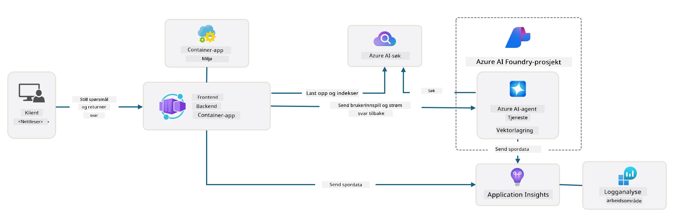

# 3. Demonter en mal

!!! tip "ETTER DETTE MODULEN VIL DU KUNNE"

    - [ ] Use GitHub Copilot and optional MCP tools for Azure documentation and read-only exploration
    - [ ] Identify the template's application, infrastructure, configuration, and test entry points
    - [ ] Verify generated explanations against actual repository files
    - [ ] **Lab 3:** Trace one request and one configuration input through the project

---

## 1. Aktiver GitHub Copilot

Åpne den initialiserte AI-eksempelkoden i VS Code og aktiver [GitHub Copilot](https://code.visualstudio.com/docs/copilot/chat/chat-agent-mode). Logg inn med en konto som har en gyldig plan; bruksgrenser varierer. Be Copilot forklare depotet før du godkjenner endringer.

### Valgfrie MCP-servere

Disse tjenestene kan tilby flere verktøy:

- [Azure MCP Server](https://learn.microsoft.com/azure/developer/azure-mcp-server/overview)
- [Microsoft Learn MCP Server](https://learn.microsoft.com/training/support/mcp)

I VS Code, gå gjennom [MCP-konfigurasjonsveiledningen](https://code.visualstudio.com/docs/copilot/chat/mcp-servers) og opprett `.vscode/mcp.json` om nødvendig:

```json
{
  "servers": {
    "Azure MCP Server": {
      "type": "stdio",
      "command": "npx",
      "args": ["-y", "@azure/mcp@latest", "server", "start"]
    },
    "microsoft.docs.mcp": {
      "type": "http",
      "url": "https://learn.microsoft.com/api/mcp"
    }
  }
}
```

`npx`-kommandoen krever en støttet Node.js/npm-installasjon og laster ned kjørbar kode. Gå gjennom pakken og fest en godkjent versjon for et reproduserbart team-oppsett. Start serverne ved å bruke VS Codes MCP-kontroller og inspiser tilgjengelige verktøy; navn kan endre seg mellom versjoner.

**Autentisering er separat.** Bruk `azd auth login` for AZD. Følg Azure MCPs dokumenterte autentiseringsflyt for dens verktøy; AZD-innlogging alene etablerer ikke en MCP-økt. Bruk `az login` separat når en oppgave eller hook kaller Azure CLI.

Prøv lese-only prompts:

1. “Bruk Microsoft Learn MCP for å finne konfigurasjonsdokumentasjonen for Azure Developer CLI.”
2. “Forklar dette depotets `azure.yaml`; oppgi hvilke filer som implementerer hver hook.”
3. “Ved bruk av tilgjengelige Azure MCP-verktøy, list opp mine deployerte ressurser uten å gjøre endringer.”

Sjekk valgt leietaker/abonnement og hver foreslåtte verktøysanrop. Ikke godkjenn opprettelse, sletting eller tilgangsendringer bare for å utforske arkitekturen.

## 2. Forstå arkitekturen

Eksempelkoden inneholder en Python FastAPI-backend og en React/TypeScript-frontend i Azure Container Apps. Backend kommuniserer med en agent i et Microsoft Foundry-prosjekt. Henting og observabilitet avhenger av de aktiverte malfunksjonene og vellykket oppsett; de er ikke garantert bare fordi applikasjonen er deployert.



Sammenlign dette diagrammet med [gjeldende oppstrøms distribusjonsveiledning](https://github.com/Azure-Samples/get-started-with-ai-agents/blob/main/docs/deployment.md) og dine faktiske ressurser. Sjekk konfigurert modellutrulling, agentverktøy, administrert identitet, rolleoppdragelser og valgfrie AI Search/Application Insights-ressurser.

**Øvelse:** Be Copilot følge en chat-forespørsel fra frontend gjennom API-et til Foundry, med fil- og funksjonsreferanser. Åpne disse referansene og verifiser forklaringen. Ikke antag implementert autentisering, ruting eller autorisasjon utelukkende ut fra et diagram.

## 3. Repository-struktur

De følgende valgte stiene ble kontrollert mot eksemplet 4. november 2026. Din initialiserte revisjon er fortsatt sannhetskilden:

```text
get-started-with-ai-agents/
  azure.yaml
  docker-compose.yaml
  requirements-dev.txt
  .devcontainer/
  infra/
    main.bicep
    main.parameters.json
    api.bicep
    core/
  src/
    Dockerfile
    pyproject.toml
    requirements.txt
    api/
      main.py
      routes.py
      search_index_manager.py
    frontend/
      package.json
      src/
    files/
  scripts/
    validate_env_vars.sh
    validate_env_vars.ps1
    postdeploy.sh
    postdeploy.ps1
  tests/
    test_evaluation.py
    test_red_teaming.py
  docs/
    deployment.md
    deploy_customization.md
    ai_search.md
    observability.md
    local_development.md
    troubleshooting.md
```

### Infrastruktur og konfigurasjon

`infra/main.bicep` orkestrerer ressurser; `main.parameters.json` kobler malens inndata til AZD-miljøverdier. `azure.yaml` velger applikasjonstjenesten og livssyklus-hooks. Følg et inndata som `USE_AZURE_AI_SEARCH_SERVICE` gjennom disse filene for å finne hva som faktisk endres.

### Applikasjon og identitet

Les `src/api/` og `src/frontend/` sammen. Identifiser hvor agenten opprettes eller hentes, hvor instruksjoner/verktøy konfigureres, og hvilken identitet hver Azure-kall bruker. Eksempelfiler under `src/files/` er demonstrasjonsdata, ikke en produksjonskatalog eller autorisasjonsmodell.

### Tester og observabilitet

Nåværende evaluerings- og red-teaming inngangspunkter er under `tests/`; eldre `evals/` og `airedteaming/` katalogreferanser er utdaterte for dette eksemplet. Les `docs/observability.md` for forutsetninger og kostnader før du kjører skytester. Disse Python-testene er separate fra det valgfrie `azure.ai.evaluations` AZD-utvidelsen.

## 4. Verifiser dine funn

- Identifiser API-ruten, agentinteraksjonen og hentekoden for et eksempelspørsmål.
- Forklar hvilken identitet som får tilgang til Foundry og hvilken konfigurasjon som velger endepunktet.
- Finn de faktiske pre-up og post-deploy-skriptene og hvordan de håndterer feil.
- List opp eventuelle avhengigheter eller valgfrie funksjoner som mangler i din deployering.

Fortsett til [Konfigurer en mal](4-Configure-AI-Template.md).

---

<!-- CO-OP TRANSLATOR DISCLAIMER START -->
**Ansvarsfraskrivelse**:
Dette dokumentet er oversatt ved hjelp av AI-oversettelsestjenesten [Co-op Translator](https://github.com/Azure/co-op-translator). Selv om vi streber etter nøyaktighet, vær oppmerksom på at automatiske oversettelser kan inneholde feil eller unøyaktigheter. Det opprinnelige dokumentet på originalspråket skal betraktes som den autoritative kilden. For kritisk informasjon anbefales profesjonell menneskelig oversettelse. Vi er ikke ansvarlige for eventuelle misforståelser eller feiltolkninger som oppstår ved bruk av denne oversettelsen.
<!-- CO-OP TRANSLATOR DISCLAIMER END -->