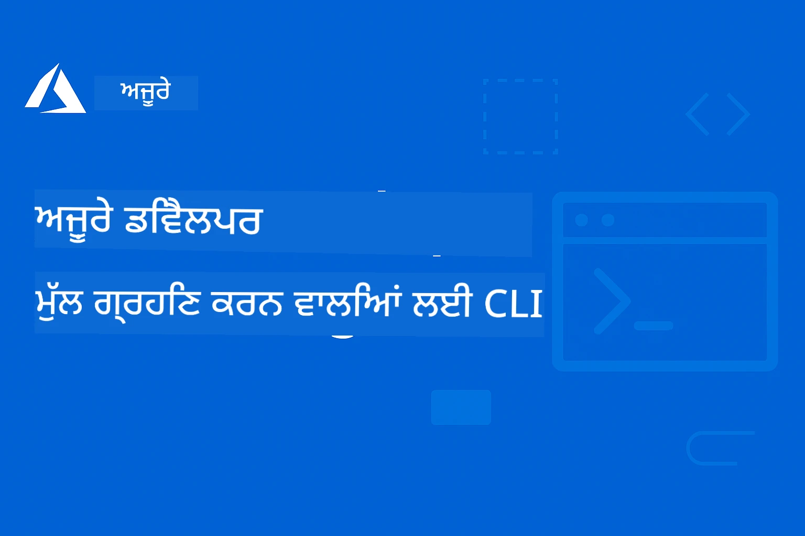

# AZD ਸਿੱਖਣ ਵਾਲਿਆਂ ਲਈ: ਇੱਕ ਸੰਰਚਿਤ ਸਿੱਖਣ ਯਾਤਰਾ

 

[](https://github.com/microsoft/AZD-for-beginners)
[](https://GitHub.com/microsoft/azd-for-beginners/network/)
[](https://github.com/microsoft/AZD-for-beginners)

[](https://discord.com/invite/nkVh3dp)
[](https://discord.gg/nTYy5BXMWG)

---

### ਆਟੋਮੇਟਿਕ ਅਨੁਵਾਦ (ਹਮੇਸ਼ਾ ਅਪਡੇਟ ਰਹਿੰਦੇ)

<!-- CO-OP TRANSLATOR LANGUAGES TABLE START -->
[Arabic](../ar/README.md) | [Bengali](../bn/README.md) | [Bulgarian](../bg/README.md) | [Burmese (Myanmar)](../my/README.md) | [Chinese (Simplified)](../zh-CN/README.md) | [Chinese (Traditional, Hong Kong)](../zh-HK/README.md) | [Chinese (Traditional, Macau)](../zh-MO/README.md) | [Chinese (Traditional, Taiwan)](../zh-TW/README.md) | [Croatian](../hr/README.md) | [Czech](../cs/README.md) | [Danish](../da/README.md) | [Dutch](../nl/README.md) | [Estonian](../et/README.md) | [Finnish](../fi/README.md) | [French](../fr/README.md) | [German](../de/README.md) | [Greek](../el/README.md) | [Hebrew](../he/README.md) | [Hindi](../hi/README.md) | [Hungarian](../hu/README.md) | [Indonesian](../id/README.md) | [Italian](../it/README.md) | [Japanese](../ja/README.md) | [Kannada](../kn/README.md) | [Khmer](../km/README.md) | [Korean](../ko/README.md) | [Lithuanian](../lt/README.md) | [Malay](../ms/README.md) | [Malayalam](../ml/README.md) | [Marathi](../mr/README.md) | [Nepali](../ne/README.md) | [Nigerian Pidgin](../pcm/README.md) | [Norwegian](../no/README.md) | [Persian (Farsi)](../fa/README.md) | [Polish](../pl/README.md) | [Portuguese (Brazil)](../pt-BR/README.md) | [Portuguese (Portugal)](../pt-PT/README.md) | [Punjabi (Gurmukhi)](./README.md) | [Romanian](../ro/README.md) | [Russian](../ru/README.md) | [Serbian (Cyrillic)](../sr/README.md) | [Slovak](../sk/README.md) | [Slovenian](../sl/README.md) | [Spanish](../es/README.md) | [Swahili](../sw/README.md) | [Swedish](../sv/README.md) | [Tagalog (Filipino)](../tl/README.md) | [Tamil](../ta/README.md) | [Telugu](../te/README.md) | [Thai](../th/README.md) | [Turkish](../tr/README.md) | [Ukrainian](../uk/README.md) | [Urdu](../ur/README.md) | [Vietnamese](../vi/README.md)

> **ਕੀ ਤੁਸੀਂ ਸਥਾਨਕ ਤੌਰ 'ਤੇ ਕਲੋਨ ਕਰਨਾ ਚਾਹੁੰਦੇ ਹੋ?**
>
> ਇਹ ਰਿਪੋਜ਼ਿਟਰੀ 50+ ਭਾਸ਼ਾ ਅਨੁਵਾਦ ਸ਼ਾਮਿਲ ਕਰਦੀ ਹੈ ਜੋ ਡਾਊਨਲੋਡ ਦਾ ਆਕਾਰ ਕਾਫੀ ਵਧਾਉਂਦੇ ਹਨ। ਬਿਨਾਂ ਅਨੁਵਾਦਾਂ ਦੇ ਕਲੋਨ ਕਰਨ ਲਈ, sparse checkout ਵਰਤੋਂ:
>
> **Bash / macOS / Linux:**
> ```bash
> git clone --filter=blob:none --sparse https://github.com/microsoft/AZD-for-beginners.git
> cd AZD-for-beginners
> git sparse-checkout set --no-cone '/*' '!translations' '!translated_images'
> ```
>
> **CMD (Windows):**
> ```cmd
> git clone --filter=blob:none --sparse https://github.com/microsoft/AZD-for-beginners.git
> cd AZD-for-beginners
> git sparse-checkout set --no-cone "/*" "!translations" "!translated_images"
> ```
>
> ਇਹ ਤੁਹਾਨੂੰ ਕੋਰਸ ਪੂਰਾ ਕਰਨ ਲਈ ਸਭ ਕੁਝ ਤੇਜ਼ ਡਾਊਨਲੋਡ ਨਾਲ ਦਿੰਦਾ ਹੈ।
<!-- CO-OP TRANSLATOR LANGUAGES TABLE END -->

## 🆕 azd ਵਿੱਚ ਅੱਜ ਕੀ ਨਵਾਂ ਹੈ

> 📌 **AI CLI ਰਿਲੀਜ਼ ਸਮੀਖਿਆ (2026-11-04):** ਗਾਈਡਲਾਈਨ ਪ੍ਰਕਾਸ਼ਿਤ **`azd 1.37.2`**, **agents `1.0.0-beta.23`**, ਅਤੇ **evaluations `1.0.0-beta.2`** ਦਸਤਾਵੇਜ਼/ਸਰੋਤ ਦੇ ਸਾਹਮਣੇ ਚੈੱਕ ਕੀਤੀ ਗਈ। ਮਿਲੀ-जੁਲੀ ਵਰਕਫਲੋ ਲਈ `azd >= 1.37.0` ਵਰਤੋਂ ਕਰੋ। `azd version` ਚਲਾਓ ਅਤੇ ਐਕਸਟੇਂਸ਼ਨਾਂ ਤੋਂ ਪਹਿਲਾਂ [ਮੁੱਖ CLI ਨੂੰ ਅਪਡੇਟ ਕਰੋ](https://learn.microsoft.com/azure/developer/azure-developer-cli/install-azd)। ਵੇਖੋ [ਰਿਲੀਜ਼ ਬਦਲਾਵ ਅਤੇ ਫਿਕਸਾਂ](docs/chapter-08-production/production-ai-practices.md#recent-release-changes-and-fixes)। ਇਹ ਪੂਰੇ ਕੋਰਸ ਦੀ ਲਾਈਵ ਡਿਪਲੌਇਮੈਂਟ ਵੈਰੀਫਿਕੇਸ਼ਨ ਨਹੀਂ ਹੈ।

Azure Developer CLI ਕਈ ਐਪਲੀਕੇਸ਼ਨ ਕਿਸਮਾਂ ਦਾ ਸਹਿਯੋਗ ਕਰਦਾ ਹੈ, ਜਿਸ ਵਿੱਚ ਵੈੱਬ ਐਪਸ, APIs, ਅਤੇ AI ਏਜੰਟ ਸ਼ਾਮਿਲ ਹਨ, ਸਹਿਯੋਗ ਪ੍ਰਾਪਤ ਹੋਸਟ, ਟੈਮਪਲੇਟਸ ਅਤੇ ਐਕਸਟੇਂਸ਼ਨਾਂ ਰਾਹੀਂ।

ਇਹ ਤੁਹਾਡੇ ਲਈ ਕੀ ਮਤਲਬ ਹੈ:

- **AI ਏਜੰਟ ਹੁਣ ਪਹਿਲੇ ਦਰਜੇ ਦੇ azd ਵਰਕਲੋਡ ਹਨ।** ਤੁਸੀਂ ਪਹਿਲਾਂ ਜਾਣੇ-ਪਛਾਣੇ `azd init` → `azd up` ਵਰਕਫਲੋ ਦੁਆਰਾ AI ਏਜੰਟ ਪ੍ਰਾਜੈਕਟ ਸ਼ੁਰੂ, ਡਿਪਲੌਇ ਅਤੇ ਪ੍ਰਬੰਧਿਤ ਕਰ ਸਕਦੇ ਹੋ।
- **ਦੋ ਐਕਸਟੇਂਸ਼ਨਾਂ ਵਿੱਚ ਏਜੰਟ ਲਾਈਫਸਾਈਕਲ।** ਏਜੰਟ ਸ਼ੁਰੂ ਕਰਨ, ਸੱਦਾ ਦੇਣ, ਅਪਟਿਮਾਈਜ਼ ਕਰਨ ਅਤੇ ਰਿਟਾਇਰ ਕਰਨ ਲਈ `azure.ai.agents` ਵਰਤੋਂ ਕਰੋ। **`azure.ai.evaluations`** ਕੁਝ ਅਲੱਗ ਪਰ `azd ai eval init`, `generate` ਅਤੇ `run start` ਲਈ ਇੰਸਟਾਲ ਕਰੋ। Agents beta.22 ਨੇ ਲੇਗੇਸੀ ਮੂਲਿਆੰਕਣ ਵਰਕਫਲੋ ਨੂੰ ਬਦਲਿਆ ਅਤੇ ਅਪਟਿਮਾਈਜ਼ੇਸ਼ਨ ਸੰਰਚਨਾ ਨੂੰ ਬਦਲਿਆ; [ਮਾਈਗ੍ਰੇਸ਼ਨ ਗਾਈਡ](docs/chapter-08-production/production-ai-practices.md#evaluation-migration-and-quality-checks) ਨੂੰ ਫਾਲੋ ਕਰੋ।
- **ਵੱਧ ਤੋਂ ਵੱਧ AI ਬਣਾਉਂਦੀ ਚੀਜ਼ਾਂ।** ਨਵੇਂ ਪ੍ਰੀਵਿਊ ਐਕਸਟੇਂਸ਼ਨ—`azure.ai.skills` ਅਤੇ `azure.ai.connections`—ਤੁਹਾਨੂੰ ਰੀਯੂਜ਼ੇਬਲ ਏਜੰਟ ਸਕਿਲਜ਼ ਅਤੇ Foundry ਕਨੈਕਸ਼ਨਾਂ ਨੂੰ ਸਿੱਧਾ azd ਨਾਲ ਪ੍ਰਬੰਧਿਤ ਕਰਨ ਦਿੰਦੇ ਹਨ।
- **Microsoft Foundry ਇੰਟੀਗ੍ਰੇਸ਼ਨ** ਮਾਡਲ ਡਿਪਲੌਇਮੈਂਟ, ਏਜੰਟ ਹੋਸਟਿੰਗ, ਅਤੇ AI ਸਰਵਿਸ ਸੰਰਚਨਾ ਨੂੰ ਸਿੱਧਾ azd ਟੈਮਪਲੇਟ ਇਕੋਸਿਸਟਮ ਵਿੱਚ ਲਿਆਉਂਦਾ ਹੈ।
- **ਰੋਜ਼ਾਨਾ ਬੁਨਿਆਦੀ ਕੰਮ ਆਸਾਨ ਹੋਏ।** ਹਾਲੀਆ ਰਿਲੀਜ਼ਾਂ ਨੇ `azd init` ਨੂੰ ਆਈਡੈਂਪੋਟੈਂਟ (ਮੁੜ ਚਲਾਉਣ ਯੋਗ) ਬਣਾਇਆ, `azd auth login` ਸਟੇਲ ਟੋਕਨਾਂ ਨੂੰ ਆਪਣੇ ਆਪ ਸਾਫ਼ ਕਰਦਾ ਹੈ, ਅਤੇ ਜਵਾਬਦੇਹ `azd tool` ਪਹਿਲੀ ਵਾਰੀ ਸੈਟਅੱਪ ਪ੍ਰੰਪਟ ਸ਼ਾਮਿਲ ਕੀਤੀ।
- **ਮੁੱਖ ਵਰਕਫਲੋ ਵਿੱਚ ਕੋਈ ਤਬਦੀਲੀ ਨਹੀਂ।** ਚਾਹੇ ਤੁਸੀਂ ਇੱਕ ਟੂਡੂ ਐਪ, ਮਾਇਕਰੋਸਰਵਿਸ, ਜਾਂ ਮਲਟੀ-ਏਜੰਟ AI ਹੱਲ ਡਿਪਲੌਇ ਕਰ ਰਹੇ ਹੋ, ਕਮਾਂਡ ਵਾਹੁਦੇ ਹੀ ਰਹਿੰਦੇ ਹਨ।

> **Aspire ਉਪਭੋਗਤਾਵਾਂ ਲਈ ਨੋਟ:** Microsoft ਹੁਣ ਇਹ ਉਤਪਾਦ ਸਧਾਰਨ ਤੌਰ 'ਤੇ **Aspire** (ਪਹਿਲਾਂ ".NET Aspire") ਕਹਿੰਦਾ ਹੈ। azd ਦੀ Aspire ਸਹਾਇਤਾ ਬਦਲੀ ਨਹੀਂ ਹੈ — ਸਿਰਫ਼ ਨਾਮ ਅਪਡੇਟ ਹੋਇਆ ਹੈ।

ਜੇਕਰ ਤੁਸੀਂ ਪਹਿਲਾਂ azd ਵਰਤਿਆ ਹੈ, ਤਾਂ AI ਸਹਾਇਤਾ ਕੁਦਰਤੀ ਵਾਧਾ ਹੈ — ਇਹ ਕੋਈ ਵੱਖਰੀ ਟੂਲ ਜਾਂ ਉੱਨਤ ਪਾਠ ਨਹੀਂ। ਜੇਕਰ ਤੁਸੀਂ ਨਵਾਂ ਆਰੰਭ ਕਰ ਰਹੇ ਹੋ, ਤੁਸੀਂ ਇੱਕੇ ਵਰਕਫਲੋ ਸਿੱਖੋਗੇ ਜੋ ਸਭ ਕੁਝ ਲਈ ਕੰਮ ਕਰਦਾ ਹੈ।

---

## 🚀 Azure Developer CLI (azd) ਕੀ ਹੈ?

**Azure Developer CLI (azd)** ਇੱਕ ਵਿਕਾਸਕਰਤਾ-ਮਿਤਰ ਕਮਾਂਡ-লাইন ਟੂਲ ਹੈ ਜੋ Azure 'ਤੇ ਐਪਲੀਕੇਸ਼ਨ ਡਿਪਲੌਇ ਕਰਨਾ ਸੌਖਾ ਬਣਾਉਂਦਾ ਹੈ। Azure ਦੇ ਦਰਜਨ ਭਰੀ ਤੇ ਜੁੜਦਾ ਹੱਥੋਂ-ਹੱਥ ਸਰੋਤ ਬਣਾ ਕੇ ਦੇਣ ਦੀ ਥਾਂ, ਤੁਸੀਂ ਇੱਕ ਕਮਾਂਡ ਨਾਲ ਪੂਰੇ ਐਪਲੀਕੇਸ਼ਨਾਂ ਨੂੰ ਡਿਪਲੌਇ ਕਰ ਸਕਦੇ ਹੋ।

### `azd up` ਦਾ ਜਾਦੂ

```bash
# This single command does everything:
# ✅ Creates all Azure resources  
# ✅ Configures networking and security
# ✅ Builds your application code
# ✅ Deploys to Azure
# ✅ Gives you a working URL
azd up
```

ਟੈਮਪਲੇਟ ਐਪਲੀਕੇਸ਼ਨ ਅਤੇ ਇੰਫ੍ਰਾਸਟਰੱਕਚਰ ਸੰਰਚਨਾ ਦਿੰਦਾ ਹੈ। ਸਫਲ ਡਿਪਲੌਇ ਲਈ ਸਹਿਯੋਗ ਪ੍ਰਾਪਤ ਸਰਵਿਸਾਂ/ਮਾਡਲਾਂ, ਕਾਫ਼ੀ ਕੋਟਾ ਅਤੇ ਅਧਿਕਾਰ, ਸਹੀ ਇਨਪੁਟ ਅਤੇ ਡਿਪਲੌਇ ਕੀਤੀ ਐਪਲੀਕੇਸ਼ਨ ਦੀ ਜਾਂਚ ਲੋੜੀਂਦੀ ਹੈ। `azd up` ਆਪਣੇ ਆਪ ਟੈਮਪਲੇਟ ਨੂੰ ਸੁਰੱਖਿਅਤ, ਅਨੁਕੂਲ ਜਾਂ ਪ੍ਰੋਡੱਕਸ਼ਨ-ਤਈਆਰ ਨਹੀਂ ਬਣਾਉਂਦਾ।

---

## ❓ Azure Developer CLI ਅਤੇ Azure CLI ਵਿੱਚ ਕੀ ਫ਼ਰਕ ਹੈ?

ਇਹ ਸੱਭ ਤੋਂ ਸਧਾਰਨ ਸਵਾਲ ਹੈ ਜੋ ਸ਼ੁਰੂਆਤੀ ਪੁੱਛਦੇ ਹਨ। ਇੱਥੇ ਸਧਾਰਨ ਜਵਾਬ ਹੈ:

| ਵਿਸ਼ੇਸ਼ਤਾ | **Azure CLI (`az`)** | **Azure Developer CLI (`azd`)** |
|---------|---------------------|--------------------------------|
| **ਮਕਸਦ** | ਵੱਖ-ਵੱਖ Azure ਸਰੋਤਾਂ ਦਾ ਪ੍ਰਬੰਧਨ | ਪੂਰੇ ਐਪਲੀਕੇਸ਼ਨਾਂ ਨੂੰ ਡਿਪਲੌਇ ਕਰਨਾ |
| **ਦ੍ਰਿਸ਼ਟਿਕੋਣ** | ਢਾਂਚਾਗਤ ਧਿਆਨ | ਐਪਲੀਕੇਸ਼ਨਧਾਰਿਤ ਧਿਆਨ |
| **ਉਦਾਹਰਨ** | `az webapp create --name myapp...` | `azd up` |
| **ਸਿੱਖਣ ਦੀ ਲਹਿਰ** | Azure ਸਰਵਿਸਾਂ ਜਾਣਨੀ ਲਾਜ਼ਮੀ | ਆਪਣੀ ਐਪ ਜਾਣੋ |
| **ਸਭ ਤੋਂ ਵਧੀਆ ਕਿਸ ਲਈ** | DevOps, ਢਾਂਚਾ | ਵਿਕਾਸਕਰਤਾ, ਪ੍ਰੋਟੋਟਾਇਪਿੰਗ |

### ਸਧਾਰਨ ਤੁਲਨਾ

- **Azure CLI** ਇਸ ਤਰ੍ਹਾਂ ਹੈ ਜਿਵੇਂ ਤੁਹਾਡੇ ਕੋਲ ਘਰ ਬਣਾਉਣ ਲਈ ਸਾਰੇ ਸੰਦ ਹਨ - ਕੂਟੜੇ, ਆਰੀ, ਕੀਲਾਂ। ਤੁਸੀਂ ਕੁਝ ਵੀ ਬਣਾ ਸਕਦੇ ਹੋ, ਪਰ ਤੁਹਾਨੂੰ ਨਿਰਮਾਣ ਜਾਣਨਾ ਪੈਂਦਾ ਹੈ।
- **Azure Developer CLI** ਇਸ ਤਰ੍ਹਾਂ ਹੈ ਜਿਵੇਂ ਤੁਸੀਂ ਇੱਕ ਠੇਕੈਦਾਰ ਨੂੰ ਭਾੜੇ 'ਤੇ ਲੈਂਦੇ ਹੋ - ਤੁਸੀਂ ਦੱਸਦੇ ਹੋ ਕਿ ਕੀ ਚਾਹੀਦਾ ਹੈ, ਅਤੇ ਉਹ ਨਿਰਮਾਣ ਸੰਭਾਲਦਾ ਹੈ।

### ਕਦੋਂ ਕਿਹੜਾ ਵਰਤਣਾ ਹੈ

| ਸਥਿਤੀ | ਇਸਨੂੰ ਵਰਤੋ |
|----------|----------|
| "ਮੈਂ ਆਪਣੀ ਵੈੱਬ ਐਪ ਤੇਜ਼ੀ ਨਾਲ ਡਿਪਲੌਇ ਕਰਨਾ ਚਾਹੁੰਦਾ ਹਾਂ" | `azd up` |
| "ਮੈਨੂੰ ਸਿਰਫ ਇੱਕ ਸਟੋਰੇਜ ਖਾਤਾ ਬਣਾਉਣਾ ਹੈ" | `az storage account create` |
| "ਮੈਂ ਪੂਰਾ AI ਐਪਲੀਕੇਸ਼ਨ ਬਣਾ ਰਿਹਾ ਹਾਂ" | `azd init --template azure-search-openai-demo` |
| "ਮੈਨੂੰ ਇੱਕ ਨਿਰਦਿਸ਼ਟ Azure ਸਰੋਤ ਵਿੱਚ ਡੀਬੱਗ ਕਰਨਾ ਹੈ" | `az resource show` |
| "ਮੈਂ ਆਪਣੀ ਟਿਕਾਣਾ ਬਣਾਈ ਉਤਪਾਦਨ ਵਾਤਾਵਰਣ ਵਿੱਚ ਡਿਪਲੌਇ ਕਰਨਾ ਚਾਹੁੰਦਾ ਹਾਂ" | ਸੰਰਚਨਾ, ਪਹੁੰਚ, ਲਾਗਤ, ਅਤੇ ਓਪਰੇਸ਼ਨਲ ਗੇਟਾਂ ਦੀ ਸਮੀਖਿਆ ਕਰੋ ਪਹਿਲਾਂ `azd up --environment production` |

### ਇਹ ਦੋਵੇਂ ਮਿਲ ਕੇ ਕੰਮ ਕਰਦੇ ਹਨ!

AZD ਅਤੇ Azure CLI ਦੀ ਅਲੱਗ-ਅਲੱਗ ਪ੍ਰਮਾਣੀਕਰਨ ਅਤੇ ਸੰਰਚਨਾ ਹੈ। AZD ਲਈ `azd auth login` ਅਤੇ ਜਦੋਂ ਹਾਂਗ ਜਾਂ ਡਾਇਗਨੋਸਟਿਕ ਕਮਾਂਡ ਨੂੰ ਸਪਸ਼ਟ ਤੌਰ 'ਤੇ Azure CLI ਦੀ ਲੋੜ ਹੈ ਤਾਂ `az login` ਵਰਤੋਂ। ਤੁਸੀਂ ਦੋਹਾਂ ਵਰਤ ਸਕਦੇ ਹੋ:
```bash
# Deploy your app with AZD
azd up

# Then fine-tune specific resources with Azure CLI
az webapp config set --name myapp --always-on true
```

---

## 🌟 Awesome AZD ਵਿੱਚ ਟੈਮਪਲੇਟ ਲੱਭੋ

ਖਾਲੀ ਸ਼ੁਰੂਆਤ ਨਾ ਕਰੋ! **Awesome AZD** ਤਿਆਰ-ਕਰਨ ਵਾਲੇ ਟੈਮਪਲੇਟਸ ਦਾ ਕਮਿਊਨਿਟੀ ਕਲੈਕਸ਼ਨ ਹੈ:

| ਸਰੋਤ | ਵੇਰਵਾ |
|----------|-------------|
| 🔗 [**Awesome AZD ਗੈਲਰੀ**](https://azure.github.io/awesome-azd/) | 200+ ਟੈਮਪਲੇਟ ਇਕ ਕਲਿੱਕ ਨਾਲ ਡਿਪਲੌਇ ਕਰੋ |
| 🔗 [**ਇੱਕ ਟੈਮਪਲੇਟ ਜਮ੍ਹਾਂ ਕਰੋ**](https://github.com/Azure/awesome-azd/issues) | ਆਪਣਾ ਟੈਮਪਲੇਟ ਕਮਿਊਨਿਟੀ ਨੂੰ ਦਿਓ |
| 🔗 [**GitHub ਰਿਪੋਜ਼ਿਟਰੀ**](https://github.com/Azure/awesome-azd) | ਸਟਾਰ ਕਰੋ ਅਤੇ ਸਰੋਤ ਵੇਖੋ |

### Awesome AZD ਤੋਂ ਲੋਕਪ੍ਰਿਯ AI ਟੈਮਪਲੇਟ

ਇਕ ਟੈਮਪਲੇਟ ਨੂੰ ਉਸਦੇ ਆਪਣੇ ਖਾਲੀ ਡਾਇਰੈਕਟਰੀ ਵਿੱਚ ਚੁਣੋ; ਹੇਠਾਂ ਦਿੱਤੇ ਕਮਾਂਡ ਵਿਕਲਪ ਹਨ। ਆਖਰੀ `.` ਉਸ ਡਾਇਰੈਕਟਰੀ ਨੂੰ ਸ਼ੁਰੂ ਕਰਦਾ ਹੈ।

```bash
# RAG Chat with Microsoft Foundry Models + AI Search
azd init --template azure-search-openai-demo .

# Quick AI Chat Application
azd init --template openai-chat-app-quickstart .

# AI Agents with Foundry Agents
azd init --template get-started-with-ai-agents .
```

---

## 🎯 3 ਕਦਮਾਂ ਵਿੱਚ ਸ਼ੁਰੂਆਤ

ਸ਼ੁਰੂ ਕਰਨ ਤੋਂ ਪਹਿਲਾਂ, ਇਹ ਯਕੀਨੀ ਬਣਾਓ ਕਿ ਤੁਹਾਡਾ ਮਸ਼ੀਨ ਉਸ ਟੈਮਪਲੇਟ ਲਈ ਤਿਆਰ ਹੈ ਜਿਸਨੂੰ ਤੁਸੀਂ ਡਿਪਲੌਇ ਕਰਨਾ ਚਾਹੁੰਦੇ ਹੋ:

**Windows:**
```powershell
.\validate-setup.ps1
```

**macOS / Linux:**
```bash
bash ./validate-setup.sh
```

ਜੇ ਕੋਈ ਵੀ ਜ਼ਰੂਰੀ ਚੈੱਕ ਫੇਲ੍ਹ ਹੁੰਦਾ ਹੈ, ਪਹਿਲਾਂ ਉਸਨੂੰ ਠੀਕ ਕਰੋ ਅਤੇ ਫਿਰ ਤੇਜ਼ ਸ਼ੁਰੂਆਤ ਨਾਲ ਜਾਰੀ ਰੱਖੋ।

### ਕਦਮ 1: AZD ਇੰਸਟਾਲ ਕਰੋ (2 ਮਿੰਟ)

**Windows:**
```powershell
winget install microsoft.azd
```

**macOS:**
```bash
brew tap azure/azd && brew install azd
```

**Linux:**
```bash
curl -fsSL https://aka.ms/install-azd.sh | bash
```

### ਕਦਮ 2: AZD ਲਈ ਪ੍ਰਮਾਣੀਕਰਨ ਕਰੋ

```bash
# Optional if you plan to use Azure CLI commands directly in this course
az login

# Required for AZD workflows
azd auth login
```

ਜੇ ਤੁਹਾਨੂੰ ਪਤਾ ਨਹੀਂ ਕਿ ਤੁਹਾਨੂੰ ਕਿਹੜਾ ਚਾਹੀਦਾ ਹੈ, ਤਾਂ [ਇੰਸਟਾਲੇਸ਼ਨ ਅਤੇ ਸੈਟਅੱਪ](docs/chapter-01-foundation/installation.md#authentication-setup) ਵਿੱਚ ਪੂਰਾ ਸੈੱਟਅੱਪ ਪ੍ਰਕਿਰਿਆ ਫਾਲੋ ਕਰੋ।

### ਕਦਮ 3: ਆਪਣੀ ਪਹਿਲੀ ਐਪ ਡਿਪਲੌਇ ਕਰੋ

```bash
# Initialize from a template
azd init --template todo-nodejs-mongo .

# Deploy to Azure (creates everything!)
azd up
```

**🎉 ਇਹ ਹੋਇਆ!** ਤੁਹਾਡੀ ਐਪ ਹੁਣ Azure 'ਤੇ ਲਾਈਵ ਹੈ।

### ਸਾਫ਼-ਸੁਥਰਾ (ਭੁੱਲਣਾ ਨਾ!)

```bash
# Remove all resources when done experimenting
azd down --force --purge
```

---

## 📚 ਇਸ ਕੋਰਸ ਨੂੰ ਕਿਵੇਂ ਵਰਤਣਾ ਹੈ

ਇਹ ਕੋਰਸ **ਪ੍ਰਗਤੀਸ਼ੀਲ ਸਿੱਖਣ** ਲਈ ਬਣਾਇਆ ਗਿਆ ਹੈ - ਜਿੱਥੇ ਤੁਸੀਂ ਆਰਾਮਦਾਇਕ ਹੋ, ਉਥੋਂ ਸ਼ੁਰੂ ਕਰੋ ਅਤੇ ਅੱਗੇ ਵਧੋ:

| ਤੁਹਾਡਾ ਅਨੁਭਵ | ਇੱਥੋਂ ਸ਼ੁਰੂ ਕਰੋ |
|-----------------|------------|
| **ਬਿਲਕੁਲ ਨਵਾਂ Azure ਲਈ** | [ਅਧਿਆਇ 1: ਬੁਨਿਆਦ](#-chapter-1-foundation--quick-start) |
| **Azure ਜਾਣਦਾ ਹੈ, AZD ਨਵਾਂ** | [ਅਧਿਆਇ 1: ਬੁਨਿਆਦ](#-chapter-1-foundation--quick-start) |
| **AI ਐਪ ਡਿਪਲੌਇ ਕਰਨਾ ਚਾਹੁੰਦੇ ਹੋ** | [ਅਧਿਆਇ 2: AI-ਪਹਿਲੀ ਵਿਕਾਸ](#-chapter-2-ai-first-development-recommended-for-ai-developers) |
| **ਹٿਾਂ-ਤੋਂ-ਕੰਮ ਪ੍ਰੈਕਟਿਸ ਚਾਹੀਦੀ ਹੈ** | [🎓 ਇੰਟਰਐਕਟਿਵ ਵਰਕਸ਼ਾਪ](workshop/README.md) - 3-4 ਘੰਟੇ ਦੀ ਮਦਦਗਾਰ ਲੈਬ |
| **ਪ੍ਰੋਡਕਸ਼ਨ ਪੈਟਰਨਸ ਚਾਹੀਦੇ ਹਨ** | [ਅਧਿਆਇ 8: ਉਤਪਾਦਨ ਅਤੇ ਐਂਟਰਪ੍ਰਾਈਜ਼](#-chapter-8-production--enterprise-patterns) |

### ਤੇਜ਼ ਸੈਟਅੱਪ

1. **ਇਸ ਰਿਪੋਜ਼ਿਟਰੀ ਨੂੰ ਫੋਰਕ ਕਰੋ**: [](https://GitHub.com/microsoft/azd-for-beginners/fork)
2. **ਇਸ ਨੂੰ ਕਲੋਨ ਕਰੋ**: `git clone https://github.com/YOUR-USERNAME/azd-for-beginners.git`
3. **ਮਦਦ ਪ੍ਰਾਪਤ ਕਰੋ**: [Azure Discord ਕਮਿਊਨਿਟੀ](https://discord.com/invite/ByRwuEEgH4)

> **ਕੀ ਤੁਸੀਂ ਸਥਾਨਕ ਤੌਰ 'ਤੇ ਕਲੋਨ ਕਰਨਾ ਚਾਹੁੰਦੇ ਹੋ?**

> ਇਹ ਰਿਪੋਜ਼ਿਟਰੀ 50+ ਭਾਸ਼ਾ ਅਨੁਵਾਦ ਸ਼ਾਮਿਲ ਕਰਦੀ ਹੈ ਜੋ ਡਾਊਨਲੋਡ ਦਾ ਆਕਾਰ ਕਾਫੀ ਵਧਾਉਂਦੇ ਹਨ। ਬਿਨਾਂ ਅਨੁਵਾਦਾਂ ਦੇ ਕਲੋਨ ਕਰਨ ਲਈ, sparse checkout ਵਰਤੋਂ:
> ```bash
> git clone --filter=blob:none --sparse https://github.com/microsoft/AZD-for-beginners.git
> cd AZD-for-beginners
> git sparse-checkout set --no-cone '/*' '!translations' '!translated_images'
> ```
> ਇਹ ਤੁਹਾਨੂੰ ਕੋਰਸ ਪੂਰਾ ਕਰਨ ਲਈ ਸਭ ਕੁਝ ਤੇਜ਼ ਡਾਊਨਲੋਡ ਨਾਲ ਦਿੰਦਾ ਹੈ।


## ਕੋਰਸ ਦਾ ਝਲਕ

ਸਰਗਠਿਤ ਅਧਿਆਅਾਂ ਰਾਹੀਂ ਪ੍ਰਗਟਸ਼ੀਲ ਸਿੱਖਿਆ ਲਈ ਮਾਸਟਰ Azure Developer CLI (azd) ਪ੍ਰਾਪਤ ਕਰੋ। **ਮਾਈਕਰੋਸੌਫਟ ਫਾਊਂਡਰੀ ਇੰਟੀਗਰੇਸ਼ਨ ਨਾਲ AI ਐਪਲੀਕੇਸ਼ਨ ਡਿਪਲੋਇਮੈਂਟ 'ਤੇ ਖ਼ਾਸ ਧਿਆਨ।**

### ਆਧੁਨਿਕ ਡਿਵੈਲਪਰਾਂ ਲਈ ਇਹ ਕੋਰਸ ਜ਼ਰੂਰੀ ਕਿਉਂ ਹੈ

AI ਵਰਕਲੋਡਜ਼ ਨੂੰ ਡਿਪਲੋਇ ਕਰਨ ਵਾਲੇ ਡਿਵੈਲਪਰਾਂ ਨੂੰ ਆਮ ਤੌਰ 'ਤੇ ਸਹਾਇਤਾ ਦੀ ਲੋੜ ਹੁੰਦੀ ਹੈ:
- ਗੁੰਝਲਦਾਰ ਬਹੁ-ਸੇਵਾ AI ਆਰਕੀਟੈਕਚਰ
- ਉਤਪਾਦਨ AI ਡਿਪਲੋਇਮੈਂਟ ਸ੍ਰੇਸ਼ਠ ਅਭਿਆਸ  
- Azure AI ਸੇਵਾ ਇੰਟੀਗਰੇਸ਼ਨ ਅਤੇ ਕਾਨਫਿਗਰੇਸ਼ਨ
- AI ਵਰਕਲੋਡਜ਼ ਲਈ ਲਾਗਤ ਅਨੁਕੂਲਤਾ
- AI-ਵਿਸ਼ੇਸ਼ ਡਿਪਲੋਇ ਮਸਲੇ ਹੱਲ ਕਰਨਾ

### ਸਿੱਖਣ ਦੇ ਲਕੜੀ

ਇਸ ਸਰਗਠਿਤ ਕੋਰਸ ਨੂੰ ਪੂਰਾ ਕਰਕੇ, ਤੁਸੀਂ:
- **AZD ਬੁਨਿਆਦੀ ਗਿਆਨ ਵਿੱਚ ਮਾਹਰ ਬਣੋ**: ਮੁੱਖ ਧਾਰਾਵਾਂ, ਸਥਾਪਨਾ ਅਤੇ ਕਾਨਫਿਗਰੇਸ਼ਨ
- **AI ਐਪਲੀਕੇਸ਼ਨ ਡਿਪਲੋਇ ਕਰੋ**: Microsoft Foundry ਸੇਵਾਵਾਂ ਨਾਲ AZD ਵਰਤੋਂ
- **Infrastructure as Code ਲਾਗੂ ਕਰੋ**: Bicep ਟੈਮਪਲੇਟਾਂ ਨਾਲ Azure ਸਰੋਤਾਂ ਦਾ ਪ੍ਰਬੰਧਨ
- **ਡਿਪਲੋਇਮੈਂਟ ਮੁਸ਼ਕਲਾਂ ਹੱਲ ਕਰੋ**: ਆਮ ਸਮੱਸਿਆਵਾਂ ਦਾ ਸਮਾਧਾਨ ਅਤੇ ਸਮੱਸਿਆਸ਼ੋਧਨ
- **ਉਤਪਾਦਨ ਲਈ ਅਨੁਕੂਲ ਬਣਾਓ**: ਸੁਰੱਖਿਆ, ਸਕੇਲਿੰਗ, ਨਿਗਰਾਨੀ ਅਤੇ ਕਿਰਾਇਆ ਪ੍ਰਬੰਧਨ
- **ਬਹੁ-ਏਜੰਟ ਹੱਲ ਬਣਾੳ਼**: ਗੁੰਝਲਦਾਰ AI ਆਰਕੀਟੈਕਚਰ ਡਿਪਲੋਇ ਕਰੋ

## ਸ਼ੁਰੂ ਕਰਨ ਤੋਂ ਪਹਿਲਾਂ: ਖਾਤੇ, ਪਹੁੰਚ ਅਤੇ ਧਾਰਣਾਵਾਂ

ਪਹਿਲੇ ਚੈਪਟਰ ਤੋਂ ਪਹਿਲਾਂ, ਇਹ ਯਕੀਨੀ ਬਣਾਓ ਕਿ ਤੁਹਾਡੇ ਕੋਲ ਹੇਠ ਲਿਖੀਆਂ ਚੀਜ਼ਾਂ ਹਨ। ਇਸ ਗਾਈਡ ਵਿੱਚ ਬਾਅਦ ਦੀਆਂ ਸਥਾਪਨਾ ਕਦਮ ਪਹਿਲਾਂ ਤੋਂ ਮੁੱਖ ਧਾਰਾਵਾਂ ਦੇ ਤੌਰ 'ਤੇ ਮੰਨੇ ਜਾ ਰਹੇ ਹਨ।

- **ਇੱਕ Azure ਸਬਸਕ੍ਰਿਪਸ਼ਨ**: ਤੁਸੀਂ ਆਪਣੇ ਕੰਮ ਜਾਂ ਖੁਦ ਦੇ ਖਾਤੇ ਤੋਂ ਮੌਜੂਦਾ ਸਬਸਕ੍ਰਿਪਸ਼ਨ ਵਰਤ ਸਕਦੇ ਹੋ, ਜਾਂ ਸ਼ੁਰੂਆਤ ਲਈ [ਫ਼ਰੀ ਟਰਾਇਲ](https://aka.ms/azurefreetrial) ਤਿਆਰ ਕਰ ਸਕਦੇ ਹੋ।
- **Azure ਸਰੋਤੇ ਬਣਾਉਣ ਦੀ ਅਨੁਮਤੀ**: ਜ਼ਿਆਦਾਤਰ ਅਭਿਆਸਾਂ ਲਈ, ਤੁਹਾਡੇ ਕੋਲ ਨਿਸ਼ਾਨਾ ਸਬਸਕ੍ਰਿਪਸ਼ਨ ਜਾਂ ਸਰੋਤ ਸਮੂਹ 'ਤੇ ਘੱਟੋ-ਘੱਟ **ਕੰਟ੍ਰੀਬਿਊਟਰ** ਪਹੁੰਚ ਹੋਣੀ ਚਾਹੀਦੀ ਹੈ। ਕੁਝ ਚੈਪਟਰਾਂ ਵਿੱਚ ਇਹ ਮੰਨਿਆ ਜਾ ਸਕਦਾ ਹੈ ਕਿ ਤੁਸੀਂ ਸਰੋਤ ਸਮੂਹ, ਪਰਬੰਧਿਤ ਪਛਾਣਾਂ ਅਤੇ RBAC ਅਸਾਇਨਮੈਂਟ ਵੀ ਬਣਾਉਂਦੇ ਹੋ।
- [**ਇੱਕ GitHub ਖਾਤਾ**](https://github.com): ਇਹ ਰਿਪੋਜ਼ਿਟਰੀ ਫੋਰਕ ਕਰਨ, ਆਪਣੀਆਂ ਤਬਦੀਲੀਆਂ ਟ੍ਰੈਕ ਕਰਨ ਅਤੇ ਵਰਕਸ਼ਾਪ ਲਈ GitHub ਕੋਡਸਪੇਸ ਵਰਤੋਂ ਲਈ ਲੋੜੀਂਦਾ ਹੈ।
- **ਟੈਮਪਲੇਟ ਰਨਟਾਈਮ ਲੋੜਾਂ**: ਕੁਝ ਟੈਮਪਲੇਟਾਂ ਨੂੰ Node.js, Python, Java, ਜਾਂ Docker ਵਰਗੇ ਸਥਾਨਕ ਔਜ਼ਾਰਾਂ ਦੀ ਲੋੜ ਹੈ। ਸ਼ੁਰੂ ਕਰਨ ਤੋਂ ਪਹਿਲਾਂ ਸੈਟਅਪ ਵੈਧਤਾ ਜਾਂਚ ਚਲਾਓ ਤਾਂ ਜੋ ਦੇਰ ਨਾਲ ਕਮੀ ਨਾ ਆਵੇ।
- **ਮੁਲ ਭਾਸ਼ਾ ਕਮਾਂਡ ਲਾਈਨ ਜਾਣੂ**: ਤੁਸੀਂ ਮਾਹਰ ਹੋਣ ਦੀ ਲੋੜ ਨਹੀਂ, ਪਰ ਤੁਹਾਨੂੰ ਢੰਗ ਨਾਲ ਕਮਾਂਡਾਂ ਜਿਵੇਂ ਕਿ `git clone`, `azd auth login`, ਅਤੇ `azd up` ਚਲਾਉਣਾ ਆਉਣਾ ਚਾਹੀਦਾ ਹੈ।

> **ਕੰਪਨੀ ਦੇ ਸਬਸਕ੍ਰਿਪਸ਼ਨ ਵਿੱਚ ਕੰਮ ਕਰ ਰਹੇ ਹੋ?**
> ਜੀਚեկ ਕਰੋ ਕਿ ਤੁਹਾਡੇ Azure ਮਾਹੌਲ ਨੂੰ ਪਰਬੰਧਿਤ ਕਰਨ ਵਾਲਾ ਪ੍ਰਸ਼ਾਸਕ ਅੱਗੇ ਤੋਂ ਜਾਣਦਾ ਹੋਵੇ ਕਿ ਤੁਸੀਂ ਉਕਤ ਸਬਸਕ੍ਰਿਪਸ਼ਨ ਜਾਂ ਸਰੋਤ ਸਮੂਹ ਵਿੱਚ ਸਰੋਤੇ ਡਿਪਲੋਇਮੈਂਟ ਕਰ ਸਕਦੇ ਹੋ। ਨਹੀਂ ਤਾਂ ਵਰਕਸ਼ਾਪ ਸ਼ੁਰੂ ਕਰਨ ਤੋਂ ਪਹਿਲਾਂ ਸੈਂਡਬਾਕਸ ਸਬਸਕ੍ਰਿਪਸ਼ਨ ਜਾਂ ਕੰਟ੍ਰੀਬਿਊਟਰ ਪਹੁੰਚ ਲਈ ਬੇਨਤੀ ਕਰੋ।

> **Azure ਲਈ ਨਵਾਂ?**
> ਆਪਣੇ ਆਪ ਦਾ Azure ਟਰਾਇਲ ਜਾਂ ਪੇ-ਐਜ਼-ਯੂ-ਜੋ ਸਬਸਕ੍ਰਿਪਸ਼ਨ ਨਾਲ ਸ਼ੁਰੂ ਕਰੋ https://aka.ms/azurefreetrial ਤਾਂ ਜੋ ਤੁਸੀਂ ਵਰਕਸ਼ਾਪ ਬਿਨਾਂ ਕਿਰਪਾ ਪ੍ਰਤੀਕਸ਼ਾ ਦੇ ਖਤਮ ਕਰ ਸਕੋ।

## 🗺️ ਕੋਰਸ ਨਕਸ਼ਾ: ਚੈਪਟਰ ਅਨੁਸਾਰ ਤੇਜ਼ ਨੈਵੀਗੇਸ਼ਨ

ਹਰ ਚੈਪਟਰ ਦੇ ਆਪਣੇ README ਹਨ, ਜਿੱਥੇ ਸਿੱਖਣ ਦੇ ਲਕੜੀ, ਜੀਵੰਤ ਸ਼ੁਰੂਆਤ ਅਤੇ ਅਭਿਆਸ ਦਿੱਤੇ ਗਏ ਹਨ:

| ਚੈਪਟਰ | ਵਿਸ਼ਾ | ਪਾਠ | ਸਮਾਂ | ਜਟਿਲਤਾ |
|---------|-------|---------|----------|------------|
| **[ਚੈਪਟਰ 1: ਬੁਨਿਆਦ](docs/chapter-01-foundation/README.md)** | ਸ਼ੁਰੂਆਤ | [AZD ਬੁਨਿਆਦੀ](docs/chapter-01-foundation/azd-basics.md) &#124; [ਸਥਾਪਨਾ](docs/chapter-01-foundation/installation.md) &#124; [ਪਹਿਲਾ ਪ੍ਰੋਜੈਕਟ](docs/chapter-01-foundation/first-project.md) | 30-45 ਮਿੰਟ | ⭐ |
| **[ਚੈਪਟਰ 2: AI ਵਿਕਾਸ](docs/chapter-02-ai-development/README.md)** | AI-ਪਹਿਲੇ ਐਪ | [ਫਾਊਂਡਰੀ ਇੰਟੀਗਰੇਸ਼ਨ](docs/chapter-02-ai-development/microsoft-foundry-integration.md) &#124; [AI ਏਜੰਟ](docs/chapter-02-ai-development/agents.md) &#124; [ਮਾਡਲ ਡਿਪਲੋਇਮੈਂਟ](docs/chapter-02-ai-development/ai-model-deployment.md) &#124; [ਵਰਕਸ਼ਾਪ](docs/chapter-02-ai-development/ai-workshop-lab.md) | 1-2 ਘੰਟੇ | ⭐⭐ |
| **[ਚੈਪਟਰ 3: ਕਾਨਫਿਗਰੇਸ਼ਨ](docs/chapter-03-configuration/README.md)** | ਪ੍ਰਮਾਣਿਕਤਾ ਅਤੇ ਸੁਰੱਖਿਆ | [ਕਾਨਫਿਗਰੇਸ਼ਨ](docs/chapter-03-configuration/configuration.md) &#124; [ਪ੍ਰਮਾਣਿਕਤਾ ਅਤੇ ਸੁਰੱਖਿਆ](docs/chapter-03-configuration/authsecurity.md) | 45-60 ਮਿੰਟ | ⭐⭐ |
| **[ਚੈਪਟਰ 4: ਇੰਫ੍ਰਾਸਟ੍ਰਕਚਰ](docs/chapter-04-infrastructure/README.md)** | IaC ਅਤੇ ਡਿਪਲੋਇਮੈਂਟ | [ਡਿਪਲੋਇਮੈਂਟ ਗਾਈਡ](docs/chapter-04-infrastructure/deployment-guide.md) &#124; [ਪ੍ਰੋਵਿਜ਼ਨਿੰਗ](docs/chapter-04-infrastructure/provisioning.md) | 1-1.5 ਘੰਟੇ | ⭐⭐⭐ |
| **[ਚੈਪਟਰ 5: ਬਹੁ-ਏਜੰਟ](docs/chapter-05-multi-agent/README.md)** | AI ਏਜੰਟ ਹੱਲ | [ਰਿਟੇਲ ਸਕੇਨਾਰੀਓ](examples/retail-scenario.md) &#124; [ਸੰਯੋਜਨ ਪੈਟਰਨ](docs/chapter-06-pre-deployment/coordination-patterns.md) | 2-3 ਘੰਟੇ | ⭐⭐⭐⭐ |
| **[ਚੈਪਟਰ 6: ਪ੍ਰੀ-ਡਿਪਲੋਇਮੈਂਟ](docs/chapter-06-pre-deployment/README.md)** | ਯੋਜਨਾ ਅਤੇ ਵੈਧਤਾ | [ਪ੍ਰੀਫਲਾਈਟ ਚੈਕ](docs/chapter-06-pre-deployment/preflight-checks.md) &#124; [ਸੰਭਾਵਨਾ ਯੋਜਨਾ](docs/chapter-06-pre-deployment/capacity-planning.md) &#124; [SKU ਚੋਣ](docs/chapter-06-pre-deployment/sku-selection.md) &#124; [ਐਪ ਇਨਸਾਇਟਸ](docs/chapter-06-pre-deployment/application-insights.md) | 1 ਘੰ underlying| ⭐⭐ |
| **[ਚੈਪਟਰ 7: ਮੁਸ਼ਕਿਲ ਹੱਲ](docs/chapter-07-troubleshooting/README.md)** | ਡਿਬੱਗ ਅਤੇ ਠੀਕ ਕਰੋ | [ਆਮ ਮੁਸ਼ਕਿਲਾਂ](docs/chapter-07-troubleshooting/common-issues.md) &#124; [ਡਿਬੱਗਿੰਗ](docs/chapter-07-troubleshooting/debugging.md) &#124; [AI ਸਮੱਸਿਆਵਾਂ](docs/chapter-07-troubleshooting/ai-troubleshooting.md) | 1-1.5 ਘੰਟੇ | ⭐⭐ |
| **[ਚੈਪਟਰ 8: ਉਤਪਾਦਨ](docs/chapter-08-production/README.md)** | ਉਦਯੋਗਿਕ ਪੈਟਰਨ | [ਉਤਪਾਦਨ ਅਭਿਆਸ](docs/chapter-08-production/production-ai-practices.md) | 2-3 ਘੰਟੇ | ⭐⭐⭐⭐ |
| **[🎓 ਵਰਕਸ਼ਾਪ](workshop/README.md)** | ਹੱਥ-ਨਾਲ ਲੈਬ | [ਪ੍ਰਸਤਾਵਨਾ](workshop/docs/instructions/0-Introduction.md) &#124; [ਚੋਣ](workshop/docs/instructions/1-Select-AI-Template.md) &#124; [ਵੈਧਤਾ](workshop/docs/instructions/2-Validate-AI-Template.md) &#124; [ਵਿਚਾਰ](workshop/docs/instructions/3-Deconstruct-AI-Template.md) &#124; [ਕਾਨਫਿਗਰੇਸ਼ਨ](workshop/docs/instructions/4-Configure-AI-Template.md) &#124; [ਕਸਟਮਾਈਜ਼ੇਸ਼ਨ](workshop/docs/instructions/5-Customize-AI-Template.md) &#124; [ਟਿਅਰਡਾਊਨ](workshop/docs/instructions/6-Teardown-Infrastructure.md) &#124; [ਸੰਮੀਲਿਤ ਸਮਾਪਤੀ](workshop/docs/instructions/7-Wrap-up.md) | 3-4 ਘੰਟੇ | ⭐⭐ |

**ਕੁੱਲ ਕੋਰਸ ਦੀ ਮਿਆਦ:** ~10-14 ਘੰਟਿਆਂ | **ਕੁਸ਼ਲਤਾ ਪ੍ਰਗਟੀ:** ਸ਼ੁਰੂਆਤੀ → ਉਤਪਾਦਨ-ਤਿਆਰ

---

## 📚 ਸਿੱਖਣ ਵਾਲੇ ਅਧਿਆਅ

*ਆਪਣੇ ਤਜਰਬੇ ਦੇ ਪੱਧਰ ਅਤੇ ਲਕੜੀਆਂ ਦੇ ਅਧਾਰ 'ਤੇ ਆਪਣੀ ਸਿੱਖਣ ਵਾਲੀ ਰਾਹ ਚੁਣੋ*

### 🚀 ਚੈਪਟਰ 1: ਬੁਨਿਆਦ ਅਤੇ ਤੇਜ਼ ਸ਼ੁਰੂਆਤ
**ਪੂਰਵ-ਆਵਸ਼ਕਤਾ**: Azure ਸਬਸਕ੍ਰਿਪਸ਼ਨ, ਮੂਲ ਕਮਾਂਡ ਲਾਈਨ ਜਾਣਕਾਰੀ  
**ਮਿਆਦ**: 30-45 ਮਿੰਟ  
**ਜਟਿਲਤਾ**: ⭐

#### ਤੁਸੀਂ ਕੀ ਸਿੱਖੋਗੇ
- Azure Developer CLI ਬੁਨਿਆਦੀ ਗਿਆਨ ਦੀ ਸਮਝ
- AZD ਨੂੰ ਆਪਣੇ ਪਲੇਟਫਾਰਮ 'ਤੇ ਸਥਾਪਿਤ ਕਰਨਾ
- ਆਪਣੀ ਪਹਿਲੀ ਸਫਲ ਡਿਪਲੋਇਮੈਂਟ

#### ਸਿੱਖਣ ਦੇ ਸਰੋਤ
- **🎯 ਇੱਥੇ ਸ਼ੁਰੂ ਕਰੋ**: [Azure Developer CLI ਕੀ ਹੈ?](#-what-is-azure-developer-cli-azd)
- **📖 ਸਿਧਾਂਤ**: [AZD ਬੁਨਿਆਦੀ](docs/chapter-01-foundation/azd-basics.md) - ਮੁੱਖ ਧਾਰਾਵਾਂ ਅਤੇ ਸ਼ਬਦਾਵਲੀ
- **⚙️ ਸੈਟਅਪ**: [ਸਥਾਪਨਾ ਅਤੇ ਸੈਟਅਪ](docs/chapter-01-foundation/installation.md) - ਪਲੇਟਫਾਰਮ-ਖਾਸ ਮਾਰਗਦਰਸ਼ਕ
- **🛠️ ਹੱਥ-ਨਾਲ**: [ਆਪਣਾ ਪਹਿਲਾ ਪ੍ਰੋਜੈਕਟ](docs/chapter-01-foundation/first-project.md) - ਕਦਮ-ਦਰ-ਕਦਮ ਟਿਊਟੋਰਿਯਲ
- **📋 ਤੇਜ਼ ਸੰਦਰਭ**: [ਕਮਾਂਡ ਚੀਟ ਸ਼ੀਟ](resources/cheat-sheet.md)

#### ਪ੍ਰਾਇਗਮਿਕ ਅਭਿਆਸ
```bash
# Quick installation check
azd version

# Deploy your first application
azd init --template todo-nodejs-mongo .
azd up
```

**💡 ਚੈਪਟਰ ਨਤੀਜਾ**: AZD ਦੀ ਵਰਤੋਂ ਨਾਲ ਸਧਾਰਨ ਵੈੱਬ ਐਪ ਲਈ ਸਫਲਤਾਪੂਰਵਕ ਡਿਪਲੋਇਮੈਂਟ

**✅ ਸਫਲਤਾ ਸਨਦੀਕਰਨ:**
```bash
# After completing Chapter 1, you should be able to:
azd version              # Shows installed version
azd init --template todo-nodejs-mongo  # Initializes project
azd up                  # Deploys to Azure
azd show                # Displays running app URL
# Application opens in browser and works
azd down --force --purge  # Cleans up resources
```

**📊 ਸਮਾਂ ਨਿਵੇਸ਼:** 30-45 ਮਿੰਟ  
**📈 ਸਿੱਖਣ ਦਾ ਪੱਧਰ ਬਾਅਦ ਵਿੱਚ:** ਸਧਾਰਨ ਐਪਲੀਕੇਸ਼ਨਾਂ ਨੂੰ ਖੁਦਮੁਖਤਿਆਰ ਤੌਰ 'ਤੇ ਡਿਪਲੋਇ ਕਰ ਸਕਦਾ ਹੈ

---

### 🤖 ਚੈਪਟਰ 2: AI-ਪਹਿਲੇ ਵਿਕਾਸ (AI ਡਿਵੈਲਪਰਾਂ ਲਈ ਸਿਫ਼ਾਰਸ਼ੀ)
**ਪੂਰਵ-ਆਵਸ਼ਕਤਾ**: ਚੈਪਟਰ 1 ਸੰਪੂਰਨ  
**ਮਿਆਦ**: 1-2 ਘੰਟੇ  
**ਜਟਿਲਤਾ**: ⭐⭐

#### ਤੁਸੀਂ ਕੀ ਸਿੱਖੋਗੇ
- AZD ਨਾਲ Microsoft Foundry ਇੰਟੀਗਰੇਸ਼ਨ
- AI-ਪਾਵਰਡ ਐਪਲੀਕੇਸ਼ਨਾਂ ਨੂੰ ਡਿਪਲੋਇ ਕਰਨਾ
- AI ਸੇਵਾ ਕਾਨਫਿਗਰੇਸ਼ਨਾਂ ਦੀ ਸਮਝ

#### ਸਿੱਖਣ ਦੇ ਸਰੋਤ
- **🎯 ਇੱਥੇ ਸ਼ੁਰੂ ਕਰੋ**: [Microsoft Foundry ਇੰਟੀਗਰੇਸ਼ਨ](docs/chapter-02-ai-development/microsoft-foundry-integration.md)
- **🤖 AI ਏਜੰਟ**: [AI ਏਜੰਟ ਗਾਈਡ](docs/chapter-02-ai-development/agents.md) - AZD ਨਾਲ ਬੁੱਧੀਮਾਨ ਏਜੰਟਾਂ ਦਾ ਡਿਪਲੋਇ
- **📖 ਪੈਟਰਨ**: [AI ਮਾਡਲ ਡਿਪਲੋਇਮੈਂਟ](docs/chapter-02-ai-development/ai-model-deployment.md) - AI ਮਾਡਲ ਡਿਪਲੋਇ ਅਤੇ ਪ੍ਰਬੰਧਨ ਕਰੋ
- **🛠️ ਵਰਕਸ਼ਾਪ**: [AI ਵਰਕਸ਼ਾਪ ਲੈਬ](docs/chapter-02-ai-development/ai-workshop-lab.md) - ਆਪਣੀ AI ਹੱਲਾਂ ਨੂੰ AZD ਤਿਆਰ ਬਣਾਓ
- **🎥 ਇੰਟਰਐਕਟਿਵ ਗਾਈਡ**: [ਵਰਕਸ਼ਾਪ ਸਮੱਗਰੀ](workshop/README.md) - MkDocs * DevContainer ਮਾਹੌਲ ਨਾਲ ਬ੍ਰਾਉਜ਼ਰ-ਅਧਾਰਤ ਸਿੱਖਿਆ
- **📋 ਟੈਮਪਲੇਟ**: [Microsoft Foundry ਟੈਮਪਲੇਟ](#featured-microsoft-foundry-templates)
- **📝 ਉਦਾਹਰਣਾਂ**: [AZD ਡਿਪਲੋਇਮੈਂਟ ਉਦਾਹਰਣ](examples/README.md)

#### ਪ੍ਰਾਇਗਮਿਕ ਅਭਿਆਸ
```bash
# Deploy your first AI application
azd init --template azure-search-openai-demo .
azd up

# Try additional AI templates
azd init --template openai-chat-app-quickstart .
azd init --template agent-openai-python-prompty .
```

**💡 ਚੈਪਟਰ ਨਤੀਜਾ**: RAG ਸਮਰੱਥਾ ਵਾਲੀ AI-ਪਾਵਰਡ ਚੈਟ ਐਪਲੀਕੇਸ਼ਨ ਡਿਪਲੋਇ ਅਤੇ ਕਾਨਫਿਗਰ ਕਰੋ

**✅ ਸਫਲਤਾ ਸਨਦੀਕਰਨ:**
```bash
# After Chapter 2, you should be able to:
azd init --template azure-search-openai-demo .
azd up
# Test the AI chat interface
# Ask questions and get AI-powered responses with sources
# Verify search integration works
azd monitor  # Check Application Insights shows telemetry
azd down --force --purge
```

**📊 ਸਮਾਂ ਨਿਵੇਸ਼:** 1-2 ਘੰਟੇ  
**📈 ਸਿੱਖਣ ਦਾ ਪੱਧਰ ਬਾਅਦ ਵਿੱਚ:** AI ਸਿੱਖਣ ਵਾਲੀਆਂ ਐਪਲੀਕੇਸ਼ਨਾਂ ਨੂੰ ਡਿਪਲੋਇ ਕਰ ਸਕਦਾ ਹੈ ਅਤੇ ਵਾਧੂ ਉਤਪਾਦਨ ਤਯਾਰੀ ਮੰਗਾਂ ਸੂਚਿਤ ਕਰ ਸਕਦਾ ਹੈ
**💰 ਲਾਗਤ ਦੀ ਜਾਣਕਾਰੀ:** $80-150/ਮਹੀਨਾ ਵਿਕਾਸ ਲਾਗਤ, $300-3500/ਮਹੀਨਾ ਉਤਪਾਦਨ ਲਾਗਤ ਨੂੰ ਸਮਝੋ

#### 💰 AI ਡਿਪਲੋਇਮੈਂਟ ਲਈ ਲਾਗਤ ਵਿਚਾਰ

**ਵਿਕਾਸ ਮਾਹੌਲ (ਅੰਦਾਜ਼ੇ $80-150/ਮਹੀਨਾ):**
- Microsoft Foundry Models (ਪੇ-ਐਜ਼-ਤੁਸੀਂ-ਵਰਤੋਂ): $0-50/ਮਹੀਨਾ (ਟੋਕਨ ਵਰਤੋਂ ਦੇ ਅਧਾਰ 'ਤੇ)
- AI ਖੋਜ (ਮੁੱਢਲਾ ਤੀਅਰ): $75/ਮਹੀਨਾ
- ਕੰਟੇਨਰ ਐਪ (ਖਪਤ): $0-20/ਮਹੀਨਾ
- ਸਟੋਰੇਜ (ਮਿਆਰੀ): $1-5/ਮਹੀਨਾ

**ਉਤਪਾਦਨ ਮਾਹੌਲ (ਅੰਦਾਜ਼ੇ $300-3,500+/ਮਹੀਨਾ):**
- Microsoft Foundry Models (PTU ਲਗਾਤਾਰ ਪ੍ਰਦਰਸ਼ਨ ਲਈ): $3,000+/ਮਹੀਨਾ ਜਾਂ ਵੱਡੇ ਵਾਲਿਊਮ ਨਾਲ ਪੇ-ਐਜ਼-ਜਾਓ
- AI ਖੋਜ (ਮਿਆਰੀ ਤੀਅਰ): $250/ਮਹੀਨਾ
- ਕੰਟੇਨਰ ਐਪ (ਸੰਪੂਰਣ): $50-100/ਮਹੀਨਾ
- ਐਪ ਇਨਸਾਇਟਸ: $5-50/ਮਹੀਨਾ
- ਸਟੋਰੇਜ (ਪ੍ਰੀਮੀਅਮ): $10-50/ਮਹੀਨਾ

**💡 ਲਾਗਤ ਅਨੁਕੂਲਤਾ ਸੁਝਾਅ:**
- ਮਾਡਲ ਇੰਫਰੰਸ ਪ੍ਰਾਈਸਿੰਗ ਅਤੇ ਖਾਤਾ-ਖਾਸ ਕਰੈਡਿਟਸ ਦੀ ਜਾਂਚ ਕਰੋ; Azure OpenAI ਵਿੱਚ ਸਾਰੀ ਦੁਨੀਆ ਲਈ 50,000-ਟੋਕਨ ਮਹੀਨਾਵਾਰੀ ਮੁਫ਼ਤ ਭੱਤਾ ਨਹੀਂ ਹੈ
- ਸਰੋਤਾਂ ਨੂੰ ਹਟਾਉਣ ਲਈ `azd down` ਚਲਾਓ ਜਦੋਂ ਲੋੜ ਨਾ ਹੋਵੇ, ਚੁਣੇ ਗਏ ਵਾਤਾਵਰਣ ਦੀ ਜਾਂਚ ਕਰਨ ਤੋਂ ਬਾਦ
- ਖਪਤ ਆਧਾਰਿਤ ਬਿਲਿੰਗ ਨਾਲ ਸ਼ੁਰੂ ਕਰੋ, ਸਿਰਫ ਉਤਪਾਦਨ ਲਈ PTU ਉੱਪਗਰੇਡ ਕਰੋ
- `azd provision --preview` ਨਾਲ ਯੋਜਿਤ ਇੰਫ੍ਰਾਸਟ੍ਰਕਚਰ ਦੀ ਜਾਂਚ ਕਰੋ, ਫਿਰ Azure ਪ੍ਰਾਈਸਿੰਗ ਕੈਲਕੂਲੇਟਰ ਨਾਲ ਕੀਮਤ ਦਾ ਅੰਦਾਜ਼ਾ ਲਗਾਓ
- ਆਟੋ-ਸਕੇਲਿੰਗ ਚਾਲੂ ਕਰੋ: ਸਿਰਫ ਅਸਲੀ ਵਰਤੋਂ ਲਈ ਭੁਗਤਾਨ ਕਰੋ

**ਲਾਗਤ ਨਿਗਰਾਨੀ:**
```bash
# Inspect planned resources (this does not calculate prices)
azd provision --preview

# Monitor actual costs in Azure Portal
az consumption budget list --resource-group <your-rg>
```

---

### ⚙️ ਚੈਪਟਰ 3: ਕਾਨਫਿਗਰੇਸ਼ਨ ਅਤੇ ਪ੍ਰਮਾਣਿਕਤਾ
**ਪੂਰਵ-ਆਵਸ਼ਕਤਾ**: ਚੈਪਟਰ 1 ਸੰਪੂਰਨ  
**ਮਿਆਦ**: 45-60 ਮਿੰਟ  
**ਜਟਿਲਤਾ**: ⭐⭐

#### ਤੁਸੀਂ ਕੀ ਸਿੱਖੋਗੇ
- ਵਾਤਾਵਰਣ ਦੀ ਕਾਨਫਿਗਰੇਸ਼ਨ ਅਤੇ ਪ੍ਰਬੰਧਨ
- ਪ੍ਰਮਾਣਿਕਤਾ ਅਤੇ ਸੁਰੱਖਿਆ ਸ੍ਰੇਸ਼ਠ ਅਭਿਆਸ
- ਸਰੋਤ ਨਾਮਕਰਨ ਅਤੇ ਸੁਤੰਤਰਤਾ

#### ਸਿੱਖਣ ਦੇ ਸਰੋਤ
- **📖 ਕਾਨਫਿਗਰੇਸ਼ਨ**: [ਕਾਨਫਿਗਰੇਸ਼ਨ ਗਾਈਡ](docs/chapter-03-configuration/configuration.md) - ਵਾਤਾਵਰਣ ਸੈਟਅਪ
- **🔐 ਸੁਰੱਖਿਆ**: [ਪ੍ਰਮਾਣਿਕਤਾ ਪੈਟਰਨ ਅਤੇ ਪਰਬੰਧਿਤ ਪਛਾਣ](docs/chapter-03-configuration/authsecurity.md) - ਪ੍ਰਮਾਣਿਕਤਾ ਪੈਟਰਨ
- **📝 ਉਦਾਹਰਣ**: [ਡੇਟਾਬੇਸ ਐਪ ਉਦਾਹਰਣ](examples/database-app/README.md) - AZD ਡੇਟਾਬੇਸ ਉਦਾਹਰਣ

#### ਪ੍ਰਾਇਗਮਿਕ ਅਭਿਆਸ
- ਕਈ ਵਾਤਾਵਰਣਾਂ ਦਾ ਕਾਨਫਿਗਰੇਸ਼ਨ ਕਰੋ (ਵਿਕਾਸ, ਸਟੇਜਿੰਗ, ਉਤਪਾਦਨ)
- ਪਰਬੰਧਿਤ ਪਛਾਣ ਪ੍ਰਮਾਣਿਕਤਾ ਸੈਟਅਪ ਕਰੋ
- ਵਾਤਾਵਰਣ-ਖਾਸ ਕਾਨਫਿਗਰੇਸ਼ਨਾਂ ਨੂੰ ਲਾਗੂ ਕਰੋ

**💡 ਚੈਪਟਰ ਨਤੀਜਾ**: ਠੀਕ ਪ੍ਰਮਾਣਿਕਤਾ ਅਤੇ ਸੁਰੱਖਿਆ ਨਾਲ ਕਈ ਵਾਤਾਵਰਣਾਂ ਨੂੰ ਪ੍ਰਬੰਧਿਤ ਕਰੋ

---

### 🏗️ ਚੈਪਟਰ 4: ਇੰਫ਼ਰਾਸਟ੍ਰਕਚਰ ਏਜ਼ ਕੋਡ ਅਤੇ ਡਿਪਲੋਇਮੈਂਟ
**ਪੂਰਵ-ਆਵਸ਼ਕਤਾ**: ਚੈਪਟਰ 1-3 ਸੰਪੂਰਨ  
**ਮਿਆਦ**: 1-1.5 ਘੰਟੇ  
**ਜਟਿਲਤਾ**: ⭐⭐⭐

#### ਤੁਸੀਂ ਕੀ ਸਿੱਖੋਗੇ
- ਉੱਚ ਪੱਧਰ ਡਿਪਲੋਇਮੈਂਟ ਪੈਟਰਨਜ਼
- Bicep ਨਾਲ Infrastructure as Code
- ਸਰੋਤ ਪ੍ਰਦਾਨ ਕਰਨ ਦੀਆਂ ਰਣਨੀਤੀਆਂ

#### ਸਿੱਖਣ ਦੇ ਸਰੋਤ
- **📖 ਡਿਪਲੋਇਮੈਂਟ**: [ਡਿਪਲੋਇਮੈਂਟ ਗਾਈਡ](docs/chapter-04-infrastructure/deployment-guide.md) - ਪੂਰੇ ਕੰਮ ਪ੍ਰਵਾਹ
- **🏗️ ਪ੍ਰੋਵਿਜ਼ਨਿੰਗ**: [ਪ੍ਰੋਵਿਜ਼ਨਿੰਗ ਸਰੋਤੇ](docs/chapter-04-infrastructure/provisioning.md) - Azure ਸਰੋਤ ਪ੍ਰਬੰਧਨ
- **📝 ਉਦਾਹਰਣਾਂ**: [ਕੰਟੇਨਰ ਐਪ ਉਦਾਹਰਣ](../../examples/container-app) - ਕੰਟੇਨਰਾਈਜ਼ਡ ਡਿਪਲੋਇਮੈਂਟ

#### ਪ੍ਰਾਇਗਮਿਕ ਅਭਿਆਸ
- ਕਸਟਮ Bicep ਟੈਮਪਲੇਟ ਬਣਾਓ
- ਬਹੁ-ਸੇਵਾ ਐਪਲੀਕੇਸ਼ਨਾਂ ਨੂੰ ਡਿਪਲੋਇ ਕਰੋ
- ਨੀਲਾ-ਹਰਾ ਡਿਪਲੋਇਮੈਂਟ ਰਣਨੀਤੀਆਂ ਲਾਗੂ ਕਰੋ

**💡 ਚੈਪਟਰ ਨਤੀਜਾ**: ਕਸਟਮ ਢਾਂਚਾਗਤ ਟੈਮਪਲੇਟਾਂ ਨਾਲ ਗੁੰਝਲਦਾਰ ਬਹੁ-ਸੇਵਾ ਐਪਲੀਕੇਸ਼ਨਾਂ ਦਾ ਡਿਪਲੋਇ

---

### 🎯 ਚੈਪਟਰ 5: ਬਹੁ-ਏਜੰਟ AI ਹੱਲ (ਉੱਚ ਪੱਧਰ)
**ਪੂਰਵ-ਆਵਸ਼ਕਤਾ**: ਚੈਪਟਰ 1-2 ਸੰਪੂਰਨ  
**ਮਿਆਦ**: 2-3 ਘੰਟੇ  
**ਜਟਿਲਤਾ**: ⭐⭐⭐⭐

#### ਤੁਸੀਂ ਕੀ ਸਿੱਖੋਗੇ
- ਬਹੁ-ਏਜੰਟ ਆਰਕੀਟੈਕਚਰ ਪੈਟਰਨਜ਼
- ਏਜੰਟ ਆਰਕੀਸਟਰੈਸ਼ਨ ਅਤੇ ਸੰਯੋਜਨ
- ਉਤਪਾਦਨ-ਤਿਆਰ AI ਡਿਪਲੋਇਮੈਂਟ

#### ਸਿੱਖਣ ਦੇ ਸਰੋਤ
- **🤖 ਵਿਸ਼ੇਸ਼ ਡਿਜ਼ਾਈਨ**: [ਰਿਟੇਲ ਬਹੁ-ਏਜੰਟ ਹੱਲ](examples/retail-scenario.md) - ਆਰਕੀਟੈਕਚਰ ਨਕਸ਼ਾ, ਪੂਰਾ ਐਪਲੀਕੇਸ਼ਨ ਨਹੀਂ
- **🛠️ ਏਆਰਐਮ ਟੇਂਪਲੇਟਸ**: [ARM Template Package](../../examples/retail-multiagent-arm-template) - ਢਾਂਚਾ ਸਕੈਫੋਲਡ; ਪ੍ਰੀ-ਆਵਸ਼ਕਤਾਵਾਂ ਅਤੇ ਗੁੰਮਆਪੁਲੀ ਐਪਲੀਕੇਸ਼ਨ ਘਟਕਾਂ ਦੀ ਸਮੀਖਿਆ ਕਰੋ
- **📖 ਵਾਸਤੁਕਲਾ**: [ਬਹੁ-ਏਜੰਟ ਕੋਆਰਡੀਨੇਸ਼ਨ ਪੈਟਰਨਸ](docs/chapter-06-pre-deployment/coordination-patterns.md) - ਪੈਟਰਨਸ

#### ਪ੍ਰਯੋਗਾਤਮਕ ਅਭਿਆਸ
```bash
# Inspect the retail infrastructure scaffold before choosing to deploy it
cd examples/retail-multiagent-arm-template
cat README.md

# After an intentional deployment, inspect infrastructure state
az deployment group show --resource-group <rg-name> --name <deployment-name>
```

**💡 ਅਧਿਆਇ ਪ੍ਰਣਾਮ**: ਬਹੁ-ਏਜੰਟ ਡਿਜ਼ਾਈਨ ਨੂੰ ਸਮਝੋ ਅਤੇ ਢਾਂਚਾ ਸਕੈਫੋਲਡ ਤੋਂ ਬਾਹਰ ਲਾਗੂ ਕਰਨ, ਪ੍ਰਮਾਣਿਕਰਨ ਅਤੇ ਚਾਲੂ ਕਾਰਜਾਂ ਦੀ ਪਛਾਣ ਕਰੋ

---

### 🔍 ਅਧਿਆਇ 6: ਪ੍ਰੀ-ਡਿਪਲੋਇਮੈਂਟ ਪ੍ਰਮਾਣਿਕਰਨ ਅਤੇ ਯੋਜਨਾ ਬਣਾਉਣਾ
**ਪ੍ਰੀ-ਆਵਸ਼ਕਤਾਵਾਂ**: ਅਧਿਆਇ 4 ਮੁਕੰਮਲ  
**ਸਮਾਂ**: 1 ਘੰਟਾ  
**ਜਟਿਲਤਾ**: ⭐⭐

#### ਤੁਸੀਂ ਕੀ ਸਿੱਖੋਂਗੇ
- ਸਮਰੱਥਾ ਯੋਜਨਾ ਬਣਾਉਣਾ ਅਤੇ ਸਰੋਤ ਪ੍ਰਮਾਣਿਕਰਨ
- SKU ਚੋਣ ਰਣਨੀਤੀਆਂ
- ਪ੍ਰੀ-ਫਲਾਈਟ ਜਾਂਚਾਂ ਅਤੇ ਆਟੋਮੇਸ਼ਨ

#### ਸਿੱਖਣ ਲਈ ਸਰੋਤ
- **📊 ਯੋਜਨਾ ਬਣਾਉਣਾ**: [ਸਮਰੱਥਾ ਯੋਜਨਾ](docs/chapter-06-pre-deployment/capacity-planning.md) - ਸਰੋਤ ਪ੍ਰਮਾਣਿਕਰਨ
- **💰 ਚੋਣ**: [SKU ਚੋਣ](docs/chapter-06-pre-deployment/sku-selection.md) - ਲਾਗਤ-ਪ੍ਰਭਾਵਸ਼ালী ਚੋਣਾਂ
- **✅ ਪ੍ਰਮਾਣਿਕਰਨ**: [ਪ੍ਰੀ-ਫਲਾਈਟ ਜਾਂਚਾਂ](docs/chapter-06-pre-deployment/preflight-checks.md) - ਆਟੋਮੈਟਿਕ ਸਕ੍ਰਿਪਟ

#### ਪ੍ਰਯੋਗਾਤਮਕ ਅਭਿਆਸ
- ਸਮਰੱਥਾ ਪ੍ਰਮਾਣਿਕਰਨ ਸਕ੍ਰਿਪਟ ਚਲਾਓ
- ਲਾਗਤ ਲਈ SKU ਚੋਣਾਂ ਨੂੰ ਵਧੀਆ ਬਨਾਓ
- ਆਟੋਮੇਟਿਕ ਪ੍ਰੀ-ਡਿਪਲੋਇਮੈਂਟ ਜਾਂਚਾਂ ਲਾਗੂ ਕਰੋ

**💡 ਅਧਿਆਇ ਪ੍ਰਣਾਮ**: ਡਿਪਲੋਇਮੈਂਟਾਂ ਨੂੰ ਲਾਗੂ ਕਰਣ ਤੋਂ ਪਹਿਲਾਂ ਪ੍ਰਮਾਣਿਤ ਅਤੇ ਵਧੀਆ ਬਣਾਓ

---

### 🚨 ਅਧਿਆਇ 7: ਸਮੱਸਿਆਹੱਲ ਅਤੇ ਡੀਬੱਗਿੰਗ
**ਪ੍ਰੀ-ਆਵਸ਼ਕਤਾਵਾਂ**: ਕੋਈ ਵੀ ਡਿਪਲੋਇਮੈਂਟ ਅਧਿਆਇ ਮੁਕੰਮਲ  
**ਸਮਾਂ**: 1-1.5 ਘੰਟੇ  
**ਜਟਿਲਤਾ**: ⭐⭐

#### ਤੁਸੀਂ ਕੀ ਸਿੱਖੋਂਗੇ
- ਸਿਸਟਮੈਟਿਕ ਡੀਬੱਗਿੰਗ ਪਹੁੰਚਾਂ
- ਆਮ ਸਮੱਸਿਆਵਾਂ ਅਤੇ ਹੱਲ
- ਏਆਈ-ਵਿਸ਼ੇਸ਼ ਸਮੱਸਿਆਹੱਲ

#### ਸਿੱਖਣ ਲਈ ਸਰੋਤ
- **🔧 ਆਮ ਸਮੱਸਿਆਵਾਂ**: [ਆਮ ਸਮੱਸਿਆਵਾਂ](docs/chapter-07-troubleshooting/common-issues.md) - ਪ੍ਰਸ਼ਨ ਅਤੇ ਹੱਲ
- **🕵️ ਡੀਬੱਗਿੰਗ**: [ਡੀਬੱਗਿੰਗ ਗਾਈਡ](docs/chapter-07-troubleshooting/debugging.md) - ਕਦਮ ਦਰ ਕਦਮ ਰਣਨੀਤੀਆਂ
- **🤖 ਏਆਈ ਸਮੱਸਿਆਵਾਂ**: [ਏਆਈ-ਵਿਸ਼ੇਸ਼ ਸਮੱਸਿਆਹੱਲ](docs/chapter-07-troubleshooting/ai-troubleshooting.md) - ਏਆਈ ਸਰਵਿਸ ਸਮੱਸਿਆਵਾਂ

#### ਪ੍ਰਯੋਗਾਤਮਕ ਅਭਿਆਸ
- ਡਿਪਲੋਇਮੈਂਟ ਫੇਲੀਆਂ ਦੀ ਪਛਾਣ ਕਰੋ
- ਪ੍ਰਮਾਣਿਕਤਾ ਸਮੱਸਿਆਵਾਂ ਹੱਲ ਕਰੋ
- ਏਆਈ ਸਰਵਿਸ ਜੁੜਾਈ ਦੀ ਡੀਬੱਗਿੰਗ ਕਰੋ

**💡 ਅਧਿਆਇ ਪ੍ਰਣਾਮ**: ਸੁਤੰਤਰ ਤੌਰ ਤੇ ਆਮ ਡਿਪਲੋਇਮੈਂਟ ਸਮੱਸਿਆਵਾਂ ਦੀ ਪਛਾਣ ਅਤੇ ਹੱਲ ਕਰੋ

---

### 🏢 ਅਧਿਆਇ 8: ਉਤਪਾਦਨ ਅਤੇ ਐਂਟਰਪ੍ਰਾਈਜ਼ ਪੈਟਰਨਸ
**ਪ੍ਰੀ-ਆਵਸ਼ਕਤਾਵਾਂ**: ਅਧਿਆਇ 1-4 ਮੁਕੰਮਲ  
**ਸਮਾਂ**: 2-3 ਘੰਟੇ  
**ਜਟਿਲਤਾ**: ⭐⭐⭐⭐

#### ਤੁਸੀਂ ਕੀ ਸਿੱਖੋਂਗੇ
- ਉਤਪਾਦਨ ਡਿਪਲੋਇਮੈਂਟ ਰਣਨੀਤੀਆਂ
- ਐਂਟਰਪ੍ਰਾਈਜ਼ ਸੁਰੱਖਿਆ ਪੈਟਰਨਸ
- ਨਿਗਰਾਨੀ ਅਤੇ ਲਾਗਤ ਵਿੱਚ ਸੁਧਾਰ

#### ਸਿੱਖਣ ਲਈ ਸਰੋਤ
- **🏭 ਉਤਪਾਦਨ**: [ਉਤਪਾਦਨ ਏਆਈ ਚੰਗੀਆਂ ਅਭਿਆਸਾਂ](docs/chapter-08-production/production-ai-practices.md) - ਐਂਟਰਪ੍ਰਾਈਜ਼ ਪੈਟਰਨਸ
- **📝 ਉਦਾਹਰਣਾਂ**: [ਮਾਈਕ੍ਰੋਸਰਵਿਸਿਜ਼ ਉਦਾਹਰਣ](../../examples/microservices) - ਜਟਿਲ ਵਾਸਤੁਕਲਾ
- **📊 ਨਿਗਰਾਨੀ**: [ਐਪਲੀਕੇਸ਼ਨ ਇਨਸਾਈਟਸ ਇੰਟეგ੍ਰੇਸ਼ਨ](docs/chapter-06-pre-deployment/application-insights.md) - ਨਿਗਰਾਨੀ

#### ਪ੍ਰਯੋਗਾਤਮਕ ਅਭਿਆਸ
- ਐਂਟਰਪ੍ਰਾਈਜ਼ ਸੁਰੱਖਿਆ ਪੈਟਰਨਸ ਲਾਗੂ ਕਰੋ
- ਸਮਗ੍ਰ ਨਿਗਰਾਨੀ ਸੈੱਟਅਪ ਕਰੋ
- ਠੀਕ ਸ਼ਾਸਨ ਨਾਲ ਉਤਪਾਦਨ ਵਿੱਚ ਡਿਪਲੋਇ ਕਰੋ

**💡 ਅਧਿਆਇ ਪ੍ਰਣਾਮ**: ਪੂਰੀ ਉਤਪਾਦਨ ਸਮਰੱਥਾ ਨਾਲ ਐਂਟਰਪ੍ਰਾਈਜ਼-ਤਿਆਰ ਐਪਲੀਕੇਸ਼ਨ ਡਿਪਲੋਇਮੈਂਟ ਕਰੋ

---

## 🎓 ਵਰਕਸ਼ਾਪ ਓਵਰਵਿਊ: ਹੱਥ-ਵਾਲੀ ਸਿੱਖਣ ਦਾ ਅਨੁਭਵ

> **⚠️ ਵਰਕਸ਼ਾਪ ਸਥਿਤੀ: ਸਰਗਰਮ ਵਿਕਾਸ**  
> ਵਰਕਸ਼ਾਪ ਸਮੱਗਰੀ ਇਸ ਸਮੇਂ ਵਿਕਸਿਤ ਅਤੇ ਸੁਧਾਰ ਰਹੀ ਹੈ। ਮੁੱਖ ਮੋਡੀਊਲ ਕਾਰਗਰ ਹਨ, ਪਰ ਕੁਝ ਅਗਲੇ ਹਿੱਸੇ ਅਧੂਰੇ ਹਨ। ਅਸੀਂ ਸਾਰਾ ਸਮੱਗਰੀ ਪੂਰੀ ਕਰਨ ਲਈ ਸਰਗਰਮੀ ਨਾਲ ਕੰਮ ਕਰ ਰਹੇ ਹਾਂ। [ਤਰੱਕੀ ਟਰੈਕ ਕਰੋ →](workshop/README.md)

### ਇੰਟਰੈਕਟਿਵ ਵਰਕਸ਼ਾਪ ਸਮੱਗਰੀ
**ਬ੍ਰਾਉਜ਼ਰ ਅਧਾਰਿਤ ਟੂਲਾਂ ਅਤੇ ਮਾਰਗਦਰਸ਼ਿਤ ਅਭਿਆਸਾਂ ਨਾਲ ਵਿਆਪਕ ਹੱਥ-ਵਾਲੀ ਸਿੱਖਣ**

ਸਾਡੇ ਵਰਕਸ਼ਾਪ ਦੇ ਸਮੱਗਰੀ ਚਾਪਟਰ ਅਧਾਰਿਤ ਪਾਠਕ੍ਰਮ ਨੂੰ ਪੂਰਾ ਕਰਨ ਲਈ ਸੰਰਚਿਤ, ਇੰਟਰੈਕਟਿਵ ਸਿੱਖਣ ਦਾ ਅਨੁਭਵ ਪ੍ਰਦਾਨ ਕਰਦੇ ਹਨ। ਵਰਕਸ਼ਾਪ ਸਵੈ-ਗਤੀ ਸਿੱਖਣ ਅਤੇ ਇਨਸਟਰਕਟਰ-ਨੇਤ੍ਰਿਤ ਸੈਸ਼ਨਾਂ ਲਈ ਡਿਜ਼ਾਈਨ ਕੀਤਾ ਗਿਆ ਹੈ।

#### 🛠️ ਵਰਕਸ਼ਾਪ ਫੀਚਰਸ
- **ਬ੍ਰਾਉਜ਼ਰ ਅਧਾਰਿਤ ਇੰਟਰਫੇਸ**: ਖੋਜ, ਕਾਪੀ ਅਤੇ ਥੀਮ ਫੀਚਰਸ ਵਾਲਾ ਪੂਰਾ MkDocs-ਚਾਲਿਤ ਵਰਕਸ਼ਾਪ
- **GitHub Codespaces ਇੰਟਿਗ੍ਰੇਸ਼ਨ**: ਇੱਕ-ਕਲਿੱਕ ਵਿਕਾਸ ਵਾਤਾਵਰਣ ਸੈਟਅਪ
- **ਸੰਰਚਿਤ ਸਿੱਖਣ ਪੱਥ**: 8-ਮੋਡੀਊਲ ਮਾਰਗਦਰਸ਼ਿਤ ਅਭਿਆਸ (ਕੁੱਲ 3-4 ਘੰਟੇ)
- **ਤਰੱਕੀਸ਼ੀਲ ਵਿਧੀ**: ਪ੍ਰਸਤਾਵਨਾ → ਚੋਣ → ਪ੍ਰਮਾਣਿਕਰਨ → ਵਿਗੜਨਾ → ਸੰਰਚਨਾ → ਵਿਅਕਤੀਗਤ ਕਰੋ → ਸਫਾਈ → ਸਮਾਪਤੀ
- **ਇੰਟਰੈਕਟਿਵ ਡੇਵਕੰਟੇਨਰ ਵਾਤਾਵਰਣ**: ਪਹਿਲਾਂ ਤੋਂ ਸੰਰਚਿਤ ਟੂਲਾਂ ਅਤੇ ਨਿਰਭਰਤਾਵਾਂ

#### 📚 ਵਰਕਸ਼ਾਪ ਮੋਡੀਊਲ ਸੰਰਚਨਾ
ਵਰਕਸ਼ਾਪ ਇੱਕ **8-ਮੋਡੀਊਲ ਤਰੱਕੀਸ਼ੀਲ ਵਿਧੀ** ਦੀ ਪਾਲਣਾ ਕਰਦਾ ਹੈ ਜੋ ਤੁਹਾਨੂੰ ਖੋਜ ਤੋਂ ਡਿਪਲੋਇਮੈਂਟ ਮਾਹਰਤਾ ਤੱਕ ਲੈ ਜਾਂਦੀ ਹੈ:

| ਮੋਡੀਊਲ | ਵਿਸ਼ਾ | ਤੁਸੀਂ ਕੀ ਕਰੋਗੇ | ਸਮਾਂ |
|--------|-------|----------------|----------|
| **0. ਪ੍ਰਸਤਾਵਨਾ** | ਵਰਕਸ਼ਾਪ ਓਵਰਵਿਊ | ਸਿੱਖਣ ਦੇ ਲਕੜੇ, ਪ੍ਰੀ-ਆਵਸ਼ਕਤਾਵਾਂ ਅਤੇ ਵਰਕਸ਼ਾਪ ਸੰਰਚਨਾ ਨੂੰ ਸਮਝੋ | 15 ਮਿੰਟ |
| **1. ਚੋਣ** | ਟੇਂਪਲੇਟ ਖੋਜ | AZD ਟੇਂਪਲੇਟਾਂ ਦੀ ਖੋਜ ਕਰੋ ਅਤੇ ਆਪਣੀ ਸਥਿਤੀ ਲਈ ਸਹੀ ਏਆਈ ਟੇਂਪਲੇਟ ਚੁਣੋ | 20 ਮਿੰਟ |
| **2. ਪ੍ਰਮਾਣਿਕਰਨ** | ਡਿਪਲੋਇ ਅਤੇ ਜਾਂਚੋ | `azd up` ਨਾਲ ਟੇਂਪਲੇਟ ਡਿਪਲੋਇ ਕਰੋ ਅਤੇ ਢਾਂਚਾ ਕੰਮ ਕਰ ਰਿਹਾ ਹੈ ਜਾਂ ਨਹੀਂ ਪ੍ਰਮਾਣਿਤ ਕਰੋ | 30 ਮਿੰਟ |
| **3. ਵਿਗੜਨਾ** | ਸੰਰਚਨਾ ਨੂੰ ਸਮਝੋ | GitHub Copilot ਦੀ ਵਰਤੋਂ ਕਰੋ ਟੇਂਪਲੇਟ ਆਰਕੀਟੈਕਚਰ, ਬਾਇਸਪ ਫਾਈਲਾਂ ਅਤੇ ਕੋਡ ਸργάνਨਾ ਦੀ ਖੋਜ ਲਈ | 30 ਮਿੰਟ |
| **4. ਸੰਰਚਨਾ** | azure.yaml ਦੀ ਡੂੰਘੀ ਜਾਣਕਾਰੀ | `azure.yaml` ਸੰਰਚਨਾ, ਲਾਈਫਸਾਈਕਲ ਹੁਕਾਂ ਅਤੇ ਵਾਤਾਵਰਣ ਚਲਕਾਂ ਮਾਹਰ ਬਣੋ | 30 ਮਿੰਟ |
| **5. ਵਿਅਕਤੀਗਤ ਕਰੋ** | ਇਹ ਤੁਹਾਡੇ ਲਈ ਬਣਾਓ | ਏਆਈ ਖੋਜ, ਟਰੇਸਿੰਗ, ਮੁੱਲਾਂਕਣ ਨੂੰ ਸਥਾਪਿਤ ਕਰੋ ਅਤੇ ਆਪਣੀ ਸਥਿਤੀ ਲਈ ਵਿਅਕਤੀਗਤ ਬਣਾਓ | 45 ਮਿੰਟ |
| **6. ਸਫਾਈ** | ਸਾਫ-ਸੁਥਰਾ ਕਰੋ | ਸੁਰੱਖਿਅਤ ਤਰੀਕੇ ਨਾਲ ਸਰੋਤਾਂ ਨੂੰ ਹਟਾਉਣ ਲਈ `azd down --purge` ਦੀ ਵਰਤੋਂ ਕਰੋ | 15 ਮਿੰਟ |
| **7. ਸਮਾਪਤੀ** | ਅਗਲੇ ਕਦਮ | ਕਾਮਯਾਬੀਆਂ, ਮੁੱਖ ਧਾਰਣਾ ਦੀ ਸਮੀਖਿਆ ਕਰੋ ਅਤੇ ਆਪਣਾ ਸਿੱਖਣ ਜੋਰ ਜਾਰੀ ਰੱਖੋ | 15 ਮਿੰਟ |

**ਵਰਕਸ਼ਾਪ ਪ੍ਰਵਾਹ:**
```
Introduction → Selection → Validation → Deconstruction → Configuration → Customization → Teardown → Wrap-up
     ↓            ↓           ↓              ↓               ↓              ↓            ↓           ↓
  Overview    Find the     Deploy &      Explore        Master         Customize     Clean up    Review &
             right        verify        code &        azure.yaml      for your      resources   next steps
             template                   structure                     scenario
```

#### 🚀 ਵਰਕਸ਼ਾਪ ਦੀ ਸ਼ੁਰੂਆਤ
```bash
# Option 1: GitHub Codespaces (Recommended)
# Click "Code" → "Create codespace on main" in the repository

# Option 2: Local Development
git clone https://github.com/microsoft/azd-for-beginners.git
cd azd-for-beginners/workshop
# Follow the setup instructions in workshop/README.md
```

#### 🎯 ਵਰਕਸ਼ਾਪ ਸਿੱਖਣ ਦੇ ਨਤੀਜੇ
ਵਰਕਸ਼ਾਪ ਪੂਰਾ ਕਰਨ ਨਾਲ, ਭਾਗੀਦਾਰ:
- **ਉਤਪਾਦਨ ਏਆਈ ਐਪਲੀਕੇਸ਼ਨ ਡਿਪਲੋਇਮੈਂਟ ਕਰੋ**: Microsoft Foundry ਸੇਵਾਵਾਂ ਨਾਲ AZD ਦੀ ਵਰਤੋਂ ਕਰੋ
- **ਬਹੁ-ਏਜੰਟ ਆਰਕੀਟੈਕਚਰਾਂ ਵਿੱਚ ਮਾਹਰ ਬਣੋ**: ਸਮਨਵਯਿਤ ਏਆਈ ਏਜੰਟ ਹੱਲ ਲਾਗੂ ਕਰੋ
- **ਸੁਰੱਖਿਆ ਚੰਗੀਆਂ ਅਭਿਆਸਾਂ ਲਾਗੂ ਕਰੋ**: ਪ੍ਰਮਾਣਿਕਤਾ ਅਤੇ ਐਕਸੈੱਸ ਕੰਟਰੋਲ ਕਨਫਿਗਰ ਕਰੋ
- **ਪੈਮਾਨਾ ਲਈ ਤੇਜ਼ੀ ਨਾਲ ਸੰਚਾਲਨ**: ਲਾਗਤ-ਪ੍ਰਭਾਵਸ਼ਾਲੀ, ਪ੍ਰਦਰਸ਼ਨਯੋਗ ਡਿਪਲੋਇਮੈਂਟ ਡਿਜ਼ਾਈਨ ਕਰੋ
- **ਡਿਪਲੋਇਮੈਂਟ ਸਮੱਸਿਆਵਾਂ ਹੱਲ ਕਰੋ**: ਆਮ ਸਮੱਸਿਆਵਾਂ ਸੁਤੰਤਰ ਤੌਰ ਤੇ ਹੱਲ ਕਰੋ

#### 📖 ਵਰਕਸ਼ਾਪ ਸਰੋਤ
- **🎥 ਇੰਟਰੈਕਟਿਵ ਗਾਈਡ**: [ਵਰਕਸ਼ਾਪ ਸਮੱਗਰੀ](workshop/README.md) - ਬ੍ਰਾਉਜ਼ਰ ਅਧਾਰਿਤ ਸਿੱਖਣ ਵਾਤਾਵਰਣ
- **📋 ਮੋਡੀਊਲ-ਬਾਈ-ਮੋਡੀਊਲ ਨਿਰਦੇਸ਼**:
  - [0. ਪ੍ਰਸਤਾਵਨਾ](workshop/docs/instructions/0-Introduction.md) - ਵਰਕਸ਼ਾਪ ਓਵਰਵਿਊ ਅਤੇ ਲਕੜੇ
  - [1. ਚੋਣ](workshop/docs/instructions/1-Select-AI-Template.md) - ਏਆਈ ਟੇਂਪਲੇਟ ਲੱਭੋ ਅਤੇ ਚੁਣੋ
  - [2. ਪ੍ਰਮਾਣਿਕਰਨ](workshop/docs/instructions/2-Validate-AI-Template.md) - ਟੇਂਪਲੇਟ ਡਿਪਲੋਇ ਅਤੇ ਜਾਚ ਕਰੋ
  - [3. ਵਿਗੜਨਾ](workshop/docs/instructions/3-Deconstruct-AI-Template.md) - ਟੇਂਪਲੇਟ ਆਰਕੀਟੈਕਚਰ ਦੀ ਖੋਜ ਕਰੋ
  - [4. ਸੰਰਚਨਾ](workshop/docs/instructions/4-Configure-AI-Template.md) - azure.yaml ਵਿੱਚ ਪਰ ਕਾਬੂ ਪਾਓ
  - [5. ਵਿਅਕਤੀਗਤ ਕਰੋ](workshop/docs/instructions/5-Customize-AI-Template.md) - ਆਪਣੀ ਸਥਿਤੀ ਲਈ ਵਿਅਕਤੀਗਤ ਬਣਾਓ
  - [6. ਸਫਾਈ](workshop/docs/instructions/6-Teardown-Infrastructure.md) - ਸਰੋਤ ਸਾਫ਼ ਕਰੋ
  - [7. ਸਮਾਪਤੀ](workshop/docs/instructions/7-Wrap-up.md) - ਸਮੀਖਿਆ ਅਤੇ ਅਗਲੇ ਕਦਮ
- **🛠️ ਏਆਈ ਵਰਕਸ਼ਾਪ ਲੈਬ**: [ਏਆਈ ਵਰਕਸ਼ਾਪ ਲੈਬ](docs/chapter-02-ai-development/ai-workshop-lab.md) - ਏਆਈ-ਕੇਂਦਰਤ ਅਭਿਆਸ
- **💡 ਤੁਰੰਤ ਸ਼ੁਰੂਆਤ**: [ਵਰਕਸ਼ਾਪ ਸੈਟਅਪ ਗਾਈਡ](workshop/README.md#browser-based-guide) - ਵਾਤਾਵਰਣ ਸੰਰਚਨਾ

**ਇਹ ਬਿਲਕੁਲ ਮੌਕਾ ਹੈ**: ਕਾਰਪੋਰੇਟ ਟ੍ਰੇਨਿੰਗ, ਯੂਨੀਵਰਸਿਟੀ ਕੋਰਸ, ਸਵੈ-ਗਤੀ ਸਿੱਖਣ ਅਤੇ ਡਿਵੈਲਪਰ ਬੂਟਕੈਂਪ ਲਈ।

---

## 📖 ਡੂੰਘੀ ਜਾਣਕਾਰੀ: AZD ਸਮਰੱਥਾਵਾਂ

ਬੁਨਿਆਦੀ ਗੱਲਾਂ ਤੋਂ ਇਲਾਵਾ, AZD ਉਤਪਾਦਨ ਡਿਪਲੋਇਮੈਂਟ ਲਈ ਤਾਕਤਵਰ ਫੀਚਰ ਪ੍ਰਦਾਨ ਕਰਦਾ ਹੈ:

- **ਟੇਂਪਲੇਟ-ਆਧਾਰਿਤ ਡਿਪਲੋਇਮੈਂਟ** - ਆਮ ਐਪਲੀਕੇਸ਼ਨ ਪੈਟਰਨ ਲਈ ਪਹਿਲਾਂ ਬਣਾਏ ਟੇਂਪਲੇਟ ਵਰਤੋ
- **ਇੰਫਰਾਸਟਰਕਚਰ ਐਜ਼ ਕੋਡ** - ਬਾਇਸਪ ਜਾਂ ਟੇਰਾਫਾਰਮ ਦੀ ਵਰਤੋਂ ਨਾਲ ਐਜ਼ੁਰ ਸਰੋਤ ਪ੍ਰਬੰਧਿਤ ਕਰੋ  
- **ਇੰਟਿਗ੍ਰੇਟਡ ਵਰਕਫਲੋਜ਼** - ਐਪਲੀਕੇਸ਼ਨ ਪ੍ਰੋਵਿਜ਼ਨ, ਡਿਪਲੋਇ ਅਤੇ ਨਿਗਰਾਨੀ ਬਿਨਾ ਰੁਕਾਵਟ
- **ਡਿਵੈਲਪਰ-ਮਿੱਤਰ** - ਡਿਵੈਲਪਰ ਉਤਪਾਦਕਤਾ ਅਤੇ ਅਨੁਭਵ ਲਈ ਉਸਤਤ

### **AZD + Microsoft Foundry: ਏਆਈ ਡਿਪਲੋਇਮੈਂਟ ਲਈ ਬਿਹਤਰੀਨ**

**ਏਆਈ ਹੱਲਾਂ ਲਈ AZD ਕਿਉਂ?** AZD ਉਹਨਾਂ ਮੁੱਖ ਚੁਣੌਤੀਆਂ ਦਾ ਹੱਲ ਕਰਦਾ ਹੈ ਜੋ ਏਆਈ ਡਿਵੈਲਪਰਾਂ ਨੂੰ ਮਿਲਦੀਆਂ ਹਨ:

- **ਏਆਈ-ਤਿਆਰ ਟੇਂਪਲੇਟ** - Microsoft Foundry ਮਾਡਲ, Azure AI ਸੇਵਾਵਾਂ ਅਤੇ ML ਵ੍ਯੋਂਜਨਾਂ ਲਈ ਪਹਿਲਾਂ ਤੋਂ ਸੰਰਚਿਤ ਟੇਂਪਲੇਟ
- **ਸੁਰੱਖਿਅਤ ਏਆਈ ਡਿਪਲੋਇਮੈਂਟ** - ਏਆਈ ਸੇਵਾਵਾਂ, ਏਪੀਆਈ ਚਾਬੀਆਂ ਅਤੇ ਮਾਡਲ ਐਂਡਪੌਇੰਟ ਲਈ ਬਣੇ ਸੁਰੱਖਿਆ ਪੈਟਰਨ  
- **ਉਤਪਾਦਨ ਏਆਈ ਪੈਟਰਨ** - ਪੈਮਾਨੇਯੋਗ, ਲਾਗਤ-ਪ੍ਰভাবਸ਼ালী ਏਆਈ ਐਪਲੀਕੇਸ਼ਨ ਡਿਪਲੋਇਮੈਂਟ ਲਈ ਚੰਗੀਆਂ ਅਭਿਆਸਾਂ
- **ਅੰਤ-ਤੱਕ ਏਆਈ ਵਰਕਫਲੋਜ਼** - ਮਾਡਲ ਵਿਕਾਸ ਤੋਂ ਉਤਪਾਦਨ ਡਿਪਲੋਇਮੈਂਟ ਤੱਕ ਸਹੀ ਨਿਗਰਾਨੀ ਦੇ ਨਾਲ
- **ਲਾਗਤ ਵਿੱਚ ਸੁਧਾਰ** - ਏਆਈ ਵ੍ਰਕਲੋਡ ਲਈ ਸਮਾਰਟ ਸਰੋਤ ਵੰਡ ਅਤੇ ਸਕੇਲਿੰਗ ਰਣਨੀਤੀਆਂ
- **Microsoft Foundry ਇੰਟਿਗ੍ਰੇਸ਼ਨ** - Microsoft Foundry ਮਾਡਲ ਕੈਟਲਾਗ ਅਤੇ ਐਂਡਪੌਇੰਟ ਨਾਲ ਸੀਧੀ ਕੁਨੈਕਸ਼ਨ

---

## 🎯 ਟੇਂਪਲੇਟ ਅਤੇ ਉਦਾਹਰਣ ਲਾਇਬ੍ਰੇਰੀ

### ਮੁੱਖ: Microsoft Foundry ਟੈਂਪਲੇਟ
**ਜੇ ਤੁਸੀਂ ਏਆਈ ਐਪਲੀਕੇਸ਼ਨ ਡਿਪਲੋਇ ਕਰ ਰਹੇ ਹੋ ਤਾਂ ਇੱਥੋਂ ਸ਼ੁਰੂ ਕਰੋ!**

> **ਨੋਟ:** ਇਹ ਟੇਂਪਲੇਟ ਵੱਖ-ਵੱਖ ਏਆਈ ਪੈਟਰਨਸ ਦਿਖਾਉਂਦੇ ਹਨ। ਕੁਝ ਬਾਹਰੀ Azure ਛਾਂਟੀਆਂ ਹਨ, ਹੋਰ ਲੋਕਲ ਲਾਗੂ ਕਰਨ ਹਨ।

| ਟੇਂਪਲੇਟ | ਅਧਿਆਇ | ਜਟਿਲਤਾ | ਸੇਵਾਵਾਂ | ਕਿਸਮ |
|----------|---------|------------|----------|------|
| [**ਏਆਈ ਚੈਟ ਨਾਲ ਸ਼ੁਰੂ ਕਰੋ**](https://github.com/Azure-Samples/get-started-with-ai-chat) | ਅਧਿਆਇ 2 | ⭐⭐ | AzureOpenAI + Azure AI ਮਾਡਲ ਇੰਫਰੈਂਸ API + Azure AI ਖੋਜ + Azure ਕੰਟੇਨਰ ਐਪਸ + ਐਪਲੀਕੇਸ਼ਨ ਇਨਸਾਈਟਸ | ਬਾਹਰੀ |
| [**ਏਆਈ ਏਜੰਟਸ ਨਾਲ ਸ਼ੁਰੂ ਕਰੋ**](https://github.com/Azure-Samples/get-started-with-ai-agents) | ਅਧਿਆਇ 2 | ⭐⭐ | Foundry ਏਜੰਟਸ + AzureOpenAI + Azure AI ਖੋਜ + Azure ਕੰਟੇਨਰ ਐਪਸ + ਐਪਲੀਕੇਸ਼ਨ ਇਨਸਾਈਟਸ| ਬਾਹਰੀ |
| [**Azure Search + OpenAI ਡੈਮੋ**](https://github.com/Azure-Samples/azure-search-openai-demo) | ਅਧਿਆਇ 2 | ⭐⭐ | Azure OpenAI + Azure AI ਖੋਜ + ਕੰਟੇਨਰ ਐਪਸ (ਮੂਲ) + ਸਟੋਰੇਜ | ਬਾਹਰੀ |
| [**OpenAI ਚੈਟ ਐਪ ਤੁਰੰਤ ਸ਼ੁਰੂ**](https://github.com/Azure-Samples/openai-chat-app-quickstart) | ਅਧਿਆਇ 2 | ⭐ | AzureOpenAI + ਕੰਟੇਨਰ ਐਪਸ + ਐਪਲੀਕੇਸ਼ਨ ਇਨਸਾਈਟਸ | ਬਾਹਰੀ |
| [**Agent OpenAI Python Prompty**](https://github.com/Azure-Samples/agent-openai-python-prompty) | ਅਧਿਆਇ 5 | ⭐⭐⭐ | AzureOpenAI + Azure ਫੰਕਸ਼ਨ + Prompty | ਬਾਹਰੀ |
| [**Contoso Chat RAG**](https://github.com/Azure-Samples/contoso-chat) | ਅਧਿਆਇ 8 | ⭐⭐⭐⭐ | AzureOpenAI + ਏਆਈ ਖੋਜ + Cosmos DB + ਕੰਟੇਨਰ ਐਪਸ | ਬਾਹਰੀ |
| [**ਰਿਟੇਲ ਬਹੁ-ਏਜੰਟ ਹੱਲ**](examples/retail-scenario.md) | ਅਧਿਆਇ 5 | ⭐⭐⭐⭐ | ਪ੍ਰਸਤਾਵਿਤ ਆਰਕੀਟੈਕਚਰ ਅਤੇ ਢਾਂਚਾ ਸਕੈਫੋਲਡ; ਐਪਲੀਕੇਸ਼ਨ ਲਾਗੂ ਕਰਨਾ ਲਾਜ਼ਮੀ | **ਲੋਕਲ ਨਕਸ਼ਾ** |

### ਮੁੱਖ: ਪੂਰੇ ਸਿੱਖਣ ਵਾਲੇ ਸਥਿਤੀਆਂ
**ਪ੍ਰੋਡਕਸ਼ਨ-ਤਿਆਰ ਐਪਲੀਕੇਸ਼ਨ ਟੇਂਪਲੇਟਸ ਸਿੱਖਣ ਵਾਲੇ ਅਧਿਆਇ ਨਾਲ ਜੁੜੇ ਹੋਏ ਹਨ**

| ਟੇਂਪਲੇਟ | ਸਿੱਖਣ ਅਧਿਆਇ | ਜਟਿਲਤਾ | ਮੁੱਖ ਸਿੱਖਣ |
|----------|------------------|------------|--------------|
| [**openai-chat-app-quickstart**](https://github.com/Azure-Samples/openai-chat-app-quickstart) | ਅਧਿਆਇ 2 | ⭐ | ਮੂਲ ਏਆਈ ਡਿਪਲੋਇਮੈਂਟ ਪੈਟਰਨ |
| [**azure-search-openai-demo**](https://github.com/Azure-Samples/azure-search-openai-demo) | ਅਧਿਆਇ 2 | ⭐⭐ | Azure AI ਖੋਜ ਨਾਲ RAG ਲਾਗੂ ਕਰਨਾ |
| [**get-started-with-ai-agents**](https://github.com/Azure-Samples/get-started-with-ai-agents) | ਅਧਿਆਇ 2 | ⭐⭐ | ਏਜੰਟ-ਸਹਾਇਤ ਚੈਟ ਅਤੇ ਉਦਾਹਰਣ-ਵਿਸ਼ੇਸ਼ ਮੁੱਲਾਂਕਣ ਟੈਸਟ |
| [**agent-openai-python-prompty**](https://github.com/Azure-Samples/agent-openai-python-prompty) | ਅਧਿਆਇ 5 | ⭐⭐⭐ | ਏਜੰਟ ਫ੍ਰੇਮਵਰਕ ਅਤੇ ਫੰਕਸ਼ਨ ਕਾਲਿੰਗ |
| [**contoso-chat**](https://github.com/Azure-Samples/contoso-chat) | ਅਧਿਆਇ 8 | ⭐⭐⭐ | ਐਂਟਰਪ੍ਰਾਈਜ਼ ਏਆਈ ਆਰਕੀਟੈਕਚਰ |
| [**retail-multi-agent-solution**](examples/retail-scenario.md) | ਅਧਿਆਇ 5 | ⭐⭐⭐⭐ | ਗਾਹਕ ਅਤੇ ਸਟਾਕ ਏਜੰਟਾਂ ਨਾਲ ਬਹੁ-ਏਜੰਟ ਬਣਤਰ |

### ਉਦਾਹਰਣ ਦੀ ਕਿਸਮ ਅਨੁਸਾਰ ਸਿੱਖਣਾ

> **📌 ਲੋਕਲ ਬਨਾਮ ਬਾਹਰੀ ਉਦਾਹਰਣ:**  
> **ਲੋਕਲ ਉਦਾਹਰਣ** (ਇਸ ਰੇਪੋ ਵਿੱਚ) = ਉਦਾਹਰਣ ਦੇ README ਵਿੱਚ ਲਾਗੂ ਕਰਨ ਦੀ ਸਥਿਤੀ ਅਤੇ ਪ੍ਰੀ-ਆਵਸ਼ਕਤਾਵਾਂ ਦੀ ਜਾਂਚ ਕਰੋ
> **ਬਾਹਰੀ ਉਦਾਹਰਣਾਂ** (Azure ਛਾਂਟੀਆਂ) = ਸੰਬੰਧਤ ਰਿਪੋਜ਼ਿਟਰੀਆਂ ਤੋਂ ਕਲੋਨ ਕਰੋ

#### ਲੋਕਲ ਉਦਾਹਰਣ (ਤੁਹਾਡੇ ਵਰਤੋਂ ਲਈ ਤਿਆਰ)
- [**ਰਿਟੇਲ ਬਹੁ-ਏਜੰਟ ਹੱਲ**](examples/retail-scenario.md) - ਆਰਕੀਟੈਕਚਰ ਨਕਸ਼ਾ ਅਤੇ ARM ਢਾਂਚਾ ਸਕੈਫੋਲਡ
  - ਪ੍ਰਸਤਾਵਿਤ ਗਾਹਕ ਅਤੇ ਸਟਾਕ ਏਜੰਟ ਰੋਲ
  - ਨਿਗਰਾਨੀ, ਮੁੱਲਾਂਕਣ ਅਤੇ ਐਪਲੀਕੇਸ਼ਨ ਕੋਡ ਲਾਗੂ ਅਤੇ ਸਤਿਆਪਿਤ ਹੋਣਾ ਚਾਹੀਦਾ ਹੈ
  - ਸਿਰਫ ਸਰੋਤਾਂ ਦਾ ਪ੍ਰਾਿਣ ਕਰਨ ਨਾਲ ਕਾਰਜਕਾਰੀ ਰਿਟੇਲ ਐਪਲੀਕੇਸ਼ਨ ਨਹੀਂ ਬਣਦੀ

#### ਲੋਕਲ ਉਦਾਹਰਣ - ਕੰਟੇਨਰ ਐਪਲੀਕੇਸ਼ਨ (ਅਧਿਆਇ 2-5)
**ਇਸ ਰਿਪੋ ਵਿੱਚ ਵਿਆਪਕ ਕੰਟੇਨਰ ਡਿਪਲੋਇਮੈਂਟ ਉਦਾਹਰਣਾਂ:**
- [**ਕੰਟੇਨਰ ਐਪ ਉਦਾਹਰਣ**](examples/container-app/README.md) - ਕੰਟੇਨਰਾਈਜ਼ਡ ਡਿਪਲੋਇਮੈਂਟਾਂ ਲਈ ਪੂਰਾ ਮਾਰਗਦਰਸ਼ਨ
  - [ਸਧਾਰਣ ਫਲਾਸਕ API](../../examples/container-app/simple-flask-api) - ਮੂਲ REST API ਨਾਲ ਸਕੇਲ-ਟੂ-ਜ਼ੀਰੋ
  - [ਮਾਈਕ੍ਰੋਸਰਵਿਸਿਜ਼ ਆਰਕੀਟੈਕਚਰ](../../examples/container-app/microservices) - ਦੋ-ਸੇਵਾ ਸਿੱਖਣ ਦਾ ਉਦਾਹਰਣ; ਉਤਪਾਦਨ ਸਖ਼ਤੀ ਅਤਿਰਿਕਤ ਕੰਮ ਹੈ
  - ਤੇਜ਼ ਸ਼ੁਰੂਆਤ, ਉਤਪਾਦਨ ਅਤੇ ਅਗਲੇ ਪੱਧਰ ਦੇ ਡਿਪਲੋਇਮੈਂਟ ਪੈਟਰਨ
  - ਨਿਗਰਾਨੀ, ਸੁਰੱਖਿਆ ਅਤੇ ਲਾਗਤ ਸੁਧਾਰ ਦੀ ਰਾਹਨੁਮਾ

#### ਬਾਹਰੀ ਉਦਾਹਰਣ - ਸਧਾਰਣ ਐਪਲੀਕੇਸ਼ਨ (ਅਧਿਆਇ 1-2)
**ਸ਼ੁਰੂਆਤ ਕਰਨ ਲਈ ਇਸ Azure ਛਾਂਟੀਆਂ ਰਿਪੋਜ਼ਿਟਰੀਆਂ ਨੂੰ ਕਲੋਨ ਕਰੋ:**
- [ਸਧਾਰਣ ਵੈੱਬ ਐਪ - Node.js + MongoDB](https://github.com/Azure-Samples/todo-nodejs-mongo) - ਅਸਾਨ ਡਿਪਲੋਇਮੈਂਟ ਪੈਟਰਨ
- [ਸਟੈਟਿਕ ਵੈੱਬਸਾਈਟ - React SPA](https://github.com/Azure-Samples/todo-csharp-sql-swa-func) - ਸਟੈਟਿਕ ਸਮੱਗਰੀ ਡਿਪਲੋਇਮੈਂਟ
- [ਕੰਟੇਨਰ ਐਪ - Python Flask](https://github.com/Azure-Samples/container-apps-store-api-microservice) - REST API ਡਿਪਲੋਇਮੈਂਟ

#### ਬਾਹਰੀ ਉਦਾਹਰਣ - ਡੇਟਾਬੇਸ ਇੰਟਿਗ੍ਰੇਸ਼ਨ (ਅਧਿਆਇ 3-4)  
- [ਡੇਟਾਬੇਸ ਐਪ - C# + SQL](https://github.com/Azure-Samples/todo-csharp-sql) - ਡੇਟਾਬੇਸ ਕਨੈਕਟਿਵਿਟੀ ਪੈਟਰਨ
- [ਫੰਕਸ਼ਨ + ਕੋਸਮੋਜ਼ DB](https://github.com/Azure-Samples/todo-python-mongo-swa-func) - ਸਰਵਰਲੈੱਸ ਡੇਟਾ ਵਰਕਫਲੋ

#### ਬਾਹਰੀ ਉਦਾਹਰਨਾਂ - ਅਡਵਾਂਸਡ ਪੈਟਰਨ (ਅਧਿਆਏ 4-8)
- [ਜਾਵਾ ਮਾਈਕ੍ਰੋਸਰਵਿਸਿਜ਼](https://github.com/Azure-Samples/java-microservices-aca-lab) - ਬਹੁ-ਸੇਵਾ ਆਰਕੀਟੈਕਚਰ
- [ਕੰਟੇਨਰ ਐਪ ਜੌਬ](https://github.com/Azure-Samples/container-apps-jobs) - ਪਿਛੋਕੜ ਪ੍ਰੋਸੈਸਿੰਗ  
- [ਐਂਟਰਪਰਾਈਜ਼ ਐਮਐਲ ਪਾਈਪਲਾਈਨ](https://github.com/Azure/mlops-v2) - MLOps ਹਵਾਲਾ ਪੈਟਰਨ; ਡਰਾਪ ਇਨ AZD ਟੈਮਪਲੇਟ ਨਹੀਂ

### ਬਾਹਰੀ ਟੈਮਪਲੇਟ ਸੰਗ੍ਰਹਿ
- [**ਅਧਿਕਾਰਿਕ AZD ਟੈਮਪਲੇਟ ਗੈਲਰੀ**](https://azure.github.io/awesome-azd/) - ਅਧਿਕਾਰਿਕ ਅਤੇ ਸਮੁਦਾਇਕ ਟੈਮਪਲੇਟਾਂ ਦਾ ਚੁਣਿਆ ਹੋਇਆ ਸੰਗ੍ਰਹਿ
- [**ਅਜੁਰ ਡਿਵੈਲਪਰ CLI ਟੈਮਪਲੇਟ**](https://learn.microsoft.com/en-us/azure/developer/azure-developer-cli/azd-templates) - ਮਾਈਕ੍ਰੋਸਾਫਟ ਲਰਨ ਟੈਮਪਲੇਟ ਦਸਤਾਵੇਜ਼ਿਕਰਨ
- [**ਉਦਾਹਰਨਾਂ ਡਾਇਰੈਕਟਰੀ**](examples/README.md) - ਵੇਰਵੇ ਨਾਲ ਸਥਾਨਕ ਸਿੱਖਣ ਵਾਲੀਆਂ ਉਦਾਹਰਨਾਂ

---

## 📚 ਸਿੱਖਣ ਵਾਲੇ ਸਰੋਤ ਅਤੇ ਹਵਾਲੇ

### ਤੇਜ਼ ਹਵਾਲੇ
- [**ਕਮਾਂਡ ਸੀਟ**](resources/cheat-sheet.md) - ਅਧਿਆਏ ਅਨੁਸਾਰ ਜਰੂਰੀ azd ਕਮਾਂਡਾਂ ਦਾ ਸੰਘਟਨ
- [**ਸ਼ਬਦਾਵਲੀ**](resources/glossary.md) - ਅਜ਼ੂਰ ਅਤੇ azd ਟਰਮੀਨੋਲੋਜੀ  
- [**ਅਕਸਰ ਪੁੱਛੇ ਜਾਣ ਵਾਲੇ ਸਵਾਲ**](resources/faq.md) - ਸਿੱਖਣ ਵਾਲੇ ਅਧਿਆਏਾਂ ਅਨੁਸਾਰ ਆਮ ਸਵਾਲ
- [**ਅਧਿਐਨ ਗਾਈਡ**](resources/study-guide.md) - ਵਿਸਤ੍ਰਿਤ ਅਭਿਆਸ ਅਭਿਆਸ

### ਹੱਥ-ਵਾਲੇ ਵਰਕਸ਼ਾਪ
- [**ਏਆਈ ਵਰਕਸ਼ਾਪ ਲੈਬ**](docs/chapter-02-ai-development/ai-workshop-lab.md) - ਆਪਣੀਆਂ ਏਆਈ ਹੱਲਾਂ ਨੂੰ AZD-ਤਾਇਨਾਤ ਕਰਨ ਯੋਗ ਬਣਾਓ (2-3 ਘੰਟੇ)
- [**ਇੰਟਰਐਕਟਿਵ ਵਰਕਸ਼ਾਪ**](workshop/README.md) - 8 ਮਾਡਿਊਲ ਦਿਸ਼ਾ-ਨਿਰਦੇਸ਼ਿਤ ਅਭਿਆਸ MkDocs ਅਤੇ GitHub Codespaces ਨਾਲ
  - ਅਨੁਸਰਣ ਕਰਦਾ ਹੈ: ਜਾਣ-ਪਛਾਣ → ਚੋਣ → ਪ੍ਰਮਾਣਿਕਤਾ → ਵਿਸਥਾਰ → ਸੰਰਚਨਾ → ਕਸਟਮਾਈਜ਼ੇਸ਼ਨ → ਟੀਅਰਡਾਊਨ → ਸੰਖੇਪ

### ਬਾਹਰੀ ਸਿੱਖਣ ਵਾਲੇ ਸਰੋਤ
- [ਅਜ਼ੂਰ ਡਿਵੈਲਪਰ CLI ਦਸਤਾਵੇਜ਼ਿਕਰਨ](https://learn.microsoft.com/en-us/azure/developer/azure-developer-cli/)
- [ਅਜ਼ੂਰ ਆਰਕੀਟੈਕਚਰ ਸੈਂਟਰ](https://learn.microsoft.com/en-us/azure/architecture/)
- [ਅਜ਼ੂਰ ਮੁੱਲ ਕੈਲਕੂਲੇਟਰ](https://azure.microsoft.com/pricing/calculator/)
- [ਅਜ਼ੂਰ ਸਥਿਤੀ](https://status.azure.com/)

### ਤੁਹਾਡੇ ਐਡੀਟਰ ਲਈ AI ਏਜੰਟ ਹੁਨਰ
- [**Microsoft Azure Skills on skills.sh**](https://skills.sh/microsoft/github-copilot-for-azure) - ਅਜ਼ੂਰ ਏਆਈ, ਫਾਊਂਡਰੀ, ਤਾਇਨਾਤੀ, ਨਿਦਾਨ, ਲਾਗਤ ਸੁਧਾਰ, ਅਤੇ ਹੋਰ ਲਈ 37 ਖੁੱਲ੍ਹੇ ਏਜੰਟ ਹੁਨਰ। GitHub Copilot, Cursor, Claude Code ਜਾਂ ਕਿਸੇ ਵੀ ਸਮਰਥਿਤ ਏਜੰਟ ਵਿੱਚ ਇਹਨਾਂ ਨੂੰ ਇੰਸਟਾਲ ਕਰੋ:
  ```bash
  npx skills add microsoft/github-copilot-for-azure
  ```

---

## 🔧 ਤੇਜ਼ ਸਮੱਸਿਆ ਸੰਬੋਧਨ ਗਾਈਡ

**ਸ਼ੁਰੂਆਤੀ ਮੁੱਦੇ ਜੋ ਆਮ ਤੌਰ 'ਤੇ ਸਾਹਮਣਾ ਕਰਦੇ ਹਨ ਅਤੇ ਤੁਰੰਤ ਹੱਲ:**

<details>
<summary><strong>❌ "azd: ਕਮਾਂਡ ਨਹੀਂ ਮਿਲੀ"</strong></summary>

```bash
# Install AZD first
# Windows (PowerShell):
winget install microsoft.azd

# macOS:
brew tap azure/azd && brew install azd

# Linux:
curl -fsSL https://aka.ms/install-azd.sh | bash

# Verify installation
azd version
```
</details>

<details>
<summary><strong>❌ "ਕੋਈ ਸਬਸکرਿਪਸ਼ਨ ਨਹੀਂ ਮਿਲੀ" ਜਾਂ "ਸਬਸਕ੍ਰਿਪਸ਼ਨ ਸੈੱਟ ਨਹੀਂ ਹੈ"</strong></summary>

```bash
# List available subscriptions
az account list --output table

# Set default subscription
az account set --subscription "<subscription-id-or-name>"

# Set for AZD environment
azd env set AZURE_SUBSCRIPTION_ID "<subscription-id>"

# Verify
az account show
```
</details>

<details>
<summary><strong>❌ "ਅਪਰਿਆਪਤ ਕੋਟਾ" ਜਾਂ "ਕੋਟਾ ਵੱਧ ਗਿਆ"</strong></summary>

```bash
# Try different Azure region
azd env set AZURE_LOCATION "westus2"
azd up

# Or use smaller SKUs in development
# Edit infra/main.parameters.json:
{
  "sku": "B1"  // Instead of "P1V2"
}
```
</details>

<details>
<summary><strong>❌ "azd up" ਅੱਧੇ ਰਸਤੇ ਫੇਲ</strong></summary>

```bash
# Option 1: Inspect the error and retry after correcting its cause
azd show
azd up --debug

# Option 2: Just fix infrastructure
azd provision

# Option 3: Check detailed status
azd show

# Option 4: Check logs in Azure Monitor
azd monitor --logs
```
</details>

<details>
<summary><strong>❌ "ਪ੍ਰਮਾਣਿਕਤਾ ਫੇਲ" ਜਾਂ "ਟੋਕਨ ਮਿਆਦ ਖਤਮ"</strong></summary>

```bash
# Re-authenticate for AZD
azd auth logout
azd auth login

# Optional: refresh Azure CLI too if you are running az commands
az logout
az login

# Verify authentication
az account show
```
</details>

<details>
<summary><strong>❌ "ਸੰસਾਧਨ ਪਹਿਲਾਂ ਹੀ ਮੌਜੂਦ ਹੈ" ਜਾਂ ਨਾਮਕਰਨ ਟਕਰਾਅ</strong></summary>

```bash
# Inspect the conflicting resource before changing or deleting anything.
# For an isolated new deployment, create a separate environment:
azd env new dev-v2
azd up
```
</details>

<details>
<summary><strong>❌ ਟੈਮਪਲੇਟ ਤਾਇਨਾਤੀ ਬਹੁਤ ਲੰਮੀ ਚੱਲ ਰਹੀ ਹੈ</strong></summary>

**ਆਮ ਉਡੀਕ ਸਮਾਂ:**
- ਸਧਾਰਣ ਵੈੱਬ ਐਪ: 5-10 ਮਿੰਟ
- ਡੇਟਾਬੇਸ ਵਾਲਾ ਐਪ: 10-15 ਮਿੰਟ
- AI ਐਪਲੀਕੇਸ਼ਨ: 15-25 ਮਿੰਟ (OpenAI ਪ੍ਰੋਵੀਜ਼ਨਿੰਗ ਸੌਠੀ ਹੈ)

```bash
# Check progress
azd show

# If stuck >30 minutes, check Azure Portal:
azd monitor --overview
# Look for failed deployments
```
</details>

<details>
<summary><strong>❌ "ਪ੍ਰਮਾਣ ਪੱਤਰ ਅਸਵੀਕਾਰ" ਜਾਂ "ਪਾਬੰਦੀ"</strong></summary>

```bash
# Check your Azure role
az role assignment list --assignee $(az account show --query user.name -o tsv)

# You need at least "Contributor" role
# Ask your Azure admin to grant:
# - Contributor (for resources)
# - User Access Administrator (for role assignments)
```
</details>

<details>
<summary><strong>❌ ਤਾਇਨਾਤ ਐਪਲੀਕੇਸ਼ਨ URL ਨਹੀਂ ਮਿਲ ਸਕਿਆ</strong></summary>

```bash
# Show all service endpoints
azd show

# Or open Azure Portal
azd monitor

# Check specific service
azd env get-values
# Look for *_URL variables
```
</details>

### 📚 ਪੂਰੀ ਸਮੱਸਿਆ ਸਮਾਧਾਨ ਸਰੋਤ

- **ਆਮ ਸਮੱਸਿਆਵਾਂ ਗਾਈਡ:** [ਵਿਸਤਾਰ ਵਿੱਚ ਸਮਾਧਾਨ](docs/chapter-07-troubleshooting/common-issues.md)
- **AI-ਖਾਸ ਸਮੱਸਿਆਵਾਂ:** [AI ਸਮੱਸਿਆ ਸਮਾਧਾਨ](docs/chapter-07-troubleshooting/ai-troubleshooting.md)
- **ਡਿਬੱਗਿੰਗ ਗਾਈਡ:** [ਕਦਮ-ਬਾਈ-ਕਦਮ ਡਿਬੱਗਿੰਗ](docs/chapter-07-troubleshooting/debugging.md)
- **ਮਦਦ ਪ੍ਰਾਪਤ ਕਰੋ:** [ਅਜ਼ੂਰ ਡਿਸਕੋਰਡ](https://discord.gg/microsoft-azure) #azure-developer-cli

---

## 🎓 ਕੋਰਸ ਪੂਰਾ ਕਰਨ ਅਤੇ ਸਰਟੀਫਿਕੇਸ਼ਨ

### ਪ੍ਰਗਟੀ ਸਟਰੈਕਿੰਗ
ਹਰੇਕ ਅਧਿਆਏ ਵਿੱਚ ਆਪਣੇ ਸਿੱਖਣ ਦੀ ਪ੍ਰਗਟੀ ਟਰੈਕ ਕਰੋ:

- [ ] **ਅਧਿਆਏ 1**: ਬੁਨਿਆਦ ਅਤੇ ਤੇਜ਼ ਸ਼ੁਰੂਆਤ ✅
- [ ] **ਅਧਿਆਏ 2**: AI-ਪਹਿਲਾ ਵਿਕਾਸ ✅  
- [ ] **ਅਧਿਆਏ 3**: ਸੰਰਚਨਾ ਅਤੇ ਪ੍ਰਮਾਣਿਕਤਾ ✅
- [ ] **ਅਧਿਆਏ 4**: ਕੋਡ ਵਜੋਂ ਬੁਨਿਆਦ ਅਤੇ ਤਾਇਨਾਤੀ ✅
- [ ] **ਅਧਿਆਏ 5**: ਬਹੁ-ਏਜੰਟ AI ਹੱਲ ✅
- [ ] **ਅਧਿਆਏ 6**: ਤਾਇਨਾਤੀ ਤੋਂ ਪਹਿਲਾਂ ਸatyਾਬੰਧੀ ਅਤੇ ਯੋਜਨਾ ✅
- [ ] **ਅਧਿਆਏ 7**: ਸਮੱਸਿਆ ਹੱਲ ਅਤੇ ਡਿਬੱਗਿੰਗ ✅
- [ ] **ਅਧਿਆਏ 8**: ਉਤਪਾਦਨ ਅਤੇ ਉਦਯੋਗ ਪੈਟਰਨ ✅

### ਸਿੱਖਣ ਦੀ ਪੁਸ਼ਟੀ
ਹਰੇਕ ਅਧਿਆਏ ਨੂੰ ਪੂਰਾ ਕਰਨ ਤੋਂ ਬਾਅਦ, ਆਪਣਾ ਗਿਆਨ ਸਾਬਤ ਕਰੋ:
1. **ਵਿਆਵਹਾਰਕ ਅਭਿਆਸ**: ਅਧਿਆਏ ਦੀ ਹੱਥ-ਵਾਲੀ ਤਾਇਨਾਤੀ ਪੂਰੀ ਕਰੋ
2. **ਗਿਆਨ ਜਾਂਚ**: ਆਪਣੇ ਅਧਿਆਏ ਲਈ FAQ ਭਾਗ ਦੀ ਸਮੀਖਿਆ ਕਰੋ
3. **ਕਮਿਊਨਿਟੀ ਚਰਚਾ**: ਆਪਣੇ ਤਜਰਬੇ ਨੂੰ ਅਜ਼ੂਰ ਡਿਸਕੋਰਡ ਵਿੱਚ ਸਾਂਝਾ ਕਰੋ
4. **ਅਗਲਾ ਅਧਿਆਏ**: ਅਗਲੇ ਜਟਿਲਤਾ ਪੱਧਰ ਵੱਲ ਵਧੋ

### ਕੋਰਸ ਪੂਰਾ ਕਰਨ ਦੇ ਫ਼ਾਇਦੇ
ਸਾਰੇ ਅਧਿਆਏ ਪੂਰੇ ਕਰਨ 'ਤੇ, ਤੁਹਾਡੇ ਕੋਲ ਹੋਣਗੇ:
- **ਉਤਪਾਦਨ ਦਾ ਤਜ਼ਰਬਾ**: ਅਜ਼ੂਰ ਉੱਤੇ ਅਸਲੀ ਏਆਈ ਐਪਲੀਕੇਸ਼ਨਾਂ ਨੂੰ ਤਾਇਨਾਤ ਕੀਤਾ
- **ਪ੍ਰੋਫੈਸ਼ਨਲ ਹੁਨਰ**: ਉਦਯੋਗ-ਤਿਆਰ ਤਾਇਨਾਤੀ ਦੀ ਯੋਗਤਾ  
- **ਸਮੁਦਾਇਕ ਸਵੀਕਾਰਤਾ**: ਅज़ੂਰ ਦੇ ਵਿਕਾਸਕਾਰ ਸਮੁਦਾਇ ਦਾ ਸਰਗਰਮ ਮੈਂਬਰ
- **ਕੈਰੀਅਰ ਤਰੱਕੀ**: ਮੰਗ ਵਿੱਚ AZD ਅਤੇ ਏਆਈ ਤਾਇਨਾਤੀ ਮਾਹਰਤਾ

---

## 🤝 ਸਮੁਦਾਇ ਅਤੇ ਸਹਾਇਤਾ

### ਮਦਦ ਅਤੇ ਸਹਾਇਤਾ ਪ੍ਰਾਪਤ ਕਰੋ
- **ਤਕਨਕੀ ਸਮੱਸਿਆਵਾਂ**: [ਬੱਗ ਰਿਪੋਰਟ ਕਰੋ ਅਤੇ ਫੀਚਰ ਦੀ ਮੰਗ ਕਰੋ](https://github.com/microsoft/azd-for-beginners/issues)
- **ਸਿੱਖਣ ਦੇ ਸਵਾਲ**: [ਮਾਈਕ੍ਰੋਸਾਫਟ ਅਜ਼ੂਰ ਡਿਸਕੋਰਡ ਸਮੁਦਾਇ](https://discord.gg/microsoft-azure) ਅਤੇ [](https://discord.gg/nTYy5BXMWG)
- **ਏਆਈ-ਖਾਸ ਮਦਦ**: ਸ਼ਾਮਿਲ ਹੋਵੋ [](https://discord.gg/nTYy5BXMWG)
- **ਦਸਤਾਵੇਜ਼ੀਕਰਨ**: [ਆਧਿਕਾਰਕ Azure Developer CLI ਦਸਤਾਵੇਜ਼ੀਕਰਨ](https://learn.microsoft.com/en-us/azure/developer/azure-developer-cli/)

### Microsoft Foundry Discord ਤੋਂ ਕਮੇਮਿਊਨਿਟੀ ਜਾਣਕਾਰੀਆਂ

**ਕਮਿਊਨਿਟੀ ਵੱਲੋਂ ਚਰਚਿਤ ਵਿਸ਼ੇ:**
- ਬਹੁ-ਸੇਵਾ ਡਿਪਲੌਇਮੈਂਟ, ਕ੍ਰੈਡੈਂਸ਼ੀਅਲ ਪ੍ਰਬੰਧਨ, ਅਤੇ ਉਤਪਾਦਨ ਤਿਆਰਤਾ
- ਏਆਈ-ਖਾਸ ਟੈਂਪਲੇਟ, ਸਮੱਸਿਆ-ਸੁਲਝਾਉ ਸਹਾਇਕ ਗਾਈਡ, ਅਤੇ ਸਭ ਤੋਂ ਵਧੀਆ ਅਭਿਆਸ

**ਸਾਡੇ ਕਮਿਊਨਿਟੀ ਨਾਲ ਜੁੜੋ ਤਾਂ ਕਿ:**
- ਆਪਣਾ AZD + ਏਆਈ ਤਜ਼ਰਬਾ ਸਾਂਝਾ ਕਰੋ ਅਤੇ ਮਦਦ ਹਾਸਲ ਕਰੋ
- ਨਵੀਂ ਏਆਈ ਟੈਂਪਲੇਟਾਂ ਦੇ ਸ਼ੁਰੂਆਤੀ ਪ੍ਰੀ-ਵਿਊਜ਼ ਤੱਕ ਪਹੁੰਚ ਪ੍ਰਾਪਤ ਕਰੋ
- ਏਆਈ ਡਿਪਲੌਇਮੈਂਟ ਦੇ ਸਭ ਤੋਂ ਵਧੀਆ ਅਭਿਆਸਾਂ ਵਿੱਚ ਯੋਗਦਾਨ ਪਾਓ
- ਭਵਿੱਖ ਦੇ ਏਆਈ + AZD ਫੀਚਰ ਵਿਕਾਸ 'ਤੇ ਪ੍ਰਭਾਵ ਪਾਓ

### ਕੋਰਸ ਵਿੱਚ ਯੋਗਦਾਨ ਪਾਉਣਾ
ਅਸੀਂ ਯੋਗਦਾਨਾਂ ਦਾ ਸਵਾਗਤ ਕਰਦੇ ਹਾਂ! ਕਿਰਪਾ ਕਰਕੇ ਵਿਸਥਾਰ ਲਈ ਸਾਡਾ [ਯੋਗਦਾਨ ਦਿਓ ਗਾਈਡ](CONTRIBUTING.md) ਪੜ੍ਹੋ:
- **ਸਮੱਗਰੀ ਵਿਚ ਸੁਧਾਰ**: ਮੌਜੂਦਾ ਅਧਿਆਏ ਅਤੇ ਉਦਾਹਰਣਾਂ ਨੂੰ ਬਿਹਤਰ ਬਣਾਓ
- **ਨਵੇਂ ਉਦਾਹਰਣ**: ਹਕੀਕਤੀ ਦ੍ਰਿਸ਼ ਅਤੇ ਟੈਮਪਲੇਟ ਸ਼ਾਮਲ ਕਰੋ  
- **ਅਨੁਵਾਦ**: ਬਹੁ-ਭਾਸ਼ਾਈ ਸਹਾਇਤਾ ਬਣਾਈ ਰਖਣ ਵਿੱਚ ਮਦਦ ਕਰੋ
- **ਬੱਗ ਰਿਪੋਰਟਾਂ**: ਸਹੀਤਾ ਅਤੇ ਸਪਸ਼ਟਤਾ ਵਿੱਚ ਸੁਧਾਰ ਕਰੋ
- **ਕਮਿਊਨਿਟੀ ਮਿਆਰੀਆਂ**: ਸਾਡੀਆਂ ਸ਼ਾਮਿਲ ਕੁਮਿਊਨਿਟੀ ਦਿਸ਼ਾ-ਨਿਰਦੇਸ਼ਾਂ ਦੀ ਪਾਲਣਾ ਕਰੋ

---

## 📄 ਕੋਰਸ ਜਾਣਕਾਰੀ

### ਲਾਇਸੰਸ
ਇਹ ਪ੍ਰੋਜੈਕਟ MIT License ਹੇਠਾਂ ਲਾਇਸੰਸ ਕੀਤਾ ਗਿਆ ਹੈ - ਵਿਸਥਾਰ ਲਈ [LICENSE](../../LICENSE) ਫਾਈਲ ਵੇਖੋ।

### ਸੰਬੰਧਿਤ Microsoft ਲਰਨਿੰਗ ਸਰੋਤ

ਸਾਡੀ ਟੀਮ ਹੋਰ ਵਿਸਥਾਰਪੂਰਕ ਲਰਨਿੰਗ ਕੋਰਸ ਤਿਆਰ ਕਰਦੀ ਹੈ:

<!-- CO-OP TRANSLATOR OTHER COURSES START -->
### LangChain
[](https://aka.ms/langchain4j-for-beginners)
[](https://aka.ms/langchainjs-for-beginners?WT.mc_id=m365-94501-dwahlin)
[](https://github.com/microsoft/langchain-for-beginners?WT.mc_id=m365-94501-dwahlin)
---

### ਏਜ਼ੂਰ / ਐਜ / MCP / ਏਜੰਟ
[](https://github.com/microsoft/AZD-for-beginners?WT.mc_id=academic-105485-koreyst)
[](https://github.com/microsoft/edgeai-for-beginners?WT.mc_id=academic-105485-koreyst)
[](https://github.com/microsoft/mcp-for-beginners?WT.mc_id=academic-105485-koreyst)
[](https://github.com/microsoft/ai-agents-for-beginners?WT.mc_id=academic-105485-koreyst)

---
 
### ਜਨਰੇਟਿਵ ਏਆਈ ਸੀਰੀਜ਼
[](https://github.com/microsoft/generative-ai-for-beginners?WT.mc_id=academic-105485-koreyst)
[-9333EA?style=for-the-badge&labelColor=E5E7EB&color=9333EA)](https://github.com/microsoft/Generative-AI-for-beginners-dotnet?WT.mc_id=academic-105485-koreyst)
[-C084FC?style=for-the-badge&labelColor=E5E7EB&color=C084FC)](https://github.com/microsoft/generative-ai-for-beginners-java?WT.mc_id=academic-105485-koreyst)
[-E879F9?style=for-the-badge&labelColor=E5E7EB&color=E879F9)](https://github.com/microsoft/generative-ai-with-javascript?WT.mc_id=academic-105485-koreyst)

---
 
### ਕੋਰ ਸਿੱਖਿਆ
[](https://aka.ms/ml-beginners?WT.mc_id=academic-105485-koreyst)
[](https://aka.ms/datascience-beginners?WT.mc_id=academic-105485-koreyst)
[](https://aka.ms/ai-beginners?WT.mc_id=academic-105485-koreyst)
[](https://github.com/microsoft/Security-101?WT.mc_id=academic-96948-sayoung)
[](https://aka.ms/webdev-beginners?WT.mc_id=academic-105485-koreyst)
[](https://aka.ms/iot-beginners?WT.mc_id=academic-105485-koreyst)
[](https://github.com/microsoft/xr-development-for-beginners?WT.mc_id=academic-105485-koreyst)

---
 
### ਕੋਪਾਇਲਟ ਸੀਰੀਜ਼
[](https://aka.ms/GitHubCopilotAI?WT.mc_id=academic-105485-koreyst)
[](https://github.com/microsoft/mastering-github-copilot-for-dotnet-csharp-developers?WT.mc_id=academic-105485-koreyst)
[](https://github.com/microsoft/CopilotAdventures?WT.mc_id=academic-105485-koreyst)
<!-- CO-OP TRANSLATOR OTHER COURSES END -->

---

## 🗺️ ਕੋਰਸ ਨੇਵੀਗੇਸ਼ਨ

**🚀 ਸਿੱਖਣਾ ਸ਼ੁਰੂ ਕਰਨ ਲਈ ਤਿਆਰ?**

**ਨਵੇਂ ਆਏ**: ਸ਼ੁਰੂ ਕਰੋ [ਅਧਿਆਇ 1: ਬੁਨਿਆਦ ਅਤੇ ਤੇਜ਼ ਸ਼ੁਰੂਆਤ](#-chapter-1-foundation--quick-start)  
**AI ਵਿਕਾਸਕਰਤਾ**: ਛਾਲ ਮਾਰੋ [ਅਧਿਆਇ 2: AI-ਪਹਿਲਾ ਵਿਕਾਸ](#-chapter-2-ai-first-development-recommended-for-ai-developers)  
**ਅਨੁਭਵੀ ਵਿਕਾਸਕਰਤਾ**: ਸ਼ੁਰੂ ਕਰੋ [ਅਧਿਆਇ 3: ਸੰਰਚਨਾ ਅਤੇ ਪ੍ਰਮਾਣਿਕਤਾ](#️-chapter-3-configuration--authentication)

**ਅਗਲੇ ਕਦਮ**: [ਅਧਿਆਇ 1 ਸ਼ੁਰੂ ਕਰੋ - AZD ਮੂਲ ਤੱਤ](docs/chapter-01-foundation/azd-basics.md) →

---

<!-- CO-OP TRANSLATOR DISCLAIMER START -->
**ਅਸਵੀਕਾਰੋਪਣ**:
ਇਸ ਦਸਤਾਵੇਜ਼ ਦਾ ਅਨੁਵਾਦ ਏਆਈ ਅਨੁਵਾਦ ਸੇਵਾ [Co-op Translator](https://github.com/Azure/co-op-translator) ਦੀ ਵਰਤੋਂ ਕਰਕੇ ਕੀਤਾ ਗਿਆ ਹੈ। ਜਦੋਂ ਕਿ ਅਸੀਂ ਸਹੀਤਾਵਾਂ ਲਈ ਯਤਨਸ਼ੀਲ ਹਾਂ, ਕਿਰਪਾ ਕਰਕੇ ਧਿਆਨ ਰੱਖੋ ਕਿ ਸਵੈਚਾਲਿਤ ਅਨੁਵਾਦਾਂ ਵਿੱਚ ਗਲਤੀਆਂ ਜਾਂ ਅਸਮੱਤਿਆਵਾਂ ਹੋ ਸਕਦੀਆਂ ਹਨ। ਮੂਲ ਦਸਤਾਵੇਜ਼ ਆਪਣੀ ਮੂਲ ਭਾਸ਼ਾ ਵਿੱਚ ਅਧਿਕਾਰਕ ਸਰੋਤ ਮੰਨਿਆ ਜਾਣਾ ਚਾਹੀਦਾ ਹੈ। ਜਰੂਰੀ ਜਾਣਕਾਰੀ ਲਈ, ਪੇਸ਼ੇਵਰ ਮਨੁੱਖੀ ਅਨੁਵਾਦ ਦੀ ਸਿਫ਼ਾਰਸ਼ ਕੀਤੀ ਜਾਂਦੀ ਹੈ। ਅਸੀਂ ਇਸ ਅਨੁਵਾਦ ਦੇ ਉਪਯੋਗ ਤੋਂ ਪੈਦਾ ਹੋਣ ਵਾਲੀਆਂ ਕਿਸੇ ਵੀ ਗਲਤਫਹਿਮੀਆਂ ਜਾਂ ਗਲਤ ਵਿਆਖਿਆਵਾਂ ਲਈ ਜਵਾਬਦੇਹ ਨਹੀਂ ਹਾਂ।
<!-- CO-OP TRANSLATOR DISCLAIMER END -->