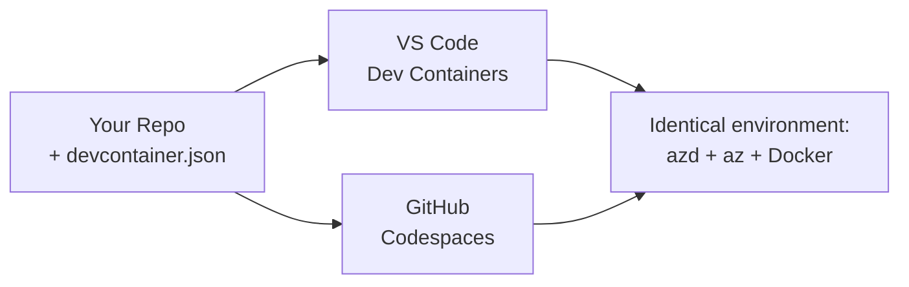

# azd ਲਈ ਡੈਵ ਕੰਟੇਨਰ ਅਤੇ GitHub ਕੋਡਸਪੇਸ

**ਧੜੇ ਦੀ ਨੈਵੀਗੇਸ਼ਨ:**
- **📚 ਕੋਰ੍ਸ ਹੋਮ**: [ਆਰੰਭਕਾਂ ਲਈ AZD](../../README.md)
- **📖 ਮੌਜੂਦਾ ਧੜਾ**: ਧੜਾ 1 - ਬੁਨਿਆਦ ਅਤੇ ਤੁਰੰਤ ਸ਼ੁਰੂਆਤ
- **⬅️ ਪਹਿਲਾਂ**: [ਆਪਣਾ ਆਪ ਲਿਆਓ](bring-your-own-app.md)
- **🚀 ਅਗਲਾ ਧੜਾ**: [ਧੜਾ 2: AI-ਪਹਿਲੀ ਵਿਕਾਸ](../chapter-02-ai-development/README.md)

> ਕਮਾਂਡ ਅਤੇ ਸੰਰਚਨਾ ਸਮੀਖਿਆ ਟਾਰਗਟ: `azd 1.37.2` (ਨਵੰਬਰ 2026)। ਕੰਟੇਨਰ ਬਿਲਡ ਅਤੇ Azure ਡਿਪਲੋਇਮੈਂਟ ਇਸ ਸਮੀਖਿਆ ਦੇ ਹਿੱਸੇ ਦੇ ਤੌਰ ਤੇ ਨਹੀਂ ਕੀਤੇ ਗਏ।

## ਪਰਚਯ

ਹਰ ਮਸ਼ੀਨ 'ਤੇ azd, ਸਹੀ ਭਾਸ਼ਾ ਰੰਨਟਾਈਮ, Docker, ਅਤੇ Azure CLI ਨੂੰ ਇੰਸਟਾਲ ਕਰਨਾ ਇਕ ਮਿਹਨਤ ਵਾਲਾ ਕੰਮ ਹੈ—ਅਤੇ ਇਹ ਮੁੱਖ ਕਾਰਨ ਹੈ ਕਿ "ਮੇਰੀ ਮਸ਼ੀਨ ਤੇ ਚੱਲਦਾ ਹੈ" ਕਿੱਸਾ ਕਿਸੇ ਹੋਰ ਲਈ ਨਾਕਾਮ ਹੁੰਦਾ ਹੈ। ਇਕ **ਡੈਵ ਕੰਟੇਨਰ** ਇਸ ਸਮੱਸਿਆ ਨੂੰ ਇਕ ਫਾਈਲ ਵਿੱਚ ਤੁਹਾਡੇ ਸਾਰੇ ਟੂਲਚੇਨ ਨੂੰ ਵੇਰਵਾ ਦੇ ਕੇ ਹੱਲ ਕਰਦਾ ਹੈ। ਕੋਈ ਵੀ ਵਿਅਕਤੀ ਜੋ ਇਸ ਪ੍ਰੋਜੈਕਟ ਨੂੰ VS ਕੋਡ ਜਾਂ GitHub ਕੋਡਸਪੇਸ ਵਿੱਚ ਖੋਲਦਾ ਹੈ, ਠੀਕ ਇੱਕੋ ਜਿਹਾ ਵਾਤਾਵਰਨ ਪ੍ਰਾਪਤ ਕਰਦਾ ਹੈ, ਜਿਸ ਵਿੱਚ azd ਪਹਿਲਾਂ ਹੀ ਇੰਸਟਾਲ ਹੁੰਦਾ ਹੈ। ਇਹ ਪਾਠ ਤੁਹਾਨੂੰ ਦਿਖਾਵੇਗਾ ਕਿ ਕਿਵੇਂ ਇੱਕ ਜੋੜੀਦਾ ਹੈ।

## ਸਿੱਖਣ ਦੇ ਲਕੜੇ

ਇਸ ਪਾਠ ਦੇ ਅੰਤ ਤੱਕ, ਤੁਸੀਂ:
- ਸਮਝੋਗੇ ਕਿ ਡੈਵ ਕੰਟੇਨਰ ਕੀ ਹੈ ਅਤੇ azd ਲਈ ਇਹ ਕਿਵੇਂ ਮਦਦਗਾਰ ਹੈ
- ਇੱਕ ਘੱਟੋ-ਘੱਟ `.devcontainer/devcontainer.json` ਪ੍ਰੋਜੈਕਟ ਵਿੱਚ ਸ਼ਾਮਲ ਕਰੋ
- ਡੈਵ ਕੰਟੇਨਰ *ਫੀਚਰਾਂ* ਰਾਹੀਂ azd, Azure CLI, ਅਤੇ Docker ਸ਼ਾਮਲ ਕਰੋ
- ਪ੍ਰੋਜੈਕਟ ਨੂੰ GitHub ਕੋਡਸਪੇਸ ਜਾਂ VS ਕੋਡ ਵਿੱਚ ਖੋਲ੍ਹੋ

## ਸਿੱਖਣ ਦੇ ਨਤੀਜੇ

ਇਸ ਪਾਠ ਮੁਕੰਮਲ ਕਰਨ ਤੋਂ ਬਾਅਦ, ਤੁਸੀਂ ਸਮਰੱਥ ਹੋਵੋਗੇ:
- ek azd ਪ੍ਰੋਜੈਕਟ ਲਈ `devcontainer.json` ਲਿਖੋ
- ਬਿਨਾਂ ਹੱਥੋਂ ਇੰਸਟਾਲ ਕੀਤੇ azd ਅਤੇ Azure ਟੂਲਿੰਗ ਜੋੜੋ
- ਇਕ ਕੰਟੇਨਰ ਜਾਂ ਕੋਡਸਪੇਸ ਦੇ ਅੰਦਰੋਂ `azd up` ਚਲਾਓ

---

## ਡੈਵ ਕੰਟੇਨਰ ਕੀ ਹੈ?

ਇਕ ਡੈਵ ਕੰਟੇਨਰ ਤੁਹਾਡੇ ਰਿਪੋਜ਼ਿਟਰੀ ਵਿੱਚ ਇਕ `.devcontainer/devcontainer.json` ਫਾਈਲ ਨਾਲ ਵਿਆਖਿਆਤ ਡੋਕਰ ਅਧਾਰਿਤ ਵਿਕਾਸ ਵਾਤਾਵਰਨ ਹੈ। ਜਦੋਂ ਤੁਸੀਂ ਪ੍ਰੋਜੈਕਟ ਖੋਲਦੇ ਹੋ:

- **VS ਕੋਡ** (ਡੈਵ ਕੰਟੇਨਰ ਐਕਸਟੈਂਸ਼ਨ ਨਾਲ) ਕੰਟੇਨਰ ਬਣਾਉਂਦਾ ਹੈ ਅਤੇ ਇਸ ਨਾਲ ਜੁੜਦਾ ਹੈ।
- **GitHub ਕੋਡਸਪੇਸ** ਇਕੋ ਕੰਟੇਨਰ ਨੂੰ ਕਲਾਉਡ ਵਿੱਚ ਬਣਾਉਂਦਾ ਹੈ ਅਤੇ ਤੁਹਾਨੂੰ ਬ੍ਰਾਊਜ਼ਰ ਅਧਾਰਿਤ ਐਡੀਟਰ ਦਿੰਦਾ ਹੈ।

ਕਿਸੇ ਵੀ ਤਰੀਕੇ ਨਾਲ, ਹਰ ਯੋਗਦਾਤਾ ਨੂੰ ਇਕੋ ਜਿਹੇ ਟੂਲ ਮਿਲਦੇ ਹਨ—"ਕੀ ਤੁਸੀਂ azd ਇੰਸਟਾਲ ਕੀਤਾ?" ਦੀ ਸਮੱਸਿਆ ਨਹੀਂ ਹੁੰਦੀ।



---

## ਪੱਧਰ 1: devcontainer ਫਾਈਲ ਬਣਾਓ

ਆਪਣੇ ਪ੍ਰੋਜੈਕਟ ਦੀ ਮੂਲ ਨੂੰ ਸ਼ੁਰੂਆਤ ਵਿੱਚ `.devcontainer/devcontainer.json` ਬਣਾਓ:

```json
{
  "name": "azd-project",
  "image": "mcr.microsoft.com/devcontainers/base:bookworm",
  "features": {
    "ghcr.io/devcontainers/features/azure-cli:1": {},
    "ghcr.io/azure/azure-dev/azd:0": { "version": "1.37.2" },
    "ghcr.io/devcontainers/features/docker-in-docker:2": {},
    "ghcr.io/devcontainers/features/node:1": {}
  },
  "customizations": {
    "vscode": {
      "extensions": [
        "ms-azuretools.azure-dev",
        "ms-azuretools.vscode-bicep"
      ]
    }
  },
  "forwardPorts": [3000],
  "postCreateCommand": "azd version"
}
```

ਹਰ ਹਿੱਸਾ ਕੀ ਕਰਦਾ ਹੈ:

| ਕੁੰਜੀ | ਮਕਸਦ |
|-----|---------|
| `image` | ਕੰਟੇਨਰ ਲਈ ਅਧਾਰ OS |
| `features` | ਪਹਿਲਾਂ ਤੋਂ ਬਣੇ ਇੰਸਟਾਲਰ — ਇੱਥੇ: Azure CLI, **azd**, Docker, ਅਤੇ Node.js |
| `customizations.vscode.extensions` | azd ਅਤੇ Bicep VS ਕੋਡ ਐਕਸਟੈਂਸ਼ਨਜ਼ ਨੂੰ ਆਪੋ-आप ਇੰਸਟਾਲ ਕਰਦਾ ਹੈ |
| `forwardPorts` | ਤੁਹਾਡੇ ਐਪ ਦਾ ਪੋਰਟ ਤੁਹਾਡੇ ਬ੍ਰਾਊਜ਼ਰ ਨੂੰ ਖੋਲ੍ਹਦਾ ਹੈ |
| `postCreateCommand` | ਕੰਟੇਨਰ ਬਣਨ ਤੋਂ ਬਾਅਦ ਇੱਕ ਵਾਰੀ ਚਲਦਾ ਹੈ (ਇੱਥੇ, ਇੱਕ ਸਹੀਤਾ ਜਾਂਚ) |

> ਫੀਚਰ ਵਰਜਨ (`azd:0`) ਅਤੇ ਇੰਸਟਾਲ ਕੀਤੀ CLI ਵਰਜਨ ਵੱਖ-ਵੱਖ ਹਨ। CLI ਨੂੰ ਠੀਕ ਕਰਨ ਲਈ ਫੀਚਰ ਦਾ `version` ਵਿਕਲਪ `"1.37.2"` ਤੇ ਸੈਟ ਕਰੋ; CLI ਵਰਜਨ ਨੂੰ ਫੀਚਰ ਟੈਗ ਵਜੋਂ ਨਾ ਵਰਤੋਂ।

---

## ਪੱਧਰ 2: ਆਪਣੇ ਐਪ ਦੀ ਭਾਸ਼ਾ ਲਈ ਫੀਚਰ ਮੇਲ ਖਾਓ

ਜੇਹੜਾ ਕੁਝ ਵੀ ਤੁਹਾਡਾ ਐਪ ਵਰਤਦਾ ਹੈ, ਉਸ ਲਈ `node` ਫੀਚਰ ਬਦਲੋ:

```jsonc
// Python project
"ghcr.io/devcontainers/features/python:1": {},

// .NET project
"ghcr.io/devcontainers/features/dotnet:2": {},

// Java project
"ghcr.io/devcontainers/features/java:1": {},

// Go project
"ghcr.io/devcontainers/features/go:1": {}
```

ਜਦੋਂ ਸਥਾਨਕ ਤੌਰ 'ਤੇ ਇਮੇਜ ਬਣਾਉਂਦੇ ਹੋ ਤਾਂ `docker-in-docker` ਰੱਖੋ। ਸੰਰਚਿਤ ਰਿਮੋਟ ACR ਬਿਲਡ (`docker.remoteBuild: true`) ਇਕ ਬਦਲ ਹੈ; ਸਿਰਫ ਹੋਸਟ ਕਿਸਮ ਸਥਾਨਕ Docker ਦੀ ਲੋੜ ਨਹੀਂ ਹੈ।

---

## ਪੱਧਰ 3: ਇਸਨੂੰ ਖੋਲ੍ਹੋ

**VS ਕੋਡ ਵਿੱਚ:**
1. **ਡੈਵ ਕੰਟੇਨਰ** ਐਕਸਟੈਂਸ਼ਨ ਇੰਸਟਾਲ ਕਰੋ।
2. ਪ੍ਰੋਜੈਕਟ ਫੋਲਡਰ ਖੋਲ੍ਹੋ।
3. ਜਦੋਂ ਪੁੱਛਿਆ ਜਾਵੇ ਤਦ **ਕੰਟੇਨਰ ਵਿੱਚ ਮੁੜ ਖੋਲ੍ਹੋ** ਤੇ ਕਲਿਕ ਕਰੋ (ਜਾਂ *Dev Containers: Reopen in Container* ਚਲਾਓ)।

**GitHub ਕੋਡਸਪੇਸ ਵਿੱਚ:**
1. ਰਿਪੋ ਨੂੰ GitHub ਤੇ ਪੁਸ਼ ਕਰੋ।
2. **ਕੋਡ → ਕੋਡਸਪੇਸ → ਮੈਨ ਬ੍ਰਾਂਚ 'ਤੇ ਕੋਡਸਪੇਸ ਬਣਾਓ** ਤੇ ਕਲਿਕ ਕਰੋ।
3. ਕੰਟੇਨਰ ਬਣਨ ਦੀ ਉਡੀਕ ਕਰੋ—azd ਟਰਮੀਨਲ ਵਿੱਚ ਤਿਆਰ ਹੈ।

---

## ਪੱਧਰ 4: ਕੰਟੇਨਰ ਦੇ ਅੰਦਰੋਂ ਡਿਪਲੌਇ ਕਰੋ

ਕੰਟੇਨਰ ਵਿੱਚ azd ਪਹਿਲਾਂ ਤੋਂ ਇੰਸਟਾਲ ਹੈ, ਇਸ ਲਈ ਆਮ ਵਰਕਫਲੋ ਸਹੀ ਤਰੀਕੇ ਨਾਲ ਚੱਲਦਾ ਹੈ:

```bash
azd auth login --use-device-code   # device code is handy inside Codespaces
azd up
```

> **ਕਿਉਂ `--use-device-code`?** ਇਕ ਰਿਮੋਟ ਕੰਟੇਨਰ ਜਾਂ ਕੋਡਸਪੇਸ ਵਿੱਚ ਕੋਈ ਸਥਾਨਕ ਬ੍ਰਾਊਜ਼ਰ ਨਾਹ ਹੁੰਦਾ ਜਿਸ ਨੂੰ ਰੀਡਾਇਰੈਕਟ ਕੀਤਾ ਜਾਵੇ, ਇਸ ਲਈ ਡਿਵਾਈਸ-ਕੋਡ ਲੋਗਿਨ ਭਰੋਸੇਮੰਦ ਰਸਤਾ ਹੈ। ਤੁਸੀਂ ਇਸ ਨੂੰ ਪੂਰਾ ਕਰਨ ਲਈ ਬ੍ਰਾਊਜ਼ਰ ਟੈਬ ਵਿੱਚ ਇਕ ਕੋਡ ਚਿਪਕਾਵੋਗੇ।

---

## ਆਮ ਗਲਤੀਆਂ

| ਗਲਤੀ | ਠੀਕ ਕਰੋ |
|---------|-----|
| `azd up` ਇਮੇਜ ਨਹੀਂ ਬਣਾ ਸਕਦਾ | `docker-in-docker` ਫੀਚਰ ਜੋੜੋ |
| ਕੋਡਸਪੇਸ ਵਿੱਚ ਬ੍ਰਾਊਜ਼ਰ ਲੋਗਿਨ ਰੁਕ ਜਾਂਦਾ ਹੈ | `azd auth login --use-device-code` ਵਰਤੋਂ |
| ਟੀਮ ਮੈਂਬਰਾਂ ਵਿੱਚ ਟੂਲ ਵੱਖਰੇ ਹਨ | azd ਫੀਚਰ ਦੇ `version` ਵਿਕਲਪ ਰਾਹੀਂ CLI ਬੰਨ੍ਹੋ ਅਤੇ ਭਾਸ਼ਾ ਰੰਨਟਾਈਮ ਪਿੰਨ ਕਰੋ |
| ਬ੍ਰਾਊਜ਼ਰ ਵਿੱਚ ਐਪ ਪੁੱਜਣਯੋਗ ਨਹੀਂ | ਪੋਰਟ `forwardPorts` ਵਿੱਚ ਸ਼ਾਮਲ ਕਰੋ |

---

## ਸਾਰ

- ਡੈਵ ਕੰਟੇਨਰ ਤੁਹਾਡੇ azd ਟੂਲਚੇਨ ਨੂੰ ਸਭ ਲਈ ਦੁਹਰਾਉਣਯੋਗ ਬਣਾਉਂਦਾ ਹੈ।
- ਡੈਵ ਕੰਟੇਨਰ *ਫੀਚਰਾਂ* ਰਾਹੀਂ azd, Azure CLI, ਅਤੇ Docker ਨੂੰ ਜੋੜੋ।
- ਆਪਣੀ ਐਪ ਲਈ ਭਾਸ਼ਾ ਫੀਚਰ ਮਿਲਾਓ ਅਤੇ ਕੰਟੇਨਰ ਹੋਸਟਾਂ ਲਈ `docker-in-docker` ਰੱਖੋ।
- ਕੋਡਸਪੇਸ ਵਿੱਚ ਚਲਾਉਂਦੇ ਵੇਲੇ ਡਿਵਾਈਸ-ਕੋਡ ਲੋਗਿਨ ਵਰਤੋਂ।

---

## 🔗 ਨੈਵੀਗੇਸ਼ਨ

| ਦਿਸ਼ਾ | ਸਰੋਤ |
|-----------|----------|
| **ਪਹਿਲਾਂ** | [ਆਪਣਾ ਆਪ ਲਿਆਓ](bring-your-own-app.md) |
| **ਧੜਾ ਹੋਮ** | [ਧੜਾ 1: ਬੁਨਿਆਦ ਅਤੇ ਤੁਰੰਤ ਸ਼ੁਰੂਆਤ](README.md) |
| **ਅਗਲਾ ਧੜਾ** | [ਧੜਾ 2: AI-ਪਹਿਲੀ ਵਿਕਾਸ](../chapter-02-ai-development/README.md) |

## 📖 ਸੰਬੰਧਿਤ ਸਰੋਤ

- [ਇੰਸਟਾਲੇਸ਼ਨ ਅਤੇ ਸੈਟਅਪ](installation.md)
- [ਕਮਾਂਡ ਚੀਟ ਸ਼ੀਟ](../../resources/cheat-sheet.md)
- [ਅਧਿਕਾਰਕ ਡੈਵ ਕੰਟੇਨਰ ਵਿਸ਼ੇਸ਼ਤਾ](https://containers.dev/)
- [azd ਡੈਵ ਕੰਟੇਨਰ ਫੀਚਰ](https://github.com/Azure/azure-dev/tree/main/ext/devcontainer)

---

<!-- CO-OP TRANSLATOR DISCLAIMER START -->
**ਅਸਵੀਕਾਰੋਪਣ**:
ਇਸ ਦਸਤਾਵੇਜ਼ ਦਾ ਅਨੁਵਾਦ ਏਆਈ ਅਨੁਵਾਦ ਸੇਵਾ [Co-op Translator](https://github.com/Azure/co-op-translator) ਦੀ ਵਰਤੋਂ ਕਰਕੇ ਕੀਤਾ ਗਿਆ ਹੈ। ਜਦੋਂ ਕਿ ਅਸੀਂ ਸਹੀਤਾਵਾਂ ਲਈ ਯਤਨਸ਼ੀਲ ਹਾਂ, ਕਿਰਪਾ ਕਰਕੇ ਧਿਆਨ ਰੱਖੋ ਕਿ ਸਵੈਚਾਲਿਤ ਅਨੁਵਾਦਾਂ ਵਿੱਚ ਗਲਤੀਆਂ ਜਾਂ ਅਸਮੱਤਿਆਵਾਂ ਹੋ ਸਕਦੀਆਂ ਹਨ। ਮੂਲ ਦਸਤਾਵੇਜ਼ ਆਪਣੀ ਮੂਲ ਭਾਸ਼ਾ ਵਿੱਚ ਅਧਿਕਾਰਕ ਸਰੋਤ ਮੰਨਿਆ ਜਾਣਾ ਚਾਹੀਦਾ ਹੈ। ਜਰੂਰੀ ਜਾਣਕਾਰੀ ਲਈ, ਪੇਸ਼ੇਵਰ ਮਨੁੱਖੀ ਅਨੁਵਾਦ ਦੀ ਸਿਫ਼ਾਰਸ਼ ਕੀਤੀ ਜਾਂਦੀ ਹੈ। ਅਸੀਂ ਇਸ ਅਨੁਵਾਦ ਦੇ ਉਪਯੋਗ ਤੋਂ ਪੈਦਾ ਹੋਣ ਵਾਲੀਆਂ ਕਿਸੇ ਵੀ ਗਲਤਫਹਿਮੀਆਂ ਜਾਂ ਗਲਤ ਵਿਆਖਿਆਵਾਂ ਲਈ ਜਵਾਬਦੇਹ ਨਹੀਂ ਹਾਂ।
<!-- CO-OP TRANSLATOR DISCLAIMER END -->