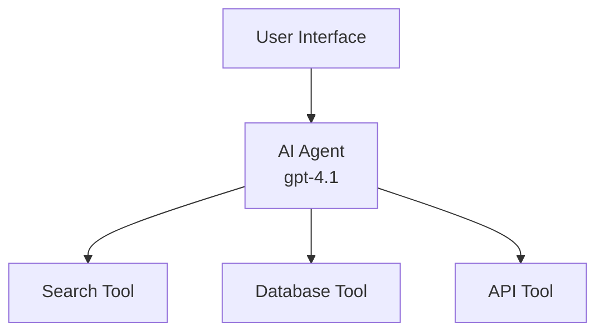
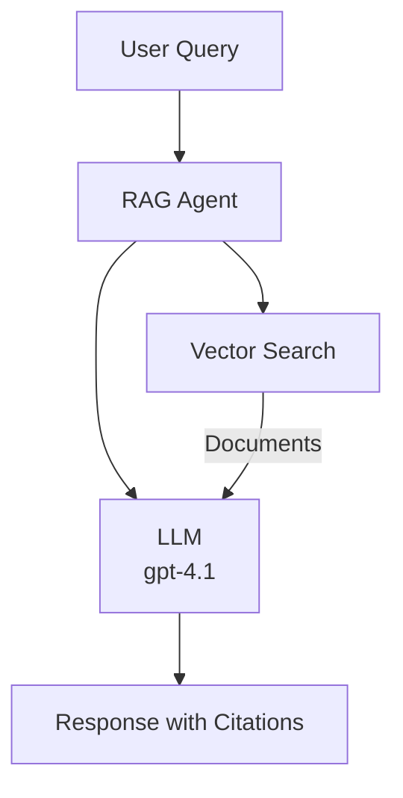
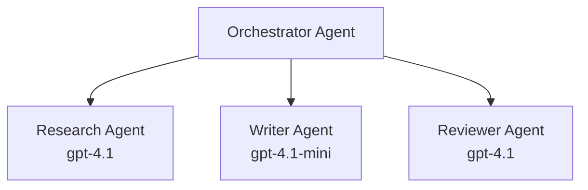

# ਐਜਿਊਰ ਡਿਵੈਲਪਰ CLI ਨਾਲ AI ਏਜੰਟ

**ਅਧਿਆਇ ਨੈਵਿਗੇਸ਼ਨ:**
- **📚 ਕੋਰਸ ਮੁੱਖ ਪੰਨਾ**: [ਬਿਗਿਨਰਜ਼ ਲਈ AZD](../../README.md)
- **📖 ਮੌਜੂਦਾ ਅਧਿਆਇ**: ਅਧਿਆਇ 2 - AI-ਪਹਿਲਾ ਵਿਕਾਸ
- **⬅️ ਪਿਛਲਾ**: [Microsoft Foundry ਇੰਟੀਗ੍ਰੇਸ਼ਨ](microsoft-foundry-integration.md)
- **➡️ ਅੱਗੇ**: [AI ਮਾਡਲ ਡਿਪਲਾਇਮੈਂਟ](ai-model-deployment.md)
- **🚀 ਉੱਚ-ਪੱਧਰੀ**: [ਮਲਟੀ-ਏਜੰਟ ਸੋਲੂਸ਼ਨ](../../examples/retail-scenario.md)

---

## ਪਰਚਾਅ

AI ਏਜੰਟ ਸੁਤੰਤਰ ਪ੍ਰੋਗਰਾਮ ਹਨ ਜੋ ਆਪਣੇ ਵਾਤਾਵਰਨ ਨੂੰ ਸਮਝ ਸਕਦੇ ਹਨ, ਫੈਸਲੇ ਕਰ ਸਕਦੇ ਹਨ, ਅਤੇ ਨਿਰਧਾਰਿਤ ਟੀਕਿਆਂ ਨੂੰ ਪ੍ਰਾਪਤ ਕਰਨ ਲਈ ਕਾਰਵਾਈਆਂ ਕਰਦੇ ਹਨ। ਸਧਾਰਨ ਚੈਟਬੋਟਾਂ ਦੇ ਵਿਰੁੱਧ ਜੋ ਸਿਰਫ ਪ੍ਰਾਪਤੀਆਂ ਦਾ ਜਵਾਬ ਦਿੰਦੇ ਹਨ, ਏਜੰਟ ਇਹ ਕਰ ਸਕਦੇ ਹਨ:

- **ਟੂਲਾਂ ਦਾ ਉਪਯੋਗ ਕਰਨਾ** - APIs ਨੂੰ ਕਾਲ ਕਰਨਾ, ਡਾਟਾਬੇਸ ਖੋਜਣਾ, ਕੋਡ ਚਲਾਉਣਾ
- **ਯੋਜਨਾ ਬਣਾ ਕੇ ਸੋਚਣਾ** - ਜਟਿਲ ਕਾਰਜਾਂ ਨੂੰ ਕਦਮਾਂ ਵਿੱਚ ਵੰਡਣਾ
- **ਸੰਦਰਭ ਤੋਂ ਸਿੱਖਣਾ** - ਯਾਦ ਰੱਖਣਾ ਅਤੇ ਵਤੀਰਾ ਅਨੁਕੂਲ ਕਰਨਾ
- **ਸਹਿਯੋਗ ਕਰਨਾ** - ਹੋਰ ਏਜੰਟਾਂ ਨਾਲ ਕੰਮ ਕਰਨਾ (ਮਲਟੀ-ਏਜੰਟ ਸਿਸਟਮ)

ਇਸ ਗਾਈਡ ਵਿੱਚ ਤੁਹਾਨੂੰ ਦਿਖਾਇਆ ਗਿਆ ਹੈ ਕਿ ਕਿਵੇਂ Azure Developer CLI (azd) ਦੀ ਵਰਤੋਂ ਕਰ ਕੇ AI ਏਜੰਟਾਂ ਨੂੰ ਅਜ਼ੂਰ 'ਤੇ ਡਿਪਲਾਇ ਕੀਤਾ ਜਾ ਸਕਦਾ ਹੈ।

ਗੱਲਬਾਤ ਦੇ ਸੰਦਰਭ ਦੀ ਵਰਤੋਂ ਮਾਡਲ ਟ੍ਰੇਨਿੰਗ ਨਹੀਂ ਹੈ: ਸਥਾਈ ਯਾਦ, ਐਕਸੈਸ ਕੰਟਰੋਲ, ਅਤੇ ਰੋਕਥਾਮ ਨੂੰ ਐਪਲੀਕੇਸ਼ਨ ਦੁਆਰਾ ਲਾਗੂ/ਸੰਰਚਿਤ ਕੀਤਾ ਜਾਣਾ ਚਾਹੀਦਾ ਹੈ।

> **Foundry GA ਅਪਡੇਟ (2026-11-09):** ਆਮ ਤੌਰ 'ਤੇ ਉਪਲੱਬਧ `microsoft.foundry` 1.0 ਬੰਡਲ ਨੂੰ `azd >= 1.37.0` ਨਾਲ ਇੰਸਟਾਲ ਕਰੋ। ਮੁਲਾਂਕਣ ਅਲੱਗੋਂ ਇੰਸਟਾਲ ਹੁੰਦੇ ਹਨ; ਵਿਕਲਪਿਕ ਪ੍ਰੀਵਿਊ ਫੀਚਰ ਅਤੇ ਹੇਠਾਂ ਦਿੱਤਾ ਕਲਾਸਿਕ SDK ਫ੍ਰੈਗਮੈਂਟ ਬੰਡਲ ਐਲਾਨ ਦੁਆਰਾ GA ਵੱਲ ਨਹੀਂ ਜਾਣਦੇ। ਇਹ ਦਿਸ਼ਾ-ਨਿਰਦੇਸ਼ [GA ਐਲਾਨ](https://devblogs.microsoft.com/azure-sdk/microsoft-foundry-azure-developer-cli-ga/) ਅਤੇ ਦਸਤਾਵੇਜ਼ਾਂ 'ਤੇ ਆਧਾਰਿਤ ਹੈ, ਲਾਈਵ ਅਜ਼ੂਰ ਡਿਪਲੌਇਮੈਂਟ ਨਹੀਂ।

## ਸਿੱਖਣ ਦੇ ਲਕੜ

ਇਸ ਗਾਈਡ ਨੂੰ ਪੂਰਾ ਕਰਨ ਨਾਲ, ਤੁਸੀਂ:
- ਸਮਝ ਜਾਵੋਗੇ ਕਿ AI ਏਜੰਟ ਕੀ ਹੁੰਦੇ ਹਨ ਅਤੇ ਉਹ ਚੈਟਬੋਟਾਂ ਤੋਂ ਕਿਵੇਂ ਵੱਖਰੇ ਹਨ
- AZD ਦੀ ਵਰਤੋਂ ਕਰਕੇ ਪਹਿਲਾਂ ਤੋਂ ਬਣਾਏ ਗਏ AI ਏਜੰਟ ਟੈਮਪਲੇਟ ਡਿਪਲਾਇ ਕਰਨਗੇ
- ਕਸਟਮ ਏਜੰਟਾਂ ਲਈ Foundry ਏਜੰਟਾਂ ਨੂੰ ਸੰਰਚਿਤ ਕਰਨਗੇ
- ਮੂਲ ਏਜੰਟ ਪੈਟਰਨਾਂ ਨੂੰ ਲਾਗੂ ਕਰਨਗੇ (ਟੂਲ ਉਪਯੋਗ, RAG, ਮਲਟੀ-ਏਜੰਟ)
- ਡਿਪਲਾਇ ਕੀਤੇ ਏਜੰਟਾਂ ਦੀ ਨਿਗਰਾਨੀ ਅਤੇ ਡੀਬੱਗਿੰਗ ਕਰਨਗੇ

## ਸਿੱਖਣ ਦੇ ਨਤੀਜੇ

ਪੂਰਾ ਕਰਨ 'ਤੇ, ਤੁਸੀਂ ਸਮਰੱਥ ਹੋਵੋਗੇ:
- ਸਿੰਗਲ ਕਮਾਂਡ ਨਾਲ Azure 'ਤੇ AI ਏਜੰਟ ਐਪਲੀਕੇਸ਼ਨ ਡਿਪਲਾਇ ਕਰਨ ਲਈ
- ਏਜੰਟ ਟੂਲਾਂ ਅਤੇ ਸਮਰੱਥਾਵਾਂ ਨੂੰ ਸੰਰਚਿਤ ਕਰਨ ਲਈ
- RAG (ਰੀਟ੍ਰੀਵਲ-ਆਗਮੈਂਟਡ ਜਨਰੇਸ਼ਨ) ਨੂੰ ਏਜੰਟਾਂ ਨਾਲ ਅਮਲ ਵਿੱਚ ਲਿਆਉਣ ਲਈ
- ਜਟਿਲ ਵਰਕਫਲੋਵਾਂ ਲਈ ਮਲਟੀ-ਏਜੰਟ ਆਰਕੀਟੈਕਚਰਜ਼ ਤਿਆਰ ਕਰਨ ਲਈ
- ਆਮ ਏਜੰਟ ਡਿਪਲਾਇਮੈਂਟ ਸਮੱਸਿਆਵਾਂ ਨੂੰ ਦੂਰ ਕਰਨ ਲਈ

---

## 🤖 ਏਜੰਟ ਨੂੰ ਚੈਟਬੋਟ ਤੋਂ ਵੱਖਰਾ ਕੀ ਬਣਾਉਂਦਾ ਹੈ?

| ਵਿਸ਼ੇਸ਼ਤਾ | ਚੈਟਬੋਟ | AI ਏਜੰਟ |
|---------|---------|----------|
| **ਵਤੀਰਾ** | ਪ੍ਰਾਪਤੀਆਂ ਦਾ ਜਵਾਬ | ਸੁਤੰਤਰ ਕਾਰਵਾਈ ਕਰਦਾ ਹੈ |
| **ਟੂਲ** | ਰੀਟ੍ਰੀਵਲ ਜਾਂ ਟੂਲ ਵਰਤ ਸਕਦਾ ਹੈ | ਆਮ ਤੌਰ 'ਤੇ ਟੂਲ ਉਦੇਸ਼-ਕੇਂਦਰਿਤ ਲੂਪ ਵਿੱਚ ਵਰਤਦਾ ਹੈ |
| **ਯਾਦ** | ਐਪਲੀਕੇਸ਼ਨ-ਆਧਾਰਿਤ | ਸਿਰਫ ਜੇ ਖੁੱਲ੍ਹ ਕੇ ਲਾਗੂ ਕੀਤੀ ਗਈ ਹੋਵੇ ਤਾਂ ਸਥਾਈ ਯਾਦ |
| **ਯੋਜਨਾ** | ਇਕਲੌਤਾ ਜਵਾਬ | ਕਈ ਕਦਮਾਂ ਵਾਲੀ ਸੋਚ |
| **ਸਹਿਯੋਗ** | ਇਕ ਇਕਾਈ | ਹੋਰ ਏਜੰਟਾਂ ਨਾਲ ਕੰਮ ਕਰ ਸਕਦਾ ਹੈ |

### ਸਧਾਰਣ ਤੁਲਨਾ

- **ਚੈਟਬੋਟ** = ਜਾਣਕਾਰੀ ਡੈਸਕ 'ਤੇ ਸਵਾਲਾਂ ਦੇ ਜਵਾਬ ਦੇਣ ਵਾਲਾ ਮਦਦਗਾਰ ਵਿਅਕਤੀ
- **AI ਏਜੰਟ** = ਨਿੱਜੀ ਸਹਾਇਕ ਜੋ ਕਾਲ ਕਰ ਸਕਦਾ ਹੈ, ਅਪਾਇੰਟਮੈਂਟ ਬੁੱਕ ਕਰ ਸਕਦਾ ਹੈ, ਅਤੇ ਤੁਹਾਡੇ ਲਈ ਕਾਰਜ ਪੂਰੇ ਕਰ ਸਕਦਾ ਹੈ

---

## 🚀 ਤੇਜ਼ ਸ਼ੁਰੂਆਤ: ਆਪਣਾ ਪਹਿਲਾ ਏਜੰਟ ਡਿਪਲਾਇ ਕਰੋ

ਇੱਕ **ਨਵੀਂ ਖਾਲੀ ਕਾਰਜਕਾਰੀ ਡਾਇਰੈਕਟਰੀ** ਵਿੱਚੋਂ ਇੱਕ ਵਿਕਲਪ ਚੁਣੋ। ਆਖਰੀ `.` ਇੱਥੇ ਇਨੀਸ਼ੀਆਲਾਈਜ਼ ਕਰਦਾ ਹੈ; ਬਿਨਾਂ ਕਿਸੇ ਖ਼ਾਸ ਮੰਜ਼ਿਲ ਦੇ, ਵਰਤਮਾਨ AZD ਇੱਕ ਟੈਮਪਲੇਟ-ਨਾਂ ਵਾਲਾ ਸਬਡਾਇਰੈਕਟਰੀ ਬਣਾ ਸਕਦਾ ਹੈ ਅਤੇ ਤੁਹਾਡੇ ਸ਼ੈੱਲ ਦੀ ਡਾਇਰੈਕਟਰੀ ਨਹੀਂ ਬਦਲਦਾ। ਵੱਖਰੇ ਟੈਮਪਲੇਟ/ਵਾਤਾਵਰਣ ਵੱਖਰੇ ਡਾਇਰੈਕਟਰੀਆਂ ਵਿੱਚ ਰੱਖੋ।

ਹੇਠਾਂ ਦਿੱਤੇ ਸਮੇਂ/ਲਾਗਤ ਦੇ ਦਾਇਰੇ ਉਦਾਹਰਣੀ ਹਨ, ਪ੍ਰਮਾਣਿਤ ਕੋਟਸ ਨਹੀਂ। ਹਰ ਸੈਂਪਲ ਦੀ ਵਰਤਮਾਨ ਪੂਰਵ-ਸ਼ਰਤਾਂ, ਕੀਮਤਾਂ, ਮਾਡਲ ਕੋਟਾ, ਅਤੇ ਵਿਕਲਪਿਕ ਸੇਵਾਵਾਂ ਨੂੰ ਡਿਪਲਾਇਮੈਂਟ ਤੋਂ ਪਹਿਲਾਂ ਪ੍ਰਖਿਆ ਕਰ ਲਵੋ।

### ਵਿਕਲਪ 1: Foundry Agents ਟੈਮਪਲੇਟ (ਸਿਫ਼ਾਰਸ਼ ਕੀਤੀ)

```bash
# Initialize the AI agents template
azd init --template get-started-with-ai-agents .

# Deploy to Azure
azd up
```

**ਜੋ ਡਿਪਲਾਇ ਹੁੰਦਾ ਹੈ:** ਸੈਂਪਲ ਦੀ ਵਰਤਮਾਨ ਢਾਂਚਾ ਅਤੇ ਚੁਣੇ ਗਏ ਵਿਕਲਪ ਮਾਡਲ, ਟੂਲ, ਹੋਸਟਿੰਗ, ਅਤੇ ਨਿਗਰਾਨੀ ਸਾਧਨਾਂ ਨੂੰ ਨਿਰਧਾਰਤ ਕਰਦੇ ਹਨ। ਇਸ ਦਾ README ਅਤੇ `infra/` ਪ੍ਰੋਵਿਜ਼ਨ ਕਰਨ ਤੋਂ ਪਹਿਲਾਂ ਸਮੀਖਿਆ ਕਰੋ; ਹਰ ਏਜੰਟ ਟੈਮਪਲੇਟ ਵਿੱਚ Search ਜਾਂ ਵੈੱਬ ਇੰਟਰਫੇਸ ਸ਼ਾਮਲ ਨਹੀਂ ਹੁੰਦੀ।

**ਸਮਾਂ:** ~15-20 ਮਿੰਟ
**ਲਾਗਤ:** ~100-150 ਡਾਲਰ/ਮਹੀਨਾ (ਵਿਕਾਸ)

### ਵਿਕਲਪ 2: Prompty ਨਾਲ ਰਚਨਾਤਮਕ ਲਿਖਤੀ ਏਜੰਟ

```bash
# Initialize the Prompty-based agent template
azd init --template https://github.com/Azure-Samples/contoso-creative-writer .

# Deploy to Azure
azd up
```

**ਜੋ ਡਿਪਲਾਇ ਹੁੰਦਾ ਹੈ:** ਇੱਕ FastAPI/Prompty ਮਲਟੀ-ਏਜੰਟ ਲਿਖਤੀ ਉਦਾਹਰਣ ਜੋ Azure OpenAI, Bing Grounding, ਅਤੇ Azure AI Search ਵਰਤਦਾ ਹੈ। ਪਹਿਲਾਂ ਵਾਲਾ `agent-openai-python-prompty` ਰਿਪੋਜਟਰੀ ਇੱਥੇ ਰੀਡਾਇਰੈਕਟ ਕਰਦਾ ਹੈ; ਇਹ ਘੱਟੋ-ਘੱਟ Azure ਫੰਕਸ਼ਨਜ਼ ਵੇਦਰ-ਏਜੰਟ ਟੈਮਪਲੇਟ ਨਹੀਂ ਹੈ। ਹੋਸਟਿੰਗ, ਮਾਡਲ ਕੋਟਾ, ਅਤੇ Bing Grounding ਪੂਰਵ-ਸ਼ਰਤਾਂ ਲਈ ਇਸ ਦਾ ਵਰਤਮਾਨ README ਫਾਲੋ ਕਰੋ।

**ਸਮਾਂ:** ~10-15 ਮਿੰਟ
**ਲਾਗਤ:** ~50-100 ਡਾਲਰ/ਮਹੀਨਾ (ਵਿਕਾਸ)

### ਵਿਕਲਪ 3: RAG ਚੈਟ ਏਜੰਟ

```bash
# Initialize RAG chat template
azd init --template azure-search-openai-demo .

# Deploy to Azure
azd up
```

**ਜੋ ਡਿਪਲਾਇ ਹੁੰਦਾ ਹੈ:**
- ✅ Microsoft Foundry ਮਾਡਲ
- ✅ Azure AI Search ਸੈਂਪਲ ਡਾਟਾ ਨਾਲ
- ✅ ਦਸਤਾਵੇਜ਼ ਪ੍ਰੋਸੈਸਿੰਗ ਪਾਈਪਲਾਈਨ
- ✅ ਸੰਦਰਭ ਸਹਿਤ ਚੈਟ ਇੰਟਰਫੇਸ

**ਸਮਾਂ:** ~15-25 ਮਿੰਟ
**ਲਾਗਤ:** ~80-150 ਡਾਲਰ/ਮਹੀਨਾ (ਵਿਕਾਸ)

### ਵਿਕਲਪ 4: GA Foundry ਬੰਡਲ ਨਾਲ ਹੋਸਟ ਕੀਤਾ ਏਜੰਟ

ਬੁਨਿਆਦੀ Python Agent Framework Responses API ਸੈਂਪਲ ਲਈ [ਪੂਰੀ ਹੋਸਟ-ਏਜੰਟ ਵਰਕਫਲੋ](microsoft-foundry-integration.md#hosted-agent-walkthrough-ga) ਦੀ ਵਰਤੋਂ ਕਰੋ। ਇਸ ਕੋਡ-ਡਿਪਲਾਇਮੈਂਟ ਰਾਹ ਲਈ Python 3.13+, ਵਰਤਮਾਨ uv, Foundry ਅਧਿਕਾਰ, ਅਤੇ ਖੇਤਰੀ ਮਾਡਲ ਕੋਟਾ ਦੀ ਲੋੜ ਹੁੰਦੀ ਹੈ। Azure CLI ਪ੍ਰਮਾਣਪੱਤਰਾਂ ਦੀ ਵਰਤੋਂ ਕਰਨ ਸਮੇਂ ਸਥਾਨਕ SDK ਕਾਲਾਂ ਨੂੰ ਅਲੱਗ ਪ੍ਰਮਾਣਿਕਰਣ ਕਰੋ।

```bash
azd auth login
azd ext install microsoft.foundry
```

ਖਾਲੀ ਡਾਇਰੈਕਟਰੀ ਵਿੱਚ, ਸੈਂਪਲ ਨੂੰ ਇਨੀਸ਼ੀਆਲਾਈਜ਼ ਕਰੋ:

```text
azd ai agent init --template https://github.com/microsoft-foundry/foundry-samples/blob/main/samples/python/hosted-agents/agent-framework/responses/01-basic/azure.yaml --deploy-mode code --src .
```

ਨਵਾਂ ਜਾਂ ਮੌਜੂਦਾ ਪ੍ਰੋਜੈਕਟ ਚੁਣੋ, `azure.yaml` ਦੀ ਸਮੀਖਿਆ ਕਰੋ, ਅਤੇ `azd provision` ਦੌੜਾਓ। Agent Inspector ਖੋਲ੍ਹਣ ਲਈ `azd ai agent run` ਦੀ ਵਰਤੋਂ ਕਰੋ ਅਤੇ ਉਸ ਡਾਇਰੈਕਟਰੀ ਵਿੱਚ ਦੂਜੇ ਟਰਮੀਨਲ ਤੋਂ `azd ai agent invoke --local "Explain how this agent is hosted."` ਦੌੜਾਓ। ਸਥਾਨਕ ਪ੍ਰਮਾਣੀਕਰਨ ਤੋਂ ਬਾਅਦ, ਡਿਪਲਾਇਮੈਂਟ ਕੀਤੇ ਜਵਾਬ ਨੂੰ ਤੁਲਨਾ ਕਰਨ ਲਈ `azd deploy` ਅਤੇ `azd ai agent invoke "Explain how this agent is hosted."` ਦੀ ਵਰਤੋਂ ਕਰੋ। Foundry ਦੂਰ-ਦਰਾਜ਼ੀ ਤੌਰ 'ਤੇ ਅਪਲੋਡ ਕੀਤਾ ਸੋਰਸ ਬਣਾਉਂਦਾ ਹੈ; ਸਥਾਨਕ ਕੰਟੇਨਰ ਬਣਾਉਣਾ ਲਾਜ਼ਮੀ ਨਹੀਂ।

**ਜਦੋਂ `azd ai agent init` ਅਤੇ `azd init --template` ਦੀ ਵਰਤੋਂ ਕਰਨੀ ਹੈ:**

| ਤਰੀਕਾ | ਸਭ ਤੋਂ ਵਧੀਆ | ਇਹ ਕਿਵੇਂ ਕੰਮ ਕਰਦਾ ਹੈ |
|----------|----------|------|
| `azd init --template` | ਕੰਮ ਕਰਦੇ ਸੈਂਪਲ ਐਪ ਤੋਂ ਸ਼ੁਰੂਆਤ | ਕੋਡ + ਢਾਂਚੇ ਨਾਲ ਪੂਰਾ ਟੈਮਪਲੇਟ ਰਿਪੋ ਕਲੋਨ ਕਰਦਾ ਹੈ |
| `azd ai agent init --template` | ਵਰਤਮਾਨ Foundry ਏਜੰਟ ਪ੍ਰੋਜੈਕਟ ਸਵੀਕਾਰ ਕਰਨਾ | ਇੱਕ `azure.yaml` ਪ੍ਰੋਜੈਕਟ ਦਸਤਾਵੇਜ਼ ਅਤੇ ਉਸ ਦੀਆਂ ਪਰਿਭਾਸ਼ਾਵਾਂ ਦੀ ਵਰਤੋਂ ਕਰਦਾ ਹੈ |

> **ਟਿੱਪ਼ਣੀ:** ਵਿਕਲਪ 1-3 ਪੂਰੇ ਐਪਲੀਕੇਸ਼ਨ ਟੈਮਪਲੇਟ ਤੋਂ ਸ਼ੁਰੂ ਹੁੰਦੇ ਹਨ; ਵਿਕਲਪ 4 GA ਹੋਸਟ-ਏਜੰਟ ਵਰਕਫਲੋ ਸਿੱਖਾਉਂਦਾ ਹੈ। ਕੋਈ ਵੀ ਇਨੀਸ਼ੀਆਲਾਈਜ਼ੇਸ਼ਨ ਕਮਾਂਡ ਵਿਰਾਸਤੀ ਏਜੰਟ ਮੈਨਿਫੈਸਟ ਸਵੈ-ਚਾਲਿਤ ਤੌਰ 'ਤੇ ਮਾਈਗ੍ਰੇਟ ਨਹੀਂ ਕਰਦੀ। ਮੌਜੂਦਾ ਪ੍ਰੋਜੈਕਟ ਵਿੱਚ ਸਿੱਧਾ ਏਜੰਟ ਪਰਿਭਾਸ਼ਾ ਸ਼ਾਮਲ ਕਰਨ ਲਈ, [ਇਨੀਸ਼ੀਆਲਾਈਜ਼ੇਸ਼ਨ ਅਤੇ ਮਾਈਗ੍ਰੇਸ਼ਨ ਦਿਸ਼ਾ-ਨਿਰਦੇਸ਼](../chapter-08-production/production-ai-practices.md#initializing-agent-projects-with-azd-ai-agent-init) ਵੇਖੋ।

ਟੈਸਟ ਡੇਟਾ/ਰੂਬਰਿਕਸ ਬਣਾਉਣ ਅਤੇ ਸਮੀਖਿਆ ਕਰਨ ਲਈ `azure.ai.evaluations` ਨੂੰ ਅਲੱਗ ਤੋਂ ਇੰਸਟਾਲ ਕਰੋ, ਇਕ ਮੁਲਾਂਕਣ ਸੰਰਚਿਤ ਕਰੋ, ਅਤੇ `azd ai eval` ਦੀ ਵਰਤੋਂ ਕਰਕੇ ਇਸਨੂੰ ਚਲਾਓ। ਆਪਟੀਮਾਈਜੇਸ਼ਨ ਇਕ ਸੁਮੇਲ ਮੁਲਾਂਕਣ ਨੂੰ ਦੁਬਾਰਾ ਵਰਤ ਸਕਦੀ ਹੈ; ਕਿਸੇ ਇੱਕ ਨੂੰ ਸਪಷ್ಟ ਤੌਰ 'ਤੇ ਲਾਗੂ ਕਰਨ ਤੋਂ ਪਹਿਲਾਂ ਉਮੀਦਵਾਰਾਂ ਦੀ ਸਮੀਖਿਆ ਕਰੋ। ਪੁਰਾਣੀਆਂ ਉਦਾਹਰਨਾਂ ਨੂੰ ਦੁਬਾਰਾ ਵਰਤਣ ਤੋਂ ਪਹਿਲਾਂ [ਮੁਲਾਂਕਣ ਕਾਰਜਪ੍ਰਵਾਹ](../chapter-08-production/production-ai-practices.md#evaluation-migration-and-quality-checks) ਅਤੇ [ਆਪਟੀਮਾਈਜੇਸ਼ਨ ਮਾਈਗ੍ਰੇਸ਼ਨ](../chapter-08-production/production-ai-practices.md#optimization-configuration-migration) ਦੀ ਪਾਲਣਾ ਕਰੋ। ਸਾਫ਼-ਸਫ਼ਾਈ ਲਈ, ਇੱਕ ਦੁਬਾਰਾ ਵਰਤੇ ਗਏ Foundry ਪ੍ਰੋਜੈਕਟ ਦੇ ਸਰੋਤ `azd down` ਤੋਂ ਬਾਅਦ ਬਚ ਜਾਂਦੇ ਹਨ; ਇੱਕ ਨਵਾਂ ਬਣਾਇਆ ਗਿਆ ਪ੍ਰੋਜੈਕਟ ਸਰੋਤ ਸਮੂਹ ਹਟਾਇਆ ਜਾਂਦਾ ਹੈ। [ਵਾਕਥਰੂ ਸਾਫ਼-ਸਫ਼ਾਈ ਦਿਸ਼ਾ-ਨਿਰਦੇਸ਼](microsoft-foundry-integration.md#7-clean-up-deliberately) ਦੇਖੋ।

---

## 🏗️ ਏਜੰਟ ਆਰਕੀਟੈਕਚਰ ਪੈਟਰਨز

### ਪੈਟਰਨ 1: ਸਿੰਗਲ ਏਜੰਟ ਨਾਲ ਸੰਦ

ਸਭ ਤੋਂ ਸਧਾਰਣ ਏਜੰਟ ਪੈਟਰਨ - ਇੱਕ ਏਜੰਟ ਜੋ ਕਈ ਸੰਦ ਵਰਤ ਸਕਦਾ ਹੈ।



**ਸਭ ਤੋਂ ਵਧੀਆ:**
- ਗਾਹਕ ਸਹਾਇਤਾ ਬੋਟ
- ਰਿਸਰਚ ਸਹਾਇਕ
- ਡੇਟਾ ਵਿਸ਼ਲੇਸ਼ਣ ਏਜੰਟ

**ਸੰਬੰਧਤ ਐਪਲੀਕੇਸ਼ਨ ਨਮੂਨਾ:** `azure-search-openai-demo` RAG ਦਿਖਾਉਂਦਾ ਹੈ, ਇੱਕ ਆਮ ਸੰਦ-ਵਾਲਾ ਏਜੰਟ ਲੂਪ ਨਹੀਂ।

### ਪੈਟਰਨ 2: RAG ਏਜੰਟ (ਰੀਟਰੀਵਲ-ਆਗਮੈਂਟਡ ਜਨਰੇਸ਼ਨ)

ਇੱਕ ਏਜੰਟ ਜੋ ਉੱਤਰ ਬਣਾਉਣ ਤੋਂ ਪਹਿਲਾਂ ਸਬੰਧਤ ਦਸਤਾਵੇਜ਼ ਪ੍ਰਾਪਤ ਕਰਦਾ ਹੈ।



**ਸਭ ਤੋਂ ਵਧੀਆ:**
- ਏਂਟਰਪ੍ਰਾਈਜ਼ ਗਿਆਨ ਬੇਸ
- ਦਸਤਾਵੇਜ਼ Q&A ਪ੍ਰਣਾਲੀਆਂ
- ਅਨੁਕੂਲਤਾ ਅਤੇ ਕਾਨੂੰਨੀ ਖੋਜ

**AZD ਟੈਮਪਲੇਟ:** `azure-search-openai-demo`

### ਪੈਟਰਨ 3: ਮਲਟੀ-ਏਜੰਟ ਪ੍ਰਣਾਲੀ

ਕਈ ਵਿਸ਼ੇਸ਼ਾਗਤ ਏਜੰਟ ਜੋ ਮਿਲ ਕੇ ਜਟਿਲ ਕੰਮ ਕਰਦੇ ਹਨ।



**ਸਭ ਤੋਂ ਵਧੀਆ:**
- ਜਟਿਲ ਸਮੱਗਰੀ ਜਨਰੇਸ਼ਨ
- ਬਹੁ-ਕਦਮੀ ਵਰਕਫਲੋਜ਼
- ਵੱਖ-ਵੱਖ ਮਾਹਿਰਤ ਵਾਲੇ ਕਾਰਜ

**ਹੋਰ ਜਾਣੋ:** [ਮਲਟੀ-ਏਜੰਟ ਕੋਆਰਡੀਨੇਸ਼ਨ ਪੈਟਰਨਜ਼](../chapter-06-pre-deployment/coordination-patterns.md)

---

## ⚙️ ਏਜੰਟ ਸੰਦਾਂ ਦੀ ਸੰਰਚਨਾ

ਏਜੰਟ ਤਾਕਤਵਰ ਬਣ ਜਾਂਦੇ ਹਨ ਜਦੋਂ ਉਹ ਸੰਦ ਵਰਤ ਸਕਦੇ ਹਨ। ਇੱਥੇ ਆਮ ਸੰਦਾਂ ਦੀ ਸੰਰਚਨਾ ਦਾ ਤਰੀਕਾ ਹੈ:

### Foundry ਏਜੰਟਾਂ ਵਿੱਚ ਸੰਦ ਸੰਰਚਨਾ

ਇਹ **ਪ੍ਰਾਚੀਨ ਏਜੰਟ ਸਰਵਿਸ SDK ਟੁਕੜਾ** `azure-ai-projects==1.0.0` ਅਤੇ `azure-ai-agents==1.1.0` ਨੂੰ `azure-identity` ਨਾਲ ਨਿਸ਼ਾਨਾ ਬਣਾਉਂਦਾ ਹੈ। ਇਹ ਕੁਝ ਮੌਜੂਦਾ Foundry ਟੈਮਪਲੇਟਾਂ ਵੱਲੋਂ ਵਰਤੇ ਜਾਂਦੇ ਨਵੇਂ ਵਰਜ਼ਨ ਐਜੰਟ/Responses API ਜਾਂ `azure.ai.agents` AZD ਐਕਸਟੇਂਸ਼ਨ (ਇੱਕ ਵੱਖਰਾ ਪੈਕੇਜ) ਨਹੀਂ ਹੈ। ਇਹਨਾਂ API ਜਨਰੇਸ਼ਨਾਂ ਨੂੰ ਮਿਲਾਉ ਨਾ। `PROJECT_ENDPOINT` ਨੂੰ ਇੱਕ ਪ੍ਰਾਚੀਨ Foundry ਪ੍ਰੋਜੈਕਟ ਐਂਡਪੌਇੰਟ ਤੇ ਅਤੇ `MODEL_DEPLOYMENT_NAME` ਨੂੰ ਇਕ ਮੌਜੂਦ ਸਹਾਇਤ ਪ੍ਰਾਪਤ ਮਾਡਲ ਡਿਪਲੋਇਮੈਂਟ ਤੇ ਸੈੱਟ ਕਰੋ; ਲੋਕਲ ਤੌਰ 'ਤੇ `az login` ਨਾਲ ਪ੍ਰਮਾਣਿਤ ਕਰੋ ਅਤੇ ਲੋੜੀਦੇ ਪ੍ਰੋਜੈਕਟ ਅਧਿਕਾਰ ਦਿਓ।

```python
# agent_config.py
import os
from azure.ai.projects import AIProjectClient
from azure.ai.agents.models import FunctionTool
from azure.identity import DefaultAzureCredential

def search_knowledge_base(query: str) -> str:
    """Search the demonstration knowledge base.

    :param query: Search text.
    :return: Matching demonstration information.
    """
    # Local fixture only, not a production search implementation.
    return "Demo policy: returns are accepted within 30 days."

project_client = AIProjectClient(
    endpoint=os.environ["PROJECT_ENDPOINT"],
    credential=DefaultAzureCredential(),
)
search_tool = FunctionTool(functions={search_knowledge_base})
project_client.agents.enable_auto_function_calls(search_tool)
agent = project_client.agents.create_agent(
    model=os.environ["MODEL_DEPLOYMENT_NAME"],
    name="Support Agent",
    instructions="Use search_knowledge_base for policy questions. Label results as demo data.",
    tools=search_tool.definitions,
)
```

ਇੱਕ ਫੰਕਸ਼ਨ ਸਕੀਮਾ ਰਜਿਸਟਰ ਕਰਨ ਨਾਲ ਸਰਵਿਸ 'ਤੇ Python ਚੱਲਦਾ ਨਹੀਂ। ਇਸ SDK ਵਿੱਚ, `enable_auto_function_calls` ਨਾਲ ਮਿਲ ਕੇ `agents.runs.create_and_process(...)` ਤੁਹਾਡੇ ਕਲਾਇੰਟ ਪ੍ਰੋਸੈਸ ਵਿੱਚ ਰਜਿਸਟਰਡ ਕਾਲਬੈਕ ਚਲਾਉਂਦਾ ਹੈ। [ਰਿਲੀਜ਼ ਕੀਤਾ SDK ਨਮੂਨਾ](https://github.com/Azure/azure-sdk-for-python/blob/azure-ai-agents_1.1.0/sdk/ai/azure-ai-agents/samples/agents_tools/sample_agents_auto_function_call.py) ਦੇਖੋ। ਕਲਾਇੰਟ ਨੂੰ ਬੰਦ ਕਰੋ ਅਤੇ ਮੁਹੱਈਆ ਕੀਤੇ ਏਜੰਟ/ਥ੍ਰੈਡ ਹਟਾਓ ਜਦੋਂ ਕੰਮ ਖਤਮ ਹੋ ਜਾਵੇ।

### ਵਾਤਾਵਰਨ ਸੰਰਚਨਾ

ਹੇਠ ਲਿਖੇ ਨਾਮ **ਦ੍ਰਸ਼ਾਇਆ ਗਿਆ ਕਸਟਮ-ਟੈਮਪਲੇਟ ਇਨਪੁੱਟ ਹਨ**, ਬਿਲਟ-ਇਨ AZD ਸਵਿੱਚ ਨਾ ਹਨ। ਪਹਿਲਾਂ ਹਰ ਮੁੱਲ ਨੂੰ `infra/main.parameters.json`, ਇਨਫ੍ਰਾਸਟਰੱਕਚਰ, ਅਤੇ ਐਪਲੀਕੇਸ਼ਨ ਕੋਡ ਰਾਹੀਂ ਜੋੜੋ। ਕੇਵਲ `azd env set` ਏਜੰਟ ਦੇ ਸੰਦ ਜਾਂ ਹਦਾਇਤਾਂ ਨੂੰ ਨਹੀਂ ਬਦਲਦਾ।

```bash
# Set up agent-specific environment variables
azd env set AZURE_OPENAI_MODEL "gpt-4.1"
azd env set AGENT_INSTRUCTIONS "You are a helpful assistant..."
azd env set ENABLE_CODE_INTERPRETER "true"
azd env set ENABLE_FILE_SEARCH "true"

# Apply wired infrastructure and application changes
azd up
```

---

## 📊 ਏਜੰਟਾਂ ਦੀ ਨਿਗਰਾਨੀ

### ਐਪਲੀਕੇਸ਼ਨ ਇਨਸਾਈਟਸ ਇਨਟੀਗ੍ਰੇਸ਼ਨ

ਜੇ ਤੁਹਾਡੇ ਚੁਣੇ ਹੋਏ ਟੈਮਪਲੇਟ ਐਪਲੀਕੇਸ਼ਨ ਇਨਸਾਈਟਸ ਪ੍ਰਦਾਨ ਕਰਦਾ ਹੈ ਅਤੇ ਇੰਸਟਰੂਮੈਂਟੇਸ਼ਨ ਸੰਰਚਿਤ ਕਰਦਾ ਹੈ:

```bash
# Open monitoring dashboard
azd monitor --overview

# Open the Application Insights logs view (not a streaming log tail)
azd monitor --logs

# View live metrics
azd monitor --live
```

### ਟਰੈਕ ਕਰਨ ਲਈ ਮੁੱਖ ਮੈਟ੍ਰਿਕਸ

| ਮੈਟ੍ਰਿਕ | ਵਰਣਨ | ਲਕੜੀ |
|--------|-------------|--------|
| ਜਵਾਬ ਦੇਣ ਵਿੱਚ ਦੇਰੀ | ਜਵਾਬ ਬਣਾਉਣ ਦਾ ਸਮਾਂ | < 5 ਸਕਿੰਟ |
| ਟੋਕਨ ਵਰਤੋਂ | ਪ੍ਰਤੀ ਬੇਨਤੀ ਟੋਕਨ | ਲਾਗਤ ਲਈ ਨਿਗਰਾਨੀ ਕਰੋ |
| ਸੰਦ ਕਾਲ ਸਫਲਤਾ ਦਰ | ਸਫਲ ਸੰਦ ਇਜ਼ੋਕਸ਼ਨਾਂ ਦਾ % | > 95% |
| ਗਲਤੀ ਦਰ | ਅਸਫਲ ਏਜੰਟ ਬੇਨਤੀਆਂ | < 1% |
| ਉਪਭੋਗਤਾ ਸੰਤੁਸ਼ਟੀ | ਫੀਡਬੈਕ ਸਕੋਰ | > 4.0/5.0 |

### ਏਜੰਟਾਂ ਲਈ ਕਸਟਮ ਲੌਗਿੰਗ

```python
import os
from azure.monitor.opentelemetry import configure_azure_monitor
from opentelemetry import trace

# Configure Azure Monitor with OpenTelemetry
configure_azure_monitor(
    connection_string=os.environ["APPLICATIONINSIGHTS_CONNECTION_STRING"]
)

tracer = trace.get_tracer(__name__)

def log_agent_interaction(user_query, agent_response, tools_used, latency_ms):
    with tracer.start_as_current_span("agent_interaction") as span:
        span.set_attributes({
            "query_length": len(user_query),  # Do not log raw prompts or personal data
            "response_length": len(agent_response),
            "tools_used": tools_used,
            "latency_ms": latency_ms
        })
```

> **ਨੋਟ:** ਲੋੜੀਦਾ ਪੈਕੇਜ ਇੰਸਟਾਲ ਕਰੋ: `pip install azure-monitor-opentelemetry`। ਇਹ OpenTelemetry ਨਿਰਭਰਤਾਵਾਂ ਲੈ ਕੇ ਆਉਂਦਾ ਹੈ; ਇਮਪੋਰਟ ਨੇਮਸਪੇਸ ਇੱਕ ਪੈਕੇਜ ਜਿਹੜਾ `opentelemetry` ਨਾਮ ਦਾ ਹੈ ਇੰਸਟਾਲ ਕਰਨ ਲਈ ਜ਼ਰੂਰੀ ਨਹੀਂ ਹੈ।

---

## 💰 ਲਾਗਤ ਸੰਬੰਧੀ ਵਿਚਾਰ

### ਪੈਟਰਨ ਮੁਤਾਬਕ ਅਨੁਮਾਨਿਤ ਮਾਸਿਕ ਲਾਗਤਾਂ

ਇਹ ਦ੍ਰਿਸ਼ਟੀਕੋਣ ਯੋਜਨਾ ਤਰਾਂਬਿੰਦੀਆਂ ਹਨ, ਕੋਈ ਕੋਟ ਨਹੀਂ ਜਾਂ ਖਰਚ ਸੀਮਾ। ਖੇਤਰ, ਮਾਡਲ ਟੋਕਨ, ਖੋਜ/ਕੰਪਿਊਟ SKUs, ਸੰਦ ਸੈਸ਼ਨ, ਸਟੋਰੇਜ ਅਤੇ ਟ੍ਰੈਫਿਕ ਇਹਨਾਂ ਨੂੰ ਪਾਰ ਕਰ ਸਕਦੇ ਹਨ। ਉਦਾਹਰਨ ਦੀ ਲਾਗਤ ਦਿਸ਼ਾ-ਨਿਰਦੇਸ਼ ਅਤੇ ਐਜ਼ਯੂਰ ਕੀਮਤਾਂ ਨੂੰ ਵੇਖੋ ਪਹਿਲਾਂ `azd up`।

| ਪੈਟਰਨ | ਵਿਕਾਸ ਵਾਤਾਵਰਨ | ਉਤਪਾਦਨ |
|---------|-----------------|------------|
| ਸਿੰਗਲ ਏਜੰਟ | $50-100 | $200-500 |
| RAG ਏਜੰਟ | $80-150 | $300-800 |
| ਮਲਟੀ-ਏਜੰਟ (2-3 ਏਜੰਟ) | $150-300 | $500-1,500 |
| ਏਂਟਰਪ੍ਰਾਈਜ਼ ਮਲਟੀ-ਏਜੰਟ | $300-500 | $1,500-5,000+ |

### ਲਾਗਤ ਆਪਟੀਮਾਈਜ਼ੇਸ਼ਨ ਸੁਝਾਅ

1. **ਸਧਾਰਣ ਕਾਰਜਾਂ ਲਈ gpt-4.1-mini ਦੀ ਵਰਤੋਂ ਕਰੋ** (ਸਿਰਫ ਜੇ ਤੁਹਾਡਾ ਟੈਮਪਲੇਟ ਇਹ ਇਨਪੁੱਟ ਖਪਤ ਕਰਦਾ ਹੈ)
   ```bash
   azd env set AZURE_OPENAI_MODEL "gpt-4.1-mini"
   ```

2. **ਸੁਰੱਖਿਅਤ, ਦੁਹਰਾਈ ਗਈ ਪੁੱਛਤाछ ਲਈ ਸਕੋਪਡ ਕੈਸ਼ਿੰਗ ਲਾਗੂ ਕਰੋ।** ਟੇਨੈਂਟ/ਉਪਭੋਗਤਾ ਅਥਾਰਟੀਜੇਸ਼ਨ, ਮਾਡਲ ਡਿਪਲੋਇਮੈਂਟ, ਹਦਾਇਤਾਂ ਅਤੇ ਰੀਟਰੀਵਲ ਵਰਜ਼ਨ ਨੂੰ ਕੈਸ਼ ਕੀ ਵਿੱਚ ਸ਼ਾਮਿਲ ਕਰੋ; ਮਿਆਦ ਨਿਰਧਾਰਿਤ ਕਰੋ। ਪ੍ਰਾਈਵੇਟ ਗੱਲ-ਬਾਤ ਜਵਾਬਾਂ ਨੂੰ ਪ੍ਰਕਿਰਿਆ-ਵਿਆਪਕ ਸਿਰਫ ਪੁੱਛਤाछ ਕੈਸ਼ ਰਾਹੀਂ ਸਾਂਝਾ ਨਾ ਕਰੋ। SDK ਏਜੰਟ ਵਸਤੂ ਕੋਲ ਕੋਈ ਸਧਾਰਣ `agent.run()` ਮੀਥਡ ਨਹੀਂ ਹੈ।

3. **ਪ੍ਰਤੀ ਦੌੜ ਟੋਕਨ ਸੀਮਾਵਾਂ ਸੈੱਟ ਕਰੋ**
   ```python
   # Set max_completion_tokens when running the agent, not during creation
   run = project_client.agents.runs.create_and_process(
       thread_id=thread.id,
       agent_id=agent.id,
       max_completion_tokens=1000  # Budget across the run; may finish as incomplete
   )
   ```

4. **ਜਦੋਂ ਵਰਤੋਂ ਵਿੱਚ ਨਾ ਹੋਵੇ ਤਾਂ ਯੋਗ ਕੰਟੇਨਰ ਐਪਸ ਨੂੰ ਸਿਫ਼ਰ 'ਤੇ ਸਕੇਲ ਕਰੋ**
   ```bash
   # Custom-template input: must map to template.scale.minReplicas
   azd env set MIN_REPLICAS "0"
   ```
   ਸਾਢਾ ਬਦਲਾਅ `azd provision` ਜਾਂ `azd up` ਨਾਲ ਲਾਗੂ ਕਰੋ। ਸਿਫ਼ਰ ਸਕੇਲਿੰਗ ਲਈ ਇੱਕ ਉਚਿਤ ਟ੍ਰਿਗਰ ਲੋੜੀਂਦਾ ਹੈ ਅਤੇ ਇਹ ਖੋਜ, ਸਟੋਰੇਜ ਜਾਂ ਮਾਡਲ/ਸੰਦ ਖਰਚ ਨੂੰ ਨਹੀਂ ਰੋਕਦਾ।

---

## 🔧 ਏਜੰਟ ਸਮੱਸਿਆ ਨਿਵਾਰਨ

### ਆਮ ਸਮੱਸਿਆਵਾਂ ਅਤੇ ਸਮਾਧਾਨ

<details>
<summary><strong>❌ ਏਜੰਟ ਸੰਦ ਕਾਲਾਂ ਦਾ ਜਵਾਬ ਨਹੀਂ ਦੇ ਰਿਹਾ</strong></summary>

```bash
# Inspect the application deployment (not the agent's registered tools)
azd show

# Verify OpenAI deployment
az cognitiveservices account deployment list \
  --name $AZURE_OPENAI_NAME \
  --resource-group $RG_NAME

# Check agent logs
azd monitor --logs
```

**ਆਮ ਕਾਰਨ:**
- ਸੰਦ ਫੰਕਸ਼ਨ ਦਸਤਖ਼ਤ ਦਾ ਮੇਲ ਨਹੀਂ
- ਜ਼ਰੂਰੀ ਅਧਿਕਾਰ ਗੁੰਮ ਹੋਣਾ
- API ਐਂਡਪਾਇੰਟ ਅਣਪਹੁੰਚਯੋਗ
</details>

<details>
<summary><strong>❌ ਏਜੰਟ ਜਵਾਬਾਂ ਵਿੱਚ ਉੱਚ ਲੇਟੰਸੀ</strong></summary>

```bash
# Check Application Insights for bottlenecks
azd monitor --live

# Consider using a faster model
azd env set AZURE_OPENAI_MODEL "gpt-4.1-mini"
azd up
```

**ਆਪਟੀਮਾਈਜੇਸ਼ਨ ਸੁਝਾਅ:**
- ਸਟ੍ਰੀਮਿੰਗ ਜਵਾਬਾਂ ਦੀ ਵਰਤੋਂ ਕਰੋ
- ਜਵਾਬ ਕੈਸ਼ਿੰਗ ਲਾਗੂ ਕਰੋ
- ਸੰਦਰਭ ਵਿੰਡੋ ਆਕਾਰ ਘਟਾਓ
</details>

<details>
<summary><strong>❌ ਏਜੰਟ ਗਲਤ ਜਾਂ ਹਲੂਸੀਨੇਟਡ ਜਾਣਕਾਰੀ ਵਾਪਸ ਕਰ ਰਿਹਾ ਹੈ</strong></summary>

```python
# Improve with better system prompts
instructions = """
You are a helpful assistant. IMPORTANT:
- Only answer based on provided context
- If you don't know, say "I don't know"
- Always cite your sources
- Never make up information
"""

# Use these instructions in the agent definition.
# For classic file search, first upload/index documents in a vector store,
# then use FileSearchTool(vector_store_ids=[...]) and pass both its
# .definitions and .resources when creating the agent.
```
ਹਦਾਇਤਾਂ ਅਤੇ ਰੀਟਰੀਵਲ ਜੋਖਮ ਘਟਾਉਂਦੇ ਹਨ; ਕੋਈ ਵੀ ਤੱਥਿਕ ਜਵਾਬਾਂ ਦੀ ਗਾਰੰਟੀ ਨਹੀਂ। ਜਾਣੇ - ਪਛਾਣੇ ਉੱਤਰਾਂ ਨਾਲ ਸੰਬੰਧਤ ਅਤੇ ਦਾਇਰੇ ਤੋਂ ਬਾਹਰ ਸਵਾਲਾਂ ਦੀ ਮੁਲਾਂਕਣਾ ਕਰੋ।
</details>

<details>
<summary><strong>❌ ਟੋਕਨ ਸੀਮਾ ਵੱਧ ਜਾਣ ਕਾਰਨਾਂ ਦੀਆਂ ਗਲਤੀਆਂ</strong></summary>

```python
# Implement context window management
def truncate_context(messages, max_tokens=8000, model="gpt-4.1"):
    """Approximate content-only budget for objects with .content strings."""
    import tiktoken
    encoding = tiktoken.encoding_for_model(model)
    total_tokens = 0
    truncated = []
    
    for msg in reversed(messages):
        msg_tokens = len(encoding.encode(msg.content))
        if total_tokens + msg_tokens > max_tokens:
            break
        truncated.insert(0, msg)
        total_tokens += msg_tokens
    
    return truncated
```
ਇਹ ਮਦਦਗਾਰ ਭੂਮਿਕਾ/ਸੰਦ ਸਕੀਮਾਵਾਂ, ਪ੍ਰਣਾਲੀ ਹਦਾਇਤਾਂ, ਚਿੱਤਰ ਟੋਕਨ ਅਤੇ ਪ੍ਰੋਟੋਕੋਲ ਓਵਰਹੈੱਡ ਨੂੰ ਬਾਹਰ ਰੱਖਦਾ ਹੈ। ਉਹਨਾਂ ਲਈ ਅਤੇ ਕਮਪਲੀਸ਼ਨ ਲਈ ਜਗ੍ਹਾ ਰਾਖੋ; ਸੰਦ-ਕਾਲ/ਨਤੀਜੇ ਜੁੜੀਆਂ ਜੋੜੀਆਂ ਨੂੰ ਨਾਂ ਵੰਡੋ ਜਾਂ ਲੋੜੀਂਦੇ ਪ੍ਰਣਾਲੀ ਹਦਾਇਤਾਂ ਨੂੰ ਨਾ ਫ਼ਲਾਓ। `tiktoken` ਨੂੰ ਅਲੱਗ ਤੋਂ ਇੰਸਟਾਲ ਕਰੋ। ਇਹ ਇੱਕ ਆਮ ਸੰਦਰਭ ਵਿੰਡੋ ਵੈਧਤਾ ਜਾਂਚ ਕਰਨ ਵਾਲਾ ਨਹੀਂ ਹੈ।
</details>

---

## 🎓 ਹੱਥ-ਵਰਕਸਾ ਅਭਿਆਸ

### ਅਭਿਆਸ 1: ਇਕ ਬੁਨਿਆਦੀ ਏਜੰਟ ਨੂੰ ਡਿਪਲੋਇ ਕਰੋ (20 ਮਿੰਟ)

**ਲਕੜੀ:** AZD ਦਾ ਉਪਯੋਗ ਕਰਕੇ ਆਪਣਾ ਪਹਿਲਾ AI ਏਜੰਟ ਡਿਪਲੋਇ ਕਰੋ

```bash
# Step 1: Initialize template
azd init --template get-started-with-ai-agents .

# Step 2: Login to Azure
azd auth login
# If you work across tenants, add --tenant-id <tenant-id>

# Step 3: Deploy
azd up

# Step 4: Test the agent
# Expected output after deployment:
#   Deployment Complete!
#   Endpoint: https://<app-name>.<region>.azurecontainerapps.io
# Open the URL shown in the output and try asking a question

# Step 5: View monitoring
azd monitor --overview

# Step 6: Review the listed resources and confirm cleanup
azd down
```

**ਸਫਲਤਾ ਮਾਪਦੰਡ:**
- [ ] ਏਜੰਟ ਸਵਾਲਾਂ ਦਾ ਜਵਾਬ ਦਿੰਦਾ ਹੈ
- [ ] `azd monitor` ਰਾਹੀਂ ਮਾਨੀਟਰਿੰਗ ਡੈਸ਼ਬੋਰਡ ਤੱਕ ਪਹੁੰਚ ਸਕਦਾ ਹੈ
- [ ] ਸਰੋਤ ਸਫਲਤਾਪੂਰਵਕ ਸਾਫ਼ ਕੀਤੇ ਗਏ

### ਅਭਿਆਸ 2: ਇੱਕ ਕਸਟਮ ਟੂਲ ਸ਼ਾਮਲ ਕਰੋ (30 ਮਿੰਟ)

**ਲਕੜੀ:** ਇੱਕ ਏਜੰਟ ਨੂੰ ਕਸਟਮ ਟੂਲ ਨਾਲ ਵਧਾਓ

**ਸ਼ੁਰੂਆਤੀ ਨੁਕਤਾ:** ਇੱਕ ਵੱਖਰੇ SDK ਸਿਰਜਣ ਨਾਲ ਇੱਕ ਮਨਮਾਨਾ ਟੈਮਪਲੇਟ ਦੀ ਬਜਾਏ [ਟੂਲ ਕਨਫਿਗਰੇਸ਼ਨ](#tool-configuration-in-foundry-agents) ਤੋਂ ਕਲਾਸੀਕ SDK ਕਲਾਇਂਟ ਦਾ ਉਪਯੋਗ ਕਰੋ।

1. ਇਸ ਨਿਰਧਾਰਿਤ ਫਿਕਸਚਰ ਨੂੰ `agent_config.py` ਵਿੱਚ ਸ਼ਾਮਲ ਕਰੋ:
   ```python
   def get_weather(location: str) -> str:
       """Return demonstration weather, not live conditions.

       :param location: City name.
       :return: A clearly labelled fixture.
       """
       print(f"TOOL_CALLED: {location}")
       return f"Demo weather in {location}: Sunny, 72°F (fixture, not live)"
   ```
2. ਖੋਜ-ਸੰਸਾਧਨ ਰਜਿਸਟ੍ਰੇਸ਼ਨ ਅਤੇ ਬਣਾਉ ਟੁਕੜਾ ਬਦਲ ਕੇ:
   ```python
   weather_tool = FunctionTool(functions={get_weather})
   project_client.agents.enable_auto_function_calls(weather_tool)
   agent = project_client.agents.create_agent(
       model=os.environ["MODEL_DEPLOYMENT_NAME"],
       name="Weather Agent",
       instructions="Call get_weather for weather questions; explain that it returns demo data.",
       tools=weather_tool.definitions,
   )
   thread = project_client.agents.threads.create()
   try:
       project_client.agents.messages.create(
           thread_id=thread.id, role="user", content="Use get_weather for Seattle."
       )
       run = project_client.agents.runs.create_and_process(
           thread_id=thread.id, agent_id=agent.id
       )
       if run.status != "completed":
           raise RuntimeError(f"Run status: {run.status}; error: {run.last_error}")
       for message in project_client.agents.messages.list(thread_id=thread.id):
           for text in message.text_messages:
               print(text.text.value)
   finally:
       project_client.agents.threads.delete(thread.id)
       project_client.agents.delete_agent(agent.id)
       project_client.close()
   ```
3. ਸਥਾਨਕ ਤੌਰ 'ਤੇ ਚਲਾਓ (ਇਹ ਮੌਜੂਦਾ Azure ਪਰੋਜੈਕਟ ਨੂੰ ਕਾਲ ਕਰਦਾ ਹੈ ਅਤੇ ਮਾਡਲ ਚਾਰਜ ਲਾਗੂ ਹੁੰਦੇ ਹਨ):
   ```bash
   python agent_config.py
   # Expected: TOOL_CALLED: Seattle, then a completed answer labelled demo data.
   ```

**ਸਫਲਤਾ ਦੇ ਮਾਪਦੰਡ:**
- [ ] ਏਜੰਟ ਮੌਸਮ ਸੰਬੰਧੀ ਸਵਾਲਾਂ ਨੂੰ ਸਮਝਦਾ ਹੈ
- [ ] ਟੂਲ ਨੂੰ ਠੀਕ ਤਰੀਕੇ ਨਾਲ ਕਾਲ ਕੀਤਾ ਗਿਆ
- [ ] ਜਵਾਬ ਵਿੱਚ ਮੌਸਮ ਦੀ ਜਾਣਕਾਰੀ ਸ਼ਾਮਲ ਹੈ

### ਅਭਿਆਸ 3: ਇੱਕ RAG ਏਜੰਟ ਬਣਾਓ (45 ਮਿੰਟ)

**ਲਕੜੀ:** ਇੱਕ ਏਜੰਟ ਬਣਾਓ ਜੋ ਤੁਹਾਡੇ ਦਸਤਾਵੇਜ਼ਾਂ ਤੋਂ ਸਵਾਲਾਂ ਦੇ ਜਵਾਬ ਦੇਵੇ

```bash
# Step 1: Deploy RAG template
azd init --template azure-search-openai-demo .
azd up

# Step 2: Upload your documents
# For the sample's local ingestion path, place supported files in data/.
# Run from the sample root after following its Python environment setup:
./scripts/prepdocs.sh
# Windows PowerShell equivalent: .\\scripts\\prepdocs.ps1

# Step 3: Test with domain-specific questions
# Open the web app URL from the azd up output
# Ask questions about your uploaded documents
# Responses should include citation references like [doc.pdf]
```

**ਸਫਲਤਾ ਦੇ ਮਾਪਦੰਡ:**
- [ ] ਏਜੰਟ ਅਪਲੋਡ ਕੀਤੇ ਦਸਤਾਵੇਜ਼ਾਂ ਤੋਂ ਜਵਾਬ ਦਿੰਦਾ ਹੈ
- [ ] ਜਵਾਬਾਂ ਵਿੱਚ ਹਵਾਲੇ ਸ਼ਾਮਲ ਹਨ
- [ ] ਬਾਹਰ-ਦਾਇਰਾ ਸਵਾਲਾਂ ਨੂੰ ਬਿਨਾਂ ਬਿਨਾ সমਰਥਿਤ ਦਾਵਿਆਂ ਦੇ ਸੰਭਾਲਿਆ ਜਾਂਦਾ ਹੈ (ਹਰ ਭਵਿੱਖ ਦੇ ਸਵਾਲ ਲਈ ਗਾਰੰਟੀ ਨਹੀਂ)

ਜੇ `USE_CLOUD_INGESTION=true`, ਤਾਂ ਸੈਮਪਲ ਦੇ ਕਲਾਉਡ ਇੰਜੈਸ਼ਨ/ਅਪਲੋਡ ਵਰਕਫਲੋ ਦੀ ਸਥਾਨੀਕ ਰੈਪਰ ਦੇ ਬਦਲੇ ਵਰਤੋਂ; ਟੈਸਟ ਦੇ ਬਾਅਦ, RAG ਵਾਤਾਵਰਣ ਵਿੱਚ `azd down` ਚਲਾਓ ਅਤੇ ਮਿਟਾਏ ਜਾਣ ਵਾਲੇ ਸਰੋਤਾਂ ਦੀ ਸਮੀਖਿਆ ਕਰੋ।

---

## 📚 ਅਗਲੇ ਕਦਮ

ਹੁਣ ਜਦ ਤੱਕ ਤੁਸੀਂ AI ਏਜੰਟਾਂ ਨੂੰ ਸਮਝ ਚੁੱਕੇ ਹੋ, ਇਹ ਪ੍ਰਗਟਤਾ ਵਿਸ਼ਿਆਂ ਦੀ ਜਾਂਚ ਕਰੋ:

| ਵਿਸ਼ਾ | ਵਰਣਨ | ਲਿੰਕ |
|-------|-------------|------|
| **ਮਲਟੀ-ਏਜੰਟ ਸਿਸਟਮ** | ਕਈ ਸਹਿਯੋਗੀ ਏਜੰਟਾਂ ਵਾਲੇ ਸਿਸਟਮ ਬਣਾਓ | [ਰਿਟੇਲ ਮਲਟੀ-ਏਜੰਟ ਉਦਾਹਰਨ](../../examples/retail-scenario.md) |
| **ਸਮਨਵਯ ਪੈਟਰਨ** | ਓਰਕੇਸਟਰੈਸ਼ਨ ਅਤੇ ਸੰਚਾਰ ਪੈਟਰਨ ਸਿੱਖੋ | [ਸਮਨਵਯ ਪੈਟਰਨ](../chapter-06-pre-deployment/coordination-patterns.md) |
| **ਉਤਪਾਦਨ ਡਿਪਲੋਯਮੈਂਟ** | ਐਂਟਰਪਰਾਈਜ਼-ਤਿਆਰ ਏਜੰਟ ਡਿਪਲੋਯਮੈਂਟ | [ਉਤਪਾਦਨ AI ਅਮਲ](../chapter-08-production/production-ai-practices.md) |
| **ਏਜੰਟ ਮੁਲਾਂਕਣ** | ਏਜੰਟ ਦੇ ਪ੍ਰਦਰਸ਼ਨ ਦੀ ਜਾਂਚ ਅਤੇ ਮੁਲਾਂਕਣ ਕਰੋ | [AI ਸਮੱਸਿਆ ਨਿਵਾਰਣ](../chapter-07-troubleshooting/ai-troubleshooting.md) |
| **AI ਵਰਕਸ਼ਾਪ ਲੈਬ** | ਹਥੋਂ-ਹਥ: ਆਪਣੇ AI ਹੱਲ ਨੂੰ AZD-ਤਿਆਰ ਬਣਾਓ | [AI ਵਰਕਸ਼ਾਪ ਲੈਬ](ai-workshop-lab.md) |

---

## 📖 ਵਾਧੂ ਸਾਧਨ

### ਅਧਿਕਾਰਿਕ ਦਸਤਾਵੇਜ਼ੀਕਰਨ
- [Microsoft Foundry Agent ਸੇਵਾ](https://learn.microsoft.com/azure/ai-services/agents/)
- [Microsoft Foundry Agent ਸੇਵਾ ਕਵਿਕਸਟਾਰਟ](https://learn.microsoft.com/azure/ai-services/agents/quickstart)
- [ਸੈਮਾਂਟਿਕ ਕਰਨਲ ਏਜੰਟ ਫਰੇਮਵਰਕ](https://learn.microsoft.com/semantic-kernel/)

### ਏਜੰਟਾਂ ਲਈ AZD ਟੈੰਪਲੇਟ
- [AI ਏਜੰਟਾਂ ਨਾਲ ਸ਼ੁਰੂਆਤ ਕਰੋ](https://github.com/Azure-Samples/get-started-with-ai-agents)
- [Prompty ਨਾਲ ਰਚਨਾਤਮਕ ਲਿਖਾਈ ਏਜੰਟ](https://github.com/Azure-Samples/contoso-creative-writer)
- [Azure Search OpenAI ਡੈਮੋ](https://github.com/Azure-Samples/azure-search-openai-demo)

### ਕਮਿਊਨਿਟੀ ਸਾਧਨ
- [ਸ਼ਾਨਦਾਰ AZD - ਏਜੰਟ ਟੈੰਪਲੇਟ](https://azure.github.io/awesome-azd/?tags=ai-agents)
- [Azure AI ਡਿਸਕੋਰਡ](https://discord.gg/microsoft-azure)
- [Microsoft Foundry ਡਿਸਕੋਰਡ](https://discord.gg/nTYy5BXMWG)

### ਤੁਹਾਡੇ ਸੰਪਾਦਕ ਲਈ ਏਜੰਟ ਹੁਨਰ
- [**ਮਾਈਕ੍ਰੋਸੋਫਟ ਐਜ਼ੁਰ ਏਜੰਟ ਸਕਿੱਲਜ਼**](https://skills.sh/microsoft/github-copilot-for-azure) - ਗਿਟਹੱਬ ਕੋਪਾਇਲਟ, ਕਰਸਰ ਜਾਂ ਕਿਸੇ ਵੀ ਸਮਰਥਿਤ ਏਜੰਟ ਵਿੱਚ ਏਜ਼ੁਰ ਵਿਕਾਸ ਲਈ ਮੁੜ ਵਰਤਣ ਯੋਗ AI ਏਜੰਟ ਸਕਿੱਲਜ਼ ਇੰਸਟਾਲ ਕਰੋ। ਇਸ ਵਿੱਚ [ਏਜ਼ੁਰ AI](https://skills.sh/microsoft/github-copilot-for-azure/azure-ai), [ਮਾਈਕ੍ਰੋਸੋਫਟ ਫਾਊਂਡਰੀ](https://skills.sh/microsoft/github-copilot-for-azure/microsoft-foundry), [ਡਿਪਲੋਇਮੈਂਟ](https://skills.sh/microsoft/github-copilot-for-azure/azure-deploy), ਅਤੇ [ਡਾਇਗਨੋਸਟਿਕਸ](https://skills.sh/microsoft/github-copilot-for-azure/azure-diagnostics) ਲਈ ਸਕਿੱਲਜ਼ ਸ਼ਾਮਲ ਹਨ:
  ```bash
  npx skills add microsoft/github-copilot-for-azure
  ```

---

**ਨੈਵੀਗੇਸ਼ਨ**
- **ਪਿਛਲਾ ਪਾਠ**: [ਮਾਈਕ੍ਰੋਸੋਫਟ ਫਾਊਂਡਰੀ ਇੰਟੀਗਰੇਸ਼ਨ](microsoft-foundry-integration.md)
- **ਅਗਲਾ ਪਾਠ**: [AI ਮਾਡਲ ਡਿਪਲੋਇਮੈਂਟ](ai-model-deployment.md)

---

<!-- CO-OP TRANSLATOR DISCLAIMER START -->
**ਅਸਵੀਕਾਰੋਪਣ**:
ਇਸ ਦਸਤਾਵੇਜ਼ ਦਾ ਅਨੁਵਾਦ ਏਆਈ ਅਨੁਵਾਦ ਸੇਵਾ [Co-op Translator](https://github.com/Azure/co-op-translator) ਦੀ ਵਰਤੋਂ ਕਰਕੇ ਕੀਤਾ ਗਿਆ ਹੈ। ਜਦੋਂ ਕਿ ਅਸੀਂ ਸਹੀਤਾਵਾਂ ਲਈ ਯਤਨਸ਼ੀਲ ਹਾਂ, ਕਿਰਪਾ ਕਰਕੇ ਧਿਆਨ ਰੱਖੋ ਕਿ ਸਵੈਚਾਲਿਤ ਅਨੁਵਾਦਾਂ ਵਿੱਚ ਗਲਤੀਆਂ ਜਾਂ ਅਸਮੱਤਿਆਵਾਂ ਹੋ ਸਕਦੀਆਂ ਹਨ। ਮੂਲ ਦਸਤਾਵੇਜ਼ ਆਪਣੀ ਮੂਲ ਭਾਸ਼ਾ ਵਿੱਚ ਅਧਿਕਾਰਕ ਸਰੋਤ ਮੰਨਿਆ ਜਾਣਾ ਚਾਹੀਦਾ ਹੈ। ਜਰੂਰੀ ਜਾਣਕਾਰੀ ਲਈ, ਪੇਸ਼ੇਵਰ ਮਨੁੱਖੀ ਅਨੁਵਾਦ ਦੀ ਸਿਫ਼ਾਰਸ਼ ਕੀਤੀ ਜਾਂਦੀ ਹੈ। ਅਸੀਂ ਇਸ ਅਨੁਵਾਦ ਦੇ ਉਪਯੋਗ ਤੋਂ ਪੈਦਾ ਹੋਣ ਵਾਲੀਆਂ ਕਿਸੇ ਵੀ ਗਲਤਫਹਿਮੀਆਂ ਜਾਂ ਗਲਤ ਵਿਆਖਿਆਵਾਂ ਲਈ ਜਵਾਬਦੇਹ ਨਹੀਂ ਹਾਂ।
<!-- CO-OP TRANSLATOR DISCLAIMER END -->