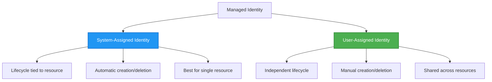

# ਪ੍ਰਮਾਣੀਕਰਨ ਪੈਟਰਨ ਅਤੇ ਪ੍ਰਬੰਧਿਤ ਪਹਚਾਣ

⏱️ **ਅੰਦਾਜ਼ਾ ਲੱਗਣ ਵਾਲਾ ਸਮਾਂ**: 45-60 ਮਿੰਟ ਪੜ੍ਹਨ ਲਈ; ਅਭਿਆਸ ਸ਼ਾਮਲ ਕਰਨ ਲਈ ਵਾਧੂ ਸਮਾਂ ਦਿਓ | 💰 **ਲਾਗਤ ਪ੍ਰਭਾਵ**: ਪਹਚਾਣ/RBAC ਮੁਫ਼ਤ ਹਨ; ਤੈਆਰ ਕੀਤਾ ਕੰਪਿਊਟ, ਸਟੋਰੇਜ਼, ਅਤੇ ਕੀ ਵੌਲਟ ਬਿੱਲਯੋਗ ਹਨ | ⭐ **ਜਟਿਲਤਾ**: ਦਰਮਿਆਨਾ

> `azd 1.37.2` ਦੇ ਖਿਲਾਫ ਸਮੀਖਿਆ ਕੀਤੀ ਗਈ (ਨਵੰਬਰ 2026)। ਇਸ ਪਾਠ ਵਿੱਚ **ਦ੍ਰਿਸ਼ਟੀਕੋਣਿਕ ਇੰਟੀਗ੍ਰੇਸ਼ਨ ਟੁਕੜੇ ਹਨ, ਨ ਕਿ ਪੂਰਾ ਡਾਊਨਲੋਡ ਕਰਨ ਯੋਗ `secure-app` ਟੈਮਪਲੇਟ**। ਹਵਾਲੇ ਦਿੱਤੇ ਫਾਈਲਾਂ ਬਣਾਓ, ਮਿਲਦੇ ਜੁਲਦੇ ਢਾਂਚੇ ਪ੍ਰਦਾਨ ਕਰੋ, ਅਤੇ ਡਿਪਲੋਅ ਕਰਨ ਤੋਂ ਪਹਿਲਾਂ ਪਲੇਸਹੋਲਡਰਾਂ ਨੂੰ ਬਦਲੋ। ਸਮੀਖਿਆ ਦੇ ਦੌਰਾਨ ਕੋਈ Azure ਸਰੋਤ ਪ੍ਰਦਾਨ ਨਹੀਂ ਕੀਤੇ ਗਏ। 

**📚 ਸਿੱਖਣ ਦਾ ਰਸਤਾ:**
- ← ਪਹਿਲਾਂ: [ਕੰਫਿਗਰੇਸ਼ਨ ਮੈਨੇਜਮੈਂਟ](configuration.md) - ਵਾਤਾਵਰਣ ਵੈਰੀਏਬਲ ਤੇ ਸੀਕ੍ਰੇਟਸ ਦਾ ਪ੍ਰਬੰਧਨ
- 🎯 **ਤੁਸੀਂ ਇੱਥੇ ਹੋ**: ਪ੍ਰਮਾਣਿਕਤਾ ਅਤੇ ਸੁਰੱਖਿਆ (ਮੈਨੇਜਡ ਆਈਡੇਂਟਿਟੀ, ਕੀ ਵਾਲਟ, ਸੁਰੱਖਿਅਤ ਰੁਝਾਨ)
- → ਅਗਲਾ: [ਇੰਫ੍ਰਾਸਟਰਕਚਰ ਐਜ਼ ਕੋਡ](../chapter-04-infrastructure/README.md) - ਸਰੋਤ ਪ੍ਰਦਾਨ ਕਰਨਾ ਅਤੇ ਤੈਨਾਤ ਕਰਨਾ
- 🏠 [ਕੋਰਸ ਘਰ](../../README.md)

---

## ਤੁਸੀਂ ਕੀ ਸਿੱਖੋਗੇ

ਇਸ ਪਾਠ ਨੂੰ ਪੂਰਾ ਕਰਨ ਦੁਆਰਾ, ਤੁਸੀਂ:
- ਅਜ਼ੂਰ ਪ੍ਰਮਾਣਿਕਤਾ ਨਮੂਨੇ (ਕੀਜ਼, ਕਨੈਕਸ਼ਨ ਸਟ੍ਰਿੰਗਜ਼, ਮੈਨੇਜਡ ਆਈਡੈਂਟਿਟੀ) ਸਮਝੋਗੇ
- ਬਿਨਾਂ ਪਾਸਵਰਡ ਦੀ ਪ੍ਰਮਾਣਿਕਤਾ ਲਈ **ਮੈਨੇਜਡ ਆਈਡੈਂਟਿਟੀ** ਲਾਗੂ ਕਰੋ
- **Azure Key Vault** ਇੰਟਿਗ੍ਰੇਸ਼ਨ ਨਾਲ ਸਿੱਟੇ ਸੁਰੱਖਿਅਤ ਕਰੋ
- AZD ਡਿਪਲੋਇਮੈਂਟਸ ਲਈ **ਰੋਲ-ਅਧਾਰਿਤ ਪਹੁੰਚ ਕੰਟਰੋਲ (RBAC)** ਸੰਰਚਿਤ ਕਰੋ
- ਕੰਟੇਨਰ ਐਪਸ ਅਤੇ ਅਜ਼ੂਰ ਸੇਵਾਵਾਂ ਵਿੱਚ ਸੁਰੱਖਿਆ ਦੇ ਸਭਿਆਚਾਰ ਲਾਗੂ ਕਰੋ
- ਗੁੰਜਾਈਸ਼-ਆਧਾਰਿਤ ਤੋਂ ਪਛਾਣ-ਆਧਾਰਿਤ ਪ੍ਰਮਾਣਿਕਤਾ ਵਿੱਚ ਮਾਈਗ੍ਰੇਟ ਕਰੋ

##.Managed Identity ਕਿਉਂ ਮਹੱਤਵਪੂਰਨ ਹੈ

### ਸਮੱਸਿਆ: ਪਰੰਪਰਾਗਤ ਪ੍ਰਮਾਣਿਕਤਾ

**Managed Identity ਤੋਂ ਪਹਿਲਾਂ:**
```javascript
// ❌ SECURITY RISK: Hardcoded secrets in code
const connectionString = "Server=mydb.database.windows.net;User=admin;Password=P@ssw0rd123";
const storageKey = "xK7mN9pQ2wR5tY8uI0oP3aS6dF1gH4jK...";
const cosmosKey = "C2x7B9n4M1p8Q5w3E6r0T2y5U8i1O4p7...";
```

**ਸਮੱਸਿਆਵਾਂ:**
- 🔴 ਕੋਡ, ਸੰਰਚਨਾ ਫਾਈਲਾਂ, ਵਾਤਾਵਰਣ ਚਲਕਾਂ ਵਿੱਚ **ਖੁਲ੍ਹੇ ਰਾਜ਼**
- 🔴 **ਕ੍ਰੈਡੈਂਸ਼ਅਲ ਘੁੰਮਾਅ** ਲਈ ਕੋਡ ਬਦਲਣਾ ਅਤੇ ਮੁੜ ਤਾਇਨਾਤੀ ਲੋੜੀਂਦੀ ਹੈ
- 🔴 **ਆਡਿਟ ਦੁਰਦਸ਼ਾ** - ਕਿਸ ਨੇ ਕੀ, ਕਦੋਂ ਐਕਸੈੱਸ ਕੀਤਾ?
- 🔴 **ਫੈਲਾਵ** - ਰਾਜ਼ ਵੱਖ-ਵੱਖ ਸਿਸਟਮਾਂ ਵਿੱਚ ਫੈਲੇ ਹੋਏ
- 🔴 **ਅਨੁਕੂਲਤਾ ਦੇ ਖਤਰੇ** - ਸੁਰੱਖਿਆ ਆਡਿਟ ਵਿੱਚ ਅਸਫਲ

### ਸਮਾਧਾਨ: Managed Identity

**ਮੈਨੇਜਡ ਆਈਡੈਂਟਿਟੀ ਤੋਂ ਬਾਅਦ:**
```javascript
// ✅ SECURE: No secrets in code
const credential = new DefaultAzureCredential();
const client = new BlobServiceClient(
  "https://mystorageaccount.blob.core.windows.net",
  credential  // Azure automatically handles authentication
);
```

**ਫਾਇਦੇ:**
- ✅ **ਕੋਡ ਜਾਂ ਕਨਫਿਗਰੇਸ਼ਨ ਵਿੱਚ ਜ਼ੀਰੋ ਸਿਕ੍ਰੈਟਸ**
- ✅ **ਆਟੋਮੈਟਿਕ ਰੋਟੇਸ਼ਨ** - ਏਜ਼ੂਰ ਇਸ ਦੀ ਸੰਭਾਲ ਕਰਦਾ ਹੈ
- ✅ **ਮਾਈਕ੍ਰੋਸੌਫਟ ਐਂਟਰਾ ID ਲੋਗ ਵਿੱਚ ਪੂਰਾ ਆਡਟ ਟਰੈਲ**
- ✅ **ਕੇਂਦਰੀਕ੍ਰਿਤ ਸੁਰੱਖਿਆ** - ਏਜ਼ੂਰ ਪੋਰਟਲ ਵਿੱਚ ਪ੍ਰਬੰਧਿਤ ਕਰੋ
- ✅ **ਕੰਪਲਾਇੰਸ ਲਈ ਤਿਆਰ** - ਸੁਰੱਖਿਆ ਮਿਆਰਾਂ ਨੂੰ ਪੂਰਾ ਕਰਦਾ ਹੈ

**ਉਦਾਹਰਨ**: ਪਰੰਪਰागत ਪ੍ਰਮਾਣਿਕਤਾ ਵੱਖ-ਵੱਖ ਦਰਵਾਜਿਆਂ ਲਈ ਕਈ ਭੌਤਿਕ ਚਾਬੀਆਂ ਲੈ ਕੇ ਜਾਣ ਵਾਂਗ ਹੈ। ਮੈਨੇਜਡ ਆਈਡੈਂਟਿਟੀ ਉਸ ਸੁਰੱਖਿਆ ਬੈਜ ਵਾਂਗ ਹੈ ਜੋ स्वੈਚालित ਤੌਰ 'ਤੇ ਤੁਹਾਡੇ ਹੋਣ ਦੇ ਆਧਾਰ 'ਤੇ ਪਹੁੰਚ ਦਿੰਦਾ ਹੈ—ਕੋਈ ਚਾਬੀਆਂ ਗੁਆਉਣ, ਕਾਪੀ ਕਰਨ ਜਾਂ ਬਦਲਣ ਦੀ ਲੋੜ ਨਹੀਂ।

---

## ਸਰੰਜਾਮ ਦਾ ਸਮੀਖਿਆ

### ਮੈਨੇਜਡ ਆਈਡੈਂਟਿਟੀ ਨਾਲ ਪ੍ਰਮਾਣਿਕਤਾ ਦਾ ਪ੍ਰਵਾਹ

```mermaid
sequenceDiagram
    participant App as Your Application<br/>(Container App)
    participant MI as Managed Identity<br/>(Microsoft Entra ID)
    participant KV as Key Vault
    participant Storage as Azure Storage
    participant DB as Azure SQL
    
    App->>MI: Request access token<br/>(automatic)
    MI->>MI: Verify identity<br/>(no password needed)
    MI-->>App: Return token for requested audience<br/>(lifetime varies)
    
    App->>KV: Get secret<br/>(using token)
    KV->>KV: Check RBAC permissions
    KV-->>App: Return secret value
    
    App->>Storage: Upload blob<br/>(using token)
    Storage->>Storage: Check RBAC permissions
    Storage-->>App: Success
    
    App->>DB: Query data<br/>(using token)
    DB->>DB: Check SQL permissions
    DB-->>App: Return results
    
    Note over App,DB: Request a separate token for each service audience;<br/>SDK credentials handle caching and renewal
```

### ਮੈਨੇਜਡ ਆਈਡੈਂਟਿਟੀ ਦੇ ਪ੍ਰਕਾਰ



| ਫੀਚਰ | ਪ੍ਰਣਾਲੀ-ਨਿਰਧਾਰਤ | ਯੂਜ਼ਰ-ਨਿਰਧਾਰਤ |
|---------|----------------|---------------|
| **ਜ਼ਿੰਦਗੀ ਚੱਕਰ** | ਸਰੋਤ ਨਾਲ ਜੁੜਿਆ ਹੋਇਆ | ਸਵਤੰਤ੍ਰ |
| **ਤਿਆਰੀ** | ਸਰੋਤ ਦੇ ਨਾਲ ਆਟੋਮੈਟਿਕ | ਹੱਥ-ਨਿਰਧਾਰਤ ਤਿਆਰੀ |
| **ਮਿਟਾਉਣਾ** | ਸਰੋਤ ਦੇ ਨਾਲ ਮਿਟਾਇਆ ਜਾਂਦਾ ਹੈ | ਸਰੋਤ ਮਿਟਾਕੇ ਬਾਅਦ ਟਿਕੀ ਰਹਿੰਦੀ ਹੈ |
| **ਸਾਂਝਾ ਕਰਨਾ** | ਸਿਰਫ ਇੱਕ ਸਰੋਤ | ਕਈ ਸਰੋਤ |
| **ਵਰਤੋਂ ਮਾਮਲਾ** | ਸਾਦਾ ਸਿੰਨੀਰੀਓਜ਼ | ਜਟਿਲ ਬਹੁ-ਸਰੋਤ ਸਿੰਨੀਰੀਓਜ਼ |
| **ਟੈਂਪਲੇਟ ਚੋਣ** | ਸਰੰਜਾਮ ਵਿੱਚ ਨਿਰਧਾਰਤ | ਸਰੰਜਾਮ ਵਿੱਚ ਨਿਰਧਾਰਤ |

---

## ਲੋੜੀਂਦੇ ਅਗਲੇ ਕਦਮ

### ਜ਼ਰੂਰੀ ਟੂਲ

ਤੁਹਾਡੇ ਕੋਲ ਪਹਿਲਾਂ ਹੀ ਇਹ ਪਿਛਲੇ ਪਾਠਾਂ ਤੋਂ ਹੋਣ ਚਾਹੀਦੇ ਹਨ:

```bash
# Verify Azure Developer CLI
azd version
# ✅ Expected: azd version 1.0.0 or higher

# Verify Azure CLI
az --version
# ✅ Expected: azure-cli 2.50.0 or higher
```

### ਏਜ਼ੂਰ ਲੋੜਾਂ

- ਸਰਗਰਮ ਏਜ਼ੂਰ ਸਬਸਕ੍ਰਿਪਸ਼ਨ
- ਅਨੁਮਤੀਆਂ:
  - ਮੈਨੇਜਡ ਆਈਡੈਂਟਿਟੀਜ਼ ਬਣਾਉਣ ਦੀ
  - RBAC ਭੂਮਿਕਾਵਾਂ ਨਿਰਧਾਰਿਤ ਕਰਨ ਦੀ
  - ਕੀ ਵੌਲਟ ਸਰੋਤ ਬਣਾਉਣ ਦੀ
  - ਕੰਟੇਨਰ ਐਪਸ ਨਿਆਪਤ ਕਰਨ ਦੀ

### ਜਾਣਕਾਰੀ ਲਈ ਲੋੜੀਂਦੇ ਪਹਿਲਾਂ ਦੇ ਅਧਿਆਇ

ਤੁਹਾਨੂੰ ਇਹ ਮੁਕੰਮਲ ਕਰਨੇ ਚਾਹੀਦੇ ਹਨ:
- [ਇੰਸਟਾਲੇਸ਼ਨ ਗਾਈਡ](../chapter-01-foundation/installation.md) - AZD ਸੈਟਅਪ
- [AZD ਬੁਨਿਆਦੀ ਜਾਣਕਾਰੀਆਂ](../chapter-01-foundation/azd-basics.md) - ਮੁੱਖ ਸੰਕਲਪ
- [ਵਿਉਰਵ ਸੰਚਾਲਨ ਪ੍ਰਬੰਧਨ](configuration.md) - ਵਾਤਾਵਰਣ ਚਲਕ

---

## ਪਾਠ 1: ਪ੍ਰਮਾਣਿਕਤਾ ਪੈਟਰਨਾਂ ਨੂੰ ਸਮਝਣਾ

### ਪੈਟਰਨ 1: ਕਨੈਕਸ਼ਨ ਸਟਰਿੰਗਸ (ਪੁਰਾਣਾ - ਬਚੋ)

**ਇਹ ਕਿਸ ਤਰ੍ਹਾਂ ਕੰਮ ਕਰਦਾ ਹੈ:**
```bash
# Connection string contains credentials
STORAGE_CONNECTION_STRING="DefaultEndpointsProtocol=https;AccountName=myaccount;AccountKey=xK7mN9pQ2wR5..."
COSMOS_CONNECTION_STRING="AccountEndpoint=https://myaccount.documents.azure.com:443/;AccountKey=C2x7..."
SQL_CONNECTION_STRING="Server=myserver.database.windows.net;User=admin;Password=P@ssw0rd..."
```

**ਮੁਸ਼ਕਲਾਂ:**
- ❌ ਗੁਪਤ ਜਾਣਕਾਰੀਆਂ ਵਾਤਾਵਰਣ ਚਲਕਾਂ ਵਿੱਚ ਵਿਖਾਈ ਦਿੰਦੀਆਂ ਹਨ
- ❌ ਡਿਪਲੋਇਮੈਂਟ ਸਿਸਟਮਾਂ ਵਿੱਚ ਲੌਗ ਕੀਤੀਆਂ ਜਾਣ
- ❌ ਘੁੰਮਾਓਣਾ ਮੁਸ਼ਕਿਲ ਹੈ
- ❌ ਪਹੁੰਚ ਦਾ ਆਡੀਟ ਟ੍ਰੇਲ ਨਹੀਂ

**ਕਦੋਂ ਵਰਤਣਾ ਹੈ:** ਜਦੋਂ ਟਾਰਗਟ ਸਰਵਿਸ ਨੂੰ ਕੁੰਜੀ-ਅਧਾਰਿਤ ਪ੍ਰਮਾਣਿਕਤਾ ਦੀ ਲੋੜ ਹੋਵੇ। ਸਮਰਥਿਤ ਸਥਾਨਾਂ 'ਤੇ ਪਹਚਾਣ ਨੂੰ ਤਰਜੀਹ ਦਿਓ; ਨਹੀਂ ਤਾਂ ਕੁੰਜੀਆਂ ਨੂੰ ਸੁਰੱਖਿਅਤ ਢੰਗ ਨਾਲ ਸਟੋਰ ਕਰੋ ਅਤੇ ਉਹਨਾਂ ਨੂੰ ਘੁੰਮਾਓ, ਜਿਸ ਵਿੱਚ ਪ੍ਰੋਡਕਸ਼ਨ ਵੀ ਸ਼ਾਮਲ ਹੈ।

---

### ਪੈਟਰਨ 2: ਕੀ ਵਾਲਟ ਰੈਫਰੰਸز (ਵਧੀਆ)

**ਇਹ ਕਿਸ ਤਰ੍ਹਾਂ ਕੰਮ ਕਰਦਾ ਹੈ:**
**ਅਧੂਰੇ ਬਾਇਸੈਪ ਟੁਕੜੇ:** ਲੋੜੀਂਦੇ ਵੌਲਟ ਫੀਲਡ, ਕੰਟੇਨਰ ਐਪ ਦੀ ਪਛਾਣ, ਅਤੇ ਇਸ ਦਾ `configuration.secrets` ਐਂਟਰੀ ਛੱਡ ਦਿੱਤੀ ਗਈ ਹੈ। `secretRef` ਕੰਟੇਨਰ ਐਪ ਸੀਕ੍ਰੇਟ ਦਾ ਨਾਮ ਦਿੰਦਾ ਹੈ; ਇਹ ਖੁਦ **ਕੀ ਵੌਲਟ URI ਨਹੀਂ ਹੈ।** ਕੀ ਵੌਲਟ ਵਰਤਣ ਲਈ, ਉਸ ਨਾਮਿਤ ਸੀਕ੍ਰੇਟ ਨੂੰ `keyVaultUrl` ਅਤੇ ਪ੍ਰਮਾਣਿਤ `identity` ਨਾਲ ਪਰਿਭਾਸ਼ਿਤ ਕਰੋ।

```bicep
// Store secret in Key Vault
resource keyVault 'Microsoft.KeyVault/vaults@2023-02-01' = {
  name: 'mykv'
  properties: {
    enableRbacAuthorization: true
  }
}

// Reference in Container App
env: [
  {
    name: 'STORAGE_KEY'
    secretRef: 'storage-key'  // References Key Vault
  }
]
```

**ਫਾਇਦੇ:**
- ✅ ਸੀਕ੍ਰੇਟ ਸੁਰੱਖਿਅਤ ਤਰੀਕੇ ਨਾਲ ਕੀ ਵੌਲਟ ਵਿੱਚ ਸੁਰੱਖਿਅਤ
- ✅ ਕੇਂਦਰਿਤ ਸੀਕ੍ਰੇਟ ਪ੍ਰਬੰਧਨ
- ✅ ਕੋਡ ਬਦਲਾਅ ਤੋਂ ਬਿਨਾਂ ਰੋਟੇਸ਼ਨ

**ਸੀਮਾਵਾਂ:**
- ⚠️ ਕੀਂਜ/ਪਾਸਵਰਡ fortsatt ਵਰਤੇ ਜਾ ਰਹੇ ਹਨ
- ⚠️ ਕੀ ਵੌਲਟ ਐਕਸੈਸ ਨੂੰ ਪ੍ਰਬੰਧਿਤ ਕਰਨ ਦੀ ਲੋੜ ਹੈ

**ਕਦੋਂ ਵਰਤਣਾ ਹੈ:** ਕਨੈਕਸ਼ਨ ਸਟਰਿੰਗ ਤੋਂ ਪ੍ਰਬੰਧਿਤ ਪਛਾਣ ਵਿੱਚ ਟਰਾਂਜ਼ੀਸ਼ਨ ਕਦਮ।

---

### ਪੈਟਰਨ 3: ਪ੍ਰਬੰਧਿਤ ਪਛਾਣ (ਸਰਵੋਤਮ ਅਭਿਆਸ)

**ਕਿਵੇਂ ਕੰਮ ਕਰਦਾ ਹੈ:**
**ਅਧੂਰਾ ਬਾਇਸੈਪ:** ਪਛਾਣ ਬਲਾਕ ਨੂੰ ਪੂਰੇ ਕੰਟੇਨਰ ਐਪ ਵਿੱਚ ਮਿਲਾਓ ਅਤੇ `storageAccount` ਅਤੇ ਭੂਮਿਕਾ ਪਰਿਭਾਸ਼ਾ ਦਿਓ। ਇੱਕ ਭੂਮਿਕਾ ਨਿਯੋਗ ਲਈ ਇੱਕ ਨਿਰਧਾਰਤ `name` ਵੀ ਲੋੜੀਂਦਾ ਹੈ।

```bicep
// Enable managed identity
resource containerApp 'Microsoft.App/containerApps@2023-05-01' = {
  name: 'myapp'
  identity: {
    type: 'SystemAssigned'  // Automatically creates identity
  }
}

// Grant permissions
resource roleAssignment 'Microsoft.Authorization/roleAssignments@2022-04-01' = {
  name: guid(storageAccount.id, containerApp.id, storageBlobDataContributorRole)
  scope: storageAccount
  properties: {
    roleDefinitionId: storageBlobDataContributorRole
    principalId: containerApp.identity.principalId
    principalType: 'ServicePrincipal'
  }
}
```

**ਐਪਲੀਕੇਸ਼ਨ ਕੋਡ:**
```javascript
// No secrets needed!
const { DefaultAzureCredential } = require('@azure/identity');
const { BlobServiceClient } = require('@azure/storage-blob');

const credential = new DefaultAzureCredential();
const blobServiceClient = new BlobServiceClient(
  'https://mystorageaccount.blob.core.windows.net',
  credential
);
```

**ਫਾਇਦੇ:**
- ✅ ਕੋਡ/ਕੰਫਿਗ ਵਿੱਚ ਕੋਈ ਸੀਕ੍ਰੇਟ ਨਹੀਂ
- ✅ ਆਟੋਮੈਟਿਕ ਪ੍ਰਮਾਣ ਪੱਤਰ ਰੋਟੇਸ਼ਨ
- ✅ ਪੂਰਾ ਆਡਿਟ ਟਰੇਲ
- ✅ RBAC ਅਧਾਰਿਤ ਅਧਿਕਾਰ
- ✅ ਅਨੁਕੂਲਤਾ ਤਿਆਰ

**ਕਦੋਂ ਵਰਤਣਾ ਹੈ:** ਐਜਰ-ਮੇਜ਼ਬਾਨ ਐਪਲੀਕੇਸ਼ਨਾਂ ਲਈ ਜੋ ਮਾਈਕ੍ਰੋਸਾਫਟ ਐਨਟਰਾ ਪ੍ਰਮਾਣਿਕਤਾ ਸਹਾਇਤਾ ਵਾਲੀਆਂ ਸੇਵਾਵਾਂ ਤੱਕ ਪਹੁੰਚਦੇ ਹਨ।

---

### ਪੈਟਰਨ 4: ਸਰਵਿਸ ਪ੍ਰਿੰਸੀਪਲ (CI/CD ਅਤੇ ਆਟੋਮੇਸ਼ਨ)

ਪ੍ਰਬੰਧਿਤ ਪਛਾਣ *ਆਜ਼ਰ ਦੇ ਅੰਦਰ ਚੱਲ ਰਹੇ ਸਰੋਤਾਂ ਲਈ* ਸੋਨੇ ਦਾ ਮਿਆਰ ਹੈ। ਪਰ ਜੋ ਕੁਝ **ਬਾਹਰ** ਆਜ਼ਰ ਚੱਲਦਾ ਹੈ—ਜਿਵੇਂ ਕਿ CI/CD ਪਾਈਪਲਾਈਨ ਜਾਂ ਤੁਹਾਡੇ ਲੈਪਟਾਪ 'ਤੇ ਸਕ੍ਰਿਪਟ ਜੋ ਤੁਹਾਡੇ ਇੰਟਰਐਕਟਿਵ ਲੌਗਇਨ ਨੂੰ ਵਰਤ ਨਹੀਂ ਸਕਦਾ? ਉੱਥੇ ਇੱਕ **ਸਰਵਿਸ ਪ੍ਰਿੰਸੀਪਲ** ਆਉਂਦਾ ਹੈ: ਆਪਣੀ ਪ੍ਰਮਾਣਿਕਤਾਵਾਂ ਵਾਲੀ ਗੈਰ-ਮਾਨਵ ਪਛਾਣ ਜਿਸ ਦੇ ਨਾਲ ਕੋਈ ਆਟੋਮੇਟਿਕ ਪ੍ਰਕਿਰਿਆ ਸਾਈਨ ਇਨ ਕਰ ਸਕਦੀ ਹੈ।

**ਕਿਵੇਂ ਕੰਮ ਕਰਦਾ ਹੈ:**

ਇੱਕ ਸਰਵਿਸ ਪ੍ਰਿੰਸੀਪਲ ਬਣਾਓ ਜੋ ਕਿਸੇ ਸਰੋਤ ਗਰੁੱਪ ਲਈ ਸੀਮਿਤ ਹੋਵੇ (ਸਭ ਤੋਂ ਘੱਟ ਅਧਿਕਾਰ):

```bash
az ad sp create-for-rbac \
  --name "myapp-cicd" \
  --role contributor \
  --scopes "/subscriptions/<sub-id>/resourceGroups/<rg-name>"
```

ਇਹ ਇਕ ਕਲਾਇੰਟ ID, ਕਲਾਇੰਟ ਸੀਕ੍ਰੇਟ, ਅਤੇ ਟੇਨੈਂਟ ID ਛਪਦਾ ਹੈ। azd ਇਨ੍ਹਾਂ ਨਾਲ ਗੈਰ-ਇੰਟਰਐਕਟਿਵ ਤਰੀਕੇ ਨਾਲ ਸਾਈਨ ਇਨ ਕਰ ਸਕਦਾ ਹੈ:

```bash
azd auth login \
  --client-id "<appId>" \
  --client-secret "<password>" \
  --tenant-id "<tenant>"
```

**ਸੀਕ੍ਰੇਟ ਦੀ ਬਜਾਏ ਫੈਡਰੇਟਿਡ ਪ੍ਰਮਾਣ ਪੱਤਰ (OIDC) ਨੂੰ ਤਰਜੀਹ ਦਿਓ।** ਲੰਮੀ ਮਿਆਦ ਵਾਲੇ ਕਲਾਇੰਟ ਸੀਕ੍ਰੇਟ ਦੀ ਬਜਾਏ, ਇੱਕ ਫੈਡਰੇਟਿਡ ਪ੍ਰਮਾਣ ਪੱਤਰ ਕੰਫਿਗਰ ਕਰੋ ਤਾਂ ਕਿ ਪਾਈਪਲਾਈਨ ਛੋਟੇ ਸਮੇਂ ਵਾਲਾ ਟੋਕੇਨ ਬਦਲ ਸਕੇ—ਕੋਈ ਸੀਕ੍ਰੇਟ ਜੋ ਲੀਕ ਜਾਂ ਰੋਟੇਟ ਹੋਣ ਦਾ ਜੋਖਮ ਨਹੀਂ:

```bash
azd auth login \
  --client-id "<appId>" \
  --federated-credential-provider "github" \
  --tenant-id "<tenant>"
```

> `azd pipeline config` ਇਹ ਤੁਹਾਡੇ ਲਈ ਆਪਣੇ ਆਪ ਸੈਟਅੱਪ ਕਰਦਾ ਹੈ। [ਚੈਪਟਰ 8](../chapter-08-production/production-ai-practices.md) ਵਿੱਚ CI/CD ਵਾਲਕਥਰੂਜ਼ ਵੇਖੋ।

**ਫਾਇਦੇ:**
- ✅ ਏਜ਼ਯੂਰ ਤੋਂ ਬਾਹਰ ਕੰਮ ਕਰਦਾ ਹੈ (ਬਿਲਡ ਏਜੰਟ, ਆਨ-ਪ੍ਰੇਮ, ਹੋਰ ਕਲਾਉਡ)
- ✅ ਇੱਕ ਹੀ ਰੋਲ ਨਾਲ ਇੱਕ ਰਿਸੋਰਸ ਗਰੁੱਪ ਤੱਕ ਸੀਮਿਤ ਕੀਤਾ ਜਾ ਸਕਦਾ ਹੈ
- ✅ ਫੈਡਰੇਟਡ (OIDC) ਵਰਾਈਐਂਟ ਕਿਸੇ ਵੀ ਸਟੋਰ ਕੀਤੀ ਗਈ ਗੁਪਤ ਚੀਜ਼ ਦੀ ਵਰਤੋਂ ਨਹੀਂ ਕਰਦਾ

**ਵਪਾਰਿਕ ਤਜਰਬੇ:**
- ⚠️ ਗੁਪਤ ਚੀਜ਼-ਅਧਾਰਿਤ ਵਰਾਈਐਂਟ ਸਾਵਧਾਨੀ ਨਾਲ ਸਟੋਰੇਜ ਅਤੇ ਰੋਟੇਸ਼ਨ ਦੀ ਲੋੜ ਹੈ
- ⚠️ ਜੇ ਗੁਪਤ ਚੀਜ਼ ਲੀਕ ਹੋ ਜਾਏ ਤਾਂ SP ਜੋ ਵੀ ਕਰ ਸਕਦਾ ਹੈ ਉਹ ਕਰ ਸਕਦਾ ਹੈ—ਸਕੋਪ ਨੂੰ ਕਸੀ ਰੱਖੋ

**ਕਦੋਂ ਵਰਤਣਾ:** CI/CD ਪਾਈਪਲਾਈਨ ਅਤੇ ਆਟੋਮੇਸ਼ਨ ਜੋ ਪ੍ਰਬੰਧਿਤ ਪਹਚਾਣ ਦਾ ਉਪਯੋਗ ਨਹੀਂ ਕਰ ਸਕਦੇ। ਹਮੇਸ਼ਾ **ਫੈਡਰੇਟਡ/OIDC** ਵਰਾਈਐਂਟ ਨੂੰ ਕਲਾਇਂਟ ਸੀਕ੍ਰੇਟ ਨਾਲ ਤਰਜੀਹ ਦਿਓ, ਅਤੇ ਜਦੋਂ ਵੀ ਵਰਕਲੋਡ ਏਜ਼ਯੂਰ ਦੇ ਅੰਦਰ ਚੱਲਦਾ ਹੈ ਤਾਂ ਪ੍ਰਬੰਧਿਤ ਪਹਚਾਣ ਨੂੰ ਤਰਜੀਹ ਦਿਓ।

**ਸੁਰੱਖਿਅਤ ਤਰੀਕੇ ਨਾਲ ਕ੍ਰੈਡੈਂਸ਼ਿਅਲ ਸਟੋਰ ਕਰਨਾ:**
- ਗੁਪਤ ਚੀਜ਼ਾਂ ਕਦੇ ਕਮੇਟ ਨਾ ਕਰੋ—ਆਪਣੇ ਪਾਈਪਲਾਈਨ ਦੇ ਗੁਪਤ ਸਟੋਰ ਦਾ ਵਰਤੋਂ ਕਰੋ (GitHub Actions secrets, Azure DevOps variable groups / Key Vault).
- SP ਨੂੰ ਸਭ ਤੋਂ ਛੋਟੇ ਰੋਲ ਅਤੇ ਰਿਸੋਰਸ ਗਰੁੱਪ ਤੱਕ ਸੀਮਿਤ ਕਰੋ ਜਿਸ ਦੀ ਉਸਨੂੰ ਲੋੜ ਹੈ।
- ਇੱਕ ਮਿਆਦ ਨਿਰਧਾਰਿਤ ਕਰੋ ਅਤੇ ਰੋਟੇਟ ਕਰੋ, ਜਾਂ OIDC ਨਾਲ ਗੁਪਤ ਚੀਜ਼ ਨੂੰ ਪੂਰੀ ਤਰ੍ਹਾਂ ਹਟਾਓ।

---

## ਪਾਠ 2: AZD ਨਾਲ ਪ੍ਰਬੰਧਿਤ ਪਹਚਾਣ ਲਾਗੂ ਕਰਨਾ

### ਕਦਮ-ਦਰ-ਕਦਮ ਲਾਗੂ ਕਰਨ ਦੀ ਪ੍ਰਕਿਰਿਆ

ਹੇਠਾਂ ਦਿੱਤੇ ਟੁਕੜੇ ਦਿਖਾਉਂਦੇ ਹਨ ਕਿਵੇਂ ਪ੍ਰਬੰਧਿਤ ਪਹਚਾਣ ਨੂੰ ਇੱਕ Container App ਪ੍ਰੋਜੈਕਟ ਵਿੱਚ ਜੋੜਿਆ ਜਾਵੇ। ਇਹ **ਕਾਪੀ-ਅਤੇ-ਚਲਾਓ ਸ਼ੁਰੂਆਤਕਾਰ ਨਹੀਂ ਹਨ**: ਸਟੋਰੇਜ ਮੋਡਿਊਲ, ਪੂਰਾ ਪ੍ਰਬੰਧਿਤ ਵਾਤਾਵਰਣ/ਰਜਿਸਟਰੀ ਸੰਰਚਨਾ, Dockerfile, ਅਤੇ ਪੈਰਾਮੀਟਰ ਫਾਈਲ ਇੱਥੇ ਸਾਰੇ ਦਿੱਤੇ ਨਹੀਂ ਗਏ। ਕੰਟੇਨਰ ਐਪਸ ਟੈਮਪਲੇਟ ਤੋਂ ਸ਼ੁਰੂ ਕਰੋ ਅਤੇ ਇਹ ਪੈਟਰਨ ਮਰਜ਼ ਕਰੋ, ਇਸ ਦੀ ਰਜਿਸਟਰੀ ਸੰਰਚਨਾ ਅਤੇ ਸੇਵਾ ਟੈਗਸ ਨੂੰ ਬਰਕਰਾਰ رکھتے ਹੋਏ।

### ਪ੍ਰੋਜੈਕਟ ਸੰਰਚਨਾ

```
secure-app/
├── azure.yaml                 # AZD configuration
├── infra/
│   ├── main.bicep            # Main infrastructure
│   ├── core/
│   │   ├── identity.bicep    # Managed identity setup
│   │   ├── keyvault.bicep    # Key Vault configuration
│   │   └── storage.bicep     # Storage with RBAC
│   └── app/
│       └── container-app.bicep
└── src/
    ├── app.js                # Application code
    ├── package.json
    └── Dockerfile
```

### 1. AZD ਸੰਰਚਿਤ ਕਰੋ (azure.yaml)

```yaml
name: secure-app
metadata:
  template: secure-app@1.0.0

services:
  api:
    project: ./src
    language: js
    host: containerapp

# Managed identity must be enabled in the infrastructure, not by this YAML.
```

### 2. ਇੰਫ੍ਰਾਸਟ੍ਰੱਕਚਰ: ਪ੍ਰਬੰਧਿਤ ਪਹਚਾਣ ਯੋਗ ਕਰੋ

**ਫਾਈਲ: `infra/main.bicep`**

```bicep
targetScope = 'subscription'

param environmentName string
param location string = 'eastus'
param containerAppsEnvironmentId string
param containerImage string

var tags = { 'azd-env-name': environmentName }

// Resource group
resource rg 'Microsoft.Resources/resourceGroups@2021-04-01' = {
  name: 'rg-${environmentName}'
  location: location
  tags: tags
}

// Storage Account
module storage './core/storage.bicep' = {
  name: 'storage'
  scope: rg
  params: {
    name: 'st${uniqueString(rg.id)}'
    location: location
    tags: tags
  }
}

// Key Vault
module keyVault './core/keyvault.bicep' = {
  name: 'keyvault'
  scope: rg
  params: {
    name: 'kv-${uniqueString(rg.id)}'
    location: location
    tags: tags
  }
}

// Container App with Managed Identity
module containerApp './app/container-app.bicep' = {
  name: 'container-app'
  scope: rg
  params: {
    name: 'ca-${environmentName}'
    location: location
    tags: tags
    storageAccountName: storage.outputs.name
    keyVaultName: keyVault.outputs.name
    containerAppsEnvironmentId: containerAppsEnvironmentId
    containerImage: containerImage
  }
}

// Grant Container App access to Storage
module storageRoleAssignment './core/role-assignment.bicep' = {
  name: 'storage-role'
  scope: rg
  params: {
    principalId: containerApp.outputs.identityPrincipalId
    roleDefinitionId: 'ba92f5b4-2d11-453d-a403-e96b0029c9fe'  // Storage Blob Data Contributor
    targetResourceType: 'storage'
    targetResourceName: storage.outputs.name
  }
}

// Grant Container App access to Key Vault
module kvRoleAssignment './core/role-assignment.bicep' = {
  name: 'kv-role'
  scope: rg
  params: {
    principalId: containerApp.outputs.identityPrincipalId
    roleDefinitionId: '4633458b-17de-408a-b874-0445c86b69e6'  // Key Vault Secrets User
    targetResourceType: 'keyvault'
    targetResourceName: keyVault.outputs.name
  }
}

// Outputs
output AZURE_STORAGE_ACCOUNT_NAME string = storage.outputs.name
output AZURE_KEY_VAULT_NAME string = keyVault.outputs.name
output APP_URL string = containerApp.outputs.url
```

### 3. ਸਿਸਟਮ-ਆਸਾਈਨਡ ਪਹਚਾਣ ਦੇ ਨਾਲ ਕੰਟੇਨਰ ਐਪ

**ਫਾਈਲ: `infra/app/container-app.bicep`**

```bicep
param name string
param location string
param tags object = {}
param storageAccountName string
param keyVaultName string
param containerAppsEnvironmentId string
param containerImage string

resource containerApp 'Microsoft.App/containerApps@2023-05-01' = {
  name: name
  location: location
  tags: union(tags, { 'azd-service-name': 'api' })
  identity: {
    type: 'SystemAssigned'  // 🔑 Enable managed identity
  }
  properties: {
    managedEnvironmentId: containerAppsEnvironmentId
    configuration: {
      ingress: {
        external: true
        targetPort: 3000
      }
    }
    template: {
      containers: [
        {
          name: 'api'
          image: containerImage // Must exist; configure registry credentials for private images
          resources: {
            cpu: json('0.5')
            memory: '1Gi'
          }
          env: [
            {
              name: 'AZURE_STORAGE_ACCOUNT_NAME'
              value: storageAccountName
            }
            {
              name: 'AZURE_KEY_VAULT_NAME'
              value: keyVaultName
            }
            // 🔑 No secrets - managed identity handles authentication!
          ]
        }
      ]
    }
  }
}

// Output the identity for RBAC assignments
output identityPrincipalId string = containerApp.identity.principalId
output id string = containerApp.id
output url string = 'https://${containerApp.properties.configuration.ingress.fqdn}'
```

### 4. RBAC ਰੋਲ ਅਸਾਈਨਮੈਂਟ ਮੋਡਿਊਲ

**ਫਾਈਲ: `infra/core/role-assignment.bicep`**

```bicep
param principalId string
param roleDefinitionId string  // Azure built-in role ID
@allowed(['storage', 'keyvault'])
param targetResourceType string
param targetResourceName string

// Typed existing resources give Bicep a valid resource scope, not a string ID.
resource storageTarget 'Microsoft.Storage/storageAccounts@2023-01-01' existing = {
  name: targetResourceName
}
resource vaultTarget 'Microsoft.KeyVault/vaults@2023-02-01' existing = {
  name: targetResourceName
}

resource storageAssignment 'Microsoft.Authorization/roleAssignments@2022-04-01' = if (targetResourceType == 'storage') {
  name: guid(storageTarget.id, principalId, roleDefinitionId)
  scope: storageTarget
  properties: {
    roleDefinitionId: subscriptionResourceId('Microsoft.Authorization/roleDefinitions', roleDefinitionId)
    principalId: principalId
    principalType: 'ServicePrincipal'
  }
}

resource vaultAssignment 'Microsoft.Authorization/roleAssignments@2022-04-01' = if (targetResourceType == 'keyvault') {
  name: guid(vaultTarget.id, principalId, roleDefinitionId)
  scope: vaultTarget
  properties: {
    roleDefinitionId: subscriptionResourceId('Microsoft.Authorization/roleDefinitions', roleDefinitionId)
    principalId: principalId
    principalType: 'ServicePrincipal'
  }
}

// This module assigns at the target resource scope, not the whole resource group.
```

### 5. ਪ੍ਰੋਗਰਾਮ ਕੋਡ ਪ੍ਰਬੰਧਿਤ ਪਹਚਾਣ ਨਾਲ

**ਫਾਈਲ: `src/app.js`**

```javascript
const express = require('express');
const { DefaultAzureCredential } = require('@azure/identity');
const { BlobServiceClient } = require('@azure/storage-blob');
const { SecretClient } = require('@azure/keyvault-secrets');

const app = express();
const PORT = process.env.PORT || 3000;

// 🔑 Initialize credential (works automatically with managed identity)
const credential = new DefaultAzureCredential();

// Azure Storage setup
const storageAccountName = process.env.AZURE_STORAGE_ACCOUNT_NAME;
const blobServiceClient = new BlobServiceClient(
  `https://${storageAccountName}.blob.core.windows.net`,
  credential  // No keys needed!
);

// Key Vault setup
const keyVaultName = process.env.AZURE_KEY_VAULT_NAME;
const secretClient = new SecretClient(
  `https://${keyVaultName}.vault.azure.net`,
  credential  // No keys needed!
);

// Health check
app.get('/health', (req, res) => {
  res.json({ status: 'healthy', authentication: 'managed-identity' });
});

// Upload file to blob storage
app.post('/upload', async (req, res) => {
  try {
    const containerClient = blobServiceClient.getContainerClient('uploads');
    await containerClient.createIfNotExists();
    
    const blobName = `file-${Date.now()}.txt`;
    const blockBlobClient = containerClient.getBlockBlobClient(blobName);
    
    const content = 'Hello from managed identity!';
    await blockBlobClient.upload(content, Buffer.byteLength(content));
    
    res.json({
      success: true,
      blobName: blobName,
      message: 'File uploaded using managed identity!'
    });
  } catch (error) {
    console.error('Upload error:', error);
    res.status(500).json({ error: error.message });
  }
});

// Get secret from Key Vault
app.get('/secret/:name', async (req, res) => {
  try {
    const secretName = req.params.name;
    const secret = await secretClient.getSecret(secretName);
    
    res.json({
      name: secretName,
      retrieved: secret.value !== undefined, // Never return the secret value to callers
      message: 'Secret retrieved using managed identity!'
    });
  } catch (error) {
    console.error('Secret error:', error);
    res.status(500).json({ error: error.message });
  }
});

// List blob containers (demonstrates read access)
app.get('/containers', async (req, res) => {
  try {
    const containers = [];
    for await (const container of blobServiceClient.listContainers()) {
      containers.push(container.name);
    }
    
    res.json({
      containers: containers,
      count: containers.length,
      message: 'Containers listed using managed identity!'
    });
  } catch (error) {
    console.error('List error:', error);
    res.status(500).json({ error: error.message });
  }
});

app.listen(PORT, () => {
  console.log(`Secure API listening on port ${PORT}`);
  console.log('Authentication: Managed Identity (passwordless)');
});
```

**ਫਾਈਲ: `src/package.json`**

```json
{
  "name": "secure-app",
  "version": "1.0.0",
  "dependencies": {
    "express": "^4.18.2",
    "@azure/identity": "^4.0.0",
    "@azure/storage-blob": "^12.17.0",
    "@azure/keyvault-secrets": "^4.7.0"
  },
  "scripts": {
    "start": "node app.js"
  }
}
```

### 6. ਡਿਪਲੌਇ ਅਤੇ ਟੈਸਟ ਕਰੋ

ਇਹਨਾਂ ਕਮਾਂਡਾਂ ਨੂੰ **ਤਦੋ ਬਾਅਦ ਹੀ** ਚਲਾਓ ਜਦੋਂ ਤੁਸੀਂ ਆਪਣੀ ਪ੍ਰੋਜੈਕਟ ਵਿੱਚ ਗੁੰਮ ਹੋਈ ਇੰਫਰਾਸਟਰੱਕਚਰ, Dockerfile, ਅਤੇ ਮਿਲਦੇ `main.parameters.json` ਨੂੰ ਪੂਰਾ ਕਰ ਲਿਆ ਹੋਵੇ। azd ਨਾਲ `azd auth login` ਦੁਆਰਾ ਪ੍ਰਮਾਣਿਤ ਕਰੋ; ਵੀਅਲਾਂ ਵਿੱਚ Azure CLI ਜਾਂਚ ਲਈ ਅਲੱਗੋਂ `az login` ਨਾਲ ਸਾਈਨ ਇਨ ਕਰੋ। ਦਰਸਾਏ ਗਏ ਇੰਡੀਪੌਇੰਟ ਡੈਮੋ ਹਨ ਅਤੇ ਪਬਲਿਕ ਵਰਤੋਂ ਤੋਂ ਪਹਿਲਾਂ ਉਚਿਤ ਐਕਸੈੱਸ ਕੰਟਰੋਲ ਲੋੜੀਂਦੇ ਹਨ।

```bash
# Initialize AZD environment
azd init

# Deploy infrastructure and application
azd up

# Get the app URL
APP_URL=$(azd env get-value APP_URL)

# Test health check
curl $APP_URL/health
```

**✅ ਉਮੀਦ ਕੀਤੀ ਗਈ ਨਤੀਜਾ:**
```json
{
  "status": "healthy",
  "authentication": "managed-identity"
}
```

**ਟੈਸਟ ਬਲਾਕ ਅਪਲੋਡ:**
```bash
curl -X POST $APP_URL/upload
```

**✅ ਉਮੀਦ ਕੀਤੀ ਗਈ ਨਤੀਜਾ:**
```json
{
  "success": true,
  "blobName": "file-1700404800000.txt",
  "message": "File uploaded using managed identity!"
}
```

**ਟੈਸਟ ਕੰਟੇਨਰ ਲਿਸਟਿੰਗ:**
```bash
curl $APP_URL/containers
```

**✅ ਉਮੀਦ ਕੀਤੀ ਗਈ ਨਤੀਜਾ:**
```json
{
  "containers": ["uploads"],
  "count": 1,
  "message": "Containers listed using managed identity!"
}
```

---

## ਆਮ Azure RBAC ਭੂਮਿਕਾਵਾਂ

### ਮੈਨੇਂਜਡ ਆਈਡੈਂਟਿਟੀ ਲਈ ਬਿਲਟ-ਇਨ ਭੂਮਿਕਾ ਆਈਡੀਜ਼

| ਸੇਵਾ | ਭੂਮਿਕਾ ਨਾਮ | ਭੂਮਿਕਾ ਆਈਡੀ | ਅਨੁਮਤੀਆਂ |
|---------|-----------|---------|-------------|
| **ਸਟੋਰੇਜ** | Storage Blob Data Reader | `2a2b9908-6ea1-4ae2-8e65-a410df84e7d1` | ਬਲਾਬ ਅਤੇ ਕੰਟੇਨਰ ਪੜ੍ਹੋ |
| **ਸਟੋਰੇਜ** | Storage Blob Data Contributor | `ba92f5b4-2d11-453d-a403-e96b0029c9fe` | ਬਲਾਬ ਪੜ੍ਹੋ, ਲਿਖੋ, ਹਟਾਓ |
| **ਸਟੋਰੇਜ** | Storage Queue Data Contributor | `974c5e8b-45b9-4653-ba55-5f855dd0fb88` | ਕਿਊ/ਸੰਦੇਸ਼ ਪੜ੍ਹੋ, ਲਿਖੋ, ਹਟਾਓ |
| **Key Vault** | Key Vault Secrets User | `4633458b-17de-408a-b874-0445c86b69e6` | ਰਾਜ਼ ਪੜ੍ਹੋ |
| **Key Vault** | Key Vault Secrets Officer | `b86a8fe4-44ce-4948-aee5-eccb2c155cd7` | ਰਾਜ਼ ਪੜ੍ਹੋ, ਲਿਖੋ, ਮਿਟਾਓ |
| **Cosmos DB** | Cosmos DB Built-in Data Reader | `00000000-0000-0000-0000-000000000001` | Cosmos DB ਡਾਟਾ ਪੜ੍ਹੋ |
| **Cosmos DB** | Cosmos DB Built-in Data Contributor | `00000000-0000-0000-0000-000000000002` | Cosmos DB ਡਾਟਾ ਪੜ੍ਹੋ, ਲਿਖੋ |
| **SQL Database** | SQL DB Contributor | `9b7fa17d-e63e-47b0-bb0a-15c516ac86ec` | ਡਾਟਾਬੇਸ ਸਰੋਤਾਂ ਦਾ ਪ੍ਰਬੰਧ ਕਰੋ; SQL ਡਾਟਾ ਪਹੁੰਚ ਨਹੀਂ ਦਿੰਦਾ |
| **Service Bus** | Azure Service Bus Data Owner | `090c5cfd-751d-490a-894a-3ce6f1109419` | ਸੁਨੇਹੇ ਭੇਜੋ, ਪ੍ਰਾਪਤ ਕਰੋ, ਪ੍ਰਬੰਧ ਕਰੋ |

### ਰੋਲ ID ਕਿਵੇਂ ਲੱਭਣਾ ਹੈ

ਉਪਰ ਦਿੱਤੇ ਗਏ Cosmos DB for NoSQL ਦੇ ਦੋ ID **ਨੈਟਿਵ Cosmos ਡਾਟਾ-ਪਲੇਨ ਰੋਲ ਪਰਿਭਾਸ਼ਾਵਾਂ** ਹਨ, Azure RBAC ਦੀ ਸਬਸਕ੍ਰਿਪਸ਼ਨ ਰੋਲ ID ਨਹੀਂ। ਇਨ੍ਹਾਂ ਨੂੰ  `az cosmosdb sql role assignment create` (ਜਾਂ `Microsoft.DocumentDB/databaseAccounts/sqlRoleAssignments`) ਨਾਲ ਵਰਤੋਂ ਕਰੋ, ਨਕੀ ਕਿ `az role assignment create` ਨਾਲ। SQL ਡਾਟਾ ਪਹੁੰਚ ਲਈ Entra ਡਾਟਾਬੇਸ ਯੂਜ਼ਰ ਅਤੇ SQL ਪਰਮੀਸ਼ਨਾਂ ਦੀ ਲੋੜ ਹੁੰਦੀ ਹੈ।

```bash
# List all built-in roles
az role definition list --query "[].{Name:roleName, ID:name}" --output table

# Search for specific role
az role definition list --query "[?contains(roleName, 'Storage Blob')].{Name:roleName, ID:name}" --output table

# Get role details
az role definition list --name "Storage Blob Data Contributor"
```

---

## ਵਿਹਾਰਕ ਅਭਿਆਸ

**ਤੇਨੂੰਨਾਂ ਅਭਿਆਸਾਂ ਲਈ ਇੰਟਿਗ੍ਰੇਸ਼ਨ ਲੋੜਾਂ:** ਤੁਹਾਡੇ ਆਪਣੇ ਪ੍ਰੋਜੈਕਟ ਵਿੱਚ ਕੰਟੇਨਰ ਐਪ ਦਾ ਵਰਕਿੰਗ ਟੈਂਪਲੇਟ, ਮੈਚਿੰਗ Bicep ਸਰੋਤ, Azure CLI/azd ਸਾਈਨ-ਇਨ, ਅਤੇ ਲੋੜੀਂਦੇ ਰੋਲਾਂ ਨੂੰ ਨਿਰਧਾਰਤ ਕਰਨ ਦਾ ਅਧਿਕਾਰ। ਇਹ ਗਾਈਡ ਕੀਤੇ ਹੋਏ ਅਨੁਕੂਲਨ ਹਨ, ਸਵੈ-ਨਿਰਭਰ ਸਥਾਨਕ ਸ਼ੁਰੂਆਤੀ ਨਹੀਂ; ਨਮੂਨਾ ਸਰੋਤਨਾਂ ਦੇ ਨਾਮ ਆਪਣੇ ਡਿਪਲੋਯ ਕੀਤੇ ਨਾਮਾਂ ਨਾਲ ਬਦਲੋ।

### ਅਭਿਆਸ 1: ਮੌਜੂਦਾ ਐਪ ਲਈ ਮੈਨੇਜ਼ਡ ਆਈਡੈਂਟਿਟੀ ਸਰਗਰਮ ਕਰੋ ⭐⭐ (ਦਰਮਿਆਨਾ)

**ਲਕੜੀ:** ਮੌਜੂਦਾ ਕੰਟੇਨਰ ਐਪ ਡਿਪਲੋਯਮੈਂਟ ਵਿੱਚ ਮੈਨੇਜ਼ਡ ਆਈਡੈਂਟਿਟੀ ਜੋੜੋ

**ਦ੍ਰਿਸ਼:** ਤੁਹਾਡੇ ਕੋਲ ਕਨੈਕਸ਼ਨ ਸਟਰਿੰਗਸ ਵਰਤੋਂ ਕਰ ਰਹਾ ਕਨਟੇਨਰ ਐਪ ਹੈ। ਇਸ ਨੂੰ ਮੈਨੇਜ਼ਡ ਆਈਡੈਂਟਿਟੀ ਵਿੱਚ ਬਦਲੋ।

**ਸ਼ੁਰੂਆਤੀ ਬਿੰਦੂ:** ਇਹ ਕਨਫਿਗਰੇਸ਼ਨ ਵਾਲਾ ਕੰਟੇਨਰ ਐਪ:

```bicep
// ❌ Current: Using connection string
env: [
  {
    name: 'STORAGE_CONNECTION_STRING'
    secretRef: 'storage-connection'
  }
]
```

**ਕਦਮ:**

1. **Bicep ਵਿੱਚ ਮੈਨੇਜ਼ਡ ਆਈਡੈਂਟਿਟੀ ਸਰਗਰਮ ਕਰੋ:**

```bicep
resource containerApp 'Microsoft.App/containerApps@2023-05-01' = {
  name: 'myapp'
  identity: {
    type: 'SystemAssigned'  // Add this
  }
  // ... rest of configuration
}
```

2. **ਸਟੋਰੇਜ ਪਹੁੰਚ ਦਿਓ:**

```bicep
// Get storage account reference
resource storageAccount 'Microsoft.Storage/storageAccounts@2023-01-01' existing = {
  name: storageAccountName
}

// Assign role
resource roleAssignment 'Microsoft.Authorization/roleAssignments@2022-04-01' = {
  name: guid(containerApp.id, 'ba92f5b4-2d11-453d-a403-e96b0029c9fe', storageAccount.id)
  scope: storageAccount
  properties: {
    roleDefinitionId: subscriptionResourceId('Microsoft.Authorization/roleDefinitions', 'ba92f5b4-2d11-453d-a403-e96b0029c9fe')
    principalId: containerApp.identity.principalId
    principalType: 'ServicePrincipal'
  }
}
```

3. **ਐਪਲੀਕੇਸ਼ਨ ਕੋਡ ਅੱਪਡੇਟ ਕਰੋ:**

**ਪਹਿਲਾਂ (ਕਨੈਕਸ਼ਨ ਸਟਰਿੰਗ):**
```javascript
const { BlobServiceClient } = require('@azure/storage-blob');

const blobServiceClient = BlobServiceClient.fromConnectionString(
  process.env.STORAGE_CONNECTION_STRING
);
```

**ਬਾਅਦ (ਮੈਨੇਜ਼ਡ ਆਈਡੈਂਟਿਟੀ):**
```javascript
const { DefaultAzureCredential } = require('@azure/identity');
const { BlobServiceClient } = require('@azure/storage-blob');

const credential = new DefaultAzureCredential();
const blobServiceClient = new BlobServiceClient(
  `https://${process.env.STORAGE_ACCOUNT_NAME}.blob.core.windows.net`,
  credential
);
```

4. **ਵਾਤਾਵਰਣ ਵੈਰੀਏਬਲ ਅਪਡੇਟ ਕਰੋ:**

```bicep
env: [
  {
    name: 'STORAGE_ACCOUNT_NAME'
    value: storageAccountName  // Just the name, no secrets!
  }
  // Remove STORAGE_CONNECTION_STRING
]
```

5. **ਡਿਪਲੌਇ ਅਤੇ ਟੈਸਟ ਕਰੋ:**

```bash
# Redeploy
azd up

# Test that it still works
APP_URL=$(azd show --output json | jq -er '.services.api.ingressUrl')
curl --fail -X POST "$APP_URL/upload"
```

**✅ ਸਫਲਤਾ ਮਾਪਦੰਡ:**
- ✅ ਐਪਲੀਕੈਸ਼ਨ ਕੋਈ ਗਲਤੀ ਬਿਨਾਂ ਡਿਪਲਾਈ ਹੋਈ
- ✅ ਸਟੋਰੇਜ ਕਾਰਵਾਈਆਂ ਕੰਮ ਕਰਦੀਆਂ ਹਨ (ਅਪਲੋਡ, ਸੂਚੀ, ਡਾਊਨਲੋਡ)
- ✅ ਵਾਤਾਵਰਨ ਵੈਰੀਏਬਲਾਂ ਵਿੱਚ ਕੋਈ ਕਨੈਕਸ਼ਨ ਸਟਰਿੰਗ ਨਹੀਂ
- ✅ ਆਈਡੈਂਟਿਟੀ ਅਜ਼ੂਰ ਪੋਰਟਲ ਵਿੱਚ "ਆਈਡੈਂਟਿਟੀ" ਬਲੇਡ ਘੇਰੇ ਵਿੱਚ ਦਿਖਾਈ ਦੇ ਰਹੀ

**ਸਰਟੀਫਿਕੇਸ਼ਨ:**

```bash
# Check managed identity is enabled
az containerapp show \
  --name myapp \
  --resource-group rg-myapp \
  --query "identity.type"
# ✅ Expected: "SystemAssigned"

# Check role assignment
az role assignment list \
  --assignee $(az containerapp show --name myapp --resource-group rg-myapp --query "identity.principalId" -o tsv) \
  --scope /subscriptions/{sub-id}/resourceGroups/rg-myapp/providers/Microsoft.Storage/storageAccounts/mystorageaccount
# ✅ Expected: Shows "Storage Blob Data Contributor" role
```

**ਸਮਾਂ:** 20-30 ਮਿੰਟ

---

### ਅਭਿਆਸ 2: ਬਹੁ-ਸੇਵਾ ਪਹੁੰਚ ਨਾਲ ਯੂਜ਼ਰ-ਨਿਰਧਾਰਿਤ ਆਈਡੈਂਟਿਟੀ ⭐⭐⭐ (ਉੱਚ ਪੱਧਰ)

**ਲਕੜੀ:** ਬਹੁਤ ਸਾਰੇ ਕੰਟੇਨਰ ਐਪਾਂ ਵਿਚਕਾਰ ਸਾਂਝੀ ਕੀਤੀ ਹੋਈ ਯੂਜ਼ਰ-ਨਿਰਧਾਰਿਤ ਆਈਡੈਂਟਿਟੀ ਬਣਾਓ

**ਦ੍ਰਿਸ਼:** ਤੁਹਾਡੇ ਕੋਲ 3 ਮਾਈਕਰੋਸੇਵਾਵਾਂ ਹਨ ਜੋ ਸਾਰੇ ਇੱਕੋ ਸਟੋਰੇਜ ਖਾਤੇ ਅਤੇ ਕੀ ਵਾਲਟ ਤੱਕ ਪਹੁੰਚ ਦੀ ਲੋੜ ਰੱਖਦੀਆਂ ਹਨ।

**ਕਦਮ:**

1. **ਯੂਜ਼ਰ-ਨਿਰਧਾਰਿਤ ਆਈਡੈਂਟਿਟੀ ਬਣਾਓ:**

**ਫਾਇਲ: `infra/core/identity.bicep`**

```bicep
param name string
param location string
param tags object = {}

resource userAssignedIdentity 'Microsoft.ManagedIdentity/userAssignedIdentities@2023-01-31' = {
  name: name
  location: location
  tags: tags
}

output id string = userAssignedIdentity.id
output principalId string = userAssignedIdentity.properties.principalId
output clientId string = userAssignedIdentity.properties.clientId
```

2. **ਯੂਜ਼ਰ-ਨਿਰਧਾਰਿਤ ਆਈਡੈਂਟਿਟੀ ਨੂੰ ਰੋਲ ਸੌਂਪੋ:**

```bicep
// In main.bicep
module userIdentity './core/identity.bicep' = {
  name: 'user-identity'
  scope: rg
  params: {
    name: 'id-${environmentName}'
    location: location
    tags: tags
  }
}

// Grant Storage access
resource storageRoleAssignment 'Microsoft.Authorization/roleAssignments@2022-04-01' = {
  name: guid(storageAccount.id, environmentName, 'storage-contributor')
  scope: storageAccount
  properties: {
    roleDefinitionId: subscriptionResourceId('Microsoft.Authorization/roleDefinitions', 'ba92f5b4-2d11-453d-a403-e96b0029c9fe')
    principalId: userIdentity.outputs.principalId
    principalType: 'ServicePrincipal'
  }
}

// Grant Key Vault access
resource kvRoleAssignment 'Microsoft.Authorization/roleAssignments@2022-04-01' = {
  name: guid(keyVault.id, environmentName, 'kv-secrets-user')
  scope: keyVault
  properties: {
    roleDefinitionId: subscriptionResourceId('Microsoft.Authorization/roleDefinitions', '4633458b-17de-408a-b874-0445c86b69e6')
    principalId: userIdentity.outputs.principalId
    principalType: 'ServicePrincipal'
  }
}
```

3. **ਕਈ ਕੰਟੇਨਰ ਐਪਸ ਨੂੰ ਪਛਾਣ ਦਿੱਤੀ ਜਾਵੇ:**

```bicep
resource apiGateway 'Microsoft.App/containerApps@2023-05-01' = {
  name: 'api-gateway'
  identity: {
    type: 'UserAssigned'
    userAssignedIdentities: {
      '${userIdentity.outputs.id}': {}
    }
  }
  // ... rest of config
}

resource productService 'Microsoft.App/containerApps@2023-05-01' = {
  name: 'product-service'
  identity: {
    type: 'UserAssigned'
    userAssignedIdentities: {
      '${userIdentity.outputs.id}': {}
    }
  }
  // ... rest of config
}

resource orderService 'Microsoft.App/containerApps@2023-05-01' = {
  name: 'order-service'
  identity: {
    type: 'UserAssigned'
    userAssignedIdentities: {
      '${userIdentity.outputs.id}': {}
    }
  }
  // ... rest of config
}
```

4. **ਐਪਲੀਕੇਸ਼ਨ ਕੋਡ (ਸਾਰੇ ਸੇਵਾਵਾਂ ਇੱਕੋ ਹੀ ਪੈਟਰਨ ਵਰਤਦੀਆਂ ਹਨ):**

```javascript
const { ManagedIdentityCredential } = require('@azure/identity');
const { BlobServiceClient } = require('@azure/storage-blob');

// For user-assigned identity, specify the client ID
const credential = new ManagedIdentityCredential(
  process.env.AZURE_CLIENT_ID  // User-assigned identity client ID
);

// Alternative (choose ONE credential declaration):
// const { DefaultAzureCredential } = require('@azure/identity');
// const credential = new DefaultAzureCredential({
//   managedIdentityClientId: process.env.AZURE_CLIENT_ID
// });

const blobServiceClient = new BlobServiceClient(
  `https://${process.env.STORAGE_ACCOUNT_NAME}.blob.core.windows.net`,
  credential
);
```

ਹਰ ਕੰਟੇਨਰ ਐਪ ਦੇ ਰਨਟਾਈਮ `AZURE_CLIENT_ID` ਨੂੰ Bicep ਵਿੱਚ `userIdentity.outputs.clientId` ਅਤੇ `STORAGE_ACCOUNT_NAME` ਨੂੰ ਤੁਹਾਡੇ ਸਟੋਰੇਜ ਨਾਮ 'ਤੇ ਸੈੱਟ ਕਰੋ। ਸਿਰਫ ਪਛਾਣ ਸੌਂਪਣਾ ਜਾਂ `azd env set` ਚਲਾਉਣਾ ਇਹ ਰਨਟਾਈਮ ਮੁੱਲ ਕਨਫਿਗਰ ਨਹੀਂ ਕਰਦਾ।

5. **ਡਿਪਲੋਇ ਅਤੇ ਸੱਿਤਿਆਪਿਤ ਕਰੋ:**

```bash
azd up

# Test all services can access storage
# Replace with the actual ingress URLs reported for your three services
curl --fail -X POST "$API_GATEWAY_URL/upload"
curl --fail -X POST "$PRODUCT_SERVICE_URL/upload"
curl --fail -X POST "$ORDER_SERVICE_URL/upload"
```

**✅ ਸਫਲਤਾ ਮਾਪਦੰਡ:**
- ✅ 3 ਸੇਵਾਵਾਂ ਵਿਚਕਾਰ ਇੱਕ ਪਛਾਣ ਸਾਂਝੀ ਕੀਤੀ ਗਈ
- ✅ ਸਾਰੇ ਸੇਵਾਵਾਂ ਸਟੋਰੇਜ ਅਤੇ ਕੀ ਵਾਲਟ ਤੱਕ ਪਹੁੰਚ ਸਕਦੇ ਹਨ
- ✅ ਜੇ ਤੁਸੀਂ ਇੱਕ ਸੇਵਾ ਹਟਾਉਂਦੇ ਹੋ ਤਾਂ ਪਛਾਣ ਕਾਇਮ ਰਹਿੰਦੀ ਹੈ
- ✅ ਕੇਂਦਰੀਕ੍ਰਿਤ ਅਨੁਮਤੀ ਪ੍ਰਬੰਧਨ

**ਯੂਜ਼ਰ-ਸੌਂਪੀਆਂ ਪਛਾਣ ਦੇ ਫ਼ਾਇਦੇ:**
- ਸਿਰਫ ਇੱਕ ਪਛਾਣ ਦਾ ਪ੍ਰਬੰਧਨ
- ਸੇਵਾਵਾਂ ਵਿੱਚ ਸਥਿਰ ਅਨੁਮਤੀਆਂ
- ਸੇਵਾ ਹਟਾਏ ਜਾਣ 'ਤੇ ਕਾਇਮ ਰਹਿੰਦੀ ਹੈ
- ਜਟਿਲ ਵਿਸ਼ੇਸਥਿਤੀਆਂ ਲਈ ਬਿਹਤਰ

**ਸਮਾਂ**: 30-40 ਮਿੰਟ

---

### ਕਸਰਤ 3: ਕੀ ਵਾਲਟ ਸੀਕ੍ਰੇਟ ਰੋਟੇਸ਼ਨ ਲਾਗੂ ਕਰੋ ⭐⭐⭐ (ਉੱਚ ਦਰਜੇ)

**ਲੱਛਣ:** ਤੀਜੀ-ਪੱਖੀ API ਕੁੰਜੀਆਂ ਕੀ ਵਾਲਟ ਵਿੱਚ ਸਟੋਰ ਕਰੋ ਅਤੇ ਪ੍ਰਬੰਧਿਤ ਪਛਾਣ ਦੀ ਵਰਤੋਂ ਨਾਲ ਉਨ੍ਹਾਂ ਤੱਕ ਪਹੁੰਚ ਕਰੋ

**ਸਥਿਤੀ:** ਤੁਹਾਡੇ ਐਪ ਨੂੰ ਬਾਹਰੀ API (OpenAI, Stripe, SendGrid) ਨੂੰ ਕਾਲ ਕਰਨੀ ਹੁੰਦੀ ਹੈ ਜਿਸ ਲਈ API ਕੁੰਜੀਆਂ ਦੀ ਲੋੜ ਹੈ।

**ਕਦਮ:**

1. **RBAC ਨਾਲ ਕੀ ਵਾਲਟ ਬਣਾਓ:**

**ਫ਼ਾਇਲ: `infra/core/keyvault.bicep`**

```bicep
param name string
param location string
param tags object = {}

resource keyVault 'Microsoft.KeyVault/vaults@2023-02-01' = {
  name: name
  location: location
  tags: tags
  properties: {
    enableRbacAuthorization: true  // Use RBAC instead of access policies
    sku: {
      family: 'A'
      name: 'standard'
    }
    tenantId: subscription().tenantId
    enableSoftDelete: true
    softDeleteRetentionInDays: 90
  }
}

// Allow Container App to read secrets
output id string = keyVault.id
output name string = keyVault.name
output uri string = keyVault.properties.vaultUri
```

2. **ਕੀ ਵਾਲਟ ਵਿੱਚ ਸੀਕ੍ਰੇਟ ਸਟੋਰ ਕਰੋ:**

```bash
# Get Key Vault name
KV_NAME=$(azd env get-value AZURE_KEY_VAULT_NAME)

# Store third-party API keys
az keyvault secret set \
  --vault-name $KV_NAME \
  --name "OpenAI-ApiKey" \
  --value "sk-proj-xxxxxxxxxxxxx"

az keyvault secret set \
  --vault-name $KV_NAME \
  --name "Stripe-ApiKey" \
  --value "sk_live_xxxxxxxxxxxxx"

az keyvault secret set \
  --vault-name $KV_NAME \
  --name "SendGrid-ApiKey" \
  --value "SG.xxxxxxxxxxxxx"
```

3. **ਸੀਕ੍ਰੇਟ ਪ੍ਰਾਪਤ ਕਰਨ ਲਈ ਐਪਲੀਕੇਸ਼ਨ ਕੋਡ:**

**ਫ਼ਾਇਲ: `src/config.js`**

```javascript
const { DefaultAzureCredential } = require('@azure/identity');
const { SecretClient } = require('@azure/keyvault-secrets');

class Config {
  constructor() {
    this.credential = new DefaultAzureCredential();
    this.secretClient = new SecretClient(
      `https://${process.env.AZURE_KEY_VAULT_NAME}.vault.azure.net`,
      this.credential
    );
    this.cache = {};
  }

  async getSecret(secretName) {
    // Check cache first
    if (this.cache[secretName]) {
      return this.cache[secretName];
    }

    try {
      const secret = await this.secretClient.getSecret(secretName);
      this.cache[secretName] = secret.value;
      console.log(`✅ Retrieved secret: ${secretName}`);
      return secret.value;
    } catch (error) {
      console.error(`❌ Failed to get secret ${secretName}:`, error.message);
      throw error;
    }
  }

  async getOpenAIKey() {
    return this.getSecret('OpenAI-ApiKey');
  }

  async getStripeKey() {
    return this.getSecret('Stripe-ApiKey');
  }

  async getSendGridKey() {
    return this.getSecret('SendGrid-ApiKey');
  }
}

module.exports = new Config();
```

4. **ਐਪਲੀਕੇਸ਼ਨ ਵਿੱਚ ਸੀਕ੍ਰੇਟ ਦੀ ਵਰਤੋਂ ਕਰੋ:**

**ਫ਼ਾਇਲ: `src/app.js`**

ਇਹ **ਬਦਲੀ ਹੋਈ ਐਪਲੀਕੇਸ਼ਨ ਖੰਡ** ਨੂੰ `npm install openai`, ਇਕ ਅਸਲੀ ਤੀਜੀ-ਪੱਖੀ ਕੁੰਜੀ, ਸਾਡੇ ਮਾਡਲ ਅਤੇ ਤੁਹਾਡੇ ਕਾਰਜ ਪ੍ਰੋਜੈਕਟ ਦੀ ਢਾਂਚਾ ਦੀ ਲੋੜ ਹੈ। ਇਹ ਸੁਧੇ ਸਰਲ OpenAI ਨੂੰ ਕਾਲ ਕਰਦਾ ਹੈ, ਨਾ ਕਿ Azure OpenAI ਡਿਪਲੋਇਮੈਂਟ ਨੂੰ। ਹੇਠਾਂ ਦਿੱਤੀਆਂ ਟਿਕਾਣਾ ਕੁੰਜੀਆਂ ਬੇਨਤੀਆਂ ਨੂੰ ਅਧਿਕਾਰਿਤ ਨਹੀਂ ਕਰਦੀਆਂ।

```javascript
const express = require('express');
const config = require('./config');
const { OpenAI } = require('openai');

const app = express();

// Initialize OpenAI with key from Key Vault
let openaiClient;

async function initializeServices() {
  const openaiKey = await config.getOpenAIKey();
  openaiClient = new OpenAI({ apiKey: openaiKey });
  console.log('✅ Services initialized with secrets from Key Vault');
}

app.post('/chat', async (req, res) => {
  try {
    const completion = await openaiClient.chat.completions.create({
      model: 'gpt-4.1',
      messages: [{ role: 'user', content: 'Hello!' }]
    });
    
    res.json({
      response: completion.choices[0].message.content,
      authentication: 'Key from Key Vault via Managed Identity'
    });
  } catch (error) {
    res.status(500).json({ error: error.message });
  }
});

// Start listening only after initialization succeeds.
initializeServices().then(() => {
  app.listen(3000, () => console.log('Key Vault demo running'));
}).catch(error => {
  console.error('Initialization failed:', error.message);
  process.exitCode = 1;
});
```

5. **ਡਿਪਲੋਇ ਅਤੇ ਟੈਸਟ ਕਰੋ:**

```bash
azd up

# Test that API keys work
curl -X POST https://myapp.azurecontainerapps.io/chat \
  -H "Content-Type: application/json" \
  -d '{"message":"Hello AI"}'
```

**✅ ਸਫਲਤਾ ਮਾਪਦੰਡ:**
- ✅ ਕੋਡ ਜਾਂ ਵਾਤਾਵਰਣ ਵੈਰੀਏਬਲਜ਼ ਵਿੱਚ ਕੋਈ API ਕੁੰਜੀਆਂ ਨਹੀਂ
- ✅ ਐਪਲੀਕੇਸ਼ਨ ਕੀ ਵਾਲਟ ਤੋਂ ਕੁੰਜੀਆਂ ਪ੍ਰਾਪਤ ਕਰਦਾ ਹੈ
- ✅ ਤੀਜੀ-ਪੱਖੀ APIs ਠੀਕ ਢੰਗ ਨਾਲ ਕਾਰਜ ਕਰਦੇ ਹਨ
- ✅ ਕੁੰਜੀਆਂ ਬਿਨਾਂ ਕੋਡ ਬਦਲਾਉਂਦੇ ਰੋਟੇਟ ਕੀਤੀਆਂ ਜਾ ਸਕਦੀਆਂ ਹਨ

**ਇੱਕ ਸੀਕ੍ਰੇਟ ਨੂੰ ਰੋਟੇਟ ਕਰੋ:**

```bash
# Update secret in Key Vault
az keyvault secret set \
  --vault-name $KV_NAME \
  --name "OpenAI-ApiKey" \
  --value "sk-proj-NEW_KEY_HERE"

# Find the active revision name, then restart it to clear the in-process cache
az containerapp revision list --name myapp --resource-group rg-myapp --output table
az containerapp revision restart \
  --name myapp \
  --resource-group rg-myapp \
  --revision "<active-revision-name>"
```

**ਸਮਾਂ**: 25-35 ਮਿੰਟ

---

## ਗਿਆਨ ਜਾਂਚ ਸਥਾਨ

### 1. ਪ੍ਰਮਾਣਿਕਤਾ ਪੈਟਰਨ ✓

ਆਪਣੀ ਸਮਝ ਦੀ ਜਾਂਚ ਕਰੋ:

- [ ] **ਸਵਾਲ 1**: ਤਿੰਨ ਮੁੱਖ ਪ੍ਰਮਾਣਿਕਤਾ ਪੈਟਰਨ ਕੀ ਹਨ?
  - **ਉੱਤਰ**: ਕਨੈਕਸ਼ਨ ਸਤਰ (ਪੁਰਾਣਾ), ਕੀ ਵਾਲਟ ਰੈਫਰੇਂਸ (ਬਦਲਾਅ), ਪ੍ਰਬੰਧਿਤ ਪਛਾਣ (ਚੰਗਾ)

- [ ] **ਸਵਾਲ 2**: ਮੈਨੇਜਡ ਪਛਾਣ ਕਨੈਕਸ਼ਨ ਸਤਰਾਂ ਨਾਲੋਂ ਕਿਉਂ ਵਧੀਆ ਹੈ?
  - **ਉੱਤਰ**: ਕੋਡ ਵਿੱਚ ਕੋਈ ਰਾਜ ਨਹੀਂ, ਆਟੋਮੈਟਿਕ ਰੋਟੇਸ਼ਨ, ਪੂਰਾ ਆਡਿਟ ਟਰੇਲ, RBAC ਅਨੁਮਤੀਆਂ

- [ ] **ਸਵਾਲ 3**: ਤੁਸੀਂ ਕਦੋਂ ਯੂਜ਼ਰ-ਸੌਂਪੀਆਂ ਪਛਾਣ ਦੀ ਵਰਤੋਂ ਕਰੋਗੇ ਬਜਾਏ ਸਿਸਟਮ-ਸੌਂਪੀ ਦੇ?
  - **ਉੱਤਰ**: ਜਦੋਂ ਕਈ ਸਰੋਤਾਂ ਵਿੱਚ ਪਛਾਣ ਸਾਂਝੀ ਕਰਨੀ ਹੋਵੇ ਜਾਂ ਜਦੋਂ ਪਛਾਣ ਦਾ ਜੀਵਨਚੱਕਰ ਸਰੋਤ ਦੇ ਜੀਵਨਚੱਕਰ ਤੋਂ ਸਵਤੰਤਰ ਹੋਵੇ

**ਹੱਥਾਂ-ਗੱਲਾਤਰ ਜਾਂਚ:**
```bash
# Check what type of identity your app uses
az containerapp show \
  --name myapp \
  --resource-group rg-myapp \
  --query "identity.type"

# List all role assignments for the identity
az role assignment list \
  --assignee $(az containerapp show --name myapp --resource-group rg-myapp --query "identity.principalId" -o tsv)
```

---

### 2. RBAC ਅਤੇ ਅਨੁਮਤੀਆਂ ✓

ਆਪਣੀ ਸਮਝ ਦੀ ਜਾਂਚ ਕਰੋ:

- [ ] **ਸਵਾਲ 1**: "ਸਟੋਰੇਜ ਬਲਾਬ ਡੇਟਾ ਕੋੰਟਰਿਬਿਊਟਰ" ਦਾ ਰੋਲ ID ਕੀ ਹੈ?
  - **ਉੱਤਰ**: `ba92f5b4-2d11-453d-a403-e96b0029c9fe`

- [ ] **ਸਵਾਲ 2**: "ਕੀ ਵਾਲਟ ਸੀਕ੍ਰੇਟਸ ਯੂਜ਼ਰ" ਕੀ ਅਨੁਮਤੀਆਂ ਦਿੰਦਾ ਹੈ?
  - **ਉੱਤਰ**: ਸੀਕ੍ਰੇਟਸ ਲਈ ਕੇਵਲ ਰੀਡ-ਓਨਲੀ ਪਹੁੰਚ (ਬਣਾਉਣਾ, ਅੱਪਡੇਟ ਜਾਂ ਮਿਟਾਉਣਾ ਨਹੀਂ ਕਰ ਸਕਦਾ)

- [ ] **ਸਵਾਲ 3**: ਤੁਸੀਂ ਕਿਸ ਤਰ੍ਹਾਂ ਕੰਟੇਨਰ ਐਪ ਨੂੰ Azure SQL ਤੱਕ ਪਹੁੰਚ ਦਿੰਦੇ ਹੋ?
  - **ਉੱਤਰ**: Microsoft Entra ਪ੍ਰਮਾਣਿਕਤਾ ਸੈੱਟ ਕਰੋ, ਪਛਾਣ ਨੂੰ ਡੈਟਾਬੇਸ ਯੂਜ਼ਰ ਵਜੋਂ ਬਣਾਓ, ਅਤੇ ਲੋੜੀਂਦੇ SQL ਅਨੁਮਤੀਆਂ ਦਿਓ। "SQL DB Contributor" ਸਿਰਫ਼ Azure ਸਰੋਤਾਂ ਦਾ ਪ੍ਰਬੰਧਨ ਕਰਦਾ ਹੈ; ਇਹ ਕਵੈਰੀਜ਼ ਨੂੰ ਅਧਿਕਾਰਿਤ ਨਹੀਂ ਕਰਦਾ।

**ਹੱਥਾਂ-ਗੱਲਾਤਰ ਜਾਂਚ:**
```bash
# Find specific role
az role definition list --name "Storage Blob Data Contributor"

# Check what roles are assigned to your identity
PRINCIPAL_ID=$(az containerapp show --name myapp --resource-group rg-myapp --query "identity.principalId" -o tsv)
az role assignment list --assignee $PRINCIPAL_ID --output table
```

---

### 3. ਕੀ ਵਾਲਟ ਇੰਟੀਗ੍ਰੇਸ਼ਨ ✓

ਆਪਣੀ ਸਮਝ ਦੀ ਜਾਂਚ ਕਰੋ:

- [ ] **ਸਵਾਲ 1**: ਮੁੱਲ ਨੀਤੀਆਂ ਦੀ ਵਜਾਏ RBAC ਕਿਵੇਂ ਚਾਲੂ ਕਰੀਏ?
  - **ਉੱਤਰ**: Bicep ਵਿੱਚ `enableRbacAuthorization: true` ਸੈੱਟ ਕਰੋ

- [ ] **ਸਵਾਲ 2**: ਪ੍ਰਬੰਧਿਤ ਪਛਾਣ ਪ੍ਰਮਾਣਿਕਤਾ ਹੀ ਹਨਡਲ ਕਰਨ ਵਾਲੀ Azure SDK ਲਾਇਬ੍ਰੇਰੀ ਕਿਹੜੀ ਹੈ?
  - **ਉੱਤਰ**: `@azure/identity` ਜਿਸ ਵਿੱਚ `DefaultAzureCredential` ਕਲਾਸ ਹੁੰਦੀ ਹੈ

- [ ] **ਸਵਾਲ 3**: ਕੀ ਵਾਲਟ ਸੀਕ੍ਰੇਟ ਕਿੰਨੀ देर ਤੱਕ ਕੈਸ਼ ਵਿੱਚ ਰਹਿੰਦੇ ਹਨ?
  - **ਉੱਤਰ**: ਐਪਲੀਕੇਸ਼ਨ ਦੇ ਅਨੁਸਾਰ; ਆਪਣੀ ਕੈਸ਼ਿੰਗ ਰਣਨੀਤੀ ਲਾਗੂ ਕਰੋ

**ਹੱਥਾਂ-ਗੱਲਾਤਰ ਜਾਂਚ:**
```bash
# Test Key Vault access
az keyvault secret show \
  --vault-name $KV_NAME \
  --name "OpenAI-ApiKey" \
  --query "{name:name,enabled:attributes.enabled}"

# Check RBAC is enabled
az keyvault show \
  --name $KV_NAME \
  --query "properties.enableRbacAuthorization"
# ✅ Expected: true
```

---

## ਸੁਰੱਖਿਆ ਨਾਲ ਸਬੰਧਤ ਸਰਵੋਤਮ ਅਭਿਆਸ

### ✅ ਕੀ ਕਰੋ:

1. **ਪ੍ਰੋਡਕਸ਼ਨ ਵਿੱਚ ਹਮੇਸ਼ਾ ਪ੍ਰਬੰਧਿਤ ਪਛਾਣ ਦੀ ਵਰਤੋਂ ਕਰੋ**
   ```bicep
   identity: {
     type: 'SystemAssigned'
   }
   ```

2. **ਘੱਟ ਤੋਂ ਘੱਟ ਅਨੁਮਤੀ ਵਾਲੇ RBAC ਰੋਲ ਵਰਤੋ**
   - ਜਿੱਥੇ ਸੰਭਵ ਹੋਵੇ "ਰੀਡਰ" ਰੋਲ ਦੀ ਵਰਤੋਂ ਕਰੋ
   - ਜਰੂਰੀ ਨਾ ਹੋਵੇ ਤਾਂ "ਓਨਰ" ਜਾਂ "ਕੰਟ੍ਰੀਬਿਊਟਰ" ਤੋਂ ਬਚੋ

3. **ਤੀਜੀ-ਪੱਖੀ ਕੁੰਜੀਆਂ ਨੂੰ ਕੀ ਵਾਲਟ ਵਿੱਚ ਸਟੋਰ ਕਰੋ**
   ```javascript
   const apiKey = await secretClient.getSecret('ThirdPartyApiKey');
   ```

4. **ਆਡਿਟ ਲਾਗਿੰਗ ਚਾਲੂ ਕਰੋ** (ਅਧੂਰੀ ਸੰਸਾਧਨ ਖੰਡ; ਆਪਣੇ ਵਾਲਟ ਅਤੇ ਵਰਕਸਪੇਸ ਘੋਸ਼ણਾਵਾਂ ਨਾਲ ਮਿਲਾਓ)
   ```bicep
   resource vaultDiagnostics 'Microsoft.Insights/diagnosticSettings@2021-05-01-preview' = {
     name: 'vault-audit'
     scope: keyVault
     properties: {
       workspaceId: logAnalytics.id
       logs: [{ category: 'AuditEvent', enabled: true }]
     }
   }
   ```

5. **ਡੈਵ, ਸਟੇਜਿੰਗ ਅਤੇ ਪ੍ਰੋਡ ਲਈ ਵੱਖ-ਵੱਖ ਪਛਾਣਾਂ ਵਰਤੋਂ**
   ```bash
   azd env new dev
   azd env new staging
   azd env new prod
   ```

6. **ਸੀਕ੍ਰੇਟ ਨਿਯਮਤ ਤੌਰ 'ਤੇ ਰੋਟੇਟ ਕਰੋ**
   - ਕੀ ਵਾਲਟ ਸੀਕ੍ਰੇਟਾਂ ਤੇ ਮਿਆਦ-ਖਤਮ ਹੋਣ ਦੀ ਤਾਰੀਖ ਸੈੱਟ ਕਰੋ
   - Azure ਫੰਕਸ਼ਨਜ਼ ਨਾਲ ਰੋਟੇਸ਼ਨ ਆਟੋਮੈਟ ਕਰੋ

### ❌ ਨਾ ਕਰੋ:

1. **ਕਦੇ ਵੀ ਸੀਕ੍ਰੇਟ ਹਾਰਡਕੋਡ ਨਾ ਕਰੋ**
   ```javascript
   // ❌ BAD
   const apiKey = "sk-proj-xxxxxxxxxxxxx";
   ```

2. **ਪ੍ਰੋਡਕਸ਼ਨ ਵਿੱਚ ਕਨੈਕਸ਼ਨ ਸਤਰਾਂ ਦੀ ਵਰਤੋਂ ਨਾ ਕਰੋ**
   ```javascript
   // ❌ BAD
   BlobServiceClient.fromConnectionString(process.env.STORAGE_CONNECTION_STRING)
   ```

3. **ਜ਼ਿਆਦਾ ਅਨੁਮਤੀਆਂ ਨਾ ਦਿਓ**
   ```bicep
   // ❌ BAD - too much access
   roleDefinitionId: subscriptionResourceId('Microsoft.Authorization/roleDefinitions', '8e3af657-a8ff-443c-a75c-2fe8c4bcb635')
   
   // ✅ GOOD - least privilege
   roleDefinitionId: subscriptionResourceId('Microsoft.Authorization/roleDefinitions', '2a2b9908-6ea1-4ae2-8e65-a410df84e7d1')
   ```

4. **ਸੀਕ੍ਰੇਟਸ ਦੀ ਲਾਗਿੰਗ ਨਾ ਕਰੋ**
   ```javascript
   // ❌ BAD
   console.log('API Key:', apiKey);
   
   // ✅ GOOD
   console.log('API Key retrieved successfully');
   ```

5. **ਪ੍ਰੋਡਕਸ਼ਨ ਦੀਆਂ ਪਛਾਣਾਂ ਵਾਤਾਵਰਣਾਂ ਵਿੱਚ ਸਾਂਝੀਆਂ ਨਾ ਕਰੋ**
   ```bicep
   // ❌ BAD - same identity for dev and prod
   // ✅ GOOD - separate identities per environment
   ```

---

## ਸਮੱਸਿਆ ਨਿਵਾਰਣ ਮਾਰਗਦਰਸ਼ਿਕਾ

### ਸਮੱਸਿਆ: Azure ਸਟੋਰੇਜ ਤੱਕ ਪਹੁੰਚਣ ਤੇ "ਅਣਅਧਿਕਾਰਿਤ"

**ਲੱਛਣ:**
```
Error: Unauthorized (403)
AuthorizationPermissionMismatch: This request is not authorized to perform this operation
```

**ਜਾਂਚ:**

```bash
# Check if managed identity is enabled
az containerapp show \
  --name myapp \
  --resource-group rg-myapp \
  --query "identity.type"
# ✅ Expected: "SystemAssigned" or "UserAssigned"

# Check role assignments
PRINCIPAL_ID=$(az containerapp show --name myapp --resource-group rg-myapp --query "identity.principalId" -o tsv)
az role assignment list --assignee $PRINCIPAL_ID

# Expected: Should see "Storage Blob Data Contributor" or similar role
```

**ਹੱਲ:**

1. **ਸਹੀ RBAC ਰੋਲ ਦਿਓ:**
```bash
STORAGE_ID=$(az storage account show --name mystorageaccount --resource-group rg-myapp --query "id" -o tsv)
az role assignment create \
  --assignee $PRINCIPAL_ID \
  --role "Storage Blob Data Contributor" \
  --scope $STORAGE_ID
```

2. **ਪ੍ਰਸਾਰਣ ਲਈ ਉਡੀਕ ਕਰੋ (5-10 ਮਿੰਟ ਲੱਗ ਸਕਦੇ ਹਨ):**
```bash
# Check role assignment status
az role assignment list --assignee $PRINCIPAL_ID --scope $STORAGE_ID
```

3. **ਪੱਕਾ ਕਰੋ ਕਿ ਐਪਲੀਕੇਸ਼ਨ ਕੋਡ ਸਹੀ ਪਛਾਣ ਦੀ ਵਰਤੋਂ ਕਰਦਾ ਹੈ:**
```javascript
// Make sure you're using DefaultAzureCredential
const credential = new DefaultAzureCredential();
```

---

### ਸਮੱਸਿਆ: ਕੀ ਵਾਲਟ ਪਹੁੰਚ ਅਣਦੇਸੀ

**ਲੱਛਣ:**
```
Error: Forbidden (403)
The user, group or application does not have secrets get permission
```

**ਜਾਂਚ:**

```bash
# Check Key Vault RBAC is enabled
az keyvault show \
  --name $KV_NAME \
  --query "properties.enableRbacAuthorization"
# ✅ Expected: true

# Check role assignments
az role assignment list \
  --assignee $PRINCIPAL_ID \
  --scope /subscriptions/{sub-id}/resourceGroups/rg-myapp/providers/Microsoft.KeyVault/vaults/$KV_NAME
```

**ਹੱਲ:**

1. **ਕੀ ਵਾਲਟ 'ਤੇ RBAC ਚਾਲੂ ਕਰੋ:**
```bash
az keyvault update \
  --name $KV_NAME \
  --enable-rbac-authorization true
```

2. **ਕੀ ਵਾਲਟ ਸੀਕ੍ਰੇਟਸ ਯੂਜ਼ਰ ਰੋਲ ਦਿਓ:**
```bash
KV_ID=$(az keyvault show --name $KV_NAME --query "id" -o tsv)
az role assignment create \
  --assignee $PRINCIPAL_ID \
  --role "Key Vault Secrets User" \
  --scope $KV_ID
```

---

### ਸਮੱਸਿਆ: DefaultAzureCredential ਲੋਕਲ ਤੌਰ ਤੇ ਫੇਲ

**ਲੱਛਣ:**
```
Error: DefaultAzureCredential failed to retrieve a token
CredentialUnavailableError: No credential available
```

**ਜਾਂਚ:**

```bash
# Check if you're logged in
az account show

# Check Azure CLI authentication
az ad signed-in-user show
```

**ਹੱਲ:**

1. **Azure CLI ਵਿੱਚ ਲਾਗਿਨ ਕਰੋ:**
```bash
az login
```

2. **Azure ਸਬਸਕ੍ਰਿਪਸ਼ਨ ਸੈੱਟ ਕਰੋ:**
```bash
az account set --subscription "Your Subscription Name"
```

3. **ਲੋਕਲ ਵਿਕਾਸ ਲਈ, ਵਾਤਾਵਰਣ ਵੈਰੀਏਬਲਜ਼ ਦੀ ਵਰਤੋਂ ਕਰੋ:**
```bash
export AZURE_TENANT_ID="your-tenant-id"
export AZURE_CLIENT_ID="your-client-id"
export AZURE_CLIENT_SECRET="your-client-secret"
```

4. **ਜਾਂ ਲੋਕਲ ਤੌਰ ਤੇ ਵੱਖਰੀ ਪਛਾਣ ਦੀ ਵਰਤੋਂ ਕਰੋ:**
```javascript
const { DefaultAzureCredential, AzureCliCredential } = require('@azure/identity');

// Use AzureCliCredential for local dev
const credential = process.env.NODE_ENV === 'production' 
  ? new DefaultAzureCredential()
  : new AzureCliCredential();
```

---

### ਸਮੱਸਿਆ: ਰੋਲ ਅਸਾਇਨਮੈਂਟ ਪ੍ਰਸਾਰਿਤ ਹੋਣ ਵਿੱਚ ਜ਼ਿਆਦਾ ਸਮਾਂ ਲੈਂਦਾ ਹੈ

**ਲੱਛਣ:**
- ਰੋਲ ਸਫਲਤਾਪੂਰਵਕ ਦਿੱਤਾ ਗਿਆ
- ਫਿਰ ਵੀ 403 errors ਮਿਲ ਰਹੇ ਹਨ
- ਕਈ ਵਾਰੀ ਪਹੁੰਚ ਹੁੰਦੀ ਹੈ, ਕਈ ਵਾਰੀ ਨਹੀਂ

**ਵਿਆਖਿਆ:**
Azure RBAC ਪਾਰਿਵਰਤਨ ਗਲੋਬਲੀ ਪ੍ਰਸਾਰਿਤ ਹੋਣ ਵਿੱਚ 5-10 ਮਿੰਟ ਲੱਗ ਸਕਦੇ ਹਨ।

**ਹੱਲ:**

```bash
# Wait and retry
echo "Waiting for RBAC propagation..."
sleep 300  # Wait 5 minutes

# Test access
curl --fail -X POST "$APP_URL/upload"

# If still failing, restart the app
az containerapp revision restart \
  --name myapp \
  --resource-group rg-myapp \
  --revision "<active-revision-name>"
```

---

## ਲਾਗਤ ਦੇ ਵਿਚਾਰ

### ਪ੍ਰਬੰਧਿਤ ਪਛਾਣ ਦੀ ਲਾਗਤ

| ਸਰੋਤ | ਲਾਗਤ |
|----------|------|
| **ਪ੍ਰਬੰਧਿਤ ਪਛਾਣ** | 🆓 **ਮੁਫ਼ਤ** - ਕੋਈ ਖ਼ਰਚਾ ਨਹੀਂ |
| **RBAC ਰੋਲ ਅਸਾਇਨਮੈਂਟ** | 🆓 **ਮੁਫ਼ਤ** - ਕੋਈ ਖ਼ਰਚਾ ਨਹੀਂ |
| **Microsoft Entra ID Token ਬੇਨਤੀਆਂ** | 🆓 **ਮੁਫ਼ਤ** - ਸ਼ਾਮਲ |
| **ਕੀ ਵਾਲਟ ਆਪਰੇਸ਼ਨ** | $0.03 ਪ੍ਰਤੀ 10,000 ਆਪਰੇਸ਼ਨ |
| **ਕੀ ਵਾਲਟ ਸੀਕ੍ਰੇਟ ਸਟੋਰੇਜ** | ਮੌਜੂਦਾ ਕੀਮਤ ਦੇਖੋ; ਪ੍ਰਤੀ ਸੀਕ੍ਰੇਟ ਮਹੀਨਾਵਾਰ ਸਟੋਰੇਜ ਫੀਸ ਨਹੀਂ ਮੰਨੋ |

**ਪ੍ਰਬੰਧਿਤ ਪਛਾਣ ਪੈਸਾ ਬਚਾਉਂਦੀ ਹੈ:**
- ✅ ਸੇਵਾ-ਤੋਂ-ਸੇਵਾ ਪ੍ਰਮਾਣਿਕਤਾ ਲਈ ਕੀ ਵਾਲਟ ਆਪਰੇਸ਼ਨ ਨੂੰ ਖਤਮ ਕਰਕੇ
- ✅ ਸੁਰੱਖਿਆ ਘਟਨਾਵਾਂ ਨੂੰ ਘਟਾ ਕੇ (ਕੋਈ ਲੀਕਡ ਕ੍ਰੈਡੈਂਸ਼ਲ ਨਹੀਂ)
- ✅ ਆਪਰੇਸ਼ਨਲ ਝੰਜਟ ਨੂੰ ਘਟਾ ਕੇ (ਕੋਈ ਮੈਨੂਅਲ ਰੋਟੇਸ਼ਨ ਨਹੀਂ)

ਐਪਲੀਕੇਸ਼ਨ ਬੇਨਤੀ ਗਿਣਤੀ ਕੀ ਵਾਲਟ ਆਪਰੇਸ਼ਨ ਗਿਣਤੀ ਦੇ ਬਰਾਬਰ ਨਹੀਂ ਹੁੰਦੀ: ਕੈਸ਼ਿੰਗ ਅਤੇ ਰੋਟੇਸ਼ਨ ਪੈਟਰਨ ਸੀਕ੍ਰੇਟ-ਰੀਡ ਲਾਗਤਾਂ ਨੂੰ ਨਿਰਧਾਰਤ ਕਰਦੇ ਹਨ। ਪਛਾਣ ਕੰਪਿਊਟ/ਸਟੋਰੇਜ ਖ਼ਰਚ ਨੂੰ ਹਟਾਉਂਦੀ ਨਹੀਂ। ਆਪਣੇ ਖੇਤਰ ਲਈ [ਕੀ ਵਾਲਟ ਮੁੱਲ](https://azure.microsoft.com/pricing/details/key-vault/) ਅਤੇ Azure ਪ੍ਰਾਇਸਿੰਗ ਕੈਲਕੂਲੇਟਰ ਦੇਖੋ, ਸਿਰਫ ਬੇਨਤੀ ਗਿਣਤੀ ਤੋਂ ਮਹੀਨਾਵਾਰ ਬਚਤ ਦਾ ਅਨੁਮਾਨ ਨਾ ਲਗਾਓ।

---

## ਹੋਰ ਸਿੱਖੋ

### ਅਧਿਕਾਰਿਤ ਦਸਤਾਵੇਜ਼
- [Azure ਪ੍ਰਬੰਧਿਤ ਪਛਾਣ](https://learn.microsoft.com/entra/identity/managed-identities-azure-resources/overview)
- [Azure RBAC](https://learn.microsoft.com/azure/role-based-access-control/overview)
- [Azure ਕੀ ਵਾਲਟ](https://learn.microsoft.com/azure/key-vault/general/overview)
- [DefaultAzureCredential](https://learn.microsoft.com/dotnet/api/azure.identity.defaultazurecredential)

### SDK ਦਸਤਾਵੇਜ਼
- [@azure/identity (Node.js)](https://www.npmjs.com/package/@azure/identity)
- [Azure.Identity (C#)](https://www.nuget.org/packages/Azure.Identity/)
- [azure-identity (Python)](https://pypi.org/project/azure-identity/)

### ਇਸ ਕੋਰਸ ਵਿੱਚ ਅਗਲੇ ਕਦਮ
- ← ਪਿਛਲਾ: [ਕੰਫਿਗਰੇਸ਼ਨ ਮੈਨੇਜਮੈਂਟ](configuration.md)
- → ਅਗਲਾ: [ਇੰਫ੍ਰਾਸਟਰੱਕਚਰ ਐਜ਼ ਕੋਡ](../chapter-04-infrastructure/README.md)
- 🏠 [ਕੋਰਸ ਮੁੱਖ ਪੰਨਾ](../../README.md)

### ਸਬੰਧਿਤ ਉਦਾਹਰਨਾਂ
- [Microsoft Foundry Models ਚੈਟ ਉਦਾਹਰਨ](../../../../examples/azure-openai-chat) - Microsoft Foundry Models ਲਈ ਪ੍ਰਬੰਧਿਤ ਪਛਾਣ ਵਰਤਦਾ ਹੈ
- [ਮਾਈਕਰੋਸਰਵਿਸਜ਼ ਉਦਾਹਰਨ](../../../../examples/microservices) - ਕਈ ਸੇਵਾ ਪ੍ਰਮਾਣਿਕਤਾ ਪੈਟਰਨ

---

## ਸੰਖੇਪ

**ਤੁਸੀਂ ਸਿੱਖਿਆ:**
- ✅ ਤਿੰਨ ਪ੍ਰਮਾਣਿਕਤਾ ਪੈਟਰਨ (ਕਨੈਕਸ਼ਨ ਸਤਰਾਂ, ਕੀ ਵਾਲਟ, ਪ੍ਰਬੰਧਿਤ ਪਛਾਣ)
- ✅ AZD ਵਿੱਚ ਪ੍ਰਬੰਧਿਤ ਪਛਾਣ ਚਾਲੂ ਕਰਨ ਅਤੇ ਕਨਫਿਗਰ ਕਰਨ ਦਾ ਤਰੀਕਾ
- ✅ Azure ਸੇਵਾਵਾਂ ਲਈ RBAC ਰੋਲ ਅਸਾਇਨਮੈਂਟ
- ✅ ਤੀਜੀ-ਪੱਖੀ ਸੀਕ੍ਰੇਟ ਲਈ ਕੀ ਵਾਲਟ ਇੰਟੀਗ੍ਰੇਸ਼ਨ
- ✅ ਯੂਜ਼ਰ-ਸੌਂਪੀਆਂ ਅਤੇ ਸਿਸਟਮ-ਸੌਂਪੀਆਂ ਪਛਾਣਾਂ ਵਿੱਚ ਤਫ਼ਾਵਤ
- ✅ ਸੁਰੱਖਿਆ ਸਰਵੋਤਮ ਅਭਿਆਸ ਅਤੇ ਸਮੱਸਿਆ ਨਿਵਾਰਣ

**ਮੁੱਖ ਗੱਲਾਂ:**
1. **ਪ੍ਰੋਡਕਸ਼ਨ ਵਿੱਚ ਹਮੇਸ਼ਾ ਪ੍ਰਬੰਧਿਤ ਪਛਾਣ ਵਰਤੋਂ** - ਜ਼ੀਰੋ ਸੀਕ੍ਰੇਟ, ਆਟੋਮੈਟਿਕ ਰੋਟੇਸ਼ਨ
2. **ਘੱਟ ਤੋਂ ਘੱਟ ਅਨੁਮਤੀ ਵਾਲੇ RBAC ਰੋਲ ਵਰਤੋਂ** - ਸਿਰਫ ਲੋੜੀਂਦੀਆਂ ਅਨੁਮਤੀਆਂ ਦਿਓ
3. **ਤੀਜੀ-ਪੱਖੀ ਕੁੰਜੀਆਂ ਕੀ ਵਾਲਟ ਵਿੱਚ ਸਟੋਰ ਕਰੋ** - ਕੇਂਦਰੀਕ੍ਰਿਤ ਸੀਕ੍ਰੇਟ ਪ੍ਰਬੰਧਨ
4. **ਹਰ ਵਾਤਾਵਰਣ ਲਈ ਵੱਖ-ਵੱਖ ਪਛਾਣਾਂ** - ਡੈਵ, ਸਟੇਜਿੰਗ, ਪ੍ਰੋਡ ਅਲੱਗ-ਅਲੱਗ
5. **ਆਡਿਟ ਲਾਗਿੰਗ ਚਾਲੂ ਕਰੋ** - ਜਾਣੋ ਕਿ ਕੌਣ ਕੀ ਪਹੁੰਚ ਰਿਹਾ ਹੈ

**ਅਗਲੇ ਕਦਮ:**
1. ਉਪਰੋਕਤ ਅਭਿਆਸ ਪੂਰੇ ਕਰੋ
2. ਇੱਕ ਮੌਜੂਦਾ ਐਪ ਨੂੰ ਕਨੈਕਸ਼ਨ ਸਤਰ ਤੋਂ ਪ੍ਰਬੰਧਿਤ ਪਛਾਣ ਤੇ ਮਾਈਗਰੇਟ ਕਰੋ
3. ਸ਼ੁਰੂਆਤੀ ਡਿਪਲੋਇਮੈਂਟ ਫਲੋ ਦੁਬਾਰਾ ਵੇਖੋ: [ਪਹਿਲਾ ਪ੍ਰੋਜੈਕਟ](../chapter-01-foundation/first-project.md)

---

<!-- CO-OP TRANSLATOR DISCLAIMER START -->
**ਅਸਵੀਕਾਰੋਪਣ**:
ਇਸ ਦਸਤਾਵੇਜ਼ ਦਾ ਅਨੁਵਾਦ ਏਆਈ ਅਨੁਵਾਦ ਸੇਵਾ [Co-op Translator](https://github.com/Azure/co-op-translator) ਦੀ ਵਰਤੋਂ ਕਰਕੇ ਕੀਤਾ ਗਿਆ ਹੈ। ਜਦੋਂ ਕਿ ਅਸੀਂ ਸਹੀਤਾਵਾਂ ਲਈ ਯਤਨਸ਼ੀਲ ਹਾਂ, ਕਿਰਪਾ ਕਰਕੇ ਧਿਆਨ ਰੱਖੋ ਕਿ ਸਵੈਚਾਲਿਤ ਅਨੁਵਾਦਾਂ ਵਿੱਚ ਗਲਤੀਆਂ ਜਾਂ ਅਸਮੱਤਿਆਵਾਂ ਹੋ ਸਕਦੀਆਂ ਹਨ। ਮੂਲ ਦਸਤਾਵੇਜ਼ ਆਪਣੀ ਮੂਲ ਭਾਸ਼ਾ ਵਿੱਚ ਅਧਿਕਾਰਕ ਸਰੋਤ ਮੰਨਿਆ ਜਾਣਾ ਚਾਹੀਦਾ ਹੈ। ਜਰੂਰੀ ਜਾਣਕਾਰੀ ਲਈ, ਪੇਸ਼ੇਵਰ ਮਨੁੱਖੀ ਅਨੁਵਾਦ ਦੀ ਸਿਫ਼ਾਰਸ਼ ਕੀਤੀ ਜਾਂਦੀ ਹੈ। ਅਸੀਂ ਇਸ ਅਨੁਵਾਦ ਦੇ ਉਪਯੋਗ ਤੋਂ ਪੈਦਾ ਹੋਣ ਵਾਲੀਆਂ ਕਿਸੇ ਵੀ ਗਲਤਫਹਿਮੀਆਂ ਜਾਂ ਗਲਤ ਵਿਆਖਿਆਵਾਂ ਲਈ ਜਵਾਬਦੇਹ ਨਹੀਂ ਹਾਂ।
<!-- CO-OP TRANSLATOR DISCLAIMER END -->