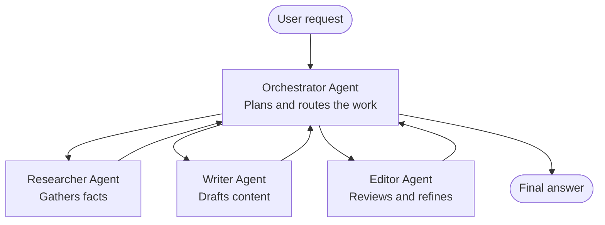

# ਮੱਲਟੀ-ਏਜੰਟ ਬੇਸਿਕਸ - ਆਪਣੀ ਪਹਿਲੀ ਕੋਆਰਡੀਨੇਟਿਡ ਏਆਈ ਸਿਸਟਮ Deploy ਕਰੋ

**ਅਧਿਆਇ ਨੈਵੀਗੇਸ਼ਨ:**
- **📚 ਕੋਰਸ ਹೋਮ**: [ਸ਼ੁਰੂਆਤੀਆਂ ਲਈ AZD](../../README.md)
- **📖 ਮੌਜੂਦਾ ਅਧਿਆਇ**: ਅਧਿਆਇ 5 - ਮੱਲਟੀ-ਏਜੰਟ ਏਆਈ ਸਮਾਧਾਨ
- **⬅️ ਪਿਛਲੇ**: [ਅਧਿਆਇ 4: ਇਨਫਰਾਸਟ੍ਰਕਚਰ](../chapter-04-infrastructure/README.md)
- **➡️ ਅੱਗੇ**: [ਸਹਯੋਗ ਪੈਟਰਨ](../chapter-06-pre-deployment/coordination-patterns.md)

> ਜਾਰੀ ਕੀਤੇ ਗਏ `azd 1.37.2` ਸੰਦਰਭ ਮੁਤਾਬਕ ਕਮਾਂਡ ਗਾਈਡੈਂਸ ਦੀ ਸਮੀਖਿਆ ਕੀਤੀ ਗਈ। ਕਲਾਉਡ ਡਿਪਲੋਇਮੈਂਟਸ ਨਹੀਂ ਕੀਤੇ ਗਏ।

## ਪਰਿਚਯ

ਪਹਿਲਾਂ ਦੇ ਅਧਿਆਇਆਂ ਵਿੱਚ ਤੁਸੀਂ ਇੱਕਲਾਇ ਐਪਲੀਕੇਸ਼ਨ Deploy ਕੀਤਾ ਸੀ—ਅਤੇ ਅਧਿਆਇ 2 ਵਿੱਚ ਤੁਸੀਂ ਇੱਕ ਏਆਈ ਏਜੰਟ Deploy ਕੀਤਾ ਸੀ। ਇਹ ਪਾਠ ਅਗਲਾ ਕਦਮ ਹੈ: ਇੱਕ **ਮੱਲਟੀ-ਏਜੰਟ ਸਿਸਟਮ** Deploy ਕਰਨਾ, ਜਿੱਥੇ ਕਈ ਵਿਸ਼ੇਸ਼ਜ ਜਾਣਕਾਰ ਏਜੰਟ ਮਿਲਕੇ ਕੰਮ ਕਰਦੇ ਹਨ ਤਾਂ ਜੋ ਕੋਈ ਵੀ ਏਜੰਟ ਆਪਣੇ ਆਪ ਨਾਲ ਚੰਗੀ ਤਰ੍ਹਾਂ ਹੱਲ ਨਾ ਕਰ ਸਕੇ।

ਸ਼ੁਰੂਆਤੀਆਂ ਲਈ ਚੰਗੀ ਖ਼ਬਰ: **ਤੁਹਾਨੂੰ ਜ਼ਰੂਰੀ ਨਹੀਂ ਕਮਾਂਡਾਂ ਦੀ ਨਵੀਂ ਲੋੜ।** ਇੱਕ ਮੱਲਟੀ-ਏਜੰਟ ਸਮਾਧਾਨ ਅਜੇ ਵੀ ਇੱਕ azd ਪ੍ਰੋਜੈਕਟ ਹੈ। ਤੁਸੀਂ `azd init`, `azd up`, ਟੈਸਟ ਕਰੋਗੇ ਅਤੇ `azd down` ਕਰੋਗੇ—ਉਹੀ ਵਰਕਫਲੋ ਜੋ ਤੁਸੀਂ ਪਹਿਲਾਂ ਹੀ ਜਾਣਦੇ ਹੋ। ਜੋ ਬਦਲਦਾ ਹੈ ਉਹ ਅੰਦਰਲੀ ਐਪ ਦੀ *ਆਕਾਰ* ਹੈ।

## ਬੁੱਧੀਮੱਤੀ ਦੇ ਲਕਸ਼

ਇਸ ਪਾਠ ਦੇ ਖਤਮ ਹੋਣ ਤੱਕ, ਤੁਸੀਂ:
- ਸਮਝ ਜਾਵੋਗੇ ਕਿ "ਮੱਲਟੀ-ਏਜੰਟ" ਦਾ ਕੀ ਅਰਥ ਹੈ ਅਤੇ ਇਹ ਕਦੋਂ ਵਧੇਰੇ ਜਟਿਲਤਾ ਲਾਇਕ ਹੈ
- ਮੱਲਟੀ-ਏਜੰਟ ਸਿਸਟਮ ਵਿੱਚ ਆਮ ਭੂਮਿਕਾਵਾਂ (ਅੰਤਰਕਾਰੀ + ਵਿਸ਼ੇਸ਼ਜ) ਨੂੰ ਪਛਾਣੋਗੇ
- ਇੱਕ ਅਸਲੀ, ਕੰਮ ਕਰਨ ਵਾਲੇ ਮੱਲਟੀ-ਏਜੰਟ ਟੈਂਪਲੇਟ ਨੂੰ `azd up` ਨਾਲ Deploy ਕਰੋਗੇ
- ਉਹ Azure ਸਰੋਤ ਸਮਝੋਗੇ ਜੋ ਮੱਲਟੀ-ਏਜੰਟ ਐਪ ਲਈ ਬੈਕਅੱਪ ਦਿੰਦੇ ਹਨ
- ਸਮਾਧਾਨ ਨੂੰ ਸੁਰੱਖਿਅਤ ਤਰੀਕੇ ਨਾਲ ਜਾਂਚਣ, ਕਸਟਮਾਈਜ਼ ਕਰਨ ਅਤੇ ਖ਼ਤਮ ਕਰਨ ਦਾ ਤਰੀਕਾ ਜਾਣੋਗੇ

## ਸਿੱਖਣ ਦੇ ਨਤੀਜੇ

ਇਸ ਪਾਠ ਨੂੰ ਪੂਰਾ ਕਰਨ ਤੋਂ ਬਾਅਦ, ਤੁਸੀਂ ਯੋਗ ਹੋਵੋਗੇ:
- ਇੱਕ ਇਕੱਲੇ ਏਜੰਟ ਅਤੇ ਇੱਕ ਮੱਲਟੀ-ਏਜੰਟ ਸਿਸਟਮ ਵਿੱਚ ਫਰਕ ਵਿਆਖਿਆ ਕਰਨ ਲਈ
- ਇੱਕ ਇਕੱਲੇ ਏਜੰਟ ਸਾਥ ਟੂਲਜ਼ ਅਤੇ ਇੱਕ ਸੱਚੇ ਮੱਲਟੀ-ਏਜੰਟ ਡਿਜ਼ਾਇਨ ਵਿੱਚ ਚੋਣ ਕਰਨ ਲਈ
- azd ਨਾਲ ਇੱਕ ਮੱਲਟੀ-ਏਜੰਟ ਟੈਂਪਲੇਟ End to End Deploy ਅਤੇ ਟੈਸਟ ਕਰਨ ਲਈ
- ਪਛਾਣ ਕਰੋ ਕਿ ਹਰ ਏਜੰਟ ਕਿੱਥੇ ਚਲਦਾ ਹੈ ਅਤੇ ਉਹ ਕਿਵੇਂ ਸੰਚਾਰ ਕਰਦੇ ਹਨ
- ਸਾਰੇ ਸਰੋਤਾਂ ਨੂੰ ਸਾਫ਼ ਕਰਨਾ ਤਾਂ ਜੋ ਚੱਲਦੇ ਖਰਚਿਆਂ ਤੋਂ ਬਚਿਆ ਜਾ ਸਕੇ

---

## ਮੱਲਟੀ-ਏਜੰਟ ਸਿਸਟਮ ਕੀ ਹੈ?

ਇੱਕ ਸਿੰਗਲ ਏਆਈ ਏਜੰਟ ਇੱਕ ਮਾਡਲ ਹੁੰਦਾ ਹੈ ਜਿਸਦੇ ਕੋਲਹਦਾਇਤਾਂ ਦਾ ਸੈੱਟ ਅਤੇ (ਚਾਹੇ ਤਾਂ) ਕੁਝ ਟੂਲਜ਼ ਹੁੰਦੇ ਹਨ। ਇਹ ਧਿਆਨ ਕੇਂਦ੍ਰਿਤ ਕੰਮਾਂ ਲਈ ਚੰਗਾ ਕੰਮ ਕਰਦਾ ਹੈ। ਪਰ ਜਿਵੇਂ ਜਿਵੇਂ ਕੰਮ ਵੱਧਦਾ ਹੈ—ਖੋਜ, ਫਿਰ ਲਿਖਣਾ, ਫਿਰ ਸੰਜੋਨਾ, ਫਿਰ ਤੱਥ ਪ੍ਰਮਾਣਿਤ ਕਰਨਾ—ਸਭ ਕੁਝ ਇੱਕ ਪ੍ਰਾਂਪਟ ਵਿੱਚ ਮੁੜਨਾ ਏਜੰਟ ਨੂੰ ਹੌਲੀ, ਘੱਟ ਭਰੋਸੇਮੰਦ ਅਤੇ ਡਿਬੱਗ ਕਰਨਾ ਔਖਾ ਬਣਾ ਦਿੰਦਾ ਹੈ।

ਇੱਕ **ਮੱਲਟੀ-ਏਜੰਟ ਸਿਸਟਮ** ਕੰਮ ਨੂੰ ਵਿਸ਼ੇਸ਼ਜਾਨਕਾਰਾਂ ਵਿੱਚ ਵੰਡਦਾ ਹੈ ਜੋ ਹਰ ਇੱਕ ਕੰਮ ਚੰਗੀ ਤਰ੍ਹਾਂ ਕਰਦਾ ਹੈ, ਇੱਕ ਅੰਤਰਕਾਰੀ ਦੁਆਰਾ ਸਹਯੋਗਿਤ:



### ਦੋ ਭੂਮਿਕਾਵਾਂ ਜੋ ਤੁਸੀਂ ਹਮੇਸ਼ਾ ਦੇਖੋਗੇ

| ਭੂਮਿਕਾ | ਕੰਮ | ਉਦਾਹਰਨ |
|------|-----|---------|
| **ਅੰਤਰਕਾਰੀ** | ਫੈਸਲਾ ਕਰਦਾ ਹੈ *ਅਗਲਾ ਕੀ ਹੋਵੇ* ਅਤੇ ਏਜੰਟਾਂ ਵਿਚਕਾਰ ਕੰਮ ਭੇਜਦਾ ਹੈ | "ਪਹਿਲਾਂ ਖੋਜ, ਫਿਰ ਲਿਖੋ, ਫਿਰ ਸੰਜੋ" |
| **ਵਿਸ਼ੇਸ਼ਜ** | ਇੱਕ ਧਿਆਨ ਕੇਂਦ੍ਰਿਤ ਕੰਮ ਕਰਦਾ ਹੈ ਅਤੇ ਨਤੀਜਾ ਵਾਪਸ ਕਰਦਾ ਹੈ | ਇੱਕ "ਖੋਜਕਾਰ" ਜੋ ਸਿਰਫ਼ ਤੱਥ ਇਕੱਤਰ ਕਰਦਾ ਹੈ |

### ਕੀ ਤੁਹਾਨੂੰ ਅਸਲ ਵਿੱਚ ਕਈ ਏਜੰਟਾਂ ਦੀ ਲੋੜ ਹੈ?

ਆਮ ਤੌਰ ਤੇ ਸਧਾਰਣ ਰੱਖੋ। ਮੱਲਟੀ-ਏਜੰਟ **ਸਿਰਫ਼** ਇਸ ਵੇਲੇ ਵਰਤੋਂ ਜਦੋਂ ਇਹ ਸੱਚ ਹੋਵੇ:

- ✅ ਕੰਮ ਵਿੱਚ **ਵੱਖ-ਵੱਖ ਚਰਣ** ਹੁੰਦੇ ਹਨ ਜੋ ਵੱਖ-ਵੱਖ ਹਦਾਇਤਾਂ ਨਾਲ ਲਾਭਪ੍ਰਦ ਹੁੰਦੇ ਹਨ (ਖੋਜ ਵੱਲੋਂ ਲਿਖਣ ਤੇ ਸੰਸੋਧਨ ਤੱਕ)
- ✅ ਤੁਸੀਂ ਚਾਹੁੰਦੇ ਹੋ ਕਿ ਵਿਸ਼ੇਸ਼ਜਾਂ **ਸਮਾਂ ਬਚਾਉਣ ਲਈ ਸਾਥ-ਸਾਥ ਚਲਣ** 
- ✅ ਵੱਖ-ਵੱਖ ਕਦਮਾਂ ਲਈ **ਵੱਖਰੇ ਟੂਲਜ਼ ਜਾਂ ਡਾਟਾ ਸੋਰਸਿਜ਼ ਦੀ ਲੋੜ** ਹੈ
- ✅ ਤੁਹਾਨੂੰ ਚਾਹੀਦਾ ਹੈ ਕਿ ਹਰ ਕਦਮ **ਆਜ਼ਾਦ ਤੌਰ ਤੇ ਟੈਸਟ ਅਤੇ ਡਿਬੱਗ ਕੀਤਾ ਜਾ ਸਕੇ**

ਜੇ ਤੁਹਾਡਾ ਕੰਮ ਸਿਰਫ਼ ਇੱਕ ਪ੍ਰਸ਼ਨ-ਉੱਤਰ ਜਾਂ ਇੱਕ ਸਧਾਰਣ ਟੂਲ ਕਾਲ ਹੈ, ਤਾਂ ਇੱਕ **ਇੱਕਲਾਏ ਏਜੰਟ ਸਾਥ ਟੂਲਜ਼** (ਅਧਿਆਇ 2) ਸਧਾਰਣ, ਸਸਤਾ ਅਤੇ ਚਲਾਉਣਾ ਆਸਾਨ ਹੈ।

> **ਸ਼ੁਰੂਆਤੀ ਸੁਝਾਅ:** "ਵੱਧ ਏਜੰਟ" ਦਾ ਮਤਲਬ "ਵਧੀਆ" ਨਹੀਂ। ਹਰ ਏਜੰਟ ਲੇਟੈਂਸੀ, ਖ਼ਰਚ ਅਤੇ ਨਵੀਂ ਚੀਜ਼ ਨਿਗਰਾਨੀ ਵਿੱਚ ਵਧਾਉਂਦਾ ਹੈ। ਏਜੰਟ ਨੂੰ ਸਿਰਫ਼ ਉਸੇ ਵੇਲੇ ਜੋੜੋ ਜਦੋਂ ਸਮੱਸਿਆ ਸਾਫ਼ ਤੌਰ ਤੇ ਹਿੱਸਿਆਂ ਵਿੱਚ ਵੰਡ ਜਾਂਦੀ ਹੈ।

---

## Azure 'ਤੇ ਮੱਲਟੀ-ਏਜੰਟ ਬਨਾਉਣ ਦੇ ਦੋ ਤਰੀਕੇ

| ਤਰੀਕਾ | ਕੀ ਹੈ | ਸਭ ਤੋਂ ਵਧੀਆ |
|----------|-----------|----------|
| **ਇੱਕਲਾਏ ਏਜੰਟ + ਟੂਲਜ਼** | ਇੱਕ Foundry ਏਜੰਟ ਜੋ ਫੰਕਸ਼ਨ/ਟੂਲਜ਼ ਕਾਲ ਕਰਦਾ ਹੈ | ਸਧਾਰਣ ਵਰਕਫਲੋ, ਸ਼ੁਰੂਆਤ |
| **ਕਈ ਕੋਆਰਡੀਨੇਟਿਡ ਏਜੰਟ** | ਕਈ ਏਜੰਟ ਇੱਕ ਅੰਤਰਕਾਰੀ ਨਾਲ | ਵੱਖਰੇ ਚਰਣ, ਸਾਥ-ਸਾਥ ਕੰਮ, ਵਿਸ਼ੇਸ਼ਤਾ |

ਇਹ ਪਾਠ ਦੂਜੇ ਤਰੀਕੇ 'ਤੇ ਧਿਆਨ ਕੇਂਦ੍ਰਿਤ ਹੈ ਜੋ ਇੱਕ **ਤਿਆਰ ਕੀਤੇ ਟੈਂਪਲੇਟ** ਦਾ ਉਪਯੋਗ ਕਰਦਾ ਹੈ, ਤਾਂ ਜੋ ਤੁਸੀਂ ਆਪਣਾ ਬਣਾਉਣ ਤੋਂ ਪਹਿਲਾਂ ਇੱਕ ਅਸਲੀ ਮੱਲਟੀ-ਏਜੰਟ ਸਿਸਟਮ ਚਲਦਾ ਵੇਖ ਸਕੋ।

---

## ਹੱਥ-ਉੱਪ: ਇੱਕ ਕੰਮ ਕਰਨ ਵਾਲੇ ਮੱਲਟੀ-ਏਜੰਟ ਐਪ Deploy ਕਰੋ

ਅਸੀਂ Deploy ਕਰਾਂਗੇ **ਕਾਂਟੋਸੋ ਕ੍ਰੀਏਟਿਵ ਰਾਈਟਰ**, ਇੱਕ ਅਧਿਕਾਰਕ Azure ਸੈਂਪਲ ਜੋ ਖੋਜ, ਉਤਪਾਦ, ਲਿਖਾਈ, ਅਤੇ ਸੰਸੋਧਨ ਏਜੰਟਾਂ ਨੂੰ ਸਹਯੋਗ ਦਿੰਦਾ ਹੈ ਤਾਂ ਜੋ ਇੱਕ ਲੇਖ ਬਣਾਇਆ ਜਾ ਸਕੇ। ਅੱਗੇ ਵੱਧਣ ਤੋਂ ਪਹਿਲਾਂ, [ਸੈਂਪਲ ਦੀਆਂ ਅਗਵਾਈਆਂ ਅਤੇ ਖਰਚੇ](https://github.com/Azure-Samples/contoso-creative-writer#azure-account-requirements) ਚੈੱਕ ਕਰੋ: ਇਸ ਨੂੰ ਮਾਡਲ ਕੋਟਾ, Azure AI Search, Bing Grounding ਐਕਸੈਸ, Python, Docker, ਅਤੇ Bash-ਸਹਿਯੋਗੀ ਹੁਕਮ ਦੀ ਲੋੜ ਹੈ। ਮਾਡਲ ਅਤੇ ਖੇਤਰ ਦੀ ਉਪਲਬਧਤਾ ਤੁਹਾਡੇ ਸਬਸਕ੍ਰਿਪਸ਼ਨ 'ਤੇ ਨਿਰਭਰ ਕਰਦੀ ਹੈ; ਕਿਸੇ ਖਾਸ ਖੇਤਰ ਦੀ ਚੋਣ ਨਾਲ ਡਿਪਲੋਇਮੈਂਟ ਦੀ ਗਾਰੰਟੀ ਨਹੀਂ ਹੈ।

### ਕਦਮ 1: ਟੈਂਪਲੇਟ ਸ਼ੁਰੂ ਕਰੋ

```bash
# Create a working folder
mkdir creative-writer && cd creative-writer

# Initialize from the official multi-agent template
azd init --template Azure-Samples/contoso-creative-writer .
```

> ਕਿਸੇ ਵੀ ਸਮੇਂ ਹੋਰ ਮੱਲਟੀ-ਏਜੰਟ ਟੈਂਪਲੇਟ ਨੂੰ [Awesome AZD AI ਗੈਲਰੀ](https://azure.github.io/awesome-azd/?tags=ai) ਵਿੱਚ ਵੇਖੋ। ਹੋਰ ਸ਼ੁਰੂਆਤੀ-ਮਿੱਤਰ ਵਿਕਲਪਾਂ ਵਿੱਚ `get-started-with-ai-agents` ਅਤੇ `azure-ai-travel-agents` ਸ਼ਾਮਲ ਹਨ।

### ਕਦਮ 2: ਪ੍ਰਮਾਣਿਕਤਾ ਕਰੋ

```bash
# Required for azd workflows
azd auth login

# Also required by this sample's Azure CLI hooks
az login
```

### ਕਦਮ 3: ਵਾਤਾਵਰਨ ਚੈੱਕ ਕਰੋ

```bash
# init normally creates/selects an environment; confirm it before proceeding
azd env list
# Only if you need an additional environment:
# azd env new dev
```

### ਕਦਮ 4: ਪੂਰਵ ਦਰਸ਼ਨ (ਪ੍ਰਿਵਿਊ), ਫਿਰ Deploy ਕਰੋ

```bash
# See what will be created before spending anything (recommended)
azd provision --preview

# Provision infrastructure and deploy all agents in one step
azd up
```

`azd up` ਗੁਮ ਹੋਏ ਸਬਸਕ੍ਰਿਪਸ਼ਨ ਅਤੇ ਖੇਤਰ ਸੈਟਿੰਗਾਂ ਲਈ ਪੁੱਛੇਗਾ, ਫਿਰ ਸਰੋਤ ਪ੍ਰਦਾਨ ਕਰੇਗਾ ਅਤੇ ਐਪਲੀਕੇਸ਼ਨ ਨੂੰ ਤੈਅ ਕਰੇਗਾ। ਪ੍ਰੀਵਿਊ ਕੁਆਟਾ ਰਿਜ਼ਰਵ ਨਹੀਂ ਕਰਦਾ ਜਾਂ ਸਫਲਤਾ ਦੀ ਗਾਰੰਟੀ ਨਹੀਂ ਦਿੰਦਾ; ਟੈਮਪਲੇਟ ਹੂਕਸ ਹਾਲਾਂਕਿ ਪ੍ਰੋਵਿਜ਼ਨਿੰਗ ਪ੍ਰੀਵਿਊ ਦੇ ਦੌਰਾਨ ਵੀ ਚੱਲ ਸਕਦੇ ਹਨ, ਇਸ ਲਈ ਪਹਿਲਾਂ ਉਨ੍ਹਾਂ ਦੀ ਜਾਂਚ ਕਰੋ। ਹਰ **ਸੇਵਾ ਤੈਅ ਕਰਨ** (ਮਾਡਲ ਪ੍ਰੋਵਿਜ਼ਨਿੰਗ ਨਹੀਂ) ਲਈ azd ਕਿੰਨੀ ਦੇਰ ਇੰਤਜ਼ਾਰ ਕਰਦਾ ਹੈ, ਇਸ ਨੂੰ ਵਧਾਉਣ ਲਈ:

```bash
azd deploy --timeout 1800
```

ਇੱਕ ਟਾਈਮਆਉਟ azd ਦੀ ਉਡੀਕ ਰੋਕਦਾ ਹੈ; ਇਹ Azure ਵਿੱਚ ਤੈਅ ਕਰਨ ਨੂੰ ਰੱਦ ਨਹੀਂ ਕਰਦਾ। ਦੁਬਾਰਾ ਕੋਸ਼ਿਸ਼ ਕਰਨ ਤੋਂ ਪਹਿਲਾਂ ਸਰੋਤ ਦੀ ਹਾਲਤ ਦੀ ਜਾਂਚ ਕਰੋ।

> **ਲਾਗਤ ਅਤੇ ਸਮਰੱਥਾ ਬਾਰੇ ਸਾਵਧਾਨੀ:** ਮਲਟੀ-ਏਜੰਟ ਐਪ AI ਮਾਡਲ ਤੈਅ ਕਰਦੇ ਹਨ ਜੋ ਕੁਆਟਾ ਖਰਚ ਕਰਦੇ ਹਨ ਅਤੇ ਲਾਗਤ ਆਉਂਦੀ ਹੈ। ਜੇ `azd up` ਮਾਡਲ ਕੁਆਟਾ 'ਤੇ ਅਸਫਲ ਰਹਿੰਦਾ ਹੈ, ਤਾਂ ਖੇਤਰ ਅਤੇ ਕੁਆਟਾ ਠੀਕ ਕਰਨ ਲਈ [AI Troubleshooting](../chapter-07-troubleshooting/ai-troubleshooting.md) ਵੇਖੋ, ਅਤੇ ਅਧਿਆਇ 6 [Capacity Planning](../chapter-06-pre-deployment/capacity-planning.md)।

---

## ਤੁਸੀਂ ਜੋ ਡਿਪਲੋਏ ਕੀਤਾ ਉਹ ਸਮਝਣਾ

ਇੱਕ ਆਮ ਮਲਟੀ-ਏਜੰਟ ਐਪ ਇਸ ਤਰ੍ਹਾਂ ਏਜ਼ਰ ਸਰੋਤਾਂ ਦਾ ਇੱਕ ਸੈੱਟ ਮੁਹੱਈਆ ਕਰਦੀ ਹੈ ਜੋ ਉੱਪਰ ਦਿੱਤੀ ਚਿੱਤਰ ਵਿੱਚ ਜਿੰਮੇਵਾਰੀਆਂ ਨਾਲ ਸਿੱਧਾ ਮੇਲ ਖਾਂਦੇ ਹਨ:

| ਸਰੋਤ | ਇਹ ਕਿਉਂ ਹੈ |
|----------|----------------|
| **Microsoft Foundry / Models** | ਹਰ ਏਜੰਟ ਵਲੋਂ ਵਰਤੇ ਜਾਣ ਵਾਲੇ ਭਾਸ਼ਾ ਮਾਡਲਾਂ ਦੀ ਮਿਜਬਾਨੀ ਕਰਦਾ ਹੈ |
| **Azure AI Search** | ਖੋਜ ਕਰਨ ਵਾਲੇ ਏਜੰਟ ਨੂੰ ਮੂਲ ਡੇਟਾ ਦਿੰਦਾ ਹੈ |
| **Container Apps** (ਜਾਂ App Service) | ਅਆਰਕੇਸਟਰੇਟਰ ਅਤੇ ਏਜੰਟ ਕੋਡ ਨੂੰ ਮਿਜਬਾਨੀ ਕਰਦਾ ਹੈ |
| **Cosmos DB** (ਕੁਝ ਨਮੂਨਿਆਂ ਵਿੱਚ) | ਏਜੰਟਾਂ ਵਿਚਕਾਰ ਸਾਂਝੀ ਰਾਜ/ਮੇਮੋਰੀ ਸਟੋਰ ਕਰਦਾ ਹੈ |
| **ਐਪਲੀਕੇਸ਼ਨ ਇਨਸਾਈਟਸ** | ਏਜੰਟਾਂ *ਦੇ ਵਿਚਕਾਰ* ਬੇਨਤੀਆਂ ਦਾ ਟਰੇਸ ਕਰਦਾ ਹੈ ਤਾਂ ਜੋ ਤੁਸੀਂ ਫਲੋ ਦੀ ਡੀਬੱਗਿੰਗ ਕਰ ਸਕੋ |

### ਏਜੰਟ ਇਕ ਦੂਜੇ ਨਾਲ ਕਿਵੇਂ ਗੱਲ ਕਰਦੇ ਹਨ

ਜ਼ਿਆਦਾਤਰ azd ਮੁਲਟੀ-ਏਜੰਟ ਉਦਾਹਰਨਾਂ ਵਿੱਚ, **ਆਰਕੈਸਟਰਟਰ ਤੁਹਾਡੇ ਐਪਲੀਕੇਸ਼ਨ ਕੋਡ ਵਿੱਚ ਚੱਲਦਾ ਹੈ** (ਜਿਵੇਂ ਕਿ Semantic Kernel ਜਾਂ Microsoft Agent Framework ਵਰਗੇ ਫ੍ਰੇਮਵਰਕ ਦਾ ਇਸਤੇਮਾਲ ਕਰਕੇ)। ਆਰਕੈਸਟਰਟਰ ਹਰੇਕ ਵਿਸ਼ੇਸ਼ ਏਜੰਟ ਨੂੰ ਬਾਰੀ ਬਾਰੀ ਕਾਲ ਕਰਦਾ ਹੈ, ਨਤੀਜੇ ਪਾਸ ਕਰਦਾ ਹੈ, ਅਤੇ ਅੰਤਿਮ ਜਵਾਬ ਇਕੱਠਾ ਕਰਦਾ ਹੈ। ਏਜੰਟ ਸੰਦਰਭ ਸਾਂਝਾ ਕਰਦੇ ਹਨ:

- **ਫੰਕਸ਼ਨ/ਉਪਕਰਨ ਕਾਲਜ਼** — ਆਰਕੈਸਟਰਟਰ ਇੱਕ ਵਿਸ਼ੇਸ਼ਗਿਆ ਏਜੰਟ ਨੂੰ ਕਾਲ ਕਰਦਾ ਹੈ ਅਤੇ ਨਤੀਜਾ ਪ੍ਰਾਪਤ ਕਰਦਾ ਹੈ
- **ਸਾਂਝੀ ਮੈਮੋਰੀ** — ਇੱਕ ਡਾਟਾਬੇਸ (ਅਕਸਰ Cosmos DB) ਸਥਿਤੀ ਰੱਖਦਾ ਹੈ ਜਿਸਨੂੰ ਦੋਵੇਂ ਏਜੰਟ ਪੜ੍ਹ ਸਕਦੇ ਹਨ
- **ਮੇਸੇਜ/ਘਟਨਾਵਾਂ** — ਢਿੱਲੀ ਕਪਲਿੰਗ ਲਈ, ਏਜੰਟ ਕਿਊ ਜਾਂ ਸੇਵਾ ਬੱਸ ਰਾਹੀਂ ਸੰਚਾਰ ਕਰਦੇ ਹਨ

> **ਡੀਬੱਗਿੰਗ ਲਈ ਇਹ ਮੱਤਵਪੂਰਨ ਕਿਉਂ ਹੈ:** ਕਿਉਂਕਿ ਹਰੇਕ ਕਦਮ ਅਲੱਗ ਹੁੰਦਾ ਹੈ, ਐਪਲੀਕੇਸ਼ਨ ਇਨਸਾਈਟਸ ਤੁਹਾਨੂੰ ਦਿਖਾਉਂਦਾ ਹੈ *ਕਿਹੜਾ* ਏਜੰਟ ਧੀਮਾ ਜਾਂ ਅਸਫ਼ਲ ਸੀ। ਇਹੀ ਇੱਕ ਵੱਡਾ ਕਾਰਨ ਹੈ ਜਿਸ ਕਰਕੇ ਕੰਮmulti-agent ਵਿੱਚ ਵੰਡਿਆ ਜਾਂਦਾ ਹੈ।

---

## ਡਿਪਲੋਇਮੈਂਟ ਦੀ ਪੁਸ਼ਟੀ ਕਰੋ

ਅੱਗੇ ਵਧਣ ਤੋਂ ਪਹਿਲਾਂ ਸਿਸਟਮ ਵਾਸਤਵ ਵਿੱਚ ਕੰਮ ਕਰ ਰਿਹਾ ਹੈ ਇਹ ਪੱਕਾ ਕਰੋ:

```bash
# Show the deployed endpoints
azd show

# Open the app's monitoring dashboard
azd monitor

# Open Application Insights Logs (not a terminal log stream)
azd monitor --logs
```

ਫਿਰ `azd show` ਤੋਂ ਐਪ URL ਖੋਲ੍ਹੋ ਅਤੇ ਇੱਕ ਛੋਟਾ ਲੇਖ ਮੰਗੋ। ਇਸਦੇ ਏਜੰਟ ਵਰਕਫਲੋ ਦੀ ਜਾਂਚ ਕਰਨ ਲਈ ਨਮੂਨੇ ਦੇ ਡੀਬੱਗ ਦ੍ਰਿਸ਼ ਨੂੰ ਵਰਤੋ। ਐਪਲੀਕੇਸ਼ਨ ਇਨਸਾਈਟਸ ਟ੍ਰਾਂਜ਼ੈਕਸ਼ਨ ਖੋਜ ਸਿਰਫ਼ ਉਸ ਸਮੇਂ ਵਿਅਕਤੀਗਤ ਕਦਮ ਦਿਖਾ ਸਕਦੀ ਹੈ ਜੇ ਨਮੂਨਾ ਉਪਕਰਨ ਕਰਦਾ ਹੈ ਅਤੇ ਉਹਨਾਂ ਨੂੰ ਸਹਿਯੋਗ ਦਿੰਦਾ ਹੈ; azd ਆਪੋ-ਆਪਣੇ ਏਜੰਟ ਸਪੈਨ ਨਹੀਂ ਜੋੜਦਾ।

**ਸਫਲਤਾ ਦੇ ਮਾਪਦੰਡ:**
- ✅ `azd show` ਇੱਕ ਪਹੁੰਚਯੋਗ ਐਂਡਪਆਇੰਟ ਸੂਚੀਬੱਧ ਕਰਦਾ ਹੈ
- ✅ ਇੱਕ ਬੇਨਤੀ ਐਸਾ ਨਤੀਜਾ ਪ੍ਰਦਾਨ ਕਰਦੀ ਹੈ ਜੋ ਸਪਸ਼ਟ ਤੌਰ 'ਤੇ ਕਈ ਮੰਜ਼ਿਲਾਂ ਰਾਹੀਂ ਗਈ ਹੋਵੇ
- ✅ ਡੀਬੱਗ ਦ੍ਰਿਸ਼ ਕਈ ਏਜੰਟ ਕਦਮ ਦਿਖਾਉਂਦਾ ਹੈ; ਜੇ ਟ੍ਰੇਸਿੰਗ ਸਕ੍ਰਿਯ ਹੈ, ਤਾਂ ਖਪਤ ਤੋਂ ਬਾਅਦ ਸੰਬੰਧਤ ਟੈਲੀਮੀਟਰੀ ਦੀ ਪੁਸ਼ਟੀ ਕਰੋ

---

## ਕਸਟਮਾਈਜ਼ ਕਰੋ: ਇੱਕ ਏਜੰਟ ਜੋੜੋ ਜਾਂ ਸਮ਼ਾਰੋ

ਕਿਉਂਕਿ ਹਰ ਇੱਕ ਏਜੰਟ ਸਿਰਫ਼ ਹਦਾਇਤਾਂ ਅਤੇ ਸੰਦ ਹੁੰਦੇ ਹਨ, ਇਸ ਲਈ ਕਸਟਮਾਈਜ਼ ਕਰਨਾ ਸੌਖਾ ਹੈ:

1.  **ਏਜੰਟ ਦੀਆਂ ਪਰਿਭਾਸ਼ਾਵਾਂ ਲੱਭੋ** ਟੈਮਪਲੇਟ ਵਿੱਚ (ਅਕਸਰ ਇੱਕ `prompts/`, `agents/`, ਜਾਂ `*.prompty` ਫਾਈਲਾਂ ਦਾ ਸੈੱਟ).
2.  **ਏਜੰਟ ਦੇ ਨਿਰਦੇਸ਼ਾਂ ਨੂੰ ਟਿਊਨ ਕਰੋ** — ਉਦਾਹਰਨ ਵਜੋਂ, ਐਡੀਟਰ ਏਜੰਟ ਨੂੰ ਕਿਸੇ ਖਾਸ ਲਹਜੇ ਜਾਂ ਸ਼ਬਦ ਗਿਣਤੀ ਨੂੰ ਲਾਗੂ ਕਰਨ ਲਈ ਕਹੋ.
3.  **ਸਿਰਫ ਕੋਡ ਨੂੰ ਦੁਬਾਰਾ ਤਾਇਨਾਤ ਕਰੋ** (ਇੰਫ੍ਰਾਸਟ੍ਰੱਕਚਰ ਬਦਲਿਆ ਨਹੀਂ ਗਿਆ):

   ```bash
   azd deploy
   ```

ਆਪਣੀ *ਆਪਣੀ* Foundry ਏਜੰਟ ਪ੍ਰੋਜੈਕਟ ਨਾਲ ਅੱਗੇ ਵਧਣ ਲਈ, ਇੱਕ ਵੱਖਰੇ ਖਾਲੀ ਡਾਇਰੈਕਟਰੀ ਵਿੱਚ AZD 1.37.0+ ਨਾਲ GA ਬੰਡਲ ਦੀ ਵਰਤੋਂ ਕਰੋ:

```bash
azd ext install microsoft.foundry
azd ai agent init
azd up
azd ai agent invoke      # test, with response timing
```

ਏਜੰਟ ਇੰਸਪੈਕਟਰ ਸਥਾਨਕ ਟੈਸਟਿੰਗ, ਰਿਮੋਟ ਕੋਡ ਡਿਪਲੋਇਮੈਂਟ, ਅਤੇ ਸਾਫ਼-ਸਫਾਈ ਦੇ ਮਾਲਕੀ ਹੱਕ ਲਈ [GA ਹੋਸਟਿਡ-ਏਜੰਟ ਵਾਕਥਰੂ](../chapter-02-ai-development/microsoft-foundry-integration.md#hosted-agent-walkthrough-ga) ਦੇਖੋ। [AZD AI CLI ਰੈਫਰੈਂਸ](../chapter-08-production/production-ai-practices.md#azd-ai-cli-commands-and-extensions) ਵੱਖ-ਵੱਖ ਮੁਲਾਂਕਣ ਇਕਸਟੇਂਸ਼ਨ, ਓਪਟੀਮਾਈਜ਼ੇਸ਼ਨ, ਅਤੇ ਏਜੰਟ ਮਿਟਾਉਣ ਨੂੰ ਵੀ ਕਵਰ ਕਰਦਾ ਹੈ।

---

## ਸਾਫ਼-सੁਫ਼ਾਈ

ਬਹੁ-ਏਜੰਟ ਐਪਸ ਇੱਕ ਤੋਂ ਵੱਧ ਬਿਲਯੋਗ ਸੇਵਾਵਾਂ ਚਲਾਉਂਦੇ ਹਨ। ਜਦੋਂ ਤੁਸੀਂ ਖਤਮ ਕਰ ਲਵੋ ਤਾਂ ਸਭ ਕੁਝ ਤੋੜ ਦਿਉ:

```bash
# Review the resources and confirm deletion interactively
azd down
```

ਮਿਟਾਉਣਾ ਫੁਟਕਾਰਕ ਹੈ। ਇੱਕ ਜ਼ਰੂਰੀ ਲੈਬ ਲਈ, `azd down --force --purge` ਮਿਟਾਉਣ ਤੋਂ ਬਿਨਾਂ ਅਤੇ ਸਮਰਥਿਤ ਸੌਫਟ-ਡਿਲੀਟ ਪੁਰਜ ਪੁਸ਼ਟੀਕਰਨਾਂ ਨੂੰ ਛੱਡ ਦਿੰਦਾ ਹੈ; ਜਿੱਥੇ ਸਮਰਥਿਤ ਹੈ ਸਾਫ-ਸਫਾਈ ਨਾ ਵਾਪਸੀਯੋਗ ਹੁੰਦੀ ਹੈ ਅਤੇ ਪੁਰਜ ਸੁਰੱਖਿਆ ਵੱਲੋਂ ਰੋਕੀ ਜਾ ਸਕਦੀ ਹੈ। ਸੌਫਟ ਡਿਲੀਟ ਕਰਨ ਨਾਲ ਬਹਾਲੀ/ਨਾਂ-ਦੁਬਾਰਾ ਵਰਤੋਂ ਦੀ ਚਿੰਤਾ ਹੁੰਦੀ ਹੈ, ਖੁਦ ਇਹ ਸੰਚਾਲਿਤ ਖਰਚੇ ਦਾ ਸਬੂਤ ਨਹੀਂ ਹੁੰਦਾ। ਸਾਫ਼-ਸੁਫ਼ਾਈ ਤੋਂ ਬਾਅਦ ਕਾਇਮ ਕੀਤੇ ਗਏ ਸਰੋਤ ਅਤੇ ਬਿਲਿੰਗ ਦੀ ਜਾਂਚ ਕਰੋ।

ਜੇ ਤੁਸੀਂ ਪਹਿਲਾਂ ਹੀ ਮੌਜੂਦਾ Foundry ਪ੍ਰੋਜੈਕਟ ਦੇ ਖਿਲਾਫ ਇੱਕ ਹੋਸਟ ਕੀਤਾ ਗਿਆ ਏਜੰਟ ਸ਼ੁਰੂ ਕੀਤਾ ਹੈ, ਤਾਂ `azd down` ਉਸ ਪ੍ਰੋਜੈਕਟ ਦਾ ਏਜੰਟ ਅਤੇ ਹੋਰ ਸਰੋਤ ਜਗ੍ਹਾ ਤੇ ਰਹਿਣ ਦਿੰਦਾ ਹੈ। ਕੇਵਲ ਉਹ ਨ ਦਾ ਅਧਿਕਾਰਕ ਸਰੋਤ ਹਟਾਓ ਜੋ ਤੁਸੀਂ ਅਲੱਗ ਤੌਰ 'ਤੇ ਰੱਖਦੇ ਹੋ। ਆਪਣੇ AZD ਵਾਤਾਵਰਨ ਦੁਆਰਾ ਬਣਾਏ ਗਏ ਨਵੇਂ Foundry ਪ੍ਰੋਜੈਕਟ ਲਈ, `azd down` ਸਰੋਤ ਸਮੂਹ ਅਤੇ ਇਸ ਵਿੱਚ ਸਭ ਕੁਝ ਮਿਟਾ ਦਿੰਦਾ ਹੈ।

---

## ਉਤਪਾਦਨ ਬਹੁ-ਏਜੰਟ ਪ੍ਰਣਾਲੀਆਂ ਬਾਰੇ ਇੱਕ ਟਿੱਪਣੀ

ਇਸ ਰੇਪੋ ਵਿੱਚ [ਰਿਟੇਲ ਮਲਟੀ-ਏਜੈਂਟ ਸੋਲਿਊਸ਼ਨ](../../examples/retail-scenario.md) ਇੱਕ **ਆਰਕੀਟੈਕਚਰ ਬਲੂਪ੍ਰਿੰਟ** ਹੈ, ਨਾਕਿ ਇੱਕ ਇੱਕ-ਕਮਾਂਡ ਟੈਮਪਲੇਟ—ਇਹ ਦਸਤਾਵੇਜ਼ ਕਰਦਾ ਹੈ ਕਿ ਉਤਪਾਦਨ ਰਿਟੇਲ ਸਿਸਟਮ *ਕਿਵੇਂ* ਬਣਾਇਆ ਜਾਵੇਗਾ (ਅਤੇ ਇਹ ਸਪਸ਼ਟ ਹੈ ਕਿ ਪੂਰਾ ਨਿਰਮਾਣ ਇੱਕ ਮਹੱਤਵਪੂਰਨ ਕੋਸ਼ਿਸ਼ ਹੈ)। ਇਸਨੂੰ ਇੱਥੇ ਇੱਕ ਕੰਮ ਕਰਨ ਵਾਲੇ ਨਮੂਨੇ ਨੂੰ ਤਾਇਨਾਤ ਕਰਨ ਤੋਂ *ਬਾਅਦ* ਇੱਕ ਡਿਜ਼ਾਈਨ ਸੰਦਰਭ ਵਜੋਂ ਵਰਤੋ। ਉਤਪਾਦਨ ਦੀਆਂ ਚਿੰਤਾਵਾਂ (ਮਜ਼ਬੂਤੀ, ਲਾਗਤ, ਨਿਗਰਾਨੀ, ਸੁਰਾਜ) ਲਈ, [ਅਧਿਆਇ 8: ਉਤਪਾਦਨ AI ਅਮਲ](../chapter-08-production/production-ai-practices.md) ਵੱਲ ਜਾਰੀ ਰੱਖੋ।

---

## ਸਾਰ

- ਇੱਕ ਮਲਟੀ-ਏਜੈਂਟ ਸਿਸਟਮ ਅਸਪਸ਼ੇਸ਼ਾਂ ਵਿੱਚ ਕੰਮ ਵੰਡਦਾ ਹੈ ਜੋ ਇੱਕ ਨਿਰਦੇਸ਼ਕ ਦੁਆਰਾ ਸੰਚਾਲਿਤ ਹੁੰਦੇ ਹਨ।
- ਇਸਨੂੰ ਸਿਰਫ਼ ਤਦ ਵਰਤੋ ਜਦ ਕੰਮ ਵਿੱਚ ਵੱਖਰੇ ਪੜਾਅ, ਸਾਮਾਂਤਰਤਾ ਜਾਂ ਹਰ ਕਦਮ ਲਈ ਵੱਖਰੇ ਟੂਲ ਹੋਣ—ਨਹੀਂ ਤਾਂ ਇੱਕ ਏਜੈਂਟ ਪਸੰਦ ਕਰੋ।
- azd ਵਰਕਫ਼ਲੋ ਅਪਰਿਵਰਤਿਤ ਹੈ: `azd init` → `azd up` → test → `azd down`.
- ਇੱਕ ਅਸਲ ਟੈਮਪਲੇਟ ਜਿਵੇਂ `contoso-creative-writer` ਤੁਹਾਨੂੰ ਅੱਜ ਇੱਕ ਕੰਮ ਕਰਨ ਵਾਲੀ ਮਲਟੀ-ਏਜੈਂਟ ਐਪ ਨੂੰ ਦੇਖਣ ਅਤੇ ਕਸਟਮਾਈਜ਼ ਕਰਨ ਦਿੰਦਾ ਹੈ।
- ਏਜੈਂਟਾਂ ਵਿੱਚ ਐਪਲੀਕੇਸ਼ਨ ਇਨਸਾਈਟਸ ਟ੍ਰੇਸਿੰਗ ਮਲਟੀ-ਏਜੈਂਟ ਡਿਜ਼ਾਈਨ ਦੇ ਸਭ ਤੋਂ ਵੱਡੇ ਪ੍ਰਯੋਗਿਕ ਫਾਇਦੇ ਵਿੱਚੋਂ ਇੱਕ ਹੈ।

---

## 🔗 ਨੈਵੀਗੇਸ਼ਨ

| ਦਿਸ਼ਾ | ਪਾਠ |
|-----------|--------|
| **ਪਿਛਲਾ** | [ਅਧਿਆਇ 4: ਢਾਂਚਾ](../chapter-04-infrastructure/README.md) |
| **ਅਗਲਾ** | [ਸਮੇਤਕਾਰ ਪੈਟਰਨ](../chapter-06-pre-deployment/coordination-patterns.md) |

## 📖 ਸੰਬੰਧਿਤ ਸਰੋਤ

- [AI ਏਜੰਟ ਗਾਈਡ](../chapter-02-ai-development/agents.md)
- [ਸਮੇਤਕਾਰ ਪੈਟਰਨ](../chapter-06-pre-deployment/coordination-patterns.md)
- [ਪ੍ਰੋਡਕਸ਼ਨ AI ਅਮਲ](../chapter-08-production/production-ai-practices.md)
- [AI ਟ੍ਰਬਲਸ਼ੂਟਿੰਗ](../chapter-07-troubleshooting/ai-troubleshooting.md)

---

<!-- CO-OP TRANSLATOR DISCLAIMER START -->
**ਅਸਵੀਕਾਰੋਪਣ**:
ਇਸ ਦਸਤਾਵੇਜ਼ ਦਾ ਅਨੁਵਾਦ ਏਆਈ ਅਨੁਵਾਦ ਸੇਵਾ [Co-op Translator](https://github.com/Azure/co-op-translator) ਦੀ ਵਰਤੋਂ ਕਰਕੇ ਕੀਤਾ ਗਿਆ ਹੈ। ਜਦੋਂ ਕਿ ਅਸੀਂ ਸਹੀਤਾਵਾਂ ਲਈ ਯਤਨਸ਼ੀਲ ਹਾਂ, ਕਿਰਪਾ ਕਰਕੇ ਧਿਆਨ ਰੱਖੋ ਕਿ ਸਵੈਚਾਲਿਤ ਅਨੁਵਾਦਾਂ ਵਿੱਚ ਗਲਤੀਆਂ ਜਾਂ ਅਸਮੱਤਿਆਵਾਂ ਹੋ ਸਕਦੀਆਂ ਹਨ। ਮੂਲ ਦਸਤਾਵੇਜ਼ ਆਪਣੀ ਮੂਲ ਭਾਸ਼ਾ ਵਿੱਚ ਅਧਿਕਾਰਕ ਸਰੋਤ ਮੰਨਿਆ ਜਾਣਾ ਚਾਹੀਦਾ ਹੈ। ਜਰੂਰੀ ਜਾਣਕਾਰੀ ਲਈ, ਪੇਸ਼ੇਵਰ ਮਨੁੱਖੀ ਅਨੁਵਾਦ ਦੀ ਸਿਫ਼ਾਰਸ਼ ਕੀਤੀ ਜਾਂਦੀ ਹੈ। ਅਸੀਂ ਇਸ ਅਨੁਵਾਦ ਦੇ ਉਪਯੋਗ ਤੋਂ ਪੈਦਾ ਹੋਣ ਵਾਲੀਆਂ ਕਿਸੇ ਵੀ ਗਲਤਫਹਿਮੀਆਂ ਜਾਂ ਗਲਤ ਵਿਆਖਿਆਵਾਂ ਲਈ ਜਵਾਬਦੇਹ ਨਹੀਂ ਹਾਂ।
<!-- CO-OP TRANSLATOR DISCLAIMER END -->