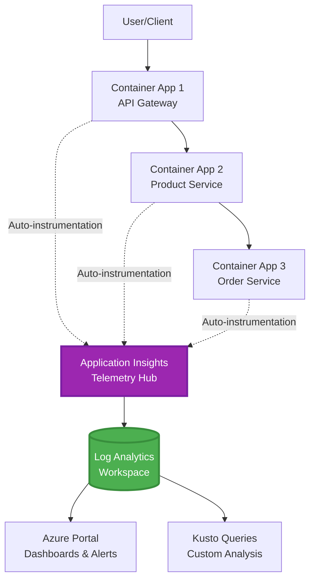
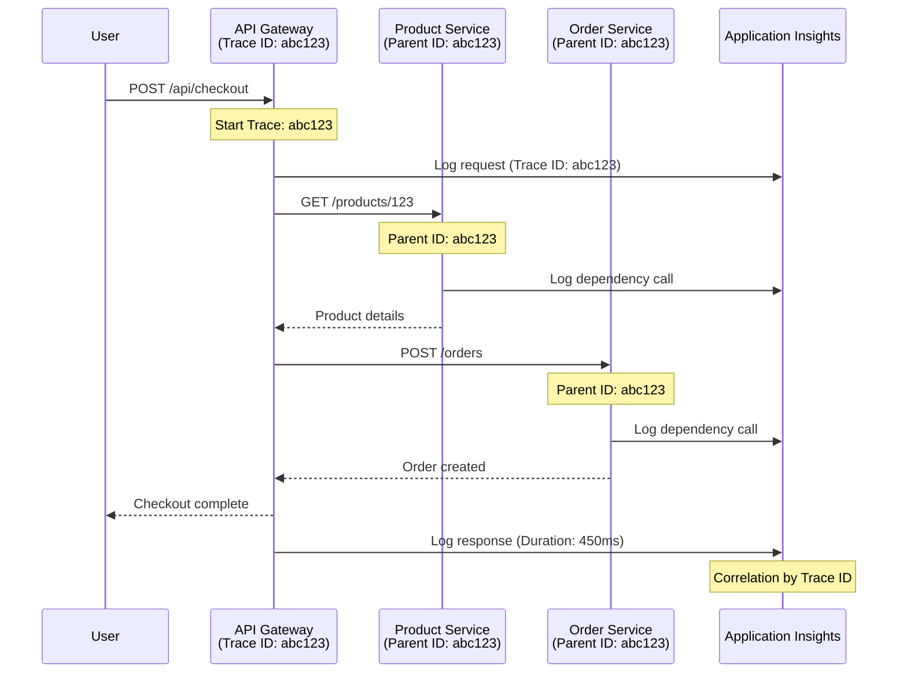

# AZD ਨਾਲ ਐਪਲੀਕੇਸ਼ਨ ਇਨਸਾਈਟਸ ਇੰਟੀਗ੍ਰੇਸ਼ਨ

⏱️ **ਅਨੁਮਾਨਿਤ ਸਮਾਂ**: 40-50 ਮਿੰਟ | 💰 **ਲਾਗਤ ਪ੍ਰਭਾਵ**: ~$5-15/ਮਹੀਨਾ | ⭐ **ਜਟਿਲਤਾ**: ਦਰਮਿਆਨਾ

**📚 ਸਿਖਲਾਈ ਦਾ ਰਾਸਤਾ:**
- ← ਪਿਛਲਾ: [ਪ੍ਰੀਫਲਾਈਟ ਚੈੱਕ](preflight-checks.md) - ਪ੍ਰੀ-ਡਿਪਲੋਈਮੈਂਟ ਵੈਰੀਫਿਕੇਸ਼ਨ
- 🎯 **ਤੁਹਾਡੀ ਸਥਿਤੀ**: ਐਪਲੀਕੇਸ਼ਨ ਇਨਸਾਈਟਸ ਇੰਟੀਗ੍ਰੇਸ਼ਨ (ਮਾਨੀਟਰਿੰਗ, ਟੈਲੀਮੀਟਰੀ, ਡੀਬੱਗਿੰਗ)
- → ਅਗਲਾ: [ਡਿਪਲੋਈਮੈਂਟ ਗਾਈਡ](../chapter-04-infrastructure/deployment-guide.md) - ਐਜ਼ੂਰ ਤੇ ਡਿਪਲੋਈ ਕਰਨਾ
- 🏠 [ਕੋਰਸ ਹੋਮ](../../README.md)

---

## ਤੁਸੀਂ ਕੀ ਸਿੱਖੋਗੇ

ਇਹ ਪਾਠ ਪੂਰਾ ਕਰਨ ਨਾਲ, ਤੁਸੀਂ:
- AZD ਇੰਫਰਾਸਟਰੱਕਚਰ ਵਿੱਚ **ਐਪਲੀਕੇਸ਼ਨ ਇਨਸਾਈਟਸ** ਦਾ ਇਲਾਨ ਕਰੋ ਅਤੇ SDK ਇੰਸਟ੍ਰੂਮੈਂਟੇਸ਼ਨ ਕਾਨਫਿਗਰ ਕਰੋ
- ਮਾਈਕ੍ਰੋਸਰਵਿਸਾਂ ਲਈ **ਵੰਡੇ ਗਏ ਟਰੇਸਿੰਗ** ਨੂੰ ਸੈੱਟ ਅੱਪ ਕਰੋ
- **ਕਸਟਮ ਟੈਲੀਮੀਟਰੀ** (ਮੀਟਰਿਕਸ, ਇਵੈਂਟਸ, ਡਿਪੈਂਡੈਂਸੀਜ਼) ਨੂੰ ਲਾਗੂ ਕਰੋ
- ਰੀਅਲ-ਟਾਈਮ ਮਾਨੀਟਰਿੰਗ ਲਈ **ਲਾਈਵ ਮੀਟਰਿਕਸ** ਸੈੱਟ ਕਰੋ
- AZD ਡਿਪਲੋਇਮੈਂਟ ਤੋਂ **ਅਲਰਟਸ ਅਤੇ ਡੈਸ਼ਬੋਰਡ** ਬਣਾਓ
- **ਟੈਲੀਮੀਟਰੀ ਕਵੈਰੀਜ਼** ਨਾਲ ਪ੍ਰੋਡਕਸ਼ਨ ਸਮੱਸਿਆਵਾਂ ਦਾ ਡੀਬੱਗ ਕਰੋ
- **ਲਾਗਤਾਂ ਅਤੇ ਸੈਂਪਲਿੰਗ** ਰਣਨੀਤੀਆਂ ਦਾ ਅਨੁਕੂਲਨ ਕਰੋ
- **AI/LLM ਐਪਲੀਕੇਸ਼ਨਜ਼** (ਟੋਕਨਜ਼, ਲਿਆਟੇnਸੀ, ਲਾਗਤਾਂ) ਦੀ ਨਿਗਰਾਨੀ ਕਰੋ

## AZD ਨਾਲ ਐਪਲੀਕੇਸ਼ਨ ਇਨਸਾਈਟਸ ਅਹੰਕਾਰ ਵਾਲਾ ਕਿਉਂ ਹੈ

### ਚੁਣੌਤੀ: ਪ੍ਰੋਡਕਸ਼ਨ ਦੀ ਨਿਗਰਾਨੀ

**ਐਪਲੀਕੇਸ਼ਨ ਇਨਸਾਈਟਸ ਬਿਨਾਂ:**
```
❌ No visibility into production behavior
❌ Manual log aggregation across services
❌ Reactive debugging (wait for customer complaints)
❌ No performance metrics
❌ Cannot trace requests across services
❌ Unknown failure rates and bottlenecks
```

**ਐਪਲੀਕੇਸ਼ਨ ਇਨਸਾਈਟਸ + AZD ਨਾਲ:**
```
✅ Automatic telemetry collection
✅ Centralized logs from all services
✅ Proactive issue detection
✅ End-to-end request tracing
✅ Performance metrics and insights
✅ Real-time dashboards
✅ AZD provisions the monitoring declared in your templates
```

**ਉਪਮਾ**: ਐਪਲੀਕੇਸ਼ਨ ਇਨਸਾਈਟਸ ਤੁਹਾਡੇ ਐਪਲੀਕੇਸ਼ਨ ਲਈ "ਬਲੈਕ ਬਾਕਸ" ਫਲਾਈਟ ਰਿਕਾਰਡਰ + ਕਾਕਪਿਟ ਡੈਸ਼ਬੋਰਡ ਵਰਗਾ ਹੈ। ਤੁਸੀਂ ਹਰ ਚੀਜ਼ ਰੀਅਲ-ਟਾਈਮ ਵਿੱਚ ਦੇਖ ਸਕਦੇ ਹੋ ਅਤੇ ਕਿਸੇ ਵੀ ਘਟਨਾ ਨੂੰ ਦੁਬਾਰਾ ਚਲਾ ਸਕਦੇ ਹੋ।

---

## ਆਰਕੀਟੈਕਚਰ ਦਾ ਝਲਕ

### AZD ਆਰਕੀਟੈਕਚਰ ਵਿੱਚ ਐਪਲੀਕੇਸ਼ਨ ਇਨਸਾਈਟਸ



### ਕੀ ਖੁਦਕਾਰ ਤੌਰ 'ਤੇ ਮਾਨੀਟਰ ਹੁੰਦਾ ਹੈ

ਸਮਰਥਿਤ ਆਟੋ-ਇੰਸਟ੍ਰੂਮੈਂਟੇਸ਼ਨ ਲਾਇਬ੍ਰੇਰੀਜ਼ ਲਈ ਰਿਕਵੇਸਟ/ਡਿਪੈਂਡੈਂਸੀਜ਼ ਕੈਪਚਰ ਕਰਦਾ ਹੈ। ਕਸਟਮ ਇਵੈਂਟਸ ਅਤੇ ਮੀਟਰਿਕਸ ਲਈ ਐਪਲੀਕੇਸ਼ਨ ਕੋਡ ਦੀ ਲੋੜ ਹੈ; ਉਪਲਬਧਤਾ ਟੈਸਟ ਨੂੰ ਵੱਖਰੇ ਤੌਰ 'ਤੇ ਕਾਨਫਿਗਰ ਕਰਨਾ ਪੈਂਦਾ ਹੈ। ਇਹ ਇਸ ਲਈ ਹਰ ਕਤਾਰ ਨੂੰ ਨਹੀਂ ਕੈਪਚਰ ਕਰਦਾ ਜੋ ਸਿਰਫ਼ ਰਿਸੋর্স ਮੌਜੂਦ ਹੋਣ ਕੰ ਕਾਰਨ ਹੈ।

| ਟੈਲੀਮੀਟਰੀ ਕਿਸਮ | ਇਹ ਕੀ ਕੈਪਚਰ ਕਰਦਾ ਹੈ | ਵਰਤੋਂ ਦਾ ਕੇਸ |
|----------------|------------------|----------|
| **ਰਿਕਵੇਸਟਸ** | HTTP ਰਿਕਵੇਸਟਸ, ਸਥਿਤੀ ਕੋਡ, ਸਮਾ | API ਪ੍ਰਦਰਸ਼ਨ ਮਾਨੀਟਰਿੰਗ |
| **ਡਿਪੈਂਡੈਂਸੀਜ਼** | ਬਾਹਰੀ ਕਾਲਜ਼ (DB, APIs, ਸਟੋਰੇਜ) | ਬੋਤਲਨੈੱਕ ਪਛਾਣੋ |
| **ਐਕਸਪੈਸ਼ਨਜ਼** | ਅਣਹੈਂਡਲ ਕੀਤੀਆਂ ਗਲਤੀਆਂ ਅਤੇ ਸਟੈਕ ਟਰੇਸ | ਫੇਲੀਆਂ ਦਾ ਡੀਬੱਗਿੰਗ |
| **ਕਸਟਮ ਇਵੈਂਟਸ** | ਕਾਰੋਬਾਰੀ ਇਵੈਂਟਸ (ਸਾਈਨਅੱਪ, ਖਰੀਦ) | ਵਿਸ਼ਲੇਸ਼ਣ ਅਤੇ ਫਨਲਜ਼ |
| **ਮੀਟਰਿਕਸ** | ਪ੍ਰਦਰਸ਼ਨ ਕਾਊਂਟਰ, ਕਸਟਮ ਮੀਟਰਿਕਸ | ਸਮਰੱਥਾ ਯੋਜਨਾ |
| **ਟਰੇਸਜ਼** | ਗੰਭੀਰਤਾ ਨਾਲ ਲਾਗ ਸੁਨੇਹੇ | ਡੀਬੱਗਿੰਗ ਅਤੇ ਆਡੀਟਿੰਗ |
| **ਉਪਲਬਧਤਾ** | ਅੱਪਟਾਈਮ ਅਤੇ ਪ੍ਰਤੀਕ੍ਰਿਆ ਸਮਾਂ ਟੈਸਟ | SLA ਮਾਨੀਟਰਿੰਗ |

---

## ਲੋੜੀਂਦੇ ਤੱਤ

### ਜ਼ਰੂਰੀ ਟੂਲਜ਼

```bash
# Verify Azure Developer CLI
azd version
# Command reference baseline: azd 1.37.2

# Verify Azure CLI
az --version
# ✅ Expected: azure-cli 2.50.0 or higher
```

### ਐਜ਼ੂਰ ਦੀਆਂ ਲੋੜਾਂ

- ਸਰਗਰਮ ਐਜ਼ੂਰ ਸਬਸਕ੍ਰਿਪਸ਼ਨ
- ਬਣਾਉਣ ਦੇ ਅਧਿਕਾਰ:
  - ਐਪਲੀਕੇਸ਼ਨ ਇਨਸਾਈਟਸ ਦੇ ਰਿਸੋੁਰਸ
  - ਲਾਗ ਐਨਾਲਿਟਿਕਸ ਵਿਰਕਸਪੇਸز
  - ਕੰਟੇਨਰ ਐਪਸ
  - ਰਿਸੋੁਰਸ ਗਰੂਪ

### ਗਿਆਨ ਦੀਆਂ ਲੋੜਾਂ

ਤੁਸੀਂ ਸੰਪੂਰਨ ਕਰ ਚੁੱਕੇ ਹੋਣ ਚਾਹੀਦੇ ਹੋ:
- [AZD ਬੇਸਿਕਸ](../chapter-01-foundation/azd-basics.md) - ਬੁਨਿਆਦੀ AZD ਧਾਰਣਾ
- [ਕਾਨਫਿਗਰੇਸ਼ਨ](../chapter-03-configuration/configuration.md) - ਮਾਹੌਲ ਸੈਟਅੱਪ
- [ਪਹਿਲਾ ਪ੍ਰੋਜੈਕਟ](../chapter-01-foundation/first-project.md) - ਮੁਢਲਾ ਡਿਪਲੋਇਮੈਂਟ

---

## ਪਾਠ 1: AZD ਨਾਲ ਆਟੋਮੈਟਿਕ ਐਪਲੀਕੇਸ਼ਨ ਇਨਸਾਈਟਸ

### AZD ਕਿਵੇਂ ਐਪਲੀਕੇਸ਼ਨ ਇਨਸਾਈਟਸ ਤਿਆਰ ਕਰਦਾ ਹੈ

AZD ਸਿਰਫ਼ **ਜਦੋਂ ਪ੍ਰੋਜੈਕਟ ਦੀ ਇਨਫ੍ਰਾਸਟ੍ਰਕਚਰ ਇਸਦਾ ਐਲਾਨ ਕਰਦੀ ਹੈ** ਤਦ ਹੀ ਐਪਲੀਕੇਸ਼ਨ ਇੰਸਾਈਟਸ ਦੀ ਪ੍ਰਦਾਨਗੀ ਕਰਦਾ ਹੈ। `azure.yaml` ਆਪਣੇ ਆਪ ਵਿੱਚ ਮਾਨੀਟਰਨਿੰਗ ਬਣਾਉਂਦਾ ਜਾਂ ਐਪਲੀਕੇਸ਼ਨ ਕੋਡ ਵਿੱਚ ਇੰਸਟਰੂਮੈਂਟ ਨਹੀਂ ਕਰਦਾ।

> **ਉਦਾਹਰਣ ਸਕੋਪ:** ਇਸ ਪਾਠ ਵਿੱਚ ਇੰਟੀਗ੍ਰੇਸ਼ਨ ਟੁਕੜੇ ਹਨ, ਨਾ ਕਿ ਇਸ ਰਿਪੋਜ਼ੀਟਰੀ ਵਿੱਚ ਪੂਰਾ `monitored-app` ਪ੍ਰੋਜੈਕਟ। ਮੇਨ ਟੈਂਪਲੇਟ ਅਤੇ ਪੈਰਾਮੀਟਰ ਮੈਪਿੰਗ, ਕੰਟੇਨਰ ਐਪਸ ਮਾਹੌਲ, ਰਜਿਸਟਰੀ/ਚਿੱਤਰ ਅਤੇ ਪਰਛਾਊ ਸੰਰਚਨਾ, Dockerfile ਅਤੇ ਸਰਵਿਸ ਟੈਗਸ ਪੇਸ਼ ਕਰਨ ਤੋਂ ਪਹਿਲਾਂ ਜਮ੍ਹਾਂ ਕਰੋ। ਬਾਅਦ ਦੇ ਪਾਠ ਵੱਖ-ਵੱਖ/ਵਿੱਸਤਾਰ ਟੁਕੜੇ ਦਿਖਾਉਂਦੇ ਹਨ, ਨਾ ਕਿ ਐਸਿਆਂ ਫਾਇਲਾਂ ਜੋ ਸਾਰੇ ਬਿਨਾਂ ਬਦਲਾਅ ਦੇ ਇਕੱਠੇ ਚਿਪਕਾਏ ਜਾ ਸਕਦੇ ਹਨ। ਜੇ ਤੁਹਾਨੂੰ ਚਲਾਉਣਯੋਗ ਬੇਸਲਾਈਨ ਦੀ ਜਰੂਰਤ ਹੈ ਤਾਂ ਕਾਰਜਸ਼ੀਲ [ਮਾਈਕਰੋਸਰਵਿਸਜ਼ ਉਦਾਹਰਣ](../../../../examples/microservices) ਨਾਲ ਸ਼ੁਰੂ ਕਰੋ।

### ਪ੍ਰੋਜੈਕਟ ਦੀ ਸੰਰਚਨਾ

```
monitored-app/
├── azure.yaml                     # AZD configuration
├── infra/
│   ├── main.bicep                # Main infrastructure
│   ├── core/
│   │   └── monitoring.bicep      # Application Insights + Log Analytics
│   └── app/
│       └── api.bicep             # Container App with monitoring
└── src/
    ├── app.py                    # Application with telemetry
    ├── requirements.txt
    └── Dockerfile
```

---

### ਪਹਿਲਾ ਕਦਮ: AZD ਕਨਫਿਗਰ ਕਰੋ (azure.yaml)

**ਫਾਇਲ: `azure.yaml`**

```yaml
name: monitored-app
metadata:
  template: monitored-app@1.0.0

services:
  api:
    project: ./src
    language: python
    host: containerapp

# Monitoring must be declared in infra/ and enabled in application code.
```

ਇਹ ਡਿਪਲੋਏ ਕਰਨ ਵਾਲੀ ਸੇਵਾ ਦਾ ਐਲਾਨ ਕਰਦਾ ਹੈ। ਹੇਠਾਂ ਦਿੱਤੀ ਬਾਈਸਪ ਅਤੇ SDK ਸੰਰਚਨਾਹਾਂ ਮਾਨੀਟਰਨਿੰਗ ਦਿੰਦੀਆਂ ਹਨ; azd ਇਨ੍ਹਾਂ ਨੂੰ ਆਪਣੇ ਆਪ ਨਹੀਂ ਜੋੜਦਾ।

---

### ਦੂਜਾ ਕਦਮ: ਮਾਨੀਟਰਨਿੰਗ ਇਨਫ੍ਰਾਸਟ੍ਰਕਚਰ (ਬਾਈਸਪ)

**ਫਾਇਲ: `infra/core/monitoring.bicep`**

```bicep
param logAnalyticsName string
param applicationInsightsName string
param location string = resourceGroup().location
param tags object = {}

// Log Analytics Workspace (required for Application Insights)
resource logAnalytics 'Microsoft.OperationalInsights/workspaces@2022-10-01' = {
  name: logAnalyticsName
  location: location
  tags: tags
  properties: {
    sku: {
      name: 'PerGB2018'  // Pay-as-you-go pricing
    }
    retentionInDays: 30  // Keep logs for 30 days
    features: {
      enableLogAccessUsingOnlyResourcePermissions: true
    }
  }
}

// Application Insights
resource applicationInsights 'Microsoft.Insights/components@2020-02-02' = {
  name: applicationInsightsName
  location: location
  tags: tags
  kind: 'web'
  properties: {
    Application_Type: 'web'
    WorkspaceResourceId: logAnalytics.id
    IngestionMode: 'LogAnalytics'
    publicNetworkAccessForIngestion: 'Enabled'
    publicNetworkAccessForQuery: 'Enabled'
  }
}

// Outputs for Container Apps
output logAnalyticsWorkspaceId string = logAnalytics.id
output logAnalyticsWorkspaceName string = logAnalytics.name
output applicationInsightsConnectionString string = applicationInsights.properties.ConnectionString
output applicationInsightsInstrumentationKey string = applicationInsights.properties.InstrumentationKey
output applicationInsightsName string = applicationInsights.name
output applicationInsightsId string = applicationInsights.id
```

---

### ਤੀਜਾ ਕਦਮ: ਕੰਟੇਨਰ ਐਪ ਨੂੰ ਐਪਲੀਕੇਸ਼ਨ ਇੰਸਾਈਟਸ ਨਾਲ ਜੋੜੋ

**ਫਾਇਲ: `infra/app/api.bicep`**

```bicep
param name string
param location string
param tags object = {}
param containerAppsEnvironmentId string
param containerImage string
param applicationInsightsConnectionString string

resource containerApp 'Microsoft.App/containerApps@2023-05-01' = {
  name: name
  location: location
  tags: tags
  properties: {
    managedEnvironmentId: containerAppsEnvironmentId
    configuration: {
      ingress: {
        external: true
        targetPort: 8000
      }
      secrets: [
        {
          name: 'appinsights-connection-string'
          value: applicationInsightsConnectionString
        }
      ]
    }
    template: {
      containers: [
        {
          name: 'api'
          image: containerImage // Supply an accessible image and registry authentication
          resources: {
            cpu: json('0.5')
            memory: '1Gi'
          }
          env: [
            {
              name: 'APPLICATIONINSIGHTS_CONNECTION_STRING'
              secretRef: 'appinsights-connection-string'
            }
            {
              name: 'APPLICATIONINSIGHTS_ENABLED'
              value: 'true'
            }
          ]
        }
      ]
    }
  }
}

output uri string = 'https://${containerApp.properties.configuration.ingress.fqdn}'
```

---

### ਚੌਥਾ ਕਦਮ: ਟੈਲੀਮੀਟਰੀ ਨਾਲ ਐਪਲੀਕੇਸ਼ਨ ਕੋਡ

**ਫਾਇਲ: `src/app.py`**

```python
from flask import Flask, request, jsonify
from azure.monitor.opentelemetry import configure_azure_monitor
import logging
import os

app = Flask(__name__)

# Get Application Insights connection string
connection_string = os.environ.get('APPLICATIONINSIGHTS_CONNECTION_STRING')

if connection_string:
    # Azure Monitor OpenTelemetry instruments supported libraries, including Flask.
    configure_azure_monitor(
        connection_string=connection_string,
        logger_name=__name__,
        enable_live_metrics=True
    )
    logger = logging.getLogger(__name__)
    logger.setLevel(logging.INFO)
    
    print("✅ Application Insights enabled")
else:
    logger = logging.getLogger(__name__)
    logger.setLevel(logging.INFO)
    print("⚠️ Application Insights not configured")

@app.route('/health')
def health():
    logger.info('Health check endpoint called')
    return jsonify({'status': 'healthy', 'monitoring': 'enabled' if connection_string else 'disabled'})

@app.route('/api/products')
def get_products():
    logger.info('Fetching products')
    
    # In-memory fixture: this is not a database dependency call.
    products = [
        {'id': 1, 'name': 'Laptop', 'price': 999.99},
        {'id': 2, 'name': 'Mouse', 'price': 29.99},
        {'id': 3, 'name': 'Keyboard', 'price': 79.99}
    ]
    
    logger.info(f'Returned {len(products)} products')
    return jsonify(products)

@app.route('/api/error-test')
def error_test():
    """Test error tracking"""
    logger.error('Testing error tracking')
    try:
        raise ValueError('This is a test exception')
    except Exception as e:
        logger.exception('Exception occurred in error-test endpoint')
        return jsonify({'error': str(e)}), 500

@app.route('/api/slow')
def slow_endpoint():
    """Test performance tracking"""
    import time
    logger.info('Slow endpoint called')
    time.sleep(3)  # Simulate slow operation
    logger.warning('Endpoint took 3 seconds to respond')
    return jsonify({'message': 'Slow operation completed'})

if __name__ == '__main__':
    app.run(host='0.0.0.0', port=8000)
```

**ਫਾਇਲ: `src/requirements.txt`**

```txt
Flask
azure-monitor-opentelemetry
gunicorn
requests
openai
```

ਆਪਣੇ ਪ੍ਰੋਜੈਕਟ ਵਿੱਚ ਇਹਨਾਂ ਨਿਰਭਰਤਾਵਾਂ ਨੂੰ ਹੱਲ ਕਰੋ, ਇਕੱਠੇ ਟੈਸਟ ਕਰੋ, ਅਤੇ ਨਤੀਜੇ ਵਜੋਂ ਵਰਜਨ ਲੌਕ ਕਰੋ। ਨਵੇਂ ਪ੍ਰੋਜੈਕਟਜ਼ ਨੂੰ OpenCensus Python ਐਕਸਪੋਰਟਰਾਂ ਦੀ ਬਜਾਏ Azure Monitor OpenTelemetry ਦੀ ਵਰਤੋਂ ਕਰਨੀ ਚਾਹੀਦੀ ਹੈ।

---

### ਪੰਜਵਾਂ ਕਦਮ: ਡਿਪਲੋਏ ਅਤੇ ਤਸਦੀਕ ਕਰੋ

```bash
# Deploy only after completing and wiring the infrastructure fragments above
azd up

# Get app URL
APP_URL=$(azd env get-value API_URL) # Requires this output in main.bicep

# Generate telemetry
curl $APP_URL/health
curl $APP_URL/api/products
curl $APP_URL/api/error-test
curl $APP_URL/api/slow
```

**✅ ਉਮੀਦ ਕੀਤੀ ਨਤੀਜਾ:**
```json
{
  "status": "healthy",
  "monitoring": "enabled"
}
```

---

### ਛੇਵਾਂ ਕਦਮ: ਏਜ਼ੂਅਰ ਝਰਪਟ ਵਿੱਚ ਟੈਲੀਮੀਟਰੀ ਵੇਖੋ

```bash
# Get Application Insights details
azd env get-values | grep APPLICATIONINSIGHTS

# Open in Azure Portal
az monitor app-insights component show \
  --app $(azd env get-values | grep APPLICATIONINSIGHTS_NAME | cut -d '=' -f2 | tr -d '"') \
  --resource-group $(azd env get-values | grep AZURE_RESOURCE_GROUP | cut -d '=' -f2 | tr -d '"') \
  --query "appId" -o tsv
```

**ਏਜ਼ੂਅਰ ਫ਼ੋਰਮ → ਐਪਲੀਕੇਸ਼ਨ ਇੰਸਾਈਟਸ → ਟਰਾਂਜ਼ੈਕਸ਼ਨ ਖੋਜ ਵਿੱਚ ਜਾਓ**

ਤੁਸੀਂ ਇਹ ਦੇਖਣਾ ਚਾਹੀਦਾ ਹੈ:
- ✅ ਐਚਟੀਟੀਪੀ ਬੇਨਤੀਆਂ ਸਥਿਤੀ ਕੋਡਾਂ ਨਾਲ
- ✅ ਬੇਨਤੀ ਸਮਾਂ (3+ ਸਕਿੰਟਾਂ ਲਈ `/api/slow`)
- ✅ `/api/error-test` ਤੋਂ ਅਪਵਾਦ ਵੇਰਵੇ
- ✅ ਕਸਟਮ ਲਾਗ ਸੁਨੇਹੇ

---

## ਪਾਠ 2: ਕਸਟਮ ਟੈਲੀਮੀਟਰੀ ਅਤੇ ਘਟਨਾਵਾਂ

### ਕਾਰੋਬਾਰੀ ਘਟਨਾਵਾਂ ਦਾ ਟ੍ਰੈਕ ਕਰੋ

ਆਓ ਕਾਰੋਬਾਰ-ਮਹੱਤਵਪੂਰਨ ਘਟਨਾਵਾਂ ਲਈ ਕਸਟਮ ਟੈਲੀਮੀਟਰੀ ਸ਼ਾਮਲ ਕਰੀਏ।

**ਫਾਇਲ: `src/telemetry.py`**

```python
from contextlib import contextmanager
from azure.monitor.opentelemetry import configure_azure_monitor
from opentelemetry import metrics, trace
from opentelemetry.trace import SpanKind
import logging
import os

class TelemetryClient:
    """Custom telemetry client for Application Insights"""
    
    def __init__(self, connection_string=None):
        self.connection_string = connection_string or os.environ.get('APPLICATIONINSIGHTS_CONNECTION_STRING')
        
        # Configure once per process. If app.py already calls this, keep only
        # one configure_azure_monitor call and use logger_name='telemetry'.
        if self.connection_string:
            configure_azure_monitor(
                connection_string=self.connection_string,
                logger_name=__name__,
                enable_live_metrics=True
            )
        self.logger = logging.getLogger(__name__)
        self.logger.setLevel(logging.INFO)
        self.tracer = trace.get_tracer(__name__)
        self.meter = metrics.get_meter(__name__)
        self.instruments = {}
    
    def track_event(self, event_name: str, properties: dict = None):
        """Track custom business event"""
        properties = properties or {}
        self.logger.info(
            f"CustomEvent: {event_name}",
            extra={
                # OTel log attributes become customDimensions in App Insights.
                    'event_name': event_name,
                    **properties
            }
        )
    
    def track_metric(self, metric_name: str, value: float, properties: dict = None):
        """Track custom metric"""
        properties = properties or {}
        if metric_name not in self.instruments:
            self.instruments[metric_name] = self.meter.create_histogram(metric_name)
        self.instruments[metric_name].record(value, attributes=properties)
    
    @contextmanager
    def track_dependency(self, name: str):
        """Time the real operation inside a client span; exceptions mark failure."""
        with self.tracer.start_as_current_span(name, kind=SpanKind.CLIENT) as span:
            yield span

# Global telemetry client
telemetry = TelemetryClient()
```

### ਐਪਲੀਕੇਸ਼ਨ ਨੂੰ ਕਸਟਮ ਘਟਨਾਵਾਂ ਨਾਲ ਅੱਪਡੇਟ ਕਰੋ

**ਫਾਇਲ: `src/app.py` (ਸੁਧਾਰੀ ਕੀਤੀ)**

ਮੌਜੂਦਾ Flask ਐਪਲੀਕੇਸ਼ਨ ਵਿੱਚ ਇਹ ਰoutes ਸ਼ਾਮਲ ਕਰੋ; ਪਹਿਲਾਂ ਵਾਲੇ ਹੇਲਥ/ਟੈਸਟ ਰoutes ਸੁਰੱਖਿਅਤ ਰੱਖੋ। ਹੇਠਾਂ ਦਿੱਤਾ ਛੋਟਾ ਹਿੱਸਾ ਸਪਸ਼ਟਤਾ ਲਈ ਵੱਖਰਾ ਐਪ ਦਿਖਾਉਂਦਾ ਹੈ। ਟੈਲੀਮੀਟਰੀ ਸ਼ੁਰੂਆਤ ਹੁਣ `telemetry.py` ਵਿੱਚ ਰਹਿੰਦੀ ਹੈ—ਐਕਸਪੋਰਟਰਾਂ ਨੂੰ ਦੋ ਵਾਰੀ ਇਨਿਸ਼ੀਆਲਾਈਜ਼ ਨਾ ਕਰੋ।

```python
from flask import Flask, request, jsonify
from telemetry import telemetry
import time
import random
import os

app = Flask(__name__)

@app.route('/api/purchase', methods=['POST'])
def purchase():
    """Track purchase event with custom telemetry"""
    data = request.get_json(silent=True) or {}
    product_id = data.get('product_id')
    quantity = data.get('quantity', 1)
    price = data.get('price', 0)
    if not isinstance(quantity, int) or quantity < 1 or \
       not isinstance(price, (int, float)) or price < 0:
        return jsonify({'error': 'quantity and price must be non-negative numbers; quantity >= 1'}), 400
    
    # Track business event
    telemetry.track_event('Purchase', {
        'product_id': product_id,
        'quantity': quantity,
        'total_amount': price * quantity,
        'user_id': request.headers.get('X-User-Id', 'anonymous')
    })
    
    # Track revenue metric
    telemetry.track_metric('Revenue', price * quantity, {
        'product_id': product_id,
        'currency': 'USD'
    })
    
    return jsonify({
        'order_id': f'ORD-{random.randint(1000, 9999)}',
        'status': 'confirmed',
        'total': price * quantity
    })

@app.route('/api/search')
def search():
    """Track search queries"""
    query = request.args.get('q', '')
    
    start_time = time.time()
    
    # Simulate search (would be real database query)
    results = [{'id': 1, 'name': f'Result for {query}'}]
    
    duration = (time.time() - start_time) * 1000  # Convert to ms
    
    # Track search event
    telemetry.track_event('Search', {
        'query': query,
        'results_count': len(results),
        'duration_ms': duration
    })
    
    # Track search performance metric
    telemetry.track_metric('SearchDuration', duration, {
        'query_length': len(query)
    })
    
    return jsonify({'results': results, 'count': len(results)})

@app.route('/api/external-call')
def external_call():
    """Track external API dependency"""
    import requests
    
    try:
        # Set an actual test endpoint; api.example.com is not a working API.
        with telemetry.track_dependency('ExternalAPI'):
            response = requests.get(os.environ['EXTERNAL_API_URL'], timeout=5)
            response.raise_for_status()
            result = response.json()
    except Exception as e:
        return jsonify({'error': 'External dependency failed'}), 502
    
    return jsonify(result)

if __name__ == '__main__':
    app.run(host='0.0.0.0', port=8000)
```

### ਕਸਟਮ ਟੈਲੀਮੀਟਰੀ ਦੀ ਜਾਂਚ ਕਰੋ

```bash
# Track purchase event
curl -X POST $APP_URL/api/purchase \
  -H "Content-Type: application/json" \
  -H "X-User-Id: user123" \
  -d '{"product_id": 1, "quantity": 2, "price": 29.99}'

# Track search event
curl "$APP_URL/api/search?q=laptop"

# Track external dependency
curl $APP_URL/api/external-call
```

**ਏਜ਼ੂਅਰ ਫ਼ੋਰਮ ਵਿੱਚ ਵੇਖੋ:**

ਐਪਲੀਕੇਸ਼ਨ ਇੰਸਾਈਟਸ → ਲਾਗਜ਼ ਵਿੱਚ ਜਾਓ, ਫਿਰ ਚਲਾਓ:

```kusto
// View purchase events
traces
| where customDimensions.event_name == "Purchase"
| project 
    timestamp,
    product_id = tostring(customDimensions.product_id),
    total_amount = todouble(customDimensions.total_amount),
    user_id = tostring(customDimensions.user_id)
| order by timestamp desc

// Revenue recorded in Purchase events (not a billing ledger)
traces
| where customDimensions.event_name == "Purchase"
| summarize TotalRevenue = sum(todouble(customDimensions.total_amount)) by bin(timestamp, 1h)
| render timechart

// View search performance
traces
| where customDimensions.event_name == "Search"
| summarize 
    AvgDuration = avg(todouble(customDimensions.duration_ms)),
    SearchCount = count()
  by bin(timestamp, 5m)
| render timechart
```

---

## ਪਾਠ 3: ਮਾਈਕਰੋਸਰਵਿਸਜ਼ ਲਈ ਵਿਤਰਿਤ ਟ੍ਰੇਸਿੰਗ

### ਕ੍ਰਾਸ-ਸੇਵਾ ਟ੍ਰੇਸਿੰਗ ਸಕ್ರਿਯ ਕਰੋ

ਸੰਗਤਿ ਇੰਸਟਰੂਮੈਂਟੇਸ਼ਨ ਅਤੇ W3C ਟਰੇਸ-ਕੌਂਟੇਕਸਟ ਪ੍ਰਚਾਰ ਨਾਲ, ਐਪਲੀਕੇਸ਼ਨ ਇੰਸਾਈਟਸ ਸੇਵਾਵਾਂ ਵਿਚ ਬੇਨਤੀਆਂ ਨੂੰ ਜੋੜਦਾ ਹੈ। ਸਿਰਫ਼ ਕਨੈਕਸ਼ਨ ਸਟਰਿੰਗ ਸਾਂਝੀ ਕਰਕੇ ਮਾਪਾ-ਪਿਤਾ ਸਪੈਨਜ਼ ਸਥਾਪਤ ਨਹੀਂ ਹੁੰਦੇ। ਹੇਠਾਂ ਦਿੱਤਾ ਸਾਂਰਚਨਾ ਟੁਕੜਾ ਮੋਡੀਊਲਾਂ ਦੀਆਂ ਸੂਚੀਆਂ ਦਿੰਦਾ ਹੈ ਜੋ ਤੁਹਾਨੂੰ ਲਾਗੂ ਕਰਣੀਆਂ ਹਨ।

**ਫਾਇਲ: `infra/main.bicep`**

```bicep
targetScope = 'subscription'

param environmentName string
param location string = 'eastus'

var tags = { 'azd-env-name': environmentName }

resource rg 'Microsoft.Resources/resourceGroups@2021-04-01' = {
  name: 'rg-${environmentName}'
  location: location
  tags: tags
}

// Monitoring (shared by all services)
module monitoring './core/monitoring.bicep' = {
  name: 'monitoring'
  scope: rg
  params: {
    logAnalyticsName: 'log-${environmentName}'
    applicationInsightsName: 'appi-${environmentName}'
    location: location
    tags: tags
  }
}

// API Gateway
module apiGateway './app/api-gateway.bicep' = {
  name: 'api-gateway'
  scope: rg
  params: {
    name: 'ca-gateway-${environmentName}'
    location: location
    tags: union(tags, { 'azd-service-name': 'gateway' })
    applicationInsightsConnectionString: monitoring.outputs.applicationInsightsConnectionString
  }
}

// Product Service
module productService './app/product-service.bicep' = {
  name: 'product-service'
  scope: rg
  params: {
    name: 'ca-products-${environmentName}'
    location: location
    tags: union(tags, { 'azd-service-name': 'products' })
    applicationInsightsConnectionString: monitoring.outputs.applicationInsightsConnectionString
  }
}

// Order Service
module orderService './app/order-service.bicep' = {
  name: 'order-service'
  scope: rg
  params: {
    name: 'ca-orders-${environmentName}'
    location: location
    tags: union(tags, { 'azd-service-name': 'orders' })
    applicationInsightsConnectionString: monitoring.outputs.applicationInsightsConnectionString
  }
}

output APPLICATIONINSIGHTS_CONNECTION_STRING string = monitoring.outputs.applicationInsightsConnectionString
output GATEWAY_URL string = apiGateway.outputs.uri
```

### ਐਂਡ-ਟੂ-ਐਂਡ ਟ੍ਰਾਂਜ਼ੈਕਸ਼ਨ ਵੇਖੋ



**ਕੁਇਰੀ ਐਂਡ-ਟੂ-ਐਂਡ ਟ੍ਰੇਸ:**

```kusto
// Find complete request flow
let traceId = "abc123...";  // Copy operation_Id from a request in Application Insights
dependencies
| union requests
| where operation_Id == traceId
| project 
    timestamp,
    type = itemType,
    name,
    duration,
    success,
    cloud_RoleName
| order by timestamp asc
```

---

## ਪਾਠ 4: ਲਾਈਵ ਮੈਟਰਿਕਸ ਅਤੇ ਰੀਅਲ-ਟਾਈਮ ਨਿਗਰਾਨੀ

### ਲਾਈਵ ਮੈਟਰਿਕਸ ਸਟਰੀਮ ਚਾਲੂ ਕਰੋ

ਜਦੋਂ SDK ਦੁਆਰਾ ਸਮਰਥਿਤ ਅਤੇ ਚਾਲੂ ਕੀਤਾ ਜਾਵੇ ਤਦ ਲਾਈਵ ਮੈਟਰਿਕਸ ਨੇੜਲੇ-ਰੀਅਲ-ਟਾਈਮ ਟੇਲੀਮੇਟਰੀ ਪ੍ਰਦਾਨ ਕਰਦਾ ਹੈ। ਇਹ ਲેટੈਂਸੀ SLA ਨਹੀਂ ਹੈ। ਉੱਪਰ ਦਿੱਤਾ ਗਿਆ Python OpenTelemetry ਸੈਟਅੱਪ `enable_live_metrics=True` ਨਾਲ ਚੁਣਦਾ ਹੈ।

**ਲਾਈਵ ਮੈਟਰਿਕਸ ਤੱਕ ਪਹੁੰਚ:**

```bash
# Get Application Insights resource
APPI_NAME=$(azd env get-values | grep APPLICATIONINSIGHTS_NAME | cut -d '=' -f2 | tr -d '"')

# Get resource group
RG_NAME=$(azd env get-values | grep AZURE_RESOURCE_GROUP | cut -d '=' -f2 | tr -d '"')

echo "Navigate to: Azure Portal → Resource Groups → $RG_NAME → $APPI_NAME → Live Metrics"
```

**ਤੁਹਾਡੇ ਕੋਲ ਰੀਅਲ-ਟਾਈਮ ਵਿੱਚ ਜੋ ਦਿਖਾਈ ਦੇਂਦਾ ਹੈ:**
- ✅ ਆਉਣ ਵਾਲੇ ਬਿਨੈ ਦਰ (ਬਿਨੈ/ਸੈਕੰਡ)
- ✅ ਬਾਹਰੀ ਡਿਪੈਂਡੈਂਸੀ ਕਾਲਾਂ
- ✅ ਐਕਸੈਪਸ਼ਨ ਗਿਣਤੀ
- ✅ CPU ਅਤੇ ਮੇਮੋਰੀ ਵਰਤੋਂ
- ✅ ਸਰਗਰਮ ਸਰਵਰ ਗਿਣਤੀ
- ✅ ਨਮੂਨਾ ਟੇਲੀਮੇਟਰੀ

### ਟੈਸਟਿੰਗ ਲਈ ਲੋਡ ਬਣਾਓ

```bash
# Generate load to see live metrics
for i in {1..100}; do
  curl --silent --max-time 10 "$APP_URL/api/products"
  curl --silent --max-time 10 "$APP_URL/api/search?q=test$i"
done

# Watch live metrics in Azure Portal
# You should see request rate spike
```

---

## ਪ੍ਰਯੋਗਾਤਮਕ ਕਸਰਤਾਂ

### ਕਸਰਤ 1: ਅਲਰਟ ਸੈੱਟ ਕਰੋ ⭐⭐ (ਮੱਧਮ)

**ਉਦੇਸ਼**: ਵੱਧ ਤਰ੍ਹਾਂ ਦੀਆਂ ਗਲਤੀਆਂ ਅਤੇ ਧੀਮੇ ਪ੍ਰਤੀਕਿਰਿਆਵਾਂ ਲਈ ਅਲਰਟ ਬਣਾਉਣਾ।

**ਕਦਮ:**

1. **ਗਲਤੀ ਦਰ ਲਈ ਅਲਰਟ ਬਣਾਓ:**

```bash
# Get Application Insights resource ID
APPI_ID=$(az monitor app-insights component show \
  --app $APPI_NAME \
  --resource-group $RG_NAME \
  --query "id" -o tsv)

# Create metric alert for failed requests
az monitor metrics alert create \
  --name "High-Error-Rate" \
  --resource-group $RG_NAME \
  --scopes $APPI_ID \
  --condition "count requests/failed > 10" \
  --window-size 5m \
  --evaluation-frequency 1m \
  --description "Alert when failed request count exceeds 10 per 5 minutes"
```

2. **ਧੀਮੇ ਪ੍ਰਤੀਕਿਰਿਆਵਾਂ ਲਈ ਅਲਰਟ ਬਣਾਓ:**

```bash
az monitor metrics alert create \
  --name "Slow-Responses" \
  --resource-group $RG_NAME \
  --scopes $APPI_ID \
  --condition "avg requests/duration > 3000" \
  --window-size 5m \
  --evaluation-frequency 1m \
  --description "Alert when average response time exceeds 3 seconds"
```

3. **ਬਾਈਸਪ (AZD ਲਈ ਪ੍ਰਾਥਮਿਕ) ਰਾਹੀਂ ਅਲਰਟ ਬਣਾਓ:**

**ਫਾਇਲ: `infra/core/alerts.bicep`**

```bicep
param applicationInsightsId string
param actionGroupId string = ''
param location string = resourceGroup().location

// High error rate alert
resource errorRateAlert 'Microsoft.Insights/metricAlerts@2018-03-01' = {
  name: 'high-error-rate'
  location: 'global'
  properties: {
    description: 'Alert when error rate exceeds threshold'
    severity: 2
    enabled: true
    scopes: [
      applicationInsightsId
    ]
    evaluationFrequency: 'PT1M'
    windowSize: 'PT5M'
    criteria: {
      'odata.type': 'Microsoft.Azure.Monitor.SingleResourceMultipleMetricCriteria'
      allOf: [
        {
          name: 'Error rate'
          metricName: 'requests/failed'
          operator: 'GreaterThan'
          threshold: 10
          timeAggregation: 'Count'
        }
      ]
    }
    actions: actionGroupId != '' ? [
      {
        actionGroupId: actionGroupId
      }
    ] : []
  }
}

// Slow response alert
resource slowResponseAlert 'Microsoft.Insights/metricAlerts@2018-03-01' = {
  name: 'slow-responses'
  location: 'global'
  properties: {
    description: 'Alert when response time is too high'
    severity: 3
    enabled: true
    scopes: [
      applicationInsightsId
    ]
    evaluationFrequency: 'PT1M'
    windowSize: 'PT5M'
    criteria: {
      'odata.type': 'Microsoft.Azure.Monitor.SingleResourceMultipleMetricCriteria'
      allOf: [
        {
          name: 'Response duration'
          metricName: 'requests/duration'
          operator: 'GreaterThan'
          threshold: 3000
          timeAggregation: 'Average'
        }
      ]
    }
  }
}

output errorAlertId string = errorRateAlert.id
output slowResponseAlertId string = slowResponseAlert.id
```

4. **ਅਲਰਟਾਂ ਦੀ ਟੈਸਟਿੰਗ ਕਰੋ:**

```bash
# Generate errors
for i in {1..20}; do
  curl $APP_URL/api/error-test
done

# Generate slow responses
for i in {1..10}; do
  curl $APP_URL/api/slow
done

# Check rule configuration (not fired/resolved alert-instance history)
az monitor metrics alert list \
  --resource-group $RG_NAME \
  --query "[].{Name:name, Enabled:enabled}" \
  --output table
```

**✅ ਸਫਲਤਾ ਕੇਸ:**
- ✅ ਅਲਰਟ ਸਫਲਤਾਪੂਰਵਕ ਬਣਾਏ ਗਏ
- ✅ ਅਲਰਟ ਸੀਮਾਵਾਂ ਤੋਂ ਬਾਅਦ ਚਾਲੂ ਹੁੰਦੇ ਹਨ
- ✅ ਅਜ਼ੂਰ ਪੋਰਟਲ ਵਿੱਚ ਅਲਰਟ ਇਤਿਹਾਸ ਦੇਖ ਸਕਦੇ ਹਨ
- ✅ AZD ਡਿਪਲੋਇਮੈਂਟ ਨਾਲ ਇੰਟੀਗ੍ਰੇਟ ਕੀਤਾ ਗਿਆ

**ਸਮਾਂ**: 20-25 ਮਿੰਟ

---

### ਕਸਰਤ 2: ਕਸਟਮ ਡੈਸ਼ਬੋਰ੍ਡ ਬਣਾਓ ⭐⭐ (ਮੱਧਮ)

**ਉਦੇਸ਼**: ਮੁੱਖ ਐਪਲੀਕੇਸ਼ਨ ਮੈਟਰਿਕਸ ਦਿਖਾਉਣ ਵਾਲਾ ਡੈਸ਼ਬੋਰ੍ਡ ਬਣਾਉਣਾ।

**ਕਦਮ:**

1. **ਅਜ਼ੂਰ ਪੋਰਟਲ ਰਾਹੀਂ ਡੈਸ਼ਬੋਰ੍ਡ ਬਣਾਓ:**

ਜਾਓ: ਅਜ਼ੂਰ ਪੋਰਟਲ → ਡੈਸ਼ਬੋਰ੍ਡ → ਨਵਾਂ ਡੈਸ਼ਬੋਰ੍ਡ

2. **ਮੁੱਖ ਮੈਟਰਿਕਸ ਲਈ ਟਾਈਲਾਂ ਸ਼ਾਮਲ ਕਰੋ:**

- ਬਿਨੈ ਗਿਣਤੀ (ਆਖਰੀ 24 ਘੰਟੇ)
- ਔਸਤ ਪ੍ਰਤੀਕਿਰਿਆ ਸਮਾਂ
- ਗਲਤੀ ਦਰ
- ਸ਼੍ਰੇਣੀ ਵਿੱਖੇ ਸਭ ਤੋਂ ਧੀਮੀਆਂ 5 ਕਾਰਵਾਈਆਂ
- ਉਪਭੋਗਤਾਵਾਂ ਦੀ ਭੌਗੋਲਿਕ ਵੰਡ

3. **ਬਾਈਸਪ ਰਾਹੀਂ ਡੈਸ਼ਬੋਰ੍ਡ ਬਣਾੳੋ:**

**ਫਾਇਲ: `infra/core/dashboard.bicep`**

```bicep
param dashboardName string
param applicationInsightsId string
param location string = resourceGroup().location

resource dashboard 'Microsoft.Portal/dashboards@2020-09-01-preview' = {
  name: dashboardName
  location: location
  properties: {
    lenses: [
      {
        order: 0
        parts: [
          // Request count
          {
            position: {
              x: 0
              y: 0
              rowSpan: 4
              colSpan: 6
            }
            metadata: {
              type: 'Extension/Microsoft_OperationsManagementSuite_Workspace/PartType/LogsDashboardPart'
              inputs: [
                {
                  name: 'resourceId'
                  value: applicationInsightsId
                }
                {
                  name: 'query'
                  value: '''
                    requests
                    | summarize RequestCount = count() by bin(timestamp, 1h)
                    | render timechart
                  '''
                }
              ]
            }
          }
          // Error rate
          {
            position: {
              x: 6
              y: 0
              rowSpan: 4
              colSpan: 6
            }
            metadata: {
              type: 'Extension/Microsoft_OperationsManagementSuite_Workspace/PartType/LogsDashboardPart'
              inputs: [
                {
                  name: 'resourceId'
                  value: applicationInsightsId
                }
                {
                  name: 'query'
                  value: '''
                    requests
                    | summarize 
                        Total = count(),
                        Failed = countif(success == false)
                    | extend ErrorRate = (Failed * 100.0) / Total
                    | project ErrorRate
                  '''
                }
              ]
            }
          }
        ]
      }
    ]
  }
}

output dashboardId string = dashboard.id
```

4. **ਡੈਸ਼ਬੋਰ੍ਡ ਤੈਨਾਤ ਕਰੋ:**

```bicep
// Add to a subscription-scoped main.bicep with rg and monitoring declared
module dashboard './core/dashboard.bicep' = {
  name: 'dashboard'
  scope: rg
  params: {
    dashboardName: 'dashboard-${environmentName}'
    applicationInsightsId: monitoring.outputs.applicationInsightsId
    location: location
  }
}
```

```bash
# Deploy
azd up
```

**✅ ਸਫਲਤਾ ਕੇਸ:**
- ✅ ਡੈਸ਼ਬੋਰ੍ਡ ਮੁੱਖ ਮੈਟਰਿਕਸ ਦਿਖਾਉਂਦਾ ਹੈ
- ✅ ਅਜ਼ੂਰ ਪੋਰਟਲ ਮੁੱਖ ਪਨੇ 'ਤੇ ਚਿਪਕਾਇਆ ਜਾ ਸਕਦਾ ਹੈ
- ✅ ਰੀਅਲ-ਟਾਈਮ ਵਿੱਚ ਅਪਡੇਟ ਹੁੰਦਾ ਹੈ
- ✅ AZD ਦੁਆਰਾ ਤੈਨਾਤ ਯੋਗ

**ਸਮਾਂ**: 25-30 ਮਿੰਟ

---

### ਕਸਰਤ 3: ਏਆਈ/ਐਲਐਲਐੱਮ ਐਪਲੀਕੇਸ਼ਨ ਨਿਗਰਾਨੀ ਕਰੋ ⭐⭐⭐ (ਅਡਵਾਂਸਡ)

**ਉਦੇਸ਼**: Microsoft Foundry ਮਾਡਲਾਂ ਦੀ ਵਰਤੋਂ ਟ੍ਰੈਕ ਕਰੋ (ਟੋਕਨ, ਲਾਗਤ, ਲੇਟੈਂਸੀ)।

**ਕਦਮ:**

1. **ਏਆਈ ਨਿਗਰਾਨੀ ਰੈਪਰ ਬਣਾਓ:**

**ਫਾਇਲ: `src/ai_telemetry.py`**

```python
from telemetry import telemetry
from openai import AzureOpenAI
import time

class MonitoredAzureOpenAI:
    """Microsoft Foundry Models client with automatic telemetry"""
    
    def __init__(self, api_key, endpoint, input_usd_per_million,
                 output_usd_per_million, api_version="2024-10-21"):
        self.client = AzureOpenAI(
            api_key=api_key,
            api_version=api_version,
            azure_endpoint=endpoint
        )
        self.input_rate = input_usd_per_million
        self.output_rate = output_usd_per_million
    
    def chat_completion(self, model: str, messages: list, **kwargs):
        """Track chat completion with telemetry"""
        start_time = time.time()
        
        try:
            # Call Microsoft Foundry Models
            response = self.client.chat.completions.create(
                model=model,
                messages=messages,
                **kwargs
            )
            
            duration = (time.time() - start_time) * 1000  # ms
            
            # Extract usage
            usage = response.usage
            prompt_tokens = usage.prompt_tokens
            completion_tokens = usage.completion_tokens
            total_tokens = usage.total_tokens
            
            # Approximation: supply actual deployment/region/contract rates.
            # Cached input, batch, provisioned and other charges need separate accounting.
            prompt_cost = (prompt_tokens / 1_000_000) * self.input_rate
            completion_cost = (completion_tokens / 1_000_000) * self.output_rate
            total_cost = prompt_cost + completion_cost
            
            # Track custom event
            telemetry.track_event('OpenAI_Request', {
                'model': model,
                'prompt_tokens': prompt_tokens,
                'completion_tokens': completion_tokens,
                'total_tokens': total_tokens,
                'duration_ms': duration,
                'cost_usd': total_cost,
                'success': True
            })
            
            # Track metrics
            telemetry.track_metric('OpenAI_Tokens', total_tokens, {
                'model': model,
                'type': 'total'
            })
            
            telemetry.track_metric('OpenAI_Cost', total_cost, {
                'model': model,
                'currency': 'USD'
            })
            
            telemetry.track_metric('OpenAI_Duration', duration, {
                'model': model
            })
            
            return response
            
        except Exception as e:
            duration = (time.time() - start_time) * 1000
            
            telemetry.track_event('OpenAI_Request', {
                'model': model,
                'duration_ms': duration,
                'success': False,
                'error': str(e)
            })
            
            raise
```

2. **ਨਿਗਰਾਨ ਕੀਤੀ ਕਲਾਇਟੰਟ ਦੀ ਵਰਤੋਂ ਕਰੋ:**

```python
from flask import Flask, request, jsonify
from ai_telemetry import MonitoredAzureOpenAI
import os

app = Flask(__name__)

# Initialize monitored OpenAI client
openai_client = MonitoredAzureOpenAI(
    api_key=os.environ['AZURE_OPENAI_API_KEY'],
    endpoint=os.environ['AZURE_OPENAI_ENDPOINT'],
    input_usd_per_million=float(os.environ['INPUT_USD_PER_MILLION']),
    output_usd_per_million=float(os.environ['OUTPUT_USD_PER_MILLION'])
)

@app.route('/api/chat', methods=['POST'])
def chat():
    data = request.json
    user_message = data.get('message')
    
    # Call with automatic monitoring
    response = openai_client.chat_completion(
        model=os.environ['AZURE_OPENAI_DEPLOYMENT'], # Deployment name, not catalog ID
        messages=[
            {'role': 'user', 'content': user_message}
        ]
    )
    
    return jsonify({
        'response': response.choices[0].message.content,
        'tokens': response.usage.total_tokens
    })
```

3. **ਏਆਈ ਮੈਟਰਿਕਸ ਨੂੰ ਕੁਇਰੀ ਕਰੋ:**

```kusto
// Total AI spend over time
traces
| where customDimensions.event_name == "OpenAI_Request"
| where tobool(customDimensions.success) == true
| summarize TotalCost = sum(todouble(customDimensions.cost_usd)) by bin(timestamp, 1h)
| render timechart

// Token usage by model
traces
| where customDimensions.event_name == "OpenAI_Request"
| summarize 
    TotalTokens = sum(toint(customDimensions.total_tokens)),
    RequestCount = count()
  by Model = tostring(customDimensions.model)

// Average latency
traces
| where customDimensions.event_name == "OpenAI_Request"
| summarize AvgDuration = avg(todouble(customDimensions.duration_ms))
| project AvgDurationSeconds = AvgDuration / 1000

// Cost per request
traces
| where customDimensions.event_name == "OpenAI_Request"
| extend Cost = todouble(customDimensions.cost_usd)
| summarize 
    TotalCost = sum(Cost),
    RequestCount = count(),
    AvgCostPerRequest = avg(Cost)
```

**✅ ਸਫਲਤਾ ਕੇਸ:**
- ✅ ਹਰ OpenAI ਕਾਲ ਸਵੈਚਾਲਿਤ ਤੌਰ ਤੇ ਟ੍ਰੈਕ ਕੀਤੀ ਗਈ
- ✅ ਟੋਕਨ ਵਰਤੋਂ ਅਤੇ ਲਾਗਤਾਂ ਦਿੱਖਾਈ ਦਿੰਦੀਆਂ ਹਨ
- ✅ ਲੇਟੈਂਸੀ ਨਿਗਰਾਨੀ ਕੀਤੀ ਗਈ
- ✅ ਬਜਟ ਅਲਰਟ ਸੈੱਟ ਕੀਤੇ ਜਾ ਸਕਦੇ ਹਨ

**ਸਮਾਂ**: 35-45 ਮਿੰਟ

---

## ਲਾਗਤ ਸੁਧਾਰ

### ਨਮੂਨਾ ਸਟਰੈਟਜੀਜ਼

ਟੇਲੀਮੇਟਰੀ ਨੂੰ ਨਮੂਨਾ ਲਵਾ ਕੇ ਲਾਗਤ ਨੂੰ ਕਾਬੂ ਕਰੋ:

```python
import os

# Configure before the one configure_azure_monitor() call in your process.
os.environ["OTEL_TRACES_SAMPLER"] = "microsoft.fixed_percentage"
os.environ["OTEL_TRACES_SAMPLER_ARG"] = "0.1" # 10% trace sampling
```

ਟ੍ਰੇਸ ਸੈਂਪਲਿੰਗ ਹਰ ਟੈਲੀਮੀਟਰੀ ਸ਼੍ਰੇਣੀ ਨੂੰ 90% ਘਟਾਉਂਦਾ ਨਹੀਂ ਹੈ। ਮੈਟਰਿਕਸ ਅਤੇ ਸਵਤੰਤਰ ਤੌਰ 'ਤੇ ਜਾਰੀ ਕੀਤੇ ਲਾਗਾਂ ਨੂੰ ਆਪਣਾ ਖੁਦ ਦਾ ਵਾਲਿਊਮ ਕੰਟਰੋਲ ਲੋੜੀਂਦਾ ਹੈ। ਦਰ ਨੂੰ ਦ੍ਰਿਸ਼ਟੀਯੋਗਤਾ ਦੀਆਂ ਜਰੂਰਤਾਂ ਦੇ ਅਨੁਸਾਰ ਚੁਣੋ, ਨਾ ਕਿ ਇੱਕ ਸਾਰਥਕ ਉਤਪਾਦਨ ਮਨਾਹੀ ਦੇ ਤੌਰ 'ਤੇ।

SDK ਸੈਂਪਲਿੰਗ ਨੂੰ ਖਾਸ ਤੌਰ 'ਤੇ ਸੈੱਟ ਕਰੋ; ਕੰਪੋਨੈਂਟ ਦੀ `SamplingPercentage` ਪ੍ਰਾਪਰਟੀ ਪਾਇਥਨ ਓਪਨਟੈਲੀਮੀਟਰੀ ਸੈਂਪਲਰ ਨੂੰ ਸੰਰਚਿਤ ਕਰਨ ਦਾ ਬਦਲ ਨਹੀਂ ਹੈ।

### ਡਾਟਾ ਰਿਟੇਨਸ਼ਨ

```bicep
resource logAnalytics 'Microsoft.OperationalInsights/workspaces@2022-10-01' = {
  name: logAnalyticsName
  properties: {
    retentionInDays: 30  // Minimum (cheapest)
    // Options: 30, 31, 60, 90, 120, 180, 270, 365, 550, 730
  }
}
```

### ਮਾਸਿਕ ਲਾਗਤ ਅੰਦਾਜ਼ੇ

| ਡਾਟਾ ਵਾਲਿਊਮ | ਰਿਟੇਨਸ਼ਨ | ਮਾਸਿਕ ਲਾਗਤ |
|-------------|-----------|--------------|
| 1 GB/ਮਹੀਨਾ | 30 ਦਿਨ | ~ $2-5 |
| 5 GB/ਮਹੀਨਾ | 30 ਦਿਨ | ~ $10-15 |
| 10 GB/ਮਹੀਨਾ | 90 ਦਿਨ | ~ $25-40 |
| 50 GB/ਮਹੀਨਾ | 90 ਦਿਨ | ~ $100-150 |

ਇਹ ਅੰਕੜੇ ਦਰਸਾਉਣ ਵਾਲੇ ਹਨ, ਨ ਕਿ ਕੋਟੇ। ਆਪਣੇ ਖੇਤਰ ਅਤੇ ਸਮਝੌਤੇ ਵਿੱਚ ਇੰਡਿਗੇਸ਼ਨ, ਰਿਟੇਨਸ਼ਨ, ਅਲਰਟ ਅਤੇ ਟੈਸਟ ਕੀਮਤਾਂ ਦੀ ਪੁਸ਼ਟੀ ਕਰੋ; ਮੁਫ਼ਤ ਅਲਾਓਂਸਜ਼ Azure ਮਾਨੀਟਰ ਕੀਮਤਾਂ ਅਨੁਸਾਰ ਸਾਂਝੇ/ਸਕੋਪ ਕੀਤੀਆਂ ਜਾਂਦੀਆਂ ਹਨ, ਨ ਕਿ ਹਰ ਐਪਲੀਕੇਸ਼ਨ ਇਨਸਾਈਟਸ ਰਿਸੋਰਸ ਲਈ ਇਕ ਮੁਫ਼ਤ SKU ਦੀ ਗਾਰੰਟੀ।

---

## ਗਿਆਨ ਜਾਂਚ ਬਿੰਦੂ

### 1. ਬੁਨਿਆਦੀ ਇੰਟੀਗ੍ਰੇਸ਼ਨ ✓

ਆਪਣੀ ਸਮਝ ਦਾ ਟੈਸਟ ਕਰੋ:

- [ ] **Q1**: AZD ਕਿਵੇਂ ਐਪਲੀਕੇਸ਼ਨ ਇਨਸਾਈਟਸ ਪ੍ਰਦਾਨ ਕਰਦਾ ਹੈ?
  - **ਜਵਾਬ**: ਇਹ ਪ੍ਰੋਜੈਕਟ ਦੇ Bicep/Terraform ਟੈਮਪਲੇਟਾਂ ਦੁਆਰਾ ਸਪਸ਼ਟ ਤੌਰ 'ਤੇ ਘੋਸ਼ਿਤ ਮਾਨੀਟਰਿੰਗ ਸਰੋਤ ਤੈਨਾਤ ਕਰਦਾ ਹੈ।

- [ ] **Q2**: ਕਿਹੜਾ ਵਾਤਾਵਰਨ ਵੇਰੀਏਬਲ ਐਪਲੀਕੇਸ਼ਨ ਇਨਸਾਈਟਸ ਨੂੰ ਯੋਗ ਕਰਦਾ ਹੈ?
  - **ਜਵਾਬ**: `APPLICATIONINSIGHTS_CONNECTION_STRING`

- [ ] **Q3**: ਮੁੱਖ ਤੌਰ 'ਤੇ ਤਿੰਨ ਪ੍ਰਮੁਖ ਟੈਲੀਮੀਟਰੀ ਕਿਸਮਾਂ ਕੀ ਹਨ?
  - **ਜਵਾਬ**: ਬਿਨਤੀਆਂ (HTTP ਕਾਲਾਂ), ਨਿਰਭਰਤਾਵਾਂ (ਬਾਹਰੀ ਕਾਲਾਂ), إستثناء (ਗਲਤੀਆਂ)

**ਹੱਥ-ਅੱਗੇ ਜਾਂਚ:**
```bash
# Check if Application Insights is configured
azd env get-values | grep APPLICATIONINSIGHTS

# Verify telemetry is flowing
az monitor app-insights metrics show \
  --app $APPI_NAME \
  --resource-group $RG_NAME \
  --metric "requests/count"
```

---

### 2. ਕਸਟਮ ਟੈਲੀਮੀਟਰੀ ✓

ਆਪਣੀ ਸਮਝ ਦਾ ਟੈਸਟ ਕਰੋ:

- [ ] **Q1**: ਤੁਸੀਂ ਕਿਵੇਂ ਕਸਟਮ ਕਾਰੋਬਾਰੀ ਘਟਨਾਵਾਂ ਨੂੰ ਟ੍ਰੈਕ ਕਰਦੇ ਹੋ?
  - **ਜਵਾਬ**: ਇਸ ਪਾਠ ਦਾ ਰੈਪਰ ਸੰਗਠਿਤ OTel ਲਾਗ ਲਿਖਦਾ ਹੈ ਜਿਸ ਵਿੱਚ `event_name` ਗੁਣਾ ਹਨ, ਜਿਹੜੇ `traces` ਵਿੱਚ ਪੁੱਛੇ ਜਾ ਸਕਦੇ ਹਨ; ਇਹ ਆਪਣੇ ਆਪ ਨਹੀਂ ਹੁੰਦੇ `customEvents`।

- [ ] **Q2**: ਘਟਨਾਵਾਂ ਅਤੇ ਮੈਟਰਿਕਸ ਵਿੱਚ ਕੀ ਫਰਕ ਹੈ?
  - **ਜਵਾਬ**: ਘਟਨਾਵਾਂ ਅਲੱਗ ਘਟਨਾਵਾਂ ਹਨ, ਮੈਟਰਿਕਸ ਗਿਣਤੀ ਮਾਪ ਹਨ

- [ ] **Q3**: ਤੁਸੀਂ ਸੇਵਾਵਾਂ ਵਿੱਚ ਟੈਲੀਮੀਟਰੀ ਨੂੰ ਕਿਵੇਂ ਸੰਗਰਹਿਤ ਕਰਦੇ ਹੋ?
  - **ਜਵਾਬ**: ਐਪਲੀਕੇਸ਼ਨ ਇਨਸਾਈਟਸ ਸਵੈਚਾਲਿਤ ਤੌਰ 'ਤੇ `operation_Id` ਦਾ ਵਰਤੋਂ ਕਰਦਾ ਹੈ

**ਹੱਥ-ਅੱਗੇ ਜਾਂਚ:**
```kusto
// Verify custom events
traces
| where customDimensions.event_name != ""
| summarize count() by tostring(customDimensions.event_name)
```

---

### 3. ਉਤਪਾਦਨ ਮਾਨੀਟਰਿੰਗ ✓

ਆਪਣੀ ਸਮਝ ਦਾ ਟੈਸਟ ਕਰੋ:

- [ ] **Q1**: ਸੈਂਪਲਿੰਗ ਕੀ ਹੈ ਅਤੇ ਇਸਦਾ ਕਿਉਂ ਉਪਯੋਗ ਕਰਨਾ ਚਾਹੀਦਾ ਹੈ?
  - **ਜਵਾਬ**: ਸੈਂਪਲਿੰਗ ਡਾਟਾ ਵਾਲਿਊਮ (ਅਤੇ ਲਾਗਤ) ਨੂੰ ਘਟਾਉਂਦੀ ਹੈ, ਸਰਫ਼ ਟੈਲੀਮੀਟਰੀ ਦੇ ਇੱਕ ਹਿੱਸੇ ਨੂੰ ਲੈ ਕੇ

- [ ] **Q2**: ਤੁਸੀਂ ਅਲਰਟ ਕਿਵੇਂ ਸੈੱਟ ਕਰਦੇ ਹੋ?
  - **ਜਵਾਬ**: ਐਪਲੀਕੇਸ਼ਨ ਇਨਸਾਈਟਸ ਮੈਟਰਿਕਸ ਦੇ ਆਧਾਰ 'ਤੇ Bicep ਜਾਂ Azure ਪੋਰਟਲ ਵਿੱਚ ਮੈਟਰਿਕ ਅਲਰਟ ਵਰਤੋ

- [ ] **Q3**: ਲਾਗ ਐਨਾਲਿਟਿਕਸ ਅਤੇ ਐਪਲੀਕੇਸ਼ਨ ਇਨਸਾਈਟਸ ਵਿੱਚ ਕੀ ਫਰਕ ਹੈ?
  - **ਜਵਾਬ**: ਐਪਲੀਕੇਸ਼ਨ ਇਨਸਾਈਟਸ ਡਾਟਾ ਨੂੰ ਲਾਗ ਐਨਾਲਿਟਿਕਸ ਵਰਕਸਪੇਸ ਵਿੱਚ ਸਟੋਰ ਕਰਦਾ ਹੈ; ਐਪ ਇਨਸਾਈਟਸ ਕਾਰਜ ਪ੍ਰਦਰਸ਼ਨ ਲਈ ਵਿਸ਼ੇਸ਼ ਦਰਸ਼ਣ ਦਿੰਦਾ ਹੈ

**ਹੱਥ-ਅੱਗੇ ਜਾਂਚ:**
```bash
# Check the sampler configured for the running application, not only the ARM component.
az containerapp show --name "$APP_NAME" --resource-group "$RG_NAME" \
  --query "properties.template.containers[].env[?starts_with(name, 'OTEL_TRACES_SAMPLER')]"
```

---

## ਸਭ ਤੋਂ ਵਧੀਆ ਅਮਲ

### ✅ ਕਰੋ:

1. **ਕੋਰਲੀਸ਼ਨ ID ਦੀ ਵਰਤੋਂ ਕਰੋ**
   ```python
   logger.info('Processing order', extra={
           'order_id': order_id,
           'user_id': user_id
   })
   ```

2. **ਜਰੂਰੀ ਮੈਟਰਿਕ ਲਈ ਅਲਰਟ ਸੈੱਟ ਕਰੋ**
   ```bicep
   // Error rate, slow responses, availability
   ```

3. **ਸੰਰਚਿਤ ਲాగਿੰਗ ਦੀ ਵਰਤੋਂ ਕਰੋ**
   ```python
   # ✅ GOOD: Structured
   logger.info('User signup', extra={'user_id': 'pseudonymous-id'})
   
   # ❌ BAD: Unstructured
   logger.info(f'User 123 signed up')
   ```

4. **ਨਿਰਭਰਤਾਵਾਂ ਦੀ ਨਿਗਰਾਨੀ ਕਰੋ**
   ```python
   # Automatically track database calls, HTTP requests, etc.
   ```

5. **ਤੈਨਾਤੀ ਸਮੇਂ ਲਾਈਵ ਮੈਟ੍ਰਿਕਸ ਦੀ ਵਰਤੋਂ ਕਰੋ**

### ❌ ਨਾ ਕਰੋ:

1. **ਸੰਵੇਦਨਸ਼ੀਲ ਡੇਟਾ ਦਾ ਲੌਗ ਨਾ ਕਰੋ**
   ```python
   # ❌ BAD
   logger.info(f'Login: {username}:{password}')
   
   # ✅ GOOD
   logger.info('Login attempt', extra={'result': 'failed'})
   ```

2. **ਵਾਲਿਊਮ ਅਤੇ ਨਿਰਾਕਰਣ ਜਰੂਰਤਾਂ ਨੂੰ ਮਾਪੇ ਬਿਨਾਂ ਸੈਂਪਲਿੰਗ ਨਾ ਚੁਣੋ**
   ```python
   # ❌ Expensive
   # 100% traces may be appropriate for a small workload or investigation.
   
   # ✅ Cost-effective
   # A lower trace rate reduces visibility; validate coverage before enabling.
   ```

3. **ਡੈੱਡ ਲੈਟਰ ਕਿਊਜ਼ ਨੂੰ ਨਜ਼ਰਅੰਦਾਜ਼ ਨਾ ਕਰੋ**

4. **ਡੇਟਾ ਰੋਕਥਾਮ ਹੱਦਾਂ ਸੈਟ ਕਰਨਾ ਨਾ ਭੁੱਲੋ**

---

## ਸਮੱਸਿਆ ਨਿਪਟਾਰਾ

### ਸਮੱਸਿਆ: ਕੋਈ ਟੈਲੀਮੀਟਰੀ ਨਹੀਂ ਦਿਖਾਈ ਦੇ ਰਹੀ

**ਨਿਰਾਕਰਨ:**
```bash
# Check connection string is set
azd env get-values | grep APPLICATIONINSIGHTS

# Check application logs via Azure Monitor
azd monitor --logs

# Or use Azure CLI for Container Apps:
az containerapp logs show --name $APP_NAME --resource-group $RG_NAME --tail 50
```

**ਹੱਲ:**
```bash
# Verify connection string in Container App
az containerapp show \
  --name $APP_NAME \
  --resource-group $RG_NAME \
  --query "properties.template.containers[0].env" \
  | grep -i applicationinsights
```

---

### ਸਮੱਸਿਆ: ਵੱਧ ਖ਼ਰਚੇ

**ਨਿਰਾਕਰਨ:**
```bash
# Query ingestion volume in the linked Log Analytics workspace.
# WORKSPACE_ID is the workspace customer ID (GUID), not its ARM resource ID.
az monitor log-analytics query --workspace "$WORKSPACE_ID" \
  --analytics-query "Usage | where TimeGenerated > ago(30d) | where IsBillable == true | summarize IngestedMB=sum(Quantity) by DataType"
```

**ਹੱਲ:**
- ਸੈਂਪਲਿੰਗ ਦਰ ਘਟਾਓ
- ਰੋਕੇ ਰੱਖਣ ਦੀ ਮੁਦਤ ਘਟਾਓ
- ਵਿਸ਼ਤ ਲੌਗਿੰਗ ਹਟਾਓ

---

## ਹੋਰ ਸਿੱਖੋ

### ਅਧਿਕਾਰਕ ਦਸਤਾਵੇਜ਼
- [Application Insights Overview](https://learn.microsoft.com/azure/azure-monitor/app/app-insights-overview)
- [Azure Monitor OpenTelemetry setup](https://learn.microsoft.com/azure/azure-monitor/app/opentelemetry-enable?tabs=python)
- [Kusto Query Language](https://learn.microsoft.com/azure/data-explorer/kusto/query/)
- [AZD Monitoring](https://learn.microsoft.com/azure/developer/azure-developer-cli/monitor-your-app)

### ਇਸ ਕੋਰਸ ਵਿੱਚ ਅਗਲੇ ਕਦਮ
- ← ਪਹਿਲਾਂ: [Preflight Checks](preflight-checks.md)
- → ਅੱਗੇ: [Deployment Guide](../chapter-04-infrastructure/deployment-guide.md)
- 🏠 [ਕੋਰਸ ਮੁੱਖ ਸਫ਼ਾ](../../README.md)

### ਸੰਬੰਧਿਤ ਉਦਾਹਰਣ
- [Microsoft Foundry Models Example](../../../../examples/azure-openai-chat) - ਏਆਈ ਟੈਲੀਮੀਟਰੀ
- [Microservices Example](../../../../examples/microservices) - ਵੰਡਿਆ ਟ੍ਰੇਸਿੰਗ

---

## ਸੰਖੇਪ

**ਤੁਸੀਂ ਸਿੱਖਿਆ ਹੈ:**
- ✅ AZD ਨਾਲ ਸਵੈਚਾਲਿਤ ਐਪਲੀਕੇਸ਼ਨ ਇਨਸਾਈਟਸ ਸੈਟਅਪ
- ✅ ਕਸਟਮ ਟੈਲੀਮੀਟਰੀ (ਈਵੈਂਟ, ਮੈਟਰਿਕਸ, ਡੀਪੈਂਡੇਨਸੀਜ਼)
- ✅ ਮਾਇਕ੍ਰੋਸਰਵਿਸਜ਼ ਵਿਚ ਵੰਡਿਆ ਟ੍ਰੇਸਿੰਗ
- ✅ ਲਾਈਵ ਮੈਟਰਿਕਸ ਅਤੇ ਰੀਅਲ-ਟਾਈਮ ਮਾਨੀਟਰਨਿੰਗ
- ✅ ਅਲਰਟ ਅਤੇ ਡੈਸ਼ਬੋਰਡ
- ✅ ਏਆਈ/ਐੱਲਐੱਲਐਮ ਐਪਲੀਕੇਸ਼ਨ ਮਾਨੀਟਰਨਿੰਗ
- ✅ ਖ਼ਰਚਾ ਸਧਾਰਨ ਕਰਨ ਦੀਆਂ ਰਣਨੀਤੀਆਂ

**ਮੁੱਖ ਨਤੀਜੇ:**
1. **ਮਾਨੀਟਰਨਿੰਗ ਨੂੰ ਖੁਲਾਸਾ ਕਰਨਾ** - AZD ਤੁਹਾਡੇ ਟੈਂਪਲੇਟ ਤੈਨਾਤ ਕਰਦਾ ਹੈ; SDK ਇੰਸਟਰੂਮੈਂਟੇਸ਼ਨ ਟੈਲੀਮੀਟਰੀ ਭੇਜਦਾ ਹੈ
2. **ਸੰਰਚਿਤ ਲੌਗਿੰਗ ਵਰਤੋਂ** - ਪੁੱਛਗਿੱਛ ਨੂੰ ਆਸਾਨ ਬਣਾਉਂਦਾ ਹੈ
3. **ਵਪਾਰਕ ਈਵੈਂਟਸ ਦਾ ਪਤਾ ਲਗਾਓ** - ਸਿਰਫ ਤਕਨੀਕੀ ਮੈਟਰਿਕਸ ਨਹੀਂ
4. **ਏਆਈ ਖ਼ਰਚੇ ਦੀ ਮਾਨੀਟਰਨਿੰਗ ਕਰੋ** - ਟੋਕਨ ਅਤੇ ਖ਼ਰਚੇ ਦਾ ਪਤਾ ਲਗਾਓ
5. **ਅਲਰਟ ਸੈਟ ਕਰੋ** - ਪ੍ਰਤੀਕਿਰਿਆਸ਼ੀਲ ਨਹੀਂ, ਪਹਿਲਾਂ ਤੋਂ ਤਿਆਰ ਰਹੋ
6. **ਖ਼ਰਚਾ ਸਧਾਰੋ** - ਸੈਂਪਲਿੰਗ ਅਤੇ ਰੋਕਥਾਮ ਹੱਦਾਂ ਵਰਤੋਂ

**ਅਗਲੇ ਕਦਮ:**
1. ਅਭਿਆਸ ਕਾਰਜ ਪੂਰੇ ਕਰੋ
2. ਆਪਣੇ AZD ਪ੍ਰੋਜੈਕਟਾਂ ਵਿੱਚ ਐਪਲੀਕੇਸ਼ਨ ਇਨਸਾਈਟਸ ਸ਼ਾਮਲ ਕਰੋ
3. ਆਪਣੀ ਟੀਮ ਲਈ ਕਸਟਮ ਡੈਸ਼ਬੋਰਡ ਬਣਾਓ
4. ਸਿੱਖੋ [Deployment Guide](../chapter-04-infrastructure/deployment-guide.md)

---

<!-- CO-OP TRANSLATOR DISCLAIMER START -->
**ਅਸਵੀਕਾਰੋਪਣ**:
ਇਸ ਦਸਤਾਵੇਜ਼ ਦਾ ਅਨੁਵਾਦ ਏਆਈ ਅਨੁਵਾਦ ਸੇਵਾ [Co-op Translator](https://github.com/Azure/co-op-translator) ਦੀ ਵਰਤੋਂ ਕਰਕੇ ਕੀਤਾ ਗਿਆ ਹੈ। ਜਦੋਂ ਕਿ ਅਸੀਂ ਸਹੀਤਾਵਾਂ ਲਈ ਯਤਨਸ਼ੀਲ ਹਾਂ, ਕਿਰਪਾ ਕਰਕੇ ਧਿਆਨ ਰੱਖੋ ਕਿ ਸਵੈਚਾਲਿਤ ਅਨੁਵਾਦਾਂ ਵਿੱਚ ਗਲਤੀਆਂ ਜਾਂ ਅਸਮੱਤਿਆਵਾਂ ਹੋ ਸਕਦੀਆਂ ਹਨ। ਮੂਲ ਦਸਤਾਵੇਜ਼ ਆਪਣੀ ਮੂਲ ਭਾਸ਼ਾ ਵਿੱਚ ਅਧਿਕਾਰਕ ਸਰੋਤ ਮੰਨਿਆ ਜਾਣਾ ਚਾਹੀਦਾ ਹੈ। ਜਰੂਰੀ ਜਾਣਕਾਰੀ ਲਈ, ਪੇਸ਼ੇਵਰ ਮਨੁੱਖੀ ਅਨੁਵਾਦ ਦੀ ਸਿਫ਼ਾਰਸ਼ ਕੀਤੀ ਜਾਂਦੀ ਹੈ। ਅਸੀਂ ਇਸ ਅਨੁਵਾਦ ਦੇ ਉਪਯੋਗ ਤੋਂ ਪੈਦਾ ਹੋਣ ਵਾਲੀਆਂ ਕਿਸੇ ਵੀ ਗਲਤਫਹਿਮੀਆਂ ਜਾਂ ਗਲਤ ਵਿਆਖਿਆਵਾਂ ਲਈ ਜਵਾਬਦੇਹ ਨਹੀਂ ਹਾਂ।
<!-- CO-OP TRANSLATOR DISCLAIMER END -->