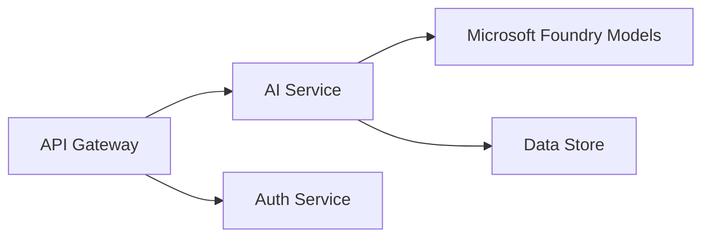
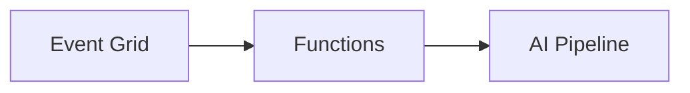

# ਅਧਿਆਇ 8: ਉਤਪਾਦਨ ਅਤੇ ਉਦਯੋਗ ਪੈਟਰਨ

**📚 ਕੋਰਸ**: [AZD ਫਾਰ ਬਿਗਿਨਰਜ਼](../../README.md) | **⏱️ ਸਮਾਂ**: 2-3 ਘੰਟੇ | **⭐ ਜਟਿਲਤਾ**: ਉੱਚ ਪੱਧਰ

---

## ਸਾਰ

ਇਹ ਅਧਿਆਇ ਉਦਯੋਗ-ਤਿਆਰ ਤੈਨਾਤੀ ਪੈਟਰਨ, ਸੁਰੱਖਿਆ ਸਖਤੀ, ਮਾਨੀਟਰਿੰਗ ਅਤੇ ਪ੍ਰੋਡਕਸ਼ਨ AI ਵੋੜਲੋਡਸ ਸਿਰੇ ਤੱਕ ਲਾਗੂ ਕਰਨ ਬਾਰੇ ਹੈ।

ਇਹ ਇਕ ਆਰਕੀਟੈਕਚਰਲ ਰੈਫਰੰਸ ਹੈ, ਪੂਰਾ ਤੈਨਾਤ ਕਰਨ ਯੋਗ ਪ੍ਰੋਡਕਸ਼ਨ ਟੈਂਪਲੇਟ ਨਹੀਂ। ਉਦਾਹਰਨਾਂ ਵਿੱਚ ਇਕਾਈਕਰਨ ਵੇਰਵਾ ਨਹੀ ਦਿੱਤਾ ਗਿਆ ਜੋ ਤੁਹਾਡੇ ਆਪਣੇ ਐਪਲੀਕੇਸ਼ਨ ਵਿੱਚ ਦਿੱਤਾ ਅਤੇ ਟੈਸਟ ਕੀਤਾ ਜਾਣਾ ਜਰੂਰੀ ਹੈ; ਚੈਕਲਿਸਟ ਨੂੰ ਪੜ੍ਹਨ ਨਾਲ ਪ੍ਰੋਡਕਸ਼ਨ ਤਿਆਰੀ ਦੀ ਗਾਰੰਟੀ ਨਹੀਂ ਮਿਲਦੀ।

> **Foundry GA ਅੱਪਡੇਟ (2026-11-09):** Foundry ਵਰਕਫ਼ਲੋ ਲਈ `azd >= 1.37.0` ਅਤੇ ਆਮ ਉਪਲੱਬਧ `microsoft.foundry` 1.0 ਬੰਡਲ ਦੀ ਵਰਤੋਂ ਕਰੋ; ਮੂਲਾਂਕਣ ਵੱਖਰੇ ਤੌਰ ਤੇ ਇੰਸਟਾਲ ਹੁੰਦੇ ਹਨ। ਦੇਖੋ [ਰਿਲੀਜ਼ ਸਕੋਪ ਅਤੇ ਮਾਈਗ੍ਰੇਸ਼ਨ](production-ai-practices.md#recent-release-changes-and-fixes) ਅਤੇ [ਪ੍ਰਮਾਣਿਤ ਪਾਈਪਲਾਈਨ ਉਦਾਹਰਨ](production-ai-practices.md#cicd-pipeline-configuration)। ਇਹ ਇੱਕ ਦਸਤਾਵੇਜ਼ ਸਮੀਖਿਆ ਹੈ, ਲਾਈਵ ਤੈਨਾਤੀ ਵੈਰੀਫਿਕੇਸ਼ਨ ਜਾਂ ਵਿਕਲਪਿਕ ਪ੍ਰੀਵਿਊ ਫੀਚਰਾਂ ਲਈ ਹਰ ਤਰ੍ਹਾਂ ਦੀ GA ਸਥਿਤੀ ਨਹੀਂ ਹੈ।

## ਸਿੱਖਣ ਦੇ ਉਦੇਸ਼

ਇਸ ਅਧਿਆਇ ਨੂੰ ਪੂਰਾ ਕਰਕੇ, ਤੁਸੀਂ:
- ਬਹੁ-ਖੇਤਰ ਸਹਿਣਸ਼ੀਲ ਐਪਲੀਕੇਸ਼ਨ ਤੈਨਾਤ ਕਰੋ
- ਉਦਯੋਗ ਸੁਰੱਖਿਆ ਪੈਟਰਨ ਲਾਗੂ ਕਰੋ
- ਵਿਆਪਕ ਮਾਨੀਟਰਿੰਗ ਸੰਰਚਨਾ ਕਰੋ
- ਵੱਡੇ ਪੱਧਰ ਤੇ ਖਰਚੇ optimize ਕਰੋ
- AZD ਨਾਲ CI/CD ਪਾਈਪਲਾਈਨ ਸੈੱਟ ਕਰੋ

---

## 📚 ਪਾਠ

| # | ਪਾਠ | ਵਰਣਨ | ਸਮਾਂ |
|---|--------|-------------|------|
| 1 | [ਪ੍ਰੋਡਕਸ਼ਨ AI ਅਭਿਆਸ](production-ai-practices.md) | ਉਦਯੋਗ ਤੈਨਾਤੀ ਪੈਟਰਨ | 90 ਮਿੰਟ |

---

## 🚀 ਪ੍ਰੋਡਕਸ਼ਨ ਚੈਕਲਿਸਟ

- [ ] ਬਹੁ-ਖੇਤਰ ਤੈਨਾਤੀ ਲਈ ਸਹਿਣਸ਼ੀਲਤਾ
- [ ] ਪ੍ਰਮਾਣਿਕਤਾ ਲਈ ਪ੍ਰਬੰਧਿਤ ਪਹਿਚਾਣ (ਕੁੰਜੀਆਂ ਨਹੀਂ)
- [ ] ਮਾਨੀਟਰਿੰਗ ਲਈ ਐਪਲੀਕੇਸ਼ਨ ਇਨਸਾਈਟਸ
- [ ] ਲਾਗਤ ਬਜਟ ਅਤੇ ਅਲਰਟ ਸੰਰਚਿਤ
- [ ] ਸੁਰੱਖਿਆ ਸਕੈਨਿੰਗ ਸક્રਿਯ
- [ ] CI/CD ਪਾਈਪਲਾਈਨ ਇਕਾਈਕਰਨ
- [ ] ਆਫਤ ਦੁੱਧਾਰਾ ਯੋਜਨਾ

---

## 🏗️ ਆਰਕੀਟੈਕਚਰ ਪੈਟਰਨ

### ਪੈਟਰਨ 1: ਮਾਈਕ੍ਰੋਸਰਵਿਸਜ਼ AI



### ਪੈਟਰਨ 2: ਇਵੈਂਟ-ਚਾਲਿਤ AI



---

## 🔐 ਸੁਰੱਖਿਆ ਸਰਵੋਤਮ ਅਭਿਆਸ

```bicep
// Illustrative properties from different resources, NOT a standalone Bicep file.
// Attach identity to the application host:
identity: {
  type: 'SystemAssigned'
}

// AI account properties (also require private endpoints, DNS and app connectivity):
properties: {
  publicNetworkAccess: 'Disabled'
  networkAcls: {
    defaultAction: 'Deny'
  }
}
```

---

## 💰 ਲਾਗਤ optimize ਕਰਨਾ

|रणਨੀति | ਮੁੱਖ ਸੀਮਾ |
|----------|---------|
| ਜ਼ੀਰੋ ਤੱਕ ਸکیل ਕਰੋ (ਕੰਟੇਨਰ ਐਪ) | ਇੱਕ ਉਚਿਤ ਟ੍ਰਿਗਰ ਦੀ ਲੋੜ | ਹੋਰ ਸੇਵਾਵਾਂ ਦਾ ਖਰਚ਼ ਅਜੇ ਵੀ ਹੁੰਦਾ ਹੈ |
| ਵਿਕਾਸ ਲਈ ਖਪਤ ਟੀਅਰ ਦੀ ਵਰਤੋਂ ਕਰੋ | ਚੁਣੀ ਗਈ ਸੇਵਾ ਕੀਮਤ ਅਤੇ ਕਾਰਜਭਾਰ ਦੀ ਤੁਲਨਾ ਕਰੋ |
| ਨਿਯਤ ਸਕੇਲਿੰਗ | ਸਮਰਥਿਤ ਢਾਂਚਾ/ਆਟੋਮੇਸ਼ਨ ਰਾਹੀਂ ਸਕੇਲ ਕਰੋ |
| ਰਿਜ਼ਰਵੇਸ਼ਨ/ਪ੍ਰੋਵਿਜਨਡ ਸਮਰੱਥਾ | ਸਿਰਫ਼ ਜਦੋਂ ਸਮਰਥਿਤ ਹੋਵੇ; ਵਾਅਦੇ ਆਲਸੀ ਲਾਗਤ ਵਧਾ ਸਕਦੇ ਹਨ |

ਇੱਕ ਵੈਧ ਸ਼ੁਰੂਆਤੀ ਤਾਰੀਖ, ਬਿਲਿੰਗ ਸਕੋਪ, ਪ੍ਰਾਪਤਕਰਤਾ ਅਤੇ ਅਧਿਕਾਰਾਂ ਨਾਲ [ਪੂਰਾ ਬਜਟ ਸਰੋਤ ਪੈਟਰਨ](production-ai-practices.md#2-cost-monitoring-and-budgets) ਦੀ ਵਰਤੋਂ ਕਰੋ। ਇੱਕ ਬਜਟ ਅਲਰਟ ਭੇਜਦਾ ਹੈ; ਇਹ ਖਰਚਾ ਸੀਮਿਤ ਨਹੀਂ ਕਰਦਾ। ਬਚਤ ਮਾਪੇ ਗਏ ਉਪਯੋਗ 'ਤੇ ਨਿਰਭਰ ਕਰਦੀ ਹੈ ਅਤੇ ਪ੍ਰਤੀਸ਼ਤ ਭਰੋਸੇਯੋਗ ਨਹੀਂ ਹੁੰਦੀ।

---

## 📊 ਮਾਨੀਟਰਿੰਗ ਸੈਟਅਪ

```bash
# Open the Application Insights logs view (requires configured monitoring)
azd monitor --logs

# Check Application Insights
azd monitor --overview

# View metrics
az monitor metrics list --resource <resource-id>
```

---

## 🔗 ਨੈਵੀਗੇਸ਼ਨ

| ਦਿਸ਼ਾ | ਅਧਿਆਇ |
|-----------|---------|
| **ਪਿਛਲਾ** | [ਅਧਿਆਇ 7: ਟ੍ਰਬਲਸ਼ੂਟਿੰਗ](../chapter-07-troubleshooting/README.md) |
| **ਕੋਰਸ ਪੂਰਾ** | [ਕੋਰਸ ਮੁੱਖਪੰਨਾ](../../README.md) |

---

## 📖 ਸੰਬੰਧਿਤ ਸੰਸਾਧਨ

- [AI ਏਜੰਟ ਗਾਈਡ](../chapter-02-ai-development/agents.md)
- [ਐਪਲੀਕੇਸ਼ਨ ਇਨਸਾਈਟਸ](../chapter-06-pre-deployment/application-insights.md)
- [ਬਹੁ-ਏਜੰਟ ਹੱਲ](../chapter-05-multi-agent/README.md)
- [ਮਾਈਕ੍ਰੋਸਰਵਿਸਜ਼ ਉਦਾਹਰਨ](../../examples/microservices/README.md)

---

<!-- CO-OP TRANSLATOR DISCLAIMER START -->
**ਅਸਵੀਕਾਰੋਪਣ**:
ਇਸ ਦਸਤਾਵੇਜ਼ ਦਾ ਅਨੁਵਾਦ ਏਆਈ ਅਨੁਵਾਦ ਸੇਵਾ [Co-op Translator](https://github.com/Azure/co-op-translator) ਦੀ ਵਰਤੋਂ ਕਰਕੇ ਕੀਤਾ ਗਿਆ ਹੈ। ਜਦੋਂ ਕਿ ਅਸੀਂ ਸਹੀਤਾਵਾਂ ਲਈ ਯਤਨਸ਼ੀਲ ਹਾਂ, ਕਿਰਪਾ ਕਰਕੇ ਧਿਆਨ ਰੱਖੋ ਕਿ ਸਵੈਚਾਲਿਤ ਅਨੁਵਾਦਾਂ ਵਿੱਚ ਗਲਤੀਆਂ ਜਾਂ ਅਸਮੱਤਿਆਵਾਂ ਹੋ ਸਕਦੀਆਂ ਹਨ। ਮੂਲ ਦਸਤਾਵੇਜ਼ ਆਪਣੀ ਮੂਲ ਭਾਸ਼ਾ ਵਿੱਚ ਅਧਿਕਾਰਕ ਸਰੋਤ ਮੰਨਿਆ ਜਾਣਾ ਚਾਹੀਦਾ ਹੈ। ਜਰੂਰੀ ਜਾਣਕਾਰੀ ਲਈ, ਪੇਸ਼ੇਵਰ ਮਨੁੱਖੀ ਅਨੁਵਾਦ ਦੀ ਸਿਫ਼ਾਰਸ਼ ਕੀਤੀ ਜਾਂਦੀ ਹੈ। ਅਸੀਂ ਇਸ ਅਨੁਵਾਦ ਦੇ ਉਪਯੋਗ ਤੋਂ ਪੈਦਾ ਹੋਣ ਵਾਲੀਆਂ ਕਿਸੇ ਵੀ ਗਲਤਫਹਿਮੀਆਂ ਜਾਂ ਗਲਤ ਵਿਆਖਿਆਵਾਂ ਲਈ ਜਵਾਬਦੇਹ ਨਹੀਂ ਹਾਂ।
<!-- CO-OP TRANSLATOR DISCLAIMER END -->