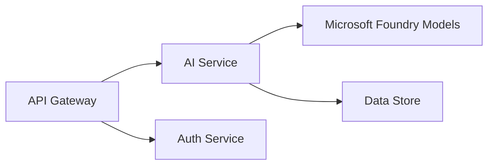
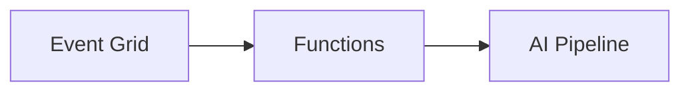

# ਅਧਿਆਇ 8: ਉਤਪਾਦਨ ਅਤੇ ਉਦਯੋਗਿਕ ਪੈਟਰਨ

**📚 ਕੋਰਸ**: [AZD For Beginners](../../README.md) | **⏱️ ਸਮਾਂ**: 2-3 ਘੰਟੇ | **⭐ ਕਠਿਨਾਈ**: ਉੱਨਤ

---

## ਝਲਕ

ਇਹ ਅਧਿਆਇ ਉਦਯੋਗਿਕ ਤਿਆਰ ਡਿਪਲੌਇਮੈਂਟ ਪੈਟਰਨ, ਸੁਰੱਖਿਆ ਮਜ਼ਬੂਤੀ, ਨਿਗਰਾਨੀ ਅਤੇ ਉਤਪਾਦਨ AI ਵਰਕਲੋਡਜ਼ ਲਈ ਲਾਗਤ ਅਨੁਕੂਲਤਾ ਨੂੰ ਕਵਰ ਕਰਦਾ ਹੈ।

ਇਹ ਇੱਕ ਵਾਸਤੁਕ ਪ੍ਰਸੰਦਰੂਪ ਹੈ, ਕੋਈ ਪੂਰਾ ਡਿਪਲੌਏਬਲ ਉਤਪਾਦਨ ਟੈਮਪਲੇਟ ਨਹੀਂ। ਉਦਾਹਰਣਾਂ ਇੰਟੀਗ੍ਰੇਸ਼ਨ ਵੇਰਵੇ ਛੱਡ ਦਿੰਦੀਆਂ ਹਨ ਜੋ ਤੁਹਾਡੇ ਆਪਣੇ ਐਪਲੀਕੇਸ਼ਨ ਵਿੱਚ ਜਮ੍ਹਾਂ ਕਰਵਾਏ ਜਾਣ ਅਤੇ ਚੈੱਕ ਕੀਤੇ ਜਾਣ ਜ਼ਰੂਰੀ ਹਨ; ਚੈੱਕਲਿਸਟ ਪੜ੍ਹਨਾ ਉਤਪਾਦਨ ਤਿਆਰੀ ਦੀ ਗਾਰੰਟੀ ਨਹੀਂ ਦਿੰਦਾ।

> **ਰਿਲੀਜ਼ ਸਮੀਖਿਆ (2026-11-04):** AI CLI ਮਾਰਗਦਰਸ਼ਨ ਦੀ ਜਾਂਚ `azd 1.37.2`, ਏਜੰਟਾਂ `1.0.0-beta.23`, ਅਤੇ ਮੁਲਾਂਕਣਾਂ `1.0.0-beta.2` ਦਸਤਾਵੇਜ਼/ਸਰੋਤ ਨਾਲ ਕੀਤੀ ਗਈ। ਮਿਲਾਪ ਦੀਆਂ ਲੋੜਾਂ ਅਤੇ ਮਾਈਗ੍ਰੇਸ਼ਨ ਵੇਰਵੇ ਲਈ [ਰਿਲੀਜ਼ ਬਦਲਾਅ ਅਤੇ ਸੁਧਾਰ](production-ai-practices.md#recent-release-changes-and-fixes) ਵੇਖੋ; ਇਹ ਕੋਈ ਲਾਈਵ ਡਿਪਲੌਇਮੈਂਟ ਵਿਸ਼ਲੇਸ਼ਣ ਨਹੀਂ ਹੈ।

## ਸਿੱਖਣ ਦੇ ਲਕਸ਼

ਇਸ ਅਧਿਆਇ ਨੂੰ ਪੂਰਾ ਕਰਕੇ, ਤੁਸੀਂ:
- ਬਹੁ-ਖੇਤਰ ਲਚਕੀਲੇ ਐਪਲੀਕੇਸ਼ਨਾਂ ਨੂੰ ਡਿਪਲੌਏ ਕਰੋ
- ਉਦਯੋਗਿਕ ਸੁਰੱਖਿਆ ਪੈਟਰਨ ਲਾਗੂ ਕਰੋ
- ਵਿਆਪਕ ਨਿਗਰਾਨੀ ਸੰਰਚਨਾ ਕਰੋ
- ਪੈਮਾਨੇ 'ਤੇ ਲਾਗਤਾਂ ਨੂੰ ਅਨੁਕੂਲ ਕਰੋ
- AZD ਨਾਲ CI/CD ਪਾਈਪਲਾਈਨਾਂ ਸੈਟਅੱਪ ਕਰੋ

---

## 📚 ਪਾਠ

| # | ਪਾਠ | ਵੇਰਵਾ | ਸਮਾਂ |
|---|--------|-------------|------|
| 1 | [ਉਤਪਾਦਨ AI ਅਭਿਆਸ](production-ai-practices.md) | ਉਦਯੋਗ ਡਿਪਲੌਇਮੈਂਟ ਪੈਟਰਨ | 90 ਮਿੰਟ |

---

## 🚀 ਉਤਪਾਦਨ ਚੈੱਕਲਿਸਟ

- [ ] ਲਚਕੀਲਾਪਣ ਲਈ ਬਹੁ-ਖੇਤਰੀ ਡਿਪਲੌਇਮੈਂਟ
- [ ] ਪ੍ਰਮਾਣਿਕਤਾ ਲਈ ਪ੍ਰਬੰਧਤ ਪਛਾਣ (ਕੁੰਜੀਆਂ ਨਹੀਂ)
- [ ] ਨਿਗਰਾਨੀ ਲਈ ਐਪਲੀਕੇਸ਼ਨ ਇੰਸਾਈਟਸ
- [ ] ਲਾਗਤ ਬਜਟ ਅਤੇ ਚੇਤਾਵਨੀਆਂ ਸੰਰਚਿਤ
- [ ] ਸੁਰੱਖਿਆ ਸਕੈਨਿੰਗ ਯੋਗ
- [ ] CI/CD ਪਾਈਪਲਾਈਨ ਇੰਟੀਗ੍ਰੇਸ਼ਨ
- [ ] ਆਪਦਾ ਪੁਨਰ ਪ੍ਰਾਪਤੀ ਯੋਜਨਾ

---

## 🏗️ ਵਾਸਤੁਕ ਪੈਟਰਨ

### ਪੈਟਰਨ 1: ਮਾਈਕਰੋਸਰਵਿਸਜ਼ AI



### ਪੈਟਰਨ 2: ਇਵੈਂਟ-ਚਲਿਤ AI



---

## 🔐 ਸੁਰੱਖਿਆ ਸ਼੍ਰੇਸ਼ਠ ਅਭਿਆਸ

```bicep
// Illustrative properties from different resources, NOT a standalone Bicep file.
// Attach identity to the application host:
identity: {
  type: 'SystemAssigned'
}

// AI account properties (also require private endpoints, DNS and app connectivity):
properties: {
  publicNetworkAccess: 'Disabled'
  networkAcls: {
    defaultAction: 'Deny'
  }
}
```

---

## 💰 ਲਾਗਤ ਅਨੁਕੂਲਤਾ

| रणਨੀਤੀ | ਮੁੱਖ ਪਾਬੰਦੀ |
|----------|---------|
| ਜ਼ੀਰੋ ਤੱਕ ਵਧਾਓ (ਕੰਟੇਨਰ ਐਪਸ) | ਇੱਕ ਉਚਿਤ ਟ੍ਰਿਗਰ ਦੀ ਲੋੜ; ਹੋਰ ਸੇਵਾਵਾਂ ਲਈ ਅਜੇ ਵੀ ਖਰਚ ਹੁੰਦੇ ਹਨ |
| ਵਿਕਾਸ ਲਈ ਖਪਤ ਦਰਜੇ ਵਰਤੋ | ਚੁਣੀ ਹੋਈ ਸੇਵਾ ਦੀ ਕੀਮਤ ਅਤੇ ਵਰਕਲੋਡ ਨਾਲ ਤੁਲਨਾ ਕਰੋ |
| ਨਿਯਤ ਸਮੇਂ 'ਤੇ ਵਧਾਉਣਾ | ਸਹਾਇਕ ਇੰਫਰਾਸਟਰਕਚਰ/ਆਟੋਮੈਸ਼ਨ ਰਾਹੀਂ ਵਧਾਉਣਾ |
| ਰਿਜ਼ਰਵੇਸ਼ਨ/ਪ੍ਰੋਵਿਜ਼ਨ ਕੀਤੀ ਗਈ ਸਮਰੱਥਾ | ਸਿਰਫ ਜਦੋਂ ਸਮਰਥਿਤ ਹੋਵੇ; ਵਚਨਾਂ ਨਾਲ ਫਿਝੀਲ ਖਰਚ ਵਧ ਸਕਦੇ ਹਨ |

ਵੈਧ ਸ਼ੁਰੂਆਤੀ ਮਿਤੀ, ਬਿਲਿੰਗ ਸਕੋਪ, ਪ੍ਰਾਪਤਕਾਰਾਂ ਅਤੇ ਅਧਿਕਾਰਾਂ ਨਾਲ [ਪੂਰਨ ਬਜਟ ਰਿਸੋਰਸ ਪੈਟਰਨ](production-ai-practices.md#2-cost-monitoring-and-budgets) ਵਰਤੋ। ਇੱਕ ਬਜਟ ਚੇਤਾਵਨੀਆਂ ਭੇਜਦਾ ਹੈ; ਇਹ ਖਰਚ ਸੀਮਿਤ ਨਹੀਂ ਕਰਦਾ। ਬਚਤ ਮਾਪੀ ਗਈ ਵਰਤੋਂ 'ਤੇ ਨਿਰਭਰ ਕਰਦੀ ਹੈ ਅਤੇ ਜਾਂਚੀ ਹੋਈ ਪ੍ਰਤੀਸ਼ਤ ਨਹੀਂ।

---

## 📊 ਨਿਗਰਾਨੀ ਸੈਟਅੱਪ

```bash
# Open the Application Insights logs view (requires configured monitoring)
azd monitor --logs

# Check Application Insights
azd monitor --overview

# View metrics
az monitor metrics list --resource <resource-id>
```

---

## 🔗 ਨੈਵੀਗੇਸ਼ਨ

| ਦਿਸ਼ਾ | ਅਧਿਆਇ |
|-----------|---------|
| **ਪਿਛਲਾ** | [ਅਧਿਆਇ 7: ਸਮੱਸਿਆ ਨਿਵਾਰਨ](../chapter-07-troubleshooting/README.md) |
| **ਕੋਰਸ ਮੁਕੰਮਲ** | [ਕੋਰਸ ਦਾ ਮੁੱਖ ਪੰਨਾ](../../README.md) |

---

## 📖 ਸੰਬੰਧਤ ਸਰੋਤ

- [AI ਏਜੰਟਗਾਈਡ](../chapter-02-ai-development/agents.md)
- [ਐਪਲੀਕੇਸ਼ਨ ਇੰਸਾਈਟਸ](../chapter-06-pre-deployment/application-insights.md)
- [ਬਹੁ-ਏਜੰਟ ਹੱਲ](../chapter-05-multi-agent/README.md)
- [ਮਾਈਕਰੋਸਰਵਿਸਜ਼ ਉਦਾਹਰਣ](../../examples/microservices/README.md)

---

<!-- CO-OP TRANSLATOR DISCLAIMER START -->
**ਅਸਵੀਕਾਰੋਪਣ**:
ਇਸ ਦਸਤਾਵੇਜ਼ ਦਾ ਅਨੁਵਾਦ ਏਆਈ ਅਨੁਵਾਦ ਸੇਵਾ [Co-op Translator](https://github.com/Azure/co-op-translator) ਦੀ ਵਰਤੋਂ ਕਰਕੇ ਕੀਤਾ ਗਿਆ ਹੈ। ਜਦੋਂ ਕਿ ਅਸੀਂ ਸਹੀਤਾਵਾਂ ਲਈ ਯਤਨਸ਼ੀਲ ਹਾਂ, ਕਿਰਪਾ ਕਰਕੇ ਧਿਆਨ ਰੱਖੋ ਕਿ ਸਵੈਚਾਲਿਤ ਅਨੁਵਾਦਾਂ ਵਿੱਚ ਗਲਤੀਆਂ ਜਾਂ ਅਸਮੱਤਿਆਵਾਂ ਹੋ ਸਕਦੀਆਂ ਹਨ। ਮੂਲ ਦਸਤਾਵੇਜ਼ ਆਪਣੀ ਮੂਲ ਭਾਸ਼ਾ ਵਿੱਚ ਅਧਿਕਾਰਕ ਸਰੋਤ ਮੰਨਿਆ ਜਾਣਾ ਚਾਹੀਦਾ ਹੈ। ਜਰੂਰੀ ਜਾਣਕਾਰੀ ਲਈ, ਪੇਸ਼ੇਵਰ ਮਨੁੱਖੀ ਅਨੁਵਾਦ ਦੀ ਸਿਫ਼ਾਰਸ਼ ਕੀਤੀ ਜਾਂਦੀ ਹੈ। ਅਸੀਂ ਇਸ ਅਨੁਵਾਦ ਦੇ ਉਪਯੋਗ ਤੋਂ ਪੈਦਾ ਹੋਣ ਵਾਲੀਆਂ ਕਿਸੇ ਵੀ ਗਲਤਫਹਿਮੀਆਂ ਜਾਂ ਗਲਤ ਵਿਆਖਿਆਵਾਂ ਲਈ ਜਵਾਬਦੇਹ ਨਹੀਂ ਹਾਂ।
<!-- CO-OP TRANSLATOR DISCLAIMER END -->