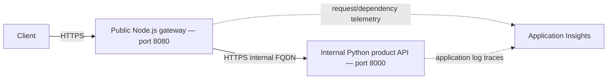

# ਦੋ-ਸੇਵਾ ਮਾਈਕ੍ਰੋਸਰਵਿਸਿਜ਼ — ਐਜ਼ਯੂਰ ਕੰਟੇਨਰ ਐਪਸ

**ਸਤਹ:** ਦਰਮਿਆਨਾ · **ਸਮਾਂ:** 45–60 ਮਿੰਟ ਸੈਟਅਪ ਸਮੇਤ

ਇਹ ਸਿੱਖਣ ਦਾ ਨਮੂਨਾ ਇੱਕ **Node.js API Gateway** ਅਤੇ ਇੱਕ **ਪੜ੍ਹਨ-ਕੇਵਲ Python
ਪ੍ਰੋਡਕਟ ਸੇਵਾ** ਨੂੰ ਲਾਗੂ ਕਰਦਾ ਹੈ। ਸੋਰਸ, Dockerfiles, Bicep, ਅਤੇ azd ਸੰਰਚਨਾ ਸ਼ਾਮਿਲ ਹੈ।
ਇਹ ਉਤਪਾਦਨ-ਮਜ਼ਬੂਤ ਸਿਸਟਮ ਨਹੀਂ ਹੈ।

## ਤੁਸੀਂ ਕੀ ਸਿੱਖੋਗੇ

- ਦੋ ਸੇਵਾਵਾਂ ਨੂੰ ਸੁਤੰਤਰ ਤੌਰ 'ਤੇ ਤਾਇਨਾਤ ਕਰੋ।
- HTTPS 'ਤੇ ਇੱਕ ਆੰਤਰੀਕ ਬੈਕਏਂਡ FQDN ਦੀ ਵਰਤੋਂ ਕਰੋ।
- ਸਫਲਤਾ, ਨਾ-ਮਿਲਣ ਅਤੇ ਗੈਰ-ਉਪਲਬਧ-ਸੇਵਾ ਪ੍ਰਤੀਕ੍ਰਿਆਵਾਂ ਦੀ ਪੁਸ਼ਟੀ ਕਰੋ।
- ਟੈਲੀਮੇਟਰੀ ਅਤੇ ਸੁਤੰਤਰ ਮਾਪ ਸੀਮਾਵਾਂ ਨੂੰ ਸਮਝੋ।



ਪ੍ਰੋਡਕਟ ਕੈਟਾਲੌਗ ਵਿੱਚ ਯਾਦداشت ਵਿੱਚ ਪੰਜ ਫਿਕਸਡ ਪ੍ਰੋਡਕਟ ਹਨ। ਇੱਥੇ **ਕੋਈ POST,
PUT, ਜਾਂ DELETE ਹੈਂਡਲਰ**, ਡੇਟਾਬੇਸ, ਸਰਵਿਸ ਬੱਸ, ਆਰਡਰ/ਉਪਭੋਗਤਾ/ਸੂਚਨਾ ਸੇਵਾ,
C#, ਜਾਂ Go ਕੋਡ ਨਹੀਂ ਹਨ। ਇਹ ਭਵਿੱਖ ਦਾ ਵਿਕਾਸੀ ਵਿਚਾਰ ਹਨ, ਸ਼ਾਮਿਲ ਫੀਚਰ ਨਹੀਂ।
ਗੇਟਵੇ ਯੂਜ਼ਰਾਂ ਦੀ ਪ੍ਰਮਾਣਿਕਤਾ ਨਹੀਂ ਕਰਦਾ; ਆੰਤਰੀਕ ਇਨਗ੍ਰੈੱਸ ਐਪਲੀਕੇਸ਼ਨ ਅਧਿਕਾਰਣਾ ਦਾ ਬਦਲ ਨਹੀਂ ਹੈ।


ਪਹਿਲਾਂ [ਸਿੰਗਲ Flask API](../../../../../examples/container-app/simple-flask-api) ਨੂੰ ਪੂਰਾ ਕਰੋ।
ਮੌਜੂਦਾ ਸਥਿਰ azd ਹੀ ਇੰਸਟਾਲ ਕਰੋ (ਸਮੀਖਿਆ ਸਮੇਂ ਪ੍ਰਕਾਸ਼ਿਤ ਰਿਲੀਜ਼: 1.37.2), Azure CLI,
ਅਤੇ ਡਾਕਰ ਨੂੰ ਡੀਮਨ ਚਲ ਰਹਿਆ ਹੋਵੇ। ਤੁਹਾਨੂੰ ਇੱਕ Azure ਸਬਸਕ੍ਰਿਪਸ਼ਨ, ਸਰੋਤ ਸਿਰਜਣ ਅਧਿਕਾਰ,
ਅਤੇ Container Apps ਖੇਤੀਬਾੜੀ ਕੋਟਾ ਦੀ ਲੋੜ ਹੈ।

```bash
azd version
az version
docker info
azd auth login
az login
```

CLI ਦੋਹਾਂ ਟੂਲਾਂ ਵਿੱਚ ਵਸ਼ੀਕਰਨ ਨਾਲ ਇੱਕੋ ਸਬਸਕ੍ਰਿਪਸ਼ਨ ਦੀ ਵਰਤੋਂ ਕਰੋ। ਹੇਠਾਂ ਦਿੱਤੇ ਕਮਾਂਡਾਂ Bash ਵਰਤਦੀਆਂ ਹਨ।

## ਨਿੱਜੀਕਰਨ ਅਤੇ ਪੁਸ਼ਟੀ ਕਰੋ

ਰਿਪੋਜਿਟਰੀ ਮੂਲ ਤੋਂ:

```bash
cd examples/container-app/microservices
azd env new microservices-demo
azd up
GATEWAY_URL=$(azd env get-value API_GATEWAY_URL)
RG_NAME=$(azd env get-value AZURE_RESOURCE_GROUP)
GATEWAY_NAME=$(azd env get-value API_GATEWAY_NAME)
PRODUCT_NAME=$(azd env get-value PRODUCT_SERVICE_NAME)

curl --fail-with-body "${GATEWAY_URL}/health"
curl --fail-with-body "${GATEWAY_URL}/api/products"
curl --fail-with-body "${GATEWAY_URL}/api/products/1"
curl -i "${GATEWAY_URL}/api/products/999"
```

**ਸਫਲਤਾ:** ਸਿਹਤ 200; ਸੂਚੀ 200 ਨਾਲ **ਪੰਜ** ਉਤਪਾਦ; ਉਤਪਾਦ 1 ਇੱਕ ਲੈਪਟਾਪ ਹੈ
ਜੋ 999.99 ਕੀਮਤ ਵਾਲਾ ਅਤੇ ਸਟੌਕ 50 ਨਾਲ ਹੈ; ਅਣਜਾਣ ਉਤਪਾਦ 404 ਵਾਪਸ ਕਰਦਾ ਹੈ।
ਵਰਣਨਾਂ ਜਵਾਬਾਂ ਵਿੱਚ ਸ਼ਾਮਲ ਹਨ; ਸਮੇਂ ਦੇ ਮੁਹੂਰਤ ਵੱਖ-ਵੱਖ ਹੁੰਦੇ ਹਨ।

ਸ਼ੁਰੂਆਤੀ ਪ੍ਰੋਵਿਜ਼ਨ ਪੋਰਟ 80 'ਤੇ ਸਰਵਜਨਿਕ hello-world ਇਮੇਜਾਂ ਦੀ ਵਰਤੋਂ ਕਰਦਾ ਹੈ ਤਾਂ ਜੋ 
ਖ਼ਾਲੀ ਰਜਿਸਟਰੀ ਤੋਂ ਅਸਰਹੀਨ ਇਮੇਜਾਂ ਨੂੰ ਖਿੱਚਣ ਦੀ ਕੋਸ਼ਿਸ਼ ਨਾ ਹੋਵੇ। ਸੇਵਾ-ਵਿਸ਼ੇਸ਼ Bicep ਮਾਡਿਊਲ
ਅਤੇ ਪੈਰਾਮੀਟਰ ਫਾਇਲਾਂ ਉਨ੍ਹਾਂ ਦੀ ਥਾਂ ਬਣੇ ਹੋਏ ਇਮੇਜਾਂ ਅਤੇ ਐਪ ਪੋਰਟ/ਪ੍ਰੋਬ ਰੱਖਦੀਆਂ ਹਨ  
`azd deploy` ਦੌਰਾਨ। ਮੁੱਖ ਪੈਰਾਮੀਟਰ ਬਾਅਦ ਵਿੱਚ ਪ੍ਰੋਵਿਜ਼ਨਿੰਗ ਲਈ ਪ੍ਰਕਾਸ਼ਿਤ ਇਮੇਜ ਨਾਮ ਸੰਭਾਲ ਕੇ ਰੱਖਦੇ ਹਨ।  

## ਸੇਵਾਵਾਂ ਅਤੇ ਨੈੱਟਵਰਕਿੰਗ  

| ਸੇਵਾ | ਪ੍ਰਗਟ ਲਿੰਗ | ਡਿਫੌਲਟ ਸਰੋਤ |  
|---|---|---|  
| ਗੇਟਵੇ | GET `/`, `/health`, `/api/products`, `/api/products/:id` | 1 vCPU, 2 GiB, 2–20 ਨਕਲ |  
| ਪ੍ਰੋਡਕਟ | GET `/`, `/health`, `/products`, `/products/<id>` | 0.5 vCPU, 1 GiB, 1–10 ਨਕਲ |  

ਪ੍ਰੋਡਕਟ ਇੰਗ੍ਰੈੱਸ ਵਿੱਚ `external: false` ਅਤੇ `allowInsecure: false` ਸ਼ਾਮਿਲ ਹਨ। ਬਾਈਸਪ ਗੇਟਵੇ ਵਿੱਚ  
`PRODUCT_SERVICE_URL=https://<actual-internal-fqdn>` ਇੰਜੈਕਟ ਕਰਦਾ ਹੈ। HTTP ਹੋਵੇਗਾ  
ਰੀਡਾਇਰੈਕਟ; HTTPS ਸੰਰਚਿਤ ਇੰਗ੍ਰੈੱਸ ਨਾਲ ਮੇਲ ਖਾਂਦਾ ਹੈ। ਇੱਕ ਛੋਟਾ DNS ਨਾਮ
**ਅਸਲ ਕੰਟੇਨਰ ਐਪ ਨਾਮ** ਨਾਲ ਮੇਲ ਖਾਣਾ ਚਾਹੀਦਾ ਹੈ, ਨਾ ਕਿ ਤਰਕਸ਼ੀਲ ਸੇਵਾ ਕੁੰਜੀ `product-service`.
ਆਪਣੇ ਲੈਪਟਾਪ ਤੋਂ ਅੰਦਰੂਨੀ URL ਨੂੰ ਸਿੱਧਾ ਕਾਲ ਕਰਨ ਦੀ ਕੋਸ਼ਿਸ਼ ਨਾ ਕਰੋ।

ਗੇਟਵੇ ਕੋਲ ਪ੍ਰੋਡਕਟ ਕਾਲਾਂ ਲਈ ਪੰਜ ਸਕਿੰਟਾਂ ਦੀ ਟਾਈਮਆਉਟ ਹੁੰਦੀ ਹੈ। ਗੁੰਮ ਪ੍ਰੋਡਕਟ ID
404 ਵਜੋਂ ਫੈਲ ਜਾਂਦੇ ਹਨ; ਟਰਾਂਸਪੋਰਟ ਫੇਲਿਅਰ/ਹੋਰ ਬੈਕਐਂਡ ਫੇਲਿਅਰ 503 ਵਾਪਸ ਕਰਦੇ ਹਨ।
ਗੇਟਵੇ `/health` ਕੇਵਲ ਗੇਟਵੇ ਦੀ ਜਾਂਚ ਕਰਦਾ ਹੈ, ਬੈਕਐਂਡ ਉਪਲਬਧਤਾ ਨਹੀਂ।

## ਫਾਈਲਾਂ ਅਤੇ ਸੰਰਚਨਾ

```text
azure.yaml
infra/main.bicep
infra/main.parameters.json
infra/abbreviations.json
infra/core/container-apps-environment.bicep
infra/core/monitor.bicep
infra/app/api-gateway.bicep
infra/app/api-gateway.parameters.json
infra/app/product-service.bicep
infra/app/product-service.parameters.json
src/api-gateway/{app.js,package.json,Dockerfile}
src/product-service/{main.py,requirements.txt,Dockerfile}
```

ਸਕੇਲਿੰਗ, CPU/ਮੈਮੋਰੀ, ਪੋਰਟਸ, ਅਤੇ ਪ੍ਰੋਬਸ `infra/app/*.bicep` ਵਿੱਚ ਸੈਟ ਕੀਤੇ ਜਾਂਦੇ ਹਨ। ਉਹਨਾਂ
ਫਾਈਲਾਂ ਵਿੱਚ ਤਬਦੀਲੀ ਕਰੋ ਅਤੇ ਢਾਂਚਾਗਤ ਲਈ `azd up` ਚਲਾਓ ਅਤੇ ਦੁਬਾਰਾ ਤਾਇਨਾਤ ਕਰੋ। ਇਸ ਨਮੂਨੇ ਵਿੱਚ
ਕੋਈ `GATEWAY_MAX_REPLICAS` ਵਾਤਾਵਰਣ-ਚਲਕ ਪ੍ਰਮਾਣ ਪੱਤਰ ਨਹੀਂ ਹੈ।

ਸਿਰਫ ਕੋਡ-ਸਬੰਧੀ ਤਬਦੀਲੀਆਂ ਲਈ:

```bash
azd deploy product-service
azd deploy api-gateway
```

ਨੋਡ ਚਿੱਤਰ ਨੋਡ 22 ਵਰਤਦਾ ਹੈ; ਪਾਇਥਨ ਚਿੱਤਰ ਪਾਇਥਨ 3.11 ਵਰਤਦਾ ਹੈ। ਦੋਹਾਂ ਬਾਈਂਡ ਕਰਦੇ ਹਨ
`0.0.0.0`। ਇੰਗਰੇਸ/ਪ੍ਰੋਬਜ਼ ਵੱਖ-ਵੱਖ ਪੋਰਟ 8080 (ਗੇਟਵੇ) ਅਤੇ 8000 (ਉਤਪਾਦ) ਦੀ ਵਰਤੋਂ ਕਰਦੇ ਹਨ।

## ਡੋਕਰ ਨਾਲ ਸਥਾਨਕ ਵਿਕਾਸ

ਇਸ ਉਦਾਹਰਨ ਡਾਇਰੈਕਟਰੀ ਤੋਂ ਚਲਾਓ। ਇੱਕ ਯੂਜ਼ਰ-ਪਰਿਭਾਸ਼ਿਤ ਨੈੱਟਵਰਕ ਵਰਤੋ, **ਨਾ ਕਿ `localhost`
ਇੱਕ ਕੰਟੇਨਰ ਤੋਂ ਦੂਜੇ ਤੱਕ ਪਹੁੰਚਣ ਲਈ**:

```bash
docker network create azd-microservices-demo
docker build -t local-product ./src/product-service
docker build -t local-gateway ./src/api-gateway
docker run -d --name azd-product --network azd-microservices-demo local-product
docker run -d --name azd-gateway --network azd-microservices-demo \
  -p 8080:8080 -e PRODUCT_SERVICE_URL=http://azd-product:8000 local-gateway
curl --fail-with-body http://localhost:8080/api/products
```

ਉਮੀਦ ਹੈ: ਪੰਜ ਉਤਪਾਦ। HTTP ਸਿਰਫ ਇਸ ਸਥਾਨਕ Docker ਨੈੱਟਵਰਕ ਲਈ ਵਰਤਿਆ ਜਾਂਦਾ ਹੈ।

```bash
docker stop azd-product azd-gateway
docker rm azd-product azd-gateway
docker network rm azd-microservices-demo
```

## ਮਾਨੀਟਰਿੰਗ

```bash
az containerapp logs show --name "$GATEWAY_NAME" --resource-group "$RG_NAME" --follow
# In a separate terminal:
az containerapp logs show --name "$PRODUCT_NAME" --resource-group "$RG_NAME" --tail 100
```

`azd monitor --logs` ਇੱਕ ਪੋਰਟਲ ਦ੍ਰਿਸ਼ ਖੋਲ੍ਹਦਾ ਹੈ; ਇਹ ਟਰਮੀਨਲ ਲੌਗ ਸਟਰਿਮ ਨਹੀਂ ਕਰਦਾ।
ਨੋਡ SDK ਗੇਟਵੇ ਬੇਨਤੀਆਂ/ਨਿਰਭਰਤਾਵਾਂ ਇਕੱਠਾ ਕਰਦਾ ਹੈ। ਪਾਇਥਨ ਦਾ `AzureLogHandler`
"**ਲੌਗ ਟਰੇਸ**" ਐਕਸਪੋਰਟ ਕਰਦਾ ਹੈ, ਨਾ ਕਿ ਆਟੋਮੈਟਿਕ ਫਲੇਸਕ ਬੇਨਤੀਆਂ, SQL ਨਿਰਭਰਤਾਵਾਂ ਜਾਂ ਪੂਰੇ
ਵਿਤਰਿਤ ਟਰੇਸ। OpenCensus ਇੱਕ ਪੁਰਾਣਾ SDK ਹੈ; ਇਸ ਨਮੂਨੇ ਦਾ ਵਿਕਾਸ ਕਰਦਿਆਂ Azure Monitor OpenTelemetry
ਨੂੰ ਤਰਜੀਹ ਦਿਓ।

ਐਪਲੀਕੇਸ਼ਨ ਇਨਸਾਈਟਸ ਲੌਗਜ਼ ਵਿੱਚ, ਬੇਨਤੀਆਂ ਬਣਾਓ ਅਤੇ ਜਾਂਚੋ:

```kusto
requests
| where timestamp > ago(1h)
| where name contains "products"
| summarize RequestCount=count(), AvgDuration=avg(duration) by bin(timestamp, 5m)
```

ਪਾਇਥਨ ਐਪਲੀਕੇਸ਼ਨ ਸੁਨੇਹਿਆਂ ਲਈ:

```kusto
traces
| where timestamp > ago(1h)
| where message contains "products"
| project timestamp, message, severityLevel
```

ਇੰਜੈਸ਼ਨ ਵਿੱਚ ਦੇਰੀ ਅਤੇ ਨਮੂਨਾ ਲੈਣਾ ਮਨਜ਼ੂਰ ਕਰੋ; ਠੀਕ ਬੇਨਤੀ ਗਿਣਤੀ ਜਾਂ ਯਕੀਨੀ ਲੈਟੈਂਸੀ ਦੀ ਉਮੀਦ ਨਾ ਕਰੋ।
ਕੋਈ ਕਸਟਮ ਚੇਤਾਵਨੀਆਂ ਜਾਂ ਡੈਸ਼ਬੋਰਡ ਸੈੱਟ ਨਹੀਂ ਕੀਤੇ ਗਏ।

## ਵਿਆਵਹਾਰਿਕ ਅਭਿਆਸ

### ਅਭਿਆਸ 1: ਕੈਟਾਲੌਗ ਵਿੱਚ ਸੋਧ ਕਰੋ

**ਸ਼ੁਰੂਆਤੀ ਬਿੰਦੂ:** `src/product-service/main.py`।
**ਲਕੜੀ:** ਸੁਤੰਤਰ ਸੇਵਾ ਤैनਾਤੀ ਦੀ ਪੁਸ਼ਟੀ ਕਰੋ।
ਫਿਕਸਡ `products` ਸੂਚੀ ਵਿੱਚ ਲੈਪਟੌਪ ਦਾ ਸਟਾਕ 50 ਤੋਂ 49 ਵਿੱਚ ਬਦਲੋ, ਚਲਾo
`azd deploy product-service`, ਫਿਰ `${GATEWAY_URL}/api/products/1` ਦੀ ਬੇਨਤੀ ਕਰੋ।

**ਸਫਲਤਾ ਮਾਪਦੰਡ / ਹੱਲ:** `"stock":49` ਨਾਲ HTTP 200। 50 ਨੂੰ ਮੁੜ ਸਥਾਪਤ ਕਰੋ ਅਤੇ ਦੁਬਾਰਾ ਤਾਇਨਾਤ ਕਰੋ।
**ਆਮ ਸਮੱਸਿਆ:** ਕੈਟਲੌਗ ਦੇ ਮਾਲਕ ਸਰਵਿਸ ਦੀ ਬਜਾਏ ਗੇਟਵੇ ਨੂੰ ਸੋਧਣਾ।
ਇਹ ਸੋਰਸ ਡਾਟਾ ਨੂੰ ਬਦਲਦਾ ਹੈ, ਕਿਸੇ ਟਿਕਾਊ ਇਨਵੈਂਟਰੀ ਡੇਟਾਬੇਸ ਨੂੰ ਨਹੀਂ।

### ਕਸਰਤ 2: ਰੇਪਲਿਕਾ ਸੰਰਚਨਾ ਦੀ ਪੁਸ਼ਟੀ ਕਰੋ

**ਸ਼ੁਰੂਆਤੀ ਬਿੰਦੂ:** `infra/app/product-service.bicep`।
**ਲਕੜੀ:** ਬਿਨਾਂ ਆਟੋਸਕੇਲਿੰਗ ਦਾ ਅਨੁਮਾਨ ਲੱਗਾਏ ਇਕ ਇੰਫ੍ਰਾਸਟਰੱਕਚਰ ਬਦਲਾਅ ਵੇਖੋ।
`minReplicas: 1` ਨੂੰ `minReplicas: 2` ਵਿੱਚ ਬਦਲੋ, `azd up` ਚਲਾo, ਫਿਰ:

```bash
az containerapp show --name "$PRODUCT_NAME" --resource-group "$RG_NAME" \
  --query properties.template.scale -o json
```

**ਸਫਲਤਾ ਮਾਪਦੰਡ:** ਸੰਰਚਿਤ ਘੱਟੋ-ਘੱਟ 2 ਹੈ ਅਤੇ ਵੱਧੋ-ਵੱਧ 10 ਹੀ ਰਹਿੰਦਾ ਹੈ।
ਘੱਟੋ-ਘੱਟ 1 ਨੂੰ ਮੁੜ ਸਥਾਪਤ ਕਰੋ ਅਤੇ `azd up` ਚਲਾo।
**ਆਮ ਸਮੱਸਿਆ:** `azd deploy` ਅਕੇਲਾ ਅਣਸੰਬੰਧਿਤ ਸਾਂਝੇ ਇੰਫ੍ਰਾਸਟਰੱਕਚਰ 'ਤੇ ਬਦਲਾਅ ਲਾਗੂ ਨਹੀਂ ਕਰਦਾ।  
ਫੇਲਿਯਰ ਸਿਮੂਲੇਸ਼ਨ ਵਜੋਂ `maxReplicas` ਨੂੰ ਜ਼ੀਰੋ 'ਤੇ ਨਾ ਸੈੱਟ ਕਰੋ।
ਇਹ ਸੰਰਚਨਾ ਦੀ ਪੁਸ਼ਟੀ ਕਰਦਾ ਹੈ, ਭਾਰ-ਟੈਸਟ ਜਾਂ ਗਾਰੰਟੀਸ਼ੁਦਾ ਤੁਰੰਤ ਰੇਪਲਿਕਾ ਗਿਣਤੀ ਨਹੀਂ।

### ਕਸਰਤ 3: ਸਥਾਨਕ ਤੌਰ 'ਤੇ ਅਣਪਹੁੰਚਯੋਗ-ਸੇਵਾ ਦਾ ਟੈਸਟ ਕਰੋ

**ਸ਼ੁਰੂਆਤੀ ਬਿੰਦੂ:** ਦੋਹਾਂ ਸਥਾਨਕ ਡਾਕਰ ਕੰਟੇਨਰ ਚੱਲ ਰਹੇ ਹਨ।
**ਮਕਸਦ:** ਮਿਸਿੰਗ ਪ੍ਰੋਡਕਟ ਤੋਂ ਬੈਕਐਂਡ ਫੇਲਿਅਰ ਨੂੰ ਵੱਖਰਾ ਕਰੋ।
ਸਿਰਫ ਪ੍ਰੋਡਕਟ ਕੰਟੇਨਰ ਨੂੰ ਰੋਕੋ:

```bash
docker stop azd-product
curl -i http://localhost:8080/api/products
docker start azd-product
curl --fail-with-body http://localhost:8080/api/products
```

**ਸਫਲਤਾ ਮਾਪਦੰਡ:** ਰੁਕੇ ਹੋਏ ਸਮੇਂ, ਗੇਟਵੇ 503 ਵਾਪਸ ਕਰਦਾ ਹੈ
`"error":"Product service unavailable"`; ਰੀਸਟਾਰਟ ਕਰਨ ਤੋਂ ਬਾਅਦ, ਸੂਚੀ 200 ਵਾਪਸ ਕਰਦੀ ਹੈ।
ਜੇ ਲੋੜ ਹੋਵੇ ਤਾਂ ਛੋਟੀ ਸ਼ੁਰੂਆਤੀ ਦੇਰੀ ਤੋਂ ਬਾਅਦ ਮੁੜ ਕੋਸ਼ਿਸ਼ ਕਰੋ।
**ਆਮ ਸਮੱਸਿਆ:** ਗੇਟਵੇ ਨੂੰ ਰੋਕਣਾ ਇੱਕ ਵੱਖਰਾ ਫੇਲਯਰ ਟੈਸਟ ਕਰਦਾ ਹੈ (ਕੋਈ HTTP ਜਵਾਬ ਨਹੀਂ)।

## ਖਰਚੇ ਅਤੇ ਉਤਪਾਦਨ ਵਿਚਕਾਰ ਖਾਲੀਆਂ

ਡਿਫਾਲਟ ਘੱਟੋ-ਘੱਟ ਨਕਲਕਿਆਂ ਨਾਲ ਕਮਪਿਊਟ ਚਲਦਾ ਰਹਿੰਦਾ ਹੈ। ਰਜਿਸਟਰੀ ਅਤੇ ਨਿਗਰਾਨੀ ਵੀ
ਖਰਚੇ ਲਗਦੇ ਹਨ। ਕੋਈ ਪ੍ਰਮਾਣਿਤ ਫਿਕਸ $50/ਮਹੀਨਾ ਕੁੱਲ ਨਹੀਂ ਹੈ: ਖੇਤਰੀ CPU/ਮੈਮੋਰੀ ਅੰਦਾਜ਼ਾ ਲਗਾਓ,
ਨਕਲ ਘੰਟੇ, ਬੇਨਤੀਆਂ, ਰਜਿਸਟਰੀ, ਅਤੇ ਲਾਗ ਰਿਟੈਂਸ਼ਨ ਨੂੰ
[Azure ਕੀਮਤ ਕੈਲਕੁਲੇਟਰ](https://azure.microsoft.com/pricing/calculator/) ਵਿੱਚ ਵੇਖੋ।
ਸਿੱਖਣ ਵਾਲੇ ਸਾਧਨਾਂ ਨੂੰ ਜਲਦੀ ਹਟਾਓ।

ਉਤਪਾਦਨ ਕੰਮ ਵਿੱਚ ਪ੍ਰਮਾਣਿਕਤਾ/ਅਧਿਕਾਰ, ਸੀਮਤ ਪ੍ਰਬੰਧਤ ਪਹਿਚਾਣਾਂ,
ਸਥਾਈ ਡਾਟਾ, ਇਨਪੁਟ/ਜਵਾਬ ਦੀ ਪੁਸ਼ਟੀ, ਸਮਰਥਿਤ ਨਿਰੀਖਣ ਯੰਤਰ-ਸਾਜ਼ੀ,
ਭਾਰ/ਨਾਕਾਮੀ ਟੈਸਟਿੰਗ, CI/CD, ਸਤਰਨਾਂ, ਅਤੇ ਪੁਨਰ ਪ੍ਰਾਪਤੀ ਪ੍ਰਕਿਰਿਆਵਾਂ ਸ਼ਾਮਲ ਹਨ। ਇੱਕ ਆਰਡਰ
ਸੇਵਾ, ਕਿਊ, ਜਾਂ ਡੇਟਾਬੇਸ ਸ਼ਾਮਲ ਕਰਨਾ ਇੱਕ ਵੱਖਰਾ ਲਾਗੂ ਕਰਨ ਦਾ ਕੰਮ ਹੈ, ਨਾ ਕਿ ਇੱਕ ਮੁਕੰਮਲ
ਅਭਿਆਸ ਜਾਂ ਪਹਿਲਾਂ ਤੋਂ ਉਪਲਬਧ ਫੀਚਰ।

## ਸਮੱਸਿਆ ਸਮਾਧਾਨ ਅਤੇ ਸਫਾਈ

- **ਪਹਿਲੀ ਵਾਰ ਪ੍ਰਦਾਨਕਾਰੀ ਦੌਰਾਨ ਚਿੱਤਰ ਨਹੀਂ ਮਿਲਿਆ:** ਬੂਟਸਟ੍ਰੈਪ ਨੂੰ ਸਰਵਜਨਕ ਚਿੱਤਰ ਵਰਤਣਾ ਚਾਹੀਦਾ ਹੈ;
  ਮੁੱਖ ਚਿੱਤਰ ਪੈਰਾਮੀਟਰ ਡਿਫਾਲਟ ਅਤੇ ਨਿਯੁਕਤੀ ਮਾਡਿਊਲ ਮੈਪਿੰਗ ਦੀ ਜਾਂਚ ਕਰੋ।
- **503 ਉਤਪਾਦ:** ਉਤਪਾਦ ਲਾਗ, ਚਿੱਤਰ ਸੰਸ਼ੋਧਨ, ਅਤੇ ਇੰਜੈਕਟ ਕੀਤਾ ਗਿਆ ਅੰਦਰੂਨੀ HTTPS URL ਚੈੱਕ ਕਰੋ।
- **404 ਅਣਅਪੇक्षित ਮਾਰਗ:** ਉਤਪਾਦ API ਕੇਵਲ ਪੜ੍ਹਨ ਲਈ ਹੈ; ਮਾਰਗ ਦੀ ਪੁਸ਼ਟੀ ਕਰੋ, ਨਾ ਕਿ ਮੌਜੂਦ ਨਾ ਹੋਣ ਵਾਲੇ CRUD ਹੈਂਡਲਰ ਨੂੰ।
- **ਕੋਈ ਟੈਲੀਮੀਟਰੀ ਨਹੀਂ:** ਰਨਟਾਈਮ ਕਨੈਕਸ਼ਨ ਸਟਰਿੰਗਜ਼ ਦੀ ਜਾਂਚ ਕਰੋ ਬਿਨਾਂ ਉਨ੍ਹਾਂ ਨੂੰ ਪ੍ਰਗਟ ਕੀਤੇ ਅਤੇ
  ਇੰਜੈਸ਼ਨ ਦੇਰੀ ਦੀ ਆਗਿਆ ਦਿਓ। ਪਾਇਥਨ ਰਿਕਵੈਸਟ ਟੇਬਲਾਂ ਨੂੰ ਇਸ ਦੇ ਲਾਗ ਹੈਂਡਲਰ ਦੁਆਰਾ ਭਰਿਆ ਨਹੀਂ ਜਾਂਦਾ।

ਇਸ ਨਮੂਨਾ ਡਾਇਰੈਕਟਰੀ ਤੋਂ:

```bash
azd down
```

ਮਿਟਾਉਣ ਦੇ ਪ੍ਰਾਂਪਟਾਂ ਦੀ ਸਮੀਖਿਆ ਕਰੋ ਅਤੇ ਯਕੀਨੀ ਬਣਾਓ ਕਿ ਸਮਰਪਿਤ ਸਾਧਨ ਸਮੂਹ ਹਟਾਇਆ ਗਿਆ ਹੈ।

[ਪਿਛਲਾ: Flask API](../../../../../examples/container-app/simple-flask-api) · [ਅਗਲਾ: ਡੇਟਾਬੇਸ ਐਪ](../../../../../examples/database-app) ·
[ਏਆਈ ਵਿਕਾਸ](../../../docs/chapter-02-ai-development/README.md) ·
[ਕੋਰਸ ਹੋਮ](../../../README.md) · [ਇੱਕ ਸਮੱਸਿਆ ਰਿਪੋਰਟ ਕਰੋ](https://github.com/microsoft/AZD-for-beginners/issues)

---

<!-- CO-OP TRANSLATOR DISCLAIMER START -->
**ਅਸਵੀਕਾਰੋਪਣ**:
ਇਸ ਦਸਤਾਵੇਜ਼ ਦਾ ਅਨੁਵਾਦ ਏਆਈ ਅਨੁਵਾਦ ਸੇਵਾ [Co-op Translator](https://github.com/Azure/co-op-translator) ਦੀ ਵਰਤੋਂ ਕਰਕੇ ਕੀਤਾ ਗਿਆ ਹੈ। ਜਦੋਂ ਕਿ ਅਸੀਂ ਸਹੀਤਾਵਾਂ ਲਈ ਯਤਨਸ਼ੀਲ ਹਾਂ, ਕਿਰਪਾ ਕਰਕੇ ਧਿਆਨ ਰੱਖੋ ਕਿ ਸਵੈਚਾਲਿਤ ਅਨੁਵਾਦਾਂ ਵਿੱਚ ਗਲਤੀਆਂ ਜਾਂ ਅਸਮੱਤਿਆਵਾਂ ਹੋ ਸਕਦੀਆਂ ਹਨ। ਮੂਲ ਦਸਤਾਵੇਜ਼ ਆਪਣੀ ਮੂਲ ਭਾਸ਼ਾ ਵਿੱਚ ਅਧਿਕਾਰਕ ਸਰੋਤ ਮੰਨਿਆ ਜਾਣਾ ਚਾਹੀਦਾ ਹੈ। ਜਰੂਰੀ ਜਾਣਕਾਰੀ ਲਈ, ਪੇਸ਼ੇਵਰ ਮਨੁੱਖੀ ਅਨੁਵਾਦ ਦੀ ਸਿਫ਼ਾਰਸ਼ ਕੀਤੀ ਜਾਂਦੀ ਹੈ। ਅਸੀਂ ਇਸ ਅਨੁਵਾਦ ਦੇ ਉਪਯੋਗ ਤੋਂ ਪੈਦਾ ਹੋਣ ਵਾਲੀਆਂ ਕਿਸੇ ਵੀ ਗਲਤਫਹਿਮੀਆਂ ਜਾਂ ਗਲਤ ਵਿਆਖਿਆਵਾਂ ਲਈ ਜਵਾਬਦੇਹ ਨਹੀਂ ਹਾਂ।
<!-- CO-OP TRANSLATOR DISCLAIMER END -->