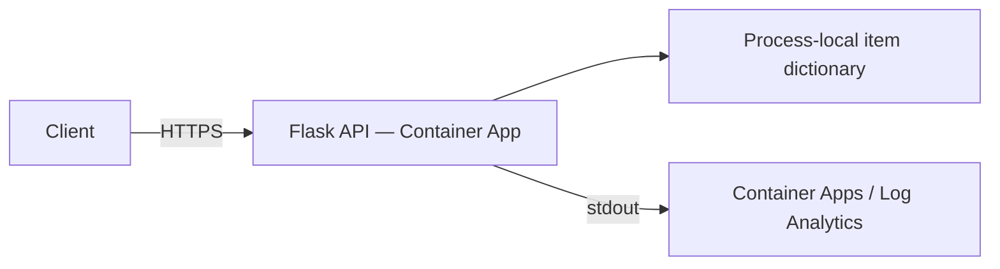

# ਸਧਾਰਣ ਫਲਾਸਕ ਏਪੀਆਈ — ਏਜ਼ਰ ਕੰਟੇਨਰ ਐਪਸ

**ਸਤਹ:** ਸ਼ੁਰੂਆਤੀ · **ਸਮਾਂ:** ਸੈਟਅਪ ਸਮੇਤ 30–45 ਮਿੰਟ

ਏਜ਼ਰ ਡੈਵਲਪਰ CLI (azd) ਨਾਲ ਇੱਕ ਪਾਇਥਨ ਫਲਾਸਕ CRUD ਏਪੀਆਈ ਤਿਆਰ ਕਰੋ। ਸਰੋਤ, Dockerfile,
Bicep, ਅਤੇ ਡਿਪਲੌਇਮੈਂਟ ਪੈਰਾਮੀਟਰ ਸ਼ਾਮਲ ਹਨ। ਇਹ ਇੱਕ **ਸਿੱਖਣ ਵਾਲਾ ਉਦਾਹਰਨ ਹੈ**, ਨਾ ਕਿ
ਪ੍ਰੋਡਕਸ਼ਨ-ਤਿਆਰ ਏਪੀਆਈ।

## ਤੁਸੀਂ ਕੀ ਸਿੱਖੋਗੇ

- azd ਰਾਹੀਂ ਕੰਟੇਨਰ ਬਣਾਉਣਾ ਅਤੇ ਪ੍ਰਕਾਸ਼ਿਤ ਕਰਨਾ।
- ਇੰਗਰੈੱਸ ਅਤੇ ਲਾਈਵਨੈੱਸ/ਰੇਡੀਨੇੱਸ ਪ੍ਰੋਬਜ਼ ਸੰਰਚਿਤ ਕਰਨਾ।
- CRUD ਜਵਾਬਾਂ ਦੀ ਪੁਸ਼ਟੀ ਕਰਨਾ ਅਤੇ ਐਪਲੀਕੇਸ਼ਨ ਲੌਗਾਂ ਦੀ ਜਾਂਚ ਕਰਨਾ।
- ਸਮਝਣਾ ਕਿ ਕਿਉਂ ਸਮਰੱਥ ਐਪਲੀਕੇਸ਼ਨਾਂ ਲਈ ਇਨ-ਮੈਮੋਰੀ ਡੇਟਾ ਅਣੁਕੂਲ ਨਹੀਂ ਹੈ।



**ਜ਼ਰੂਰੀ:** ਆਈਟਮ ਇੱਕ ਪ੍ਰਕਿਰਿਆ ਵਿੱਚ ਰੱਖੇ ਜਾਂਦੇ ਹਨ। ਡਿਫ਼ਾਲਟ ਹੈ **ਇੱਕ ਗੁਨੀਕੌਰਨ ਵਰਕਰ,
0–1 ਨਕਲ**, ਜੋ ਕਿ ਵਰਕਰਾਂ/ਨਕਲਾਂ ਵਿੱਚ ਅਸਥਿਰ ਡਾਟਾ ਤੋਂ ਬਚਾਉਂਦਾ ਹੈ।
ਆਈਟਮ ਰੀਸਟਾਰਟ, ਸੰਸ਼ੋਧਨ ਬਦਲਾਅ, ਜਾਂ ਸਰੇ-ਆਪਕ ਤੌਰ 'ਤੇ ਖਤਮ ਹੋ ਜਾਣ 'ਤੇ ਖੋ ਜਾਂਦੇ ਹਨ। ਨਕਲਾਂ ਵਿੱਚ ਵਾਧਾ
ਸਾਂਝੇ ਪ੍ਰਸਥਿਰ ਸਟੋਰੇਜ ਦੀ ਲੋੜ ਹੈ। ਏਪੀਆਈ ਵਿੱਚ ਕੋਈ ਪ੍ਰਮਾਣੀਕਰਨ ਜਾਂ ਅਧਿਕਾਰ ਨਹੀਂ ਹੈ।

## ਲੋੜੀਂਦੇ ਸ਼ਰਤਾਂ

- [ਮੌਜੂਦਾ ਸਥਿਰ azd](https://learn.microsoft.com/azure/developer/azure-developer-cli/install-azd)
  (ਰਿਵਿਊ ਸਮੇਂ ਪ੍ਰਕਾਸ਼ਿਤ ਰਿਲੀਜ਼: 1.37.2).
- ਜਾਂਚ ਲਈ [ਏਜ਼ਰ CLI](https://learn.microsoft.com/cli/azure/install-azure-cli)।
- ਡੋਕਰ ਇਸ ਦੇ ਡੀਮਨ ਨਾਲ ਚੱਲ ਰਿਹਾ; ਇਹ ਡਿਫ਼ਾਲਟ ਸਥਾਨਕ ਇਮੇਜ ਬਿਲਡ ਲਈ ਜ਼ਰੂਰੀ ਹੈ।
- ਏਜ਼ਰ ਸਬਸਕ੍ਰਿਪਸ਼ਨ, ਸਰੋਤ-ਤਿਆਰ ਕਰਨ ਦੇ ਅਧਿਕਾਰ, ਅਤੇ ਕੰਟੇਨਰ ਐਪਸ ਖੇਤਰੀ ਯੋਗਤਾ।
- ਹੇਠਾਂ ਦਿੱਤੇ ਕਮਾਂਡਾਂ ਲਈ ਬਾਸ਼ (ਜਾਂ ਬਰਾਬਰ ਦਾ PowerShell)।
- ਵਿਕਲਪਿਕ ਸਥਾਨਕ ਵਿਕਾਸ ਲਈ ਪਾਇਥਨ 3.11।

```bash
azd version
az version
docker info
azd auth login
az login
```

CLI ਟੂਲਾਂ ਦੀਆਂ ਵੱਖਰੀਆਂ ਲਾਗਇਨ ਸੈਸ਼ਨ ਹੁੰਦੀਆਂ ਹਨ। ਦੋਨੋਂ ਵਿੱਚ ਇੱਕੋ ਸਬਸਕ੍ਰਿਪਸ਼ਨ ਵਰਤੋ।

## ਤੇਜ਼ ਸ਼ੁਰੂਆਤ

ਰਿਪੋਜ਼ਟਰੀ ਰੂਟ ਤੋਂ:

```bash
cd examples/container-app/simple-flask-api
azd env new flask-demo
azd up
API_URL=$(azd env get-value API_ENDPOINT)
RG_NAME=$(azd env get-value AZURE_RESOURCE_GROUP)
API_NAME=$(azd env get-value API_NAME)
curl --fail-with-body "${API_URL}/health"
```

ਉਮੀਦ: HTTP 200 ਅਤੇ JSON ਜਿਸ ਵਿੱਚ `"status":"healthy"`,
`"service":"simple-flask-api"`, ਅਤੇ ਮੌਜੂਦਾ UTC ਟਾਈਮਸਟੈਂਪ ਹੋਵੇਗਾ।
ਪ੍ਰੋਵਿਜ਼ਨਿੰਗ ਅਤੇ ਇਮੇਜ ਬਣਾਉਣਾ ਆਮ ਤੌਰ 'ਤੇ ਕੁਝ ਮਿੰਟ ਲੀਂਦਾ ਹੈ; ਸਮਾਂ ਵੱਖ-ਵੱਖ ਹੋ ਸਕਦਾ ਹੈ।

ਸ਼ੁਰੂਆਤੀ ਪ੍ਰੋਵਿਜ਼ਨਿੰਗ ਇੱਕ ਪਬਲਿਕ ਹੈਲੋ-ਵਰਲਡ ਇਮੇਜ ਵਰਤਦਾ ਹੈ ਜੋ ਪੋਰਟ 80 ਤੇ ਸੁਣਦਾ ਹੈ।
`azure.yaml` ਦੀ ਚੋਣ `infra/app/api.bicep` ਅਤੇ ਇਸ ਦੇ ਮੈਚਿੰਗ ਪੈਰਾਮੀਟਰ ਫਾਈਲ ਨੂੰ ਸੇਵਾ ਡਿਪਲੌਇਮੈਂਟ ਲਈ ਕਰਦਾ ਹੈ,
ਜੋ ਇਮੇਜ, ਇੰਗਰੈੱਸ, ਅਤੇ ਪ੍ਰੋਬਜ਼ ਨੂੰ ਪੋਰਟ 8000 'ਤੇ ਬਦਲ ਦਿੰਦਾ ਹੈ।
ਉਹ ਡਿਪਲੌਇਮੈਂਟ ਪੈਰਾਮੀਟਰ ਨਾ ਮਿਟਾਓ।

## CRUD ਦੀ ਪੁਸ਼ਟੀ ਕਰੋ

ਜਦੋਂ ਤੱਕ ਇੱਕੋ ਨਕਲ ਸਰਗਰਮ ਹੈ, ਹੇਠਾਂ ਦਿੱਤੀਆਂ ਕਮਾਂਡਾਂ ਸਿਖਰਤਮੀਕ ਰੂਪ ਵਿੱਚ ਚਲਾਓ:

```bash
# Create: HTTP 201; note the returned id (1 for a fresh process).
curl -i -X POST "${API_URL}/api/items" \
  -H "Content-Type: application/json" \
  -d '{"name":"Test Item","description":"My first item"}'

# Read list: HTTP 200, total 1 in a fresh process.
curl --fail-with-body "${API_URL}/api/items"

# Replace 1 if your create response returned another id.
curl --fail-with-body "${API_URL}/api/items/1"
curl -i -X PUT "${API_URL}/api/items/1" \
  -H "Content-Type: application/json" -d '{"name":"Updated Item"}'
curl -i -X DELETE "${API_URL}/api/items/1"
curl -i "${API_URL}/api/items/1"
```

ਸਫਲਤਾ: POST 201, ਪੜ੍ਹਨਾ/PUT 200, DELETE 204 ਬਿਨਾਂ ਬਾਡੀ, ਫਿਰ ਗੁੰਮ ਆਈਟਮ 404।
ਖਰਾਬ ਜਾਂ ਗੈਰ-ਆਬਜੈਕਟ JSON ਜਾਂ ਖਾਲੀ ਨਾਮ 400 ਵਾਪਸ ਕਰਦਾ ਹੈ।
ਜੇ ਆਈਟਮ ਬੇਨਤੀਵਾਂ ਵਿੱਚ ਗਾਇਬ ਹੋ ਜਾਵੇ, ਤਾਂ ਰੀਸਟਾਰਟ ਜਾਂ ਸਕੇਲ-ਟੂ-ਜ਼ੀਰੋ ਦੀ ਜਾਂਚ ਕਰੋ;
ਇਹ ਇੱਕ ਇਰਾਦਤੀ ਇਨ-ਮੈਮੋਰੀ ਸੀਮਾ ਹੈ, ਨ कि ਕਿਸੇ ਪ੍ਰਸਥਿਰਤਾ ਦੀ।

| ਐਂਡਪੌਇੰਟ | ਢੰਗ |
|---|---|
| `/` | GET — ਸੇਵਾ ਜਾਣਕਾਰੀ |
| `/health` | GET — ਲਾਈਵਨੈੱਸ/ਰੇਡੀਨੇੱਸ |
| `/api/items` | GET, POST |
| `/api/items/{id}` | GET, PUT, DELETE |

## ਲੌਗ ਅਤੇ ਸੰਰਚਨਾ

```bash
az containerapp logs show --name "$API_NAME" --resource-group "$RG_NAME" --follow
```

ਉਮੀਦ: ਗੁਨੀਕੌਰਨ ਸ਼ੁਰੂਆਤ, ਬੇਨਤੀ ਐਕਸੇਸ ਲੌਗ ਅਤੇ ਅਰਜ਼ੀ ਸੁਨੇਹੇ।
`azd monitor --logs` ਇੱਕ ਪੋਰਟਲ ਦਿਖਾਉਂਦਾ ਹੈ; ਇਹ ਟਰਮੀਨਲ ਨੂੰ ਸਟਰੀਮ ਨਹੀਂ ਕਰਦਾ।
ਐਪਲੀਕੇਸ਼ਨ ਇੰਸਾਈਟਸ ਪ੍ਰੋਵਿਜ਼ਨ ਕੀਤੀ ਗਈ ਹੈ ਪਰ ਇਹ ਫਲਾਸਕ ਕੋਡ ਦੁਆਰਾ **ਇੰਸਟਰੂਮੈਂਟ ਨਹੀਂ** ਕੀਤੀ ਗਈ;
stdout ਲੌਗਾਂ ਲਈ ਕੰਟੇਨਰ ਐਪਸ/ਲੌਗ ਐਨਾਲਿਟਿਕਸ ਵਰਤੋਂ।

`infra/app/api.bicep` ਵਿੱਚ CPU/ਮੈਮੋਰੀ, ਨਕਲ ਸੀਮਾਵਾਂ, ਜਾਂ ਸਕੇਲ ਨਿਯਮ ਸੰਪਾਦਿਤ ਕਰੋ, ਫਿਰ
`azd up` ਚਲਾਓ। ਡਿਫਾਲਟ 0.5 vCPU, 1 GiB, ਘੱਟੋ-ਘੱਟ 0 / ਵੱਧ ਤੋਂ ਵੱਧ 1 ਨਕਲ, ਅਤੇ
HTTP ਸੀਮਾ 50 ਸਮਕਾਲੀ ਬੇਨਤੀਆਂ ਹੈ। ਸਕੇਲ-ਟੂ-ਜ਼ੀਰੋ ਮਹੀਨ ਸ਼ੁਰੂਆਤ ਵਿੱਚ ਦੇਰੀ ਜੁੜ ਸਕਦੀ ਹੈ।

ਜਿਹੜੇ ਵੀ `azd env set MAX_REPLICAS`, `API_KEY`, `LOG_LEVEL`, ਜਾਂ
`SCALE_TO_ZERO_TIMEOUT` ਮੁੱਲ ਹਨ, ਉਹ ਇਸ ਟੈਮਪਲੇਟ ਜਾਂ ਐਪ ਨਾਲ **ਜੁੜੇ ਨਹੀਂ** ਹਨ।
ਮੁੱਲ ਸੈਟ ਕਰਨਾ ਇਸ ਨੂੰ ਆਪੋ-ਆਪ ਰਨਟਾਈਮ ਵਾਤਾਵਰਣ ਚਲ ਇਸ ਵੈਰੀਏਬਲ ਨਹੀਂ ਬਣਾਉਂਦਾ।
ਇਮੇਜ ਸਾਫ਼-ਸੁਥਰੇ ਤੌਰ 'ਤੇ ਪੋਰਟ 8000 ਨੂੰ ਬੰਨ੍ਹਦਾ ਹੈ; ਪੋਰਟ ਬਦਲਣ ਦੇ ਸਮੇਂ ਡੋਕਰਫਾਈਲ, ਬਾਈਸਪ ਇੰਗਰੈੱਸ, ਅਤੇ ਪ੍ਰੋਬਜ਼
ਇਕਠੇ ਅਪਡੇਟ ਕਰੋ।

## ਫਾਈਲਾਂ

```text
azure.yaml
infra/main.bicep
infra/main.parameters.json
infra/app/container-apps.bicep       # Environment, registry, monitoring
infra/app/api.bicep                  # App, ingress, probes, scale settings
infra/app/api.parameters.json        # Image and resource values for azd deploy
src/app.py
src/Dockerfile
src/requirements.txt
```

## ਸਥਾਨਕ ਵਿਕਾਸ

ਇਸ ਉਦਾਹਰਣ ਡਾਇਰੈਕਟਰੀ ਤੋਂ:

```bash
python -m venv .venv
source .venv/bin/activate  # PowerShell: .\.venv\Scripts\Activate.ps1
python -m pip install -r src/requirements.txt
python src/app.py
```

ਦੂਜੇ ਟਰਮੀਨਲ ਵਿੱਚ, `http://localhost:8000/health` ਅਤੇ CRUD ਐਂਡਪੋਇੰਟ ਦੀ ਪੜਚੋਲ ਕਰੋ।
ਜਾਂ ਅਸਲੀ ਚਿੱਤਰ ਬਣਾਓ ਅਤੇ ਚਲਾਓ:

```bash
docker build -t flask-api:local ./src
docker run --rm -p 8000:8000 flask-api:local
```

ਪਹਿਲੀ ਤਾਇਨਾਤੀ ਮਗਰੋਂ ਸਿਰਫ ਕੋਡ-ਪਰੇਵਰਤਨਾਂ ਲਈ, `azd deploy api` ਚਲਾਓ।
Bicep ਬਦਲਾਵਾਂ ਲਈ,`azd up` ਨੂੰ ਰੀ-ਪ੍ਰੋਵਿਜ਼ਨ ਅਤੇ ਤਾਇਨਾਤ ਕਰਨ ਲਈ ਚਲਾਓ।

## ਪ੍ਰਯੋਗਾਤਮਕ ਅਭਿਆਸ

### 1. ਇਨਪੁਟ ਰਿਜੈਕਸ਼ਨ ਦੀ ਜਾਂਚ ਕਰੋ

**ਸ਼ੁਰੂਆਤੀ ਸਥਿਤੀ:** ਤਾਇਨਾਤਿਆ API, `API_URL` ਉਪਰ।
**ਮਕਸਦ:** ਜਾਂਚ ਕਰੋ ਕਿ API ਅਣਜਾਣੀ JSON ਸ਼ਕਲਾਂ ਅਤੇ ਗੁੰਮ ਹੋਏ ਨਾਮਾਂ ਨੂੰ ਰੱਦ ਕਰਦਾ ਹੈ।

```bash
curl -i -X POST "${API_URL}/api/items" \
  -H "Content-Type: application/json" -d '[]'
curl -i -X POST "${API_URL}/api/items" \
  -H "Content-Type: application/json" -d '{"name":""}'
```

**ਸਫਲਤਾ ਦੇ ਮਿਆਰ / ਹੱਲ:** ਦੋਵੇਂ 400 ਨੂੰ JSON ਗਲਤੀ ਦੇ ਨਾਲ ਵਾਪਸ ਕਰਦੇ ਹਨ, ਨਾ ਕਿ 500।
**ਆਮ ਸਮੱਸਿਆ:** JSON content-type ਹੈੱਡਰ ਨੂੰ ਛੱਡਣਾ।

### 2. ਇੱਕ ਪੜ੍ਹਨ-ਕੇਵਲ ਸੰਸਕਰਣ ਐਂਡਪੋਇੰਟ ਸ਼ਾਮਿਲ ਕਰੋ

**ਸ਼ੁਰੂਆਤੀ ਸਥਿਤੀ:** `src/app.py`। **ਮਕਸਦ:** API ਨੂੰ ਵਧਾਇਆ ਅਤੇ ਮੁੜ ਤਾਇਨਾਤ ਕਰੋ।
ਇਸ ਨੂੰ `if __name__ == '__main__':` ਬਲਾਕ ਤੋਂ ਪਹਿਲਾਂ ਸ਼ਾਮਿਲ ਕਰੋ:

```python
@app.route('/version', methods=['GET'])
def version():
    return jsonify({'version': '1.0.0'})
```

`azd deploy api` ਚਲਾਓ, ਫਿਰ `curl --fail-with-body "${API_URL}/version"`।
**ਸਫਲਤਾ ਦੇ ਮਿਆਰ:** HTTP 200 ਅਤੇ `{"version":"1.0.0"}`।
**ਆਮ ਸਮੱਸਿਆ:** ਰੂਟ ਨੂੰ ਰੋਕਣ ਵਾਲੇ `app.run()` ਕਾਲ ਤੋਂ ਬਾਅਦ ਰੱਖਣਾ ਜਦੋਂ
`python src/app.py` ਨਾਲ ਜਾਂਚ ਕਰਦੇ ਹੋ।

### ਗਿਆਨ ਦੀ ਜਾਂਚ

ਇਕ ਵਰਕਰ ਕਿਉਂ ਦਿਰਘਕਾਲੀ ਡਾਟਾ ਲਈ ਅਯਾਪਤ ਹੈ? ਕਿਉਂਕਿ ਇੱਕ ਹੀ ਪ੍ਰਕਿਰਿਆ ਵੀ ਦੁਬਾਰਾ ਸ਼ੁਰੂ ਕਰਨ 'ਤੇ ਆਪਣਾ ਡਿਕਸ਼ਨਰੀ ਖੋ ਦਿੰਦੀ ਹੈ। ਪ੍ਰੋਡਕਸ਼ਨ ਵਰਜ਼ਨ ਨੂੰ ਸਥਾਈ ਸਾਂਝਾ ਸਟੋਰੇਜ,
ਪ੍ਰਮਾਣਿਕਤਾ, ਅਧਿਕਾਰਤਾ, ਮਾਈਗ੍ਰੇਸ਼ਨ, ਟੈਸਟ ਅਤੇ ਪਰਚਾਲਕੀ ਨਿਗਰਾਨੀ ਦੀ ਲੋੜ ਹੁੰਦੀ ਹੈ।


ਇਹ ਇੱਕ ਗਾਰੰਟੀ ਵਾਲਾ $0 ਡਿਪਲੋਇਮੈਂਟ ਨਹੀਂ ਹੈ: ਬੇਸਿਕ ਰਜਿਸਟਰੀ ਅਤੇ ਲੌਗ ਸਟੋਰੇਜ/ਇੰਜੈਸ਼ਨ
ਕਿਨ੍ਹਾਂ ਖਰਚਾਂ ਲਾਗੂ ਹੋ ਸਕਦੀਆਂ ਹਨ ਜਦੋ ਐਪ ਕੰਪਿਊਟ ਜ਼ੀਰੋ ‘ਤੇ ਹੋਵੇ। ਵਰਤੋਂ ਕਰੋ
[ਕੀਮਤ ਕੈਲਕੂਲੇਟਰ](https://azure.microsoft.com/pricing/calculator/) ਆਪਣੇ ਖੇਤਰ ਲਈ।

- **Docker ਬਿਲਡ ਅਸਫਲਤਾ:** ਪੁਸ਼ਟੀ ਕਰੋ `docker info`, ਨੈੱਟਵਰਕ ਐਕਸੇਸ, ਅਤੇ ਨਿਰਭਰਸ਼ੀਲਤਾਵਾਂ।
- **ਅਣਹੈਲਥੀ ਐਪ:** ਕਨਸੋਲ/ਸਿਸਟਮ ਲੌਗਾਂ ਦੀ ਜਾਂਚ ਕਰੋ ਅਤੇ ਤਸਵੀਰ ਪੋਰਟ, ਇੰਗਰੈੱਸ,
  ਅਤੇ ਪ੍ਰੋਬਾਂ ਨੂੰ ਮਿਲਾਓ। ਫਲਾਸਕ ਪੋਰਟ 'ਤੇ ਇੱਕ ਪਲੇਸਹੋਲਡਰ ਨੂੰ ਪ੍ਰੋਬ ਨਹੀਂ ਕੀਤਾ ਜਾਣਾ ਚਾਹੀਦਾ।
- **403/ਅਧਿਕਾਰ:** ਸਬਸਕ੍ਰਿਪਸ਼ਨ ਅਤੇ ਸਾਧਨ-ਸਿਰਜਣ ਅਧਿਕਾਰਾਂ ਦੀ ਪੁਸ਼ਟੀ ਕਰੋ।
- **ਆਈਟਮ ਗਾਇਬ ਹੋਣੇ:** ਰੀਸਟਾਰਟ/ਜ਼ੀਰੋ-ਸਕੇਲ ਤੇ ਦਰਮਿਆਨੀ ਮੈਮੋਰੀ ਸਥਿਤੀ ਰੀਸੈੱਟ ਹੁੰਦੀ ਹੈ;
  ਟਿਕਾਊ ਵਿਵਹਾਰ ਲਈ ਡਾਟਾਬੇਸ ਸ਼ਾਮਲ ਕਰੋ।

## ਸਫਾਈ ਅਤੇ ਅਗਲੇ ਕਦਮ

```bash
azd down
```

ਮਿਟਾਉਣ ਦੇ ਪ੍ਰੰਪਟ ਨੂੰ ਸਮੀਖਿਆ ਕਰੋ ਅਤੇ ਯਕੀਨੀ ਬਣਾਓ ਕਿ ਸਮਰਪਿਤ ਸਾਧਨ ਸਮੂਹ ਹਟਾਇਆ ਗਿਆ ਹੈ।
ਅਸੰਬੰਧਤ ਡਾਟਾ ਵਾਲੇ ਸਾਧਨ ਸਮੂਹ ਖਿਲਾਫ ਬੀਨਾਸ਼ਕ ਸਫਾਈ ਨਾ ਕਰੋ।

[ਅਗਲਾ: ਡਾਟਾਬੇਸ ਐਪ](../../../../../examples/database-app) · [ਮਾਈਕਰੋਸਰਵਿਸ](../../../../../examples/container-app/microservices) ·
[ਕੰਟੇਨਰ ਓਵਰਵਿਊ](../README.md) · [ਕੋਰਸ ਮੁੱਖ ਸਫ਼ਾ](../../../README.md) ·
[ਮਸਲਾ ਰਿਪੋਰਟ ਕਰੋ](https://github.com/microsoft/AZD-for-beginners/issues)

---

<!-- CO-OP TRANSLATOR DISCLAIMER START -->
**ਅਸਵੀਕਾਰੋਪਣ**:
ਇਸ ਦਸਤਾਵੇਜ਼ ਦਾ ਅਨੁਵਾਦ ਏਆਈ ਅਨੁਵਾਦ ਸੇਵਾ [Co-op Translator](https://github.com/Azure/co-op-translator) ਦੀ ਵਰਤੋਂ ਕਰਕੇ ਕੀਤਾ ਗਿਆ ਹੈ। ਜਦੋਂ ਕਿ ਅਸੀਂ ਸਹੀਤਾਵਾਂ ਲਈ ਯਤਨਸ਼ੀਲ ਹਾਂ, ਕਿਰਪਾ ਕਰਕੇ ਧਿਆਨ ਰੱਖੋ ਕਿ ਸਵੈਚਾਲਿਤ ਅਨੁਵਾਦਾਂ ਵਿੱਚ ਗਲਤੀਆਂ ਜਾਂ ਅਸਮੱਤਿਆਵਾਂ ਹੋ ਸਕਦੀਆਂ ਹਨ। ਮੂਲ ਦਸਤਾਵੇਜ਼ ਆਪਣੀ ਮੂਲ ਭਾਸ਼ਾ ਵਿੱਚ ਅਧਿਕਾਰਕ ਸਰੋਤ ਮੰਨਿਆ ਜਾਣਾ ਚਾਹੀਦਾ ਹੈ। ਜਰੂਰੀ ਜਾਣਕਾਰੀ ਲਈ, ਪੇਸ਼ੇਵਰ ਮਨੁੱਖੀ ਅਨੁਵਾਦ ਦੀ ਸਿਫ਼ਾਰਸ਼ ਕੀਤੀ ਜਾਂਦੀ ਹੈ। ਅਸੀਂ ਇਸ ਅਨੁਵਾਦ ਦੇ ਉਪਯੋਗ ਤੋਂ ਪੈਦਾ ਹੋਣ ਵਾਲੀਆਂ ਕਿਸੇ ਵੀ ਗਲਤਫਹਿਮੀਆਂ ਜਾਂ ਗਲਤ ਵਿਆਖਿਆਵਾਂ ਲਈ ਜਵਾਬਦੇਹ ਨਹੀਂ ਹਾਂ।
<!-- CO-OP TRANSLATOR DISCLAIMER END -->