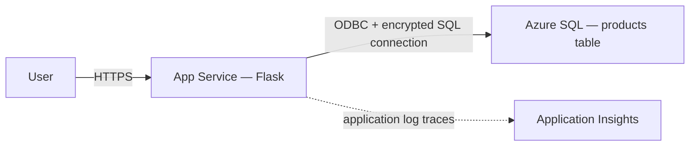

# ਫਲਾਸਕ ਅਤੇ ਅਜ਼ੂਰ SQL ਐਪ ਸਰਵਿਸ 'ਤੇ

**ਸਤਹ:** ਦਰਮਿਆਨਾ · **ਸਮਾਂ:** 30–60 ਮਿੰਟ, ਪ੍ਰੀ-ਰਿਕਵਾਇਰਮੈਂਟ ਸਮੇਤ

ਇਹ ਨਮੂਨਾ ਇੱਕ ਪਾਇਥਨ ਫਲਾਸਕ ਰੀਡ API ਨੂੰ **ਲਿਨਕਸ ਐਪ ਸਰਵਿਸ** ਅਤੇ ਬੇਸਿਕ
ਅਜ਼ੂਰ SQL ਡੇਟਾਬੇਸ 'ਤੇ ਡਿਪਲੌਇ ਕਰਦਾ ਹੈ। ਸੋਰਸ, ਬਾਈਸਪ, ਅਤੇ azd ਸੰਰਚਨਾ ਸ਼ਾਮਲ ਹਨ। ਇਹ ਇੱਕ
ਸਿੱਖਣ ਵਾਲਾ ਐਪਲੀਕੇਸ਼ਨ ਹੈ, ਪ੍ਰੋਡਕਸ਼ਨ-ਤਿਆਰ ਡੇਟਾਬੇਸ ਆਰਕੀਟੈਕਚਰ ਨਹੀਂ।

## ਤੁਸੀਂ ਕੀ ਸਿੱਖੋਗੇ

- ਬਾਈਸਪ ਨਾਲ ਐਪ ਸਰਵਿਸ, SQL, ਅਤੇ ਮਾਨੀਟਰਿੰਗ ਸਰੋਤ ਪ੍ਰੋਵਿਜ਼ਨ ਕਰੋ।
- ਸਰਟੀਫਿਕੇਟ ਬਿਨਾਂ ਗੁਪਤ ਕੋਡਿੰਗ ਦੇਕੋਡ SQL ਕੁਨੈਕਟਿਵਿਟੀ ਸੰਰਚਿਤ ਕਰੋ।
- ਗਨੀਕੌਰਨ ਵਰਕਰ ਸ਼ੁਰੂ ਕਰਨ ਤੋਂ ਪਹਿਲਾਂ ਸਕੀਮਾ ਸ਼ੁਰੂ ਕਰੋ।
- ਸੀਡ ਕੀਤੇ ਡੇਟਾ, ਨਾ-ਲੱਭੇ ਜਵਾਬ, ਅਤੇ ਡੇਟਾਬੇਸ ਸਿਹਤ ਦੀ ਪੁਸ਼ਟੀ ਕਰੋ।



ਸਰੋਤ: ਸਮਰਪਿਤ ਸਰੋਤ ਗਰੁੱਪ, B1 ਲਿਨਕਸ ਐਪ ਸਰਵਿਸ ਪਲੈਨ, ਪਾਇਥਨ 3.11 ਵੈੱਬ
ਐਪ, SQL ਸਰਵਰ ਅਤੇ ਬੇਸਿਕ 2-GB ਡੇਟਾਬੇਸ, ਐਪਲੀਕੇਸ਼ਨ ਇਨਸਾਈਟਸ, ਅਤੇ ਲੌਗ ਐਨਾਲਿਟਿਕਸ।
ਵੈੱਬ ਐਪ **source/ZIP deployment ਅਤੇ Oryx ਡਿਪੈਂਡੈਂਸੀ ਇੰਸਟਾਲੇਸ਼ਨ** ਦੀ ਵਰਤੋਂ ਕਰਦਾ ਹੈ;
`azd deploy` ਵਿਕਲਪੀ Dockerfile ਨੂੰ ਨਹੀਂ ਬਣਾਉਂਦਾ ਜਾਂ ਡਿਪਲੌਇ ਕਰਦਾ।

## ਪੂਰਵ-ਸ਼ਰਤਾਂ

- ਮੌਜੂਦਾ ਸਥਿਰ [azd](https://learn.microsoft.com/azure/developer/azure-developer-cli/install-azd)
  (ਸਮੀਖਿਆ ਸਮੇਂ ਪ੍ਰਕਾਸ਼ਿਤ ਰਿਲੀਜ਼: 1.37.2)।
- [Azure CLI](https://learn.microsoft.com/cli/azure/install-azure-cli) ਜਾਂਚ ਲਈ।
- ਅਜ਼ੂਰ ਸਬਸਕ੍ਰਿਪਸ਼ਨ, ਸੂਚੀਬੱਧ ਸਰੋਤ ਬਣਾਉਣ ਦੀ ਆਗਿਆਈ, ਅਤੇ ਖੇਤਰੀ ਕੁਆਟਾ।
- ਪਾਇਥਨ **3.11** ਸਥਾਨਕ ਵਿਕਾਸ ਲਈ; ਪ੍ਰਤੀਬੱਧ `pyodbc==5.0.1` ਨੂੰ ਨਵੇਂ ਪਾਇਥਨ ਵਰਜਨਾਂ 'ਤੇ
  ਮੂਲ ਤਿਆਰ ਕਰਨ ਵਾਲੇ ਟੂਲਜ਼ ਦੀ ਲੋੜ ਹੋ ਸਕਦੀ ਹੈ।
- ਮਾਈਕਰੋਸਾਫਟ ODBC ਡਰਾਈਵਰ 18 (ਜਾਂ 17) SQL ਸਰਵਰ ਲਈ ਸਥਾਨਕ ਮਸ਼ੀਨਾਂ 'ਤੇ। `pip install
  pyodbc` ਸਿਸਟਮ ਡਰਾਈਵਰ ਨੂੰ ਇੰਸਟਾਲ ਨਹੀਂ ਕਰਦਾ। ਵੇਖੋ
  [ODBC ਇੰਸਟਾਲੇਸ਼ਨ](https://learn.microsoft.com/sql/connect/odbc/download-odbc-driver-for-sql-server)।
- ਕੇਵਲ ਡਾਕਰ ਜੇ ਵਿਕਲਪੀ ਕੰਟੇਨਰ ਸਥਾਨਕ ਤੌਰ 'ਤੇ ਪਰਖ ਰਿਹਾ ਹੈ।

```bash
azd version
az version
azd auth login
az login
```

ਦੋਹਾਂ ਟੂਲਜ਼ ਵਿੱਚ ਇੱਕੋ ਜਿਹਾ ਸਬਸਕ੍ਰਿਪਸ਼ਨ ਵਰਤੋ। ਹੇਠਾਂ ਕਮਾਂਡਾਂ ਬਾਸ਼ ਵਰਤਦੀਆਂ ਹਨ।

## ਡਿਪਲੌਇ

ਰਿਪੋਜ਼ਿਟਰੀ ਰੂਟ ਤੋਂ:

```bash
cd examples/database-app
azd env new sql-demo
azd provision
azd deploy
WEB_URL=$(azd env get-value WEB_APP_URI)
WEB_NAME=$(azd env get-value WEB_APP_NAME)
RG_NAME=$(azd env get-value AZURE_RESOURCE_GROUP)
```

ਸਹਾਇਕ ਖੇਤਰ ਚੁਣੋ। `sqlAdminLogin` ਦਾ ਡਿਫਾਲਟ `sqladmin` ਹੈ; ਲੋੜੀਂਦਾ
`sqlAdminPassword` ਇੱਕ ਸੁਹਣਾ ਪਰਾਮੀਟਰ ਹੈ। ਪੁੱਛਿਆ ਜਾਣ 'ਤੇ ਮਜ਼ਬੂਤ ਪਾਸਵਰਡ ਦਿਓ।
ਡਿਪਲੌਇਮੈਂਟ ਗੁਪਤ-ਕੋਡ Git ਅਤੇ ਮੁਦੱਤ ਰਿਪੋਰਟਾਂ ਵਿੱਚੋਂ ਬਾਹਰ ਰੱਖੋ। ਮੌਜੂਦਾ ਕਨੈਕਸ਼ਨ
ਸਟਰਿੰਗ ਇੰਟਰਪੋਲੇਸ਼ਨ ਪਾਸਵਰਡ ਨੂੰ ਕਨੈਕਸ਼ਨ-ਸਟਰਿੰਗ ਡੈਲਿਮਿਟਰਾਂ ਬਿਨਾਂ ਮੰਨਦੀ ਹੈ ਜਿਵੇਂ ਕਿ
`;`; ਐਸੀਆਂ ਵੈਲਿਊਜ਼ ਦੀ ਵਰਤੋਂ ਕਰਨ ਤੋਂ ਪਹਿਲਾਂ ਸਕੇਪਿੰਗ ਢਾਲੋ।

Bicep ਇੱਕ ਸਟਾਰਟਅੱਪ ਕਮਾਂਡ ਸੈੱਟ ਕਰਦਾ ਹੈ ਜੋ `init_database()` ਨੂੰ **Gunicorn ਤੋਂ ਪਹਿਲਾਂ** ਚਲਾਉਂਦਾ ਹੈ
ਵਰਕਰਾਂ ਦੇ ਸ਼ੁਰੂ ਹੋਣ ਤੋਂ ਪਹਿਲਾਂ। ਇਹ ਲੋੜੀਂਦਾ ਹੈ ਕਿਉਂਕਿ `app:app` ਨੂੰ ਇੰਪੋਰਟ ਕਰਨਾ
Python ਦਾ `if __name__ == '__main__'` ਬਲੌਕ ਚਲਾਉਂਦਾ ਨਹੀਂ ਹੈ। ਇੱਕ ਨਵੀਂ ਡੇਟਾਬੇਸ 'ਤੇ, ਸ਼ੁਰੂਆਤ
`products` ਬਣਾਉਂਦੀ ਹੈ ਅਤੇ ਪੰਜ ਪੰक्तੀਆਂ ਸ਼ਾਮਿਲ ਕਰਦੀ ਹੈ। ਇਹ ਸਿੱਖਣ ਲਈ ਸਧਾਰਣ ਬੀਜ ਹੈ, ਇੱਕ
ਸੰਗਠਿਤ ਮਾਈਗ੍ਰੇਸ਼ਨ ਫਰੇਮਵਰਕ ਨਹੀਂ; ਇੰਸਟੈਂਸਾਂ ਨੂੰ ਵਧਾਉਣ ਤੋਂ ਪਹਿਲਾਂ ਸਹੀ ਮਾਈਗ੍ਰੇਸ਼ਨਾਂ ਦੀ ਵਰਤੋਂ ਕਰੋ।

ਐਪ ਇੰਸਟਾਲ ਕੀਤੇ ਮਾਇਕਰੋਸਾਫਟ ODBC ਡਰਾਈਵਰ 18 ਨੂੰ ਚੁਣਦਾ ਹੈ, ਫਿਰ 17, ਜੇ ਕਨੈਕਸ਼ਨ
ਸਟ੍ਰਿੰਗ ਸਪੱਸ਼ਟ ਤੌਰ 'ਤੇ ਕੋਈ ਡਰਾਈਵਰ ਨਹੀਂ ਨਾਂਦਾ। ਜੇ ਦੋਵਾਂ ਮੌਜੂਦ ਨਾ ਹੋਣ ਤਾਂ, ਸਟਾਰਟਅੱਪ ਇੱਕ
ਕਾਰਵਾਈਯੋਗ ਇੰਸਟਾਲੇਸ਼ਨ ਗਲਤੀ ਨਾਲ ਫੇਲ੍ਹ ਹੋ ਜਾਂਦਾ ਹੈ। ਆਪਣੇ ਚੁਣੇ ਹੋਏ
ਐਪ ਸਰਵਿਸ ਰਨਟਾਈਮ ਵਿੱਚ ਡਰਾਈਵਰ ਦੀ ਉਪਲਬਧਤਾ ਦੀ ਜਾਂਚ ਕਰੋ ਨਾ ਕਿ ਅਨੁਮਾਨ ਲਗਾਓ।

## ਸੱਚਾਈ ਦੀ ਜਾਂਚ ਕਰੋ

```bash
curl --fail-with-body "${WEB_URL}/"
curl --fail-with-body "${WEB_URL}/health"
curl --fail-with-body "${WEB_URL}/products"
curl --fail-with-body "${WEB_URL}/products/1"
curl -i "${WEB_URL}/products/999"
```

ਉਮੀਦ ਕੀਤੀ ਗਈ:

- `/` ਐਂਡਪੌਇੰਟ ਜਾਣਕਾਰੀ ਵਾਪਸ ਕਰਦਾ ਹੈ।
- `/health` 200 ਨਾਲ `{"status":"healthy","database":"connected"}` ਵਾਪਸ ਕਰਦਾ ਹੈ।
- `/products` ਇੱਕ ਨਵੀਂ ਡੇਟਾਬੇਸ 'ਤੇ ਪੰਜ ਬੀਜੀ ਉਤਪਾਦ ਵਾਪਸ ਕਰਦਾ ਹੈ।
- `/products/1` ਲੈਪਟਾਪ ਨੂੰ ਕੀਮਤ 1299.99 ਨਾਲ ਵਾਪਸ ਕਰਦਾ ਹੈ।
- ਇੱਕ ਅਜਿਹਾ ਉਤਪਾਦ ਜੋ ਮੌਜੂਦ ਨਹੀਂ ਹੈ ਉਹ `{"error":"Product not found"}` ਨਾਲ 404 ਵਾਪਸ ਕਰਦਾ ਹੈ।

API ਸਿਰਫ਼ ਪੜ੍ਹਨ ਵਾਲਾ ਹੈ। ਕੋਈ POST/PUT/DELETE ਰੂਟ ਜਾਂ ਬ੍ਰਾਉਜ਼ਰ UI ਨਹੀਂ ਹੈ।
ਡੇਟਾਬੇਸ ਕਨੈਕਟੀਵਿਟੀ ਫੇਲ੍ਹ ਹੋਣ 'ਤੇ `/health` ਤੋਂ 503 ਵਾਪਸ ਹੁੰਦਾ ਹੈ; ਇਹ ਸਫਲਤਾ ਨਹੀਂ ਹੈ।

## ਫਾਇਲਾਂ ਅਤੇ ਸੰਰਚਨਾ

```text
azure.yaml                         # Python App Service source deployment
infra/main.bicep
infra/main.parameters.json
infra/abbreviations.json
infra/resources/sql-server.bicep
infra/resources/sql-database.bicep
infra/resources/app-service-plan.bicep
infra/resources/web-app.bicep       # Settings + initialization/startup command
infra/resources/app-insights.bicep
src/web/app.py
src/web/requirements.txt
src/web/Dockerfile                 # Optional local container, not the azd target
.env.sample
```

`SQL_CONNECTION_STRING` ਨੂੰ Web App ਮੋਡੀਊਲ ਨੂੰ ਇੱਕ ਸੁਰੱਖਿਅਤ Bicep ਪੈਰਾਮੀਟਰ ਵਜੋਂ ਦਿੱਤਾ ਜਾਂਦਾ ਹੈ
ਅਤੇ ਇਸਨੂੰ App Service ਸੈਟਿੰਗਾਂ ਵਿੱਚ ਸਟੋਰ ਕੀਤਾ ਜਾਂਦਾ ਹੈ, deployment outputs ਵਿੱਚ ਨਹੀਂ।
`APPLICATIONINSIGHTS_CONNECTION_STRING` ਲੌਗ ਨਿਰ੍ਯਾਤ ਕੋਨਫਿਗਰ ਕਰਦਾ ਹੈ।
`SCM_DO_BUILD_DURING_DEPLOYMENT=true` ਸਰਵਰ-ਸਾਈਡ ਡਿਪੈਂਡੈਂਸੀ ਇੰਸਟਾਲੇਸ਼ਨ ਨੂੰ ਯੋਗ ਕਰਦਾ ਹੈ।
ਮਨਮਾਨੇ `azd env` ਮੁੱਲ ਸੈੱਟ ਕਰਨ ਨਾਲ ਆਟੋਮੈਟਿਕ ਤੌਰ 'ਤੇ ਐਪ ਸੈਟਿੰਗਾਂ ਵਿੱਚ ਕੋਈ ਬਦਲਾਅ ਨਹੀਂ ਹੁੰਦਾ।

SQL ਫਾਇਰਵਾਲ ਦਾ `0.0.0.0` ਨਿਯਮ **Azure ਸੇਵਾਵਾਂ,
ਜਿਨ੍ਹਾਂ ਵਿੱਚ ਹੋਰ ਗ੍ਰਾਹਕਾਂ ਦੀਆਂ ਸਬਸਕ੍ਰਿਪਸ਼ਨਾਂ ਸ਼ਾਮਲ ਹਨ**, ਤੋਂ ਕੁਨੈਕਸ਼ਨਾਂ ਦੀ ਆਗਿਆ ਦਿੰਦਾ ਹੈ, ਜਿਹੜਾ SQL ਪ੍ਰਮਾਣੀਕਰਨ ਦੇ ਅਧੀਨ ਹੈ। ਇਹ
ਕੇਵਲ ਇਸ ਐਪ ਜਾਂ ਸਬਸਕ੍ਰਿਪਸ਼ਨ ਤੱਕ ਸੀਮਤ ਨਹੀਂ ਹੈ। SQL ਪਬਲਿਕ ਨੈੱਟਵਰਕ ਐਕਸੈਸ ਸੰਚਾਲਿਤ ਹੈ।
ਉਤਪਾਦਨ ਤੋਂ ਪਹਿਲਾਂ ਸਕੋਪਡ ਨੈੱਟਵਰਕਿੰਗ ਅਤੇ ਗੈਰ-ਐਡਮਿਨ ਐਪਲੀਕੇਸ਼ਨ ਆਈਡੈਂਟੀਟੀ ਦੀ ਵਰਤੋਂ ਕਰੋ।

## ਲੋਕਲ ਵਿਕਾਸ

Python 3.11 ਅਤੇ ਇੱਕ ਇੰਸਟਾਲ Microsoft SQL ODBC ਡਰਾਈਵਰ ਦੀ ਵਰਤੋਂ ਕਰੋ:

```bash
python -m venv .venv
source .venv/bin/activate  # PowerShell: .\.venv\Scripts\Activate.ps1
python -m pip install -r src/web/requirements.txt
export SQL_CONNECTION_STRING='Server=tcp:YOUR_SERVER.database.windows.net,1433;Database=YOUR_DATABASE;UID=YOUR_USER;PWD=YOUR_PASSWORD;Encrypt=yes;TrustServerCertificate=no;Connection Timeout=30;'
python src/web/app.py
```

ਜ਼ਮੀਨੀ ਨਿਸ਼ਾਨ ਸੁਰੱਖਿਅਤ ਢੰਗ ਨਾਲ ਬਦਲੋ। ਇੱਕ ਨਕਲ ਕੀਤਾ ਹੋਇਆ `.env` ਫਾਇਲ **ਆਟੋਮੈਟਿਕ ਤੌਰ ‘ਤੇ ਲੋਡ ਨਹੀਂ ਹੁੰਦੀ**
ਇਸ ਐਪਲੀਕੇਸ਼ਨ ਵੱਲੋਂ। ਇਸ ਦੀ ਥਾਂ ਆਪਣੇ ਮੌਜੂਦਾ ਸ਼ੈੱਲ ਵਿੱਚ ਵੇਰੀਏਬਲ ਨਿਰਯਾਤ ਕਰੋ।
ਲੈਪਟਾਪ ਤੋਂ Azure SQL ਲਈ, ਅਸਥਾਈ ਤੌਰ ‘ਤੇ ਕੇਵਲ ਆਪਣਾ ਆਪਣਾ ਪਬਲਿਕ IP ਆਗਿਆ ਦਿਓ:

```bash
SQL_SERVER=$(azd env get-value SQL_SERVER_NAME)
MY_IP=YOUR_PUBLIC_IP
az sql server firewall-rule create -g "$RG_NAME" -s "$SQL_SERVER" \
  -n AllowMyLearningIP --start-ip-address "$MY_IP" --end-ip-address "$MY_IP"
```

ਟੈਸਟਿੰਗ ਦੇ ਬਾਅਦ ਨਿਯਮ ਹਟਾਓ:

```bash
az sql server firewall-rule delete -g "$RG_NAME" -s "$SQL_SERVER" -n AllowMyLearningIP
```

ਇਸ ਉਦਾਹਰਣ ਡਾਇਰੈਕਟਰੀ ਤੋਂ ਵਿਕਲਪੀ ਕੰਟੇਨਰ ਟੈਸਟ:

```bash
docker build -t sql-flask:local src/web
docker run --rm -p 8000:8000 -e SQL_CONNECTION_STRING sql-flask:local
```

ਇਸ ਚਿੱਤਰ ਵਿੱਚ ਡਰਾਈਵਰ 18 ਨੂੰ Debian 12 ਪੈਕੇਜ ਰਿਪੋਜਿਟਰੀ ਦੀ ਵਰਤੋਂ ਕਰਕੇ ਇੰਸਟਾਲ ਕੀਤਾ ਗਿਆ ਹੈ, ਜੋ ਕਿ ਇਸਦੇ
Bookworm ਬੇਸ ਨਾਲ ਮੇਲ ਖਾਂਦਾ ਹੈ, ਡਾਟਾਬੇਸ ਨੂੰ ਇੱਕ ਵਾਰ ਸ਼ੁਰੂ ਕਰਦਾ ਹੈ, ਫਿਰ Gunicorn ਸ਼ੁਰੂ ਕਰਦਾ ਹੈ।

## ਮਾਨੀਟਰਨਿੰਗ ਅਤੇ ਟ੍ਰਬਲਸ਼ੂਟਿੰਗ

ਸਟਾਰਟਅੱਪ ਦੀ ਜਾਂਚ ਦੌਰਾਨ ਐਪ ਸਰਵਿਸ ਫਾਈਲਸਿਸਟਮ ਐਪਲੀਕੇਸ਼ਨ ਲੌਗਜ਼ ਨੂੰ ਯੋਗ/ਟੇਲ ਕਰੋ:

```bash
az webapp log config --name "$WEB_NAME" --resource-group "$RG_NAME" \
  --application-logging filesystem --level information
az webapp log tail --name "$WEB_NAME" --resource-group "$RG_NAME"
```

ਇਹ ਕੋਡ ਲੈਗਸੀ OpenCensus ਹੈਂਡਲਰ ਰਾਹੀਂ ਐਪਲੀਕੇਸ਼ਨ **ਲੌਗ ਟ੍ਰੇਸ** ਨਿਰਯਾਤ ਕਰਦਾ ਹੈ।
ਇਹ ਆਟੋਮੈਟਿਕ Flask ਬੇਨਤੀ/ਡਿਪੈਂਡੇਸੀ ਟ੍ਰੇਸਿੰਗ, ਲਾਈਵ ਮੈਟ੍ਰਿਕਸ,
SQL ਆਡਿਟਿੰਗ, ਡਾਇਗਨੋਸਟਿਕ ਸੈਟਿੰਗਜ਼, ਜਾਂ ਅਲਰਟਸ ਨੂੰ ਸੰਰਚਿਤ ਨਹੀਂ ਕਰਦਾ। ਇਹਨਾਂ ਲਈ ਵੱਖਰੀ ਸੈਟਅੱਪ ਦੀ ਲੋੜ ਹੁੰਦੀ ਹੈ।
ਨਵੇਂ ਇੰਸਟਰੂਮੈਂਟੇਸ਼ਨ ਲਈ, Azure Monitor OpenTelemetry ਨੂੰ ਤਰਜੀਹ ਦਿਓ।

ਐਪਲੀਕੇਸ਼ਨ ਇਨਸਾਈਟਸ ਲੌਗਸ ਵਿੱਚ, API ਬੇਨਤੀਆਂ ਕਰਨ ਤੋਂ ਬਾਅਦ:

```kusto
traces
| where timestamp > ago(1h)
| where message contains "products" or message contains "Health check"
| project timestamp, message, severityLevel
```

ਇੰਜੈਸ਼ਨ ਦੇਰੀ ਦੀ ਆਗਿਆ ਦਿਓ। ਬੇਨਤੀ-ਟੇਬਲ ਜਾਂ ਲਾਈਵ ਮੈਟ੍ਰਿਕਸ ਦਰਸ਼ਾਈ ਇੱਕ ਪੂਰਨਤਾ ਦੀ ਸ਼ਰਤ ਨਹੀਂ ਹੈ
ਇਸ ਸਿਰਫ਼ ਲੌਗ ਇੰਸਟਰੂਮੈਂਟੇਸ਼ਨ ਲਈ।

- **ਡ라이ਵਰ ਲਾਪਤਾ ਹੈ:** ਰੰਟਾਈਮ ਵਿੱਚ `pyodbc.drivers()` ਨੂੰ ਇੰਸਪੈਕਟ ਕਰੋ ਅਤੇ ਮਾਈਕਰੋਸਾਫ਼ਟ ODBC ਡਰਾਈਵਰ ਨੂੰ ਇੰਸਟਾਲ ਕਰੋ।
  ਕੇਵਲ Python ਪੈਕੇਜ ਕਾਫ਼ੀ ਨਹੀਂ ਹੈ।
- **ਕਨੈਕਸ਼ਨ ਫੇਲ੍ਹ:** SQL ਸੈਟਿੰਗਜ਼, ਪ੍ਰਮਾਣ ਪੱਤਰ, ਫਾਇਰਵਾਲ ਅਤੇ ਚੁਣੀ ਗਈ
  سبسکرپਸ਼ਨ ਨੂੰ ਜਾਂਚੋ। ਗਲਤੀ ਨੂੰ ਬਾਇਪਾਸ ਕਰਨ ਲਈ ਇੰਕ੍ਰਿਪਸ਼ਨ ਨੂੰ ਬੰਦ ਨਾ ਕਰੋ।
- **ਪ੍ਰੋਡਕਟਸ ਟੇਬਲ ਗੁੰਮ ਹੈ:** ਪੁਸ਼ਟੀ ਕਰੋ ਕਿ Bicep ਸਟਾਰਟਅੱਪ ਕਮਾਂਡ ਤਕਸੀਮ ਕੀਤੀ ਗਈ ਸੀ;
  ਕੇਵਲ `gunicorn app:app` ਸ਼ੁਰੂ ਕਰਨ ਨਾਲ ਸ਼ੁਰੂਆਤ ਛੱਡ ਦਿੰਦੀ ਹੈ।
- **ਪੈਕੇਜ ਬਿਲਡ ਫੇਲ੍ਹ:** Python 3.11 ਵਰਤੋਂ ਜਾਂ ਮੂਲ ਬਿਲਡ ਲੋੜੀਂਦੀ ਚੀਜ਼ਾਂ ਪ੍ਰਦਾਨ ਕਰੋ।
- **ਜ਼ੀਰੋ-ਕੀਮਤ ਡੇਟਾ:** ਜ਼ੀਰੋ ਇੱਕ ਵੈਧ ਦਸਮਲਵ ਕੀਮਤ ਹੈ; ਇਹਨੂੰ 0.0 ਵਾਂਗ ਸਿਰਿਆਲਾਈਜ਼ ਕਰਨਾ ਚਾਹੀਦਾ ਹੈ,
  ਨਾ ਕਿ `null` ਵਾਂਗ।

## ਪ੍ਰਾਇਕਟਿਕਲ ਅਭਿਆਸ

### ਅਭਿਆਸ 1: ਗੁੰਮ ਪ੍ਰੋਡਕਟ ਦੇ ਵਿਹਾਰ ਦੀ ਪੁਸ਼ਟੀ ਕਰੋ

**ਸ਼ੁਰੂਆਤੀ ਬਿੰਦੂ:** ਤਕਸੀਮ ਕੀਤੀ API ਅਤੇ `WEB_URL` ਉੱਪਰ।
**ਮਕਸਦ:** ਗੁੰਮ ਪੰਗਤੀ ਨੂੰ ਟੁੱਟੇ ਹੋਏ ਡੇਟਾਬੇਸ ਤੋਂ ਵੱਖਰਾ ਕਰੋ।
ਕਮਾਂਡਾਂ ਵਲੋਂ `/health` ਅਤੇ `/products/999` ਦੇ ਆਰਡਰ ਕਰੋ।
**ਕਾਮਯਾਬੀ ਦੀ ਸ਼ਰਤ/ਜਵਾਬ:** ਸਿਹਤ 200, ਗੈਰ-ਮੌਜੂਦ ਪ੍ਰੋਡਕਟ 404 (500 ਜਾਂ 503 ਨਹੀਂ)।
**ਆਮ ਮਸਲਾ:** ਨਾ ਮਿਲਣ ਵਾਲਾ ਜਵਾਬ SQL ਕਨੈਕਸ਼ਨ ਟੁੱਟਾ ਹੋਣ ਦਾ ਪਤਾ ਦਿੰਦਾ ਹੈ।

### ਅਭਿਆਸ 2: ਇੱਕ ਸਿਡ ਕੀਤੀ ਕੀਮਤ ਬਦਲੋ

**ਸ਼ੁਰੂਆਤੀ ਬਿੰਦੂ:** Azure SQL Query Editor, ਸੈਂਪਲ ਡੇਟਾਬੇਸ ਨਾਲ ਜੁੜਿਆ ਹੋਇਆ।
**ਮਕਸਦ:** ਦਿਖਾਉਣਾ ਕਿ API ਡੇਟਾ ਪ੍ਰੋਸੈਸ ਮੈਮੋਰੀ ਦੀ ਬਜਾਇ SQL ਵਿੱਚ ਸਟੋਰ ਹੁੰਦਾ ਹੈ।

```sql
UPDATE products SET price = 0 WHERE id = 1;
SELECT id, name, price FROM products WHERE id = 1;
```

ਬੇਨਤੀ `${WEB_URL}/products/1`. **ਕਾਮਯਾਬੀ ਮਾਪਦੰਡ:** ਕੀਮਤ `0.0` ਹੈ, ਨ ਕਿ `null`।
ਮੁੱਲ ਨੂੰ ਮੁੜ ਸਥਾਪਿਤ ਕਰੋ:

```sql
UPDATE products SET price = 1299.99 WHERE id = 1;
```

**ਆਮ ਸਮੱਸਿਆ:** ਪਾਈਥਨ ਸੀਡ ਸੂਚੀ ਨੂੰ ਸੋਧਣਾ SQL ਵਿੱਚ ਪਹਿਲਾਂ ਤੋਂ ਮੌਜੂਦ ਕਤਾਰਾਂ ਨੂੰ ਅਪਡੇਟ ਨਹੀਂ ਕਰਦਾ।
ਉਤਪਾਦਨ ਡੇਟਾਬੇਸ ਖਿਲਾਫ ਸਕੀਮਾ/ਡੇਟਾ ਅਭਿਆਸ ਨਾ ਚਲਾਓ।

### ਅਭਿਆਸ 3: ਇੱਕ ਸਿਰਫ-ਪੜ੍ਹਨ ਵਾਲਾ ਗਿਣਤੀ ਐਂਡਪੋਇੰਟ ਜੋੜੋ

**ਸ਼ੁਰੂਆਤੀ ਬਿੰਦੂ:** `src/web/app.py`।
**ਮਕਸਦ:** ਇੱਕ ਪੈਰਾਮੀਟਰ-ਮੁਕਤ ਸਮੂਹਕ ਕਵੇਰੀ ਦੇ ਨਾਲ API ਨੂੰ ਵਧਾਓ।
ਇਸਨੂੰ `if __name__ == '__main__':` ਬਲਾਕ ਤੋਂ ਪਹਿਲਾਂ ਜੋੜੋ:

```python
@app.route('/product-count')
def product_count():
    from contextlib import closing
    with closing(get_db_connection()) as conn, closing(conn.cursor()) as cursor:
        cursor.execute("SELECT COUNT(*) FROM products")
        return jsonify({'count': cursor.fetchone()[0]})
```

`azd deploy web` ਚਲਾਓ, ਫਿਰ `${WEB_URL}/product-count` ਦੀ ਬੇਨਤੀ ਕਰੋ।
**ਕਾਮਯਾਬੀ ਮਾਪਦੰਡ:** 200 ਨਾਲ `{"count":5}` ਅਪਰੇਸ਼ਨਹੀਨ ਸੀਡ ਕੀਤੀ ਡੇਟਾਬੇਸ 'ਤੇ।
**ਆਮ ਸਮੱਸਿਆ:** ਰੂਟ ਬਦਲਣਾ ਪਰ ਫਿਰ ਤੋਂ ਡਿਪਲੋਇਮੈਂਟ ਕਰਨਾ ਭੁੱਲ ਜਾਣਾ।
ਉਤਪਾਦਨ ਲਈ, ਗਲਤੀ ਸੰਭਾਲ/ਟੈਸਟ ਸ਼ਾਮਲ ਕਰੋ; ਇਹ ਛੋਟਾ ਅਭਿਆਸ ਸਿਰਫ ਕਵੇਰੀ 'ਤੇ ਧਿਆਨ ਕੇਂਦਰਿਤ ਕਰਦਾ ਹੈ।

## ਖਰਚੇ, ਉਤਪਾਦਨ ਵਿਚ ਜ਼ਕਾਵਾਂ, ਅਤੇ ਸਾਫ਼-ਸਫਾਈ

B1 ਐਪ ਸਰਵਿਸ ਅਤੇ ਬੇਸਿਕ ਡੇਟਾਬੇਸ ਪ੍ਰਦਾਨਕੀਤ ਹੋਣ ਵੇਲੇ ਬਿਲ ਕੀਤੇ ਜਾਂਦੇ ਹਨ। ਵੈੱਬ ਐਪ ਨੂੰ ਰੋਕਣਾ
App Service ਯੋਜਨਾ ਬਿਲਿੰਗ ਨੂੰ **ਰੋਕਦਾ ਨਹੀਂ**। ਲੌਗ ਅਤੇ ਸਟੋਰੇਜ ਖਰਚੇ ਵਧਾ ਸਕਦੇ ਹਨ।
ਵਰਤੋਂ ਕਰੋ [Azure pricing calculator](https://azure.microsoft.com/pricing/calculator/)
ਵਰਤਮਾਨ ਖੇਤਰੀ ਕੀਮਤਾਂ ਲਈ। F1 ਤੇ ਬਦਲਣਾ ਵੀ `alwaysOn` ਨੂੰ ਅਯੋਗ ਕਰਨ ਦੀ ਲੋੜ ਹੈ;
ਇਹ ਇੱਕ ਲਾਈਨ ਦਾ ਬਦਲੀ ਨਹੀਂ ਹੈ। SQL ਸਰਵਰਲੇਸ ਆਪਣੇ ਆਪ ਮੁਫ਼ਤ ਨਹੀਂ ਹੈ।

ਉਤਪਾਦਨ ਕੰਮ ਵਿੱਚ ਘੱਟੋ-ਘੱਟ ਹੱਕ ਵਾਲੀ ਐਪ ਪਛਾਣ (SQL ਪ੍ਰਬੰਧਕ ਨਹੀਂ),
ਪ੍ਰਮਾਣਿਕਤਾ/ਪ੍ਰਮਾਣਕਰਨ, ਨਿੱਜੀ ਨੈੱਟਵਰਕਿੰਗ, ਸੁਰੱਖਿਅਤ ਮਾਈਗ੍ਰੇਸ਼ਨ, ਕਨੈਕਸ਼ਨ
ਪੂਲਿੰਗ/ਲਾਈਫਸਾਈਕਲ ਸਮੀਖਿਆ, ਟੈਲੀਮੇਟਰੀ, ਆਡਿਟਿੰਗ, ਅਲਰਟ, ਟੈਸਟ ਅਤੇ ਸਹਾਇਤਾ ਕਾਰਜਵਾਹੀਆਂ ਸ਼ਾਮਲ ਹਨ।
ਰੈਡਿਸ ਕੈਸ਼ਿੰਗ ਅਤੇ ਵਾਧੂ ਟੇਬਲ ਵਿਕਾਸਕ ਪਰਿਯੋਜਨਾਵਾਂ ਹਨ, ਜਿਨ੍ਹਾਂ ਨੂੰ ਅਭਿਆਸ ਵਜੋਂ ਲਾਗੂ ਨਹੀਂ ਕੀਤਾ ਗਿਆ।

ਇਸ ਉਦਾਹਰਨ ਡਾਇਰੈਕਟਰੀ ਵਿੱਚੋਂ:

```bash
azd down
```

ਮਿਟਾਉਣ ਦੀ ਪੁੱਛਗਿੱਛ ਨੂੰ ਸਮੀਖਿਆ ਕਰੋ ਅਤੇ ਪੁਸ਼ਟੀ ਕਰੋ ਕਿ ਸਮਰਪਿਤ ਸਾਧਨ ਗਰੁੱਪ ਹਟਾ ਦਿੱਤਾ ਗਿਆ ਹੈ।
ਅਣਸੰਬੰਧਤ ਡੇਟਾ ਵਾਲੇ ਗਰੁੱਪ ਨਾ ਮਿਟਾਓ।

[Container examples](../../../../examples/container-app) ·
[AI development](../../docs/chapter-02-ai-development/README.md) ·
[Course home](../../README.md) · [Report an issue](https://github.com/microsoft/AZD-for-beginners/issues)

---

<!-- CO-OP TRANSLATOR DISCLAIMER START -->
**ਅਸਵੀਕਾਰੋਪਣ**:
ਇਸ ਦਸਤਾਵੇਜ਼ ਦਾ ਅਨੁਵਾਦ ਏਆਈ ਅਨੁਵਾਦ ਸੇਵਾ [Co-op Translator](https://github.com/Azure/co-op-translator) ਦੀ ਵਰਤੋਂ ਕਰਕੇ ਕੀਤਾ ਗਿਆ ਹੈ। ਜਦੋਂ ਕਿ ਅਸੀਂ ਸਹੀਤਾਵਾਂ ਲਈ ਯਤਨਸ਼ੀਲ ਹਾਂ, ਕਿਰਪਾ ਕਰਕੇ ਧਿਆਨ ਰੱਖੋ ਕਿ ਸਵੈਚਾਲਿਤ ਅਨੁਵਾਦਾਂ ਵਿੱਚ ਗਲਤੀਆਂ ਜਾਂ ਅਸਮੱਤਿਆਵਾਂ ਹੋ ਸਕਦੀਆਂ ਹਨ। ਮੂਲ ਦਸਤਾਵੇਜ਼ ਆਪਣੀ ਮੂਲ ਭਾਸ਼ਾ ਵਿੱਚ ਅਧਿਕਾਰਕ ਸਰੋਤ ਮੰਨਿਆ ਜਾਣਾ ਚਾਹੀਦਾ ਹੈ। ਜਰੂਰੀ ਜਾਣਕਾਰੀ ਲਈ, ਪੇਸ਼ੇਵਰ ਮਨੁੱਖੀ ਅਨੁਵਾਦ ਦੀ ਸਿਫ਼ਾਰਸ਼ ਕੀਤੀ ਜਾਂਦੀ ਹੈ। ਅਸੀਂ ਇਸ ਅਨੁਵਾਦ ਦੇ ਉਪਯੋਗ ਤੋਂ ਪੈਦਾ ਹੋਣ ਵਾਲੀਆਂ ਕਿਸੇ ਵੀ ਗਲਤਫਹਿਮੀਆਂ ਜਾਂ ਗਲਤ ਵਿਆਖਿਆਵਾਂ ਲਈ ਜਵਾਬਦੇਹ ਨਹੀਂ ਹਾਂ।
<!-- CO-OP TRANSLATOR DISCLAIMER END -->