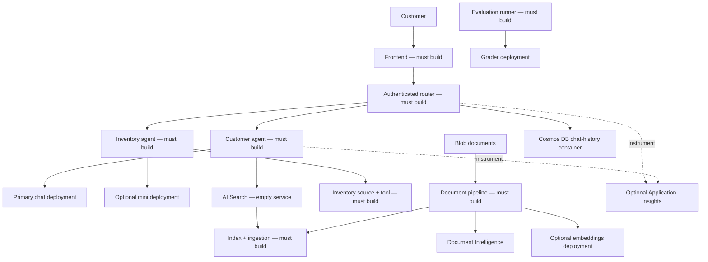

# ਮਲਟੀ-ਏਜੰਟ ਕਸਟਮਰ ਸਪੋਰਟ — ਰਿਟੇਲ ਆਰਕੀਟੈਕਚਰ ਬਲੂਪ੍ਰਿੰਟ

**ਅਧਿਆਇ 5: ਮਲਟੀ-ਏਜੰਟ ਏਆਈ ਸਮਾਧਾਨ**

- [ਕੋर्स ਦਾ ਮੁੱਖ ਪੰਨਾ](../README.md)
- [ਅਧਿਆਇ 5](../docs/chapter-05-multi-agent/README.md)
- [ਪੂਰਵ ਸ਼ਰਤ: ਏਆਈ ਇਕੀਕਰਨ](../docs/chapter-02-ai-development/microsoft-foundry-integration.md)
- [ਅਗਲਾ: ਸਮਰੱਥਾ ਯੋਜਨਾ](../docs/chapter-06-pre-deployment/capacity-planning.md)
- [ARM ਬੁਨਿਆਦੀ ਢਾਂਚਾ](retail-multiagent-arm-template/README.md)

> **ਆਰਕੀਟੈਕਚਰ ਗਾਈਡ, ਕਾਰਜਕਾਰੀ ਐਪਲੀਕੇਸ਼ਨ ਨਹੀਂ।** ਇਕੱਲੇ ਰਿਟੇਲ ਲਾਗੂ ਕਰਨ ਵਾਲੇ
> ਫਾਇਲਾਂ ਹਨ `azuredeploy.json`, `azuredeploy.parameters.json`, ਅਤੇ `deploy.sh` 
> ਵਿੱਚ `retail-multiagent-arm-template/`। ਰਾਊਟਰ/ਫਰੰਟਐਂਡ ਕੰਟੇਨਰ ਹੈਲੋ-ਵਰਲਡ ਪਲੇਸਹੋਲਡਰ ਹਨ। ਕੋਈ ਰਿਟੇਲ ਏਜੰਟ,
> UI, ਇੰਜੇਸ਼ਨ ਪਾਈਪਲਾਈਨ, ਮੁਲਾਂਕਣਕ, ਸਕੈਨਰ, ਜਾਂ
> ਐਪਲੀਕੇਸ਼ਨ ਟੈਸਟ ਸੂਟ ਸਥਾਨਕ ਤੌਰ 'ਤੇ ਮੌਜੂਦ ਨਹੀਂ ਹੈ।

## ਝਲਕ

**ਲਕੜੀ:** ਇੱਕ ਕਸਟਮਰ ਸਹਾਇਤਾ ਪ੍ਰਣਾਲੀ ਡਿਜ਼ਾਇਨ ਕਰਨੀ ਜਿਸ ਵਿੱਚ ਇੱਕ ਕਸਟਮਰ ਏਜੰਟ ਅਤੇ ਇੱਕ ਇਨਵੈਟਰੀ
ਏਜੰਟ ਹੋਵੇ, ਇਹ ਪਛਾਣਣਾ ਕਿ ਢਾਂਚਾ ਕੀ ਪ੍ਰਦਾਨ ਕਰਦਾ ਹੈ, ਅਤੇ ਗੁੰਮ ਐਪਲੀਕੇਸ਼ਨ
ਠੇਕਿਆਂ ਅਤੇ ਸੱਚਾਈ ਤਪਾਸੀ ਦੀ ਯੋਜਨਾ ਬਣਾਉਣਾ।

**ਦਰਸ਼ਕ:** ਵਿਕਾਸਕਾਰ ਜਿਨ੍ਹਾਂ ਨੇ ਸਥਾਨਕ
[ਚੈਟ ਸੈਂਪਲ](../../../examples/azure-openai-chat) ਅਤੇ [ਦੋ-ਸੇਵਾ ਕੰਟੇਨਰ ਸੈਂਪਲ](../../../examples/container-app/microservices)।
ਆਰਕੀਟੈਕਚਰ ਅਧਿਐਨ ਲਈ 2–3 ਘੰਟੇ ਦਿਓ। ਐਪਲੀਕੇਸ਼ਨ ਬਣਾਉਣਾ ਇੱਕ ਵੱਖਰਾ
ਪ੍ਰੋਜੈਕਟ ਹੈ: 80–120 ਵਿਕਾਸ ਘੰਟੇ ਅਨੁਭਵੀ ਡਿਵੈਲਪਰਾਂ ਲਈ ਇੱਕ ਦਿੱਖੀ ਯੋਜਨਾ ਅੰਦਾਜ਼ਾ ਹੈ,
**ਡਿਲੀਵਰੀ ਦਾ ਵਾਅਦਾ ਨਹੀਂ**; ਉਤਪਾਦਨ ਸਖਤੀ, ਟੈਸਟ,
ਸੁਰੱਖਿਆ ਸਮੀਖਿਆ, ਅਤੇ ਓਪਰੇਸ਼ਨ ਵਾਧੂ ਕੰਮ ਦੀ ਲੋੜ ਹੁੰਦੀ ਹੈ।

### ਸਿੱਖਣ ਦੇ ਨਤੀਜੇ

- ਰੂਟਿੰਗ, ਗ੍ਰਾਉਂਡਿੰਗ, ਟੂਲ ਅਧਿਕਾਰ, ਅਤੇ ਗੱਲਬਾਤ ਦੀ ਮਾਲਕੀ ਬਾਰੇ ਸਮਝਾਓ।
- ਮਾਡਲ ਪਛਾਣ, ਡਿਪਲੋਏਮੈਂਟ ਨਾਂ, API ਵਰਜਨ ਅਤੇ ARM ਵਰਜਨਾਂ ਨੂੰ ਵੱਖਰਾ ਕਰੋ।
- ਮਿਲਦੇ-ਜੁਲਦੇ ਵੇਕਟਰ ਮਾਪਦੰਡਾਂ ਦੇ ਨਾਲ ਦਸਤਾਵੇਜ਼ ਖਪਤ ਅਤੇ ਪ੍ਰਾਪਤੀ ਡਿਜ਼ਾਈਨ ਕਰੋ।
- ਪਰਖਣਯੋਗ ਕਾਰਗੁਜ਼ਾਰੀ, ਮੁੱਲਾਂਕਣ ਅਤੇ ਨਾਕਾਮੀ-ਪੁਨਰ ਪ੍ਰਾਪਤੀ ਦੀਆਂ ਲੋੜਾਂ ਨੂੰ ਪਰਿਭਾਸ਼ਿਤ ਕਰੋ।
- ਆਪਣੇ-ਆਪ्शन ਅਰਕੀਟੈਕਚਰ ਲਕੜਾਂ ਨੂੰ ਅਸਲ ਵਿੱਚ ਪ੍ਰਦਾਨ ਕੀਤੀਆਂ ਸਰੋਤਾਂ ਤੋਂ ਵੱਖਰਾ ਕਰੋ।

## ਸਮਾਧਾਨ ਅਰਕੀਟੈਕਚਰ



ਇਹ ਇੱਕ **ਲਕੜੀਐਂਡੀ ਐਪਲੀਕੇਸ਼ਨ ਅਰਕੀਟੈਕਚਰ** ਹੈ, ਚੱਲਦੇ ਏਜੰਟ
ਸੇਵਾਵਾਂ ਦਾ ਚਿੱਤਰ ਨਹੀਂ। ARM ਸਕੈਫੋਲਡ ਅਧਾਰਭੂਤ ਸੇਵਾਵਾਂ ਅਤੇ ਦੋ ਪਲੇਸਹੋਲਡਰ
ਕੰਟੇਨਰ ਹੀ ਬਣਾਉਂਦਾ ਹੈ। ਫਰੰਟ ਡੋਰ, ਰਜਿਸਟਰੀ, ਪ੍ਰਬੰਧਿਤ ਪਹਿਚਾਣਾਂ, ਭੂਮਿਕਾ ਅਸਾਈਨਮੈਂਟ,
ਪ੍ਰਾਈਵੇਟ ਐਂਡਪੌਇੰਟ, ਫੇਲਓਵਰ, ਐਪਲੀਕੇਸ਼ਨ ਇੰਸਟ੍ਰੂਮੈਂਟੇਸ਼ਨ, ਅਤੇ ਚੇਤਾਵਨੀਆਂ ਸ਼ਾਮਲ ਨਹੀਂ ਹਨ।

### ਜਿੰਮੇਵਾਰੀਆਂ ਅਤੇ ਕਰਾਰ

| ਘਟਕਾ | ਲੋੜੀਂਦਾ ਵਿਹਾਰ | ਮੁਕੰਮਲ ਕਹਿਣ ਤੋਂ ਪਹਿਲਾਂ ਸਬੂਤ |
|---|---|---|
| ਫਰੰਟਐਂਡ | ਯੂਜ਼ਰਾਂ ਦੀ ਪਹਿਚਾਣ ਕਰੋ, ਚੈਟ ਰੈਂਡਰ ਕਰੋ, ਸੁਰੱਖਿਅਤ ਦਸਤਾਵੇਜ਼ ਅਪਲੋਡ ਕਰੋ | UI ਅਤੇ ਅਪਲੋਡ ਟੈਸਟ, ਪਹੁੰਚਯੋਗ ਗਲਤੀਆਂ |
| ਰੂਟਰ | ਬੇਨਤੀਆਂ ਨੂੰ ਅਧਿਕਾਰ ਦਿਓ, ਏਜੰਟ ਚੁਣੋ, ਟੂਲ ਕਾਲ/ਟਾਈਮਆਉਟ ਬਾਂਧੋ | ਰੂਟਿੰਗ ਟੈਸਟ, ਅਧਿਕਾਰ ਜਾਂਚ, ਅਸਫਲਤਾ ਟੈਸਟ |
| ਗਾਹਕ ਏਜੰਟ | ਮਨਜ਼ੂਰਸ਼ੁਦਾ ਸਰੋਤਾਂ ਵਿੱਚ ਨੀਤੀ/ਉਤਪਾਦ ਦੇ ਜਵਾਬ ਗ੍ਰਾਉਂਡ ਕਰੋ | ਸਹੀ ਹਵਾਲੇ, ਡੇਟਾ ਨਾ ਹੋਣ 'ਤੇ ਪਰਹੇਜ਼ |
| ਇਨਵੈਂਟਰੀ ਟੂਲ | ਮਿਆਰੀ ਸਾਮਾਨ ਪੜ੍ਹੋ ਜਿਵੇਂ ਅਧਿਕਾਰਿਤ ਹੈ | ਪੱਕੇ ਸਟਾਕ ਟੈਸਟ; ਬਣਾਏ ਗਏ ਉਪਲਬਧਤਾ ਨਹੀਂ |
| ਦਸਤਾਵੇਜ਼ ਪਾਈਪਲਾਈਨ | ਕੱੜੋ, ਟੁਕੜਾ ਕਰੋ, ਇੰਬੈਡ ਕਰੋ, ਸੂਚਕਾਂਕ, ਅੱਪਡੇਟ/ਡਿਲੀਟ ਕਰੋ | ਸੂਚਕ ਢਾਂਚੇ ਅਤੇ ਦੁਬਾਰਾ ਕੋਸ਼ਿਸ਼/ਡੈੱਡ-ਲੇਟਰ ਵਿਹਾਰ |
| ਗੱਲਬਾਤ ਸਟੋਰੇਜ | ਯੂਜ਼ਰਾਂ ਨੂੰ ਅਲੱਗ-ਅਲੱਗ ਕਰੋ, ਰੀਟੇੰਸ਼ਨ ਲਾਗੂ ਕਰੋ | ਯੂਜ਼ਰ-ਬੀਚ ਅਧਿਕਾਰ ਅਤੇ TTL ਟੈਸਟ |
| ਮੁੱਲਾਂਕਣ ਦੌੜਾਉਣ ਵਾਲਾ | ਨਤੀਜੇ ਗ੍ਰਾਉਂਡ ਸੱਚ ਅਤੇ ਮਿਆਰ ਨਾਲ ਤੁਲਨਾ ਕਰੋ | ਕਵਰੇਜ, ਅਸਫਲਤਾ ਗਿਣਤੀ, ਦੁਹਰਾਏ ਜਾ ਸਕਦੇ ਰਿਪੋਰਟ |

ਰੂਟਰ ਨੂੰ ਇੱਕ ਰਸੀਪਸ਼ਨ ਡੈਸਕ ਵਜੋਂ ਸੋਚੋ ਅਤੇ ਟੂਲਾਂ ਨੂੰ ਸੀਮਿਤ ਅੰਦਰੂਨੀ ਸਿਸਟਮ ਵਜੋਂ:
ਇਕ ਵਿਸ਼ੇਸ਼ਜ્ઞ ਚੁਣਨਾ ਹਰ ਗਾਹਕ ਦੇ ਰਿਕਾਰਡਾਂ ਤੱਕ ਪਹੁੰਚ ਦਾ ਅਧਿਕਾਰ ਨਹੀਂ ਹੈ।
ਪਹਿਚਾਣ ਅਤੇ ਅਧਿਕਾਰ ਐਪਲੀਕੇਸ਼ਨ ਕੋਡ ਅਤੇ ਡੇਟਾ ਸੇਵਾਵਾਂ ਵਿੱਚ ਲਾਗੂ ਕਰੋ, ਪ੍ਰਾਂਪਟਾਂ ਵਿੱਚ ਨਹੀਂ।

## ਢਾਂਚਾ ਵਿਰੁੱਧ ਐਪਲੀਕੇਸ਼ਨ

ਪ੍ਰੋਵਿਜ਼ਨਿੰਗ ਤੋਂ ਪਹਿਲਾਂ [scaffold README](retail-multiagent-arm-template/README.md) ਨੂੰ ਪੜ੍ਹੋ।
ਇਹਠੀਕ ਸਾਧਨ, ਢੰਗ, ਲਾਗਤਾਂ ਅਤੇ ਸੀਮਾਵਾਂ ਦੀ ਸੂਚੀ ਦਿੰਦਾ ਹੈ।

| ਲਾਜ਼ਮੀ ਵਰਤੋਂ | ARM ਡਿਪਲੋਇਮੈਂਟ ਨਾਮ | ਮਾਡਲ / ਵਰਜਨ | ਡੀਫ਼ੌਲਟ ਖੇਤਰ |
|---|---|---|---|
| ਗਾਹਕ ਗੱਲਬਾਤ | `gpt-4.1-chat` | `gpt-4.1` / `2025-04-14` | `eastus2` |
| ਇਨਵੈਂਟਰੀ | `gpt-4.1-mini-inventory` | `gpt-4.1-mini` / `2025-04-14` | `westus2`, ਵਿਕਲਪਿਕ |
| ਐਂਬੈਡਿੰਗਜ਼ | `text-embedding-ada-002` | `text-embedding-ada-002` / `2` | `francecentral`, ਵਿਕਲਪਿਕ |
| ਮੁਲਾਂਕਣ | `gpt-4.1-grader` | `gpt-4.1` / `2025-04-14` | ਮੂਲ ਖੇਤਰ ਡੀਫ਼ੌਲਟ ਵਜੋਂ |

ਹਰ ਖੇਤਰ ਵਿੱਚ ਮਾਡਲ/ਵਰਜਨ/SKU ਉਪਲਬਧਤਾ ਅਤੇ ਕੋਟਾ ਚੈੱਕ ਕਰੋ। ਗੱਲਬਾਤ/ਮਿਨੀ/ਗ੍ਰੇਡਰ
ਲਈ `GlobalStandard` ਵਰਤੇ ਜਾਂਦੇ ਹਨ; ਐਂਬੈਡਿੰਗਜ਼ ਲਈ `Standard` ਵਰਤੇ ਜਾਂਦੇ ਹਨ। ਸਮਰੱਥਾ-ਯੂਨਿਟ-ਟੂ-TPM ਨਕਸ਼ੇ
ਮਾਡਲ-ਵਿਸ਼ੇਸ਼ ਹੁੰਦੇ ਹਨ। ਯੂਨਿਵਰਸਲ ਕੋਟਾ ਗਾਰੰਟੀ ਵਜੋਂ ਵੱਖ-ਵੱਖ ਸਮਰੱਥਾ ਯੂਨਿਟ ਨਾ ਜੋੜੋ।

ਇੱਕ Azure OpenAI ਬੇਨਤੀ ਦਾ `model` ਦਲੀਲ **ਡਿਪਲੋਇਮੈਂਟ ਨਾਮ** ਹੁੰਦਾ ਹੈ, ਜਰੂਰੀ ਨਹੀਂ ਕਿ
ਕੈਟਾਲੌਗ ਮਾਡਲ ਪਹਚਾਣਕਾਰ ਹੈ। ਡਾਟਾ-ਪਲੇਨ API ਵਰਜਨ `2024-10-21`
ਮਾਡਲ ਵਰਜਨ `2025-04-14` ਅਤੇ ARM ਸਰੋਤ `apiVersion` ਤੋਂ ਵੱਖਰਾ ਹੈ।
ਕੋਈ ਮਾਡਲ ਜੋ ਉਪਲੱਬਧ ਨਹੀਂ ਹੈ, ਉਸਨੂੰ ਸਿਰਫ਼ ਡਾਟਾ-ਪਲੇਨ API ਵਰਜਨ ਬਦਲ ਕੇ ਠੀਕ ਨਹੀਂ ਕੀਤਾ ਜਾ ਸਕਦਾ।

`--no-multi-region` ਸੈਕੰਡਰੀ ਅਤੇ ਐਂਬੈਡਿੰਗਸ ਖਾਤਿਆਂ ਨੂੰ ਛੱਡ ਦਿੰਦਾ ਹੈ। ਇੱਕ ਪ੍ਰਾਥਮਿਕ ਚੈਟ ਅਤੇ
ਸੁਤੰਤਰ ਗਰੇਡਰ ਖਾਤਾ ਬਚਦਾ ਹੈ। ਵੱਖਰੇ ਮਾਡਲ ਖਾਤੇ ਆਪਣੇ ਆਪ ਫੇਲਓਵਰ ਨਹੀਂ ਦਿੰਦੇ;
ਇਸ ਲਈ ਐਪਲੀਕੇਸ਼ਨ ਰਾਊਟਿੰਗ, ਮਿਲਦੇ ਜੁਲਦੇ ਡਿਪਲੋਇਮੈਂਟ, ਹੈਲਥ ਚੈਕ,
ਰਿਟ੍ਰਾਈ ਹੱਦਾਂ ਅਤੇ ਡਾਟਾ-ਰਿਹਾਇਸ਼ੀ ਸਮੀਖਿਆ ਦੀ ਲੋੜ ਹੁੰਦੀ ਹੈ।

## ਲਾਗੂ ਕਰਨ ਦਾ ਰੋਡਮੇਪ

### 1. ਇੱਕ ਟੈਸਟ ਕੀਤੀ ਗਈ ਇੰਟਰੈਕਸ਼ਨ ਨਾਲ ਸ਼ੁਰੂ ਕਰੋ

ਵੱਡੇ ਸਕੈਫੋਲਡ ਦੀ ਪ੍ਰੋਵੀਜ਼ਨਿੰਗ ਤੋਂ ਪਹਿਲਾਂ, ਸਥਾਨਕ ਚੈਟ ਨਮੂਨੇ ਦਾ ਇਸਤੇਮਾਲ ਕਰਕੇ
ਅਨੁਮਾਨ ਕਨੈਕਟਿਵਿਟੀ ਸਥਾਪਿਤ ਕਰੋ। ਇੱਕ ਪ੍ਰਤੀਨਿਧੀ ਗ੍ਰਾਹਕ ਸਵਾਲ, ਮੰਨਿਆ ਗਿਆ
ਉੱਤਰੀ ਸਰੋਤ, ਉਮੀਦਵਾਰ ਹਵਾਲਾ, ਅਤੇ ਜਦੋਂ ਉਹ ਸਰੋਤ ਗਾਇਬ ਹੋਵੇ ਤਾਂ ਅਸਫਲਤਾ ਦੇ ਵਰਤਾਵ ਨੂੰ ਪਰਿਭਾਸ਼ਿਤ ਕਰੋ।

### 2. ਰਾਊਟਿੰਗ ਅਤੇ ਟੂਲ ਦੀਆਂ ਸੀਮਾਵਾਂ ਪਰਿਭਾਸ਼ਿਤ ਕਰੋ

ਆਪਣੇ ਰਾਊਟਰ ਸਰੋਤ, ਡਿਪੈਂਡেন্সੀ ਮੈਨਿਫੈਸਟ, ਡਾਕਰਫਾਇਲ, ਅਤੇ ਟੈਸਟ ਬਣਾਓ। ਇੱਕ
illustrative contract could be `POST /chat` with `{"message":"...","conversation_id":"..."}`.
**ਉਹ ਐਂਡਪੌਇੰਟ ਇੱਕ ਡਿਜ਼ਾਈਨ ਪ੍ਰস্তਾਵ ਹੈ; ਇਹ ARM ਟੈਂਪਲੇਟ ਦੁਆਰਾ ਲਾਗੂ ਨਹੀਂ ਕੀਤਾ ਗਿਆ ਹੈ।**

Validate body types/limits, derive user identity from authentication, enforce
conversation ownership, apply request timeouts, and return meaningful error codes.
Do not treat HTTP failures or empty replies as successful agent results.

### 3. Implement grounding and ingestion

The ARM template does not create a search index. This is a **reference JSON
fragment to adapt in your own index definition**, not a file already in the repo:

```json
{
  "name": "retail-product-index",
  "fields": [
    {"name": "id", "type": "Edm.String", "key": true},
    {"name": "title", "type": "Edm.String", "searchable": true},
    {"name": "content", "type": "Edm.String", "searchable": true},
    {"name": "category", "type": "Edm.String", "filterable": true},
    {
      "name": "content_vector",
      "type": "Collection(Edm.Single)",
      "searchable": true,
      "dimensions": 1536,
      "vectorSearchProfile": "retail-profile"
    }
  ],
  "vectorSearch": {
    "algorithms": [{"name": "retail-hnsw", "kind": "hnsw"}],
    "profiles": [{"name": "retail-profile", "algorithm": "retail-hnsw"}]
  }
}
```

ਪ੍ਰੋਫਾਈਲ ਵੈਕਟਰ ਫੀਲਡ ਨੂੰ ਇਸ ਦੇ ਐਲਗੋਰਿਦਮ ਨਾਲ ਜੋੜਦਾ ਹੈ। ਮਾਪਦੰਡਾਂ ਨੂੰ ਮਿਲਣਾ ਜਰੂਰੀ ਹੈ
ਅਸਲ ਐਮਬੈਡਿੰਗ ਆਉਟਪੁੱਟ (ਇਸ `ada-002` ਡਿਪਲੋਇਮੈਂਟ ਲਈ 1536). Python ਰੀਟਰੀਵਲ ਲਈ,
ਅਧੂਰੇ ਡਿਕਸ਼ਨਰੀ ਦੀ ਬਜਾਏ `azure.search.documents.models.VectorizedQuery` ਦੀ ਵਰਤੋਂ ਕਰੋ
ਜਿਸ ਵਿੱਚ ਇਸਦਾ ਵੇਕਟਰ ਕ్వੈਰੀ ਕਿਸਮ ਨਹੀਂ ਹੈ:

```python
# Reference function only: supply an authenticated async SearchClient and an embedding.
from azure.search.documents.models import VectorizedQuery

async def retrieve(search_client, embedding):
    results = await search_client.search(
        search_text=None,
        vector_queries=[VectorizedQuery(
            vector=embedding,
            k_nearest_neighbors=5,
            fields="content_vector"
        )],
        select=["id", "title", "content"]
    )
    return [document async for document in results]
```

ਇੱਕ ਵੱਖਰੀ ਇੰਜੈਸ਼ਨ ਇੰਪਲੀਮੈਂਟੇਸ਼ਨ ਬਣਾਓ ਜੋ:

1. ਅਪਲੋਡ ਐਕਸੈਸ ਲਈ ਅਧਿਕਾਰ ਦਿੰਦਾ ਹੈ ਅਤੇ ਸਮੱਗਰੀ ਦੀ ਕਿਸਮ ਅਤੇ ਆਕਾਰ ਦੀ ਪੁਸ਼ਟੀ ਕਰਦਾ ਹੈ।
2. ਪ੍ਰਮਾਣਿਤ SDK ਕਾਲਾਂ ਦੀ ਵਰਤੋਂ ਕਰਕੇ ਪ੍ਰਾਈਵੇਟ ਬਲੌਬ ਨੂੰ ਪੜ੍ਹਦਾ ਹੈ। ਇੱਕ ਪ੍ਰਾਈਵੇਟ ਬਲੌਬ URL ਆਪਣੇ ਆਪ ਵਿੱਚ
   ਇੱਕ ਪੜ੍ਹਨ ਯੋਗ ਡੌਕਯੂਮੈਂਟ ਇੰਟੈਲੀਜੈਂਸ ਇਨਪੁੱਟ **ਨਹੀਂ** ਹੈ; ਡਾਊਨਲੋਡ ਕੀਤੇ ਬਾਈਟਾਂ ਨੂੰ ਭੇਜੋ
   `AnalyzeDocumentRequest(bytes_source=...)` ਨਾਲ ਜਾਂ ਕਿਸੇ ਉਚਿਤ ਸਕੋਪ ਵਾਲੇ,
   ਛੋਟੀ ਮਿਆਦ ਵਾਲੇ SAS ਦੀ ਵਰਤੋਂ ਕਰੋ, ਪਹੁੰਚ ਦੀਆਂ ਲੋੜਾਂ ਦੀ ਸਮੀਖਿਆ ਕਰਨ ਤੋਂ ਬਾਅਦ।
3. ਟੈਕਸਟ ਨਿਕਾਲਦਾ ਹੈ, ਇਸਨੂੰ ਏਮਬੈਡਿੰਗ ਸੀਮਾਵਾਂ ਵਿੱਚ ਫਿੱਟ ਕਰਨ ਲਈ ਚੰਕ ਕਰਦਾ ਹੈ, ਅਤੇ ਏਮਬੈਡਿੰਗ ਤਿਆਰ ਕਰਦਾ ਹੈ।
4. ਸਥਿਰ ਵੈਧ ਦਸਤਾਵੇਜ਼ ਕੁੰਜੀਆਂ ਬਣਾਂਦਾ ਹੈ ਅਤੇ ਮੇਲ ਖਾਂਦੇ ਵੈਕਟਰਾਂ ਨਾਲ ਚੰਕ ਅੱਪਲੋਡ ਕਰਦਾ ਹੈ।
5. ਪ੍ਰਤੀ ਦਸਤਾਵੇਜ਼ ਇੰਡੈਕਸਿੰਗ ਨਤੀਜਿਆਂ ਦੀ ਜਾਂਚ ਕਰਦਾ ਹੈ, ਮੁੜ ਕੋਸ਼ਿਸ਼ਾਂ ਨੂੰ ਸੰਭਾਲਦਾ ਹੈ, ਅਤੇ ਪੁਰਾਣਾ ਡਾਟਾ ਅਪਡੇਟ/ਹਟਾਉਂਦਾ ਹੈ।

OData ਫਿਲਟਰਾਂ ਵਿੱਚ ਮਨਮਾਨੇ ਯੂਜ਼ਰ ਕੁੰਜੀਆਂ/ਮੁੱਲ ਨਹੀਂ ਜੋੜੋ। ਖੇਤਰਾਂ ਦੀ ਅਨੁਮਤੀ ਸੂਚੀ ਬਨਾਓ,
ਮੁੱਲਾਂ ਦੀ ਕਿਸਮਾਂ ਦੀ ਪੁਸ਼ਟੀ ਕਰੋ, ਅਤੇ ਸਤਰਿੰਗ ਦਾ ਕੋਟ ਛੁਟਕਾਰਾ ਦਿਓ। ਬੂਲੀਅਨ ਅਤੇ ਨੰਬਰ ਫਿਲਟਰਾਂ ਨੂੰ ਲੋੜ ਹੈ
ਟਾਈਪ ਕੀਤੇ ਹੋਏ ਲਿਟਰਲਾਂ ਦੀ, ਨਾ ਕਿ ਕੋਟ ਕੀਤੇ ਸਤਰਿੰਗਾਂ ਦੀ।

### 4. ਵੈੱਬ ਗ੍ਰਾਊਂਡਿੰਗ

**ਬਿੰਗ ਸਰਚ v7 ਨੂੰ 11 ਅਗਸਤ 2025 ਨੂੰ ਰੀਟਾਇਰ ਕਰ ਦਿੱਤਾ ਗਿਆ ਸੀ।** ਪੁਰਾਣਾ `Microsoft.Bing/accounts`
ਸਰੋਤ ਅਤੇ `api.bing.microsoft.com/v7.0/search` ਉਦਾਹਰਣਾਂ ਇੱਕ ਸਮਰਥਿਤ
ਲਾਗੂਗੀਰੀ ਮਾਰਗ ਨਹੀਂ ਹਨ। ਮੌਜੂਦਾ ਸਮਰਥਿਤ ਗ੍ਰਾਊਂਡਿੰਗ ਇੰਟਿਗਰੇਸ਼ਨ ਦੀ ਮੁਲਾਂਕਣ ਕਰੋ
Microsoft Foundry ਅਤੇ ਇਸਦੇ SDK, ਅਧਿਕਾਰਾਂ, ਬਿੱਲਿੰਗ, ਅਤੇ ਹਵਾਲਾ ਲੋੜਾਂ ਵਿੱਚ;
ਕਿਸੇ ਨੂੰ ਇੱਥੇ ਲਾਗੂ ਨਹੀਂ ਕੀਤਾ ਗਿਆ ਹੈ। ਇਹ ਰੀਟਾਇਰਡ ਐਂਡਪੋਇੰਟ ਲਈ ਇੱਕ ਪਰਵਾਨਗੀ ਨਹੀਂ ਹੈ।

### 5. ਟੈਲੀਮੀਟਰੀ ਅਤੇ ਮੁਲਾਂਕਣ ਜੋੜੋ

ਐਪਲੀਕੇਸ਼ਨ ਇਨਸਾਈਟਸ ਬਣਾਉਣਾ ਕੋਡ ਨੂੰ ਸਾਜੋ-ਸਮਭਾਲ ਨਹੀਂ ਕਰਦਾ। ਨਵੀਂ ਐਪਲੀਕੇਸ਼ਨ ਬਣਾਉਂਦੇ ਸਮੇਂ ਸਮਰਥਿਤ Azure Monitor
OpenTelemetry ਸਾਜੋ-ਸਮਭਾਲ ਦੀ ਵਰਤੋਂ ਕਰੋ, ਸੇਵਾਵਾਂ ਵਿੱਚ ਟਰੇਸ ਸੰਦਰਭ ਨੂੰ ਪ੍ਰਸਾਰਿਤ ਕਰੋ,
ਅਤੇ ਗਾਹਕ ਦੇ ਪ੍ਰਾਂਪਟਸ, ਦਸਤਾਵੇਜ਼, ਜਾਂ ਰਾਜ਼ ਨਾ ਲੌਗ ਕਰੋ।
ਇੱਕ ਕੈਵਰੀ ਨੂੰ ਕੱਟਨਾ ਇਸਨੂੰ **ਗੁਪਤ** ਨਹੀਂ ਬਨਾਉਂਦਾ।

ਬੇਨਤੀ ਸਮਾਂਬੱਧਤਾ, ਰੂਟਿੰਗ/ਟੂਲ ਨਾਕਾਮੀਆਂ, ਪ੍ਰਾਪਤੀ ਪ੍ਰਸੰਗਿਕਤਾ, ਹਵਾਲਾ ਸਹੀਤਾ, ਟੋਕਨ ਵਰਤੋਂ,
ਅਤੇ ਪਰਹੇਜ਼ ਨੂੰ ਮਾਪੋ। ਮੁਲਾਂਕਣ ਮਾਮਲਿਆਂ ਨਾਲ ਨਾਲ ਸੱਚਾਈ ਦੀ ਸੂਚੀ/ਨੀਤੀ ਤੱਥ ਸੰਭਾਲੋ:
ਇਕ ਗਰੇਡਰ ਕੇਵਲ ਇੱਕ ਸਵਾਲ ਅਤੇ ਜਵਾਬ ਤੋਂ ਤੱਥਮੂਲ ਨਿਰਧਾਰਿਤ ਨਹੀਂ ਕਰ ਸਕਦਾ।


ਸੰਰਚਿਤ ਆਊਟਪੁੱਟ/ਸਕੀਮਾ ਪੁਸ਼ਟੀ, ਸਕੋਰ-ਰੇਂਜ ਚੈੱਕ, ਟ੍ਰਾਂਸਪੋਰਟ ਨਾਕਾਮੀ ਗਿਣਤੀ,
ਅਤੇ ਮਨੁੱਖੀ ਸਮੀਖਿਆ ਕੀਤੀਆਂ ਮਾਮਲਿਆਂ ਨੂੰ। ਅਧੂਰੇ/ਤ੍ਰੁੱਟੀ ਵਾਲੇ ਮਾਮਲਿਆਂ ਦੀ ਵੱਖਰੇ ਰਿਪੋਰਟ ਕਰੋ; ਇਨ੍ਹਾਂ ਨੂੰ ਸਫਲ ਗਰੇਡਾਂ ਵਿੱਚ ਨਾ ਬਦਲੋ
ਜਾਂ ਖ਼ਾਮੋਸ਼ੀ ਨਾਲ ਜ਼ੀਰੋ-ਗੁਣਵੱਤਾ ਵਾਲੇ ਮਾਡਲ ਜਵਾਬਾਂ ਵਿੱਚ ਸਮੇਲਿਤ ਨਾ ਕਰੋ।


ਬੇਨਤੀ, ਗੁੰਮਸ਼ੁਦਾ ਟੈਸਟ ਰਣਨੀਤੀ, ਜਾਂ ਖਾਲੀ ਜਵਾਬ ਇੱਕ ਟੈਸਟ ਨੂੰ **ਅਨਿਰਣਾ ਜਾਂ
ਅਸਫਲ** ਕਰਨਾ ਚਾਹੀਦਾ ਹੈ, ਨਾ ਕਿ "100% ਸੁਰੱਖਿਅਤ" ਸਕੋਰ ਦੇਣਾ। ਢੰਗ ਨਾਲ ਅਧਿਕ੍ਰਿਤ ਟੈਸਟਿੰਗ ਕਰੋ
ਫੇਲ੍ਹ**, "100% ਸੁਰੱਖਿਅਤ" ਸਕੋਰ ਨਾ ਦੇਣ। ਯੋਗ ਅਧਿਕ੍ਰਿਤ ਟੈਸਟਿੰਗ ਕਰੋ
ਉਤਪਾਦਨ-ਤਿਆਰੀ ਦੇ ਕਿਸੇ ਵੀ ਦਾਅਵੇ ਤੋਂ ਪਹਿਲਾਂ ਸੰਦਕਾਰੀ ਅਤੇ ਮਨੁੱਖੀ ਸਮੀਖਿਆ।

### 6. ਆਪਣੀ ਐਪਲੀਕੇਸ਼ਨ ਡਿਪਲੋਏ ਕਰੋ

ਆਪਣੀਆਂ ਸੋਰਸ ਡਾਇਰੈਕਟਰੀਜ਼, ਮੇਨੀਫੈਸਟ, ਟੈਸਟ, ਰਜਿਸਟਰੀ, ਅਤੇ ਇਮੇਜ-ਪੁੱਲ ਅਧਿਕਾਰ ਬਣਾਓ। 
Placeholder ਨੂੰ ਬਣੇ ਹੋਏ ਇਮੇਜ ਨਾਲ ਬਦਲੋ ਅਤੇ ਹਰ ਐਪ ਦੇ ਸੁਣਨ ਵਾਲੇ ਪੋਰਟ ਨਾਲ ਮੇਲ ਖਾਂਦਾ ਹੋਇਆ ਈਨਗ੍ਰੈਸ/ਪ੍ਰੋਬਜ਼ ਨੂੰ ਅਪਡੇਟ ਕਰੋ। 
Bicep ਵਿੱਚ ਜਾਂ ਇੱਕ ਸਪਸ਼ਟ ਸਮਰਥਿਤ azd ਵਾਤਾਵਰਣ ਮੈਪਿੰਗ ਵਿੱਚ ਰਨਟਾਈਮ ਵਾਤਾਵਰਣ ਵਰਿਆਬਲ ਕੰਫਿਗਰ ਕਰੋ।


ਬਿਲਕੁਲ ਕੋਈ ਸਾਹਮਣੇ ਵਾਲਾ `config` ਡਕਸ਼ਨਰੀ ਆਜ਼ਦ ਸਰਵਿਸ ਹੇਠ ਨਹੀਂ ਹੈ ਜੋ ਆਪਣੇ ਆਪ ਰਨਟਾਈਮ ਵਾਤਾਵਰਣ ਚਲਾਉਂਦਾ ਹੈ।
`azd env set` ਸਿਰਫ ਉਹਨਾਂ ਸਰੋਤਾਂ ਵਿੱਚ ਬਦਲਾਅ ਕਰਦਾ ਹੈ ਜੋ ਉਨ੍ਹਾਂ ਮੁੱਲਾਂ ਨੂੰ ਖਪਤ ਕਰਦੇ ਹਨ।
ਇਸ ਸਕੈਫੋਲਡ ਵਿੱਚ ਕੋਈ ਕੈਨਰੀ, ਖੇਤਰਾਂ ਦੀ ਸੂਚੀ, ਜਾਂ ਬਰੀਕੀ ਨਾਲ ਸੁਧਾਰਨ ਵਾਲਾ ਹੂਕ ਲਾਗੂ ਨਹੀਂ ਕੀਤਾ ਗਿਆ ਹੈ।


## ਪ੍ਰාਯੋਗਿਕ ਡਿਜ਼ਾਈਨ ਅਭਿਆਸ

ਇਹ **ਆਰਕੀਟੈਕਚਰ ਅਭਿਆਸ** ਹਨ, ਨਾ ਕਿ ਚਲਾਉਣਯੋਗ ਰੀਟੇਲ ਸਟਾਰਟਰ ਕੋਡ ਦੇ ਦਾਅਵੇ।

### ਅਭਿਆਸ 1: ਸਰਹੱਦ ਦੀ ਪੁਸ਼ਟੀ ਕਰੋ

**ਸ਼ੁਰੂਆਤੀ ਬਿੰਦੂ:** ਤਿੰਨ ਫਾਇਲਾਂ `retail-multiagent-arm-template/` ਵਿੱਚ।
**ਲਕੜੀ:** ਪ੍ਰੋਵੀਜ਼ਨਿੰਗ ਅਤੇ ਐਪਲੀਕੇਸ਼ਨ ਕਾਰਜਸ਼ੀਲਤਾ ਨੂੰ ਵੱਖਰਾ ਕਰੋ।
`azuredeploy.json` ਖੋਲ੍ਹੋ, ਦੋਹਾਂ ਕੰਟੇਨਰ ਚਿੱਤਰਾਂ ਅਤੇ `targetPort` ਮੁੱਲਾਂ ਨੂੰ ਲੱਭੋ,
ਫਿਰ ਭੰਡਾਰ ਵਿਚੋਂ ਲਾਪਤਾ ਐਪਲੀਕੇਸ਼ਨ ਹਿੱਸੇ ਦੀ ਸੂਚੀ ਬਣਾਓ।

**ਸਫਲਤਾ ਮਾਪਦੰਡ / ਉੱਤਰ:** ਦੋਹਾਂ ਚਿੱਤਰ hello-world ਪਲੇਸਹੋਲਡਰ ਹਨ ਜੋ ਸੁਣ ਰਹੇ ਹਨ
ਪੋਰਟ 80 ਤੇ; ਏਜੰਟ, ਚੈਟ UI, ਰਾਊਟਰ ਹੈਂਡਲਰ, ਇੰਡੈਕਸ/ਇੰਜੈਸਟਨ, ਮੁਲਾਂਕਣਕਾਰ, ਅਤੇ ਸਕੈਨਰ
ਮੌਜੂਦ ਨਹੀਂ ਹਨ। ਇੱਕ ਸਫਲ ਪਲੇਸਹੋਲਡਰ ਰੂਟ ਬੇਨਤੀ `/chat` ਨੂੰ ਵੈਧ ਨਹੀਂ ਕਰਦੀ।
**ਆਮ ਸਮੱਸਿਆ:** ਸਾਧਨ ਨਾਮਾਂ ਨੂੰ `retail-router` ਵਜੋਂ ਕੰਮ ਕਰਨ ਵਾਲੇ ਕੋਡ ਦੇ ਤੌਰ 'ਤੇ ਸਮਝਣਾ।

### ਅਭਿਆਸ 2: ਵੇਕਟਰ ਕੰਫਿਗਰੇਸ਼ਨ ਦਾ ਟਰੇਸ ਕਰੋ

**ਸ਼ੁਰੂਆਤੀ ਬਿੰਦੂ:** ਉਪਰ ਦਿੱਤਾ ਗਿਆ ਇੰਡੈਕਸ JSON।
**ਉਦੇਸ਼:** ਖੇਤਰ → ਪ੍ਰੋਫਾਈਲ → ਅਲਗੋਰਿਦਮ ਸੰਬੰਧ ਨੂੰ ਸਮਝਣਾ।
ਇਹ ਪਛਾਣੋ ਕਿ ਕਿਹੜੀਆਂ ਕੀਮਤਾਂ ਨੂੰ ਵੱਖਰੇ ਆਉਟਪੁੱਟ ਡਾਇਮੈਨਸ਼ਨ ਵਾਲੇ ਐੰਬੈਡਿੰਗ ਮਾਡਲ ਵਿੱਚ ਬਦਲਦੇ ਸਮੇਂ ਬਦਲਣਾ ਲਾਜ਼ਮੀ ਹੈ,
ਫਿਰ `retrieve` ਫੰਕਸ਼ਨ ਦੀ ਜਾਂਚ ਕਰੋ।

**ਸਫਲਤਾ ਦੇ ਮਾਪਦੰਡ / ਜਵਾਬ:** ਫੀਲਡ `dimensions` ਨੂੰ ਅਸਲ ਵੈਕਟਰ ਲੰਬਾਈ ਵਿੱਚ ਬਦਲੋ;
`vectorSearchProfile` ਨੂੰ ਘੋਸ਼ਿਤ ਪ੍ਰੋਫਾਈਲ ਅਤੇ ਇਸਦੇ ਐਲਗੋਰਿਦਮ ਨਾਲ ਸੰਗਤ ਬਨਾਓ;
ਕਵੇਰੀ `fields` ਨੂੰ ਵੈਕਟਰ ਫੀਲਡ ਦਾ ਨਾਮ ਦੇਣਾ ਚਾਹੀਦਾ ਹੈ। ਮੌਜੂਦਾ ਦਸਤਾਵੇਜ਼ ਵੈਕਟਰਾਂ ਨੂੰ ਦੁਬਾਰਾ ਬਣਾਓ
ਜਦੋਂ ਐਂਬੈਡਿੰਗ ਮਾਡਲ ਬਦਲਦਾ ਹੈ।
**ਆਮ ਸਮੱਸਿਆ:** ਸਿਰਫ ਮਾਡਲ ਦਾ ਨਾਮ ਬਦਲਣਾ ਜਦਕਿ ਅਣਮਿਲਦਿਆਂ ਵਾਲੇ ਵੈਕਟਰਾਂ ਨੂੰ ਜਾਰੀ ਰੱਖਣਾ।

### ਕਸਰਤ 3: ਇੱਕ ਅਸਫਲਤਾ ਟੈਸਟ ਪਰਿਭਾਸ਼ਿਤ ਕਰੋ

**ਸ਼ੁਰੂਆਤੀ ਬਿੰਦੂ:** ਜ਼ਿੰਮੇਵਾਰੀਆਂ ਦੀ ਸਾਰਣੀ।
**ਲਕੜੀ:** ਗਲਤ ਸਫਲਤਾ ਨੂੰ ਰੋਕਣਾ।
ਉਪਲਬਧ inventory API, ਕੋਈ ਮਿਲਦੇ ਦਸਤਾਵੇਜ਼ ਨਾ ਹੋਣ ਵਾਲੇ ਖੋਜ ਇੰਡੈਕਸ, ਅਤੇ HTTP 503 ਵਾਪਸ ਕਰਨ ਵਾਲੀ ਮੁਲਾਂਕਣ ਬੇਨਤੀ ਲਈ ਉਮੀਦ ਕੀਤੀ ਵਿਹਵਾਰ ਲਿਖੋ।


**ਆਮ ਸਮੱਸਿਆ:** ਹਰ ਇੱਕ exception ਫੜ ਕੇ ਖਾਲੀ ਜਵਾਬ ਨਾਲ ਜਾਰੀ ਰੱਖਣਾ।

## ਖਰਚੇ, ਸਮੱਸਿਆ ਸਮਾਧਾਨ ਅਤੇ ਸਫਾਈ


## ਲਾਗਤਾਂ, ਸਮੱਸਿਆ ਸुलਝਾਉਣ ਅਤੇ ਸਾਫ਼ ਸੁਥਰਾ ਕਰਨਾ

- ਇੰਫਰਾਸਟਰੱਕਚਰ ਦੇ ਨਿਰੰਤਰ ਖਰਚ ਹੁੰਦੇ ਹਨ ਭਾਵੇਂ ਖਾਲੀ ਖੋਜ ਸੂਚੀਕਰਣ ਅਤੇ ਪਲੇਸਹੋਲਡਰ ਹੋਣ
  ਐਪਸ। ਮੌਜੂਦਾ ਖੇਤੀ ਦੇ ਮੁੱਲ ਵਰਤੋ; ਨਾ “ਛੋਟਾ” ਨਾ ਹੀ ਬਹੁ-ਖੇਤਰ ਮਤਲਬ ਮੁਫ਼ਤ ਹੈ।
- ਟੋਕਨ ਖ਼ਰਚ ਮਾਡਲ, ਕੈਸ਼ਡ/ਅਣਕੈਸ਼ਡ ਇਨਪੁੱਟ, ਆਉਟਪੁੱਟ, ਅਤੇ ਡਿਪਲੋਯਮੈਂਟ SKU 'ਤੇ ਨਿਰਭਰ ਕਰਦੇ ਹਨ।
  ਰਾਊਟਿੰਗ ਸਿਰਫ਼ ਤਦ ਹੀ ਪੈਸਾ ਬਚਾ ਸਕਦੀ ਹੈ ਜਦੋਂ ਮਾਪੀ ਗਈ ਵਰਕਲੋਡ ਅਤੇ ਗੁਣਵੱਤਾ ਦੇ ਨਤੀਜੇ ਇਸਦੀ ਵਜ੍ਹਾ ਸਾਬਤ ਹੁੰਦੇ ਹਨ;
  ਇੱਕ ਨਿਸ਼ਚਿਤ 60-80% ਬਚਤ ਦੀ ਗਾਰੰਟੀ ਨਹੀਂ ਹੈ।
- ਪ੍ਰੋਵਿਜ਼ਨਿੰਗ ਕਰਨ ਤੋਂ ਪਹਿਲਾਂ ਮਾਡਲ ਉਪਲਬਧਤਾ ਅਤੇ ਕੋਟਾ ਦੀ ਜਾਂਚ ਕਰੋ; ਅਨੁਮਤੀ,
  ਡਿਪਲੋਇਮੈਂਟ ਨਾਮ, ਖੇਤਰ, ਮਾਡਲ ਸੰਸਕਰਣ, ਅਤੇ ਏਪੀਆਈ ਸੰਸਕਰਣ ਦੀਆਂ ਗਲਤੀਆਂ ਵਿੱਚ ਫਰਕ ਕਰੋ।
- ਗੁੰਮ ਹੋਏ `setup-data.sh`, evaluator CLI, ਜਾਂ `pytest tests/` ਕਮਾਂਡ ਨਾ ਚਲਾਓ।
  ਉਹਨਾਂ ਦੀਆਂ ਕਾਰਗੁਜ਼ਾਰੀਆਂ ਤੁਹਾਡੇ ਵਿਕਾਸ ਬੈਕਲੌਗ ਦਾ ਹਿੱਸਾ ਹਨ।
- ਸਪਾਫੋਲਡ ਸਿਰਫ਼ ARM ਲਈ ਹੈ: ਉਸ ਦੇ
  [ਤਸਦੀਕ ਅਤੇ ਸਾਫ਼-ਸਫਾਈ ਦੇ ਨਿਰਦੇਸ਼](retail-multiagent-arm-template/README.md) ਦੀ ਪਾਲਣਾ ਕਰੋ।
  `azd down` ਉਹਨਾਂ ਸਰੋਤਾਂ ਦਾ ਪ੍ਰਬੰਧ ਨਹੀਂ ਕਰਦਾ।

## ਸਬੰਧਤ ਸਰੋਤ

- [ਕਾਰਗਰ ਸਥਾਨਕ ਚੈਟ ਨਮੂਨਾ](../../../examples/azure-openai-chat)
- [ਦੋ-ਸੇਵਾ ਕੰਟੇਨਰ ਨਮੂਨਾ](../../../examples/container-app/microservices)
- [AI ਖੋਜ ਵੇਕਟਰ ਇੰਡੈਕਸ](https://learn.microsoft.com/azure/search/vector-search-how-to-create-index)
- [ਕੰਟੇਨਰ ਐਪਸ ਦਸਤਾਵੇਜ਼](https://learn.microsoft.com/azure/container-apps/)
- [ਟ੍ਰਬਲਸ਼ੂਟਿੰਗ](../docs/chapter-07-troubleshooting/common-issues.md)
- [ਇੱਕ ਸਮੱਸਿਆ ਦੀ ਰਿਪੋਰਟ ਕਰੋ](https://github.com/microsoft/AZD-for-beginners/issues)

---

<!-- CO-OP TRANSLATOR DISCLAIMER START -->
**ਅਸਵੀਕਾਰੋਪਣ**:
ਇਸ ਦਸਤਾਵੇਜ਼ ਦਾ ਅਨੁਵਾਦ ਏਆਈ ਅਨੁਵਾਦ ਸੇਵਾ [Co-op Translator](https://github.com/Azure/co-op-translator) ਦੀ ਵਰਤੋਂ ਕਰਕੇ ਕੀਤਾ ਗਿਆ ਹੈ। ਜਦੋਂ ਕਿ ਅਸੀਂ ਸਹੀਤਾਵਾਂ ਲਈ ਯਤਨਸ਼ੀਲ ਹਾਂ, ਕਿਰਪਾ ਕਰਕੇ ਧਿਆਨ ਰੱਖੋ ਕਿ ਸਵੈਚਾਲਿਤ ਅਨੁਵਾਦਾਂ ਵਿੱਚ ਗਲਤੀਆਂ ਜਾਂ ਅਸਮੱਤਿਆਵਾਂ ਹੋ ਸਕਦੀਆਂ ਹਨ। ਮੂਲ ਦਸਤਾਵੇਜ਼ ਆਪਣੀ ਮੂਲ ਭਾਸ਼ਾ ਵਿੱਚ ਅਧਿਕਾਰਕ ਸਰੋਤ ਮੰਨਿਆ ਜਾਣਾ ਚਾਹੀਦਾ ਹੈ। ਜਰੂਰੀ ਜਾਣਕਾਰੀ ਲਈ, ਪੇਸ਼ੇਵਰ ਮਨੁੱਖੀ ਅਨੁਵਾਦ ਦੀ ਸਿਫ਼ਾਰਸ਼ ਕੀਤੀ ਜਾਂਦੀ ਹੈ। ਅਸੀਂ ਇਸ ਅਨੁਵਾਦ ਦੇ ਉਪਯੋਗ ਤੋਂ ਪੈਦਾ ਹੋਣ ਵਾਲੀਆਂ ਕਿਸੇ ਵੀ ਗਲਤਫਹਿਮੀਆਂ ਜਾਂ ਗਲਤ ਵਿਆਖਿਆਵਾਂ ਲਈ ਜਵਾਬਦੇਹ ਨਹੀਂ ਹਾਂ।
<!-- CO-OP TRANSLATOR DISCLAIMER END -->