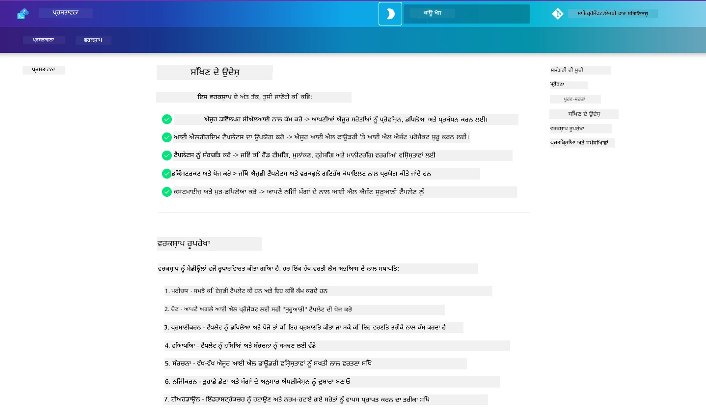

<div align="center">
  <div style="background: linear-gradient(135deg, #0078d4, #106ebe); border-radius: 10px; padding: 20px; margin: 20px 0; box-shadow: 0 4px 15px rgba(0, 120, 212, 0.3); border: 2px solid #005a9e;">
    <h2 style="color: white; margin: 0; font-size: 24px; text-shadow: 1px 1px 2px rgba(0,0,0,0.3);">
      🎯 ਏਜ਼ੀਡੀ ਫਾਰ ਏਆਈ ਡਿਵੈਲਪਰ ਵਰਕਸ਼ਾਪ
    </h2>
    <p style="color: white; margin: 10px 0 0 0; font-size: 16px; text-shadow: 1px 1px 2px rgba(0,0,0,0.3);">
      <strong>ਐਜ਼ਯੂਰ ਡਿਵੈਲਪਰ CLI ਨਾਲ AI ਐਪਲੀਕੇਸ਼ਨ ਬਣਾਉਣ ਲਈ ਇੱਕ ਕਾਰਗਰ ਵਰਕਸ਼ਾਪ।</strong><br>
      ਏਜ਼ੀਡੀ ਟੈਮਪਲੇਟ ਅਤੇ ਏਆਈ ਡਿਪਲੋਇਮੈਂਟ ਵਰਕਫਲੋਜ਼ ਵਿੱਚ ਨਿਪੁੰਨ ਬਣਨ ਲਈ 7 ਮੋਡੀਊਲਜ਼ ਪੂਰੇ ਕਰੋ।
    </p>
    <div style="margin-top: 15px;">
      <span style="background: rgba(255,255,255,0.2); padding: 5px 10px; border-radius: 15px; color: white; font-size: 14px;">
        📅 ਸਰੋਤ ਮਾਰਗਦਰਸ਼ਨ ਸਮੀਖਿਆ: ਨਵੰਬਰ 2026
      </span>
    </div>
  </div>
</div>

# ਏਜ਼ੀਡੀ ਫਾਰ ਏਆਈ ਡਿਵੈਲਪਰ ਵਰਕਸ਼ਾਪ

ਏਜ਼ਯੂਰ ਡਿਵੈਲਪਰ CLI (AZD) ਸਿਖਣ ਲਈ ਏਆਈ ਐਪਲੀਕੇਸ਼ਨ ਡਿਪਲੋਇਮੈਂਟ ਦੇ ਕੇਂਦਰ ਨਾਲ ਇੱਕ ਕਾਰਗਰ ਵਰਕਸ਼ਾਪ ਵਿੱਚ ਤੁਹਾਡਾ ਸਵਾਗਤ ਹੈ। ਇਸ ਵਰਕਸ਼ਾਪ ਨਾਲ ਤੁਸੀਂ 3 ਕਦਮਾਂ ਵਿੱਚ ਏਜ਼ੀਡੀ ਟੈਮਪਲੇਟ ਦੀ ਵਰਤੋਂ ਬਾਰੇ ਪ੍ਰਯੋਗਾਤਮਕ ਸਮਝ ਪ੍ਰਾਪਤ ਕਰੋਂਗੇ:

1. **ਖੋਜ** - ਆਪਣੀ ਲਈ ਠੀਕ ਟੈਮਪਲੇਟ ਲੱਭੋ।
1. **ਡਿਪਲੋਇਮੈਂਟ** - ਡਿਪਲੋਇ ਕਰੋ ਅਤੇ ਇਹ ਕੰਮ ਕਰਦਾ ਹੈ ਜਾਂ ਨਹੀਂ, ਜाँच ਕਰੋ
1. **ਕਸਟਮਾਈਜੇਸ਼ਨ** - ਸੋਧੋ ਅਤੇ ਮੁੜ ਸੋਚ ਕਰਕੇ ਇਹਨੂੰ ਆਪਣਾ ਬਣਾਓ!

ਇਸ ਵਰਕਸ਼ਾਪ ਦੇ ਦੌਰਾਨ, ਤੁਹਾਨੂੰ ਮੁੱਖ ਡਿਵੈਲਪਰ ਟੂਲਾਂ ਅਤੇ ਵਰਕਫਲੋਜ਼ ਨਾਲ ਵੀ ਜਾਣੂ ਕਰਵਾਇਆ ਜਾਵੇਗਾ, ਜੋ ਤੁਹਾਡੇ ਸਭ-ਤਰਫ਼ੀ ਵਿਕਾਸ ਯਾਤਰਾ ਨੂੰ ਸੁਗਮ ਬਣਾਉਣ ਵਿੱਚ ਮਦਦ ਕਰੇਗਾ।

<br/>

## ਬਰਾਊਜ਼ਰ-ਅਧਾਰਿਤ ਗਾਈਡ

ਵਰਕਸ਼ਾਪ ਦੇ ਪਾਠ ਮਾਰਕਡਾਊਨ ਵਿੱਚ ਹਨ। ਤੁਸੀਂ ਇਨ੍ਹਾਂ ਨੂੰ ਸਿੱਧਾ GitHub ਵਿੱਚ ਨੈਵੀਗੇਟ ਕਰ ਸਕਦੇ ਹੋ - ਜਾਂ ਹੇਠਲੇ ਸਕ੍ਰੀਨਸ਼ਾਟ ਵਿੱਚ ਵੇਖਾਏ ਗਏ ਬਰਾਊਜ਼ਰ-ਅਧਾਰਿਤ ਪ੍ਰੀਵਿਊ ਨੂੰ ਲਾਂਚ ਕਰੋ।



ਇਸ ਵਿਕਲਪ ਨੂੰ ਵਰਤਣ ਲਈ - ਰਿਪੋਜ਼ਿਟਰੀ ਨੂੰ ਆਪਣੇ ਪ੍ਰੋਫ਼ਾਈਲ ਵਿੱਚ ਫੋਰਕ ਕਰੋ, ਅਤੇ GitHub ਕੋਡਸਪੇਸ ਲਾਂਚ ਕਰੋ। ਇੱਕ ਵਾਰੀ VS ਕੋਡ ਟਰਮੀਨਲ ਸਰਗਰਮ ਹੋ ਜਾਵੇ, ਇਹ ਕਮਾਂਡ ਟਾਈਪ ਕਰੋ:

ਇਹ ਬਰਾਊਜ਼ਰ ਪ੍ਰੀਵਿਊ GitHub ਕੋਡਸਪੇਸ, ਡੈਵ ਕੰਟੇਨਰਜ਼ ਜਾਂ ਪਾਇਥਨ ਅਤੇ MkDocs ਨਾਲ ਇੱਕ ਲੋਕਲ ਕਲੋਨ ਵਿੱਚ ਕੰਮ ਕਰਦਾ ਹੈ।

```bash title="" linenums="0"
python -m pip install -r requirements-dev.txt
python -m mkdocs serve --config-file workshop/mkdocs.yml
```

ਇਹ ਕਮਾਂਡਾਂ **ਕੋਰਸ ਰਿਪੋਜ਼ਿਟਰੀ ਦੇ ਰੂਟ** ਤੋਂ ਚਲਾਓ, ਵੱਖ-ਵੱਖ ਸ਼ੁਰੂਆਤੀ ਏਆਈ ਸੈਂਪਲ ਤੋਂ ਨਹੀਂ। ਪ੍ਰੀਵਿਊ ਨੂੰ ਫੋਰਗ੍ਰਾਊਂਡ ਵਿੱਚ ਰੱਖੋ ਤਾਂ ਜੋ ਗਲਤੀਆਂ ਦਿਖਾਈ ਦੇਣ। ਇਸਨੂੰ Ctrl+C ਨਾਲ ਬੰਦ ਕਰੋ। ਸਾਈਟ ਬਿਨਾਂ ਸਰਵਿੰਗ ਦੇ ਜਾਂਚਣ ਲਈ, `python -m mkdocs build --strict --config-file workshop/mkdocs.yml` ਚਲਾਓ।

ਕੁਝ ਸਕਿੰਟਾਂ ਵਿੱਚ, ਤੁਸੀਂ ਇੱਕ ਪੌਪ-ਅੱਪ ਡਾਇਲਾਗ ਦੇਖੋਗੇ। ਵਿਕਲਪ ਚੁਣੋ ਕਿ ਇਹ `Open in browser` ਕਰੇ। ਵੈੱਬ ਅਧਾਰਿਤ ਗਾਈਡ ਹੁਣ ਇੱਕ ਨਵੇਂ ਬਰਾਊਜ਼ਰ ਟੈਬ ਵਿੱਚ ਖੁਲ ਜਾਵੇਗੀ। ਇਸ ਪ੍ਰੀਵਿਊ ਦੇ ਕੁਝ ਫਾਇਦੇ:

1. **ਬਿਲਟ-ਇਨ ਖੋਜ** - ਤੇਜ਼ੀ ਨਾਲ ਕੁੰਜੀ ਸ਼ਬਦ ਜਾਂ ਪਾਠ ਲੱਭੋ।
1. **ਕਾਪੀ ਆਈਕਨ** - ਕੋਡਬਲਾਕਾਂ 'ਤੇ ਮਾਊਸ ਲਿਜਾਣ ਤੇ ਇਹ ਵਿਕਲਪ ਵੇਖੋ
1. **ਥੀਮ ਟੋਗਲ** - ਡਾਰਕ ਅਤੇ ਲਾਈਟ ਥੀਮਾਂ ਵਿਚਕਾਰ ਬਦਲੋ
1. **ਸਹਾਇਤਾ ਪ੍ਰਾਪਤ ਕਰੋ** - ਫੁੱਟਰ ਵਿੱਚ ਡਿਸਕਾਰਡ ਆਈਕਨ 'ਤੇ ਕਲਿੱਕ ਕਰਕੇ ਜੁੜੋ!

<br/>

## ਵਰਕਸ਼ਾਪ ਦਾ ਜਾਇਜ਼ਾ

**ਅਵਧੀ:** 3-4 ਘੰਟੇ  
**ਸਤਰ:** ਸ਼ੁਰੂਆਤੀ ਤੋਂ ਮੱਧਮ  
**ਜਰੂਰੀ ਗੁਣ:** ਏਜ਼ਯੂਰ, ਏਆਈ ਧਾਰਨਾਂ, VS ਕੋਡ ਅਤੇ ਕਮਾਂਡ-ਲਾਈਨ ਟੂਲਾਂ ਨਾਲ ਪਰਿਚਿਤ ਹੋਣਾ।

ਇਹ ਇੱਕ ਕਾਰਗਰ ਵਰਕਸ਼ਾਪ ਹੈ ਜਿੱਥੇ ਤੁਸੀਂ ਕਰਕੇ ਸਿੱਖਦੇ ਹੋ। ਜਦੋਂ ਤੁਸੀਂ ਕਸਰਤਾਂ ਪੂਰੀਆਂ ਕਰ ਲਿਆ, ਤਾਂ ਅਸੀਂ ਸਿਫਾਰਸ਼ ਕਰਦੇ ਹਾਂ ਕਿ AZD ਫਾਰ ਬਿਗਿਨਰਜ਼ ਕਰੀਕੁਲਮ ਦੀ ਸਮੀਖਿਆ ਕਰੋ ਤਾਂ ਜੋ ਸੁਰੱਖਿਆ ਅਤੇ ਪ੍ਰਮਾਣਿਕਤਾ ਦੇ ਅੱਗੇ ਵਧਣ ਵਾਲੇ ਤਰੀਕੇ ਸਿੱਖ ਸਕੋ।

| ਸਮਾਂ| ਮੋਡੀਊਲ  | ਲਕੜੀ ਦਾ ਟੀਚਾ |
|:---|:---|:---|
| 15 ਮਿੰਟ | [ਪ੍ਰਸਤਾਵਨਾ](docs/instructions/0-Introduction.md) | ਮਕਸਦ ਸਮਝਣਾ, ਦ੍ਰਿਸ਼ਟਿਕੋਣ ਸੈੱਟ ਕਰਨਾ |
| 30 ਮਿੰਟ | [ਏਆਈ ਟੈਮਪਲੇਟ ਚੁਣੋ](docs/instructions/1-Select-AI-Template.md) | ਵਿਕਲਪਾਂ ਦੀ ਖੋਜ ਅਤੇ ਸ਼ੁਰੂਆਤ ਚੁਣਨਾ | 
| 30 ਮਿੰਟ | [ਏਆਈ ਟੈਮਪਲੇਟ ਠੀਕ ਕਰੋ](docs/instructions/2-Validate-AI-Template.md) | ਡਿਫੌਲਟ ਹੱਲ ਨੂੰ ਏਜ਼ਯੂਰ 'ਤੇ ਡਿਪਲੋਇ ਕਰੋ |
| 30 ਮਿੰਟ | [ਏਆਈ ਟੈਮਪਲੇਟ ਨੂੰ ਵਿਖੰਡਿਤ ਕਰੋ](docs/instructions/3-Deconstruct-AI-Template.md) | ਸੰਰਚਨਾ ਅਤੇ ਕਨਫਿਗਰੇਸ਼ਨ ਦੀ ਖੋਜ |
| 30 ਮਿੰਟ | [ਏਆਈ ਟੈਮਪਲੇਟ ਕਨਫਿਗਰ ਕਰੋ](docs/instructions/4-Configure-AI-Template.md) | ਉਪਲਬਧ ਫੀਚਰਸ ਨੂੰ ਐਕਟਿਵ ਕਰੋ ਅਤੇ ਕੋਸ਼ਿਸ਼ ਕਰੋ |
| 30 ਮਿੰਟ | [ਏਆਈ ਟੈਮਪਲੇਟ ਕਸਟਮਾਈਜ਼ ਕਰੋ](docs/instructions/5-Customize-AI-Template.md) | ਟੈਮਪਲੇਟ ਨੂੰ ਆਪਣੀਆਂ ਜ਼ਰੂਰਤਾਂ ਅਨੁਸਾਰ ਬਦਲੋ |
| 30 ਮਿੰਟ | [ਇੰਫ਼ਰਾਸਟਰਕਚਰ ਨੂੰ ਹਟਾਓ](docs/instructions/6-Teardown-Infrastructure.md) | ਸਾਫ਼-ਸਫਾਈ ਅਤੇ ਸਰੋਤਾਂ ਨੂੰ ਰਿਹਾਈ ਦਿਓ |
| 15 ਮਿੰਟ | [ਸਾਰਾ ਸੰਘਰਸ਼ & ਅਗਲੇ ਕਦਮ](docs/instructions/7-Wrap-up.md) | ਸਿੱਖਣ ਦੇ ਸੰਸਾਧਨ, ਵਰਕਸ਼ਾਪ ਚੈਲੈਂਜ |

<br/>

## ਤੁਸੀਂ ਕੀ ਸਿੱਖੋਗੇ

ਏਜ਼ੀਡੀ ਟੈਮਪਲੇਟ ਨੂੰ ਇੱਕ ਸਿੱਖਣ ਵਾਲੇ ਸैंडਬਾਕਸ ਵਜੋਂ ਸੋਚੋ ਜੋ ਮਾਈਕ੍ਰੋਸਾਫਟ ਫਾਊਂਡਰੀ 'ਤੇ ਅੰਤ-ਤਰਫ਼ਾ ਵਿਕਾਸ ਲਈ ਵੱਖ-ਵੱਖ ਸਮਰੱਥਾਵਾਂ ਅਤੇ ਟੂਲਾਂ ਦੀ ਖੋਜ ਦਾ ਮੌਕਾ ਦਿੰਦਾ ਹੈ। ਇਸ ਵਰਕਸ਼ਾਪ ਦੇ ਅੰਤ ਤੱਕ, ਤੁਹਾਡੇ ਕੋਲ ਇਸ ਸੰਦਰਭ ਵਿੱਚ ਵੱਖ-ਵੱਖ ਟੂਲਾਂ ਅਤੇ ਧਾਰਨਾਵਾਂ ਦੀ ਇੱਕ ਅੰਦਰੂਨੀ ਸਮਝ ਹੋਣੀ ਚਾਹੀਦੀ ਹੈ।

| ਧਾਰਨਾ  | ਲਕੜੀ ਦਾ ਟੀਚਾ |
|:---|:---|
| **ਏਜ਼ਯੂਰ ਡਿਵੈਲਪਰ CLI** | ਟੂਲ ਕਮਾਂਡ ਅਤੇ ਵਰਕਫਲੋਜ਼ ਨੂੰ ਸਮਝੋ|
| **AZD ਟੈਮਪਲੇਟਸ**| ਪ੍ਰੋਜੈਕਟ ਦੀ ਸੰਰਚਨਾ ਅਤੇ ਕਨਫਿਗਰੇਸ਼ਨ ਨੂੰ ਸਮਝੋ|
| **ਏਜ਼ਯੂਰ ਏਆਈ ਏਜੰਟ**| ਮਾਈਕ੍ਰੋਸਾਫਟ ਫਾਊਂਡਰੀ ਪ੍ਰੋਜੈਕਟ ਨੂੰ ਪ੍ਰੋਵਿਜ਼ਨ ਅਤੇ ਡਿਪਲੋਇ ਕਰੋ  |
| **ਏਜ਼ਯੂਰ ਏਆਈ ਖੋਜ**| ਏਜੰਟਸ ਨਾਲ ਸੰਦਰਭ ਇੰਜੀਨੀਅਰਿੰਗ ਯੋਗ ਬਣਾਓ |
| **ਨਿਗਰਾਨੀਯੋਗਤਾ**| ਟਰੇਸਿੰਗ, ਮਾਨੀਟਰਿੰਗ ਅਤੇ ਮੁਲਾਂਕਣ ਦੀ ਖੋਜ |
| **ਰੇਡ ਟੀਮਿੰਗ**| ਵਿਰੋਧੀ ਟੈਸਟਿੰਗ ਅਤੇ ਰੋਕਥਾਮ ਦੀ ਖੋਜ |

<br/>

## ਵਰਕਸ਼ਾਪ ਦੀ ਸੰਰਚਨਾ

ਵਰਕਸ਼ਾਪ ਨੂੰ ਇਸ ਤਰ੍ਹਾਂ ਬਣਾਇਆ ਗਿਆ ਹੈ ਕਿ ਤੁਹਾਨੂੰ ਟੈਮਪਲੇਟ ਦੀ ਖੋਜ ਤੋਂ ਲੈ ਕੇ ਡਿਪਲੋਇਮੈਂਟ, ਵਿਖੰਡਨ ਅਤੇ ਕਸਟਮਾਈਜ਼ੇਸ਼ਨ ਦੇ ਸਫ਼ਰ 'ਤੇ ਲੈ ਜਾਵੇ - ਜਿਸ ਵਿੱਚ ਸਰਕਾਰੀ [Getting Started with AI Agents](https://github.com/Azure-Samples/get-started-with-ai-agents) ਸਟਾਰਟਰ ਟੈਮਪਲੇਟ ਮੁੱਖ ਆਧਾਰ ਹੈ।

### [ਮੋਡੀਊਲ 1: ਏਆਈ ਟੈਮਪਲੇਟ ਚੁਣੋ](docs/instructions/1-Select-AI-Template.md) (30 ਮਿੰਟ)

- ਏਆਈ ਟੈਮਪਲੇਟ ਕੀ ਹਨ?
- ਮੈਂ ਏਆਈ ਟੈਮਪਲੇਟ ਕਿੱਥੇ ਲੱਭ ਸਕਦਾ ਹਾਂ?
- ਮੈਂ ਕਿਵੇਂ ਏਆਈ ਏਜੰਟ ਬਣਾਉਣ ਦੀ ਸ਼ੁਰੂਆਤ ਕਰ ਸਕਦਾ ਹਾਂ?
- **ਲੇਬ**: ਕੋਡਸਪੇਸ ਜਾਂ ਡੈਵ ਕੰਟੇਨਰ ਵਿੱਚ ਤੁਰੰਤ ਸ਼ੁਰੂਆਤ

### [ਮੋਡੀਊਲ 2: ਏਆਈ ਟੈਮਪਲੇਟ ਠੀਕ ਕਰੋ](docs/instructions/2-Validate-AI-Template.md) (30 ਮਿੰਟ)

- ਏਆਈ ਟੈਮਪਲੇਟ ਆਰਕੀਟੈਕਚਰ ਕੀ ਹੈ?
- AZD ਵਿਕਾਸ ਵਰਕਫਲੋ ਕੀ ਹੈ?
- ਮੈਂ AZD ਵਿਕਾਸ ਵਿੱਚ ਕਿਵੇਂ ਸਹਾਇਤਾ ਲੈ ਸਕਦਾ ਹਾਂ?
- **ਲੇਬ**: ਏਆਈ ਏਜੰਟਸ ਟੈਮਪਲੇਟ ਡਿਪਲੋਇਅਰ ਅਤੇ ਵੈਰੀਫਾਈ ਕਰੋ

### [ਮੋਡੀਊਲ 3: ਏਆਈ ਟੈਮਪਲੇਟ ਨੂੰ ਵਿਖੰਡਿਤ ਕਰੋ](docs/instructions/3-Deconstruct-AI-Template.md) (30 ਮਿੰਟ)

- ਆਪਣੇ ਵਾਤਾਵਰਨ ਦੀ ਖੋਜ ਕਰੋ `.azure/` 
- ਆਪਣੇ ਸਰੋਤ ਸੈੱਟਅਪ ਦੀ ਖੋਜ ਕਰੋ `infra/` 
- ਆਪਣੇ AZD ਕਨਫਿਗਰੇਸ਼ਨ ਦੀ ਖੋਜ ਕਰੋ `azure.yaml`s
- **ਲੇਬ**: ਵਾਤਾਵਰਨ ਚਲਣ ਵਾਲੇ ਤੱਤ ਸੋਧੋ ਅਤੇ ਮੁੜ ਡਿਪਲੋਇ ਕਰੋ

### [ਮੋਡੀਊਲ 4: ਏਆਈ ਟੈਮਪਲੇਟ ਕਨਫਿਗਰ ਕਰੋ](docs/instructions/4-Configure-AI-Template.md) (30 ਮਿੰਟ)
- ਖੋਜ ਕਰੋ: ਰੀਟਰੀਵਲ ਅਗ਼ਮੈਂਟਡ ਜਨਰੇਸ਼ਨ
- ਖੋਜ ਕਰੋ: ਏਜੰਟ ਮੁਲਾਂਕਣ ਅਤੇ ਰੇਡ ਟੀਮਿੰਗ
- ਖੋਜ ਕਰੋ: ਟਰੇਸਿੰਗ ਅਤੇ ਮਾਨੀਟਰਿੰਗ
- **ਲੇਬ**: ਏਆਈ ਏਜੰਟ ਅਤੇ ਨਿਗਰਾਨੀਯੋਗਤਾ ਦੀ ਖੋਜ ਕਰੋ 

### [ਮੋਡੀਊਲ 5: ਏਆਈ ਟੈਮਪਲੇਟ ਕਸਟਮਾਈਜ਼ ਕਰੋ](docs/instructions/5-Customize-AI-Template.md) (30 ਮਿੰਟ)
- ਪਰਿਭਾਸ਼ਿਤ ਕਰੋ: ਦ੍ਰਿਸ਼ਟੀਕੋਣ ਸਾਥ ਸੀਨੀਰੀਓ ਦੀਆਂ ਲੋੜਾਂ
- ਕਨਫਿਗਰ ਕਰੋ: AZD ਲਈ ਵਾਤਾਵਰਨ ਚਲਣ ਵਾਲੇ ਤੱਤ
- ਲਾਗੂ ਕਰੋ: ਵਧੇਰੇ ਕੰਮ ਲਈ ਲਾਈਫਸਾਈਕਲ ਹੁੱਕਸ
- **ਲੇਬ**: ਆਪਣੇ ਸੀਨੀਰੀਓ ਲਈ ਟੈਮਪਲੇਟ ਕਸਟਮਾਈਜ਼ ਕਰੋ

### [ਮੋਡੀਊਲ 6: ਇੰਫ਼ਰਾਸਟਰਕਚਰ ਹਟਾਓ](docs/instructions/6-Teardown-Infrastructure.md) (30 ਮਿੰਟ)
- ਦੁਹਰਾਓ: AZD ਟੈਮਪਲੇਟ ਕੀ ਹਨ?
- ਦੁਹਰਾਓ: ਕਿਉਂ ਏਜ਼ਯੂਰ ਡਿਵੈਲਪਰ CLI ਵਰਤਣਾ ਹੈ?
- ਅਗਲੇ ਕਦਮ: ਵੱਖਰਾ ਟੈਮਪਲੇਟ ਅਜ਼ਮਾਓ!
- **ਲੇਬ**: ਇੰਫ਼ਰਾਸਟਰਕਚਰ ਦੀ ਡਿਪ੍ਰੋਵਿਜ਼ਨ ਅਤੇ ਸਾਫ਼-ਸਫਾਈ

<br/>

## ਵਰਕਸ਼ਾਪ ਚੈਲੈਂਜ

ਆਪਣੇ ਆਪ ਨੂੰ ਹੋਰ ਚੁਣੌਤੀ ਦੇਣੀ ਹੈ? ਇੱਥੇ ਕੁਝ ਪ੍ਰੋਜੈਕਟ ਸੁਝਾਅ ਹਨ - ਜਾਂ ਸਾਡੇ ਨਾਲ ਆਪਣੇ ਵਿਚਾਰ ਸਾਂਝੇ ਕਰੋ!!

| ਪ੍ਰੋਜੈਕਟ | ਵੇਰਵਾ |
|:---|:---|
|1. **ਇੱਕ ਜਟਿਲ ਏਆਈ ਟੈਮਪਲੇਟ ਨੂੰ ਵਿਖੰਡਿਤ ਕਰੋ** | ਜੋ ਵਰਕਫਲੋਅ ਅਤੇ ਟੂਲ ਅਸੀਂ ਦਿੱਤੇ ਉਹਨਾਂ ਦੀ ਵਰਤੋਂ ਕਰੋ ਅਤੇ ਦੇਖੋ ਕਿ ਕੀ ਤੁਸੀਂ ਇਕ ਹੋਰ ਏਆਈ ਹੱਲ ਵਾਲਾ ਟੈਮਪਲੇਟ ਡਿਪਲੋਇ, ਵੈਰੀਫਾਈ ਅਤੇ ਕਸਟਮਾਈਜ਼ ਕਰ ਸਕਦੇ ਹੋ। _ਤੁਸੀਂ ਕੀ ਸਿੱਖਿਆ?_|
|2. **ਆਪਣੇ ਸੀਨੀਰੀਓ ਨਾਲ ਕਸਟਮਾਈਜ਼ ਕਰੋ**  | ਕਿਸੇ ਹੋਰ ਸੀਨੀਰੀਓ ਲਈ PRD (ਉਤਪਾਦ ਦੀਆਂ ਲੋੜਾਂ ਦਾ ਦਸਤਾਵੇਜ਼) ਲਿਖ ਕੇ ਦੇਖੋ। ਫਿਰ ਆਪਣੇ ਟੈਮਪਲੇਟ ਰਿਪੋ ਵਿੱਚ GitHub ਕੋਪਾਈਲਟ ਸਹਾਇਤਾ ਨਾਲ ਏਜੰਟ ਮਾਡਲ ਵਿਚ ਇਸ ਲਈ ਕਸਟਮਾਈਜ਼ੇਸ਼ਨ ਵਰਕਫਲੋਅ ਬਣਵਾਓ। _ਤੁਸੀਂ ਕੀ ਸਿੱਖਿਆ? ਤੁਸੀਂ ਇਹ ਸੁਝਾਅ ਕਿਵੇਂ ਸੁਧਾਰ ਸਕਦੇ ਹੋ?_|
| | |

## ਫੀਡਬੈਕ ਹੈ?

1. ਇਸ ਰਿਪੋ 'ਤੇ ਇਕ ਇਸ਼ੂ ਪੋਸਟ ਕਰੋ - ਸੁਵਿਧਾ ਲਈ ਇਸਨੂੰ `Workshop` ਨਾਲ ਟੈਗ ਕਰੋ।
1. ਮਾਈਕ੍ਰੋਸਾਫਟ ਫਾਊਂਡਰੀ ਡਿਸਕਾਰਡ ਵਿੱਚ ਸ਼ਾਮਲ ਹੋਵੋ - ਆਪਣੇ ਸਾਥੀਆਂ ਨਾਲ ਜੁੜੋ!


| | | 
|:---|:---|
| **📚 ਕੋਰਸ ਹੈਲਪ**| [AZD ਫਾਰ ਬਿਗਿਨਰਜ਼](../README.md)|
| **📖 ਦਸਤਾਵੇਜ਼ੀਕਰਨ** | [ਏਆਈ ਟੈਮਪਲੇਟ ਨਾਲ ਸ਼ੁਰੂ ਕਰੋ](https://learn.microsoft.com/en-us/azure/ai-foundry/how-to/develop/ai-template-get-started)|
| **🛠️ਏਆਈ ਟੈਮਪਲੇਟ** | [ਮਾਈਕ੍ਰੋਸਾਫਟ ਫਾਊਂਡਰੀ ਟੈਮਪਲੇਟ](https://ai.azure.com/templates) |
|**🚀 ਅਗਲੇ ਕਦਮ** | [ਵਰਕਸ਼ਾਪ ਸ਼ੁਰੂ ਕਰੋ](#workshop-overview) |
| | |

<br/>

---

**ਨੀਵੀਗੇਸ਼ਨ:** [ਮੁੱਖ ਕੋਰਸ](../README.md) | [ਪ੍ਰਸਤਾਵਨਾ](docs/instructions/0-Introduction.md) | [ਮੋਡੀਊਲ 1: ਟੈਮਪਲੇਟ ਚੁਣੋ](docs/instructions/1-Select-AI-Template.md)

**ਕੀ ਤੁਸੀਂ AZD ਨਾਲ ਏਆਈ ਐਪਲੀਕੇਸ਼ਨ ਬਣਾਉਣਾ ਸ਼ੁਰੂ ਕਰਨ ਲਈ ਤਿਆਰ ਹੋ?**

[ਵਰਕਸ਼ਾਪ ਸ਼ੁਰੂ ਕਰੋ: ਪ੍ਰਸਤਾਵਨਾ →](docs/instructions/0-Introduction.md)

---

<!-- CO-OP TRANSLATOR DISCLAIMER START -->
**ਅਸਵੀਕਾਰੋਪਣ**:
ਇਸ ਦਸਤਾਵੇਜ਼ ਦਾ ਅਨੁਵਾਦ ਏਆਈ ਅਨੁਵਾਦ ਸੇਵਾ [Co-op Translator](https://github.com/Azure/co-op-translator) ਦੀ ਵਰਤੋਂ ਕਰਕੇ ਕੀਤਾ ਗਿਆ ਹੈ। ਜਦੋਂ ਕਿ ਅਸੀਂ ਸਹੀਤਾਵਾਂ ਲਈ ਯਤਨਸ਼ੀਲ ਹਾਂ, ਕਿਰਪਾ ਕਰਕੇ ਧਿਆਨ ਰੱਖੋ ਕਿ ਸਵੈਚਾਲਿਤ ਅਨੁਵਾਦਾਂ ਵਿੱਚ ਗਲਤੀਆਂ ਜਾਂ ਅਸਮੱਤਿਆਵਾਂ ਹੋ ਸਕਦੀਆਂ ਹਨ। ਮੂਲ ਦਸਤਾਵੇਜ਼ ਆਪਣੀ ਮੂਲ ਭਾਸ਼ਾ ਵਿੱਚ ਅਧਿਕਾਰਕ ਸਰੋਤ ਮੰਨਿਆ ਜਾਣਾ ਚਾਹੀਦਾ ਹੈ। ਜਰੂਰੀ ਜਾਣਕਾਰੀ ਲਈ, ਪੇਸ਼ੇਵਰ ਮਨੁੱਖੀ ਅਨੁਵਾਦ ਦੀ ਸਿਫ਼ਾਰਸ਼ ਕੀਤੀ ਜਾਂਦੀ ਹੈ। ਅਸੀਂ ਇਸ ਅਨੁਵਾਦ ਦੇ ਉਪਯੋਗ ਤੋਂ ਪੈਦਾ ਹੋਣ ਵਾਲੀਆਂ ਕਿਸੇ ਵੀ ਗਲਤਫਹਿਮੀਆਂ ਜਾਂ ਗਲਤ ਵਿਆਖਿਆਵਾਂ ਲਈ ਜਵਾਬਦੇਹ ਨਹੀਂ ਹਾਂ।
<!-- CO-OP TRANSLATOR DISCLAIMER END -->