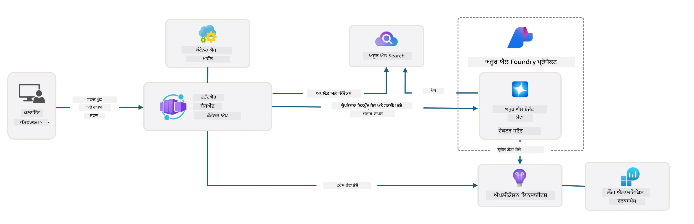

# 3. ਇਕ ਟੈਮਪਲੇਟ ਨੂੰ ਡੀਕਨਸਟ੍ਰਕਟ ਕਰੋ

!!! tip "ਇਸ ਮਾਡਿਊਲ ਦੇ ਅੰਤ ਤੱਕ ਤੁਸੀਂ ਸਮਰਥ ਹੋਵੋਗੇ"

    - [ ] Use GitHub Copilot and optional MCP tools for Azure documentation and read-only exploration
    - [ ] Identify the template's application, infrastructure, configuration, and test entry points
    - [ ] Verify generated explanations against actual repository files
    - [ ] **Lab 3:** Trace one request and one configuration input through the project

---

## 1. GitHub Copilot ਨੂੰ ਸਰਗਰਮ ਕਰੋ

VS ਕੋਡ ਵਿੱਚ ਸ਼ੁਰੂ ਕੀਤਾ ਗਿਆ AI ਸੈਂਪਲ ਖੋਲ੍ਹੋ ਅਤੇ [GitHub Copilot](https://code.visualstudio.com/docs/copilot/chat/chat-agent-mode) ਨੂੰ ਯਕਨੀਕ ਬਣਾਓ। ਉਸ ਖਾਤੇ ਨਾਲ ਲੌਗਇਨ ਕਰੋ ਜਿਸਦੇ ਕੋਲ ਯੋਗ ਯੋਜਨਾ ਹੋਵੇ; ਵਰਤੋਂ ਦੀਆਂ ਸੀਮਾਵਾਂ ਵੱਖਰੇ ਹੋ ਸਕਦੀਆਂ ਹਨ। ਬਦਲਾਅ ਦੀ ਸਹਿਮਤੀ ਦੇਣ ਤੋਂ ਪਹਿਲਾਂ ਕੋਪਾਇਲਟ ਨੂੰ ਰੀਪੋਜ਼ਟਰੀ ਦੀ ਵਿਆਖਿਆ ਕਰਨ ਲਈ ਪੁੱਛੋ।

### ਵਿਕਲਪਿਕ MCP ਸਰਵਰਜ਼

ਇਹ ਸੇਵਾਵਾਂ ਵਾਧੂ ਸੰਦ ਮੁਹੱਈਆ ਕਰਵਾ ਸਕਦੀਆਂ ਹਨ:

- [Azure MCP Server](https://learn.microsoft.com/azure/developer/azure-mcp-server/overview)
- [Microsoft Learn MCP Server](https://learn.microsoft.com/training/support/mcp)

VS ਕੋਡ ਵਿੱਚ, [MCP ਕਨਫਿਗਰੇਸ਼ਨ ਮਾਰਗਦਰਸ਼ਨ](https://code.visualstudio.com/docs/copilot/chat/mcp-servers) ਦੀ ਸਮੀਖਿਆ ਕਰੋ ਅਤੇ ਜੇ ਲੋੜ ਹੋਵੇ ਤਾਂ `.vscode/mcp.json` ਬਣਾਓ:

```json
{
  "servers": {
    "Azure MCP Server": {
      "type": "stdio",
      "command": "npx",
      "args": ["-y", "@azure/mcp@latest", "server", "start"]
    },
    "microsoft.docs.mcp": {
      "type": "http",
      "url": "https://learn.microsoft.com/api/mcp"
    }
  }
}
```

`npx` ਕਮਾਂਡ ਲਈ ਇੱਕ ਸਮਰਥਿਤ Node.js/npm ਇੰਸਟਾਲੇਸ਼ਨ ਦੀ ਲੋੜ ਹੁੰਦੀ ਹੈ ਅਤੇ ਇਹ ਚਲਾਏ ਜਾਂਦੇ ਕੋਡ ਨੂੰ ਡਾਊਨਲੋਡ ਕਰਦਾ ਹੈ। ਪੈਕੇਜ ਦੀ ਸਮੀਖਿਆ ਕਰੋ ਅਤੇ ਦਲੀਲ ਸਥਿਰ ਕਰਨ ਲਈ ਮਨਜ਼ੂਰਸ਼ੁਦਾ ਸੰਸਕਰਨ ਪਿਨ ਕਰੋ। VS ਕੋਡ ਦੇ MCP ਕਂਟਰੋਲਾਂ ਦੀ ਵਰਤੋਂ ਕਰਕੇ ਸਰਵਰ ਚਲਾਓ ਅਤੇ ਉਪਲਬਧ ਸੰਦਾਂ ਦੀ ਜਾਂਚ ਕਰੋ; ਨਾਮ ਵਰਜਨਮਾਂ ਵਿੱਚ ਬਦਲ ਸਕਦੇ ਹਨ।

**ਪਛਾਣ ਕਰਨ ਦਾ ਢੰਗ ਵੱਖਰਾ ਹੈ।** AZD ਲਈ `azd auth login` ਵਰਤੋਂ ਕਰੋ। Azure MCP ਦੇ ਦਸਤਾਵੇਜ਼ ਕੀਤੇ ਪਛਾਣ ਪ੍ਰਕਿਰਿਆ ਦੀ ਪਾਲਣਾ ਕਰੋ; ਸਿਰਫ AZD ਲੌਗਿਨ ਨਾਲ MCP ਸੈਸ਼ਨ ਸਥਾਪਿਤ ਨਹੀਂ ਹੁੰਦਾ। ਜਦੋਂ ਕੋਈ ਅਭਿਆਸ ਜਾਂ ਹੂਕ Azure CLI ਨੂੰ ਸੱਦਾ ਦੇਵੇ ਤਾਂ ਵੱਖਰੇ ਤੌਰ 'ਤੇ `az login` ਵਰਤੋਂ ਕਰੋ।

ਸਿਰਫ ਪੜ੍ਹਨ ਯੋਗ ਪ੍ਰਾਂਪਟ ਕਮਜ਼ੋਰ ਕਰੋ:

1. “Microsoft Learn MCP ਦੀ ਵਰਤੋਂ ਕਰ ਕੇ Azure Developer CLI ਕਨਫਿਗਰੇਸ਼ਨ ਦਸਤਾਵੇਜ਼ ਬਾਰੇ ਜਾਣੋ।”
2. “ਇਸ ਰੀਪੋਜ਼ਟਰੀ ਦੇ `azure.yaml` ਨੂੰ ਸਮਝਾਓ; ਹਰੇਕ ਹੂਕ ਨੂੰ ਲਾਗੂ ਕਰਨ ਵਾਲੀਆਂ ਫਾਈਲਾਂ ਦਾ ਹਵਾਲਾ ਦਿਓ।”
3. “ਉਪਲਬਧ Azure MCP ਸੰਦਾਂ ਦੀ ਵਰਤੋਂ ਕਰਕੇ, ਮੇਰੇ ਤਾਇਨਾਤ ਸਰੋਤਾਂ ਦੀ ਸੂਚੀ ਦਿਓ ਬਿਨਾਂ ਕਿਸੇ ਤਬਦੀਲੀ ਦੇ।”

ਚੁਣੇ ਹੋਏ ਟੇਨੈਂਟ/ਸਬਸਕ੍ਰਿਪਸ਼ਨ ਅਤੇ ਹਰ ਸਪੱਸ਼ਟ ਸੰਦ ਕਾਲ ਦੀ ਜਾਂਚ ਕਰੋ। ਸਿਰਫ ਆਰਕੀਟੈਕਚਰ ਦੀ ਖੋਜ ਲਈ ਸਰੋਤ ਬਣਾਉਣ, ਮਿਟਾਉਣ ਜਾਂ ਪਹੁੰਚ ਬਦਲਣ ਦੀ ਮਨਜ਼ੂਰੀ ਨਾ ਦਿਓ।

## 2. ਆਰਕੀਟੈਕਚਰ ਨੂੰ ਸਮਝੋ

ਇਹ ਸੈਂਪਲ Azure Container Apps ਵਿੱਚ Python FastAPI ਬੈਕਐਂਡ ਅਤੇ React/TypeScript ਫਰੰਟਏਂਡ ਨੂੰ ਹੋਸਟ ਕਰਦਾ ਹੈ। ਬੈਕਐਂਡ Microsoft Foundry ਪ੍ਰੋਜੈਕਟ ਵਿੱਚ ਇੱਕ ਏਜੰਟ ਨਾਲ ਸੰਚਾਰ ਕਰਦਾ ਹੈ। ਪ੍ਰਾਪਤੀ ਅਤੇ ਨਿਰੀਖਣ ਟੈਮਪਲੇਟ ਫੀਚਰਾਂ ਅਤੇ ਸਫਲ ਸੈਟਅਪ 'ਤੇ ਨਿਰਭਰ ਕਰਦੇ ਹਨ; ਸਿਰਫ ਐਪਲੀਕੇਸ਼ਨ ਤਾਇਨਾਤ ਹੋਣ ਦੀ ਵਜ੍ਹਾ ਨਾਲ ਇਹ ਦੀ ਗਾਰੰਟੀ ਨਹੀਂ ਹੈ।



ਇਸ ਡਾਇਗ੍ਰਾਮ ਨੂੰ [ਮੌਜੂਦਾ ਅਪਰਸਟਰੀਮ ਤਾਇਨਾਤ ਮਾਰਗਦਰਸ਼ਨ](https://github.com/Azure-Samples/get-started-with-ai-agents/blob/main/docs/deployment.md) ਅਤੇ ਤੁਹਾਡੇ ਅਸਲੀ ਸਰੋਤਾਂ ਨਾਲ ਤੁਲਨਾ ਕਰੋ। ਮਾਡਲ ਤਾਇਨਾਤ, ਏਜੰਟ ਸੰਦ, ਪ੍ਰਬੰਧਿਤ ਪਛਾਣ, ਭੂਮਿਕਾ ਸੌਂਪਣ ਅਤੇ ਵਿਕਲਪਿਕ AI Search/Application Insights ਸਰੋਤ ਜਾਂਚੋ।

**ਅਭਿਆਸ:** ਕੋਪਾਇਲਟ ਨੂੰ ਪੁੱਛੋ ਕਿ ਫਰੰਟਏਂਡ ਤੋਂ API ਰਾਹੀਂ Foundry ਤਕ ਚੈਟ ਬੇਨਤੀ ਕਿਵੇਂ ਟ੍ਰੇਸ ਕਰੇ, ਫਾਈਲ ਅਤੇ ਫੰਕਸ਼ਨ ਰੈਫਰੈਂਸ ਛੱਡ ਕੇ। ਉਸੇ ਰੈਫਰੈਂਸ ਖੋਲ੍ਹੋ ਅਤੇ ਵਿਆਖਿਆ ਦੀ ਪੁਸ਼ਟੀ ਕਰੋ। ਸਿਰਫ ਡਾਇਗ੍ਰਾਮ ਤੋਂ پਛਾਣ, ਰਾਊਟਿੰਗ ਜਾਂ ਪ੍ਰਧਾਨਗੀ ਲਾਗੂ ਕਰਨ ਦਾ ਅੰਦਾਜ਼ਾ ਨਾ ਲਗਾਓ।

## 3. ਰੀਪੋਜ਼ਟਰੀ ਦੀ ਸੰਰਚਨਾ

ਹੇਠ ਲਿਖੇ ਚੁਣੇ ਹੋਏ ਪਥ 4 ਨਵੰਬਰ 2026 ਨੂੰ ਸੈਂਪਲ ਨਾਲ ਜਾਂਚੇ ਗਏ। ਤੁਹਾਡੀ ਸ਼ੁਰੂਆਤੀ ਸੰਸਕਰਨ ਸਚਾਈ ਦਾ ਸਰੋਤ ਰਹਿੰਦੀ ਹੈ:

```text
get-started-with-ai-agents/
  azure.yaml
  docker-compose.yaml
  requirements-dev.txt
  .devcontainer/
  infra/
    main.bicep
    main.parameters.json
    api.bicep
    core/
  src/
    Dockerfile
    pyproject.toml
    requirements.txt
    api/
      main.py
      routes.py
      search_index_manager.py
    frontend/
      package.json
      src/
    files/
  scripts/
    validate_env_vars.sh
    validate_env_vars.ps1
    postdeploy.sh
    postdeploy.ps1
  tests/
    test_evaluation.py
    test_red_teaming.py
  docs/
    deployment.md
    deploy_customization.md
    ai_search.md
    observability.md
    local_development.md
    troubleshooting.md
```

### ਬੁਨਿਆਦੀ ਢਾਂਚਾ ਅਤੇ ਕਨਫਿਗਰੇਸ਼ਨ

`infra/main.bicep` ਸਰੋਤਾਂ ਨੂੰ ਯੋਜਿਤ ਕਰਦਾ ਹੈ; `main.parameters.json` ਟੈਮਪਲੇਟ ਇਨਪੁਟ ਨੂੰ AZD ਵਾਤਾਵਰਣ ਮੁੱਲਾਂ ਨਾਲ ਜੋੜਦਾ ਹੈ। `azure.yaml` ਐਪਲੀਕੇਸ਼ਨ ਸਰਵਿਸ ਅਤੇ ਜੀਵਨਚੱਕਰ ਹੂਕ ਚੁਣਦਾ ਹੈ। ਕਿਸੇ ਇਨਪੁਟ ਜਿਵੇਂ ਕਿ `USE_AZURE_AI_SEARCH_SERVICE` ਨੂੰ ਫਾਈਲਾਂ ਰਾਹੀਂ ਟ੍ਰੇਸ ਕਰੋ ਇਹ ਦੇਖਣ ਲਈ ਕਿ ਅਸਲ ਵਿੱਚ ਕੀ ਬਦਲਦਾ ਹੈ।

### ਐਪਲੀਕੇਸ਼ਨ ਅਤੇ ਪਛਾਣ

ਇਕੱਠੇ `src/api/` ਅਤੇ `src/frontend/` ਪੜ੍ਹੋ। ਇਹ ਪਛਾਣ ਕਰੋ ਕਿ ਏਜੰਟ ਕਿੱਥੇ ਬਣਾਇਆ ਜਾਂਦਾ ਹੈ ਜਾਂ ਪ੍ਰਾਪਤ ਕੀਤਾ ਜਾਂਦਾ ਹੈ, ਕਿੱਥੇ ਸੂਚਨਾਵਾਂ/ਸੰਦ ਬਣਾਏ ਜਾਂਦੇ ਹਨ, ਅਤੇ ਹਰੇਕ Azure ਕਾਲ ਕਿਹੜੀ ਪਛਾਣ ਵਰਤਦੀ ਹੈ। `src/files/` ਹੇਠਾਂ ਦਾ ਸੈਂਪਲ ਡਾਟਾ ਡੈਮੋਂਸਟਰੇਸ਼ਨ ਲਈ ਹੈ, ਨ ਕਿ ਉਤਪਾਦਨ ਕੈਟਾਲਾਗ ਜਾਂ ਪ੍ਰਧਾਨਗੀ ਮਾਡਲ।

### ਟੈਸਟ ਅਤੇ ਨਿਰੀਖਣਯੋਗਤਾ

ਮੌਜੂਦਾ ਮੁਲਾਂਕਣ ਅਤੇ ਰੈੱਡ-ਟੀਮਿੰਗ ਐਂਟਰੀ ਪੁਆਇੰਟ `tests/` ਹੇਠਾਂ ਹਨ; ਪੁਰਾਣੇ `evals/` ਅਤੇ `airedteaming/` ਡਾਇਰੈਕਟਰੀ ਰੈਫਰੈਂਸ ਇਸ ਸੈਂਪਲ ਲਈ ਅਪ੍ਰਚਲਿਤ ਹਨ। ਕਲਾਊਡ ਟੈਸਟ ਚਲਾਉਣ ਤੋਂ ਪਹਿਲਾਂ Preconditions ਅਤੇ ਖ਼ਰਚੇ ਲਈ `docs/observability.md` ਪੜ੍ਹੋ। ਇਹ Python ਟੈਸਟ ਵਿਕਲਪਿਕ `azure.ai.evaluations` AZD ਐਕਸਟੈਂਸ਼ਨ ਤੋਂ ਅਲੱਗ ਹਨ।

## 4. ਆਪਣੇ ਨਤੀਜੇ ਜਾਣਚੋ

- ਇੱਕ ਸੈਂਪਲ ਪ੍ਰਸ਼ਨ ਲਈ API ਰੂਟ, ਏਜੰਟ ਇੰਟਰੈਕਸ਼ਨ, ਅਤੇ ਪ੍ਰਾਪਤੀ ਕੋਡ ਪਛਾਣੋ।
- ਸਮਝਾਓ ਕਿ ਕਿਹੜੀ ਪਛਾਣ Foundry ਤੱਕ ਪਹੁੰਚਦੀ ਹੈ ਅਤੇ ਕਿਸ ਕਨਫਿਗਰੇਸ਼ਨ ਨਾਲ ਇਸਦਾ ਐਂਡਪੋਇੰਟ ਚੁਣਿਆ ਜਾਂਦਾ ਹੈ।
- ਅਸਲ ਪ੍ਰੀ-ਅੱਪ ਅਤੇ ਪੋਸਟ-ਤਾਇਨਾਤ ਸਕ੍ਰਿਪਟ ਅਤੇ ਉਨ੍ਹਾਂ ਦਾ ਐਰਰ-ਹੈਂਡਲਿੰਗ ਵਿਹਾਰ ਲੱਭੋ।
- ਕਿਸੇ ਵੀ ਨਿਰਭਰਤਾ ਜਾਂ ਵਿਕਲਪਿਕ ਫੀਚਰਾਂ ਦੀ ਸੂਚੀ ਦਿਓ ਜੋ ਤੁਹਾਡੇ ਤਾਇਨਾਤ ਵਿੱਚ ਲਾਪਤਾ ਹਨ।

ਜਾਰੀ ਰੱਖੋ [ਟੈਂਪਲੇਟ ਸੰਰਚਿਤ ਕਰਨ ਲਈ](4-Configure-AI-Template.md)।

---

<!-- CO-OP TRANSLATOR DISCLAIMER START -->
**ਅਸਵੀਕਾਰੋਪਣ**:
ਇਸ ਦਸਤਾਵੇਜ਼ ਦਾ ਅਨੁਵਾਦ ਏਆਈ ਅਨੁਵਾਦ ਸੇਵਾ [Co-op Translator](https://github.com/Azure/co-op-translator) ਦੀ ਵਰਤੋਂ ਕਰਕੇ ਕੀਤਾ ਗਿਆ ਹੈ। ਜਦੋਂ ਕਿ ਅਸੀਂ ਸਹੀਤਾਵਾਂ ਲਈ ਯਤਨਸ਼ੀਲ ਹਾਂ, ਕਿਰਪਾ ਕਰਕੇ ਧਿਆਨ ਰੱਖੋ ਕਿ ਸਵੈਚਾਲਿਤ ਅਨੁਵਾਦਾਂ ਵਿੱਚ ਗਲਤੀਆਂ ਜਾਂ ਅਸਮੱਤਿਆਵਾਂ ਹੋ ਸਕਦੀਆਂ ਹਨ। ਮੂਲ ਦਸਤਾਵੇਜ਼ ਆਪਣੀ ਮੂਲ ਭਾਸ਼ਾ ਵਿੱਚ ਅਧਿਕਾਰਕ ਸਰੋਤ ਮੰਨਿਆ ਜਾਣਾ ਚਾਹੀਦਾ ਹੈ। ਜਰੂਰੀ ਜਾਣਕਾਰੀ ਲਈ, ਪੇਸ਼ੇਵਰ ਮਨੁੱਖੀ ਅਨੁਵਾਦ ਦੀ ਸਿਫ਼ਾਰਸ਼ ਕੀਤੀ ਜਾਂਦੀ ਹੈ। ਅਸੀਂ ਇਸ ਅਨੁਵਾਦ ਦੇ ਉਪਯੋਗ ਤੋਂ ਪੈਦਾ ਹੋਣ ਵਾਲੀਆਂ ਕਿਸੇ ਵੀ ਗਲਤਫਹਿਮੀਆਂ ਜਾਂ ਗਲਤ ਵਿਆਖਿਆਵਾਂ ਲਈ ਜਵਾਬਦੇਹ ਨਹੀਂ ਹਾਂ।
<!-- CO-OP TRANSLATOR DISCLAIMER END -->