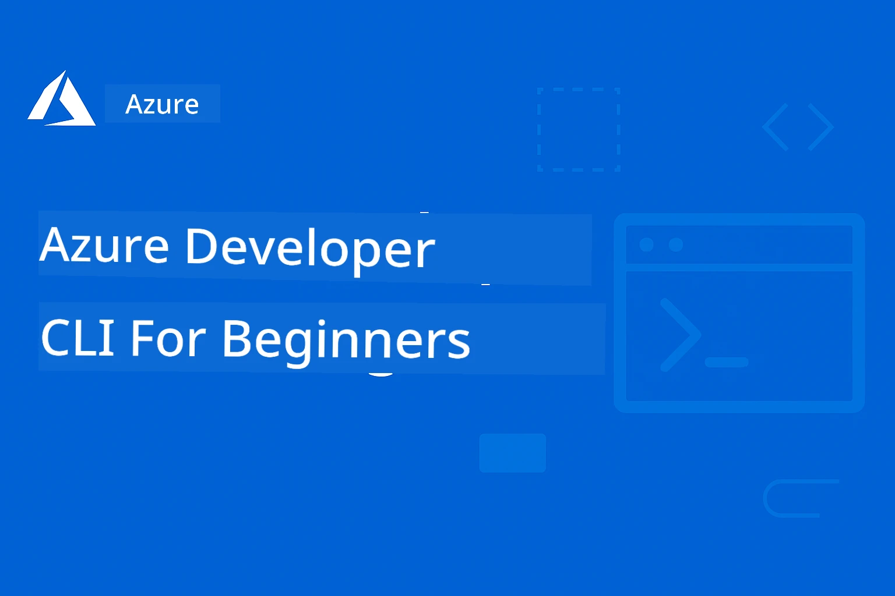

# AZD For Beginners: A Structured Learning Journey

 

[](https://github.com/microsoft/AZD-for-beginners)
[](https://GitHub.com/microsoft/azd-for-beginners/network/)
[](https://github.com/microsoft/AZD-for-beginners)

[](https://discord.com/invite/nkVh3dp)
[](https://discord.gg/nTYy5BXMWG)

---

### Automated Translations (Always Up-to-Date)

<!-- CO-OP TRANSLATOR LANGUAGES TABLE START -->
[Arabic](../ar/README.md) | [Bengali](../bn/README.md) | [Bulgarian](../bg/README.md) | [Burmese (Myanmar)](../my/README.md) | [Chinese (Simplified)](../zh-CN/README.md) | [Chinese (Traditional, Hong Kong)](../zh-HK/README.md) | [Chinese (Traditional, Macau)](../zh-MO/README.md) | [Chinese (Traditional, Taiwan)](../zh-TW/README.md) | [Croatian](../hr/README.md) | [Czech](../cs/README.md) | [Danish](../da/README.md) | [Dutch](../nl/README.md) | [Estonian](../et/README.md) | [Finnish](../fi/README.md) | [French](../fr/README.md) | [German](../de/README.md) | [Greek](../el/README.md) | [Hebrew](../he/README.md) | [Hindi](../hi/README.md) | [Hungarian](../hu/README.md) | [Indonesian](../id/README.md) | [Italian](../it/README.md) | [Japanese](../ja/README.md) | [Kannada](../kn/README.md) | [Khmer](../km/README.md) | [Korean](../ko/README.md) | [Lithuanian](../lt/README.md) | [Malay](../ms/README.md) | [Malayalam](../ml/README.md) | [Manipuri (Meitei Mayek)](../mni/README.md) | [Marathi](../mr/README.md) | [Nepali](../ne/README.md) | [Nigerian Pidgin](./README.md) | [Norwegian](../no/README.md) | [Persian (Farsi)](../fa/README.md) | [Polish](../pl/README.md) | [Portuguese (Brazil)](../pt-BR/README.md) | [Portuguese (Portugal)](../pt-PT/README.md) | [Punjabi (Gurmukhi)](../pa/README.md) | [Romanian](../ro/README.md) | [Russian](../ru/README.md) | [Serbian (Cyrillic)](../sr/README.md) | [Slovak](../sk/README.md) | [Slovenian](../sl/README.md) | [Spanish](../es/README.md) | [Swahili](../sw/README.md) | [Swedish](../sv/README.md) | [Tagalog (Filipino)](../tl/README.md) | [Tamil](../ta/README.md) | [Telugu](../te/README.md) | [Thai](../th/README.md) | [Turkish](../tr/README.md) | [Ukrainian](../uk/README.md) | [Urdu](../ur/README.md) | [Vietnamese](../vi/README.md)

> **Wetin you prefer be say you wan Clone local?**
>
> Dis repository get more than 50 language translations wey dey make di size of di download big well well. If you wan clone without di translations, use sparse checkout:
>
> **Bash / macOS / Linux:**
> ```bash
> git clone --filter=blob:none --sparse https://github.com/microsoft/AZD-for-beginners.git
> cd AZD-for-beginners
> git sparse-checkout set --no-cone '/*' '!translations' '!translated_images'
> ```
>
> **CMD (Windows):**
> ```cmd
> git clone --filter=blob:none --sparse https://github.com/microsoft/AZD-for-beginners.git
> cd AZD-for-beginners
> git sparse-checkout set --no-cone "/*" "!translations" "!translated_images"
> ```
>
> Dis one go give you everything wey you need to complete di course wit quick download.
<!-- CO-OP TRANSLATOR LANGUAGES TABLE END -->

## 🆕 Wetin New for azd Today

> 📌 **AI CLI release review (2026-11-04):** Di guidance dem check am wit di main **`azd 1.37.2`**, **agents `1.0.0-beta.23`** and **evaluations `1.0.0-beta.2`** documentation/source wey publish. Use `azd >= 1.37.0` for di combined workflow. Run `azd version` and [update di core CLI](https://learn.microsoft.com/azure/developer/azure-developer-cli/install-azd) before extensions. Check [release changes and fixes](docs/chapter-08-production/production-ai-practices.md#recent-release-changes-and-fixes). Dis no be live deployment validation for di whole course.

Azure Developer CLI dey support plenty application types, including web apps, APIs, and AI agents, through di supported hosts, templates, and extensions.

Dis na wetin e mean for you:

- **AI agents don become first-class azd workloads.** You fit initialize, deploy, and manage AI agent projects using di same `azd init` → `azd up` workflow wey you dey sabi before.
- **Agent lifecycle dey happen across two extensions.** Use `azure.ai.agents` to initialize, call, optimize, and retire agents. Make sure say you install **`azure.ai.evaluations`** separate for `azd ai eval init`, `generate`, and `run start`. Agents beta.22 don change di old evaluation workflow and di optimization configuration; follow di [migration guide](docs/chapter-08-production/production-ai-practices.md#evaluation-migration-and-quality-checks).
- **More AI building blocks.** New preview extensions—`azure.ai.skills` and `azure.ai.connections`—dey let you manage reusable agent skills and Foundry connections direct with azd.
- **Microsoft Foundry integration** dey bring model deployment, agent hosting, and AI service configuration direct inside di azd template system.
- **Smoother day-to-day basics.** Recent releases don make `azd init` idempotent (e mean say e safe to run am again), don make `azd auth login` clear stale tokens automatically, and add friendly `azd tool` first-run setup prompt.
- **Core workflow no change.** Whether you dey deploy todo app, microservice, or one multi-agent AI solution, di commands dey di same.

> **Note for Aspire users:** Microsoft don just call di product **Aspire** now (wey before na ".NET Aspire"). azd's Aspire support no change—na only di name dem update.

If you don use azd before, AI support na natural extension—no be different tool or advanced waka. If na new you be, you go learn one workflow wey fit everything.

---

## 🚀 Wetin be Azure Developer CLI (azd)?

**Azure Developer CLI (azd)** na developer-friendly command-line tool wey make am easy to deploy applications for Azure. Instead make you dey create and connect plenty Azure resources one by one, you fit deploy whole applications with one command.

### Di Magic of `azd up`

```bash
# This single command does everything:
# ✅ Creates all Azure resources  
# ✅ Configures networking and security
# ✅ Builds your application code
# ✅ Deploys to Azure
# ✅ Gives you a working URL
azd up
```

Di template dey supply di application and infrastructure configuration. To deploy well you need supported services/models, enough quota and permissions, correct inputs, and check the deployed application clean. `azd up` no mean say e automatically secure, compliant, or production-ready.

---

## ❓ Azure Developer CLI vs Azure CLI: Wetin be di Difference?

Dis na di most common question wey beginners dey ask. Na dis simple answer be dat:

| Feature | **Azure CLI (`az`)** | **Azure Developer CLI (`azd`)** |
|---------|---------------------|--------------------------------|
| **Purpose** | Manage individual Azure resources | Deploy whole applications |
| **Mindset** | Infrastructure-focused | Application-focused |
| **Example** | `az webapp create --name myapp...` | `azd up` |
| **Learning Curve** | You gats sabi Azure services | Just sabi your app |
| **Best For** | DevOps, Infrastructure | Developers, Prototyping |

### Simple Analogy

- **Azure CLI** na like you get all di tools to build house - hammer, saw, nails. You fit build anything but you gats sabi construction well.
- **Azure Developer CLI** na like say you dey hire contractor - you go talk wetin you want, and dem go handle di building.

### When To Use Each

| Scenario | Use This |
|----------|----------|
| "I want to deploy my web app quickly" | `azd up` |
| "I need to create just a storage account" | `az storage account create` |
| "I'm building a full AI application" | `azd init --template azure-search-openai-demo` |
| "I need to debug a specific Azure resource" | `az resource show` |
| "I want to deploy to my configured production environment" | Review configuration, access, cost, and operational gates before `azd up --environment production` |

### Dem Dey Work Together!

AZD and Azure CLI get their own authentication and configuration. Use `azd auth login` for AZD, and `az login` when hook or diagnostic command need Azure CLI direct. You fit use both:
```bash
# Deploy your app with AZD
azd up

# Then fine-tune specific resources with Azure CLI
az webapp config set --name myapp --always-on true
```

---

## 🌟 Find Templates for Awesome AZD

No start from scratch! **Awesome AZD** na community collection of ready-to-deploy templates:

| Resource | Description |
|----------|-------------|
| 🔗 [**Awesome AZD Gallery**](https://azure.github.io/awesome-azd/) | Browse 200+ templates with one-click deploy |
| 🔗 [**Submit a Template**](https://github.com/Azure/awesome-azd/issues) | Contribute your own template to di community |
| 🔗 [**GitHub Repository**](https://github.com/Azure/awesome-azd) | Star and explore di source |

### Popular AI Templates from Awesome AZD

Choose one template for im own empty directory; di commands below na alternatives. Di trailing `.` go initialize dat directory.

```bash
# RAG Chat with Microsoft Foundry Models + AI Search
azd init --template azure-search-openai-demo .

# Quick AI Chat Application
azd init --template openai-chat-app-quickstart .

# AI Agents with Foundry Agents
azd init --template get-started-with-ai-agents .
```

---

## 🎯 How To Start for 3 Steps

Before you start, make sure your machine ready for di template wey you wan deploy:

**Windows:**
```powershell
.\validate-setup.ps1
```

**macOS / Linux:**
```bash
bash ./validate-setup.sh
```

If any required check fail, fix am first then continue wit di quick start.

### Step 1: Install AZD (2 minutes)

**Windows:**
```powershell
winget install microsoft.azd
```

**macOS:**
```bash
brew tap azure/azd && brew install azd
```

**Linux:**
```bash
curl -fsSL https://aka.ms/install-azd.sh | bash
```

### Step 2: Authenticate for AZD

```bash
# Optional if you plan to use Azure CLI commands directly in this course
az login

# Required for AZD workflows
azd auth login
```

If you no sure which one you need, follow di full setup flow for [Installation & Setup](docs/chapter-01-foundation/installation.md#authentication-setup).

### Step 3: Deploy Your First App

```bash
# Initialize from a template
azd init --template todo-nodejs-mongo .

# Deploy to Azure (creates everything!)
azd up
```

**🎉 Na im be that!** Your app don dey live for Azure now.

### Clean Up (No Forget!)

```bash
# Remove all resources when done experimenting
azd down --force --purge
```

---

## 📚 How To Use Dis Course

Dis course design for **progressive learning** - start where you comfortable and waka your way go up:

| Your Experience | Start Here |
|-----------------|------------|
| **Brand new to Azure** | [Chapter 1: Foundation](#-chapter-1-foundation--quick-start) |
| **Know Azure, new to AZD** | [Chapter 1: Foundation](#-chapter-1-foundation--quick-start) |
| **Want to deploy AI apps** | [Chapter 2: AI-First Development](#-chapter-2-ai-first-development-recommended-for-ai-developers) |
| **Want hands-on practice** | [🎓 Interactive Workshop](workshop/README.md) - 3-4 hour guided lab |
| **Need production patterns** | [Chapter 8: Production & Enterprise](#-chapter-8-production--enterprise-patterns) |

### Quick Setup

1. **Fork Dis Repository**: [](https://GitHub.com/microsoft/azd-for-beginners/fork)
2. **Clone am**: `git clone https://github.com/YOUR-USERNAME/azd-for-beginners.git`
3. **Get Help**: [Azure Discord Community](https://discord.com/invite/ByRwuEEgH4)

> **Wetin you prefer be say you wan Clone local?**

> Dis repository get more than 50 language translations wey dey make di size of di download big well well. If you wan clone without di translations, use sparse checkout:
> ```bash
> git clone --filter=blob:none --sparse https://github.com/microsoft/AZD-for-beginners.git
> cd AZD-for-beginners
> git sparse-checkout set --no-cone '/*' '!translations' '!translated_images'
> ```
> Dis go give you everytin wey you need to finish di course wit much faster download.


## Course Overview

Master Azure Developer CLI (azd) tru structured chapters wey dem design for progressive learning. **Special focus on AI application deployment wit Microsoft Foundry integration.**

### Why Dis Course Na Important for Modern Developers

Developers wey dey deploy AI workloads dey usually need guidance on:
- Complex multi-service AI architectures
- Production AI deployment best practices  
- Azure AI service integration and configuration
- Cost optimization for AI workloads
- Troubleshooting AI-specific deployment issues

### Learning Objectives

By finishing dis structured course, you go:
- **Master AZD Fundamentals**: Core concepts, installation, and configuration
- **Deploy AI Applications**: Use AZD wit Microsoft Foundry services
- **Implement Infrastructure as Code**: Manage Azure resources wit Bicep templates
- **Troubleshoot Deployments**: Solve common issues and debug problems
- **Optimize for Production**: Security, scaling, monitoring, and cost management
- **Build Multi-Agent Solutions**: Deploy complex AI architectures

## Before You Start: Accounts, Access, and Assumptions

Before you start Chapter 1, make sure say you get di following set. Di installation steps wey dey later for dis guide dey assume say you don handle dese basics already.

- **An Azure subscription**: You fit use existing subscription from work or your own account, or create [free trial](https://aka.ms/azurefreetrial) to start.
- **Permission to create Azure resources**: For most exercises, you suppose get at least **Contributor** access for di target subscription or resource group. Some chapters fit also assume say you fit create resource groups, managed identities, and RBAC assignments.
- [**A GitHub account**](https://github.com): Dis go help you fork di repository, track you own changes, and use GitHub Codespaces for di workshop.
- **Template runtime prerequisites**: Some templates need local tools like Node.js, Python, Java, or Docker. Run di setup validator before you start so you fit see missing tools early.
- **Basic terminal familiarity**: You no need be expert, but you gats dey comfortable to run commands like `git clone`, `azd auth login`, and `azd up`.

> **Woking for enterprise subscription?**
> If your Azure environment dey managed by administrator, confirm before time say you fit deploy resources inside di subscription or resource group wey you wan use. If no, ask for sandbox subscription or Contributor access before you start.

> **New to Azure?**
> Start wit your own Azure trial or pay-as-you-go subscription for https://aka.ms/azurefreetrial so you fit complete di exercises end to end without waiting on tenant-level approvals.

## 🗺️ Course Map: Quick Navigation by Chapter

Each chapter get dedicated README wit learning objectives, quick starts, and exercises:

| Chapter | Topic | Lessons | Duration | Complexity |
|---------|-------|---------|----------|------------|
| **[Ch 1: Foundation](docs/chapter-01-foundation/README.md)** | Getting Started | [AZD Basics](docs/chapter-01-foundation/azd-basics.md) &#124; [Installation](docs/chapter-01-foundation/installation.md) &#124; [First Project](docs/chapter-01-foundation/first-project.md) | 30-45 min | ⭐ |
| **[Ch 2: AI Development](docs/chapter-02-ai-development/README.md)** | AI-First Apps | [Foundry Integration](docs/chapter-02-ai-development/microsoft-foundry-integration.md) &#124; [AI Agents](docs/chapter-02-ai-development/agents.md) &#124; [Model Deployment](docs/chapter-02-ai-development/ai-model-deployment.md) &#124; [Workshop](docs/chapter-02-ai-development/ai-workshop-lab.md) | 1-2 hrs | ⭐⭐ |
| **[Ch 3: Configuration](docs/chapter-03-configuration/README.md)** | Auth & Security | [Configuration](docs/chapter-03-configuration/configuration.md) &#124; [Auth & Security](docs/chapter-03-configuration/authsecurity.md) | 45-60 min | ⭐⭐ |
| **[Ch 4: Infrastructure](docs/chapter-04-infrastructure/README.md)** | IaC & Deployment | [Deployment Guide](docs/chapter-04-infrastructure/deployment-guide.md) &#124; [Provisioning](docs/chapter-04-infrastructure/provisioning.md) | 1-1.5 hrs | ⭐⭐⭐ |
| **[Ch 5: Multi-Agent](docs/chapter-05-multi-agent/README.md)** | AI Agent Solutions | [Retail Scenario](examples/retail-scenario.md) &#124; [Coordination Patterns](docs/chapter-06-pre-deployment/coordination-patterns.md) | 2-3 hrs | ⭐⭐⭐⭐ |
| **[Ch 6: Pre-Deployment](docs/chapter-06-pre-deployment/README.md)** | Planning & Validation | [Preflight Checks](docs/chapter-06-pre-deployment/preflight-checks.md) &#124; [Capacity Planning](docs/chapter-06-pre-deployment/capacity-planning.md) &#124; [SKU Selection](docs/chapter-06-pre-deployment/sku-selection.md) &#124; [App Insights](docs/chapter-06-pre-deployment/application-insights.md) | 1 hr | ⭐⭐ |
| **[Ch 7: Troubleshooting](docs/chapter-07-troubleshooting/README.md)** | Debug & Fix | [Common Issues](docs/chapter-07-troubleshooting/common-issues.md) &#124; [Debugging](docs/chapter-07-troubleshooting/debugging.md) &#124; [AI Issues](docs/chapter-07-troubleshooting/ai-troubleshooting.md) | 1-1.5 hrs | ⭐⭐ |
| **[Ch 8: Production](docs/chapter-08-production/README.md)** | Enterprise Patterns | [Production Practices](docs/chapter-08-production/production-ai-practices.md) | 2-3 hrs | ⭐⭐⭐⭐ |
| **[🎓 Workshop](workshop/README.md)** | Hands-On Lab | [Introduction](workshop/docs/instructions/0-Introduction.md) &#124; [Selection](workshop/docs/instructions/1-Select-AI-Template.md) &#124; [Validation](workshop/docs/instructions/2-Validate-AI-Template.md) &#124; [Deconstruction](workshop/docs/instructions/3-Deconstruct-AI-Template.md) &#124; [Configuration](workshop/docs/instructions/4-Configure-AI-Template.md) &#124; [Customization](workshop/docs/instructions/5-Customize-AI-Template.md) &#124; [Teardown](workshop/docs/instructions/6-Teardown-Infrastructure.md) &#124; [Wrap-up](workshop/docs/instructions/7-Wrap-up.md) | 3-4 hrs | ⭐⭐ |

**Total Course Duration:** ~10-14 hours | **Skill Progression:** Beginner → Production-Ready

---

## 📚 Learning Chapters

*Select your learning path based on experience level and goals*

### 🚀 Chapter 1: Foundation & Quick Start
**Prerequisites**: Azure subscription, basic command line knowledge  
**Duration**: 30-45 minutes  
**Complexity**: ⭐

#### Wetin You Go Learn
- Understanding Azure Developer CLI fundamentals
- Installing AZD on your platform
- Your first successful deployment

#### Learning Resources
- **🎯 Start Here**: [Wetn be Azure Developer CLI?](#-what-is-azure-developer-cli-azd)
- **📖 Theory**: [AZD Basics](docs/chapter-01-foundation/azd-basics.md) - Core concepts and terminology
- **⚙️ Setup**: [Installation & Setup](docs/chapter-01-foundation/installation.md) - Platform-specific guides
- **🛠️ Hands-On**: [Your First Project](docs/chapter-01-foundation/first-project.md) - Step-by-step tutorial
- **📋 Quick Reference**: [Command Cheat Sheet](resources/cheat-sheet.md)

#### Practical Exercises
```bash
# Quick installation check
azd version

# Deploy your first application
azd init --template todo-nodejs-mongo .
azd up
```

**💡 Chapter Outcome**: Successfully deploy simple web application for Azure wit AZD

**✅ Success Validation:**
```bash
# After completing Chapter 1, you should be able to:
azd version              # Shows installed version
azd init --template todo-nodejs-mongo  # Initializes project
azd up                  # Deploys to Azure
azd show                # Displays running app URL
# Application opens in browser and works
azd down --force --purge  # Cleans up resources
```

**📊 Time Investment:** 30-45 minutes  
**📈 Skill Level After:** Fit deploy basic applications independently

---

### 🤖 Chapter 2: AI-First Development (Recommended for AI Developers)
**Prerequisites**: Chapter 1 finish  
**Duration**: 1-2 hours  
**Complexity**: ⭐⭐

#### Wetin You Go Learn
- Microsoft Foundry integration wit AZD
- Deploy AI-powered applications
- Understand AI service configurations

#### Learning Resources
- **🎯 Start Here**: [Microsoft Foundry Integration](docs/chapter-02-ai-development/microsoft-foundry-integration.md)
- **🤖 AI Agents**: [AI Agents Guide](docs/chapter-02-ai-development/agents.md) - Deploy intelligent agents wit AZD
- **📖 Patterns**: [AI Model Deployment](docs/chapter-02-ai-development/ai-model-deployment.md) - Deploy and manage AI models
- **🛠️ Workshop**: [AI Workshop Lab](docs/chapter-02-ai-development/ai-workshop-lab.md) - Make your AI solutions AZD-ready
- **🎥 Interactive Guide**: [Workshop Materials](workshop/README.md) - Browser-based learning wit MkDocs * DevContainer Environment
- **📋 Templates**: [Microsoft Foundry Templates](#featured-microsoft-foundry-templates)
- **📝 Examples**: [AZD Deployment Examples](examples/README.md)

#### Practical Exercises
```bash
# Deploy your first AI application
azd init --template azure-search-openai-demo .
azd up

# Try additional AI templates
azd init --template openai-chat-app-quickstart .
azd init --template agent-openai-python-prompty .
```

**💡 Chapter Outcome**: Deploy and configure AI-powered chat app wit RAG capabilities

**✅ Success Validation:**
```bash
# After Chapter 2, you should be able to:
azd init --template azure-search-openai-demo .
azd up
# Test the AI chat interface
# Ask questions and get AI-powered responses with sources
# Verify search integration works
azd monitor  # Check Application Insights shows telemetry
azd down --force --purge
```

**📊 Time Investment:** 1-2 hours  
**📈 Skill Level After:** Fit deploy AI learning apps and sabi additional production-readiness requirements
**💰 Cost Awareness:** Understand $80-150/month dev costs, $300-3500/month production costs

#### 💰 Cost Considerations for AI Deployments

**Development Environment (Estimated $80-150/month):**
- Microsoft Foundry Models (Pay-as-you-go): $0-50/month (based on token usage)
- AI Search (Basic tier): $75/month
- Container Apps (Consumption): $0-20/month
- Storage (Standard): $1-5/month

**Production Environment (Estimated $300-3,500+/month):**
- Microsoft Foundry Models (PTU for consistent performance): $3,000+/month OR Pay-as-go wit high volume
- AI Search (Standard tier): $250/month
- Container Apps (Dedicated): $50-100/month
- Application Insights: $5-50/month
- Storage (Premium): $10-50/month

**💡 Cost Optimization Tips:**
- Check model inference pricing and account-specific credits; Azure OpenAI no get universal 50,000-token monthly free allowance
- Run `azd down` to delete resources when you no need dem again, after you review di selected environment
- Start wit consumption-based billing, upgrade to PTU only for production
- Use `azd provision --preview` to inspect planned infrastructure, den price di resulting resources wit Azure Pricing Calculator
- Enable auto-scaling: pay only for actual usage

**Cost Monitoring:**
```bash
# Inspect planned resources (this does not calculate prices)
azd provision --preview

# Monitor actual costs in Azure Portal
az consumption budget list --resource-group <your-rg>
```

---

### ⚙️ Chapter 3: Configuration & Authentication
**Prerequisites**: Chapter 1 finish  
**Duration**: 45-60 minutes  
**Complexity**: ⭐⭐

#### Wetin You Go Learn
- Environment configuration and management
- Authentication and security best practices
- Resource naming and organization

#### Learning Resources
- **📖 Configuration**: [Configuration Guide](docs/chapter-03-configuration/configuration.md) - Environment setup
- **🔐 Security**: [Authentication patterns and managed identity](docs/chapter-03-configuration/authsecurity.md) - Authentication patterns
- **📝 Examples**: [Database App Example](examples/database-app/README.md) - AZD Database Examples

#### Practical Exercises
- Configure multiple environments (dev, staging, prod)
- Set up managed identity authentication
- Implement environment-specific configurations

**💡 Chapter Outcome**: Manage multiple environments wit proper authentication and security

---

### 🏗️ Chapter 4: Infrastructure as Code & Deployment
**Prerequisites**: Chapters 1-3 finish  
**Duration**: 1-1.5 hours  
**Complexity**: ⭐⭐⭐

#### Wetin You Go Learn
- Advanced deployment patterns
- Infrastructure as Code wit Bicep
- Resource provisioning strategies

#### Learning Resources
- **📖 Deployment**: [Deployment Guide](docs/chapter-04-infrastructure/deployment-guide.md) - Complete workflows
- **🏗️ Provisioning**: [Provisioning Resources](docs/chapter-04-infrastructure/provisioning.md) - Azure resource management
- **📝 Examples**: [Container App Example](../../examples/container-app) - Containerized deployments

#### Practical Exercises
- Create custom Bicep templates
- Deploy multi-service applications
- Implement blue-green deployment strategies

**💡 Chapter Outcome**: Deploy complex multi-service applications wit custom infrastructure templates

---

### 🎯 Chapter 5: Multi-Agent AI Solutions (Advanced)
**Prerequisites**: Chapters 1-2 finish  
**Duration**: 2-3 hours  
**Complexity**: ⭐⭐⭐⭐

#### Wetin You Go Learn
- Multi-agent architecture patterns
- Agent orchestration and coordination
- Production-ready AI deployments

#### Learning Resources
- **🤖 Featured Design**: [Retail Multi-Agent Solution](examples/retail-scenario.md) - Architecture blueprint, no be complete application
- **🛠️ ARM Templates**: [ARM Template Package](../../examples/retail-multiagent-arm-template) - Infrastructure scaffold; check prerequisities and di application tins wey dey miss
- **📖 Architecture**: [Multi-agent coordination patterns](docs/chapter-06-pre-deployment/coordination-patterns.md) - Patterns dem

#### Practical Exercises
```bash
# Inspect the retail infrastructure scaffold before choosing to deploy it
cd examples/retail-multiagent-arm-template
cat README.md

# After an intentional deployment, inspect infrastructure state
az deployment group show --resource-group <rg-name> --name <deployment-name>
```

**💡 Chapter Outcome**: Understand multi-agent design and sabi di work wey dem need do for implementation, validation, and operational sides pass di infrastructure scaffold

---

### 🔍 Chapter 6: Pre-Deployment Validation & Planning
**Prerequisites**: Chapter 4 don finish  
**Duration**: 1 hour  
**Complexity**: ⭐⭐

#### Wetin You Go Learn
- Capacity planning and resource validation
- SKU selection strategies
- Pre-flight checks and automation

#### Learning Resources
- **📊 Planning**: [Capacity Planning](docs/chapter-06-pre-deployment/capacity-planning.md) - Resource validation
- **💰 Selection**: [SKU Selection](docs/chapter-06-pre-deployment/sku-selection.md) - Cost-effective choices
- **✅ Validation**: [Pre-flight Checks](docs/chapter-06-pre-deployment/preflight-checks.md) - Automated scripts

#### Practical Exercises
- Run capacity validation scripts
- Optimize SKU selections for cost
- Implement automated pre-deployment checks

**💡 Chapter Outcome**: Validate and optimize deployments before di execution

---

### 🚨 Chapter 7: Troubleshooting & Debugging
**Prerequisites**: Any deployment chapter don finish  
**Duration**: 1-1.5 hours  
**Complexity**: ⭐⭐

#### Wetin You Go Learn
- Systematic debugging approaches
- Common issues and solutions
- AI-specific troubleshooting

#### Learning Resources
- **🔧 Common Issues**: [Common Issues](docs/chapter-07-troubleshooting/common-issues.md) - FAQ and solutions
- **🕵️ Debugging**: [Debugging Guide](docs/chapter-07-troubleshooting/debugging.md) - Step-by-step strategies
- **🤖 AI Issues**: [AI-Specific Troubleshooting](docs/chapter-07-troubleshooting/ai-troubleshooting.md) - AI service problems

#### Practical Exercises
- Diagnose deployment failures
- Resolve authentication issues
- Debug AI service connectivity

**💡 Chapter Outcome**: Fit diagnose and solve common deployment wahala by yourself

---

### 🏢 Chapter 8: Production & Enterprise Patterns
**Prerequisites**: Chapters 1-4 don finish  
**Duration**: 2-3 hours  
**Complexity**: ⭐⭐⭐⭐

#### Wetin You Go Learn
- Production deployment strategies
- Enterprise security patterns
- Monitoring and cost optimization

#### Learning Resources
- **🏭 Production**: [Production AI Best Practices](docs/chapter-08-production/production-ai-practices.md) - Enterprise patterns
- **📝 Examples**: [Microservices Example](../../examples/microservices) - Complex architectures
- **📊 Monitoring**: [Application Insights integration](docs/chapter-06-pre-deployment/application-insights.md) - Monitoring

#### Practical Exercises
- Implement enterprise security patterns
- Set up comprehensive monitoring
- Deploy to production with proper governance

**💡 Chapter Outcome**: Deploy enterprise-ready applications with full production capabilities

---

## 🎓 Workshop Overview: Hands-On Learning Experience

> **⚠️ WORKSHOP STATUS: Active Development**  
> Di workshop materials still dey develop and improve. Core modules dey work, but some advanced sections no complete finish yet. We dey work steady to complete all di content. [Track progress →](workshop/README.md)

### Interactive Workshop Materials
**Comprehensive hands-on learning with browser-based tools and guided exercises**

Our workshop materials dey provide structured, interactive learning experience wey match di chapter-based curriculum for top. Di workshop dem design am for both self-paced learning and instructor-led session.

#### 🛠️ Workshop Features
- **Browser-Based Interface**: Complete MkDocs-powered workshop with search, copy, and theme features
- **GitHub Codespaces Integration**: One-click development environment setup
- **Structured Learning Path**: 8-module guided exercises (3-4 hours total)
- **Progressive Methodology**: Introduction → Selection → Validation → Deconstruction → Configuration → Customization → Teardown → Wrap-up
- **Interactive DevContainer Environment**: Pre-configured tools and dependencies

#### 📚 Workshop Module Structure
The workshop dey follow an **8-module progressive methodology** wey go carry you from discovery to deployment mastery:

| Module | Topic | Wetin You Go Do | Duration |
|--------|-------|----------------|----------|
| **0. Introduction** | Workshop Overview | Understand learning objectives, prerequisites, and workshop structure | 15 min |
| **1. Selection** | Template Discovery | Explore AZD templates and select the right AI template for your scenario | 20 min |
| **2. Validation** | Deploy & Verify | Deploy the template with `azd up` and validate di infrastructure work well | 30 min |
| **3. Deconstruction** | Understand Structure | Use GitHub Copilot to explore template architecture, Bicep files, and code organization | 30 min |
| **4. Configuration** | azure.yaml Deep Dive | Master `azure.yaml` configuration, lifecycle hooks, and environment variables | 30 min |
| **5. Customization** | Make Am Your Own | Enable AI Search, tracing, evaluation, and arrange am for your scenario | 45 min |
| **6. Teardown** | Clean Up | Safely deprovision resources with `azd down --purge` | 15 min |
| **7. Wrap-up** | Next Steps | Review wetin you don achieve, key concepts, and continue your learning journey | 15 min |

**Workshop Flow:**
```
Introduction → Selection → Validation → Deconstruction → Configuration → Customization → Teardown → Wrap-up
     ↓            ↓           ↓              ↓               ↓              ↓            ↓           ↓
  Overview    Find the     Deploy &      Explore        Master         Customize     Clean up    Review &
             right        verify        code &        azure.yaml      for your      resources   next steps
             template                   structure                     scenario
```

#### 🚀 How To Start Di Workshop
```bash
# Option 1: GitHub Codespaces (Recommended)
# Click "Code" → "Create codespace on main" in the repository

# Option 2: Local Development
git clone https://github.com/microsoft/azd-for-beginners.git
cd azd-for-beginners/workshop
# Follow the setup instructions in workshop/README.md
```

#### 🎯 Workshop Learning Outcomes
If una complete di workshop, participants go:
- **Deploy Production AI Applications**: Use AZD with Microsoft Foundry services
- **Master Multi-Agent Architectures**: Implement coordinated AI agent solutions
- **Implement Security Best Practices**: Configure authentication and access control
- **Optimize for Scale**: Design cost-effective, performant deployments
- **Troubleshoot Deployments**: Solve common issues on your own

#### 📖 Workshop Resources
- **🎥 Interactive Guide**: [Workshop Materials](workshop/README.md) - Browser-based learning environment
- **📋 Module-by-Module Instructions**:
  - [0. Introduction](workshop/docs/instructions/0-Introduction.md) - Workshop overview and goals
  - [1. Selection](workshop/docs/instructions/1-Select-AI-Template.md) - Find and select AI templates
  - [2. Validation](workshop/docs/instructions/2-Validate-AI-Template.md) - Deploy and verify templates
  - [3. Deconstruction](workshop/docs/instructions/3-Deconstruct-AI-Template.md) - Explore template architecture
  - [4. Configuration](workshop/docs/instructions/4-Configure-AI-Template.md) - Master azure.yaml
  - [5. Customization](workshop/docs/instructions/5-Customize-AI-Template.md) - Customize for your scenario
  - [6. Teardown](workshop/docs/instructions/6-Teardown-Infrastructure.md) - Clean up resources
  - [7. Wrap-up](workshop/docs/instructions/7-Wrap-up.md) - Review and next steps
- **🛠️ AI Workshop Lab**: [AI Workshop Lab](docs/chapter-02-ai-development/ai-workshop-lab.md) - AI-focused exercises
- **💡 Quick Start**: [Workshop Setup Guide](workshop/README.md#browser-based-guide) - Environment configuration

**Perfect for**: Corporate training, university courses, self-paced learning, and developer boot camps.

---

## 📖 Deep Dive: AZD Capabilities

Pass basic level, AZD dey give powerful features for production deployments:

- **Template-based deployments** - Use pre-built templates for common application patterns
- **Infrastructure as Code** - Manage Azure resources using Bicep or Terraform  
- **Integrated workflows** - Seamlessly provision, deploy, and monitor applications
- **Developer-friendly** - Optimized for developer productivity and experience

### **AZD + Microsoft Foundry: Perfect for AI Deployments**

**Why AZD for AI Solutions?** AZD dey solve di main wahala wey AI developers dey face:

- **AI-Ready Templates** - Pre-configured templates for Microsoft Foundry Models, Azure AI Services, and ML workloads
- **Secure AI Deployments** - Built-in security patterns for AI services, API keys, and model endpoints  
- **Production AI Patterns** - Best practices for scalable, cost-effective AI application deployments
- **End-to-End AI Workflows** - From model development to production deployment with proper monitoring
- **Cost Optimization** - Smart resource allocation and scaling strategies for AI workloads
- **Microsoft Foundry Integration** - Seamless connection to Microsoft Foundry model catalog and endpoints

---

## 🎯 Templates & Examples Library

### Featured: Microsoft Foundry Templates
**Start here if you dey deploy AI applications!**

> **Note:** These templates dey show different AI patterns. Some na external Azure Samples, others na local implementations.

| Template | Chapter | Complexity | Services | Type |
|----------|---------|------------|----------|------|
| [**Get started with AI chat**](https://github.com/Azure-Samples/get-started-with-ai-chat) | Chapter 2 | ⭐⭐ | AzureOpenAI + Azure AI Model Inference API + Azure AI Search + Azure Container Apps + Application Insights | External |
| [**Get started with AI agents**](https://github.com/Azure-Samples/get-started-with-ai-agents) | Chapter 2 | ⭐⭐ | Foundry Agents + AzureOpenAI + Azure AI Search + Azure Container Apps + Application Insights| External |
| [**Azure Search + OpenAI Demo**](https://github.com/Azure-Samples/azure-search-openai-demo) | Chapter 2 | ⭐⭐ | Azure OpenAI + Azure AI Search + Container Apps (default) + Storage | External |
| [**OpenAI Chat App Quickstart**](https://github.com/Azure-Samples/openai-chat-app-quickstart) | Chapter 2 | ⭐ | AzureOpenAI + Container Apps + Application Insights | External |
| [**Agent OpenAI Python Prompty**](https://github.com/Azure-Samples/agent-openai-python-prompty) | Chapter 5 | ⭐⭐⭐ | AzureOpenAI + Azure Functions + Prompty | External |
| [**Contoso Chat RAG**](https://github.com/Azure-Samples/contoso-chat) | Chapter 8 | ⭐⭐⭐⭐ | AzureOpenAI + AI Search + Cosmos DB + Container Apps | External |
| [**Retail Multi-Agent Solution**](examples/retail-scenario.md) | Chapter 5 | ⭐⭐⭐⭐ | Proposed architecture and infrastructure scaffold; application implementation required | **Local blueprint** |

### Featured: Complete Learning Scenarios
**Production-ready application templates mapped to learning chapters**

| Template | Learning Chapter | Complexity | Key Learning |
|----------|------------------|------------|--------------|
| [**openai-chat-app-quickstart**](https://github.com/Azure-Samples/openai-chat-app-quickstart) | Chapter 2 | ⭐ | Basic AI deployment patterns |
| [**azure-search-openai-demo**](https://github.com/Azure-Samples/azure-search-openai-demo) | Chapter 2 | ⭐⭐ | RAG implementation with Azure AI Search |
| [**get-started-with-ai-agents**](https://github.com/Azure-Samples/get-started-with-ai-agents) | Chapter 2 | ⭐⭐ | Agent-backed chat and sample-specific evaluation tests |
| [**agent-openai-python-prompty**](https://github.com/Azure-Samples/agent-openai-python-prompty) | Chapter 5 | ⭐⭐⭐ | Agent framework and function calling |
| [**contoso-chat**](https://github.com/Azure-Samples/contoso-chat) | Chapter 8 | ⭐⭐⭐ | Enterprise AI orchestration |
| [**retail-multi-agent-solution**](examples/retail-scenario.md) | Chapter 5 | ⭐⭐⭐⭐ | Multi-agent architecture with Customer and Inventory agents |

### Learning by Example Type

> **📌 Local vs. External Examples:**  
> **Local Examples** (for dis repo) = Check di example README for implementation status and prerequisites
> **External Examples** (Azure Samples) = Clone from linked repositories

#### Local Examples (Ready to Use)
- [**Retail Multi-Agent Solution**](examples/retail-scenario.md) - Architecture blueprint with ARM infrastructure scaffold
  - Proposed Customer and Inventory agent roles
  - Monitoring, evaluation, and application code must be implemented and checked
  - Provisioning resources alone no go produce working retail application

#### Local Examples - Container Applications (Chapters 2-5)
**Complete container deployment examples for dis repository:**
- [**Container App Examples**](examples/container-app/README.md) - Complete guide for containerized deployments
  - [Simple Flask API](../../examples/container-app/simple-flask-api) - Basic REST API wey fit scale-to-zero
  - [Microservices Architecture](../../examples/container-app/microservices) - Two-service learning sample; production hardening na extra work
  - Quick Start, Production, and Advanced deployment patterns
  - Monitoring, security, and cost optimization guidelines

#### External Examples - Simple Applications (Chapters 1-2)
**Clone these Azure Samples repositories make you fit start:**
- [Simple Web App - Node.js + MongoDB](https://github.com/Azure-Samples/todo-nodejs-mongo) - Basic deployment patterns
- [Static Website - React SPA](https://github.com/Azure-Samples/todo-csharp-sql-swa-func) - Static content deployment
- [Container App - Python Flask](https://github.com/Azure-Samples/container-apps-store-api-microservice) - REST API deployment

#### External Examples - Database Integration (Chapter 3-4)  
- [Database App - C# + SQL](https://github.com/Azure-Samples/todo-csharp-sql) - Database connectivity patterns
- [Functions + Cosmos DB](https://github.com/Azure-Samples/todo-python-mongo-swa-func) - Serverless data workflow

#### External Examples - Advanced Patterns (Chapters 4-8)
- [Java Microservices](https://github.com/Azure-Samples/java-microservices-aca-lab) - Multi-service architectures
- [Container Apps Jobs](https://github.com/Azure-Samples/container-apps-jobs) - Background processing  
- [Enterprise ML Pipeline](https://github.com/Azure/mlops-v2) - MLOps reference patterns; not a drop-in AZD template

### External Template Collections
- [**Official AZD Template Gallery**](https://azure.github.io/awesome-azd/) - Curated collection of official and community templates
- [**Azure Developer CLI Templates**](https://learn.microsoft.com/en-us/azure/developer/azure-developer-cli/azd-templates) - Microsoft Learn template documentation
- [**Examples Directory**](examples/README.md) - Local learning examples with detailed explanations

---

## 📚 Learning Resources & References

### Quick References
- [**Command Cheat Sheet**](resources/cheat-sheet.md) - Essential azd commands organized by chapter
- [**Glossary**](resources/glossary.md) - Azure and azd terminology  
- [**FAQ**](resources/faq.md) - Common questions organized by learning chapter
- [**Study Guide**](resources/study-guide.md) - Comprehensive practice exercises

### Hands-On Workshops
- [**AI Workshop Lab**](docs/chapter-02-ai-development/ai-workshop-lab.md) - Make your AI solutions AZD-deployable (2-3 hours)
- [**Interactive Workshop**](workshop/README.md) - 8-module guided exercises with MkDocs and GitHub Codespaces
  - Follows: Introduction → Selection → Validation → Deconstruction → Configuration → Customization → Teardown → Wrap-up

### External Learning Resources
- [Azure Developer CLI Documentation](https://learn.microsoft.com/en-us/azure/developer/azure-developer-cli/)
- [Azure Architecture Center](https://learn.microsoft.com/en-us/azure/architecture/)
- [Azure Pricing Calculator](https://azure.microsoft.com/pricing/calculator/)
- [Azure Status](https://status.azure.com/)

### AI Agent Skills for Your Editor
- [**Microsoft Azure Skills on skills.sh**](https://skills.sh/microsoft/github-copilot-for-azure) - 37 open agent skills for Azure AI, Foundry, deployment, diagnostics, cost optimization, and more. Install them in GitHub Copilot, Cursor, Claude Code, or any supported agent:
  ```bash
  npx skills add microsoft/github-copilot-for-azure
  ```

---

## 🔧 Quick Troubleshooting Guide

**Common issues beginners face and immediate solutions:**

<details>
<summary><strong>❌ "azd: command not found"</strong></summary>

```bash
# Install AZD first
# Windows (PowerShell):
winget install microsoft.azd

# macOS:
brew tap azure/azd && brew install azd

# Linux:
curl -fsSL https://aka.ms/install-azd.sh | bash

# Verify installation
azd version
```
</details>

<details>
<summary><strong>❌ "No subscription found" or "Subscription not set"</strong></summary>

```bash
# List available subscriptions
az account list --output table

# Set default subscription
az account set --subscription "<subscription-id-or-name>"

# Set for AZD environment
azd env set AZURE_SUBSCRIPTION_ID "<subscription-id>"

# Verify
az account show
```
</details>

<details>
<summary><strong>❌ "InsufficientQuota" or "Quota exceeded"</strong></summary>

```bash
# Try different Azure region
azd env set AZURE_LOCATION "westus2"
azd up

# Or use smaller SKUs in development
# Edit infra/main.parameters.json:
{
  "sku": "B1"  // Instead of "P1V2"
}
```
</details>

<details>
<summary><strong>❌ "azd up" fails halfway through</strong></summary>

```bash
# Option 1: Inspect the error and retry after correcting its cause
azd show
azd up --debug

# Option 2: Just fix infrastructure
azd provision

# Option 3: Check detailed status
azd show

# Option 4: Check logs in Azure Monitor
azd monitor --logs
```
</details>

<details>
<summary><strong>❌ "Authentication failed" or "Token expired"</strong></summary>

```bash
# Re-authenticate for AZD
azd auth logout
azd auth login

# Optional: refresh Azure CLI too if you are running az commands
az logout
az login

# Verify authentication
az account show
```
</details>

<details>
<summary><strong>❌ "Resource already exists" or naming conflicts</strong></summary>

```bash
# Inspect the conflicting resource before changing or deleting anything.
# For an isolated new deployment, create a separate environment:
azd env new dev-v2
azd up
```
</details>

<details>
<summary><strong>❌ Template deployment taking too long</strong></summary>

**Normal wait times:**
- Simple web app: 5-10 minutes
- App with database: 10-15 minutes
- AI applications: 15-25 minutes (OpenAI provisioning is slow)

```bash
# Check progress
azd show

# If stuck >30 minutes, check Azure Portal:
azd monitor --overview
# Look for failed deployments
```
</details>

<details>
<summary><strong>❌ "Permission denied" or "Forbidden"</strong></summary>

```bash
# Check your Azure role
az role assignment list --assignee $(az account show --query user.name -o tsv)

# You need at least "Contributor" role
# Ask your Azure admin to grant:
# - Contributor (for resources)
# - User Access Administrator (for role assignments)
```
</details>

<details>
<summary><strong>❌ Can't find deployed application URL</strong></summary>

```bash
# Show all service endpoints
azd show

# Or open Azure Portal
azd monitor

# Check specific service
azd env get-values
# Look for *_URL variables
```
</details>

### 📚 Full Troubleshooting Resources

- **Common Issues Guide:** [Detailed Solutions](docs/chapter-07-troubleshooting/common-issues.md)
- **AI-Specific Issues:** [AI Troubleshooting](docs/chapter-07-troubleshooting/ai-troubleshooting.md)
- **Debugging Guide:** [Step-by-step Debugging](docs/chapter-07-troubleshooting/debugging.md)
- **Get Help:** [Azure Discord](https://discord.gg/microsoft-azure) #azure-developer-cli

---

## 🎓 Course Completion & Certification

### Progress Tracking
Track your learning progress through each chapter:

- [ ] **Chapter 1**: Foundation & Quick Start ✅
- [ ] **Chapter 2**: AI-First Development ✅  
- [ ] **Chapter 3**: Configuration & Authentication ✅
- [ ] **Chapter 4**: Infrastructure as Code & Deployment ✅
- [ ] **Chapter 5**: Multi-Agent AI Solutions ✅
- [ ] **Chapter 6**: Pre-Deployment Validation & Planning ✅
- [ ] **Chapter 7**: Troubleshooting & Debugging ✅
- [ ] **Chapter 8**: Production & Enterprise Patterns ✅

### Learning Verification
After completing each chapter, verify your knowledge by:
1. **Practical Exercise**: Complete the chapter's hands-on deployment
2. **Knowledge Check**: Review the FAQ section for your chapter
3. **Community Discussion**: Share your experience in Azure Discord
4. **Next Chapter**: Move to the next complexity level

### Course Completion Benefits
Upon completing all chapters, you will have:
- **Production Experience**: Deployed real AI applications to Azure
- **Professional Skills**: Enterprise-ready deployment capabilities  
- **Community Recognition**: Active member of Azure developer community
- **Career Advancement**: In-demand AZD and AI deployment expertise

---

## 🤝 Community & Support

### Get Help & Support
- **Technical Issues**: [Report bugs and request features](https://github.com/microsoft/azd-for-beginners/issues)
- **Learning Questions**: [Microsoft Azure Discord Community](https://discord.gg/microsoft-azure) and [](https://discord.gg/nTYy5BXMWG)
- **AI-Specific Help**: Join the [](https://discord.gg/nTYy5BXMWG)
- **Documentation**: [Official Azure Developer CLI documentation](https://learn.microsoft.com/en-us/azure/developer/azure-developer-cli/)

### Community Insights from Microsoft Foundry Discord

**Topics discussed by the community:**
- Multi-service deployments, credential management, and production readiness
- AI-specific templates, troubleshooting guides, and best practices

**Join our community to:**
- Share your AZD + AI experiences and get help
- Access early previews of new AI templates
- Contribute to AI deployment best practices
- Influence future AI + AZD feature development

### Contributing to the Course
We welcome contributions! Please read our [Contributing Guide](CONTRIBUTING.md) for details on:
- **Content Improvements**: Enhance existing chapters and examples
- **New Examples**: Add real-world scenarios and templates  
- **Translation**: Help maintain multi-language support
- **Bug Reports**: Improve accuracy and clarity
- **Community Standards**: Follow our inclusive community guidelines

---

## 📄 Course Information

### License
This project is licensed under the MIT License - see the [LICENSE](../../LICENSE) file for details.

### Related Microsoft Learning Resources

Our team produces other comprehensive learning courses:

<!-- CO-OP TRANSLATOR OTHER COURSES START -->
### LangChain
[](https://aka.ms/langchain4j-for-beginners)
[](https://aka.ms/langchainjs-for-beginners?WT.mc_id=m365-94501-dwahlin)
[](https://github.com/microsoft/langchain-for-beginners?WT.mc_id=m365-94501-dwahlin)
---

### Azure / Edge / MCP / Agents
[](https://github.com/microsoft/AZD-for-beginners?WT.mc_id=academic-105485-koreyst)
[](https://github.com/microsoft/edgeai-for-beginners?WT.mc_id=academic-105485-koreyst)
[](https://github.com/microsoft/mcp-for-beginners?WT.mc_id=academic-105485-koreyst)
[](https://github.com/microsoft/ai-agents-for-beginners?WT.mc_id=academic-105485-koreyst)

---
 
### Generative AI Series
[](https://github.com/microsoft/generative-ai-for-beginners?WT.mc_id=academic-105485-koreyst)
[-9333EA?style=for-the-badge&labelColor=E5E7EB&color=9333EA)](https://github.com/microsoft/Generative-AI-for-beginners-dotnet?WT.mc_id=academic-105485-koreyst)
[-C084FC?style=for-the-badge&labelColor=E5E7EB&color=C084FC)](https://github.com/microsoft/generative-ai-for-beginners-java?WT.mc_id=academic-105485-koreyst)
[-E879F9?style=for-the-badge&labelColor=E5E7EB&color=E879F9)](https://github.com/microsoft/generative-ai-with-javascript?WT.mc_id=academic-105485-koreyst)

---
 
### Core Learning
[](https://aka.ms/ml-beginners?WT.mc_id=academic-105485-koreyst)
[](https://aka.ms/datascience-beginners?WT.mc_id=academic-105485-koreyst)
[](https://aka.ms/ai-beginners?WT.mc_id=academic-105485-koreyst)
[](https://github.com/microsoft/Security-101?WT.mc_id=academic-96948-sayoung)
[](https://aka.ms/webdev-beginners?WT.mc_id=academic-105485-koreyst)
[](https://aka.ms/iot-beginners?WT.mc_id=academic-105485-koreyst)
[](https://github.com/microsoft/xr-development-for-beginners?WT.mc_id=academic-105485-koreyst)

---
 
### Copilot Series
[](https://aka.ms/GitHubCopilotAI?WT.mc_id=academic-105485-koreyst)
[](https://github.com/microsoft/mastering-github-copilot-for-dotnet-csharp-developers?WT.mc_id=academic-105485-koreyst)
[](https://github.com/microsoft/CopilotAdventures?WT.mc_id=academic-105485-koreyst)
<!-- CO-OP TRANSLATOR OTHER COURSES END -->

---

## 🗺️ Course Navigation

**🚀 Ready to Start Learning?**

**Beginners**: Start with [Chapter 1: Foundation & Quick Start](#-chapter-1-foundation--quick-start)  
**AI Developers**: Jump to [Chapter 2: AI-First Development](#-chapter-2-ai-first-development-recommended-for-ai-developers)  
**Experienced Developers**: Begin with [Chapter 3: Configuration & Authentication](#️-chapter-3-configuration--authentication)

**Next Steps**: [Begin Chapter 1 - AZD Basics](docs/chapter-01-foundation/azd-basics.md) →

---

<!-- CO-OP TRANSLATOR DISCLAIMER START -->
**Disclaimer**:
Dis document don translate wit AI translation service [Co-op Translator](https://github.com/Azure/co-op-translator). Even tho we dey try make am correct, abeg make you know say automated translation fit get errors or mistakes. Di original document for dia own language na im be di correct source. For important info, make person wey sabi human translation do am. We no go responsible for any misunderstanding or wrong understanding wey fit happen because of dis translation.
<!-- CO-OP TRANSLATOR DISCLAIMER END -->