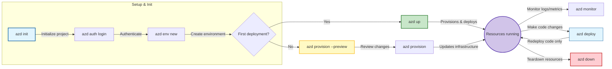
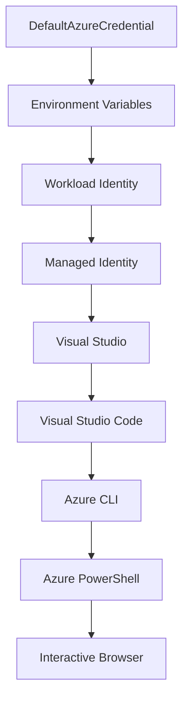

# AZD Basics - Core Concepts and Fundamentals

**Chapter Navigation:**
- **📚 Course Home**: [AZD For Beginners](../../README.md)
- **📖 Current Chapter**: Chapter 1 - Foundation & Quick Start
- **⬅️ Previous**: [Course Overview](../../README.md#-chapter-1-foundation--quick-start)
- **➡️ Next**: [Installation & Setup](installation.md)
- **🚀 Next Chapter**: [Chapter 2: AI-First Development](../chapter-02-ai-development/microsoft-foundry-integration.md)

## Introduction

> Reviewed against `azd 1.37.2` (November 2026). Bash commands use quoted placeholders that you must replace. Template workflows use `.` to initialize the current directory; without a directory argument, template initialization creates a subdirectory and does not change your shell's working directory. Advanced snippets are illustrative, not complete projects.

Dis lesson go introduce you to Azure Developer CLI (azd), na powerful command-line tool wey dey quicken your waka from local development go Azure deployment. You go learn the basic concepts, main features, and understand how azd dey make cloud-native application deployment easy.

## Learning Goals

By di end of dis lesson, you go:
- Understand wetin Azure Developer CLI be and wetin e dey mainly do
- Learn di core concepts of templates, environments, and services
- Explore key features including template-driven development and Infrastructure as Code
- Understand di azd project structure and workflow
- Be ready to install and configure azd for your development environment

## Learning Outcomes

After you don finish dis lesson, you go fit:
- Explain di role of azd for modern cloud development workflows
- Identify di parts of an azd project structure
- Describe how templates, environments, and services dey work together
- Understand di benefits of Infrastructure as Code with azd
- Recognize different azd commands and wetin dem dey do

## Wetin be Azure Developer CLI (azd)?

Azure Developer CLI (azd) na command-line tool wey dem design to quicken your waka from local development go Azure deployment. E dey make building, deploying, and managing cloud-native applications for Azure easy.

### Wetin you fit deploy with azd?

azd fit support plenti kain workloads—and di list dey grow. Today, you fit use azd deploy:

| Workload Type | Examples | Same Workflow? |
|---------------|----------|----------------|
| **Traditional applications** | Web apps, REST APIs, static sites | ✅ `azd up` |
| **Services and microservices** | Container Apps, Function Apps, multi-service backends | ✅ `azd up` |
| **AI-powered applications** | Chat apps with Microsoft Foundry Models, RAG solutions with AI Search | ✅ `azd up` |
| **Intelligent agents** | Foundry-hosted agents, multi-agent orchestrations | ✅ `azd up` |

Di main idea be say **di azd lifecycle dey the same no matter wetin you dey deploy**. You go initialize project, provision infrastructure, deploy your code, monitor your app, and clear things after—whether na simple website or one correct AI agent.

Dis continuity na by design. azd treat AI capabilities as another service wey your app fit use, no be as something wey different. A chat endpoint wey Microsoft Foundry Models dey back na, from azd way, just another service to configure and deploy.

### 🎯 Why You Go Use AZD? Real-Life Comparison

Make we compare how to deploy simple web app wey get database:

#### ❌ WITHOUT AZD: Manual Azure Deployment (30+ minutes)

**Illustrative Bash comparison, no be runnable application starter.** This one assume say application code dey already, resource names unique, Azure CLI authentication done, plus any needed CLI extensions. Use di template exercise below for di full path wey dem support.

```bash
# Step 1: Create resource group
az group create --name myapp-rg --location eastus

# Step 2: Create App Service Plan
az appservice plan create --name myapp-plan \
  --resource-group myapp-rg \
  --sku B1 --is-linux

# Step 3: Create Web App
az webapp create --name myapp-web-unique123 \
  --resource-group myapp-rg \
  --plan myapp-plan \
  --runtime "NODE:22-lts"

# Step 4: Create Cosmos DB account (10-15 minutes)
az cosmosdb create --name myapp-cosmos-unique123 \
  --resource-group myapp-rg \
  --kind MongoDB

# Step 5: Create database
az cosmosdb mongodb database create \
  --account-name myapp-cosmos-unique123 \
  --resource-group myapp-rg \
  --name tododb

# Step 6: Create collection
az cosmosdb mongodb collection create \
  --account-name myapp-cosmos-unique123 \
  --resource-group myapp-rg \
  --database-name tododb \
  --name todos

# Step 7: Get connection string
CONN_STR=$(az cosmosdb keys list \
  --name myapp-cosmos-unique123 \
  --resource-group myapp-rg \
  --type connection-strings \
  --query "connectionStrings[0].connectionString" -o tsv)

# Step 8: Configure app settings
az webapp config appsettings set \
  --name myapp-web-unique123 \
  --resource-group myapp-rg \
  --settings MONGODB_URI="$CONN_STR"

# Step 9: Enable logging
az webapp log config --name myapp-web-unique123 \
  --resource-group myapp-rg \
  --application-logging filesystem \
  --detailed-error-messages true

# Step 10: Set up Application Insights
az monitor app-insights component create \
  --app myapp-insights \
  --location eastus \
  --resource-group myapp-rg

# Step 11: Link App Insights to Web App
INSTRUMENTATION_KEY=$(az monitor app-insights component show \
  --app myapp-insights \
  --resource-group myapp-rg \
  --query "instrumentationKey" -o tsv)

az webapp config appsettings set \
  --name myapp-web-unique123 \
  --resource-group myapp-rg \
  --settings APPINSIGHTS_INSTRUMENTATIONKEY="$INSTRUMENTATION_KEY"

# Step 12: Build application locally
npm install
npm run build

# Step 13: Create deployment package
zip -r app.zip . -x "*.git*" "node_modules/*"

# Step 14: Deploy application
az webapp deployment source config-zip \
  --resource-group myapp-rg \
  --name myapp-web-unique123 \
  --src app.zip

# Step 15: Wait and pray it works 🙏
# (No automated validation, manual testing required)
```

**Problems:**
- ❌ 15+ commands to remember and execute in order
- ❌ 30-45 minutes of manual work
- ❌ Easy to make mistakes (typos, wrong parameters)
- ❌ Credentials need special handling; debug logs and shell tracing fit expose dem
- ❌ No automatic rollback if something happen
- ❌ E hard to repeat for team members
- ❌ Different every time (no fit repeat)

#### ✅ WITH AZD: Automated Deployment (5 commands, 10-15 minutes)

```bash
# Step 1: Initialize from template
azd init --template todo-nodejs-mongo .

# Step 2: Authenticate
azd auth login

# Step 3: Select the environment created during init
azd env select dev

# Step 4: Preview changes (optional but recommended)
azd provision --preview

# Step 5: Deploy everything
azd up

# ✨ Done! Everything is deployed, configured, and monitored
```

**Benefits:**
- ✅ **5 commands** against 15+ manual steps
- ✅ **10-15 minutes** total time (mostly waiting for Azure)
- ✅ **Less manual mistakes** - consistent, template-driven workflow
- ✅ **Secure secret handling** - many templates use Azure-managed secret storage
- ✅ **Repeatable deployments** - same workflow every time
- ✅ **Repeatable infrastructure definitions** - depend on quotas, region availability, and template versions
- ✅ **Team-ready** - anybody fit deploy with same commands
- ✅ **Infrastructure as Code** - version controlled Bicep templates
- ✅ **Template-defined monitoring** - Application Insights if dem include for template

### Time and Reliability

Di time dem talk so na estimate, no be benchmark. azd dey reduce di number of commands wey you need arrange, but e no fit guarantee how long deployment go take, no fit stop errors, or do automatic rollback for application/database. Make sure say your working versions dey for source control and test recovery procedures.

## Core Concepts

### Templates
Templates na di foundation for azd. Dem get:
- **Application code** - Your source code and dependencies
- **Infrastructure definitions** - Azure resources defined in Bicep or Terraform
- **Configuration files** - Settings and environment variables
- **Deployment scripts** - Automated deployment workflows

### Environments
Environments na different deployment targets:
- **Development** - For testing and development
- **Staging** - Pre-production environment
- **Production** - Live production environment

Each environment get its own:
- Environment name and values; resource isolation depend on infrastructure template
- Configuration settings
- Deployment state

### Services
Services for `azure.yaml` dey describe deployable application parts:
- **Frontend** - Web applications, SPAs
- **Backend** - APIs, microservices

Databases and storage normally dem provision as infrastructure resources, no be invented service hosts like `host: postgres`.

## Key Features

### 1. Template-Driven Development
```bash
# Browse available templates
azd template list

# Initialize from a template
azd init --template "<template-name>" .
```

### 2. Infrastructure as Code
- **Bicep** - Azure's domain-specific language
- **Terraform** - Multi-cloud infrastructure tool
- Bicep go compile to ARM templates; raw ARM JSON no be separate built-in `infra.provider`.

### 3. Integrated Workflows
```bash
# Complete deployment workflow
azd up            # Provision + Deploy this is hands off for first time setup

# 🧪 NEW: Preview infrastructure changes before deployment (SAFE)
azd provision --preview    # Simulate infrastructure deployment without making changes

azd provision     # Create Azure resources if you update the infrastructure use this
azd deploy        # Deploy application code or redeploy application code once update
azd down          # Clean up resources
```

#### 🛡️ Safe Infrastructure Planning with Preview
Di `azd provision --preview` command na correct tool for safe deployments:
- **Dry-run analysis** - E dey show wetin go create, modify, or delete
- **No infrastructure apply** - E dey review provider changes; first check project hooks, because hooks fit run commands wey get side effects
- **Team collaboration** - Share preview results before deployment
- **Cost planning input** - Check proposed SKUs, then price with Azure Pricing Calculator; preview no dey calculate prices

```bash
# Example preview workflow
azd provision --preview           # See what will change
# Review the output, discuss with team
azd provision                     # Apply changes with confidence
```

### 📊 Visual: AZD Development Workflow



**Workflow Explanation:**
1. **Init** - Start with template or new project
2. **Auth** - Authenticate with Azure
3. **Environment** - Create isolated deployment environment
4. **Preview** - 🆕 Always preview infrastructure changes first (safe practice)
5. **Provision** - Create/update Azure resources
6. **Deploy** - Push your application code
7. **Monitor** - Observe application performance
8. **Iterate** - Make changes and redeploy code
9. **Cleanup** - Remove resources when done

### 4. Environment Management
```bash
# Create and manage environments
azd env new "<environment-name>"
azd env select "<environment-name>"
azd env list
```

### 5. Extensions and AI Commands

azd get extension system to add more powers beyond di core CLI. Dis one dey especially useful for AI workloads:

```bash
# List available extensions
azd extension list

# Install the GA Foundry bundle (requires azd >= 1.37.0)
azd ext install microsoft.foundry

# Initialize an AI agent project interactively
azd ai agent init

# Test a deployed agent (shows latency and time-to-first-byte)
azd ai agent invoke

# Start the MCP server for AI-assisted development (Alpha)
azd mcp start
```

**Di agent lifecycle, end to end.** Di GA `microsoft.foundry` bundle get `azure.ai.agents` plus six other main extensions. Install `azure.ai.evaluations` separate for evaluation. Use `azd >= 1.37.0` for dis workflow. You no need all dis for day one:

| Stage | Command | Wetin e do |
|-------|---------|--------------|
| **Scaffold** | `azd ai agent init --template <path-to-azure.yaml>` | Adopt current agent project template |
| **Run locally** | `azd ai agent run`, then `azd ai agent invoke --local "Test prompt"` for another terminal | Check local activity in Agent Inspector; model calls still dey use Azure |
| **Deploy** | `azd deploy` | For code-mode hosted agents, upload source for remote Foundry build |
| **Test** | `azd ai agent invoke` | Call the agent and see how fast e respond |
| **Measure** | `azd ai eval init`, `generate`, `run start` | Configure, deploy, and run evaluations with separate extension |
| **Improve** | `azd ai agent optimize --eval <evaluation-name> --optimize-model <optimizer-deployment>` | Reuse compatible evaluation to make agent better |
| **Inspect** | `azd ai agent endpoint show` | View live endpoint configuration |
| **Clean up** | `azd ai agent delete` | Delete hosted agent and all versions |

> Start with di [GA hosted-agent walkthrough](../chapter-02-ai-development/microsoft-foundry-integration.md#hosted-agent-walkthrough-ga), wey dey cover prerequisites, provisioning, and safe cleanup. Extensions get more talk for di [AZD AI CLI Commands](../chapter-08-production/production-ai-practices.md#azd-ai-cli-commands-and-extensions) reference.

## 📁 Project Structure

Typical azd project structure be dis:
```
my-app/
├── .azure/                  # Local environments and selected-environment config
│   ├── config.json
│   └── dev/.env
├── .devcontainer/          # Development container config
├── .github/workflows/      # GitHub Actions
├── .vscode/               # VS Code settings
├── infra/                 # Infrastructure code
│   ├── main.bicep        # Main infrastructure template
│   ├── main.parameters.json
│   └── modules/          # Reusable modules
├── src/                  # Application source code
│   ├── api/             # Backend services
│   └── web/             # Frontend application
├── azure.yaml           # azd project configuration
└── README.md
```

## 🔧 Configuration Files

### azure.yaml
Di main project configuration file:
```yaml
name: my-awesome-app
metadata:
  template: my-template@1.0.0

services:
  web:
    project: ./src/web
    language: js
    host: appservice
  api:
    project: ./src/api
    language: js
    host: appservice

hooks:
  preprovision:
    shell: pwsh
    run: echo "Preparing to provision..."
```

### .azure/config.json
Project-local choice of default environment (illustrative; managed by azd):
```json
{
  "defaultEnvironment": "dev"
}
```

## 🎪 Common Workflows with Hands-On Exercises

> **💡 Learning Tip:** Follow dis exercises one by one to build your AZD skills steadily.

### 🎯 Exercise 1: Initialize Your First Project

**Goal:** Create AZD project and explore how e stand

**Steps:**
```bash
# Use a proven template
mkdir azd-basics-practice
cd azd-basics-practice
# Choose "dev" for the environment name when prompted
azd init --template todo-nodejs-mongo .

# Explore the generated files
ls -la  # View all files including hidden ones

# Key files created:
# - azure.yaml (main config)
# - infra/ (infrastructure code)
# - src/ (application code)
```

**✅ Success:** You get azure.yaml, infra/, and src/ directories

---

### 🎯 Exercise 2: Deploy to Azure

**Goal:** Complete end-to-end deployment

**Steps:**
```bash
# 1. Authenticate
azd auth login

# 2. Select the dev environment created in Exercise 1
azd env select dev
azd env set AZURE_LOCATION eastus

# 3. Preview changes (RECOMMENDED)
azd provision --preview

# 4. Deploy everything
azd up

# 5. Verify deployment
azd show    # View your app URL
```

**Expected Time:** 10-15 minutes  
**✅ Success:** Application URL open for browser

---

### 🎯 Exercise 3: Multiple Environments

**Goal:** Deploy to dev and staging

**Steps:**
```bash
# Already have dev, create staging
azd env new staging
azd env set AZURE_LOCATION westus2
azd up

# Switch between them
azd env list
azd env select dev
```

**✅ Success:** Two different resource groups for Azure Portal

**Cleanup:** Exercise 3 dey create second billable deployment. Delete both when you finish:

```bash
azd down --environment dev
azd down --environment staging
```

---

### 🛡️ Destructive Cleanup: `azd down --force --purge`

When you really want to delete selected environment's Azure resources:

```bash
azd down --force --purge
```

**Wetn e do:**
- `--force`: No confirm prompts
- `--purge`: Also delete permanently supported soft-deleted resources (like Key Vaults), if purge protection allow am. E no delete local `.azure/` directory.

**Use am when:** you don finish wit disposable environment. No treat destructive cleanup as first response to authentication, quota, or configuration error.

---

## 🎪 Original Workflow Reference

### Starting New Project
```bash
# Method 1: Use existing template
azd init --template todo-nodejs-mongo .

# Method 2: Start from scratch
azd init

# Method 3: Use current directory
azd init .
```

### Development Cycle
```bash
# Set up development environment
azd auth login
azd env new dev
azd env select dev

# Deploy everything
azd up

# Make changes and redeploy
azd deploy

# Clean up when done
azd down --force --purge # Deletes this environment's discovered Azure resources; review before forcing deletion.
```

## Understanding `azd down --force --purge`
Di `azd down --force --purge` command na strong tool to destroy your azd environment and all related resources complete. Here na wetin each flag mean:
```
--force
```
- No need confirm prompt.
- Useful for automation or script wey no need manual input.
- No go pass permissions, purge protection, or deletion failure.

```
--purge
```
For delete finish for good all di soft-deleted Azure resource wey e support without ask you again. Purge protection and permissions still dey apply. E no go **comot** local environments or di `.azure/` folder.


### Why make we use both?
Use both only if you wan delete di selected environment Azure resources and purge di recoverable resources dem. Dis na destructive cleanup, no be general repair or local-state reset.

E dey especially helpful after you don manually delete resources for Azure portal or when you dey change templates, environments, or resource group naming conventions.


### How to Manage Many Environments
```bash
# Create staging environment
azd env new staging
azd env select staging
azd up

# Switch back to dev
azd env select dev

# Compare environments
azd env list
```

## 🔐 Authentication and Credentials

Make sure say you know the difference between deployment authentication (`azd auth login`) and application SDK authentication (`DefaultAzureCredential`). Dem be different things. azd no dey use Azure CLI credentials by default.

### Azure CLI Authentication (`az login`)

Run `azd auth login` for azd. The next Azure CLI commands no compulsory but dem dey authenticate `az` commands together separate:

```bash
# Interactive login (opens browser)
az login

# Login with specific tenant
az login --tenant "<tenant-id>"

# Login with service principal
az login --service-principal -u "<app-id>" -p "<password>" --tenant "<tenant-id>"

# Check current login status
az account show

# List available subscriptions
az account list --output table

# Set default subscription
az account set --subscription "<subscription-id>"
```

### Authentication Flow
1. **Interactive Login**: E go open your normal browser so you fit authenticate
2. **Device Code Flow**: For environment wey no get browser access
3. **Service Principal**: For automation and CI/CD cases
4. **Managed Identity**: For Azure-hosted applications dem

### DefaultAzureCredential Chain

`DefaultAzureCredential` na one kain credential type wey dey give simple authentication experience by automatically dey try different credential sources for one particular order:

#### Application SDK Credential Chain

The exact chain depend on the Azure Identity SDK language, version, plugins wey dey installed, and options dem. This diagram na conceptual, no be fixed azd authentication sequence; recent SDKs fit also get Azure Developer CLI credentials.


#### 1. Environment Variables
```bash
# Set environment variables for service principal
export AZURE_CLIENT_ID="<app-id>"
export AZURE_CLIENT_SECRET="<password>"
export AZURE_TENANT_ID="<tenant-id>"
```

#### 2. Workload Identity (Kubernetes/GitHub Actions)
E dey used automatically for:
- Azure Kubernetes Service (AKS) with Workload Identity
- GitHub Actions with OIDC federation
- Other federated identity scenarios

#### 3. Managed Identity
For Azure resources dem like:
- Virtual Machines
- App Service
- Azure Functions
- Container Instances

```bash
# Inspect a deployed Container App's configured identity (requires az login)
az containerapp show --name "<app-name>" --resource-group "<rg-name>" --query identity
```

#### 4. Developer Tools Integration
- **Visual Studio**: Automatically dey use signed-in account
- **VS Code**: Support depend on the SDK and how e dey support broker/plugin setup
- **Azure CLI**: Dey use `az login` credentials (na im dey common for local development)

### AZD Authentication Setup

```bash
# Method 1: Direct azd authentication (recommended)
azd auth login

# Method 2: Direct azd authentication
azd auth login --use-device-code  # For headless environments

# Method 3: Check authentication status
azd auth login --check-status

# Method 4: Logout and re-authenticate
azd auth logout
azd auth login
```

### Authentication Best Practices

#### For Local Development
```bash
# 1. Log in to azd
azd auth login

# 2. Select the subscription for this initialized environment
azd env set AZURE_SUBSCRIPTION_ID "<subscription-id>"

# 3. Check azd sign-in details (read the status message)
azd auth login --check-status
```

#### For CI/CD Pipelines
```yaml
# Partial GitHub Actions steps: assumes checkout, azd installation,
# required AZURE_* environment values, and pipeline secret configuration.
- name: Deploy with azd
  run: |
    azd auth login --client-id ${{ secrets.AZURE_CLIENT_ID }} \
                    --client-secret ${{ secrets.AZURE_CLIENT_SECRET }} \
                    --tenant-id ${{ secrets.AZURE_TENANT_ID }}
    azd up --no-prompt
```

#### For Production Environments
- Use **Managed Identity** when you dey run on Azure resources
- Use **Service Principal** for automation cases
- No store credentials for code or configuration files
- Use **Azure Key Vault** for sensitive configuration

### Common Authentication Issues and Solutions

#### Issue: "No subscription found"
```bash
# Solution: Set default subscription
az account list --output table
az account set --subscription "<subscription-id>"
azd env set AZURE_SUBSCRIPTION_ID "<subscription-id>"
```

#### Issue: "Insufficient permissions"
```bash
# Solution: Check and assign required roles
az role assignment list --assignee $(az account show --query user.name --output tsv)

# Common required roles:
# - Contributor (for resource management)
# - User Access Administrator (for role assignments)
```

#### Issue: "Token expired"
```bash
# Solution: Re-authenticate
az logout
az login
azd auth logout
azd auth login
```

### Authentication in Different Scenarios

#### Local Development
```bash
# Personal development account
az login
azd auth login
```

#### Team Development
```bash
# Use specific tenant for organization
az login --tenant contoso.onmicrosoft.com
azd auth login --tenant-id "<tenant-id>"
```

#### Multi-tenant Scenarios
```bash
# Switch between tenants
az login --tenant tenant1.onmicrosoft.com
azd auth login --tenant-id "<tenant-1-id>"
# Select an environment configured with tenant 1's subscription
azd env select tenant1-dev
# Deploy to tenant 1
azd up

az login --tenant tenant2.onmicrosoft.com  
azd auth login --tenant-id "<tenant-2-id>"
azd env select tenant2-dev
# Deploy to tenant 2
azd up
```

### Security Considerations

1. **Credential Storage**: No ever store credentials for source code
2. **Scope Limitation**: Use least-privilege principle for service principals
3. **Token Rotation**: Dey regularly rotate service principal secrets
4. **Audit Trail**: Dey monitor authentication and deployment activities
5. **Network Security**: Use private endpoints if e possible

### Troubleshooting Authentication

```bash
# Debug authentication issues
azd auth login --check-status
az account show
az account get-access-token

# Common diagnostic commands
whoami                          # Current user context
az ad signed-in-user show      # Microsoft Entra ID user details
az group list                  # Test resource access
```

## Command Discovery

### Discovery
```bash
azd template list              # Browse templates
azd template list --help       # Template discovery options
azd init --help               # Initialization options
```

### Project Management
```bash
azd show                     # Project overview
azd env list                # Available environments and selected default
azd config show            # Configuration settings
```

### Monitoring
```bash
azd monitor                  # Open Azure portal monitoring
azd monitor --logs           # View application logs
azd monitor --live           # View live metrics
azd pipeline config          # Set up CI/CD
```

## Best Practices

### 1. Use Meaningful Names
```bash
# Good
azd env new production-east
azd init --template todo-nodejs-mongo .

# Avoid
azd env new env1
azd init --template template1 .
```

### 2. Leverage Templates
- Start with templates wey e already get
- Customize am for your own needs
- Create reusable templates for your organization

### 3. Environment Isolation
- Use separate environments for dev/staging/prod
- No ever deploy directly to production from your local machine
- Use CI/CD pipelines for production deployments

### 4. Configuration Management
- Use managed identity and Key Vault for secrets; ordinary `azd env set` values dey local plaintext
- Keep configuration for version control
- Document environment-specific settings

## Learning Progression

### Beginner (Week 1-2)
1. Install azd and authenticate
2. Deploy simple template
3. Understand project structure
4. Learn basic commands (up, down, deploy)

### Intermediate (Week 3-4)
1. Customize templates
2. Manage many environments
3. Understand infrastructure code
4. Setup CI/CD pipelines

### Advanced (Week 5+)
1. Create custom templates
2. Advanced infrastructure patterns
3. Deploy to multi-region
4. Enterprise-level configurations

## Next Steps

**📖 Continue Chapter 1 Learning:**
- [Installation & Setup](installation.md) - Make sure say azd dey installed and configured
- [Your First Project](first-project.md) - Complete hands-on tutorial
- [Configuration Guide](../chapter-03-configuration/configuration.md) - Advanced options for configuration

**🎯 Ready for Next Chapter?**
- [Chapter 2: AI-First Development](../chapter-02-ai-development/microsoft-foundry-integration.md) - Start to build AI applications

## Additional Resources

- [Azure Developer CLI Overview](https://learn.microsoft.com/en-us/azure/developer/azure-developer-cli/)
- [Template Gallery](https://azure.github.io/awesome-azd/)
- [Community Samples](https://github.com/Azure-Samples)

---

## 🙋 Frequently Asked Questions

### General Questions

**Q: Wetin be the difference between AZD and Azure CLI?**

A: Azure CLI (`az`) na for managing individual Azure resources. AZD (`azd`) na for managing whole applications:

```bash
# Azure CLI - Low-level resource management
az webapp create --name myapp --resource-group rg
az sql server create --name myserver --resource-group rg
# ...many more commands needed

# AZD - Application-level management
azd up  # Deploys entire app with all resources
```

**Think am like dis:**
- `az` = Operating on individual Lego bricks
- `azd` = Working with whole Lego sets

---

**Q: I need to sabi Bicep or Terraform to use AZD?**

A: No! Start with templates:
```bash
# Use existing template - no IaC knowledge needed
azd init --template todo-nodejs-mongo .
azd up
```

You fit learn Bicep later if you want customize infrastructure. Templates dey give examples to help you learn.

---

**Q: How much e go cost to run AZD templates?**

A: Cost dey vary by region, SKU, uptime, database mode, and model usage. Development environment fit get heavy monthly charges even if e dey idle; no just assume say e go dey always between $50-150:

```bash
# Preview resource changes (not prices)
azd provision --preview

# Always cleanup when not using
azd down --force --purge  # Removes all resources
```

**Pro tip:** Use free tiers if dem dey:
- App Service: F1 (Free) tier
- Azure OpenAI: no steady free tokens every month for general use; make sure you check current model and price
- Cosmos DB: if your provisioned-throughput account qualify, you fit opt into free tier; serverless templates no automatically qualify

---

**Q: I fit use AZD with existing Azure resources?**

A: Yes, but e better to start fresh. AZD dey work best when e dey manage everything from start to finish. For existing resources:

```bash
# Option 1: Import existing resources (advanced)
azd init
# Then modify infra/ to reference existing resources

# Option 2: Start fresh (recommended)
azd init --template "<verified-template-name>" .
azd up  # Creates new environment
```

---

**Q: How I go share my project with my teammates?**

A: Commit the AZD project to Git (but no commit .azure folder):

```bash
# Already in .gitignore by default
.azure/        # Contains secrets and environment data
*.env          # Environment variables

# Team members then:
git clone "<your-repo>"
# Change into the cloned repository before running the remaining commands.
azd auth login
azd env new "<their-name>-dev"
azd up
```

Everybody go get exactly the same infrastructure from the same templates.

---

### Troubleshooting Questions

**Q: "azd up" fail halfway. Wetin I go do?**

A: Check the error, fix am, then try again:

```bash
# Capture detailed diagnostics (redact sensitive values before sharing)
azd up --debug

# Common fixes:

# 1. If quota exceeded:
azd env set AZURE_LOCATION "westus2"  # Try different region

# 2. If resource name conflict:
azd down --force --purge  # Clean slate
azd up  # Retry

# 3. If auth expired:
az login
azd auth login
azd up
```

**Most common issue:** Wrong Azure subscription selected
```bash
az account list --output table
az account set --subscription "<correct-subscription>"
azd env set AZURE_SUBSCRIPTION_ID "<correct-subscription-id>"
```

---

**Q: How I go deploy changes for code only without reprovisioning?**

A: Use `azd deploy` instead of `azd up`:

```bash
azd up          # First time: provision + deploy (slow)

# Make code changes...

azd deploy      # Subsequent times: deploy only (fast)
```

Speed comparison:
- `azd up`: 10-15 minutes (provisions infrastructure)
- `azd deploy`: 2-5 minutes (code only)

---

**Q: I fit customize the infrastructure templates?**

A: Yes! Edit the Bicep files inside `infra/`:

```bash
# After azd init
cd infra/
code main.bicep  # Edit in VS Code

# Preview changes
azd provision --preview

# Apply changes
azd provision
```

**Tip:** Start small - begin with changing SKUs:
```bicep
// infra/main.bicep
sku: {
  name: 'B1'  // Change to 'P1V2' for production
}
```

---

**Q: How I go delete all the tins wey AZD don create?**

A: One command fit remove all resources:

```bash
azd down --force --purge

# This deletes:
# - Azure resources/resource groups discovered for the selected environment
# - Supported soft-deleted resources, if purge protection allows
# Local .azure files remain; shared/external resources may remain too.
```

**Always run this when:**
- You don finish testing one template
- You wan switch to different project
- You wan start fresh

**Cost check:** Confirm deletion for Azure and check if any resource wey still dey or wey still dey shared. Charges wey don already enter no go change.

---

**Q: Wetin I go do if I mistakenly delete resources for Azure Portal?**

A: AZD state fit no dey align. Clean slate approach:

```bash
# 1. Delete remaining resources only if that is your intent
azd down --force --purge

# 2. Start fresh
azd up

# Alternative: Let AZD detect and fix
azd provision  # Will create missing resources
```

---

### Advanced Questions

**Q: I fit use AZD for CI/CD pipelines?**

A: Yes! Example for GitHub Actions:

```yaml
# .github/workflows/deploy.yml
name: Deploy with AZD

on:
  push:
    branches: [main]

jobs:
  deploy:
    runs-on: ubuntu-latest
    steps:
      - uses: actions/checkout@v4
      
      - name: Install azd
        run: curl -fsSL https://aka.ms/install-azd.sh | bash
      
      - name: Azure Login
        run: |
          azd auth login \
            --client-id ${{ secrets.AZURE_CLIENT_ID }} \
            --client-secret ${{ secrets.AZURE_CLIENT_SECRET }} \
            --tenant-id ${{ secrets.AZURE_TENANT_ID }}
      
      - name: Deploy
        env:
          AZURE_ENV_NAME: dev
          AZURE_LOCATION: ${{ vars.AZURE_LOCATION }}
          AZURE_SUBSCRIPTION_ID: ${{ vars.AZURE_SUBSCRIPTION_ID }}
        run: azd up --no-prompt
```

---

**Q: How I go handle secrets and sensitive data?**

A: Use Key Vault clearly. `azd env set` dey write ordinary values for local environment file; e no dey automatically create vault, assign roles, or add secrets inside your application.

```bash
# Interactive: create/select a Key Vault secret and save its reference
azd env set-secret DATABASE_PASSWORD
```

You go need correct permissions for vault. Your infrastructure or application still must wire the secret to the consumer and gree runtime identity access. No dey print resolved secret values inside logs.

**Never commit:**
- `.azure/` folder (wey get environment data)
- `.env` files (local secrets)
- Connection strings

---

**Q: I fit deploy to multiple regions?**

A: Yes, create environment for each region:

```bash
# East US environment
azd env new prod-eastus
azd env set AZURE_LOCATION eastus
azd up

# West Europe environment
azd env new prod-westeurope
azd env set AZURE_LOCATION westeurope
azd up

# Each environment is independent
azd env list
```

For real multi-region apps, customize Bicep templates to deploy to plenty regions at once.

---

**Q: Where I fit get help if I jam problem?**

1. **AZD Documentation:** https://learn.microsoft.com/azure/developer/azure-developer-cli/
2. **GitHub Issues:** https://github.com/Azure/azure-dev/issues
3. **Discord:** [Azure Discord](https://discord.gg/microsoft-azure) - #azure-developer-cli channel
4. **Stack Overflow:** Tag `azure-developer-cli`
5. **This Course:** [Troubleshooting Guide](../chapter-07-troubleshooting/common-issues.md)

**Pro tip:** Before you ask, run:
```bash
azd show       # Shows current state
azd version    # Shows your version
```
Include this info for your question to get help sharp sharp.

---

## 🎓 Wetin Dey Next?

You don sabi AZD fundamentals now. Choose your path:

### 🎯 For Beginners:
1. **Next:** [Installation & Setup](installation.md) - Install AZD for your machine
2. **Then:** [Your First Project](first-project.md) - Deploy your first app
3. **Practice:** Complete all 3 exercises for this lesson

### 🚀 For AI Developers:
1. **Skip to:** [Chapter 2: AI-First Development](../chapter-02-ai-development/microsoft-foundry-integration.md)
2. **Deploy:** For empty project directory, start with `azd init --template get-started-with-ai-chat .`
3. **Learn:** Build while you deploy

### 🏗️ For Experienced Developers:
1. **Review:** [Configuration Guide](../chapter-03-configuration/configuration.md) - Advanced settings
2. **Explore:** [Infrastructure as Code](../chapter-04-infrastructure/provisioning.md) - Bicep deep dive
3. **Build:** Create custom templates for your stack

---

**Chapter Navigation:**
- **📚 Course Home**: [AZD For Beginners](../../README.md)
- **📖 Current Chapter**: Chapter 1 - Foundation & Quick Start  
- **⬅️ Previous**: [Course Overview](../../README.md#-chapter-1-foundation--quick-start)
- **➡️ Next**: [Installation & Setup](installation.md)
- **🚀 Next Chapter**: [Chapter 2: AI-First Development](../chapter-02-ai-development/microsoft-foundry-integration.md)

---

<!-- CO-OP TRANSLATOR DISCLAIMER START -->
**Disclaimer**:
Dis document don translate wit AI translation service [Co-op Translator](https://github.com/Azure/co-op-translator). Even tho we dey try make am correct, abeg make you know say automated translation fit get errors or mistakes. Di original document for dia own language na im be di correct source. For important info, make person wey sabi human translation do am. We no go responsible for any misunderstanding or wrong understanding wey fit happen because of dis translation.
<!-- CO-OP TRANSLATOR DISCLAIMER END -->