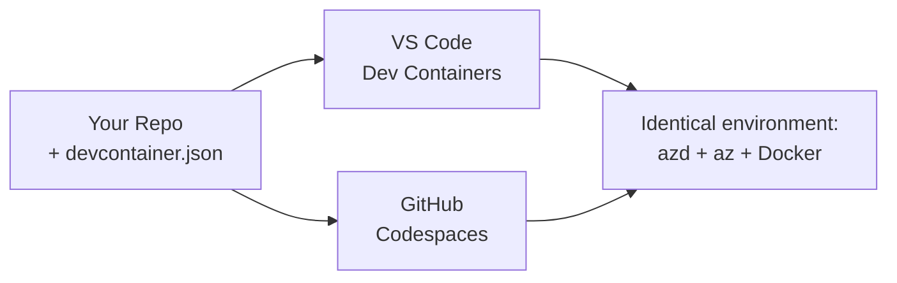

# Dev Containers & GitHub Codespaces for azd

**Chapter Navigation:**
- **📚 Course Home**: [AZD For Beginners](../../README.md)
- **📖 Current Chapter**: Chapter 1 - Foundation & Quick Start
- **⬅️ Previous**: [Bring Your Own App](bring-your-own-app.md)
- **🚀 Next Chapter**: [Chapter 2: AI-First Development](../chapter-02-ai-development/README.md)

> Command and configuration review target: `azd 1.37.2` (November 2026). Container builds and Azure deployments were not executed as part of this review.

## Introduction

Installing azd, the right language runtime, Docker, and the Azure CLI on every machine na wahala—and na di number one reason why tutorial wey "work for my machine" no go work for another person. A **dev container** dey solve dis by describing your whole toolchain inside one file. Anybody wey open di project for VS Code or GitHub Codespaces go get di exact same environment, with azd already install. Dis lesson go show you how to add one.

## Learning Goals

By di end of dis lesson, you go fit:
- Understand wetin dev container be and why e dey help with azd
- Add one small `.devcontainer/devcontainer.json` to project
- Include azd, di Azure CLI, plus Docker through Dev Container *features*
- Open di project for GitHub Codespaces or VS Code

## Learning Outcomes

After you finish dis lesson, you go sabi:
- Write `devcontainer.json` for azd project
- Add azd and Azure tools without install am by hand
- Run `azd up` from inside container or Codespace

---

## Wetin be Dev Container?

Dev container na Docker-based development environment wey you define with `.devcontainer/devcontainer.json` file inside your repository. When you open di project:

- **VS Code** (wey get Dev Containers extension) dey build di container and e attach to am.
- **GitHub Codespaces** dey build di same container for cloud and e give you browser-based editor.

Either way, every person wey dey work on am go get the same tools—no more "you install azd?" wahala.



---

## Step 1: Create di devcontainer File

Create `.devcontainer/devcontainer.json` for the root of your project:

```json
{
  "name": "azd-project",
  "image": "mcr.microsoft.com/devcontainers/base:bookworm",
  "features": {
    "ghcr.io/devcontainers/features/azure-cli:1": {},
    "ghcr.io/azure/azure-dev/azd:0": { "version": "1.37.2" },
    "ghcr.io/devcontainers/features/docker-in-docker:2": {},
    "ghcr.io/devcontainers/features/node:1": {}
  },
  "customizations": {
    "vscode": {
      "extensions": [
        "ms-azuretools.azure-dev",
        "ms-azuretools.vscode-bicep"
      ]
    }
  },
  "forwardPorts": [3000],
  "postCreateCommand": "azd version"
}
```

Wetin every part dey do:

| Key | Purpose |
|-----|---------|
| `image` | Na di base OS for di container |
| `features` | Prebuilt installers—here: Azure CLI, **azd**, Docker, and Node.js |
| `customizations.vscode.extensions` | E install azd and Bicep VS Code extensions automatic |
| `forwardPorts` | E open your app port to your browser |
| `postCreateCommand` | E run one time after container finish build (here na sanity check) |

> Di feature version (`azd:0`) and di CLI version wey dey install no be di same. Make you set di feature's `version` option to `"1.37.2"` if you wan pin di CLI version; no use CLI version as the feature tag.

---

## Step 2: Match Di Feature To Your App Language

Swap di `node` feature for wetin your app dey use:

```jsonc
// Python project
"ghcr.io/devcontainers/features/python:1": {},

// .NET project
"ghcr.io/devcontainers/features/dotnet:2": {},

// Java project
"ghcr.io/devcontainers/features/java:1": {},

// Go project
"ghcr.io/devcontainers/features/go:1": {}
```

Make sure you keep `docker-in-docker` if you dey build images local. One configured remote ACR build (`docker.remoteBuild: true`) fit be option; but host type alone no always mean say you need local Docker.

---

## Step 3: Open Am

**Inside VS Code:**
1. Install **Dev Containers** extension.
2. Open your project folder.
3. Click **Reopen in Container** when di prompt show (or run *Dev Containers: Reopen in Container*).

**Inside GitHub Codespaces:**
1. Push di repo go GitHub.
2. Click **Code → Codespaces → Create codespace on main**.
3. Wait make di container build—azd go ready for terminal.

---

## Step 4: Deploy Inside di Container

Di container don get azd preinstalled, so di normal workflow go just work:

```bash
azd auth login --use-device-code   # device code is handy inside Codespaces
azd up
```

> **Why `--use-device-code`?** Inside remote container or Codespace no get local browser wey fit redirect, so device-code login na di sure way. You go put code for browser tab to finish sign-in.

---

## Common Wahalas

| Wahala | How to Fix am |
|---------|------------|
| `azd up` no fit build image | Add di `docker-in-docker` feature |
| Browser login hang for Codespaces | Use `azd auth login --use-device-code` |
| Tools different between teammates | Pin di CLI through di azd feature's `version` option and pin language runtimes |
| App no dey reach inside browser | Add di port to `forwardPorts` |

---

## Summary

- Dev container go make your azd toolchain dey reproducible for everybody.
- Add azd, di Azure CLI, and Docker through Dev Container *features*.
- Match di language feature to your app and keep `docker-in-docker` for container hosts.
- Use device-code login when you dey run inside Codespaces.

---

## 🔗 Navigation

| Direction | Resource |
|-----------|----------|
| **Previous** | [Bring Your Own App](bring-your-own-app.md) |
| **Chapter Home** | [Chapter 1: Foundation & Quick Start](README.md) |
| **Next Chapter** | [Chapter 2: AI-First Development](../chapter-02-ai-development/README.md) |

## 📖 Related Resources

- [Installation & Setup](installation.md)
- [Command Cheat Sheet](../../resources/cheat-sheet.md)
- [Official Dev Containers specification](https://containers.dev/)
- [azd Dev Container feature](https://github.com/Azure/azure-dev/tree/main/ext/devcontainer)

---

<!-- CO-OP TRANSLATOR DISCLAIMER START -->
**Disclaimer**:
Dis document don translate wit AI translation service [Co-op Translator](https://github.com/Azure/co-op-translator). Even tho we dey try make am correct, abeg make you know say automated translation fit get errors or mistakes. Di original document for dia own language na im be di correct source. For important info, make person wey sabi human translation do am. We no go responsible for any misunderstanding or wrong understanding wey fit happen because of dis translation.
<!-- CO-OP TRANSLATOR DISCLAIMER END -->