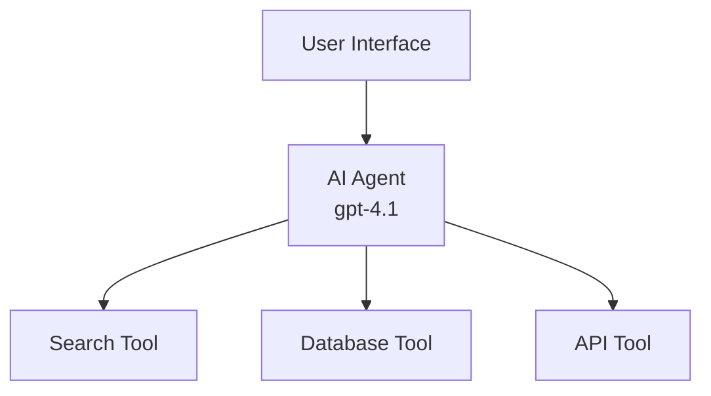
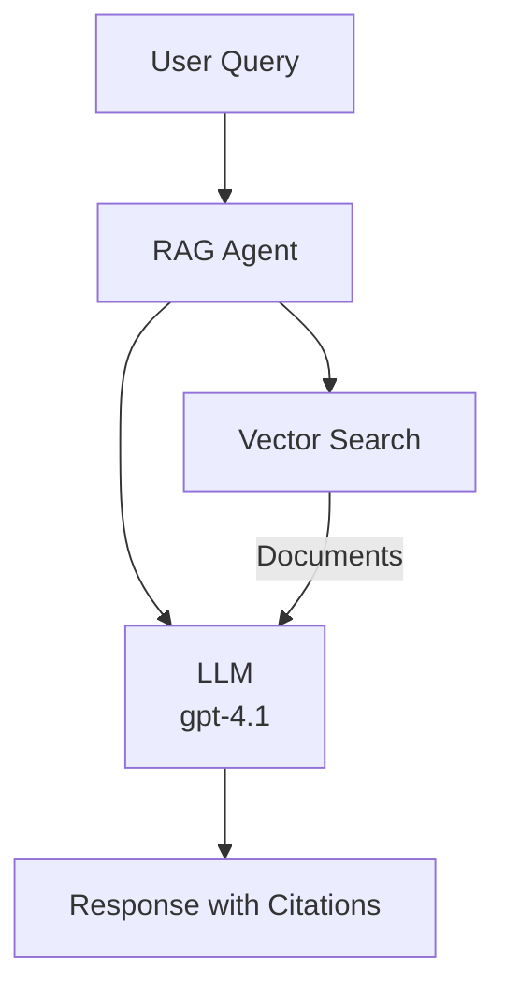
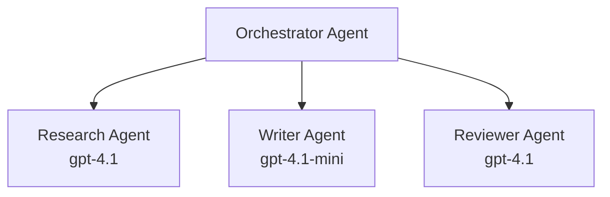

# AI Agents wit Azure Developer CLI

**Chapter Navigation:**
- **📚 Course Home**: [AZD For Beginners](../../README.md)
- **📖 Current Chapter**: Chapter 2 - AI-First Development
- **⬅️ Previous**: [Microsoft Foundry Integration](microsoft-foundry-integration.md)
- **➡️ Next**: [AI Model Deployment](ai-model-deployment.md)
- **🚀 Advanced**: [Multi-Agent Solutions](../../examples/retail-scenario.md)

---

## Introduction

AI agents na autonomous programs wey fit sabi dia environment, make decisions, and do actions to achieve specific goals. No be like simple chatbots wey dey respond to prompts only, agents fit:

- **Use tools** - Call APIs, search databases, run code
- **Plan and reason** - Break complex tasks into steps
- **Learn from context** - Remember tins and change how dem dey behave
- **Collaborate** - Work with other agents (multi-agent systems)

Dis guide go show you how to deploy AI agents for Azure using Azure Developer CLI (azd).

To use conversation context no be like model training: persistent memory, access control, and keeping data must be set up by di application.

> **Release review (2026-11-04):** CLI examples dem check against `azd` `1.37.2`, `azure.ai.agents` `1.0.0-beta.23`, and `azure.ai.evaluations` `1.0.0-beta.2` documentation/source, no be from live Azure deployment. Use `azd >= 1.37.0` for combined workflow. Check [recent changes and fixes](../chapter-08-production/production-ai-practices.md#recent-release-changes-and-fixes) before you upgrade old projects.

## Learning Goals

When you finish dis guide, you go:
- Understand wetin AI agents be and how dem different from chatbots
- Deploy pre-built AI agent templates using AZD
- Configure Foundry Agents for custom agents
- Implement basic agent patterns (tool use, RAG, multi-agent)
- Monitor and debug deployed agents

## Learning Outcomes

After you don finish, you fit:
- Deploy AI agent apps to Azure with one command
- Configure agent tools and how dem fit work
- Implement retrieval-augmented generation (RAG) with agents
- Design multi-agent system for complex workflow
- Troubleshoot common agent deployment wahala dem

---

## 🤖 Wetin Make Agent Different from Chatbot?

| Feature | Chatbot | AI Agent |
|---------|---------|----------|
| **Behavior** | Responds to prompts | Takes autonomous actions |
| **Tools** | Fit use retrieval or tools | Normally dey use tools inside goal-directed loop |
| **Memory** | Depend on application | Persistent memory if dem really implement am |
| **Planning** | Single response | Multi-step reasoning |
| **Collaboration** | Single entity | Fit work with other agents |

### Simple Analogy

- **Chatbot** = Person wey dey help answer questions for information desk
- **AI Agent** = Personal assistant wey fit make calls, book appointments, and do tasks for you

---

## 🚀 Quick Start: Deploy Your First Agent

Choose one option for **new empty working directory**. The trailing `.` go initialize there; without explicit destination, current AZD fit create template-named subdirectory and e no go change your shell directory. Make sure say e different templates/environments dey different directories.

Di time/cost wey dem put for here na illustration, no be confirmed quotes. Check each sample current requirements, pricing, model quota, and other service before deployment.

### Option 1: Foundry Agents Template (Recommended)

```bash
# Initialize the AI agents template
azd init --template get-started-with-ai-agents .

# Deploy to Azure
azd up
```

**Wetin go deploy:** Current infrastructure and options wey sample get go determine model, tools, hosting, and monitoring resources. Read README plus `infra/` before you provision; no gree say every agent template get Search or web interface.

**Time:** ~15-20 minutes
**Cost:** ~$100-150/month (development)

### Option 2: Creative Writing Agents wit Prompty

```bash
# Initialize the Prompty-based agent template
azd init --template https://github.com/Azure-Samples/contoso-creative-writer .

# Deploy to Azure
azd up
```

**Wetin go deploy:** FastAPI/Prompty multi-agent writing sample wey dey use Azure OpenAI, Bing Grounding, and Azure AI Search. Di former `agent-openai-python-prompty` repo dey redirect here; e no be minimal Azure Functions weather-agent template. Follow current README for hosting, model quota, and Bing Grounding requirements.

**Time:** ~10-15 minutes
**Cost:** ~$50-100/month (development)

### Option 3: RAG Chat Agent

```bash
# Initialize RAG chat template
azd init --template azure-search-openai-demo .

# Deploy to Azure
azd up
```

**Wetin go deploy:**
- ✅ Microsoft Foundry Models
- ✅ Azure AI Search with sample data
- ✅ Document processing pipeline
- ✅ Chat interface with citations

**Time:** ~15-25 minutes
**Cost:** ~$80-150/month (development)

### Option 4: AZD AI Agent Init (Project Template Preview)

Use `azd ai agent init` interactively, or take current `azure.yaml` agent project with `--template`/`-t`. Old `--manifest`/`-m` option don be deprecated alias, no be converter for old manifests.

```bash
# Install the AI agents extension
azd extension install azure.ai.agents

# Optional: verify the installed preview version
azd extension show azure.ai.agents

# Initialize from a current agent project template (supply your template path)
azd ai agent init --template ./templates/support-agent/azure.yaml

# Deploy to Azure
azd up

# Test the deployed agent (shows latency + time-to-first-byte)
azd ai agent invoke
```

**When to use `azd ai agent init` vs `azd init --template`:**

| Approach | Best For | How E Dey Work |
|----------|----------|------|
| `azd init --template` | Starting from working sample app | Clones full template repo with code + infra |
| `azd ai agent init --template` | Adopting current Foundry agent project | Use `azure.yaml` project document and its definitions |

> **Tip:** Use `azd init --template` when dey learn (Options 1-3 here). Use `azd ai agent init` for Foundry agent workflow. To add direct agent definition for existing project, see [initialization and migration guidance](../chapter-08-production/production-ai-practices.md#initializing-agent-projects-with-azd-ai-agent-init).

After `azd up`, use `azd ai agent invoke` to test, use separate `azure.ai.evaluations` extension (`azd ai eval init`, `generate`, and `run start`) to measure quality, and `azd ai agent optimize` to improve am with new evaluation config. Agents beta.22 don replace old evaluation workflow and change optimization's `--config` format. Check [evaluation migration](../chapter-08-production/production-ai-practices.md#evaluation-migration-and-quality-checks) and [optimization migration](../chapter-08-production/production-ai-practices.md#optimization-configuration-migration) before you use old examples again.

---

## 🏗️ Agent Architecture Patterns

### Pattern 1: Single Agent wit Tools

Di simplest agent pattern - one agent wey fit use many tools.



**Best for:**
- Customer support bots
- Research assistants
- Data analysis agents

**Related app sample:** `azure-search-openai-demo` dey show RAG, no be general arbitrary-tool agent loop.

### Pattern 2: RAG Agent (Retrieval-Augmented Generation)

Agent wey go find relevant documents before e generate answer.



**Best for:**
- Enterprise knowledge bases
- Document Q&A systems
- Compliance and legal research

**AZD Template:** `azure-search-openai-demo`

### Pattern 3: Multi-Agent System

Plenty specialized agents wey dey work together on complex tasks.



**Best for:**
- Complex content generation
- Multi-step workflows
- Tasks wey need different expertise

**Learn More:** [Multi-Agent Coordination Patterns](../chapter-06-pre-deployment/coordination-patterns.md)

---

## ⚙️ Configuring Agent Tools

Agents strong when dem fit use tools. Na so you go configure common tools:

### Tool Configuration in Foundry Agents

Dis **classic Agent Service SDK fragment** dey target `azure-ai-projects==1.0.0` and `azure-ai-agents==1.1.0` wit `azure-identity`. E no be di new versioned-agent/Responses API some current Foundry templates dey use, nor di `azure.ai.agents` AZD extension (na different package). No mix these API generations. Set `PROJECT_ENDPOINT` to classic Foundry project endpoint and `MODEL_DEPLOYMENT_NAME` to existing supported model deployment; authenticate wit `az login` for your local system and grant di project permissions wey e need.

```python
# agent_config.py
import os
from azure.ai.projects import AIProjectClient
from azure.ai.agents.models import FunctionTool
from azure.identity import DefaultAzureCredential

def search_knowledge_base(query: str) -> str:
    """Search the demonstration knowledge base.

    :param query: Search text.
    :return: Matching demonstration information.
    """
    # Local fixture only, not a production search implementation.
    return "Demo policy: returns are accepted within 30 days."

project_client = AIProjectClient(
    endpoint=os.environ["PROJECT_ENDPOINT"],
    credential=DefaultAzureCredential(),
)
search_tool = FunctionTool(functions={search_knowledge_base})
project_client.agents.enable_auto_function_calls(search_tool)
agent = project_client.agents.create_agent(
    model=os.environ["MODEL_DEPLOYMENT_NAME"],
    name="Support Agent",
    instructions="Use search_knowledge_base for policy questions. Label results as demo data.",
    tools=search_tool.definitions,
)
```

To register function schema no mean say Python dey run for di service. For dis SDK, `enable_auto_function_calls` plus `agents.runs.create_and_process(...)` dey run registered callbacks for your client process. See [released SDK example](https://github.com/Azure/azure-sdk-for-python/blob/azure-ai-agents_1.1.0/sdk/ai/azure-ai-agents/samples/agents_tools/sample_agents_auto_function_call.py). Close client and delete demonstration agents/threads when you finish.

### Environment Configuration

These names be **illustrative custom-template inputs**, no be built-in AZD switches. First wire each value through `infra/main.parameters.json`, infrastructure, and application code. `azd env set` alone no go change agent's tools or instructions.

```bash
# Set up agent-specific environment variables
azd env set AZURE_OPENAI_MODEL "gpt-4.1"
azd env set AGENT_INSTRUCTIONS "You are a helpful assistant..."
azd env set ENABLE_CODE_INTERPRETER "true"
azd env set ENABLE_FILE_SEARCH "true"

# Apply wired infrastructure and application changes
azd up
```

---

## 📊 Monitoring Agents

### Application Insights Integration

If your selected template dey provision Application Insights and configure instrumentation:

```bash
# Open monitoring dashboard
azd monitor --overview

# Open the Application Insights logs view (not a streaming log tail)
azd monitor --logs

# View live metrics
azd monitor --live
```

### Key Metrics to Track

| Metric | Description | Target |
|--------|-------------|--------|
| Response Latency | Time to generate response | < 5 seconds |
| Token Usage | Tokens per request | Watch cost |
| Tool Call Success Rate | % of successful tool executions | > 95% |
| Error Rate | Failed agent requests | < 1% |
| User Satisfaction | Feedback scores | > 4.0/5.0 |

### Custom Logging for Agents

```python
import os
from azure.monitor.opentelemetry import configure_azure_monitor
from opentelemetry import trace

# Configure Azure Monitor with OpenTelemetry
configure_azure_monitor(
    connection_string=os.environ["APPLICATIONINSIGHTS_CONNECTION_STRING"]
)

tracer = trace.get_tracer(__name__)

def log_agent_interaction(user_query, agent_response, tools_used, latency_ms):
    with tracer.start_as_current_span("agent_interaction") as span:
        span.set_attributes({
            "query_length": len(user_query),  # Do not log raw prompts or personal data
            "response_length": len(agent_response),
            "tools_used": tools_used,
            "latency_ms": latency_ms
        })
```

> **Note:** Install required package: `pip install azure-monitor-opentelemetry`. E get OpenTelemetry dependencies; the import namespace no be requirement to install package named `opentelemetry`.

---

## 💰 Cost Considerations

### Estimated Monthly Costs by Pattern

These na illustrative planning ranges, no be quotes or spending limits. Region, model tokens, Search/compute SKUs, tool sessions, storage, and traffic fit pass them. Check sample cost guidance and Azure pricing before `azd up`.

| Pattern | Dev Environment | Production |
|---------|-----------------|------------|
| Single Agent | $50-100 | $200-500 |
| RAG Agent | $80-150 | $300-800 |
| Multi-Agent (2-3 agents) | $150-300 | $500-1,500 |
| Enterprise Multi-Agent | $300-500 | $1,500-5,000+ |

### Cost Optimization Tips

1. **Use gpt-4.1-mini for simple tasks** (if your template dey use dis input)
   ```bash
   azd env set AZURE_OPENAI_MODEL "gpt-4.1-mini"
   ```

2. **Implement scoped caching for safe, repeated queries.** Include tenant/user authorization, model deployment, instructions, plus retrieval version for cache key; set expiry. No share private conversation responses with process-wide query-only cache. SDK agent object no get generic `agent.run()` method.

3. **Set token limits per run**
   ```python
   # Set max_completion_tokens when running the agent, not during creation
   run = project_client.agents.runs.create_and_process(
       thread_id=thread.id,
       agent_id=agent.id,
       max_completion_tokens=1000  # Budget across the run; may finish as incomplete
   )
   ```

4. **Scale eligible Container Apps to zero when no dey use**
   ```bash
   # Custom-template input: must map to template.scale.minReplicas
   azd env set MIN_REPLICAS "0"
   ```
   Make infrastructure change with `azd provision` or `azd up`. Scaling to zero need suitable trigger and e no stop Search, storage, or model/tool charges.

---

## 🔧 Troubleshooting Agents

### Common Issues and Solutions

<details>
<summary><strong>❌ Agent no dey respond to tool calls</strong></summary>

```bash
# Inspect the application deployment (not the agent's registered tools)
azd show

# Verify OpenAI deployment
az cognitiveservices account deployment list \
  --name $AZURE_OPENAI_NAME \
  --resource-group $RG_NAME

# Check agent logs
azd monitor --logs
```

**Common causes:**
- Tool function signature no match
- Missing required permissions
- API endpoint no dey accessible
</details>

<details>
<summary><strong>❌ High latency for agent responses</strong></summary>

```bash
# Check Application Insights for bottlenecks
azd monitor --live

# Consider using a faster model
azd env set AZURE_OPENAI_MODEL "gpt-4.1-mini"
azd up
```

**Optimization tips:**
- Use streaming responses
- Implement response caching
- Reduce context window size
</details>

<details>
<summary><strong>❌ Agent dey return wrong or hallucinated info</strong></summary>

```python
# Improve with better system prompts
instructions = """
You are a helpful assistant. IMPORTANT:
- Only answer based on provided context
- If you don't know, say "I don't know"
- Always cite your sources
- Never make up information
"""

# Use these instructions in the agent definition.
# For classic file search, first upload/index documents in a vector store,
# then use FileSearchTool(vector_store_ids=[...]) and pass both its
# .definitions and .resources when creating the agent.
```
Instructions and retrieval reduce risk; no guarantee say answers dey facts. Check grounded and out-of-scope questions against known answers.
</details>

<details>
<summary><strong>❌ Token limit exceeded errors</strong></summary>

```python
# Implement context window management
def truncate_context(messages, max_tokens=8000, model="gpt-4.1"):
    """Approximate content-only budget for objects with .content strings."""
    import tiktoken
    encoding = tiktoken.encoding_for_model(model)
    total_tokens = 0
    truncated = []
    
    for msg in reversed(messages):
        msg_tokens = len(encoding.encode(msg.content))
        if total_tokens + msg_tokens > max_tokens:
            break
        truncated.insert(0, msg)
        total_tokens += msg_tokens
    
    return truncated
```
Dis helper no include role/tool schemas, system instructions, image tokens, and protocol overhead. Reserve space for those plus completion; no split tool-call/result pairs or remove required system instructions. Install `tiktoken` separately. E no be general context-window validator.
</details>

---

## 🎓 Hands-On Exercises

### Exercise 1: Deploy Basic Agent (20 minutes)

**Goal:** Deploy your first AI agent using AZD

```bash
# Step 1: Initialize template
azd init --template get-started-with-ai-agents .

# Step 2: Login to Azure
azd auth login
# If you work across tenants, add --tenant-id <tenant-id>

# Step 3: Deploy
azd up

# Step 4: Test the agent
# Expected output after deployment:
#   Deployment Complete!
#   Endpoint: https://<app-name>.<region>.azurecontainerapps.io
# Open the URL shown in the output and try asking a question

# Step 5: View monitoring
azd monitor --overview

# Step 6: Clean up
azd down --force --purge
```

**Success Criteria:**
- [ ] Agent fit respond to questions
- [ ] Fit access monitoring dashboard with `azd monitor`
- [ ] Resources clean well without wahala

### Exercise 2: Add Custom Tool (30 minutes)

**Goal:** Extend agent wit custom tool

**Starting point:** Use classic SDK client from [Tool Configuration](#tool-configuration-in-foundry-agents), no be any arbitrary template wit different SDK generation.

1. Add dis deterministic fixture to `agent_config.py`:
   ```python
   def get_weather(location: str) -> str:
       """Return demonstration weather, not live conditions.

       :param location: City name.
       :return: A clearly labelled fixture.
       """
       print(f"TOOL_CALLED: {location}")
       return f"Demo weather in {location}: Sunny, 72°F (fixture, not live)"
   ```
2. Change di search-tool registration and creation block wit:
   ```python
   weather_tool = FunctionTool(functions={get_weather})
   project_client.agents.enable_auto_function_calls(weather_tool)
   agent = project_client.agents.create_agent(
       model=os.environ["MODEL_DEPLOYMENT_NAME"],
       name="Weather Agent",
       instructions="Call get_weather for weather questions; explain that it returns demo data.",
       tools=weather_tool.definitions,
   )
   thread = project_client.agents.threads.create()
   try:
       project_client.agents.messages.create(
           thread_id=thread.id, role="user", content="Use get_weather for Seattle."
       )
       run = project_client.agents.runs.create_and_process(
           thread_id=thread.id, agent_id=agent.id
       )
       if run.status != "completed":
           raise RuntimeError(f"Run status: {run.status}; error: {run.last_error}")
       for message in project_client.agents.messages.list(thread_id=thread.id):
           for text in message.text_messages:
               print(text.text.value)
   finally:
       project_client.agents.threads.delete(thread.id)
       project_client.agents.delete_agent(agent.id)
       project_client.close()
   ```
3. Run am local (dis go call di Azure project wey dey already and e go get model charges):
   ```bash
   python agent_config.py
   # Expected: TOOL_CALLED: Seattle, then a completed answer labelled demo data.
   ```

**Success Criteria:**
- [ ] Agent sabi understand weather-related questions
- [ ] Tool dey call correct
- [ ] Response get weather information

### Exercise 3: Build a RAG Agent (45 minutes)

**Goal:** Make agent wey go answer questions from your documents

```bash
# Step 1: Deploy RAG template
azd init --template azure-search-openai-demo .
azd up

# Step 2: Upload your documents
# For the sample's local ingestion path, place supported files in data/.
# Run from the sample root after following its Python environment setup:
./scripts/prepdocs.sh
# Windows PowerShell equivalent: .\\scripts\\prepdocs.ps1

# Step 3: Test with domain-specific questions
# Open the web app URL from the azd up output
# Ask questions about your uploaded documents
# Responses should include citation references like [doc.pdf]
```

**Success Criteria:**
- [ ] Agent dey answer from uploaded documents
- [ ] Responses get citations
- [ ] Out-of-scope test questions dem dey handle without unsupported claims (no be guarantee say e go work for every future question)

If `USE_CLOUD_INGESTION=true`, use di sample cloud ingestion/upload workflow instead; di local wrapper no go do ingestion purposely. After you don test, run `azd down` for di RAG environment and check di resources wey you go delete.

---

## 📚 Next Steps

Now wey you don understand AI agents, explore this advanced topics:

| Topic | Description | Link |
|-------|-------------|------|
| **Multi-Agent Systems** | Build systems with many agents wey dey work together | [Retail Multi-Agent Example](../../examples/retail-scenario.md) |
| **Coordination Patterns** | Learn how to organize and communicate well | [Coordination Patterns](../chapter-06-pre-deployment/coordination-patterns.md) |
| **Production Deployment** | Enterprise-ready agent deployment | [Production AI Practices](../chapter-08-production/production-ai-practices.md) |
| **Agent Evaluation** | Test and evaluate agent performance | [AI Troubleshooting](../chapter-07-troubleshooting/ai-troubleshooting.md) |
| **AI Workshop Lab** | Hands-on: Prepare your AI solution to be AZD-ready | [AI Workshop Lab](ai-workshop-lab.md) |

---

## 📖 Additional Resources

### Official Documentation
- [Microsoft Foundry Agent Service](https://learn.microsoft.com/azure/ai-services/agents/)
- [Microsoft Foundry Agent Service Quickstart](https://learn.microsoft.com/azure/ai-services/agents/quickstart)
- [Semantic Kernel Agent Framework](https://learn.microsoft.com/semantic-kernel/)

### AZD Templates for Agents
- [Get Started with AI Agents](https://github.com/Azure-Samples/get-started-with-ai-agents)
- [Creative Writing Agents with Prompty](https://github.com/Azure-Samples/contoso-creative-writer)
- [Azure Search OpenAI Demo](https://github.com/Azure-Samples/azure-search-openai-demo)

### Community Resources
- [Awesome AZD - Agent Templates](https://azure.github.io/awesome-azd/?tags=ai-agents)
- [Azure AI Discord](https://discord.gg/microsoft-azure)
- [Microsoft Foundry Discord](https://discord.gg/nTYy5BXMWG)

### Agent Skills for Your Editor
- [**Microsoft Azure Agent Skills**](https://skills.sh/microsoft/github-copilot-for-azure) - Install reusable AI agent skills for Azure development for GitHub Copilot, Cursor, or any agent wey support am. E get skills for [Azure AI](https://skills.sh/microsoft/github-copilot-for-azure/azure-ai), [Microsoft Foundry](https://skills.sh/microsoft/github-copilot-for-azure/microsoft-foundry), [deployment](https://skills.sh/microsoft/github-copilot-for-azure/azure-deploy), and [diagnostics](https://skills.sh/microsoft/github-copilot-for-azure/azure-diagnostics):
  ```bash
  npx skills add microsoft/github-copilot-for-azure
  ```

---

**Navigation**
- **Previous Lesson**: [Microsoft Foundry Integration](microsoft-foundry-integration.md)
- **Next Lesson**: [AI Model Deployment](ai-model-deployment.md)

---

<!-- CO-OP TRANSLATOR DISCLAIMER START -->
**Disclaimer**:
Dis document don translate wit AI translation service [Co-op Translator](https://github.com/Azure/co-op-translator). Even tho we dey try make am correct, abeg make you know say automated translation fit get errors or mistakes. Di original document for dia own language na im be di correct source. For important info, make person wey sabi human translation do am. We no go responsible for any misunderstanding or wrong understanding wey fit happen because of dis translation.
<!-- CO-OP TRANSLATOR DISCLAIMER END -->