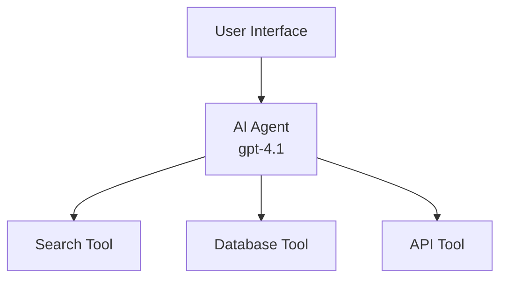
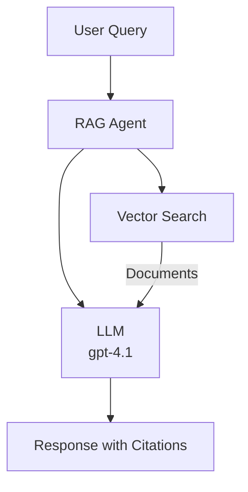
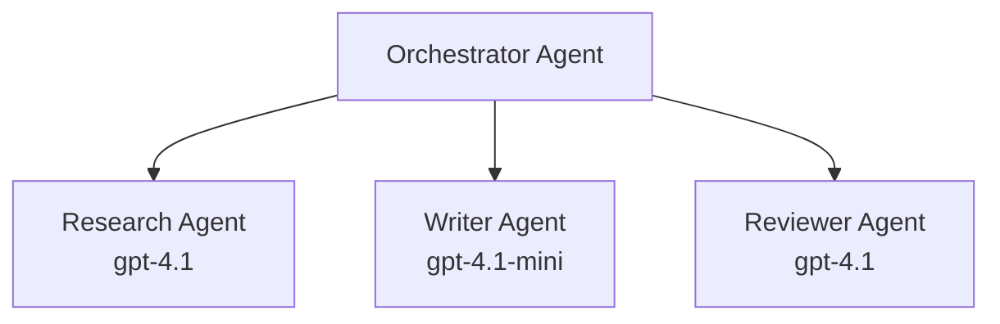

# AI Agents wit Azure Developer CLI

**Chapter Navigation:**
- **📚 Course Home**: [AZD For Beginners](../../README.md)
- **📖 Current Chapter**: Chapter 2 - AI-First Development
- **⬅️ Previous**: [Microsoft Foundry Integration](microsoft-foundry-integration.md)
- **➡️ Next**: [AI Model Deployment](ai-model-deployment.md)
- **🚀 Advanced**: [Multi-Agent Solutions](../../examples/retail-scenario.md)

---

## Introduction

AI agents na autonomous programs wey fit see wetin dey their environment, fit make decisions, and fit take actions to achieve specific goals. Different from simple chatbots wey just dey respond to prompts, agents fit:

- **Use tools** - Call APIs, search databases, execute code
- **Plan and reason** - Break complex tasks into steps
- **Learn from context** - Maintain memory and adapt behavior
- **Collaborate** - Work with other agents (multi-agent systems)

Dis guide go show you how to deploy AI agents to Azure using Azure Developer CLI (azd).

Using conversation context no be model training: persistent memory, access control, and retention must be implemented/configured by the application.

> **Foundry GA update (2026-11-09):** Install the generally available `microsoft.foundry` 1.0 bundle wit `azd >= 1.37.0`. Evaluations dey installed separately; optional preview features and the classic SDK fragment below no dey promoted to GA by the bundle announcement. Dis guidance dey based on the [GA announcement](https://devblogs.microsoft.com/azure-sdk/microsoft-foundry-azure-developer-cli-ga/) and documentation, no be live Azure deployment.

## Learning Goals

If you complete dis guide, you go:
- Understand wetin AI agents be and how dem different from chatbots
- Deploy pre-built AI agent templates using AZD
- Configure Foundry Agents for custom agents
- Implement basic agent patterns (tool use, RAG, multi-agent)
- Monitor and debug deployed agents

## Learning Outcomes

After you finish am, you go fit:
- Deploy AI agent applications to Azure with just one command
- Configure agent tools and capabilities
- Implement retrieval-augmented generation (RAG) with agents
- Design multi-agent architectures for complex workflows
- Troubleshoot common agent deployment issues

---

## 🤖 Wetin Make Agent Different from Chatbot?

| Feature | Chatbot | AI Agent |
|---------|---------|----------|
| **Behavior** | Responds to prompts | Takes autonomous actions |
| **Tools** | May use retrieval or tools | Typically uses tools in a goal-directed loop |
| **Memory** | Application-dependent | Persistent memory only if explicitly implemented |
| **Planning** | Single response | Multi-step reasoning |
| **Collaboration** | Single entity | Fit work wit other agents |

### Simple Analogy

- **Chatbot** = A helpful person wey dey answer questions for information desk
- **AI Agent** = A personal assistant wey fit make calls, book appointments, and complete tasks for you

---

## 🚀 Quick Start: Deploy Your First Agent

Choose one option for **new empty working directory**. The trailing `.` dey initialize for there; without explicit destination, current AZD fit create template-named subdirectory and e no go change your shell directory. Keep separate templates/environments for separate directories.

The time/cost ranges below na examples, no be validated quotes. Check every sample's current prerequisites, pricing, model quota, and optional services before deployment.

### Option 1: Foundry Agents Template (Recommended)

```bash
# Initialize the AI agents template
azd init --template get-started-with-ai-agents .

# Deploy to Azure
azd up
```

**Wetin go deploy:** The sample's current infrastructure and selected options go determine the model, tools, hosting, and monitoring resources. Review the README and `infra/` before you start; no assume every agent template get Search or web interface.

**Time:** ~15-20 minutes
**Cost:** ~$100-150/month (development)

### Option 2: Creative Writing Agents with Prompty

```bash
# Initialize the Prompty-based agent template
azd init --template https://github.com/Azure-Samples/contoso-creative-writer .

# Deploy to Azure
azd up
```

**Wetin go deploy:** A FastAPI/Prompty multi-agent writing sample using Azure OpenAI, Bing Grounding, and Azure AI Search. The former `agent-openai-python-prompty` repository redirect here; e no be minimal Azure Functions weather-agent template. Follow the README for hosting, model quota, and Bing Grounding prerequisites.

**Time:** ~10-15 minutes
**Cost:** ~$50-100/month (development)

### Option 3: RAG Chat Agent

```bash
# Initialize RAG chat template
azd init --template azure-search-openai-demo .

# Deploy to Azure
azd up
```

**Wetin go deploy:**
- ✅ Microsoft Foundry Models
- ✅ Azure AI Search with sample data
- ✅ Document processing pipeline
- ✅ Chat interface with citations

**Time:** ~15-25 minutes
**Cost:** ~$80-150/month (development)

### Option 4: Hosted Agent with the GA Foundry Bundle

Use the [complete hosted-agent walkthrough](microsoft-foundry-integration.md#hosted-agent-walkthrough-ga) for the basic Python Agent Framework Responses API sample. Dis code-deployment path need Python 3.13+, current uv, Foundry permissions, and regional model quota. Authenticate local SDK calls separately if you dey use Azure CLI credentials.

```bash
azd auth login
azd ext install microsoft.foundry
```

For empty directory, initialize di sample:

```text
azd ai agent init --template https://github.com/microsoft-foundry/foundry-samples/blob/main/samples/python/hosted-agents/agent-framework/responses/01-basic/azure.yaml --deploy-mode code --src .
```

Choose new or existing project, check `azure.yaml`, run `azd provision`. Use `azd ai agent run` open Agent Inspector and from another terminal for that directory, run `azd ai agent invoke --local "Explain how this agent is hosted."`. After local verification, use `azd deploy` and `azd ai agent invoke "Explain how this agent is hosted."` compare deployed response. Foundry go build uploaded source remotely; no need build local container.

**Wen to use `azd ai agent init` vs `azd init --template`:**

| Approach | Best For | How E Dey Work |
|----------|----------|------|
| `azd init --template` | Starting from working sample app | Clones full template repo wit code + infra |
| `azd ai agent init --template` | Adopting current Foundry agent project | Uses `azure.yaml` project document and definitions |

> **Tip:** Options 1-3 start from full application templates; Option 4 go teach GA hosted-agent workflow. None of initialization commands go migrate legacy agent manifests automatically. To add direct agent definition to existing project, see [initialization and migration guidance](../chapter-08-production/production-ai-practices.md#initializing-agent-projects-with-azd-ai-agent-init).

Install `azure.ai.evaluations` separately to generate and review test data/rubrics, configure evaluation, and run am with `azd ai eval`. Optimization fit reuse compatible evaluation; check candidates before you explicitly deploy one. Follow [evaluation workflow](../chapter-08-production/production-ai-practices.md#evaluation-migration-and-quality-checks) and [optimization migration](../chapter-08-production/production-ai-practices.md#optimization-configuration-migration) before you reuse older examples. For cleanup, reused Foundry project's resources remain after `azd down`; newly created project resource group dey deleted. See [walkthrough cleanup guidance](microsoft-foundry-integration.md#7-clean-up-deliberately).

---

## 🏗️ Agent Architecture Patterns

### Pattern 1: Single Agent wit Tools

The simplest agent pattern - one agent wey fit use multiple tools.



**Best for:**
- Customer support bots
- Research assistants
- Data analysis agents

**Related application sample:** `azure-search-openai-demo` dey demonstrate RAG, no be generic arbitrary-tool agent loop.

### Pattern 2: RAG Agent (Retrieval-Augmented Generation)

Agent wey dey retrieve relevant documents before e go generate responses.



**Best for:**
- Enterprise knowledge bases
- Document Q&A systems
- Compliance and legal research

**AZD Template:** `azure-search-openai-demo`

### Pattern 3: Multi-Agent System

Multiple specialized agents wey dey work together on complex tasks.



**Best for:**
- Complex content generation
- Multi-step workflows
- Tasks wey need different expertise

**Learn More:** [Multi-Agent Coordination Patterns](../chapter-06-pre-deployment/coordination-patterns.md)

---

## ⚙️ Configuring Agent Tools

Agents go powerful when dem fit use tools. Dis na how to configure common tools:

### Tool Configuration in Foundry Agents

Dis **classic Agent Service SDK fragment** dey target `azure-ai-projects==1.0.0` and `azure-ai-agents==1.1.0` wit `azure-identity`. E no be the newer versioned-agent/Responses API wey some current Foundry templates dey use, nor the `azure.ai.agents` AZD extension (different package). No mix dis API generations. Set `PROJECT_ENDPOINT` to classic Foundry project endpoint and `MODEL_DEPLOYMENT_NAME` to existing supported model deployment; authenticate wit `az login` locally and give di project wetin e need permission.

```python
# agent_config.py
import os
from azure.ai.projects import AIProjectClient
from azure.ai.agents.models import FunctionTool
from azure.identity import DefaultAzureCredential

def search_knowledge_base(query: str) -> str:
    """Search the demonstration knowledge base.

    :param query: Search text.
    :return: Matching demonstration information.
    """
    # Local fixture only, not a production search implementation.
    return "Demo policy: returns are accepted within 30 days."

project_client = AIProjectClient(
    endpoint=os.environ["PROJECT_ENDPOINT"],
    credential=DefaultAzureCredential(),
)
search_tool = FunctionTool(functions={search_knowledge_base})
project_client.agents.enable_auto_function_calls(search_tool)
agent = project_client.agents.create_agent(
    model=os.environ["MODEL_DEPLOYMENT_NAME"],
    name="Support Agent",
    instructions="Use search_knowledge_base for policy questions. Label results as demo data.",
    tools=search_tool.definitions,
)
```

Register function schema no dey run Python on di service. For dis SDK, `enable_auto_function_calls` plus `agents.runs.create_and_process(...)` dey run registered callbacks for your client process. See [released SDK example](https://github.com/Azure/azure-sdk-for-python/blob/azure-ai-agents_1.1.0/sdk/ai/azure-ai-agents/samples/agents_tools/sample_agents_auto_function_call.py). Close client and delete demo agents/threads wen done.

### Environment Configuration

These names na **illustrative custom-template inputs**, no be built-in AZD switches. First wire each value through `infra/main.parameters.json`, infrastructure, and application code. `azd env set` alone no dey change agent's tools or instructions.

```bash
# Set up agent-specific environment variables
azd env set AZURE_OPENAI_MODEL "gpt-4.1"
azd env set AGENT_INSTRUCTIONS "You are a helpful assistant..."
azd env set ENABLE_CODE_INTERPRETER "true"
azd env set ENABLE_FILE_SEARCH "true"

# Apply wired infrastructure and application changes
azd up
```

---

## 📊 Monitoring Agents

### Application Insights Integration

If your chosen template dey provision Application Insights and e configure instrumentation:

```bash
# Open monitoring dashboard
azd monitor --overview

# Open the Application Insights logs view (not a streaming log tail)
azd monitor --logs

# View live metrics
azd monitor --live
```

### Key Metrics to Track

| Metric | Description | Target |
|--------|-------------|--------|
| Response Latency | Time to generate response | < 5 seconds |
| Token Usage | Tokens per request | Monitor for cost |
| Tool Call Success Rate | % of successful tool executions | > 95% |
| Error Rate | Failed agent requests | < 1% |
| User Satisfaction | Feedback scores | > 4.0/5.0 |

### Custom Logging for Agents

```python
import os
from azure.monitor.opentelemetry import configure_azure_monitor
from opentelemetry import trace

# Configure Azure Monitor with OpenTelemetry
configure_azure_monitor(
    connection_string=os.environ["APPLICATIONINSIGHTS_CONNECTION_STRING"]
)

tracer = trace.get_tracer(__name__)

def log_agent_interaction(user_query, agent_response, tools_used, latency_ms):
    with tracer.start_as_current_span("agent_interaction") as span:
        span.set_attributes({
            "query_length": len(user_query),  # Do not log raw prompts or personal data
            "response_length": len(agent_response),
            "tools_used": tools_used,
            "latency_ms": latency_ms
        })
```

> **Note:** Install di required package: `pip install azure-monitor-opentelemetry`. E bring OpenTelemetry dependencies; the import namespace no be requirement to install package named `opentelemetry`.

---

## 💰 Cost Considerations

### Estimated Monthly Costs by Pattern

Dis na planning ranges wey illustrate cost, no be quotes or spending caps. Region, model tokens, Search/compute SKUs, tool sessions, storage, and traffic fit pass dem. Check sample cost guidance and Azure pricing before `azd up`.

| Pattern | Dev Environment | Production |
|---------|-----------------|------------|
| Single Agent | $50-100 | $200-500 |
| RAG Agent | $80-150 | $300-800 |
| Multi-Agent (2-3 agents) | $150-300 | $500-1,500 |
| Enterprise Multi-Agent | $300-500 | $1,500-5,000+ |

### Cost Optimization Tips

1. **Use gpt-4.1-mini for simple tasks** (only if your template dey consume dis input)
   ```bash
   azd env set AZURE_OPENAI_MODEL "gpt-4.1-mini"
   ```

2. **Implement scoped caching for safe, repeated queries.** Include tenant/user authorization, model deployment, instructions, and retrieval version for cache key; set expiry. No share private conversation responses through process-wide query-only cache. SDK agent object no get generic `agent.run()` method.

3. **Set token limits per run**
   ```python
   # Set max_completion_tokens when running the agent, not during creation
   run = project_client.agents.runs.create_and_process(
       thread_id=thread.id,
       agent_id=agent.id,
       max_completion_tokens=1000  # Budget across the run; may finish as incomplete
   )
   ```

4. **Scale eligible Container Apps to zero wen dem no dey use am**
   ```bash
   # Custom-template input: must map to template.scale.minReplicas
   azd env set MIN_REPLICAS "0"
   ```
   Apply infrastructure change wit `azd provision` or `azd up`. Scaling to zero need suitable trigger and e no go stop Search, storage, or model/tool charges.

---

## 🔧 Troubleshooting Agents

### Common Issues and Solutions

<details>
<summary><strong>❌ Agent no dey respond to tool calls</strong></summary>

```bash
# Inspect the application deployment (not the agent's registered tools)
azd show

# Verify OpenAI deployment
az cognitiveservices account deployment list \
  --name $AZURE_OPENAI_NAME \
  --resource-group $RG_NAME

# Check agent logs
azd monitor --logs
```

**Common causes:**
- Tool function signature no match
- Missing permissions wey e need
- API endpoint no dey accessible
</details>

<details>
<summary><strong>❌ High latency for agent responses</strong></summary>

```bash
# Check Application Insights for bottlenecks
azd monitor --live

# Consider using a faster model
azd env set AZURE_OPENAI_MODEL "gpt-4.1-mini"
azd up
```

**Optimization tips:**
- Use streaming responses
- Implement response caching
- Reduce context window size
</details>

<details>
<summary><strong>❌ Agent dey return wrong or hallucinated information</strong></summary>

```python
# Improve with better system prompts
instructions = """
You are a helpful assistant. IMPORTANT:
- Only answer based on provided context
- If you don't know, say "I don't know"
- Always cite your sources
- Never make up information
"""

# Use these instructions in the agent definition.
# For classic file search, first upload/index documents in a vector store,
# then use FileSearchTool(vector_store_ids=[...]) and pass both its
# .definitions and .resources when creating the agent.
```
 Instructions and retrieval dey reduce risk; no guarantee say answer go dey factual. Check grounded and out-of-scope questions against known answers.
</details>

<details>
<summary><strong>❌ Token limit exceeded errors</strong></summary>

```python
# Implement context window management
def truncate_context(messages, max_tokens=8000, model="gpt-4.1"):
    """Approximate content-only budget for objects with .content strings."""
    import tiktoken
    encoding = tiktoken.encoding_for_model(model)
    total_tokens = 0
    truncated = []
    
    for msg in reversed(messages):
        msg_tokens = len(encoding.encode(msg.content))
        if total_tokens + msg_tokens > max_tokens:
            break
        truncated.insert(0, msg)
        total_tokens += msg_tokens
    
    return truncated
```
 Dis helper exclude role/tool schemas, system instructions, image tokens, and protocol overhead. Reserve space for dem and the completion; no split tool-call/result pairs or discard required system instructions. Install `tiktoken` separately. E no be general context-window validator.
</details>

---

## 🎓 Hands-On Exercises

### Exercise 1: Deploy Basic Agent (20 minutes)

**Goal:** Deploy your first AI agent using AZD

```bash
# Step 1: Initialize template
azd init --template get-started-with-ai-agents .

# Step 2: Login to Azure
azd auth login
# If you work across tenants, add --tenant-id <tenant-id>

# Step 3: Deploy
azd up

# Step 4: Test the agent
# Expected output after deployment:
#   Deployment Complete!
#   Endpoint: https://<app-name>.<region>.azurecontainerapps.io
# Open the URL shown in the output and try asking a question

# Step 5: View monitoring
azd monitor --overview

# Step 6: Review the listed resources and confirm cleanup
azd down
```

**Success Criteria:**
- [ ] Agent go respond to questions
- [ ] Fit access monitoring dashboard via `azd monitor`
- [ ] Resources don clean up wella

### Exercise 2: Add one Custom Tool (30 minutes)

**Goal:** Extend one agent with one custom tool

**Starting point:** Use the classic SDK client from [Tool Configuration](#tool-configuration-in-foundry-agents), no be any random template wey get different SDK generation.

1. Add dis deterministic fixture for `agent_config.py`:
   ```python
   def get_weather(location: str) -> str:
       """Return demonstration weather, not live conditions.

       :param location: City name.
       :return: A clearly labelled fixture.
       """
       print(f"TOOL_CALLED: {location}")
       return f"Demo weather in {location}: Sunny, 72°F (fixture, not live)"
   ```
2. Change the search-tool registration and creation block with:
   ```python
   weather_tool = FunctionTool(functions={get_weather})
   project_client.agents.enable_auto_function_calls(weather_tool)
   agent = project_client.agents.create_agent(
       model=os.environ["MODEL_DEPLOYMENT_NAME"],
       name="Weather Agent",
       instructions="Call get_weather for weather questions; explain that it returns demo data.",
       tools=weather_tool.definitions,
   )
   thread = project_client.agents.threads.create()
   try:
       project_client.agents.messages.create(
           thread_id=thread.id, role="user", content="Use get_weather for Seattle."
       )
       run = project_client.agents.runs.create_and_process(
           thread_id=thread.id, agent_id=agent.id
       )
       if run.status != "completed":
           raise RuntimeError(f"Run status: {run.status}; error: {run.last_error}")
       for message in project_client.agents.messages.list(thread_id=thread.id):
           for text in message.text_messages:
               print(text.text.value)
   finally:
       project_client.agents.threads.delete(thread.id)
       project_client.agents.delete_agent(agent.id)
       project_client.close()
   ```
3. Run am for your system (dis one dey call the existing Azure project and e go dey incur model charges):
   ```bash
   python agent_config.py
   # Expected: TOOL_CALLED: Seattle, then a completed answer labelled demo data.
   ```

**Success Criteria:**
- [ ] Agent fit sabi weather-related questions
- [ ] Tool dey call correct
- [ ] Response get weather information

### Exercise 3: Build one RAG Agent (45 minutes)

**Goal:** Make one agent wey go answer questions from your documents

```bash
# Step 1: Deploy RAG template
azd init --template azure-search-openai-demo .
azd up

# Step 2: Upload your documents
# For the sample's local ingestion path, place supported files in data/.
# Run from the sample root after following its Python environment setup:
./scripts/prepdocs.sh
# Windows PowerShell equivalent: .\\scripts\\prepdocs.ps1

# Step 3: Test with domain-specific questions
# Open the web app URL from the azd up output
# Ask questions about your uploaded documents
# Responses should include citation references like [doc.pdf]
```

**Success Criteria:**
- [ ] Agent dey answer from uploaded documents
- [ ] Responses get citations
- [ ] Questions wey no dey inside scope go handle well without fake talk (no be guarantee for all future questions)

If `USE_CLOUD_INGESTION=true`, use the sample cloud ingestion/upload workflow instead; the local wrapper dey purposely skip ingestion. After you don test, run `azd down` for the RAG environment and check the resources wey go delete.

---

## 📚 Next Steps

Now wey you don sabi AI agents, make you explore these advanced topics:

| Topic | Description | Link |
|-------|-------------|------|
| **Multi-Agent Systems** | Build systems with plenti collaborating agents | [Retail Multi-Agent Example](../../examples/retail-scenario.md) |
| **Coordination Patterns** | Learn how to arrange and communicate well | [Coordination Patterns](../chapter-06-pre-deployment/coordination-patterns.md) |
| **Production Deployment** | Deploy agents for enterprise use | [Production AI Practices](../chapter-08-production/production-ai-practices.md) |
| **Agent Evaluation** | Test and check agent performance | [AI Troubleshooting](../chapter-07-troubleshooting/ai-troubleshooting.md) |
| **AI Workshop Lab** | Hands-on: Make your AI solution AZD-ready | [AI Workshop Lab](ai-workshop-lab.md) |

---

## 📖 Additional Resources

### Official Documentation
- [Microsoft Foundry Agent Service](https://learn.microsoft.com/azure/ai-services/agents/)
- [Microsoft Foundry Agent Service Quickstart](https://learn.microsoft.com/azure/ai-services/agents/quickstart)
- [Semantic Kernel Agent Framework](https://learn.microsoft.com/semantic-kernel/)

### AZD Templates for Agents
- [Get Started with AI Agents](https://github.com/Azure-Samples/get-started-with-ai-agents)
- [Creative Writing Agents with Prompty](https://github.com/Azure-Samples/contoso-creative-writer)
- [Azure Search OpenAI Demo](https://github.com/Azure-Samples/azure-search-openai-demo)

### Community Resources
- [Awesome AZD - Agent Templates](https://azure.github.io/awesome-azd/?tags=ai-agents)
- [Azure AI Discord](https://discord.gg/microsoft-azure)
- [Microsoft Foundry Discord](https://discord.gg/nTYy5BXMWG)

### Agent Skills for Your Editor
- [**Microsoft Azure Agent Skills**](https://skills.sh/microsoft/github-copilot-for-azure) - Install reusable AI agent skills for Azure development for GitHub Copilot, Cursor, or any agent wey dem support. E get skills for [Azure AI](https://skills.sh/microsoft/github-copilot-for-azure/azure-ai), [Microsoft Foundry](https://skills.sh/microsoft/github-copilot-for-azure/microsoft-foundry), [deployment](https://skills.sh/microsoft/github-copilot-for-azure/azure-deploy), and [diagnostics](https://skills.sh/microsoft/github-copilot-for-azure/azure-diagnostics):
  ```bash
  npx skills add microsoft/github-copilot-for-azure
  ```

---

**Navigation**
- **Previous Lesson**: [Microsoft Foundry Integration](microsoft-foundry-integration.md)
- **Next Lesson**: [AI Model Deployment](ai-model-deployment.md)

---

<!-- CO-OP TRANSLATOR DISCLAIMER START -->
**Disclaimer**:
Dis document don translate wit AI translation service [Co-op Translator](https://github.com/Azure/co-op-translator). Even tho we dey try make am correct, abeg make you know say automated translation fit get errors or mistakes. Di original document for dia own language na im be di correct source. For important info, make person wey sabi human translation do am. We no go responsible for any misunderstanding or wrong understanding wey fit happen because of dis translation.
<!-- CO-OP TRANSLATOR DISCLAIMER END -->