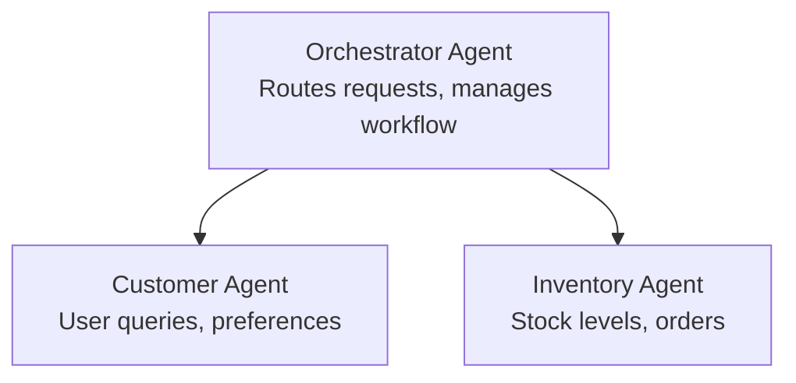

# Chapter 5: Multi-Agent AI Solutions

**📚 Course**: [AZD For Beginners](../../README.md) | **⏱️ Duration**: 2-3 hours | **⭐ Complexity**: Advanced

---

## Overview

Dis chapter dey cover advanced multi-agent architecture patterns, agent orchestration, and production-ready AI deployments for complex scenarios.

> Command guidance reviewed against the released `azd 1.37.2` reference. Cloud deployments no run.

## Learning Objectives

After you finish dis chapter, you go:
- Understand multi-agent architecture patterns
- Deploy coordinated AI agent systems
- Implement agent-to-agent communication
- Build production-ready multi-agent solutions

---

## 📚 Lessons

| # | Lesson | Description | Time |
|---|--------|-------------|------|
| 1 | [Multi-Agent Basics](multi-agent-basics.md) | Hands-on: deploy working multi-agent app with `azd up` | 45 min |
| 2 | [Coordination Patterns](../chapter-06-pre-deployment/coordination-patterns.md) | Agent orchestration strategies (continue for Chapter 6) | 30 min |
| 3 | [ARM Template Deployment](../../examples/retail-multiagent-arm-template/README.md) | One-click deployment example | 30 min |

> **Start with Lesson 1.** Na the only hands-on, deployable lesson for dis chapter. Lesson 2 dey Chapter 6 (e join with pre-deployment planning), and the [Retail Multi-Agent Solution](../../examples/retail-scenario.md) na architecture blueprint—design reference, no be one-command template.

---

## 🚀 Quick Start

```bash
# Option 1: Deploy the multi-agent template used in Lesson 1
azd init --template Azure-Samples/contoso-creative-writer .
azd up

# Option 2: Initialize a Foundry agent interactively (requires azure.ai.agents)
azd extension install azure.ai.agents
azd ai agent init
azd up
```

> **Which approach?** Use `azd init --template` to start from working sample. Use `azd ai agent init` interactively, or `azd ai agent init --template <path-to-azure.yaml>` to adopt current agent project. See [AZD AI CLI reference](../chapter-08-production/production-ai-practices.md#azd-ai-cli-commands-and-extensions) for version requirements and evaluation migration.

Run these options for different empty folders. Agents extension `1.0.0-beta.23` need `azd >= 1.37.0`; its interactive flow no dey generate custom Service Bus pipeline for coordination lesson.

---

## 🤖 Multi-Agent Architecture



---

## 🎯 Featured Solution: Retail Multi-Agent

The [Retail Multi-Agent Solution](../../examples/retail-scenario.md) dey show:

- **Customer Agent**: Manages how user dey interact and e preference dem
- **Inventory Agent**: Dey manage stock and order processing
- **Orchestrator**: E dey coordinate between agents
- **Shared Memory**: Cross-agent context management

### Services Wey Dem Use

| Service | Purpose |
|---------|---------|
| Microsoft Foundry Models | Language understanding |
| Azure AI Search | Product catalog |
| Cosmos DB | Agent state and memory |
| Container Apps | Agent hosting |
| Application Insights | Monitoring |

---

## 🔗 Navigation

| Direction | Chapter |
|-----------|---------|
| **Previous** | [Chapter 4: Infrastructure](../chapter-04-infrastructure/README.md) |
| **Next** | [Chapter 6: Pre-Deployment](../chapter-06-pre-deployment/README.md) |

---

## 📖 Related Resources

- [AI Agents Guide](../chapter-02-ai-development/agents.md)
- [Production AI Practices](../chapter-08-production/production-ai-practices.md)
- [AI Troubleshooting](../chapter-07-troubleshooting/ai-troubleshooting.md)

---

<!-- CO-OP TRANSLATOR DISCLAIMER START -->
**Disclaimer**:
Dis document don translate wit AI translation service [Co-op Translator](https://github.com/Azure/co-op-translator). Even tho we dey try make am correct, abeg make you know say automated translation fit get errors or mistakes. Di original document for dia own language na im be di correct source. For important info, make person wey sabi human translation do am. We no go responsible for any misunderstanding or wrong understanding wey fit happen because of dis translation.
<!-- CO-OP TRANSLATOR DISCLAIMER END -->