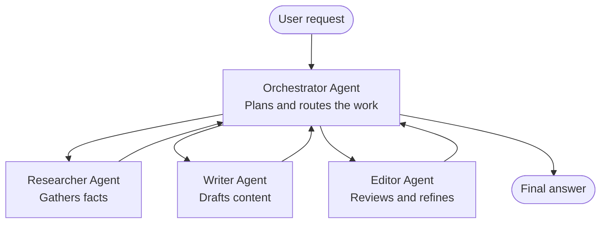

# Multi-Agent Basics - Deploy Your First Coordinated AI System

**Chapter Navigation:**
- **📚 Course Home**: [AZD For Beginners](../../README.md)
- **📖 Current Chapter**: Chapter 5 - Multi-Agent AI Solutions
- **⬅️ Previous**: [Chapter 4: Infrastructure](../chapter-04-infrastructure/README.md)
- **➡️ Next**: [Coordination Patterns](../chapter-06-pre-deployment/coordination-patterns.md)

> Command guidance reviewed against the released `azd 1.37.2` reference. Cloud deployments were not executed.

## Introduction

For di earlier chapters, you bin deploy just one application—and for Chapter 2 you deploy one AI agent dem. Dis lesson go carry you go di next step: deploy **multi-agent system**, where plenty specialized agents dey work together to solve problem wey one agent no fit handle well alone.

Di beta tin for beginners be say: **you no need new commands.** Multi-agent solution still be azd project. You go `azd init`, `azd up`, test, and `azd down`—di exact workflow wey you sabi already. Wetin go change na di *shape* of di app inside.

## Learning Goals

By di end of dis lesson, you go:
- Understand wetin "multi-agent" mean and wen e worth di extra wahala
- Recognize di common roles for multi-agent system (orchestrator + specialists)
- Deploy real, working multi-agent template with `azd up`
- Understand di Azure resources wey dey support multi-agent app
- Know how to verify, customize, and tear down di solution safely

## Learning Outcomes

After you finish dis lesson, you go fit:
- Explain di difference between single agent and multi-agent system
- Choose whether to use single agent with tools or real multi-agent design
- Deploy and test multi-agent template end to end with azd
- Identify where each agent dey run and how dem dey communicate
- Clean up all resources to avoid ongoing charges

---

## Wetin Multi-Agent System Be?

One single AI agent na one model with set of instructions and (sometimes) some tools. E dey waka well for focused tasks. But as task dey grow—research, then writing, then editing, then fact-checking—if you pack everything inside one prompt, e go make di agent slow, unreliable, and hard to debug.

**Multi-agent system** na system wey divide work among specialists wey each dey do one job well, and orchestrator dey coordinate dem:



### Di two roles wey you go always see

| Role | Job | Example |
|------|-----|---------|
| **Orchestrator** | Decides *wetin happen next* and dey route work between agents | "First research, then write, then edit" |
| **Specialist** | Dey do one focused job and return result | "Researcher" wey dey gather facts only |

### You really need multiple agents?

Start simple. Go multi-agent **only** if one of dis thing be true:

- ✅ Di task get **clear stages** wey need different instructions (research vs. write vs. review)
- ✅ You want specialist agents to run **in parallel** to save time
- ✅ Different steps need **different tools or data sources**
- ✅ You want each step to be **independently testable and debuggable**

If your task na single question-and-answer or simple tool call, **single agent with tools** (Chapter 2) simple pass, cheap pass, and easier to use.

> **Beginner tip:** "More agents" no be always "better." Every agent add latency, cost, and new tin to monitor. Add agents only if problem clear to split into parts.

---

## Two Ways to Build Multi-Agent on Azure

| Approach | Wetin e be | Best for |
|----------|-------------|---------|
| **Single agent + tools** | One Foundry agent wey dey call functions/tools | Simple workflows, start learning |
| **Multiple coordinated agents** | Many agents with orchestrator | Distinct stages, parallel work, specialization |

Dis lesson dey focus on di second way, using **ready-made template**, so you fit see real multi-agent system wey dey run before you build your own.

---

## Hands-On: Deploy Working Multi-Agent App

We go deploy **Contoso Creative Writer**, official Azure sample wey dey coordinate research, product, writing, and editing agents to produce article. Before you start, check [sample prerequisites and costs](https://github.com/Azure-Samples/contoso-creative-writer#azure-account-requirements): you go need model quota, Azure AI Search, Bing Grounding access, Python, Docker, and Bash-compatible hooks. Model and region availability depend on your subscription; deployment no guarantee if you choose particular region.

### Step 1: Initialize di template

```bash
# Create a working folder
mkdir creative-writer && cd creative-writer

# Initialize from the official multi-agent template
azd init --template Azure-Samples/contoso-creative-writer .
```

> You fit browse more multi-agent templates anytime for [Awesome AZD AI gallery](https://azure.github.io/awesome-azd/?tags=ai). Other beginner-friendly options na `get-started-with-ai-agents` and `azure-ai-travel-agents`.

### Step 2: Authenticate

```bash
# Required for azd workflows
azd auth login

# Also required by this sample's Azure CLI hooks
az login
```

### Step 3: Check di environment

```bash
# init normally creates/selects an environment; confirm it before proceeding
azd env list
# Only if you need an additional environment:
# azd env new dev
```

### Step 4: Preview, then deploy

```bash
# See what will be created before spending anything (recommended)
azd provision --preview

# Provision infrastructure and deploy all agents in one step
azd up
```

`azd up` go ask you for missing subscription and region settings, then e go provision resources and deploy di application. Preview no dey reserve quota or guarantee success; template hooks fit still run during provisioning preview, so inspect dem first. To extend how long azd go wait for each **service deployment** (no be model provisioning):

```bash
azd deploy --timeout 1800
```

Timeout stops azd waiting; e no cancel deployment for Azure. Make sure to inspect resource state before retry.

> **Heads up for cost and capacity:** Multi-agent apps dey deploy AI models wey dey consume quota and cost money. If `azd up` fail for model quota, check [AI Troubleshooting](../chapter-07-troubleshooting/ai-troubleshooting.md) for region and quota fixes, plus Chapter 6 [Capacity Planning](../chapter-06-pre-deployment/capacity-planning.md).

---

## Understand Wetin You Deploy

Typical multi-agent app like dis one dey provision set of Azure resources wey map directly to responsibilities for di diagram wey don show:

| Resource | Why e dey there |
|----------|-----------------|
| **Microsoft Foundry / Models** | Hosts di language models wey each agent dey use |
| **Azure AI Search** | Gives researcher agent grounded data to search |
| **Container Apps** (or App Service) | Hosts orchestrator and agent code |
| **Cosmos DB** (for some samples) | Stores shared state/memory wey agents fit share |
| **Application Insights** | Traces requests *across* agents make you fit debug di flow |

### How agents dey talk each other

For most azd multi-agent samples, **orchestrator dey run inside your application code** (example, using framework like Semantic Kernel or Microsoft Agent Framework). Orchestrator go call each specialist agent one by one, pass results, and assemble final answer. Agents share context through:

- **Function/tool calls** — orchestrator dey call specialist and get result back
- **Shared memory** — database (often Cosmos DB) hold state wey both agents fit read
- **Messages/events** — for loose connection, agents dey communicate through queue or Service Bus

> **Why e matter for debugging:** because each step separate, Application Insights fit show you *which* agent slow or fail. Na big reason to split work across agents.

---

## Verify Deployment

Confirm system dey really work before you continue:

```bash
# Show the deployed endpoints
azd show

# Open the app's monitoring dashboard
azd monitor

# Open Application Insights Logs (not a terminal log stream)
azd monitor --logs
```

Then open app URL from `azd show` and request short article. Use sample debug view to check agent workflow. Application Insights transaction search fit show individual steps if sample get proper instrumentation and correlation; azd no add agent spans automatically.

**Success criteria:**
- ✅ `azd show` lists reachable endpoint
- ✅ Request produce result wey clearly pass multiple stages
- ✅ Debug view show multiple agent steps; if tracing active, verify telemetry after ingestion

---

## Customize: Add or Adjust Agent

Because each agent na just instructions plus tools, customization dey easy:

1. **Find agent definitions** inside template (often `prompts/`, `agents/`, or `*.prompty` files).
2. **Tune agent instructions**—for example, tell editor agent to use specific tone or word count.
3. **Redeploy only code** (infrastructure no change):

   ```bash
   azd deploy
   ```

To go further with *your own* Foundry agent project, use agent extension interactive initialization:

```bash
azd extension install azure.ai.agents
azd ai agent init
azd up
azd ai agent invoke      # test, with response timing
```

Check [Chapter 2: Agents](../chapter-02-ai-development/agents.md) and [AZD AI CLI reference](../chapter-08-production/production-ai-practices.md#azd-ai-cli-commands-and-extensions) for complete lifecycle: agent `invoke`, separate evaluations extension `azd ai eval` workflow, agent `optimize`, and agent `delete`.

---

## Clean Up

Multi-agent apps run plenty billable services. Tear everything down when you don finish:

```bash
# Review the resources and confirm deletion interactively
azd down
```

Deletion na destructive process. For disposable lab, `azd down --force --purge` skip deletion and supported soft-delete purge confirmations; purging irreversible if supported and fit block purge protection. Soft deletion na recovery/name-reuse matter, no be proof of ongoing charges. Check if resources still dey and billing after cleanup.

---

## Note on Production Multi-Agent Systems

Di [Retail Multi-Agent Solution](../../examples/retail-scenario.md) for dis repo na **architecture blueprint**, no be one-command template—e dey describe how production retail system *go* build (e clear say full build serious work). Use am as design reference *after* you deploy working sample here. For production issues (resilience, cost, monitoring, governance), continue to [Chapter 8: Production AI Practices](../chapter-08-production/production-ai-practices.md).

---

## Summary

- Multi-agent system split work across specialists coordinated by orchestrator.
- Use am only if task get distinct stages, parallelism, or different tools per step—otherwise choose single agent.
- Azd workflow no change: `azd init` → `azd up` → test → `azd down`.
- Real template like `contoso-creative-writer` let you see and customize working multi-agent app today.
- Application Insights tracing across agents na one biggest practical benefits of multi-agent design.

---

## 🔗 Navigation

| Direction | Lesson |
|-----------|--------|
| **Previous** | [Chapter 4: Infrastructure](../chapter-04-infrastructure/README.md) |
| **Next** | [Coordination Patterns](../chapter-06-pre-deployment/coordination-patterns.md) |

## 📖 Related Resources

- [AI Agents Guide](../chapter-02-ai-development/agents.md)
- [Coordination Patterns](../chapter-06-pre-deployment/coordination-patterns.md)
- [Production AI Practices](../chapter-08-production/production-ai-practices.md)
- [AI Troubleshooting](../chapter-07-troubleshooting/ai-troubleshooting.md)

---

<!-- CO-OP TRANSLATOR DISCLAIMER START -->
**Disclaimer**:
Dis document don translate wit AI translation service [Co-op Translator](https://github.com/Azure/co-op-translator). Even tho we dey try make am correct, abeg make you know say automated translation fit get errors or mistakes. Di original document for dia own language na im be di correct source. For important info, make person wey sabi human translation do am. We no go responsible for any misunderstanding or wrong understanding wey fit happen because of dis translation.
<!-- CO-OP TRANSLATOR DISCLAIMER END -->