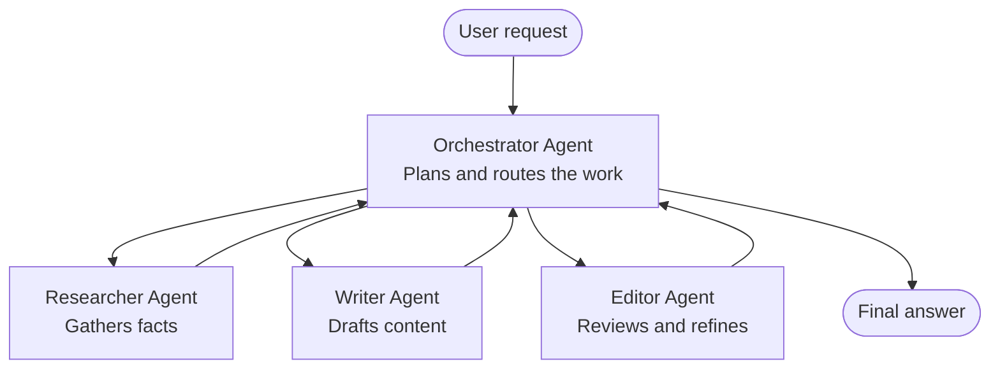

# Multi-Agent Basics - Deploy Your First Coordinated AI System

**Chapter Navigation:**
- **📚 Course Home**: [AZD For Beginners](../../README.md)
- **📖 Current Chapter**: Chapter 5 - Multi-Agent AI Solutions
- **⬅️ Previous**: [Chapter 4: Infrastructure](../chapter-04-infrastructure/README.md)
- **➡️ Next**: [Coordination Patterns](../chapter-06-pre-deployment/coordination-patterns.md)

> Command guidance reviewed against the released `azd 1.37.2` reference. Cloud deployments were not executed.

## Introduction

For di chapters wey don pass, you don deploy one app — and for Chapter 2 you deploy one AI agent. Dis lesson de move next step: to deploy **multi-agent system**, wey many specialist agents dey work together to solve one problem wey one agent no fit handle well by itself.

Good tin for beginners: **you no need new commands.** Multi-agent solution still be azd project. You go `azd init`, `azd up`, test, plus `azd down`—just di workflow wey you sabi before. Wetin change na di *shape* of di app inside.

## Learning Goals

By di time you finish dis lesson, you go:
- Understand wetin "multi-agent" mean and wen e worth di extra complexity
- Recognize di common roles for multi-agent system (orchestrator + specialists)
- Deploy real, working multi-agent template with `azd up`
- Understand di Azure resources wey back di multi-agent app
- Know how to verify, customize, plus tear down di solution safely

## Learning Outcomes

After you finish dis lesson, you go fit:
- Explain di difference between single agent and multi-agent system
- Choose between single agent with tools and real multi-agent design
- Deploy plus test multi-agent template end-to-end with azd
- Identify where each agent run and how dem dey communicate
- Clean up all resources to avoid ongoing charges

---

## Wetin Be Multi-Agent System?

One AI agent na one model wey get set of instructions and (optional) some tools. E dey work well for focused tasks. But if task grow — research, then writing, then editing, then fact-checking — to pack everything inside one prompt go make agent slow, less reliable, and hard to debug.

**Multi-agent system** divide di work into specialists wey each dey do one job well, coordinated by one orchestrator:



### Di two roles wey you go always see

| Role | Job | Example |
|------|-----|---------|
| **Orchestrator** | Decides *wetin go happen next* and routes work between agents | "First research, then write, then edit" |
| **Specialist** | Dey do one focused job and return result | Researcher wey only dey gather facts |

### You really need many agents?

Start simple. Use multi-agent **only** when one of this true:

- ✅ Task get **different stages** wey benefit from different instructions (research vs. write vs. review)
- ✅ You want specialists to dey run **parallel** to save time
- ✅ Different steps need **different tools or data sources**
- ✅ You need each step to dey **independently testable and debuggable**

If your task na one question-answer or simple tool call, **single agent with tools** (Chapter 2) easy, cheap and simple to run.

> **Beginner tip:** "More agents" no mean "better." Every agent add latency, cost, plus new thing to monitor. Add agents only when problem clearly split into parts.

---

## Two Ways to Build Multi-Agent for Azure

| Approach | Wetin e be | Best for |
|----------|-----------|----------|
| **Single agent + tools** | One Foundry agent wey dey call functions/tools | Simple workflows, to start |
| **Multiple coordinated agents** | Plenty agents plus one orchestrator | Different stages, parallel work, specialization |

Dis lesson dey focus on second approach using **ready-made template**, so you fit see real multi-agent system dey run before you build your own.

---

## Hands-On: Deploy Working Multi-Agent App

We go deploy **Contoso Creative Writer**, official Azure sample wey dey coordinate research, product, writing, plus editing agents to produce article. Before you start, check [sample prerequisite and costs](https://github.com/Azure-Samples/contoso-creative-writer#azure-account-requirements): e need model quota, Azure AI Search, Bing Grounding access, Python, Docker, plus Bash-compatible hooks. Model and region availability depend on your subscription; deployment no guarantee just because of region choice.

### Step 1: Initialize the template

```bash
# Create a working folder
mkdir creative-writer && cd creative-writer

# Initialize from the official multi-agent template
azd init --template Azure-Samples/contoso-creative-writer .
```

> Browse more multi-agent templates anytime for [Awesome AZD AI gallery](https://azure.github.io/awesome-azd/?tags=ai). Other options wey easy for beginner include `get-started-with-ai-agents` and `azure-ai-travel-agents`.

### Step 2: Authenticate

```bash
# Required for azd workflows
azd auth login

# Also required by this sample's Azure CLI hooks
az login
```

### Step 3: Check environment

```bash
# init normally creates/selects an environment; confirm it before proceeding
azd env list
# Only if you need an additional environment:
# azd env new dev
```

### Step 4: Preview, then deploy

```bash
# See what will be created before spending anything (recommended)
azd provision --preview

# Provision infrastructure and deploy all agents in one step
azd up
```

`azd up` go ask for missing subscription and region info, den go provide resources and deploy di app. Preview no reserve quota or guarantee success; template hooks fit still run for provisioning preview, so check dem first. To extend how long azd wait for each **service deployment** (no di model provisioning):

```bash
azd deploy --timeout 1800
```

Timeout stop azd waiting; e no mean deployment for Azure cancel. Check resource status before retry.

> **Heads up on cost and capacity:** Multi-agent apps deploy AI models wey dey consume quota and dey cost money. If `azd up` fail on model quota, see [AI Troubleshooting](../chapter-07-troubleshooting/ai-troubleshooting.md) for region and quota fixes, and Chapter 6 [Capacity Planning](../chapter-06-pre-deployment/capacity-planning.md).

---

## Understanding What You Deployed

Typical multi-agent app like dis go set up Azure resources wey match di responsibilities for di diagram above:

| Resource | Why e dey there |
|----------|----------------|
| **Microsoft Foundry / Models** | Hosts di language models wey each agent dey use |
| **Azure AI Search** | Gives researcher agent grounded data to search with |
| **Container Apps** (or App Service) | Hosts orchestrator and agent code |
| **Cosmos DB** (for some samples) | Stores shared state/memory wey agents dey pass between each other |
| **Application Insights** | Traces requests *across* agents so you fit debug di flow |

### How agents dey talk to each other

For most azd multi-agent samples, di **orchestrator dey your application code** (example: use framework like Semantic Kernel or Microsoft Agent Framework). Orchestrator dey call each specialist agent, carry di result, and join di final answer. Agents dey share context through:

- **Function/tool calls** — orchestrator dey invoke specialist and collect result
- **Shared memory** — database (usually Cosmos DB) dey hold state wey both agents fit read
- **Messages/events** — for loose coupling, agents dey communicate via queue or Service Bus

> **Why e matter for debugging:** because each step separate, Application Insights go show *which* agent slow or fail. Na big reason to split work among agents first.

---

## Verify Deployment

Confirm say system dey work before you continue:

```bash
# Show the deployed endpoints
azd show

# Open the app's monitoring dashboard
azd monitor

# Open Application Insights Logs (not a terminal log stream)
azd monitor --logs
```

Then open app URL from `azd show` and ask for short article. Use sample debug view to check agent workflow. Application Insights transaction search fit show individual steps only if sample instruments and correlate them; azd no dey add agent spans automatically.

**Success criteria:**
- ✅ `azd show` list reachable endpoint
- ✅ Request produce result wey clearly pass many stages
- ✅ Debug view show multiple agent steps; if tracing enabled, verify corresponding telemetry after ingestion

---

## Customize: Add or Adjust Agent

Because each agent na just instructions plus tools, customization easy to do:

1. **Find di agent definitions** inside di template (wey dey common na `prompts/`, `agents/`, or `*.prompty` set of files).
2. **Tune how agent go work** — like tell di editor agent make e use one kain tone or word count.
3. **Deploy di code and nothing else** (infrastructure no change):

   ```bash
   azd deploy
   ```

To carry go with your *own* Foundry agent project, use di GA bundle wit AZD 1.37.0+ for one separate empty folder:

```bash
azd ext install microsoft.foundry
azd ai agent init
azd up
azd ai agent invoke      # test, with response timing
```

See di [GA hosted-agent walkthrough](../chapter-02-ai-development/microsoft-foundry-integration.md#hosted-agent-walkthrough-ga) for Agent Inspector local testing, remote code deployment, and cleanup ownership. Di [AZD AI CLI reference](../chapter-08-production/production-ai-practices.md#azd-ai-cli-commands-and-extensions) still talk about di separate evaluations extension, optimization, and how to delete agent.

---

## Clean Up

Multi-agent apps dey run plenti billable services. Tear everything down when you don finish:

```bash
# Review the resources and confirm deletion interactively
azd down
```

Deletion dey destructive. For disposable lab, `azd down --force --purge` no go do deletion and e dey skip soft-delete purge confirmations; purging no fit undo where e dey supported, and purge protection fit block am. Soft deletion na recovery/name-reuse matter, e no mean say money go still dey charge. Check for things dem wey still dey and billing after cleanup.

If you still initialize one hosted agent for existing Foundry project, `azd down` go leave that project agent and other things inside. Remove only the things wey you no want wey you get separate. For new Foundry project wey AZD environment create am, `azd down` go delete group wey get resource and everything for inside.

---

## Note About Production Multi-Agent Systems

Di [Retail Multi-Agent Solution](../../examples/retail-scenario.md) wey dey dis repo na **architecture blueprint**, e no be one-command template—e dey show how production retail system *go* be built (e clear say full build na big work). Use am as design reference *after* you don deploy correct working sample here. For production level mata (resilience, cost, monitoring, governance), continue go [Chapter 8: Production AI Practices](../chapter-08-production/production-ai-practices.md).

---

## Summary

- Multi-agent system na to divide work for specialists wey di orchestrator dey coordinate.
- Use am if di task get different stages, parallel work, or different tools for each step—otherwise just use one agent.
- Di azd workflow no change: `azd init` → `azd up` → test → `azd down`.
- Real template like `contoso-creative-writer` go make you fit see and change working multi-agent app today.
- Application Insights tracing across agents na one of di biggest practical benefit of multi-agent design.

---

## 🔗 Navigation

| Direction | Lesson |
|-----------|--------|
| **Previous** | [Chapter 4: Infrastructure](../chapter-04-infrastructure/README.md) |
| **Next** | [Coordination Patterns](../chapter-06-pre-deployment/coordination-patterns.md) |

## 📖 Related Resources

- [AI Agents Guide](../chapter-02-ai-development/agents.md)
- [Coordination Patterns](../chapter-06-pre-deployment/coordination-patterns.md)
- [Production AI Practices](../chapter-08-production/production-ai-practices.md)
- [AI Troubleshooting](../chapter-07-troubleshooting/ai-troubleshooting.md)

---

<!-- CO-OP TRANSLATOR DISCLAIMER START -->
**Disclaimer**:
Dis document don translate wit AI translation service [Co-op Translator](https://github.com/Azure/co-op-translator). Even tho we dey try make am correct, abeg make you know say automated translation fit get errors or mistakes. Di original document for dia own language na im be di correct source. For important info, make person wey sabi human translation do am. We no go responsible for any misunderstanding or wrong understanding wey fit happen because of dis translation.
<!-- CO-OP TRANSLATOR DISCLAIMER END -->