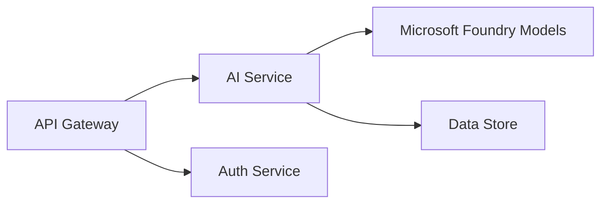
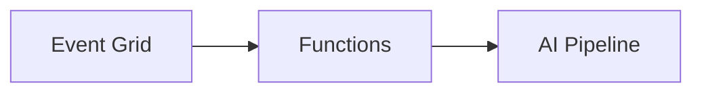

# Chapter 8: Production & Enterprise Patterns

**📚 Course**: [AZD For Beginners](../../README.md) | **⏱️ Duration**: 2-3 hours | **⭐ Complexity**: Advanced

---

## Overview

Dis chapter dey cover enterprise-ready deployment patterns, security hardening, monitoring, and cost optimization for production AI workloads.

Dis one na architectural reference, no be complete deployable production template. Examples no include integration details wey you gats supply and test for your own application; to read the checklist no mean say production don ready.

> **Release review (2026-11-04):** AI CLI guidance dem check am for against `azd 1.37.2`, agents `1.0.0-beta.23`, and evaluations `1.0.0-beta.2` documentation/source. See [release changes and fixes](production-ai-practices.md#recent-release-changes-and-fixes) for compatibility requirements and migration details; dis one no be live deployment validation.

## Learning Objectives

If you finish dis chapter, you go fit:
- Deploy multi-region resilient applications
- Implement enterprise security patterns
- Configure comprehensive monitoring
- Optimize costs at scale
- Set up CI/CD pipelines with AZD

---

## 📚 Lessons

| # | Lesson | Description | Time |
|---|--------|-------------|------|
| 1 | [Production AI Practices](production-ai-practices.md) | Enterprise deployment patterns | 90 min |

---

## 🚀 Production Checklist

- [ ] Multi-region deployment for resilience
- [ ] Managed identity for authentication (no keys)
- [ ] Application Insights for monitoring
- [ ] Cost budgets and alerts configured
- [ ] Security scanning enabled
- [ ] CI/CD pipeline integration
- [ ] Disaster recovery plan

---

## 🏗️ Architecture Patterns

### Pattern 1: Microservices AI



### Pattern 2: Event-Driven AI



---

## 🔐 Security Best Practices

```bicep
// Illustrative properties from different resources, NOT a standalone Bicep file.
// Attach identity to the application host:
identity: {
  type: 'SystemAssigned'
}

// AI account properties (also require private endpoints, DNS and app connectivity):
properties: {
  publicNetworkAccess: 'Disabled'
  networkAcls: {
    defaultAction: 'Deny'
  }
}
```

---

## 💰 Cost Optimization

| Strategy | Main Constraint |
|----------|---------|
| Scale to zero (Container Apps) | Requires a suitable trigger; other services still incur costs |
| Use consumption tiers for dev | Compare selected service pricing and workload |
| Scheduled scaling | Scale through supported infrastructure/automation |
| Reservations/provisioned capacity | Only when supported; commitments can increase idle costs |

Use the [complete budget resource pattern](production-ai-practices.md#2-cost-monitoring-and-budgets) wit valid start date, billing scope, recipients, and permissions. Budget dey send alerts; e no dey cap spending. Savings depend on measured utilization and no be guaranteed percentages.

---

## 📊 Monitoring Setup

```bash
# Open the Application Insights logs view (requires configured monitoring)
azd monitor --logs

# Check Application Insights
azd monitor --overview

# View metrics
az monitor metrics list --resource <resource-id>
```

---

## 🔗 Navigation

| Direction | Chapter |
|-----------|---------|
| **Previous** | [Chapter 7: Troubleshooting](../chapter-07-troubleshooting/README.md) |
| **Course Complete** | [Course Home](../../README.md) |

---

## 📖 Related Resources

- [AI Agents Guide](../chapter-02-ai-development/agents.md)
- [Application Insights](../chapter-06-pre-deployment/application-insights.md)
- [Multi-Agent Solutions](../chapter-05-multi-agent/README.md)
- [Microservices Example](../../examples/microservices/README.md)

---

<!-- CO-OP TRANSLATOR DISCLAIMER START -->
**Disclaimer**:
Dis document don translate wit AI translation service [Co-op Translator](https://github.com/Azure/co-op-translator). Even tho we dey try make am correct, abeg make you know say automated translation fit get errors or mistakes. Di original document for dia own language na im be di correct source. For important info, make person wey sabi human translation do am. We no go responsible for any misunderstanding or wrong understanding wey fit happen because of dis translation.
<!-- CO-OP TRANSLATOR DISCLAIMER END -->