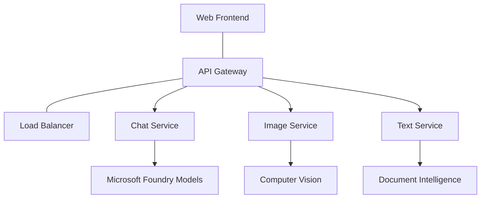

# Production AI Workload Best Practices wit AZD

**Chapter Navigation:**
- **📚 Course Home**: [AZD For Beginners](../../README.md)
- **📖 Current Chapter**: Chapter 8 - Production & Enterprise Patterns
- **⬅️ Previous Chapter**: [Chapter 7: Troubleshooting](../chapter-07-troubleshooting/debugging.md)
- **⬅️ Also Related**: [AI Workshop Lab](../chapter-02-ai-development/ai-workshop-lab.md)
- **🎯 Course Complete**: [AZD For Beginners](../../README.md)

## Overview

Dis guide dey explain production AI design patterns wit Azure Developer CLI (AZD). E be design reference, no be deployable application or production certification.

**Example boundaries:** Unless dem explain say e complete, Bicep fragments dey assume parameters and referenced resources from inside template. Dem no include host images/plans, identities, role assignments, DNS, outputs, or other needed integration. YAML service paths and hook/test scripts na example files wey you go create for **your own application**; dis course no dey provide am. Use correct AZD sample as base, compile complete infrastructure, and test am for separated environment before production.

## Key Challenges Dem Solve

Common production wahala na multi-service deployments, identity and secret management, scaling, cost controls, and monitoring. No measurement for prevalence dey here.

## Architecture Patterns for Production AI

### Pattern 1: Microservices AI Architecture

**When to use**: Complex AI applications wey get many capabilities



**AZD Implementation**:

```yaml
# azure.yaml
name: enterprise-ai-platform
services:
  web:
    project: ./web
    host: staticwebapp
  api-gateway:
    project: ./api-gateway
    host: containerapp
  chat-service:
    project: ./services/chat
    host: containerapp
  vision-service:
    project: ./services/vision
    host: containerapp
  text-service:
    project: ./services/text
    host: containerapp
```

### Pattern 2: Event-Driven AI Processing

**When to use**: Batch processing, document analysis, async workflows

```bicep
// Event Hub for AI processing pipeline
resource eventHub 'Microsoft.EventHub/namespaces@2024-01-01' = {
  name: eventHubNamespaceName
  location: location
  sku: {
    name: 'Standard'
    tier: 'Standard'
    capacity: 1
  }
}

// Service Bus for reliable message processing
resource serviceBus 'Microsoft.ServiceBus/namespaces@2024-01-01' = {
  name: serviceBusNamespaceName
  location: location
  sku: {
    name: 'Premium'
    tier: 'Premium'
    capacity: 1
  }
}

// Function App for processing
resource functionApp 'Microsoft.Web/sites@2023-01-01' = {
  name: functionAppName
  location: location
  kind: 'functionapp,linux'
  properties: {
    siteConfig: {
      appSettings: [
        {
          name: 'FUNCTIONS_EXTENSION_VERSION'
          value: '~4'
        }
        {
          name: 'AZURE_OPENAI_ENDPOINT'
          value: '@Microsoft.KeyVault(VaultName=${keyVault.name};SecretName=openai-endpoint)'
        }
      ]
    }
  }
}
```

Dis one dey create namespace fragments, no be hubs, queues, subscriptions, or Function triggers. A runnable Function need hosting plan, runtime/storage setup, attached identity, RBAC, and network access. Key Vault reference need permission to read secret; endpoint URL no be credential.

## Thinking About AI Agent Health

When normal web app break, symptoms dem be familiar: page no load, API give error, or deployment fail. AI-powered apps fit break the same way—but fit still act funny in small small way wey no show error message.

Dis section dey help you build mental model for monitoring AI workloads so you go sabi where to check when thing no dey normal.

### How Agent Health Different from Normal App Health

Normal apps fit also get small small correctness failures. AI agent add nondeterministic response quality on top usual availability and correctness issues. Think agent health in two layers:

| Layer | Wetin To Watch | Where To Look |
|-------|--------------|---------------|
| **Infrastructure health** | Service dey run? Resources don provide? Endpoints dey reachable? | `azd monitor`, Azure Portal resource health, container/app logs |
| **Behavior health** | Agent dey respond correct? Responses dey quick? Model dey call correct? | Application Insights traces, model call latency metrics, response quality logs |

Infrastructure health na familiar matter—e same for any azd app. Behavior health na new layer wey AI workloads bring.

### Where To Look If AI Apps No Dey Work Well

If your AI app no dey give the results wey you expect, here na conceptual checklist:

1. **Start with basics.** App dey run? Fit reach dependencies? Check `azd monitor` and resource health as any app.
2. **Check model connection.** Your app dey call AI model well? Failed or timeout model calls na commonest AI app wahala and e go show for your app logs.
3. **Inspect input and grounding safely.** Wrong answers fit come from retrieval, instructions, model limits, or tool execution. Use access-controlled, redacted diagnostic data; no dey turn on indiscriminate prompt/response logging for production.
4. **Review response latency.** AI model calls slow pass normal API calls. If app dey slow, check if model response time don increase—fit mean throttling, capacity limits, or region congestion.
5. **Watch for cost signs.** Sudden high token use or API calls fit mean loop, wrong prompt configuration, or too much retries.

You no need make you master observability tools now now. The main point be say AI apps get one extra behavior layer to monitor, and azd built-in monitoring (`azd monitor`) dey give you start point to check both layers.

---

## Security Best Practices

### 1. Zero-Trust Security Model

**Implementation Strategy**:
- No service-to-service communication without authentication
- All API calls use managed identities
- Network isolation with private endpoints
- Least privilege access controls

```bicep
// Managed Identity for each service
resource chatServiceIdentity 'Microsoft.ManagedIdentity/userAssignedIdentities@2023-01-31' = {
  name: 'chat-service-identity'
  location: location
}

// Role assignments with minimal permissions
resource openAIUserRole 'Microsoft.Authorization/roleAssignments@2022-04-01' = {
  scope: openAIAccount
  name: guid(openAIAccount.id, chatServiceIdentity.id, '5e0bd9bd-7b93-4f28-af87-19fc36ad61bd')
  properties: {
    roleDefinitionId: subscriptionResourceId('Microsoft.Authorization/roleDefinitions', '5e0bd9bd-7b93-4f28-af87-19fc36ad61bd')
    principalId: chatServiceIdentity.properties.principalId
    principalType: 'ServicePrincipal'
  }
}
```

### 2. Secure Secret Management

**Key Vault Integration Pattern**:

```bicep
// Key Vault with proper access policies
resource keyVault 'Microsoft.KeyVault/vaults@2023-02-01' = {
  name: keyVaultName
  location: location
  properties: {
    tenantId: tenant().tenantId
    sku: {
      family: 'A'
      name: 'standard' // Premium is needed for HSM-backed keys, not ordinary secrets
    }
    enableRbacAuthorization: true  // Use RBAC instead of access policies
    enablePurgeProtection: true    // Prevent accidental deletion
    enableSoftDelete: true
    softDeleteRetentionInDays: 90
  }
}

// Optional legacy key-auth alternative; omit when using Entra ID.
resource openAIKeySecret 'Microsoft.KeyVault/vaults/secrets@2023-02-01' = {
  parent: keyVault
  name: 'openai-api-key'
  properties: {
    value: openAIAccount.listKeys().key1
    attributes: {
      enabled: true
    }
  }
}
```

Assign runtime identity `Key Vault Secrets User` for the right scope and connect am to host; `enableRbacAuthorization` alone no give access. Prefer OpenAI managed identity authentication wit `disableLocalAuth: true`. The optional key secret only make sense for account wey dem purposely enable key, and provisioning principal need permission to write secrets.

### 3. Network Security

**Private Endpoint Configuration**:

```bicep
// Virtual Network for AI services
resource virtualNetwork 'Microsoft.Network/virtualNetworks@2023-04-01' = {
  name: vnetName
  location: location
  properties: {
    addressSpace: {
      addressPrefixes: ['10.0.0.0/16']
    }
    subnets: [
      {
        name: 'ai-services-subnet'
        properties: {
          addressPrefix: '10.0.1.0/24'
          privateEndpointNetworkPolicies: 'Disabled'
        }
      }
      {
        name: 'app-services-subnet'
        properties: {
          addressPrefix: '10.0.2.0/24'
          delegations: [
            {
              name: 'Microsoft.Web/serverFarms'
              properties: {
                serviceName: 'Microsoft.Web/serverFarms'
              }
            }
          ]
        }
      }
    ]
  }
}

// Private endpoints for all AI services
resource openAIPrivateEndpoint 'Microsoft.Network/privateEndpoints@2023-04-01' = {
  name: '${openAIAccountName}-pe'
  location: location
  properties: {
    subnet: {
      id: virtualNetwork.properties.subnets[0].id
    }
    privateLinkServiceConnections: [
      {
        name: 'openai-connection'
        properties: {
          privateLinkServiceId: openAIAccount.id
          groupIds: ['account']
        }
      }
    ]
  }
}
```

Private endpoints need private DNS zone groups/VNet links and application VNet integration. Dem no auto block public access: you go disable AI account public network access after you check private connectivity and deployment access.

## Performance and Scaling

### 1. Auto-Scaling Strategies

**Container Apps Auto-scaling**:

```bicep
resource containerApp 'Microsoft.App/containerApps@2023-05-01' = {
  name: containerAppName
  location: location
  properties: {
    configuration: {
      ingress: {
        external: true
        targetPort: 8000
        transport: 'http'
      }
    }
    template: {
      scale: {
        minReplicas: 2  // Always have 2 instances minimum
        maxReplicas: 50 // Scale up to 50 for high load
        rules: [
          {
            name: 'http-scaling'
            http: {
              metadata: {
                concurrentRequests: '20'  // Scale when >20 concurrent requests
              }
            }
          }
          {
            name: 'cpu-scaling'
            custom: {
              type: 'cpu'
              metadata: {
                type: 'Utilization'
                value: '70'  // Scale when CPU >70%
              }
            }
          }
        ]
      }
    }
  }
}
```

### 2. Caching Strategies

**Redis Cache for AI Responses**:

```bicep
// Legacy Azure Cache for Redis example (not recommended for new deployments)
resource redisCache 'Microsoft.Cache/redis@2023-04-01' = {
  name: redisCacheName
  location: location
  properties: {
    sku: {
      name: 'Premium'
      family: 'P'
      capacity: 1
    }
    enableNonSslPort: false
    minimumTlsVersion: '1.2'
    redisConfiguration: {
      'maxmemory-policy': 'allkeys-lru'
    }
    // Sharding distributes data; replication/failover provides availability.
    shardCount: 2
  }
}

// Cache configuration in application
var cacheConnectionString = '${redisCache.properties.hostName}:6380,password=${redisCache.listKeys().primaryKey},ssl=True,abortConnect=False'
```

Azure Cache for Redis Basic/Standard/Premium dey on [retirement path](https://learn.microsoft.com/azure/azure-cache-for-redis/retirement-faq). Use Azure Managed Redis for new design wit documented SKU, identity, and TLS setup, no copy this old resource for new production system. Connection-string line na nonfunctional placeholder, no be credential. Partition cache keys by authorization, model/instructions, and retrieval version wit expiry; shared query-only cache fit expose another user data.

### 3. Load Balancing and Traffic Management

**Application Gateway with WAF**:

```bicep
// Application Gateway with Web Application Firewall
resource applicationGateway 'Microsoft.Network/applicationGateways@2023-04-01' = {
  name: appGatewayName
  location: location
  properties: {
    sku: {
      name: 'WAF_v2'
      tier: 'WAF_v2'
      capacity: 2
    }
    webApplicationFirewallConfiguration: {
      enabled: true
      firewallMode: 'Prevention'
      ruleSetType: 'OWASP'
      ruleSetVersion: '3.2'
    }
    // Backend pools for AI services
    backendAddressPools: [
      {
        name: 'ai-services-pool'
        properties: {
          backendAddresses: [
            {
              fqdn: '${containerApp.properties.configuration.ingress.fqdn}'
            }
          ]
        }
      }
    ]
  }
}
```

Dis na partial gateway resource: real deployment need gateway subnet/IP setup, frontend IPs and ports, TLS listeners/certificates, backend HTTP settings/probes, routing rules and priorities, and reviewed WAF policy. TLS hostname/SNI and authentication must match Container App backend.

## 💰 Cost Optimization

### 1. Resource Right-Sizing

**Environment-Specific Configurations**:

Dem names na **illustrative custom-template inputs**, no be automatic AZD settings. Map each into `infra/main.parameters.json`/Bicep and host configuration first. For example, RAG sample use `AZURE_SEARCH_SERVICE_SKU` and `AZURE_OPENAI_CHATGPT_DEPLOYMENT_CAPACITY`, no be the generic names here. Give Container Apps memory supported unit like `1Gi` for actual resource. Apply infrastructure changes with `azd up` or `azd provision`; `azd deploy` alone no apply Bicep changes.

```bash
# Development environment
azd env new development
azd env set AZURE_OPENAI_SKU "S0"
azd env set AZURE_OPENAI_CAPACITY 10
azd env set AZURE_SEARCH_SKU "basic"
azd env set CONTAINER_CPU 0.5
azd env set CONTAINER_MEMORY 1.0

# Production environment  
azd env new production
azd env set AZURE_OPENAI_SKU "S0"
azd env set AZURE_OPENAI_CAPACITY 100
azd env set AZURE_SEARCH_SKU "standard"
azd env set CONTAINER_CPU 2.0
azd env set CONTAINER_MEMORY 4.0
```

### 2. Cost Monitoring and Budgets

```bicep
// Supply the first day of the current UTC month, e.g. 2026-11-01T00:00:00Z.
param budgetStartDate string

// Cost management and budgets
resource budget 'Microsoft.Consumption/budgets@2024-08-01' = {
  name: 'ai-workload-budget'
  properties: {
    timePeriod: {
      startDate: budgetStartDate
    }
    timeGrain: 'Monthly'
    amount: 2000  // In the billing currency, not necessarily USD
    category: 'Cost'
    notifications: {
      warning: {
        enabled: true
        operator: 'GreaterThan'
        threshold: 80
        contactEmails: [
          'finance@company.com'
          'engineering@company.com'
        ]
        contactRoles: [
          'Owner'
          'Contributor'
        ]
      }
      critical: {
        enabled: true
        operator: 'GreaterThan'
        threshold: 95
        contactEmails: [
          'cto@company.com'
        ]
      }
    }
  }
}
```

Change example recipients and check scope/permissions. Budget alerts use delayed billing data and no dey enforce spending cap.

### 3. Token Usage Optimization

**OpenAI Cost Management**:

Dis na only character-based heuristic for UI preview, **no be** model token-limit validator. Production code suppose use tokenizer correct for deployed model and include system instructions, tool schemas, history, and output budget. Reject oversized user message no be to cut am small small quietly.

```typescript
// Application-level token optimization
class TokenOptimizer {
  private readonly maxTokens = 4000;
  private readonly reserveTokens = 500;
  
  optimizePrompt(userInput: string, context: string): string {
    const availableTokens = this.maxTokens - this.reserveTokens;
    if (this.estimateTokens(userInput) + 8 >= availableTokens) {
      throw new Error("User input exceeds the illustrative prompt budget");
    }
    const estimatedTokens = this.estimateTokens(userInput + context) + 8;
    
    if (estimatedTokens > availableTokens) {
      // Truncate context, not user input
      context = this.truncateContext(context, Math.max(0, availableTokens - this.estimateTokens(userInput) - 8));
    }
    
    return `${context}\n\nUser: ${userInput}`;
  }
  
  private estimateTokens(text: string): number {
    // Rough estimation: 1 token ≈ 4 characters
    return Math.ceil(text.length / 4);
  }

  private truncateContext(text: string, estimatedBudget: number): string {
    return text.slice(0, Math.max(0, estimatedBudget) * 4);
  }
}
```

## Monitoring and Observability

### 1. Comprehensive Application Insights

```bicep
// Application Insights with advanced features
resource applicationInsights 'Microsoft.Insights/components@2020-02-02' = {
  name: applicationInsightsName
  location: location
  kind: 'web'
  properties: {
    Application_Type: 'web'
    WorkspaceResourceId: logAnalyticsWorkspace.id
    SamplingPercentage: 100  // Ingestion setting; review cost and SDK sampling separately
    DisableIpMasking: false  // Retain IP masking
  }
}

// Custom metrics for AI operations
resource aiMetricAlerts 'Microsoft.Insights/metricAlerts@2018-03-01' = {
  name: 'ai-high-error-rate'
  location: 'global'
  properties: {
    description: 'Alert when failed request count exceeds 10 in five minutes'
    severity: 2
    enabled: true
    scopes: [
      applicationInsights.id
    ]
    evaluationFrequency: 'PT1M'
    windowSize: 'PT5M'
    criteria: {
      'odata.type': 'Microsoft.Azure.Monitor.SingleResourceMultipleMetricCriteria'
      allOf: [
        {
          name: 'high-error-rate'
          metricName: 'requests/failed'
          operator: 'GreaterThan'
          threshold: 10
          timeAggregation: 'Count'
        }
      ]
    }
  }
}
```

### 2. AI-Specific Monitoring

**Custom Dashboards for AI Metrics**:

```json
{
  "dashboard": {
    "name": "AI Application Monitoring",
    "tiles": [
      {
        "name": "OpenAI Request Volume",
        "query": "dependencies | where target contains 'openai' | summarize count() by bin(timestamp, 5m)"
      },
      {
        "name": "AI Response Latency",
        "query": "dependencies | where target contains 'openai' | summarize avg(duration) by bin(timestamp, 5m)"
      },
      {
        "name": "Token Usage",
        "query": "customMetrics | where name == 'openai_tokens_used' | summarize sum(value) by bin(timestamp, 1h)"
      },
      {
        "name": "Cost per Hour",
        "query": "customMetrics | where name == 'openai_cost' | summarize sum(value) by bin(timestamp, 1h)"
      }
    ]
  }
}
```

Dis JSON na application-defined sketch, no be importable Azure portal dashboard schema. Token/cost queries need your app to emit exact custom metrics; AZD no create them. Adapt dependency filters for your actual model endpoint/span names.

### 3. Health Checks and Uptime Monitoring

```bicep
// Application Insights availability tests
resource availabilityTest 'Microsoft.Insights/webtests@2022-06-15' = {
  name: 'ai-app-availability-test'
  location: location
  tags: {
    'hidden-link:${applicationInsights.id}': 'Resource'
  }
  properties: {
    SyntheticMonitorId: 'ai-app-availability-test'
    Name: 'AI Application Availability Test'
    Description: 'Tests AI application endpoints'
    Enabled: true
    Frequency: 300  // 5 minutes
    Timeout: 120    // 2 minutes
    Kind: 'standard'
    Locations: [
      {
        Id: 'us-east-2-azr'
      }
      {
        Id: 'us-west-2-azr'
      }
    ]
    Request: {
      RequestUrl: 'https://${webApp.properties.defaultHostName}/health'
      HttpVerb: 'GET'
      FollowRedirects: true
      ParseDependentRequests: false
    }
    ValidationRules: {
      ExpectedHttpStatusCode: 200
      SSLCheck: true
      SSLCertRemainingLifetimeCheck: 7
    }
  }
}
```

## Disaster Recovery and High Availability

The test before assume say App Service `webApp` and Application Insights resource dey. Standard availability tests dey charge and need reachable endpoint; private-only apps need correct private monitoring design. URL ping tests done; use [standard availability tests](https://learn.microsoft.com/azure/azure-monitor/app/availability).

### 1. Multi-Region Deployment

```yaml
# azure.yaml - Multi-region configuration
name: ai-app-multiregion
services:
  api-primary:
    project: ./api
    host: containerapp
    env:
      AZURE_REGION: eastus
  api-secondary:
    project: ./api
    host: containerapp
    env:
      AZURE_REGION: westus2
```

```bicep
// Separate App Service topology, not the Container Apps declarations above
resource trafficManager 'Microsoft.Network/trafficManagerProfiles@2022-04-01' = {
  name: trafficManagerProfileName
  location: 'global'
  properties: {
    profileStatus: 'Enabled'
    trafficRoutingMethod: 'Priority'
    dnsConfig: {
      relativeName: trafficManagerProfileName
      ttl: 30
    }
    monitorConfig: {
      protocol: 'HTTPS'
      port: 443
      path: '/health'
      intervalInSeconds: 30
      toleratedNumberOfFailures: 3
      timeoutInSeconds: 10
    }
    endpoints: [
      {
        name: 'primary-endpoint'
        type: 'Microsoft.Network/trafficManagerProfiles/azureEndpoints'
        properties: {
          targetResourceId: primaryAppService.id
          endpointStatus: 'Enabled'
          priority: 1
        }
      }
      {
        name: 'secondary-endpoint'
        type: 'Microsoft.Network/trafficManagerProfiles/azureEndpoints'
        properties: {
          targetResourceId: secondaryAppService.id
          endpointStatus: 'Enabled'
          priority: 2
        }
      }
    ]
  }
}
```

Environment variables no select resource locations. IaC must provide separate regional hosts and bind each service wit `resourceName` or `azd-service-name` tags. Traffic Manager example na **separate App Service topology** (`primaryAppService`/`secondaryAppService`), no be routing for Container Apps declarations. Container Apps require correct external endpoint/front door, TLS/custom-domain routing, and health probes.

### 2. Data Backup and Recovery

```bicep
// Backup configuration for critical data
resource backupVault 'Microsoft.DataProtection/backupVaults@2023-05-01' = {
  name: backupVaultName
  location: location
  identity: {
    type: 'SystemAssigned'
  }
  properties: {
    storageSettings: [
      {
        datastoreType: 'VaultStore'
        type: 'LocallyRedundant'
      }
    ]
  }
}

```

Vault alone no dey back up anything. Set **workload-specific supported policy and backup instance**, permissions, retention, and restore tests wit [Azure Backup support matrices](https://learn.microsoft.com/azure/backup/backup-support-matrix). No generic Azure Backup policy for hosted Azure OpenAI model deployments. Keep infrastructure/model deployment definition for source control; protect uploaded documents, app data, fine-tuning artifacts wit backing service supported backup/export features. Define and test RPO/RTO openly.

## DevOps and CI/CD Integration

### 1. GitHub Actions Workflow

```yaml
# .github/workflows/deploy-ai-app.yml
name: Deploy AI Application

on:
  push:
    branches: [main]
  pull_request:
    branches: [main]

jobs:
  test:
    runs-on: ubuntu-latest
    steps:
      - uses: actions/checkout@v4
      
      - name: Setup Python
        uses: actions/setup-python@v4
        with:
          python-version: '3.11'
          
      - name: Install dependencies
        run: |
          pip install -r requirements.txt
          pip install pytest
          
      - name: Run tests
        run: pytest tests/
        
      - name: AI Safety Tests
        run: |
          python scripts/test_ai_safety.py
          python scripts/validate_prompts.py

```

Dis na **test-only part** of workflow and assume you don make `requirements.txt`, `tests/`, and two safety scripts. Add authenticated OIDC provisioning/deployment jobs from [CI/CD Pipeline Configuration](#cicd-pipeline-configuration) wit `needs: test`, trusted push/manual trigger, and protected GitHub environments. No deploy untrusted pull-request code wit cloud credentials. Fresh runner get no selected local AZD environment; supply environment/subscription/location inputs and use `azd auth login`, no be only `azure/login`.

### 2. Infrastructure Validation

```bash
# scripts/validate_infrastructure.sh
#!/bin/bash
set -euo pipefail

echo "Validating AI infrastructure deployment..."

# Requires Azure CLI login and the resource group selected explicitly.
: "${AZURE_RESOURCE_GROUP:?Set AZURE_RESOURCE_GROUP}"
: "${AZURE_OPENAI_NAME:?Set AZURE_OPENAI_NAME}"
: "${AZURE_OPENAI_CHAT_DEPLOYMENT:?Set the actual deployment name}"

# A successful empty list is not proof that resources exist.
types=("Microsoft.CognitiveServices/accounts" "Microsoft.Search/searchServices"
       "Microsoft.Storage/storageAccounts" "Microsoft.KeyVault/vaults")
for resource_type in "${types[@]}"; do
    count=$(az resource list --resource-group "$AZURE_RESOURCE_GROUP" \
        --resource-type "$resource_type" --query "length(@)" -o tsv)
    if [[ "$count" -lt 1 ]]; then
        echo "ERROR: No $resource_type found in $AZURE_RESOURCE_GROUP"
        exit 1
    fi
done

# Validate OpenAI model deployments
echo "Validating OpenAI model deployments..."
state=$(az cognitiveservices account deployment show \
  --name "$AZURE_OPENAI_NAME" --resource-group "$AZURE_RESOURCE_GROUP" \
  --deployment-name "$AZURE_OPENAI_CHAT_DEPLOYMENT" \
  --query "properties.provisioningState" -o tsv)
if [[ "$state" != "Succeeded" ]]; then
    echo "ERROR: Required model deployment is not provisioned successfully"
    exit 1
fi

echo "Infrastructure validation completed successfully!"
```

Expect: zero exit and completion message only if all expected types dey and named model deployment provisioned. This check inventory/provisioning state, **no be** resource health, exact topology, RBAC, network reachability, or model behaviour. Adapt expected types to your architecture, then do separate authenticated app readiness test.

## Production Readiness Checklist

### Security ✅
- [ ] All services dey use managed identities
- [ ] Secrets dem store for Key Vault
- [ ] Private endpoints don configure
- [ ] Network security groups dey implement
- [ ] RBAC wit least privilege
- [ ] WAF enabled for public endpoints

### Performance ✅
- [ ] Auto-scaling dey configure
- [ ] Caching dey implement
- [ ] Load balancing dey setup
- [ ] CDN for static content
- [ ] Database connection pooling dey
- [ ] Token usage dey optimize

### Monitoring ✅
- [ ] Application Insights dey configure
- [ ] Custom metrics dem define
- [ ] Alerting rules dey setup
- [ ] Dashboard don create
- [ ] Health checks dey implement
- [ ] Log retention policies dey

### Reliability ✅
- [ ] Multi-region deployment
- [ ] Backup and recovery plan dey
- [ ] Circuit breakers don implement
- [ ] Retry policies dey configure
- [ ] Graceful degradation dey
- [ ] Health check endpoints dey

### Cost Management ✅
- [ ] Budget alerts dey configure
- [ ] Resource right-sizing dey
- [ ] Dev/test discounts dey apply
- [ ] Reserved instances dem buy
- [ ] Cost monitoring dashboard dey
- [ ] Regular cost reviews dey

### Compliance ✅
- [ ] Data residency requirements dey met
- [ ] Audit logging enabled
- [ ] Compliance policies dem apply
- [ ] Security baselines dem comply
- [ ] Regular security assessments dey
- [ ] Incident response plan dey

## Performance Benchmarks

### Illustrative Production Targets

Na example SLOs to negotiate and load-test, no be measured benchmarks or guarantees. Response latency depend on model/output length; monthly token spend depend on traffic and prices, no just token count.

| Metric | Target | Monitoring |
|--------|--------|------------|
| **Response Time** | < 2 seconds | Application Insights |
| **Availability** | 99.9% | Uptime monitoring |
| **Error Rate** | < 0.1% | Application logs |
| **Model Spend** | < $500/month (example budget) | Cost management |
| **Concurrent Users** | 1000+ | Load testing |
| **Recovery Time** | < 1 awa | Disaster recovery tests |

### Load Testing

Di following na di interface sketch for load-test script **wey you gats do**; dis repository no dey supply `scripts/load_test.py`. Define request payloads, authentication, representative workloads, percentile latency/error assertions, plus how much money you go spend for your chosen load-test tool before you run am:

```bash
# Load testing script for AI applications
python scripts/load_test.py \
  --endpoint https://your-ai-app.azurewebsites.net \
  --concurrent-users 100 \
  --duration 300 \
  --ramp-up 60
```

## 🤝 Community Best Practices

Based on Microsoft Foundry Discord community feedback:

### Top Recommendations from di Community:

1. **Start Small, Scale Gradually**: Begin with basic SKUs and scale up based on actual usage
2. **Monitor Everything**: Set up comprehensive monitoring from day one
3. **Automate Security**: Use infrastructure as code for consistent security
4. **Test Thoroughly**: Include AI-specific testing in your pipeline
5. **Plan for Costs**: Monitor token usage and set budget alerts early

### Common Pitfalls to Avoid:

- ❌ Hardcoding API keys in code
- ❌ Not setting up proper monitoring
- ❌ Ignoring cost optimization
- ❌ Not testing failure scenarios
- ❌ Deploying without health checks

## AZD AI CLI Commands and Extensions

AZD get plenti AI-specific commands and extensions wey dey help for production AI workflows. These tools dey link local development and production deployment for AI workloads.

> **Foundry GA update (2026-11-09):** Di `microsoft.foundry` bundle don reach **1.0 / general availability** for [November 5, 2026](https://devblogs.microsoft.com/azure-sdk/microsoft-foundry-azure-developer-cli-ga/). Use **`azd >= 1.37.0`** for dis workflow. Early beta versions like `azd 1.37.2`, agents beta.23, and evaluations beta.2 review still dey below as migration history, no be di current bundle version. Dis na documentation/source review, no be live deployment validation or talk say every optional extension, API, or preview feature don reach GA.

### AZD Extensions for AI

AZD dey use extension system to add AI-specific capabilities. Install and manage extensions with:

```bash
# List all available extensions (including AI)
azd extension list

# Inspect installed versions
azd version
azd ext list --installed

# Install the GA Foundry bundle
azd ext install microsoft.foundry

# Install the separate Foundry evaluations extension
azd extension install azure.ai.evaluations

# Install the fine-tuning extension
azd extension install azure.ai.finetune

# Install the custom models extension
azd extension install azure.ai.models

# Upgrade the Foundry bundle
azd ext upgrade microsoft.foundry
```

**Available AI extensions:**

| Extension | Purpose | Status |
|-----------|---------|--------|
| `microsoft.foundry` | Meta-package wey dey install di seven core extensions below; e no get its own command group | GA bundle 1.0 |
| `azure.ai.agents` | `azd ai agent`: agent setup, local execution, and operations | Included; independently versioned |
| `azure.ai.connections` | `azd ai connection`: project connections | Included; independently versioned |
| `azure.ai.inspector` | `azd ai inspector`: local Agent Inspector UI | Included; independently versioned |
| `azure.ai.projects` | `azd ai project`: project resources and model deployments | Included; independently versioned |
| `azure.ai.routines` | `azd ai routine`: schedules and triggers | Included; independently versioned |
| `azure.ai.skills` | `azd ai skill`: reusable behavioral guidelines | Included; independently versioned |
| `azure.ai.toolboxes` | `azd ai toolbox`: versioned tool collections | Included; independently versioned |
| `azure.ai.evaluations` | Evaluation datasets, evaluators, eval groups, and runs | Separate installation/release |
| `azure.ai.dataset` | Dataset registration and versioning | Separate installation/release |
| `azure.ai.finetune` | Foundry model fine-tuning | Separate installation/release |
| `azure.ai.models` | Foundry custom models | Separate installation/release |

Installing `azure.ai.agents` one-by-one still dey supported and e dey install its dependencies; di bundle na default for di GA workflow. Bundle GA no mean say all optional features for di components na release-status guarantee. Check [extension packaging and verification](https://learn.microsoft.com/azure/foundry/agents/how-to/install-cli-foundry-extensions) and inspect installed command help before you start to use dem.

> Upgrade di core CLI first with `azd update` or di correct [installation/update method](https://learn.microsoft.com/azure/developer/azure-developer-cli/install-azd), then run `azd ext upgrade microsoft.foundry`. Update separately installed evaluations as you need with `azd ext upgrade azure.ai.evaluations`. Core `azd upgrade` command no dey. Record and review independently versioned extensions for production automation; upgrade no mean say e go automatically migrate old configuration.

### Recent Release Changes and Fixes

| Release | Wetin dem change for dis course |
|---------|------------------------------|
| `microsoft.foundry` 1.0 GA (2026-11-05) | Default na di seven-extension bundle, keep agent/deployment settings for `azure.yaml`, test locally with Agent Inspector, plus upload code for remote Foundry build. Install evaluations separate and install needed extensions again on CI runners. |
| `azd 1.37.0` | Adds stable deployment-preview APIs and fixes extension edits wey dey rewrite unrelated `azure.yaml` settings. |
| `azd 1.37.1` | Fixes Ctrl+C propagation across extensions and distinguish cancellation/timeouts from generic failures. |
| `azd 1.37.2` | Better provisioning validation: critical warnings go default to **No**, e go fail if no confirmation for unattended runs, and cancellation go skip post-provision hooks. Also fix unresolved environment values for Deployment Stacks deny lists if alpha feature dey enabled. |
| Agents `beta.22` | Migrate evaluation to `azd ai eval`, change optimization to GA v1 API, require plural `toolboxes`, plus separate managed-harness, voice, and long-running preview opt-ins. Fix environment-specific model selection and toolbox authentication. |
| Agents `beta.23` | Show `init --harness`; fix A2A 0.3 answer output, invalid prompt-agent paths/modules for infrastructure layers, activation-timeout diagnostics, and keep developer RBAC warnings. |
| Evaluations `beta.2` | Require camelCase evaluation config, add static/simulated conversation authoring and explicit local-file sources, fix dataset identity/version handling, quality-gate counts, and failed-run diagnostics. |

Agent activation timeout no mean say deployment fail: check di version wey dem try and how e be before you try again. Developer RBAC warnings fit still dey even if provisioning succeed; fix missing access before you use that developer.

Di beta rows dem dey show earlier fixes and migration boundaries, no be say you gats pin new projects to those versions.

Sources: [Foundry GA announcement](https://devblogs.microsoft.com/azure-sdk/microsoft-foundry-azure-developer-cli-ga/), [AZD releases](https://github.com/Azure/azure-dev/releases), [agents beta.23 release](https://github.com/Azure/azure-dev/releases/tag/azd-ext-azure-ai-agents_1.0.0-beta.23), [agents beta.22 migration](https://github.com/Azure/azure-dev/releases/tag/azd-ext-azure-ai-agents_1.0.0-beta.22), and [evaluations beta.2 release](https://github.com/Azure/azure-dev/releases/tag/azd-ext-azure-ai-evaluations_1.0.0-beta.2).

**Wetin be di bundled `skills` and `connections` extensions?**

Dem dey install with di core bundle but dem get different purposes:

- **`azure.ai.skills`** — A **skill** na package wey get reusable behavioral guidelines for agents. E help send reviewed instructions across agents instead of copying everywhere. Skill no dey implement any tool or give access to data itself; use toolboxes and application code to run tools.
- **`azure.ai.connections`** — A **connection** na managed link from your Foundry project to external resource wey your agents need—like one data source (e.g. Azure AI Search), a tool endpoint, or another service. Connections dey centralize *where* and *how* agents dey access data, so credentials and endpoints dey one governed place instead of scattered inside code.

You no gats configure every bundled capability to deploy your first agent. Use skills when agents share behavioral guidelines and connections when dem dey share external resources.

### Initializing Agent Projects with `azd ai agent init`

Di `azd ai agent init` command dey scaffold Microsoft Foundry agent project. For runnable code-deployment example with Python 3.13+ and current uv, follow [GA hosted-agent walkthrough](../chapter-02-ai-development/microsoft-foundry-integration.md#hosted-agent-walkthrough-ga). Di commands wey dey below na to help you adopt **your own** current `azure.yaml` project template; dis local template no dey come with dis course:

```bash
# Initialize a new agent project from a local project template
azd ai agent init --template ./templates/support-agent/azure.yaml

# Initialize and target a specific Foundry project
azd ai agent init --template ./templates/support-agent/azure.yaml --project-id <foundry-project-id>

# Adopt the template into a different directory
azd ai agent init --template ./templates/support-agent/azure.yaml --src ./agents/my-agent
```

**Key flags:**

| Flag | Description |
|------|-------------|
| `-t, --template` | Path or supported GitHub URI to `azure.yaml` project document |
| `-p, --project-id` | Existing Microsoft Foundry Project ID for your azd environment |
| `-s, --src` | Source directory for generated agents, or target directory when you dey adopt project |
| `--deploy-mode code` | Upload source for remote Foundry build, instead of building local container |
| `--model-deployment` | Reuse named existing model deployment during initialization |
| `--kind` | Initialize `hosted`, `prompt`, or preview `prompt-voice` agent |
| `--harness` | Optional execution harness for `--kind prompt`; requires preview opt-in |
| `-e, --environment` | Azd environment to use |

`--manifest`/`-m` na deprecated alias for `--template`/`-t`; renaming dis flag no con vert old manifest to current project document. `--host containerapp` no be current agent-init flag. For ordinary Container Apps app, use `azd init --template` with template wey dey declare `host: containerapp`.

For existing project wey get exactly one `azure.ai.project` service, `azd ai agent add support-agent --file ./agents/support-agent.yaml` go add or update direct agent definition without provisioning or deploying. Runtime commands no go accept legacy implicit `agent.yaml`/AgentManifest and nested service `config:` definitions; migrate dem to current `azure.ai.agent` service. When init print `cd` next step, run am before `azd up`: init no go change your shell directory.

**Production tip**: Use `--project-id` to connect directly to existing Foundry project, keep your agent code and cloud resources linked from start.

#### Optional Preview Features

Managed harness, voice, and long-running invocation dey off by default. Set only di switch for feature wey you need for **shell/CI process environment**, no use `azd env set`:

| Feature | Process environment variable |
|---------|------------------------------|
| Managed harness (`init --kind prompt --harness ...`) | `AZD_ALPHA_ENABLE_AGENTS_MANAGED_HARNESS=true` |
| Voice (`init --kind prompt-voice`) | `AZD_ALPHA_ENABLE_AGENTS_VOICE=true` |
| Long-running invocation | `AZD_ALPHA_ENABLE_AGENTS_LONG_RUNNING=true` |

For example, use `export AZD_ALPHA_ENABLE_AGENTS_MANAGED_HARNESS=true` for Bash or `$env:AZD_ALPHA_ENABLE_AGENTS_MANAGED_HARNESS = "true"` for PowerShell before you run di command. One switch no go enable others. See [released agents README](https://github.com/Azure/azure-dev/blob/azd-ext-azure-ai-agents_1.0.0-beta.23/cli/azd/extensions/azure.ai.agents/README.md) for all preview switches and limitations.

### Managing the Agent Lifecycle

Di bundle `azure.ai.agents` extension dey support local testing and deployed-agent operations. Install `azure.ai.evaluations` separate to measure quality:

```bash
# Start the local agent and Agent Inspector (leave running)
azd ai agent run

# From a second terminal in the project directory
azd ai agent invoke --local "Explain how this agent is deployed."

# Invoke a deployed agent and view server response timing
# (total latency and time to first byte)
azd ai agent invoke

# Show the live endpoint configuration before changing it
azd ai agent endpoint show

# Download the deployed source of a code-based hosted agent
# (with SHA-256 verification)
azd ai agent code download

# Delete a hosted agent and all of its versions
# (--force terminates active sessions)
azd ai agent delete --force
```

**Lifecycle at a glance:**

| Stage | Command | Production use |
|-------|---------|----------------|
| Local test | `azd ai agent run`, then `azd ai agent invoke --local "Test prompt"` | Inspect requests and responses before deployment; Azure model calls still dey charge |
| Deploy | `azd deploy` | In code mode, build uploaded source remotely for Foundry |
| Test | `azd ai agent invoke` | Validate responses and measure latency before release |
| Diagnose | `azd ai agent doctor`, `azd ai agent monitor --follow` | Check setup/permissions and stream agent logs |
| Inspect | `azd ai agent endpoint show` | Review endpoint auth/config; spot breaking changes early |
| Measure | `azd ai eval init`, `generate`, `run start` | Define, deploy, and execute repeatable evaluations |
| Improve | `azd ai agent optimize --eval <evaluation-name> --optimize-model <optimizer-deployment>` | Reuse compatible evaluation to optimize agent |
| Recover | `azd ai agent code download` | Retrieve exact deployed source for audit/rollback |
| Retire | `azd ai agent delete --force` | Tear down agent and its versions cleanly |

> Run `azd ai agent --help` to inspect commands in your installed version. Di bundle na GA; independently gated preview features still dey opt-in. Before cleanup, make sure say you know difference between agent deletion and project deletion: `azd down` go delete newly created project resource group but e go leave reused-project resources where dem dey. Follow [cleanup guidance](../chapter-02-ai-development/microsoft-foundry-integration.md#7-clean-up-deliberately).

`endpoint show` supports hosted, prompt, and voice agents, but endpoint updates na only for hosted; workflow agents no dey supported. Code download and the hosted-agent retirement example above no be normal operations for every agent kind.

#### Evaluation Migration and Quality Checks

Starting with agents **1.0.0-beta.22 (2026-10-23)**, legacy `azd ai agent eval` commands dey give migration guidance instead of di old evaluation workflow. No copy old `eval generate --dataset ...` examples: evaluation don dey under **`azd ai eval`** now.

For one agent project wey don initialize, authenticate wit `azd auth login`, confirm di environment/Foundry project wey you pick, den install `azure.ai.evaluations`. Judge model deployment dey necessary for model-based scoring; generation an conversation simulation fit need dia own model selections an fit get additional charges.

```bash
# Generate a draft rubric and dataset from the deployed agent
azd ai eval generate

# After reviewing the assets, configure a named evaluation
azd ai eval init --name quality

# Review generated files, then register datasets, evaluators, and eval groups
azd up

# Start an evaluation and wait for its results
azd ai eval run start --eval quality --wait

# Inspect runs and available test-case output
azd ai eval run list
azd ai eval run show <run-id>
azd ai eval run output list <run-id>
```

For di GA announcement example, pick **Dataset and evaluator** an **Turn** during generation, den pick di reviewed assets dem an judge model during initialization. Follow di printed next steps make you no assume say generated assets don register before. You fit still initialize wit existing reviewed dataset/rubric without generating new data. Evaluation configuration normaly dey for `evals/azure.eval.yaml`, wey `azure.ai.eval` service dey use for `azure.yaml`. Di keys be **camelCase** (`evaluationLevel`, `maxSamples`, `initializationParameters`, `dataMapping`); old snake_case config keys no go pass. Paths wey dey inside referenced config dem go resolve relative to dat file, no be repository root.

For conversation evaluations, choose **static** to score completed transcripts without calling agent, or **simulation** to generate conversations from scenario seeds. Simulation need agent target, simulator model, an separate judge-model selection. For unattended commands, supply di inputs wey `azd ai eval init --help` an `azd ai eval generate --help` list; no assume say generation model na judge or simulator too.

For CI, configure explicit quality policy using `azd ai eval run start --help` (`--fail-on`) an treat any nonzero host exit as failure. One completed run no mean say quality pass. Review failed/errored rows an diagnostics; missing or inconsistent result counts no mean success. Registered datasets dey keep dia service identity/version; `--max-samples` no fit subset registered dataset. Publish smaller dataset if na plan, or use supported local-file source.

```bash
# Example CI policy: at least 90% of all test cases must pass
azd ai eval run start --eval quality --wait --no-prompt --fail-on "pass-rate=0.9"
```

Pass-rate gate dey based on passed test cases divided by total test cases; failed, errored, skipped, an unpassed rows dey count against am. No combine gate wit `--no-wait`, wey dey return before verdict ready.

#### Optimization Configuration Migration

Optimization now dey use di GA v1 API. To reuse compatible **turn-level, dataset-backed** evaluation from di new workflow:

```bash
# Replace placeholders with the evaluation name and optimizer model deployment
azd ai agent optimize --eval-config ./evals/azure.eval.yaml --eval <evaluation-name> --optimize-model <optimizer-deployment>
```

`--eval` dey select evaluation; `--eval-config` dey select configuration file (including file-backed definitions). `--config` instead dey take **standalone optimization API request** for YAML or JSON. No pass old agent `eval.yaml` or new `azure.eval.yaml` to `--config`, an no combine `--config` wit `--eval`/`--eval-config`. Conversation, trace-backed, or simulation evaluations no fit be interchangeable wit dataset-backed optimization shortcut; use supported optimization request format for dem scenario dem. Review candidates before you apply or deploy dem.

See di [evaluations reference for di reviewed release](https://github.com/Azure/azure-dev/blob/azd-ext-azure-ai-evaluations_1.0.0-beta.2/cli/azd/extensions/azure.ai.evaluations/README.md) and [optimization command source for di reviewed release](https://github.com/Azure/azure-dev/blob/azd-ext-azure-ai-agents_1.0.0-beta.23/cli/azd/extensions/azure.ai.agents/internal/cmd/optimize.go) for exact options.

#### Read-Only Hosted-Agent Deployment Preview

For existing Foundry-bound environment wey get unified `azure.ai.agent` service of `kind: hosted`, compare supported configuration before deployment:

```bash
azd deploy <service-name> --preview --no-prompt
```

Dis preview no dey deploy agent. E no complete infrastructure/security diff: prompt/voice/workflow agents, legacy config layouts, an some hosted settings dey outside its scope. `unknown` result no mean approval to deploy. No get standalone `azd ai agent deploy` or agent `--dry-run` command; use core deployment workflow.

### Model Context Protocol (MCP) wit `azd mcp`

AZD get built-in MCP server support (Alpha), wey dey enable AI agents an tools to interact wit your Azure resources thru standardized protocol:

```bash
# Start the MCP server for your project
azd mcp start

# Review current Copilot consent rules for tool execution
azd copilot consent list
```

MCP server dey expose your azd project context—environments, services, an Azure resources—to AI-powered development tools. Dis enable:

- **AI-assisted deployment**: Make coding agents fit query your project state an trigger deployments
- **Resource discovery**: AI tools fit discover wetin Azure resources your project dey use
- **Environment management**: Agents fit switch between dev/staging/production environments

### Infrastructure Generation wit `azd infra generate`

For production AI workloads, you fit generate an customize Infrastructure as Code instead of rely on automatic provisioning:

```bash
# Generate supported infrastructure for this project type
azd infra generate
```

Support depend on di project/host an installed providers; dis no be general reverse-engineering command for any Azure resources or promise to generate both Bicep an Terraform. Run `azd infra generate --help` an check di generated format. Where support dey, writing IaC to disk make you fit:
- Review an audit infrastructure before deployment
- Add custom security policies (network rules, private endpoints)
- Integrate wit existing IaC review processes
- Version control infrastructure changes separate from application code

### Production Lifecycle Hooks

AZD hooks let you inject custom logic for every stage of deployment lifecycle—critical for production AI workflows:

```yaml
# azure.yaml - Production hooks example
name: ai-production-app
hooks:
  preprovision:
    shell: sh
    run: scripts/validate-quotas.sh    # Check AI model quota before provisioning
  postprovision:
    shell: sh
    run: scripts/verify-networking.sh  # Verify IaC-provisioned private connectivity
  predeploy:
    shell: sh
    run: scripts/run-ai-safety-tests.sh  # Run prompt safety checks
  postdeploy:
    shell: sh
    run: scripts/smoke-test.sh           # Verify agent responses post-deploy
services:
  agent-api:
    project: ./src/agent
    host: containerapp
    hooks:
      predeploy:
        shell: sh
        run: scripts/validate-model-access.sh  # Per-service hook
```

```bash
# Run a specific hook manually during development
azd hooks run predeploy
```

**Recommended production hooks for AI workloads:**

| Hook | Use Case |
|------|----------|
| `preprovision` | Validate subscription quotas for AI model capacity |
| `postprovision` | Verify private connectivity an needed resource outputs |
| `predeploy` | Run AI safety tests, validate prompt templates |
| `postdeploy` | Smoke test agent responses, verify model connectivity |

### CI/CD Pipeline Configuration

First validate di project locally an complete successful `azd up`. Then use `azd pipeline config` to connect am to GitHub Actions or Azure Pipelines wit secure Azure authentication:

```bash
# Configure CI/CD pipeline (interactive)
azd pipeline config

# Configure with a specific provider
azd pipeline config --provider github
```

Dis command:
- Create or configure pipeline identity; review di generated role scope/permissions no assume say e get least privilege
- Configure federated credentials (no stored secrets)
- Generate or update your pipeline definition file
- Set required environment variables for your CI/CD system

#### Step-by-step: your first GitHub Actions pipeline

Na so di full walkthrough be from working azd project go connect to automated deployments on every push.

**1. Make sure your project dey for GitHub**

```bash
git init
git add .
git commit -m "Initial azd project"
gh repo create my-ai-app --private --source=. --push
```

**2. Run pipeline config**

```bash
azd pipeline config --provider github
```

azd go, interactive:
- Ask which Azure subscription an environment to target
- Create Entra **app registration + service principal** for pipeline
- Set up **federated credentials (OIDC)**—so GitHub fit authenticate to Azure wit short-lived tokens an **no secrets dey stored**
- Push required **variables** to your GitHub repo (`AZURE_CLIENT_ID`, `AZURE_TENANT_ID`, `AZURE_SUBSCRIPTION_ID`, `AZURE_ENV_NAME`, `AZURE_LOCATION`)

**3. Understand di generated workflow**

For supported template, configure/review `.github/workflows/azure-dev.yml`. Di Foundry example retain checkout, OIDC sign-in, an target environment settings an install GA bundle plus evaluations on runner. Add your app's toolchain an infrastructure-provider requirements; for Terraform, keep di generated setup, remote-state, an authentication steps. Choose an pin reviewed AZD version at or above 1.37.0; dis excerpt use announcement minimum.

```yaml
# .github/workflows/azure-dev.yml
on:
  push:
    branches: [ main ]
  workflow_dispatch:        # lets you run it manually too

permissions:
  id-token: write           # required for OIDC federated login
  contents: read

concurrency:
  group: foundry-production-deployment
  cancel-in-progress: false

jobs:
  build:
    runs-on: ubuntu-latest
    env:
      AZURE_CLIENT_ID: ${{ vars.AZURE_CLIENT_ID }}
      AZURE_TENANT_ID: ${{ vars.AZURE_TENANT_ID }}
      AZURE_SUBSCRIPTION_ID: ${{ vars.AZURE_SUBSCRIPTION_ID }}
      AZURE_ENV_NAME: ${{ vars.AZURE_ENV_NAME }}
      AZURE_LOCATION: ${{ vars.AZURE_LOCATION }}
    steps:
      - uses: actions/checkout@v4
      - name: Install azd
        uses: Azure/setup-azd@v2
        with:
          version: 1.37.0
      - name: Install Foundry extensions
        run: azd ext install microsoft.foundry azure.ai.evaluations
      - name: Log in with OIDC
        run: azd auth login --client-id "$AZURE_CLIENT_ID" --federated-credential-provider "github" --tenant-id "$AZURE_TENANT_ID"
      - name: Provision infrastructure
        run: azd provision --no-prompt
      - name: Deploy application
        run: azd deploy --no-prompt
      - name: Evaluate deployed agent
        run: azd ai eval run start --eval quality --wait --no-prompt --fail-on "pass-rate=0.9"
```

di evaluation step need committed `evals/azure.eval.yaml`, service reference for `azure.yaml`, reviewed nonsecret test assets, an pipeline access to referenced datasets, evaluators, an model deployments. Configure `quality` evaluation before enable dis step; omit both step an evaluations installation if your project no dey use am. One completed run alone no be quality gate: dis example need at least 90% of all cases to pass.

Use separate AZD environment an proper approvals for each stage. Di concurrency group dey serialize dis workflow only, no other tools or repos wey dey update di same agent. Grant required resource an Foundry permissions to pipeline identity an store any needed runtime credentials in secrets, no be committed config. See di [complete Foundry CI/CD guide](https://learn.microsoft.com/azure/foundry/agents/how-to/set-up-ci-cd-cli) for provider-specific requirements.

**4. Verify e work**

```bash
# Push a change to trigger the pipeline
git commit -am "Trigger pipeline" --allow-empty
git push
```

Open **Actions** tab for your GitHub repo an watch di workflow run `azd provision` an `azd deploy` automatically.

> **Why federated credentials matter:** old pipelines dey store client secret for GitHub. OIDC federated credentials remove dat secret completely—GitHub go request short-lived token during runtime, wey dey more secure an no dey need to rotate or leak. Dis na di default `azd pipeline config` sets up.

> **Secrets vs. variables:** non-sensitive identifiers (`AZURE_CLIENT_ID`, etc.) dey for repo **variables**. If your app really need secret for build time, add am as GitHub **secret** an reference am wit `${{ secrets.NAME }}`—but prefer Key Vault + managed identity at runtime (see [Chapter 3](../chapter-03-configuration/authsecurity.md)).

**Production workflow wit pipeline config:**

```bash
# 1. Set up production environment
azd env new production
azd env set AZURE_OPENAI_CAPACITY 100

# 2. Configure the pipeline
azd pipeline config --provider github

# 3. Review the generated trigger, provisioning/deployment steps, and approvals
```

#### Step-by-step: Azure DevOps Pipelines

Prefer Azure DevOps pass GitHub Actions? azd get native support wit `azdo` provider. Di flow dey almost identical—azd dey generate pipeline file, create service connection, an wire up authentication.

**1. Make sure you get Azure DevOps project**

You need organization an project at `https://dev.azure.com/<your-org>`. Generate Personal Access Token (PAT) wit **Build (Read & execute)**, **Code (Read & write)**, an **Service Connections (Read, query & manage)** scopes—azd go prompt you for am.

**2. Configure pipeline**

```bash
azd pipeline config --provider azdo
```

azd go:
- Ask for Azure DevOps organization an project
- Create (or reuse) **service connection** to Azure wit service principal
- Configure **workload identity federation (OIDC)** so no client secret dey stored
- Configure pipeline definition (mostly `.azdo/pipelines/azure-dev.yml`) from project pipeline template

**3. Review generated pipeline**

Use project generated pipeline, including **Azure service connection an AZD authentication steps**. Official [Azure Pipelines setup guide](https://learn.microsoft.com/azure/developer/azure-developer-cli/pipeline-azure-pipelines) dey show installer fragment below; dis na **installation only**, no be runnable authenticated deployment workflow:

```yaml
# .azdo/pipelines/azure-dev.yml (installer fragment only)
trigger:
  - main

pool:
  vmImage: ubuntu-latest

steps:
  - task: setup-azd@0
    displayName: Install azd
```

Install AZD Azure DevOps extension if task no dey your org. For Foundry jobs, verify AZD 1.37.0+ an install `microsoft.foundry` on runner, plus `azure.ai.evaluations` when evaluations dey needed. No copy bare `azd provision`/`azd deploy` shell steps without authentication: having service connection no mean say all process go log inside AZD automatically. Follow generated template OIDC login an authorized task context, an supply di selected environment/subscription/location.

**4. Where variables come from**

azd dey store environment values (`AZURE_ENV_NAME`, `AZURE_LOCATION`, `AZURE_SUBSCRIPTION_ID`) as **variable group** for Azure DevOps so pipeline fit read am. You fit view an edit dem under **Pipelines → Library**.

> **Same OIDC benefit as GitHub:** `azdo` provider still dey configure workload identity federation by default, so no client secret dey stored for service connection—Azure DevOps dey exchange short-lived token at runtime. Pass `--auth-type client-credentials` only if your org no fit use OIDC yet.

**5. Run am**

```bash
git commit -am "Add Azure DevOps pipeline" --allow-empty
git push
```

Open **Pipelines** for Azure DevOps to watch `azd provision` an `azd deploy` run.

### Adding Components wit `azd add`

Add Azure services one by one to existing project:

```bash
# Add a new service component interactively
azd add
```

Dis one dey especially useful for expanding production AI apps—for example, add vector search service, new agent endpoint, or monitoring component to existing deployment.

## Additional Resources

- **Azure Well-Architected Framework**: [AI workload guidance](https://learn.microsoft.com/azure/well-architected/ai/)
- **Microsoft Foundry Documentation**: [Official docs](https://learn.microsoft.com/azure/ai-studio/)
- **Community Templates**: [Azure Samples](https://github.com/Azure-Samples)
- **Discord Community**: [#Azure channel](https://discord.gg/microsoft-azure)
- **Agent Skills for Azure**: [microsoft/github-copilot-for-azure on skills.sh](https://skills.sh/microsoft/github-copilot-for-azure) - Reusable agent skills for Azure AI, Foundry, deployment, cost optimization, an diagnostics. Install inside your editor:
  ```bash
  npx skills add microsoft/github-copilot-for-azure
  ```

---

**Chapter Navigation:**
- **📚 Course Home**: [AZD For Beginners](../../README.md)
- **📖 Current Chapter**: Chapter 8 - Production & Enterprise Patterns
- **⬅️ Previous Chapter**: [Chapter 7: Troubleshooting](../chapter-07-troubleshooting/debugging.md)
- **⬅️ Also Related**: [AI Workshop Lab](../chapter-02-ai-development/ai-workshop-lab.md)
- **🎯 Course Complete**: [AZD For Beginners](../../README.md)

**Remember**: Production AI workloads need beta planning, monitoring, and constant betterment. Start with these patterns and change dem to fit your own requirements.

---

<!-- CO-OP TRANSLATOR DISCLAIMER START -->
**Disclaimer**:
Dis document don translate wit AI translation service [Co-op Translator](https://github.com/Azure/co-op-translator). Even tho we dey try make am correct, abeg make you know say automated translation fit get errors or mistakes. Di original document for dia own language na im be di correct source. For important info, make person wey sabi human translation do am. We no go responsible for any misunderstanding or wrong understanding wey fit happen because of dis translation.
<!-- CO-OP TRANSLATOR DISCLAIMER END -->