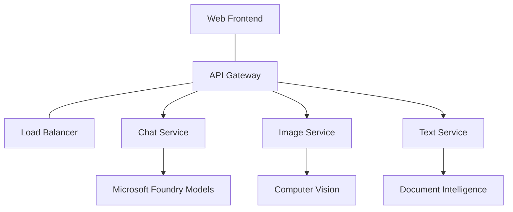

# Production AI Workload Best Practices wit AZD

**Chapter Navigation:**
- **📚 Course Home**: [AZD For Beginners](../../README.md)
- **📖 Current Chapter**: Chapter 8 - Production & Enterprise Patterns
- **⬅️ Previous Chapter**: [Chapter 7: Troubleshooting](../chapter-07-troubleshooting/debugging.md)
- **⬅️ Also Related**: [AI Workshop Lab](../chapter-02-ai-development/ai-workshop-lab.md)
- **🎯 Course Complete**: [AZD For Beginners](../../README.md)

## Overview

Dis guide dey explain production AI design patterns wit Azure Developer CLI (AZD). E be design reference, no be deployable application or production certification.

**Example boundaries:** Unless e clear talk say e complete, Bicep fragments dey assume parameters and referenced resources from one containing template. Dem no include host images/plans, identities, role assignments, DNS, outputs, and other things wey need to connect. YAML service paths and hook/test scripts na example files wey you go create for **your own application**; dis course no go provide dem. Use one working AZD sample as base, compile di complete infrastructure, and test am for isolated environment before you put am for production.

## Key Challenges Addressed

Common production wahala na multi-service deployments, identity and secret management, scaling, cost control, and monitoring. Dis place no talk say na the most common.

## Architecture Patterns for Production AI

### Pattern 1: Microservices AI Architecture

**When to use**: Complex AI applications wey get many capabilities



**AZD Implementation**:

```yaml
# azure.yaml
name: enterprise-ai-platform
services:
  web:
    project: ./web
    host: staticwebapp
  api-gateway:
    project: ./api-gateway
    host: containerapp
  chat-service:
    project: ./services/chat
    host: containerapp
  vision-service:
    project: ./services/vision
    host: containerapp
  text-service:
    project: ./services/text
    host: containerapp
```

### Pattern 2: Event-Driven AI Processing

**When to use**: Batch processing, document analysis, async workflows

```bicep
// Event Hub for AI processing pipeline
resource eventHub 'Microsoft.EventHub/namespaces@2024-01-01' = {
  name: eventHubNamespaceName
  location: location
  sku: {
    name: 'Standard'
    tier: 'Standard'
    capacity: 1
  }
}

// Service Bus for reliable message processing
resource serviceBus 'Microsoft.ServiceBus/namespaces@2024-01-01' = {
  name: serviceBusNamespaceName
  location: location
  sku: {
    name: 'Premium'
    tier: 'Premium'
    capacity: 1
  }
}

// Function App for processing
resource functionApp 'Microsoft.Web/sites@2023-01-01' = {
  name: functionAppName
  location: location
  kind: 'functionapp,linux'
  properties: {
    siteConfig: {
      appSettings: [
        {
          name: 'FUNCTIONS_EXTENSION_VERSION'
          value: '~4'
        }
        {
          name: 'AZURE_OPENAI_ENDPOINT'
          value: '@Microsoft.KeyVault(VaultName=${keyVault.name};SecretName=openai-endpoint)'
        }
      ]
    }
  }
}
```

Dis one dey create namespace fragments, no be hubs, queues, subscriptions, or Function triggers. One runnable Function still need hosting plan, runtime/storage configuration, attached identity, RBAC, and network access. The Key Vault reference need permission to read the secret; endpoint URL alone no be credential.

## Thinking About AI Agent Health

When traditional web app fowl, di symptoms dey familiar: page no load, API throw error, or deployment fail. AI-powered applications fit break like dat too—plus dem fit misbehave in subtle ways wey no go send clear error message.

Dis section go help you build mental model to monitor AI workloads so you sabi where to check when things no dey alright.

### How Agent Health Differs from Traditional App Health

Traditional apps fit get subtle correctness failure too. AI agent add nondeterministic response quality join the normal availability and correctness matter. Agent health get two layers:

| Layer | Wetin You Go Watch | Where You Go Look |
|-------|--------------|---------------|
| **Infrastructure health** | Service dey run? Resources dey? Endpoints dey reachable? | `azd monitor`, Azure Portal resource health, container/app logs |
| **Behavior health** | Agent dey respond correct? Responses dey on time? Model dey call correct? | Application Insights traces, model call latency metrics, response quality logs |

Infrastructure health na wetin everybody sabi—e same for any azd app. Behavior health na new layer wey AI workloads bring.

### Where to Look When AI Apps No Dey Behave as Expected

If your AI application no dey give the results wey you expect, na here conceptual checklist:

1. **Start wit basics.** App dey run? E fit reach wetin e depend on? Check `azd monitor` and resource health just like any other app.
2. **Check the model connection.** Your application dey successfully call the AI model? Failed or timeout model calls na most common cause of AI app wahala and you go see am for application logs.
3. **Inspect input and grounding safely.** Wrong answers fit come from retrieval, instructions, model limits, or tool execution. Use access-controlled, redacted diagnostic data; no enable indiscriminate prompt/response logging for production.
4. **Review response latency.** AI model calls slow pass normal API calls. If your app dey slow, check if model response time don increase—that fit mean throttling, capacity limits, or region-level congestion.
5. **Watch for cost signals.** Unexpected spike for token use or API calls fit mean loop, bad prompt configuration, or too many retries.

No need to sabi observability tooling sharp sharp. The main point na say AI applications get extra behavior layer wey you go monitor, and azd built-in monitoring (`azd monitor`) fit start you for checking both layers.

---

## Security Best Practices

### 1. Zero-Trust Security Model

**Implementation Strategy**:
- No service-to-service communication without authentication
- All API calls use managed identities
- Network isolation wit private endpoints
- Least privilege access controls

```bicep
// Managed Identity for each service
resource chatServiceIdentity 'Microsoft.ManagedIdentity/userAssignedIdentities@2023-01-31' = {
  name: 'chat-service-identity'
  location: location
}

// Role assignments with minimal permissions
resource openAIUserRole 'Microsoft.Authorization/roleAssignments@2022-04-01' = {
  scope: openAIAccount
  name: guid(openAIAccount.id, chatServiceIdentity.id, '5e0bd9bd-7b93-4f28-af87-19fc36ad61bd')
  properties: {
    roleDefinitionId: subscriptionResourceId('Microsoft.Authorization/roleDefinitions', '5e0bd9bd-7b93-4f28-af87-19fc36ad61bd')
    principalId: chatServiceIdentity.properties.principalId
    principalType: 'ServicePrincipal'
  }
}
```

### 2. Secure Secret Management

**Key Vault Integration Pattern**:

```bicep
// Key Vault with proper access policies
resource keyVault 'Microsoft.KeyVault/vaults@2023-02-01' = {
  name: keyVaultName
  location: location
  properties: {
    tenantId: tenant().tenantId
    sku: {
      family: 'A'
      name: 'standard' // Premium is needed for HSM-backed keys, not ordinary secrets
    }
    enableRbacAuthorization: true  // Use RBAC instead of access policies
    enablePurgeProtection: true    // Prevent accidental deletion
    enableSoftDelete: true
    softDeleteRetentionInDays: 90
  }
}

// Optional legacy key-auth alternative; omit when using Entra ID.
resource openAIKeySecret 'Microsoft.KeyVault/vaults/secrets@2023-02-01' = {
  parent: keyVault
  name: 'openai-api-key'
  properties: {
    value: openAIAccount.listKeys().key1
    attributes: {
      enabled: true
    }
  }
}
```

Assign di runtime identity `Key Vault Secrets User` for di right scope and attach am to di host; `enableRbacAuthorization` alone no get access. Better use OpenAI managed identity authentication wit `disableLocalAuth: true`. The optional key secret dey only make sense if account really need key, and the provisioning principal still need permission to write secrets.

### 3. Network Security

**Private Endpoint Configuration**:

```bicep
// Virtual Network for AI services
resource virtualNetwork 'Microsoft.Network/virtualNetworks@2023-04-01' = {
  name: vnetName
  location: location
  properties: {
    addressSpace: {
      addressPrefixes: ['10.0.0.0/16']
    }
    subnets: [
      {
        name: 'ai-services-subnet'
        properties: {
          addressPrefix: '10.0.1.0/24'
          privateEndpointNetworkPolicies: 'Disabled'
        }
      }
      {
        name: 'app-services-subnet'
        properties: {
          addressPrefix: '10.0.2.0/24'
          delegations: [
            {
              name: 'Microsoft.Web/serverFarms'
              properties: {
                serviceName: 'Microsoft.Web/serverFarms'
              }
            }
          ]
        }
      }
    ]
  }
}

// Private endpoints for all AI services
resource openAIPrivateEndpoint 'Microsoft.Network/privateEndpoints@2023-04-01' = {
  name: '${openAIAccountName}-pe'
  location: location
  properties: {
    subnet: {
      id: virtualNetwork.properties.subnets[0].id
    }
    privateLinkServiceConnections: [
      {
        name: 'openai-connection'
        properties: {
          privateLinkServiceId: openAIAccount.id
          groupIds: ['account']
        }
      }
    ]
  }
}
```

Private endpoints still need private DNS zone groups/VNet links and application VNet integration. Dem no automatically block public access: you gats explicitly disable AI account public network access after you verify private connectivity and deployment access.

## Performance and Scaling

### 1. Auto-Scaling Strategies

**Container Apps Auto-scaling**:

```bicep
resource containerApp 'Microsoft.App/containerApps@2023-05-01' = {
  name: containerAppName
  location: location
  properties: {
    configuration: {
      ingress: {
        external: true
        targetPort: 8000
        transport: 'http'
      }
    }
    template: {
      scale: {
        minReplicas: 2  // Always have 2 instances minimum
        maxReplicas: 50 // Scale up to 50 for high load
        rules: [
          {
            name: 'http-scaling'
            http: {
              metadata: {
                concurrentRequests: '20'  // Scale when >20 concurrent requests
              }
            }
          }
          {
            name: 'cpu-scaling'
            custom: {
              type: 'cpu'
              metadata: {
                type: 'Utilization'
                value: '70'  // Scale when CPU >70%
              }
            }
          }
        ]
      }
    }
  }
}
```

### 2. Caching Strategies

**Redis Cache for AI Responses**:

```bicep
// Legacy Azure Cache for Redis example (not recommended for new deployments)
resource redisCache 'Microsoft.Cache/redis@2023-04-01' = {
  name: redisCacheName
  location: location
  properties: {
    sku: {
      name: 'Premium'
      family: 'P'
      capacity: 1
    }
    enableNonSslPort: false
    minimumTlsVersion: '1.2'
    redisConfiguration: {
      'maxmemory-policy': 'allkeys-lru'
    }
    // Sharding distributes data; replication/failover provides availability.
    shardCount: 2
  }
}

// Cache configuration in application
var cacheConnectionString = '${redisCache.properties.hostName}:6380,password=${redisCache.listKeys().primaryKey},ssl=True,abortConnect=False'
```

Azure Cache for Redis Basic/Standard/Premium dey [retirement path](https://learn.microsoft.com/azure/azure-cache-for-redis/retirement-faq). Use Azure Managed Redis for new designs plus its documented SKU, identity, and TLS setup, no copy this legacy resource into new production system. That connection-string line na placeholder, no be credential. Partition cache keys by authorization, model/instructions, and retrieval version, with expiry; shared query-only cache fit expose another user data.

### 3. Load Balancing and Traffic Management

**Application Gateway with WAF**:

```bicep
// Application Gateway with Web Application Firewall
resource applicationGateway 'Microsoft.Network/applicationGateways@2023-04-01' = {
  name: appGatewayName
  location: location
  properties: {
    sku: {
      name: 'WAF_v2'
      tier: 'WAF_v2'
      capacity: 2
    }
    webApplicationFirewallConfiguration: {
      enabled: true
      firewallMode: 'Prevention'
      ruleSetType: 'OWASP'
      ruleSetVersion: '3.2'
    }
    // Backend pools for AI services
    backendAddressPools: [
      {
        name: 'ai-services-pool'
        properties: {
          backendAddresses: [
            {
              fqdn: '${containerApp.properties.configuration.ingress.fqdn}'
            }
          ]
        }
      }
    ]
  }
}
```

Dis one na partial gateway resource: real deployment still need gateway subnet/IP config, frontend IPs and ports, TLS listeners/certificates, backend HTTP settings/probes, routing rules and priorities, and reviewed WAF policy. TLS hostname/SNI and authentication must match Container App backend.

## 💰 Cost Optimization

### 1. Resource Right-Sizing

**Environment-Specific Configurations**:

Dem names na **illustrative custom-template inputs**, no be automatic AZD settings. Map each one enter `infra/main.parameters.json`/Bicep and host configuration first. For example, RAG sample dey use `AZURE_SEARCH_SERVICE_SKU` and `AZURE_OPENAI_CHATGPT_DEPLOYMENT_CAPACITY`, no be generic names below. Give Container Apps memory supported unit like `1Gi` for actual resource. Apply infrastructure changes wid `azd up` or `azd provision`; `azd deploy` alone no dey apply Bicep changes.

```bash
# Development environment
azd env new development
azd env set AZURE_OPENAI_SKU "S0"
azd env set AZURE_OPENAI_CAPACITY 10
azd env set AZURE_SEARCH_SKU "basic"
azd env set CONTAINER_CPU 0.5
azd env set CONTAINER_MEMORY 1.0

# Production environment  
azd env new production
azd env set AZURE_OPENAI_SKU "S0"
azd env set AZURE_OPENAI_CAPACITY 100
azd env set AZURE_SEARCH_SKU "standard"
azd env set CONTAINER_CPU 2.0
azd env set CONTAINER_MEMORY 4.0
```

### 2. Cost Monitoring and Budgets

```bicep
// Supply the first day of the current UTC month, e.g. 2026-11-01T00:00:00Z.
param budgetStartDate string

// Cost management and budgets
resource budget 'Microsoft.Consumption/budgets@2024-08-01' = {
  name: 'ai-workload-budget'
  properties: {
    timePeriod: {
      startDate: budgetStartDate
    }
    timeGrain: 'Monthly'
    amount: 2000  // In the billing currency, not necessarily USD
    category: 'Cost'
    notifications: {
      warning: {
        enabled: true
        operator: 'GreaterThan'
        threshold: 80
        contactEmails: [
          'finance@company.com'
          'engineering@company.com'
        ]
        contactRoles: [
          'Owner'
          'Contributor'
        ]
      }
      critical: {
        enabled: true
        operator: 'GreaterThan'
        threshold: 95
        contactEmails: [
          'cto@company.com'
        ]
      }
    }
  }
}
```

Change example recipients and check scope/permissions. Budget alerts use delayed billing data, no dey enforce spending cap.

### 3. Token Usage Optimization

**OpenAI Cost Management**:

Dis one na character-based heuristic for UI preview, **no be** model token-limit validator. Production code gats use tokenizer wey match deployed model and include system instructions, tool schemas, history, output budget. Reject oversized user message, no silently truncate am.

```typescript
// Application-level token optimization
class TokenOptimizer {
  private readonly maxTokens = 4000;
  private readonly reserveTokens = 500;
  
  optimizePrompt(userInput: string, context: string): string {
    const availableTokens = this.maxTokens - this.reserveTokens;
    if (this.estimateTokens(userInput) + 8 >= availableTokens) {
      throw new Error("User input exceeds the illustrative prompt budget");
    }
    const estimatedTokens = this.estimateTokens(userInput + context) + 8;
    
    if (estimatedTokens > availableTokens) {
      // Truncate context, not user input
      context = this.truncateContext(context, Math.max(0, availableTokens - this.estimateTokens(userInput) - 8));
    }
    
    return `${context}\n\nUser: ${userInput}`;
  }
  
  private estimateTokens(text: string): number {
    // Rough estimation: 1 token ≈ 4 characters
    return Math.ceil(text.length / 4);
  }

  private truncateContext(text: string, estimatedBudget: number): string {
    return text.slice(0, Math.max(0, estimatedBudget) * 4);
  }
}
```

## Monitoring and Observability

### 1. Comprehensive Application Insights

```bicep
// Application Insights with advanced features
resource applicationInsights 'Microsoft.Insights/components@2020-02-02' = {
  name: applicationInsightsName
  location: location
  kind: 'web'
  properties: {
    Application_Type: 'web'
    WorkspaceResourceId: logAnalyticsWorkspace.id
    SamplingPercentage: 100  // Ingestion setting; review cost and SDK sampling separately
    DisableIpMasking: false  // Retain IP masking
  }
}

// Custom metrics for AI operations
resource aiMetricAlerts 'Microsoft.Insights/metricAlerts@2018-03-01' = {
  name: 'ai-high-error-rate'
  location: 'global'
  properties: {
    description: 'Alert when failed request count exceeds 10 in five minutes'
    severity: 2
    enabled: true
    scopes: [
      applicationInsights.id
    ]
    evaluationFrequency: 'PT1M'
    windowSize: 'PT5M'
    criteria: {
      'odata.type': 'Microsoft.Azure.Monitor.SingleResourceMultipleMetricCriteria'
      allOf: [
        {
          name: 'high-error-rate'
          metricName: 'requests/failed'
          operator: 'GreaterThan'
          threshold: 10
          timeAggregation: 'Count'
        }
      ]
    }
  }
}
```

### 2. AI-Specific Monitoring

**Custom Dashboards for AI Metrics**:

```json
{
  "dashboard": {
    "name": "AI Application Monitoring",
    "tiles": [
      {
        "name": "OpenAI Request Volume",
        "query": "dependencies | where target contains 'openai' | summarize count() by bin(timestamp, 5m)"
      },
      {
        "name": "AI Response Latency",
        "query": "dependencies | where target contains 'openai' | summarize avg(duration) by bin(timestamp, 5m)"
      },
      {
        "name": "Token Usage",
        "query": "customMetrics | where name == 'openai_tokens_used' | summarize sum(value) by bin(timestamp, 1h)"
      },
      {
        "name": "Cost per Hour",
        "query": "customMetrics | where name == 'openai_cost' | summarize sum(value) by bin(timestamp, 1h)"
      }
    ]
  }
}
```

Dis JSON na application-defined sketch, no be importable Azure portal dashboard schema. The token/cost queries dey need your app to emit those exact custom metrics; AZD no create dem. Adjust dependency filters for your real model endpoint/span names.

### 3. Health Checks and Uptime Monitoring

```bicep
// Application Insights availability tests
resource availabilityTest 'Microsoft.Insights/webtests@2022-06-15' = {
  name: 'ai-app-availability-test'
  location: location
  tags: {
    'hidden-link:${applicationInsights.id}': 'Resource'
  }
  properties: {
    SyntheticMonitorId: 'ai-app-availability-test'
    Name: 'AI Application Availability Test'
    Description: 'Tests AI application endpoints'
    Enabled: true
    Frequency: 300  // 5 minutes
    Timeout: 120    // 2 minutes
    Kind: 'standard'
    Locations: [
      {
        Id: 'us-east-2-azr'
      }
      {
        Id: 'us-west-2-azr'
      }
    ]
    Request: {
      RequestUrl: 'https://${webApp.properties.defaultHostName}/health'
      HttpVerb: 'GET'
      FollowRedirects: true
      ParseDependentRequests: false
    }
    ValidationRules: {
      ExpectedHttpStatusCode: 200
      SSLCheck: true
      SSLCertRemainingLifetimeCheck: 7
    }
  }
}
```

## Disaster Recovery and High Availability

The test before assume say App Service `webApp` and Application Insights resource dey. Standard availability tests dey billable and need reachable endpoint; private-only apps need proper private monitoring design. URL ping tests don old; use [standard availability tests](https://learn.microsoft.com/azure/azure-monitor/app/availability).

### 1. Multi-Region Deployment

```yaml
# azure.yaml - Multi-region configuration
name: ai-app-multiregion
services:
  api-primary:
    project: ./api
    host: containerapp
    env:
      AZURE_REGION: eastus
  api-secondary:
    project: ./api
    host: containerapp
    env:
      AZURE_REGION: westus2
```

```bicep
// Separate App Service topology, not the Container Apps declarations above
resource trafficManager 'Microsoft.Network/trafficManagerProfiles@2022-04-01' = {
  name: trafficManagerProfileName
  location: 'global'
  properties: {
    profileStatus: 'Enabled'
    trafficRoutingMethod: 'Priority'
    dnsConfig: {
      relativeName: trafficManagerProfileName
      ttl: 30
    }
    monitorConfig: {
      protocol: 'HTTPS'
      port: 443
      path: '/health'
      intervalInSeconds: 30
      toleratedNumberOfFailures: 3
      timeoutInSeconds: 10
    }
    endpoints: [
      {
        name: 'primary-endpoint'
        type: 'Microsoft.Network/trafficManagerProfiles/azureEndpoints'
        properties: {
          targetResourceId: primaryAppService.id
          endpointStatus: 'Enabled'
          priority: 1
        }
      }
      {
        name: 'secondary-endpoint'
        type: 'Microsoft.Network/trafficManagerProfiles/azureEndpoints'
        properties: {
          targetResourceId: secondaryAppService.id
          endpointStatus: 'Enabled'
          priority: 2
        }
      }
    ]
  }
}
```

Environment variables no dey pick resource locations. IaC gats provision different regional hosts and bind each service wit `resourceName` or `azd-service-name` tags. Traffic Manager example be **separate App Service topology** (`primaryAppService`/`secondaryAppService`), no be routing for Container Apps declarations. Container Apps need correct external endpoint/front door, TLS/custom-domain routing, and health probes.

### 2. Data Backup and Recovery

```bicep
// Backup configuration for critical data
resource backupVault 'Microsoft.DataProtection/backupVaults@2023-05-01' = {
  name: backupVaultName
  location: location
  identity: {
    type: 'SystemAssigned'
  }
  properties: {
    storageSettings: [
      {
        datastoreType: 'VaultStore'
        type: 'LocallyRedundant'
      }
    ]
  }
}

```

Vault alone no dey back up anything. Configure **workload-specific supported policy and backup instance**, source permissions, retention, and restore tests using [Azure Backup support matrices](https://learn.microsoft.com/azure/backup/backup-support-matrix). No general Azure Backup policy for hosted Azure OpenAI model deployments. Keep infrastructure/model deployment definitions for source control; protect uploaded documents, application data, fine-tuning artifacts wit backing service supported backup/export features. Define and test RPO/RTO clearly.

## DevOps and CI/CD Integration

### 1. GitHub Actions Workflow

```yaml
# .github/workflows/deploy-ai-app.yml
name: Deploy AI Application

on:
  push:
    branches: [main]
  pull_request:
    branches: [main]

jobs:
  test:
    runs-on: ubuntu-latest
    steps:
      - uses: actions/checkout@v4
      
      - name: Setup Python
        uses: actions/setup-python@v4
        with:
          python-version: '3.11'
          
      - name: Install dependencies
        run: |
          pip install -r requirements.txt
          pip install pytest
          
      - name: Run tests
        run: pytest tests/
        
      - name: AI Safety Tests
        run: |
          python scripts/test_ai_safety.py
          python scripts/validate_prompts.py

```

Dis na **test-only part** of workflow and e assume say you don create `requirements.txt`, `tests/`, and two safety scripts. Add di authenticated OIDC provisioning/deployment jobs from [CI/CD Pipeline Configuration](#cicd-pipeline-configuration), wit `needs: test`, trusted push/manual trigger, and protected GitHub environments. No deploy untrusted pull-request code with cloud credentials. Fresh runner no get selected local AZD environment; give environment/subscription/location inputs and use `azd auth login`, no just `azure/login`.

### 2. Infrastructure Validation

```bash
# scripts/validate_infrastructure.sh
#!/bin/bash
set -euo pipefail

echo "Validating AI infrastructure deployment..."

# Requires Azure CLI login and the resource group selected explicitly.
: "${AZURE_RESOURCE_GROUP:?Set AZURE_RESOURCE_GROUP}"
: "${AZURE_OPENAI_NAME:?Set AZURE_OPENAI_NAME}"
: "${AZURE_OPENAI_CHAT_DEPLOYMENT:?Set the actual deployment name}"

# A successful empty list is not proof that resources exist.
types=("Microsoft.CognitiveServices/accounts" "Microsoft.Search/searchServices"
       "Microsoft.Storage/storageAccounts" "Microsoft.KeyVault/vaults")
for resource_type in "${types[@]}"; do
    count=$(az resource list --resource-group "$AZURE_RESOURCE_GROUP" \
        --resource-type "$resource_type" --query "length(@)" -o tsv)
    if [[ "$count" -lt 1 ]]; then
        echo "ERROR: No $resource_type found in $AZURE_RESOURCE_GROUP"
        exit 1
    fi
done

# Validate OpenAI model deployments
echo "Validating OpenAI model deployments..."
state=$(az cognitiveservices account deployment show \
  --name "$AZURE_OPENAI_NAME" --resource-group "$AZURE_RESOURCE_GROUP" \
  --deployment-name "$AZURE_OPENAI_CHAT_DEPLOYMENT" \
  --query "properties.provisioningState" -o tsv)
if [[ "$state" != "Succeeded" ]]; then
    echo "ERROR: Required model deployment is not provisioned successfully"
    exit 1
fi

echo "Infrastructure validation completed successfully!"
```

Expected: zero exit and completion message only when all expected types dey and named model deployment dey provisioned. Dis one dey check inventory/provisioning state, **no be** resource health, exact topology, RBAC, network reachability, or model behavior. Adjust expected types to your architecture, then run separate authenticated app readiness test.

## Production Readiness Checklist

### Security ✅
- [ ] All services dey use managed identities
- [ ] Secrets dey stored in Key Vault
- [ ] Private endpoints dey configured
- [ ] Network security groups dey implemented
- [ ] RBAC wit least privilege
- [ ] WAF dey enabled for public endpoints

### Performance ✅
- [ ] Auto-scaling dey configured
- [ ] Caching dey implemented
- [ ] Load balancing dey set up
- [ ] CDN for static content dey
- [ ] Database connection pooling dey
- [ ] Token usage optimization dey

### Monitoring ✅
- [ ] Application Insights dey configured
- [ ] Custom metrics dey defined
- [ ] Alerting rules dey set up
- [ ] Dashboard don create
- [ ] Health checks dey implemented
- [ ] Log retention policies dey

### Reliability ✅
- [ ] Multi-region deployment
- [ ] Backup and recovery plan dey
- [ ] Circuit breakers dey implemented
- [ ] Retry policies dey configured
- [ ] Graceful degradation dey
- [ ] Health check endpoints dey

### Cost Management ✅
- [ ] Budget alerts dey configured
- [ ] Resource right-sizing dey
- [ ] Dev/test discounts apply
- [ ] Reserved instances don buy
- [ ] Cost monitoring dashboard dey
- [ ] Regular cost reviews dey

### Compliance ✅
- [ ] Data residency requirements meet
- [ ] Audit logging dey enabled
- [ ] Compliance policies dey apply
- [ ] Security baselines dey implemented
- [ ] Regular security assessments dey
- [ ] Incident response plan dey

## Performance Benchmarks

### Illustrative Production Targets

Dis na example SLOs wey you fit negotiate and load-test, no be measured benchmarks or guarantee. Response latency depend on model/output length; monthly token spend depend on traffic and prices, no token count alone.

| Metric | Target | Monitoring |
|--------|--------|------------|
| **Response Time** | < 2 seconds | Application Insights |
| **Availability** | 99.9% | Uptime monitoring |
| **Error Rate** | < 0.1% | Application logs |
| **Model Spend** | < $500/month (example budget) | Cost management |
| **Concurrent Users** | 1000+ | Load testing |
| **Recovery Time** | < 1 awa | Disaster recovery tests |

### Load Testing

Di following na interface sketch for load-test script We **yù mas implement**; dis repository no supply `scripts/load_test.py`. Define request payload dem, authentication, representative workloads, percentile latency/error assertions, and wan spending cap for your chosen load-test tool before you run am:

```bash
# Load testing script for AI applications
python scripts/load_test.py \
  --endpoint https://your-ai-app.azurewebsites.net \
  --concurrent-users 100 \
  --duration 300 \
  --ramp-up 60
```

## 🤝 Community Best Practices

Based on Microsoft Foundry Discord community feedback:

### Top Recommendations from di Community:

1. **Start Small, Scale Gradually**: Start wit basic SKUs and scale up based on wetin people dey use
2. **Monitor Everything**: Setup comprehensive monitoring from day one
3. **Automate Security**: Use infrastructure as code for consistent security
4. **Test Thoroughly**: Include AI-specific testing for your pipeline
5. **Plan for Costs**: Monitor token use and set up budget alerts quick quick

### Common Wahala to Avoid:

- ❌ Hardcoding API keys inside code
- ❌ No setup proper monitoring
- ❌ No care about cost optimization
- ❌ No test failure wahala dem
- ❌ Deploy without health checks

## AZD AI CLI Commands and Extensions

AZD get set of AI-specific commands and extensions Wey dey grow wey dey help streamline production AI workflows. Dem tools dey bridge gap between local development and production deployment for AI workloads.

> **Release review (2026-11-04):** Di CLI guidance wey dey below na checked against di published releases of `azd` **1.37.2**, `azure.ai.agents` **1.0.0-beta.23**, and `azure.ai.evaluations` **1.0.0-beta.2**. Agents beta.23 need `azd >= 1.37.0`; evaluations beta.2 need `azd >= 1.33.0`. Use at least 1.37.0 for di combined workflow. Dis na documentation/source review, no be live Azure deployment validation.

### AZD Extensions for AI

AZD dey use extension system to add AI-specific capabilities. Install and manage extensions wit:

```bash
# List all available extensions (including AI)
azd extension list

# Inspect installed extension details
azd version
azd extension show azure.ai.agents

# Install the Foundry agents extension
azd extension install azure.ai.agents

# Install the separate Foundry evaluations extension
azd extension install azure.ai.evaluations

# Install the fine-tuning extension
azd extension install azure.ai.finetune

# Install the custom models extension
azd extension install azure.ai.models

# Upgrade all installed extensions
azd extension upgrade --all
```

**Available AI extensions:**

| Extension | Purpose | Status |
|-----------|---------|--------|
| `azure.ai.agents` | Foundry Agent Service management | Preview |
| `azure.ai.evaluations` | Evaluation datasets, evaluators, eval groups, and runs | Preview |
| `azure.ai.skills` | Reusable agent skills | Preview |
| `azure.ai.connections` | Foundry connections (data sources, tools) | Preview |
| `azure.ai.finetune` | Foundry model fine-tuning | Preview |
| `azure.ai.models` | Foundry custom models | Preview |
| `azure.coding-agent` | Coding agent configuration | Available |

> Run `azd extension list --installed` and `azd extension show azure.ai.evaluations` to check di installed versions. Upgrade di core CLI first using di [installation/update instructions](https://learn.microsoft.com/azure/developer/azure-developer-cli/install-azd) (if you dey use Windows winget installation: `winget upgrade Microsoft.Azd`), then run `azd extension upgrade --all`. No core `azd upgrade` command dey. Check breaking changes before upgrade production automation; no assume say extension upgrade go preserve old command or config formats.

### Recent Release Changes and Fixes

| Release | Wetin change for dis course |
|---------|------------------------------|
| `azd 1.37.0` | Adds stable deployment-preview APIs and fix extension edits wey dey rewrite unrelated `azure.yaml` settings. |
| `azd 1.37.1` | Fix Ctrl+C wey no dey propagate well for extensions and separate cancellation/timeouts from generic failures. |
| `azd 1.37.2` | Improve provisioning validation: critical warnings default to **No**, e fail if no confirmation for unattended runs, and cancellation skip post-provision hooks. E also fix unresolved environment values for Deployment Stacks deny lists if that alpha feature dey enabled. |
| Agents `beta.22` | Migrate evaluation to `azd ai eval`, change optimization to GA v1 API, need plural `toolboxes`, and separate managed-harness, voice, and long-running preview opt-ins. Fix environment-specific model selection and toolbox authentication. |
| Agents `beta.23` | Show `init --harness`; fix A2A 0.3 answer output, invalid prompt-agent paths/modules across infrastructure layers, activation-timeout diagnostics, and retained developer RBAC warnings. |
| Evaluations `beta.2` | Need camelCase evaluation config, add static/simulated conversation authoring and explicit local-file sources, and fix dataset identity/version handling, quality-gate counts, and failed-run diagnostics. |

Agent activation timeout no mean deployment fail: check the version wey e try and the state before you try again. Developer RBAC warnings fit still dey even if provisioning succeed; fix the missing access before you use as that developer.

Sources: [AZD releases](https://github.com/Azure/azure-dev/releases), [agents beta.23 release](https://github.com/Azure/azure-dev/releases/tag/azd-ext-azure-ai-agents_1.0.0-beta.23), [agents beta.22 migration](https://github.com/Azure/azure-dev/releases/tag/azd-ext-azure-ai-agents_1.0.0-beta.22), and [evaluations beta.2 release](https://github.com/Azure/azure-dev/releases/tag/azd-ext-azure-ai-evaluations_1.0.0-beta.2).

**Wetin be the newer `skills` and `connections` extensions?**

Two preview extensions show for side by side with the agent tooling and dem worth to understand even if you be beginner:

- **`azure.ai.skills`** — A **skill** na reusable capability (na packaged tool or behavior) wey you fit attach to one or more agents instead make you implement am again everytime. Think am as shared building block: define "search the docs" or "look up order" skill one time, then use am again for different agents. Dis dey keep multi-agent systems (Chapter 5) consistent and no need copy-paste.
- **`azure.ai.connections`** — A **connection** na managed link from your Foundry project to external resource wey your agents need—data source (like Azure AI Search), tool endpoint, or another service. Connections centralize *where* and *how* agents fit access data, so credentials and endpoints dey for one governed place, no scatter inside code.

You no need dem to deploy your first agents—make you use `azure.ai.agents` while you dey learn. Use `skills` if you dey see say you dey duplicate the same tool between agents, and `connections` if some agents share the same data source.

### How to Initialize Agent Projects wit `azd ai agent init`

The `azd ai agent init` command dey scaffold Microsoft Foundry agent project. Use current `azure.yaml` project template, no use any old legacy agent manifest:

```bash
# Initialize a new agent project from a local project template
azd ai agent init --template ./templates/support-agent/azure.yaml

# Initialize and target a specific Foundry project
azd ai agent init --template ./templates/support-agent/azure.yaml --project-id <foundry-project-id>

# Adopt the template into a different directory
azd ai agent init --template ./templates/support-agent/azure.yaml --src ./agents/my-agent
```

**Key flags:**

| Flag | Description |
|------|-------------|
| `-t, --template` | Path or supported GitHub URI to `azure.yaml` project document |
| `-p, --project-id` | Existing Microsoft Foundry Project ID for your azd environment |
| `-s, --src` | Source directory for generated agents, or target directory wen you dey adopt project |
| `--kind` | Initialize `hosted`, `prompt`, or preview `prompt-voice` agent |
| `--harness` | Optional execution harness for `--kind prompt`; need their preview opt-in |
| `-e, --environment` | The azd environment to use |

`--manifest`/`-m` be deprecated alias for `--template`/`-t`; renaming flag no convert old manifest to current project document. `--host containerapp` no be current agent-init flag. For normal Container Apps application, use `azd init --template` wit template wey declare `host: containerapp`.

For existing project wey get exactly one `azure.ai.project` service, `azd ai agent add support-agent --file ./agents/support-agent.yaml` go add or update direct agent definition without provisioning or deploying. Runtime commands no go accept legacy implicit `agent.yaml`/AgentManifest and nested service `config:` definitions; make you migrate dem go current `azure.ai.agent` service. When init show `cd` next step, run am before `azd up`: init no dey change your shell directory.

**Production tip**: Use `--project-id` to connect directly to existing Foundry project, keep your agent code and cloud resources linked from beginning.

#### Optional Preview Features

Managed harness, voice, and long-running invocation no dey enabled by default. Set only the switch for the feature you need for **shell/CI process environment**, no dey use `azd env set`:

| Feature | Process environment variable |
|---------|------------------------------|
| Managed harness (`init --kind prompt --harness ...`) | `AZD_ALPHA_ENABLE_AGENTS_MANAGED_HARNESS=true` |
| Voice (`init --kind prompt-voice`) | `AZD_ALPHA_ENABLE_AGENTS_VOICE=true` |
| Long-running invocation | `AZD_ALPHA_ENABLE_AGENTS_LONG_RUNNING=true` |

For example, use `export AZD_ALPHA_ENABLE_AGENTS_MANAGED_HARNESS=true` for Bash or `$env:AZD_ALPHA_ENABLE_AGENTS_MANAGED_HARNESS = "true"` for PowerShell before you run the command wey concern you. One switch no fit enable di others. See di [released agents README](https://github.com/Azure/azure-dev/blob/azd-ext-azure-ai-agents_1.0.0-beta.23/cli/azd/extensions/azure.ai.agents/README.md) for all preview switches and limitations.

### Managing the Agent Lifecycle

Use `azure.ai.agents` to test, inspect, optimize, and retire agents, and di separate `azure.ai.evaluations` extension to measure quality:

```bash
# Invoke a deployed agent and view server response timing
# (total latency and time to first byte)
azd ai agent invoke

# Show the live endpoint configuration before changing it
azd ai agent endpoint show

# Download the deployed source of a code-based hosted agent
# (with SHA-256 verification)
azd ai agent code download

# Delete a hosted agent and all of its versions
# (--force terminates active sessions)
azd ai agent delete --force
```

**Lifecycle at a glance:**

| Stage | Command | Production use |
|-------|---------|----------------|
| Test | `azd ai agent invoke` | Validate responses and measure latency before release |
| Inspect | `azd ai agent endpoint show` | Review endpoint auth/config; spot breaking changes early |
| Measure | `azd ai eval init`, `generate`, `run start` | Define, deploy, and execute repeatable evaluations |
| Improve | `azd ai agent optimize --eval <evaluation-name> --optimize-model <optimizer-deployment>` | Reuse compatible evaluation to optimize agent |
| Recover | `azd ai agent code download` | Retrieve exact deployed source for audit/rollback |
| Retire | `azd ai agent delete --force` | Tear down an agent and its versions cleanly |

> These na preview commands and dem fit change between extension releases. Run `azd ai agent --help` to see exact subcommands wey dey for your installed version.

`endpoint show` supports hosted, prompt, and voice agents, but endpoint updates na hosted-only; workflow agents no dey supported. Code download and di hosted-agent retirement example wey dey above no be generic for every agent kind.

#### Evaluation Migration and Quality Checks

Starting wit agents **1.0.0-beta.22 (2026-10-23)**, legacy `azd ai agent eval` commands dey give migration guidance instead di old evaluation workflow. No copy old `eval generate --dataset ...` examples: evaluation don shift under **`azd ai eval`**.

For initialized agent project, authenticate with `azd auth login`, confirm environment/Foundry project wey you select, and install `azure.ai.evaluations`. Judge model deployment dey needed for model-based scoring; generation and conversation simulation fit need their own model selections and incur extra charges.

```bash
# Scaffold evals/ and wire an azure.ai.eval service into azure.yaml
azd ai eval init

# Optionally synthesize a rubric and dataset from the agent
azd ai eval generate

# Review generated files, then register datasets, evaluators, and eval groups
azd up

# Start an evaluation and wait for its results
azd ai eval run start --wait

# Inspect runs and available test-case output
azd ai eval run list
azd ai eval run show <run-id>
azd ai eval run output list <run-id>
```

Follow wetin interactive selections and printed next steps talk; no dey assume say generated assets don register already. Evaluation config normally dey `evals/azure.eval.yaml`, referenced by `azure.ai.eval` service inside `azure.yaml`. Keys be **camelCase** (`evaluationLevel`, `maxSamples`, `initializationParameters`, `dataMapping`); old snake_case config keys no dey accepted. Paths inside referenced config dey relative to dat file, no dey relative to repository root.

For conversation evaluations, choose **static** to score completed transcripts without invoke agent, or **simulation** to generate conversation from scenario seeds. Simulation need agent target, simulator model, and separate judge-model selection. For unattended commands, provide the inputs wey `azd ai eval init --help` and `azd ai eval generate --help` list; no assume say generation model na di same as judge or simulator.

For CI, setup explicit quality policy wit `azd ai eval run start --help` (`--fail-on`) and treat any nonzero host exit as failure. Completed run no mean automatic quality pass. Check failed/errored rows and diagnostics; missing or inconsistent result counts no mean say e succeed. Registered datasets retain their service identity/version; `--max-samples` no fit subset registered dataset. Publish smaller dataset intentionally, or use supported local-file source.

```bash
# Example CI policy: at least 90% of all test cases must pass
azd ai eval run start --wait --fail-on "pass-rate=0.9"
```

Pass-rate gate dey use passed test cases divide by total test cases; failed, errored, skipped, and other unpassed rows fit count against am. No combo gate with `--no-wait`, wey dey return before verdict dey.

#### Optimization Configuration Migration

Optimization don shift to GA v1 API. To reuse compatible **turn-level, dataset-backed** evaluation from new workflow:

```bash
# Replace placeholders with the evaluation name and optimizer model deployment
azd ai agent optimize --eval-config ./evals/azure.eval.yaml --eval <evaluation-name> --optimize-model <optimizer-deployment>
```

`--eval` dey select evaluation; `--eval-config` dey select im configuration file (wey include file-backed definitions). `--config` instead na **standalone optimization API request** for YAML or JSON. No pass old agent `eval.yaml` or new `azure.eval.yaml` go `--config`, and no combine `--config` with `--eval`/`--eval-config`. Conversation, trace-backed, or simulation evaluations no fit replace dataset-backed optimization shortcut; make you use the supported optimization request format for those scenario dem. Make you review candidates before you apply or deploy dem.

See the [evaluations reference for the reviewed release](https://github.com/Azure/azure-dev/blob/azd-ext-azure-ai-evaluations_1.0.0-beta.2/cli/azd/extensions/azure.ai.evaluations/README.md) and [optimization command source for the reviewed release](https://github.com/Azure/azure-dev/blob/azd-ext-azure-ai-agents_1.0.0-beta.23/cli/azd/extensions/azure.ai.agents/internal/cmd/optimize.go) for exact options.

#### Read-Only Hosted-Agent Deployment Preview

For one existing Foundry-bound environment wey get unified `azure.ai.agent` service of `kind: hosted`, compare supported configuration before you deploy:

```bash
azd deploy <service-name> --preview --no-prompt
```

Dis preview no dey deploy the agent. E no complete infrastructure/security difference: prompt/voice/workflow agents, legacy configuration layouts, and some hosted settings no dey inside im scope. One `unknown` result no mean say dem approve make you deploy. No get standalone `azd ai agent deploy` or agent `--dry-run` command; make you use the core deployment workflow.

### Model Context Protocol (MCP) with `azd mcp`

AZD get built-in MCP server support (Alpha), wey dey enable AI agents and tools to interact with your Azure tin dem through standardized protocol:

```bash
# Start the MCP server for your project
azd mcp start

# Review current Copilot consent rules for tool execution
azd copilot consent list
```

MCP server dey expose your azd project context—environments, services, and Azure resources—to AI powered development tools. This one dey enable:

- **AI-assisted deployment**: Make coding agents fit ask about your project state and trigger deployments
- **Resource discovery**: AI tools fit find out which Azure resources your project dey use
- **Environment management**: Agents fit change from dev/staging/production environments

### Infrastructure Generation with `azd infra generate`

For production AI workloads, you fit generate and customize Infrastructure as Code instead make you dey rely on automatic provisioning:

```bash
# Generate supported infrastructure for this project type
azd infra generate
```

Support depend on the project/host and installed providers; dis one no be general reverse-engineering command for any Azure resources or promise to generate both Bicep and Terraform. Run `azd infra generate --help` and check the generated format. Where e dey support, to write IaC to disk go allow you to:
- Review and audit infrastructure before you deploy am
- Add custom security policies (network rules, private endpoints)
- Integrate with existing IaC review processes
- Version control infrastructure changes separate from application code

### Production Lifecycle Hooks

AZD hooks dey make you fit put custom logic for every stage of deployment lifecycle—wey important for production AI workflows:

```yaml
# azure.yaml - Production hooks example
name: ai-production-app
hooks:
  preprovision:
    shell: sh
    run: scripts/validate-quotas.sh    # Check AI model quota before provisioning
  postprovision:
    shell: sh
    run: scripts/verify-networking.sh  # Verify IaC-provisioned private connectivity
  predeploy:
    shell: sh
    run: scripts/run-ai-safety-tests.sh  # Run prompt safety checks
  postdeploy:
    shell: sh
    run: scripts/smoke-test.sh           # Verify agent responses post-deploy
services:
  agent-api:
    project: ./src/agent
    host: containerapp
    hooks:
      predeploy:
        shell: sh
        run: scripts/validate-model-access.sh  # Per-service hook
```

```bash
# Run a specific hook manually during development
azd hooks run predeploy
```

**Recommended production hooks for AI workloads:**

| Hook | Use Case |
|------|----------|
| `preprovision` | Check subscription quotas for AI model capacity |
| `postprovision` | Confirm private connectivity and required resource outputs |
| `predeploy` | Run AI safety tests, check prompt templates |
| `postdeploy` | Smoke test agent responses, confirm model connectivity |

### CI/CD Pipeline Configuration

Use `azd pipeline config` to connect your project to GitHub Actions or Azure Pipelines with secure Azure authentication:

```bash
# Configure CI/CD pipeline (interactive)
azd pipeline config

# Configure with a specific provider
azd pipeline config --provider github
```

Dis command go:
- Create or configure pipeline identity; make you review the role scope/permissions wey e generate instead to just assume e get least privilege
- Configure federated credentials (no save secrets)
- Generate or update your pipeline definition file
- Set required environment variables for your CI/CD system

#### Step-by-step: your first GitHub Actions pipeline

Here na the full walkthrough from one working azd project to automated deployments on every push.

**1. Make sure your project dey for GitHub**

```bash
git init
git add .
git commit -m "Initial azd project"
gh repo create my-ai-app --private --source=. --push
```

**2. Run pipeline config**

```bash
azd pipeline config --provider github
```

azd go, interactively:
- Ask which Azure subscription and environment you wan target
- Create Entra **app registration + service principal** for pipeline
- Set up **federated credentials (OIDC)**—so GitHub go authenticate to Azure with short-lived tokens and **no secrets go save**
- Push the required **variables** to your GitHub repo (`AZURE_CLIENT_ID`, `AZURE_TENANT_ID`, `AZURE_SUBSCRIPTION_ID`, `AZURE_ENV_NAME`, `AZURE_LOCATION`)

**3. Understand the generated workflow**

For supported template, configure/review `.github/workflows/azure-dev.yml`. The key parts be like dis (the template must supply the app's toolchain and environment parameters):

```yaml
# .github/workflows/azure-dev.yml
on:
  push:
    branches: [ main ]
  workflow_dispatch:        # lets you run it manually too

permissions:
  id-token: write           # required for OIDC federated login
  contents: read

jobs:
  build:
    runs-on: ubuntu-latest
    env:
      AZURE_CLIENT_ID: ${{ vars.AZURE_CLIENT_ID }}
      AZURE_TENANT_ID: ${{ vars.AZURE_TENANT_ID }}
      AZURE_SUBSCRIPTION_ID: ${{ vars.AZURE_SUBSCRIPTION_ID }}
      AZURE_ENV_NAME: ${{ vars.AZURE_ENV_NAME }}
      AZURE_LOCATION: ${{ vars.AZURE_LOCATION }}
    steps:
      - uses: actions/checkout@v4
      - name: Install azd
        uses: Azure/setup-azd@v2
      - name: Log in with OIDC
        run: azd auth login --client-id "$AZURE_CLIENT_ID" --federated-credential-provider "github" --tenant-id "$AZURE_TENANT_ID"
      - name: Provision infrastructure
        run: azd provision --no-prompt
      - name: Deploy application
        run: azd deploy --no-prompt
```

**4. Verify e dey work**

```bash
# Push a change to trigger the pipeline
git commit -am "Trigger pipeline" --allow-empty
git push
```

Open the **Actions** tab for your GitHub repo and observe the workflow dey run `azd provision` and `azd deploy` automatically.

> **Why federated credentials matter:** old pipeline dem dey save client secret for GitHub. OIDC federated credentials remove that secret completely—GitHub go ask for short-lived token at runtime, wey secure pass and no need to rotate or fit leak. Na default `azd pipeline config` dey set.

> **Secrets vs. variables:** non-sensitive identifiers (`AZURE_CLIENT_ID` and others) go in repo **variables**. If your app really need secret at build time, add am as GitHub **secret** and reference am with `${{ secrets.NAME }}`—but e better make you use Key Vault + managed identity at runtime (see [Chapter 3](../chapter-03-configuration/authsecurity.md)).

**Production workflow with pipeline config:**

```bash
# 1. Set up production environment
azd env new production
azd env set AZURE_OPENAI_CAPACITY 100

# 2. Configure the pipeline
azd pipeline config --provider github

# 3. Review the generated trigger, provisioning/deployment steps, and approvals
```

#### Step-by-step: Azure DevOps Pipelines

You prefer Azure DevOps pass GitHub Actions? azd support am natively with the `azdo` provider. The flow dey almost the same—azd go generate pipeline file, create service connection, and set up authentication.

**1. Make sure say you get Azure DevOps project**

You need organization and project for `https://dev.azure.com/<your-org>`. Generate Personal Access Token (PAT) wey get **Build (Read & execute)**, **Code (Read & write)**, and **Service Connections (Read, query & manage)** scopes—azd go ask you for am.

**2. Configure the pipeline**

```bash
azd pipeline config --provider azdo
```

azd go:
- Ask for your Azure DevOps organization and project
- Create (or use again) **service connection** to Azure using service principal
- Configure **workload identity federation (OIDC)** so no client secret dey saved
- Configure pipeline definition (usually `.azdo/pipelines/azure-dev.yml`) from project pipeline template

**3. Review the generated pipeline**

Use the project generated pipeline, include **Azure service connection and AZD authentication steps**. The official [Azure Pipelines setup guide](https://learn.microsoft.com/azure/developer/azure-developer-cli/pipeline-azure-pipelines) show the installer code wey e be; dis one na **installation only**, no be runnable authenticated deployment workflow:

```yaml
# .azdo/pipelines/azure-dev.yml (installer fragment only)
trigger:
  - main

pool:
  vmImage: ubuntu-latest

steps:
  - task: setup-azd@0
    displayName: Install azd
```

Install AZD Azure DevOps extension if that task no dey your organization. No copy pure `azd provision`/`azd deploy` shell steps without authentication: to get service connection no mean say e go log every process automatically into AZD. Follow generated template OIDC login and authorized task context, and provide selected environment/subscription/location.

**4. Where the variables come from**

azd dey store environment values (`AZURE_ENV_NAME`, `AZURE_LOCATION`, `AZURE_SUBSCRIPTION_ID`) as **variable group** inside Azure DevOps so pipeline fit read dem. You fit see and edit am under **Pipelines → Library**.

> **Same OIDC benefit like GitHub:** the `azdo` provider also dey configure workload identity federation, so no client secret go save for service connection—Azure DevOps dey exchange short-lived token at runtime. Only pass `--auth-type client-credentials` if your organization no fit use OIDC yet.

**5. Run am**

```bash
git commit -am "Add Azure DevOps pipeline" --allow-empty
git push
```

Open **Pipelines** for Azure DevOps to watch `azd provision` and `azd deploy` dey run.

### Adding Components with `azd add`

Add Azure services small small to existing project:

```bash
# Add a new service component interactively
azd add
```

Dis one good for growing production AI applications—for example, to add vector search service, new agent endpoint, or monitoring component to existing deployment.

## Additional Resources

- **Azure Well-Architected Framework**: [AI workload guidance](https://learn.microsoft.com/azure/well-architected/ai/)
- **Microsoft Foundry Documentation**: [Official docs](https://learn.microsoft.com/azure/ai-studio/)
- **Community Templates**: [Azure Samples](https://github.com/Azure-Samples)
- **Discord Community**: [#Azure channel](https://discord.gg/microsoft-azure)
- **Agent Skills for Azure**: [microsoft/github-copilot-for-azure on skills.sh](https://skills.sh/microsoft/github-copilot-for-azure) - Reusable agent skills for Azure AI, Foundry, deployment, cost optimization, and diagnostics. Install am for your editor:
  ```bash
  npx skills add microsoft/github-copilot-for-azure
  ```

---

**Chapter Navigation:**
- **📚 Course Home**: [AZD For Beginners](../../README.md)
- **📖 Current Chapter**: Chapter 8 - Production & Enterprise Patterns
- **⬅️ Previous Chapter**: [Chapter 7: Troubleshooting](../chapter-07-troubleshooting/debugging.md)
- **⬅️ Also Related**: [AI Workshop Lab](../chapter-02-ai-development/ai-workshop-lab.md)
- **🎯 Course Complete**: [AZD For Beginners](../../README.md)

**Remember**: Production AI workloads need careful planning, monitoring, and continuous optimization. Start with these patterns and adjust dem to your specific needs.

---

<!-- CO-OP TRANSLATOR DISCLAIMER START -->
**Disclaimer**:
Dis document don translate wit AI translation service [Co-op Translator](https://github.com/Azure/co-op-translator). Even tho we dey try make am correct, abeg make you know say automated translation fit get errors or mistakes. Di original document for dia own language na im be di correct source. For important info, make person wey sabi human translation do am. We no go responsible for any misunderstanding or wrong understanding wey fit happen because of dis translation.
<!-- CO-OP TRANSLATOR DISCLAIMER END -->