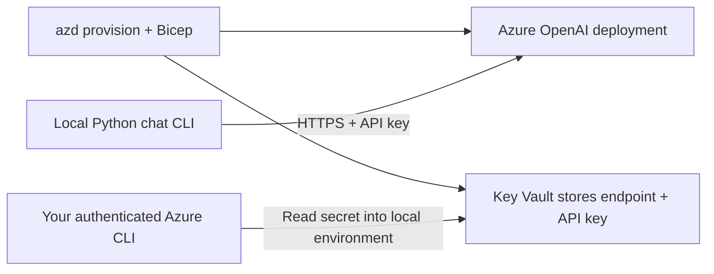

# Azure OpenAI Chat — Local CLI and AZD Infrastructure

**Level:** Intermediate · **Time:** 35–60 minutes including setup

Dis sample dey provision **Azure OpenAI resource and Key Vault**, den e go run one
interactive Python chat CLI **for your machine**. E no go host web application
or Container App. Di default model na `gpt-4.1`, version `2025-04-14`, wit
`GlobalStandard` deployment capacity 20. Check current availability and quota for
your selected region before you provision; model lifecycle dates fit change.

## Learning objectives

- Provision model infrastructure wit Bicep and azd.
- Make you fit comot API key from Key Vault without putting am inside deployment outputs.
- Send Chat Completions requests and hold conversation history.
- Understand token counts and di wahala dem wey fit dey with cost estimates.



No managed-identity runtime integration, multi-region failover, custom
rate limiter, streaming mode, or hosted compute dey for dis sample. The OpenAI SDK
dey try two times retry for retryable failures; di CLI go show remaining errors.

## Prerequisites

- Current stable [azd](https://learn.microsoft.com/azure/developer/azure-developer-cli/install-azd)
  (di published release at di time we dem review: 1.37.2).
- [Azure CLI](https://learn.microsoft.com/cli/azure/install-azure-cli).
- Python **3.10+** (3.11 na di recommended one) and virtual environment.
- Azure subscription wey get permission to create Cognitive Services and Key Vault
  resources, deploy models, and read di vault secrets.
- Regional availability and `GlobalStandard` quota for `gpt-4.1`. Access requirements
  dey depend on di subscription and feature; approval no dey guaranteed for any time.

```bash
azd version
az version
python --version
azd auth login
az login
```

Dem be separate authentication sessions. Make you choose di same subscription for both
tools before you run di commands wey dey below.

## Quick start (Bash)

Run the command from the repository root:

```bash
cd examples/azure-openai-chat
azd env new myopenai
azd provision
```

Choose one supported region. Provisioning go create a resource group, OpenAI account,
model deployment, Key Vault, and di `openai-endpoint`/`openai-api-key` secrets.
No **service dem to deploy** for `azure.yaml`.

Load di non-secret outputs and collect di secret inside your current shell:

```bash
export AZURE_OPENAI_ENDPOINT="$(azd env get-value AZURE_OPENAI_ENDPOINT)"
export AZURE_OPENAI_MODEL="$(azd env get-value AZURE_OPENAI_MODEL)"
KV_NAME="$(azd env get-value AZURE_KEY_VAULT_NAME)"
export AZURE_OPENAI_API_KEY="$(az keyvault secret show \
  --vault-name "$KV_NAME" --name openai-api-key --query value --output tsv)"

python -m venv .venv
source .venv/bin/activate
python -m pip install -r src/requirements.txt
python src/chat.py
```

For PowerShell, activate wit `.\.venv\Scripts\Activate.ps1` and assign environment
variables wit `$env:AZURE_OPENAI_ENDPOINT = azd env get-value AZURE_OPENAI_ENDPOINT`
(and also for di model). Collect di API key using
`$env:AZURE_OPENAI_API_KEY = az keyvault secret show --vault-name $KV_NAME --name openai-api-key --query value -o tsv`.
Set `$KV_NAME = azd env get-value AZURE_KEY_VAULT_NAME` first.

No print, commit, or paste di API key inside issue report dem. Di CLI dey read process
environment variables; e no **fetch** Key Vault secrets or load `.env` files.
`config.py` dey validate endpoint, token limit, and temperature when e start.

Wetin you fit expect (content and usage fit change):

```text
Azure OpenAI Chat Application
Model: gpt-4.1
...
You: Say hello in one sentence.
Assistant: Hello! How can I help you today?
[Tokens: ... | Cost: $...]
```

Commands: `stats` show totals, `clear` clear conversation history, and
`quit`/`exit` end di session. No `--stream`, `--show-tokens`, `tokens`,
or `cost` commands dey.

## Verify di deployment

After you don load di shell variables dem wey dem talk above:

```bash
curl --fail-with-body \
  "${AZURE_OPENAI_ENDPOINT%/}/openai/deployments/${AZURE_OPENAI_MODEL}/chat/completions?api-version=2024-10-21" \
  -H "Content-Type: application/json" \
  -H "api-key: $AZURE_OPENAI_API_KEY" \
  -d '{"messages":[{"role":"user","content":"Say hello!"}],"max_tokens":50}'

az keyvault secret list --vault-name "$KV_NAME" --query "[].name" -o table
```

Success: di API go return HTTP 200 wit `choices[0].message.content` and `usage`;
di vault dey list `openai-api-key` and `openai-endpoint`. Just ARM deployment
alone no fit verify inference.

## Files and configuration

```text
azure.yaml                         # Infrastructure-only AZD project
infra/main.bicep                   # Subscription deployment
infra/main.parameters.json         # Environment, location, principal ID
infra/resources/openai.bicep       # Account + model
infra/resources/keyvault.bicep     # Vault + deploying user's secret access policy
infra/resources/secrets.bicep      # Writes secrets, no key output
src/chat.py                        # Interactive CLI
src/config.py                      # Environment validation
src/requirements.txt               # Python packages
```

To change di provisioned model/version/capacity, edit di defaults for
`infra/main.bicep` and run `azd provision`. Setting `AZURE_OPENAI_MODEL` inside your
shell na only mean you select **deployment name wey already dey**; e no deploy another model.

| Runtime variable | Default / source |
|---|---|
| `AZURE_OPENAI_ENDPOINT` | Required; azd non-secret output |
| `AZURE_OPENAI_API_KEY` | Required; collect from Key Vault |
| `AZURE_OPENAI_MODEL` | `gpt-4.1`; Azure deployment name |
| `AZURE_OPENAI_MAX_TOKENS` | 800 (validation range 1–4096) |
| `AZURE_OPENAI_TEMPERATURE` | 0.7 (range 0–2) |
| `AZURE_OPENAI_INPUT_PRICE_PER_1K` | 0.002 USD; example uncached input rate |
| `AZURE_OPENAI_OUTPUT_PRICE_PER_1K` | 0.008 USD; example output rate |

## Costs and security limitations

Di cost display na **estimate**, no be Azure billing. E dey multiply API token
usage wit di configured rates and e no count cached input discounts,
regional/SKU differences, taxes, price changes, or calls wey fail/retry.
Override **both rates** if you dey use another model or SKU and verify current
[Azure OpenAI pricing](https://azure.microsoft.com/pricing/details/cognitive-services/openai-service/).

Na example, 100 requests wey use 500 uncached input and 200 output tokens each
for the default rates go cost `100 × (500/1000 × .002 + 200/1000 × .008) = $0.26`.
Key Vault operations/storage dey get separate charges. No fixed $50/month
charge for this local CLI and no hosted compute inside di template.

Di vault dey use access policy for di deploying principal; e no be RBAC or
managed-identity application example. Public endpoints and API-key authentication
dey used for teaching. Make you limit permissions and add correct identity/network
controls before you begin to adapt am for production.

## Practical exercises

### 1. Verify context and reset am

**Start:** di CLI dey run. **Goal:** observe history.
Talk “Remember di word cedar,” then ask “Which word I tell you make you remember?”
Run `stats`; two successful turns suppose count as two messages wey dem exchange.
Run `clear` and `stats`; exchanged messages suppose be zero (token totals go still dey).
Di exact wording from di model no dey deterministic.

### 2. Change di response limit

**Start:** exit di CLI, but make di shell still dey.
Run `export AZURE_OPENAI_MAX_TOKENS=100`, start `python src/chat.py` again, and ask for
small explanation about azd. Check say di banner show 100.
Restore with `unset AZURE_OPENAI_MAX_TOKENS`. Smaller response limit no go
reduce di tokens wey don already send before.

### Common issues dem

- **Missing environment variables:** provisioning no dey export shell values;
  you must do the export steps again. New terminal go need am again.
- **403 reading Key Vault:** make sure your Azure CLI subscription/login and di principal
  dey for di vault access policy. Policy changes fit take time to land.
- **404 inference:** check deployment name, endpoint, and deployment status.
- **429 inference:** wait make rate limits reset; verify regional model quota.
  Di CLI dey remove failed turns from history so retry no go duplicate dem.
- **Context length:** di sample no dey trim long conversation; use `clear`.
- **Model unavailable/retired:** check current model availability and update
  model/version/SKU together; API version and model version na different settings.

## Cleanup and next steps

```bash
azd down
unset AZURE_OPENAI_API_KEY
```

Key Vault soft-delete retention na seven days; to purge e need separate permissions.
No committed test suite dey; no try run `pytest tests/` command wey no dey.
Add mocked API tests before you extend di code.

[Container examples](../../../../examples/container-app) · [Retail architecture blueprint](../retail-scenario.md) ·
[Course home](../../README.md) · [Report an issue](https://github.com/microsoft/AZD-for-beginners/issues)

---

<!-- CO-OP TRANSLATOR DISCLAIMER START -->
**Disclaimer**:
Dis document don translate wit AI translation service [Co-op Translator](https://github.com/Azure/co-op-translator). Even tho we dey try make am correct, abeg make you know say automated translation fit get errors or mistakes. Di original document for dia own language na im be di correct source. For important info, make person wey sabi human translation do am. We no go responsible for any misunderstanding or wrong understanding wey fit happen because of dis translation.
<!-- CO-OP TRANSLATOR DISCLAIMER END -->