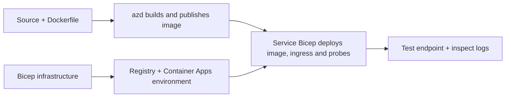

# Container App Deployment Examples wit AZD

Dis directory get two learning samples wit source code, Dockerfiles,
Bicep infrastructure, an `azure.yaml`. Neither one be production-hardened.

## Choose one example

| Sample | Wetin dem implement | Prerequisite |
|---|---|---|
| [Simple Flask API](../../../../examples/container-app/simple-flask-api) | Single Python CRUD API, in-memory items, health probes, HTTP scaling | Basic CLI an HTTP sabi |
| [Two-service microservices](../../../../examples/container-app/microservices) | Node.js gateway, internal read-only Python product service, telemetry an scaling | Finish di single-service sample first |

Make 30–60 minutes including setup an check. Azure provisioning times dey different.

## Prerequisites

- [Azure Developer CLI](https://learn.microsoft.com/azure/developer/azure-developer-cli/install-azd)
- [Azure CLI](https://learn.microsoft.com/cli/azure/install-azure-cli) for verification commands
- Docker wit im daemon wey dey run for building these container images
- An Azure subscription wit resource-creation permission an enough regional quota
- Bash for di shell examples, or equivalent PowerShell commands

```bash
azd version
az version
docker info
azd auth login
az login
```

Di two tools get their own login sessions. Make you use current stable azd; di current
published release as we dey review na 1.37.2. Older minimum version claims no
mean sey e go for sure work wit everytin.

## Quick start

From di repository root:

```bash
cd examples/container-app/simple-flask-api
azd env new flask-demo
azd up
API_URL=$(azd env get-value API_ENDPOINT)
curl --fail-with-body "${API_URL}/health"
```

We expect: HTTP 200 wit `"status": "healthy"`. Follow di sample README to create,
read, update, an delete one item, an to check logs.



Initial provisioning dey use public hello-world image on port 80. Di service-specific
Bicep parameter files make `azd deploy` fit replace am wit di built application image
an di correct app port/probes (8000 for Flask/product, 8080 for di gateway).
Keep these files wit dia `azure.yaml` `module` settings.

## Configuration: wetin dey change wetin

`azure.yaml` dey select source directories, languages, hosts, an deployment modules.
Container CPU/memory, ingress, probes, replica counts, an scale rules dey defined
for **Bicep**, no be random `resources`, `scale`, or `regions` service properties.

`azd env set SOME_VALUE ...` dey store value for local. E go only change one deployed
resource when parameter, environment mapping, or hook explicitly use dat
value. These examples no dey use `MAX_REPLICAS`, `SCALE_TO_ZERO_TIMEOUT`,
`CONTAINER_APP_REPLICA_TYPE`, or custom canary settings from azd environment values.
Edit di correct Bicep an run `azd up` to re-provision an deploy.

No put application source under `infra/`. `project` must point to di source
directory wey get di Dockerfile and dependency manifest.

## Monitoring an costs

- `azd monitor --logs` dey open portal view; e no be terminal log stream.
  Use `az containerapp logs show --follow` wit di actual resource name.
- Di simple API dey write stdout logs wey container Apps/Log Analytics dey collect.
  Di Application Insights resource wey e provision no get automatic instrumentation.
- Di microservices gateway dey use di Node.js Application Insights SDK; di Python
  service dey export application log traces. Full Python request/dependency tracing
  no configure.
- Scale-to-zero fit reduce compute charges, but registry an log ingestion/storage
  fit still cost money. Di microservices defaults make replicas dey run.
  Check your region and usage for
  [Azure pricing calculator](https://azure.microsoft.com/pricing/calculator/).

## Advanced patterns — wetin dem no include

Na design directions dem be, no be additional local projects or copy-an-run snippets:

- **Persistent data an authentication:** replace in-memory stores an add
  Microsoft Entra ID authentication/authorization before production.
- **Blue-green/canary:** use Container Apps multiple-revision mode, revision
  labels, traffic weights, health verification, an rollback procedures.
  No `deploymentStrategy: canary` azd configuration dey for these samples.
  See [revision management](https://learn.microsoft.com/azure/container-apps/revisions).
- **Multi-region:** create separate environments an apps for Bicep an design
  global routing an data consistency. One service `regions` list no be azd
  deployment method.
- **Queue workers:** add worker source, dependencies, queue resources, one managed
  identity wit data-plane roles, an authenticated scale rule. No copy
  empty `src/worker` path an expect say e go work as project.
- **Dapr:** provision components, configure di sidecar, install di matching SDK,
  an implement state/pub-sub error handling.
- **Secrets:** use managed identity an role assignments where e possible. Just
  create one Key Vault no mean say applications get access or fit load secrets.

## Cleanup

From di sample directory:

```bash
azd down
```

Check deletion prompts an confirm say di resource group wey dem dedicate don comot.
No use these samples as production baseline without more design an tests.

[Examples index](../README.md) · [Course home](../../README.md) ·
[Container Apps documentation](https://learn.microsoft.com/azure/container-apps/) ·
[Report an issue](https://github.com/microsoft/AZD-for-beginners/issues)

---

<!-- CO-OP TRANSLATOR DISCLAIMER START -->
**Disclaimer**:
Dis document don translate wit AI translation service [Co-op Translator](https://github.com/Azure/co-op-translator). Even tho we dey try make am correct, abeg make you know say automated translation fit get errors or mistakes. Di original document for dia own language na im be di correct source. For important info, make person wey sabi human translation do am. We no go responsible for any misunderstanding or wrong understanding wey fit happen because of dis translation.
<!-- CO-OP TRANSLATOR DISCLAIMER END -->