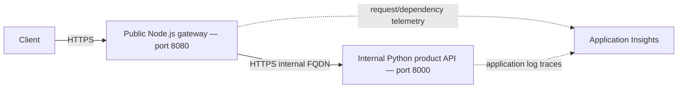

# Two-Service Microservices — Azure Container Apps

**Level:** Intermediate · **Time:** 45–60 minutes including setup

Dis learning sample de implement **Node.js API Gateway** and **read-only Python Product Service**. Source, Dockerfiles, Bicep, plus azd configuration dey included.
E no be system wey ready for production.


- Use internal backend FQDN over HTTPS.
- Check success, not-found, plus unavailable-service responses.
- Understand telemetry and independent scaling boundaries.




Di product catalog get five fixed products for memory. E no get **POST,
PUT, or DELETE handlers**, database, Service Bus, order/user/notification service,
C#, or Go code. Dem na future development ideas, no be included features.
Di gateway no dey authenticate users; internal ingress no be replacement
for application authorization.

## Prerequisites

Finish di [single Flask API](../../../../../examples/container-app/simple-flask-api) first.
Install current stable azd (published release wey dem get for review time: 1.37.2), Azure CLI,
and Docker wey daemon dey run. You need Azure subscription, resource
creation permissions, and Container Apps regional quota.

```bash
azd version
az version
docker info
azd auth login
az login
```

Use di same subscription for both CLI tools. Di commands wey dey below na Bash.

## Deploy and verify

From di repository root:

```bash
cd examples/container-app/microservices
azd env new microservices-demo
azd up
GATEWAY_URL=$(azd env get-value API_GATEWAY_URL)
RG_NAME=$(azd env get-value AZURE_RESOURCE_GROUP)
GATEWAY_NAME=$(azd env get-value API_GATEWAY_NAME)
PRODUCT_NAME=$(azd env get-value PRODUCT_SERVICE_NAME)

curl --fail-with-body "${GATEWAY_URL}/health"
curl --fail-with-body "${GATEWAY_URL}/api/products"
curl --fail-with-body "${GATEWAY_URL}/api/products/1"
curl -i "${GATEWAY_URL}/api/products/999"
```

**Success:** health 200; list 200 wit **five** products; product 1 na Laptop
wey price 999.99 wit stock 50; unknown product go return 404.
Descriptions dey inside response dem; timestamps dey different.

Initial provision dey use public hello-world images for port 80 so e no go try
pull images wey no dey for empty registry. Service-specific Bicep modules
and parameter files go replace dem with built images and app ports/probes during
`azd deploy`. Main parameters go keep published image names for later provisioning.

## Services and networking

| Service | Exposed endpoints | Default resources |
|---|---|---|
| Gateway | GET `/`, `/health`, `/api/products`, `/api/products/:id` | 1 vCPU, 2 GiB, 2–20 replicas |
| Product | GET `/`, `/health`, `/products`, `/products/<id>` | 0.5 vCPU, 1 GiB, 1–10 replicas |

Product ingress get `external: false` and `allowInsecure: false`. Bicep dey inject
`PRODUCT_SERVICE_URL=https://<actual-internal-fqdn>` into di gateway. HTTP go
redirect; HTTPS go match di ingress wey dem set. Short DNS name gats match di
**real Container App name**, no be di logical service key `product-service`.
No try call di internal URL direct from your laptop.

Di gateway get five-second timeout for product calls. Missing product IDs
go pass as 404; transport wahala/other backend failures go return 503. Gateway
`/health` just dey check di gateway, no be backend availability.

## Files and configuration

```text
azure.yaml
infra/main.bicep
infra/main.parameters.json
infra/abbreviations.json
infra/core/container-apps-environment.bicep
infra/core/monitor.bicep
infra/app/api-gateway.bicep
infra/app/api-gateway.parameters.json
infra/app/product-service.bicep
infra/app/product-service.parameters.json
src/api-gateway/{app.js,package.json,Dockerfile}
src/product-service/{main.py,requirements.txt,Dockerfile}
```

Scaling, CPU/memory, ports, and probes set for `infra/app/*.bicep`. Change di files
and run `azd up` to apply infrastructure and redeploy. No get
`GATEWAY_MAX_REPLICAS` environment-variable parameter for dis sample.

For code-only changes:

```bash
azd deploy product-service
azd deploy api-gateway
```

Di Node image dey use Node 22; di Python image dey use Python 3.11. Both bind to
`0.0.0.0`. Ingress/probes dey use port 8080 (gateway) and 8000 (product), respectively.

## Local development with Docker

Run from dis example directory. Use user-defined network, **no be `localhost`
from one container to reach the oda**:

```bash
docker network create azd-microservices-demo
docker build -t local-product ./src/product-service
docker build -t local-gateway ./src/api-gateway
docker run -d --name azd-product --network azd-microservices-demo local-product
docker run -d --name azd-gateway --network azd-microservices-demo \
  -p 8080:8080 -e PRODUCT_SERVICE_URL=http://azd-product:8000 local-gateway
curl --fail-with-body http://localhost:8080/api/products
```

Wetin you suppose expect: five products. HTTP na only for dis local Docker network e dey use.

```bash
docker stop azd-product azd-gateway
docker rm azd-product azd-gateway
docker network rm azd-microservices-demo
```

## Monitoring

```bash
az containerapp logs show --name "$GATEWAY_NAME" --resource-group "$RG_NAME" --follow
# In a separate terminal:
az containerapp logs show --name "$PRODUCT_NAME" --resource-group "$RG_NAME" --tail 100
```

`azd monitor --logs` go open portal view; e no go stream terminal logs.
Di Node SDK collect gateway requests/dependencies. Python's `AzureLogHandler`
export **log traces**, no be automatic Flask requests, SQL dependencies, or full
distributed traces. OpenCensus na legacy SDK; better use Azure Monitor OpenTelemetry
if you wan add more to dis sample.

For Application Insights Logs, make requests and check:

```kusto
requests
| where timestamp > ago(1h)
| where name contains "products"
| summarize RequestCount=count(), AvgDuration=avg(duration) by bin(timestamp, 5m)
```

For Python application messages:

```kusto
traces
| where timestamp > ago(1h)
| where message contains "products"
| project timestamp, message, severityLevel
```

Allow ingestion delay and sampling; no expect exact request count or guaranteed latency.
No custom alerts or dashboards don set.

## Practical Exercises

### Exercise 1: Modify di catalog

**Starting point:** `src/product-service/main.py`.
**Goal:** verify independent service deployment.
Change Laptop stock from 50 to 49 for di fixed `products` list, run
`azd deploy product-service`, then request `${GATEWAY_URL}/api/products/1`.

**Success criteria / solution:** HTTP 200 wit `"stock":49`. Restore 50 and redeploy.
**Common issue:** editing di gateway instead of di service wey get di catalog.
Dis one dey change source data, no be persistent inventory database.

### Exercise 2: Verify replica configuration

**Starting point:** `infra/app/product-service.bicep`.
**Goal:** see infrastructure change without guess work for autoscaling.
Change `minReplicas: 1` to `minReplicas: 2`, run `azd up`, then:

```bash
az containerapp show --name "$PRODUCT_NAME" --resource-group "$RG_NAME" \
  --query properties.template.scale -o json
```

**Success criteria:** di configured minimum be 2 and maximum still remain 10.
Restore minimum 1 and run `azd up`.
**Common issue:** `azd deploy` alone no apply changes to unrelated shared
infrastructure. No set `maxReplicas` to zero as failure simulation.
Dis one dey verify configuration, no be load-test or guaranteed instant replica count.

### Exercise 3: Test unavailable-service handling locally

**Starting point:** both local Docker containers for above dey run.
**Goal:** tell backend failure from missing product.
Stop only di product container:

```bash
docker stop azd-product
curl -i http://localhost:8080/api/products
docker start azd-product
curl --fail-with-body http://localhost:8080/api/products
```

**Success criteria:** while e stopped, gateway go return 503 wit
`"error":"Product service unavailable"`; after e start again, list go return 200.
Retry after small startup delay if e needed.
**Common issue:** stopping di gateway test different failure (no HTTP response).

## Costs and production gaps

Default minimum replicas go keep compute running. Registry and monitoring go still
charge you. No get sure fixed $50/month total: estimate regional CPU/memory,
replica hours, requests, registry, and log retention for di
[Azure pricing calculator](https://azure.microsoft.com/pricing/calculator/).
Delete learning resources quick quick.

Production work get authentication/authorization, scoped managed identities,
persistent data, input/response validation, supported observability instrumentation,
load/failure testing, CI/CD, alerts, and recovery procedures. Add order
service, queue, or database na separate implementation work, no be finished
exercise or feature wey dey here already.

## Troubleshooting and cleanup

- **Image no show during first provision:** bootstrap suppose use di public image;
  check di main image parameter defaults and deployment module mappings.
- **503 products:** check product logs, image revision, and injected internal HTTPS URL.
- **404 unexpected path:** product API na read-only; check di route, no be nonexistent CRUD handler.
- **No telemetry:** check runtime connection strings without exposing dem and
  allow ingestion delay. Python request tables no dey populated by its log handler.

From dis sample directory:

```bash
azd down
```

Review deletion prompts and check if di dedicated resource group don remove.

[Previous: Flask API](../../../../../examples/container-app/simple-flask-api) · [Next: Database app](../../../../../examples/database-app) ·
[AI development](../../../docs/chapter-02-ai-development/README.md) ·
[Course home](../../../README.md) · [Report an issue](https://github.com/microsoft/AZD-for-beginners/issues)

---

<!-- CO-OP TRANSLATOR DISCLAIMER START -->
**Disclaimer**:
Dis document don translate wit AI translation service [Co-op Translator](https://github.com/Azure/co-op-translator). Even tho we dey try make am correct, abeg make you know say automated translation fit get errors or mistakes. Di original document for dia own language na im be di correct source. For important info, make person wey sabi human translation do am. We no go responsible for any misunderstanding or wrong understanding wey fit happen because of dis translation.
<!-- CO-OP TRANSLATOR DISCLAIMER END -->