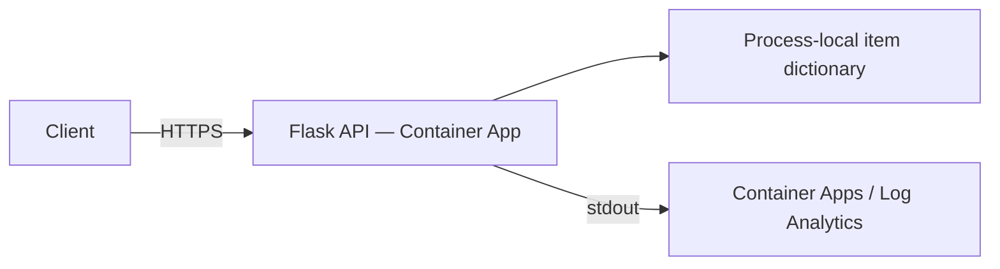

# Simple Flask API — Azure Container Apps

**Level:** Beginner · **Time:** 30–45 minutes including setup

Deploy one Python Flask CRUD API wit Azure Developer CLI (azd). Source, Dockerfile,
Bicep, and deployment parameters dey inside. Na **learning sample** dis one, no be
production-ready API.

## Wetin you go learn

- Build and publish container through azd.
- Configure ingress and liveness/readiness probes.
- Verify CRUD responses and inspect application logs.
- Understand why in-memory data no good for strong applications.



**Important:** items dey inside one process. The default na **one Gunicorn worker,
0–1 replicas**, wey purposely avoid inconsistent data across workers/replicas.
Items dey lost on restart, revision change, or scale-to-zero. If you wan increase replicas,
you go need shared persistent storage. The API no get authentication or authorization.

## Things wey you need before

- [Current stable azd](https://learn.microsoft.com/azure/developer/azure-developer-cli/install-azd)
  (published release for review time: 1.37.2).
- [Azure CLI](https://learn.microsoft.com/cli/azure/install-azure-cli) for verification.
- Docker with im daemon dey run; e dey required for default local image build.
- Azure subscription, resource-creation permissions, and Container Apps regional quota.
- Bash for the commands wey come below (or equivalent PowerShell).
- Python 3.11 for optional local development.

```bash
azd version
az version
docker info
azd auth login
az login
```

The CLI tools get separate login sessions. Make sure say you use the same subscription for both.

## Quick start

From the repository root:

```bash
cd examples/container-app/simple-flask-api
azd env new flask-demo
azd up
API_URL=$(azd env get-value API_ENDPOINT)
RG_NAME=$(azd env get-value AZURE_RESOURCE_GROUP)
API_NAME=$(azd env get-value API_NAME)
curl --fail-with-body "${API_URL}/health"
```

Expect: HTTP 200 and JSON with `"status":"healthy"`,
`"service":"simple-flask-api"`, and current UTC timestamp.
Provisioning and image building fit take few minutes; timings fit dey different.

Initial provisioning dey use one public hello-world image wey listen for port 80.
`azure.yaml` dey select `infra/app/api.bicep` and im matching parameter file for
service deployment, wey go change the image, ingress, and probes go port 8000.
No delete those deployment parameters.

## Verify CRUD

Run the commands one by one as the same replica dey active:

```bash
# Create: HTTP 201; note the returned id (1 for a fresh process).
curl -i -X POST "${API_URL}/api/items" \
  -H "Content-Type: application/json" \
  -d '{"name":"Test Item","description":"My first item"}'

# Read list: HTTP 200, total 1 in a fresh process.
curl --fail-with-body "${API_URL}/api/items"

# Replace 1 if your create response returned another id.
curl --fail-with-body "${API_URL}/api/items/1"
curl -i -X PUT "${API_URL}/api/items/1" \
  -H "Content-Type: application/json" -d '{"name":"Updated Item"}'
curl -i -X DELETE "${API_URL}/api/items/1"
curl -i "${API_URL}/api/items/1"
```

Success: POST 201, reads/PUT 200, DELETE 204 wit no body, then missing item 404.
Bad or no-object JSON or empty name go return 400.
If item vanish between requests, check if e be restart or scale-to-zero;
dis one na intentional in-memory limitation, no persistence.

| Endpoint | Methods |
|---|---|
| `/` | GET — service information |
| `/health` | GET — liveness/readiness |
| `/api/items` | GET, POST |
| `/api/items/{id}` | GET, PUT, DELETE |

## Logs and configuration

```bash
az containerapp logs show --name "$API_NAME" --resource-group "$RG_NAME" --follow
```

Expect: Gunicorn startup, request access logs, and application messages.
`azd monitor --logs` open portal view; e no stream to terminal.
Application Insights dey provision but **dis Flask code no use am**;
use Container Apps/Log Analytics for stdout logs.

Edit `infra/app/api.bicep` for CPU/memory, replica limits, or scale rules, then
run `azd up`. Defaults na 0.5 vCPU, 1 GiB, minimum 0 / maximum 1 replica, and
HTTP threshold of 50 concurrent requests. Scale-to-zero fit cause cold-start delay.

Random `azd env set MAX_REPLICAS`, `API_KEY`, `LOG_LEVEL`, or
`SCALE_TO_ZERO_TIMEOUT` values **no connect for dis template or app**.
Setting value no automatically make am runtime environment variable.
The image dey bind port 8000; if you wan change, update Dockerfile, Bicep ingress, and probes
together.

## Files

```text
azure.yaml
infra/main.bicep
infra/main.parameters.json
infra/app/container-apps.bicep       # Environment, registry, monitoring
infra/app/api.bicep                  # App, ingress, probes, scale settings
infra/app/api.parameters.json        # Image and resource values for azd deploy
src/app.py
src/Dockerfile
src/requirements.txt
```

## Local development

From this example directory:

```bash
python -m venv .venv
source .venv/bin/activate  # PowerShell: .\.venv\Scripts\Activate.ps1
python -m pip install -r src/requirements.txt
python src/app.py
```

For another terminal, test `http://localhost:8000/health` and the CRUD endpoints.
Or build and run the actual image:

```bash
docker build -t flask-api:local ./src
docker run --rm -p 8000:8000 flask-api:local
```

For code-only changes after first deployment, run `azd deploy api`.
For Bicep changes, run `azd up` to re-provision and deploy.

## Practical exercises

### 1. Check input rejection

**Starting point:** deployed API, `API_URL` above.
**Goal:** verify the API dey reject invalid JSON shapes and missing names.

```bash
curl -i -X POST "${API_URL}/api/items" \
  -H "Content-Type: application/json" -d '[]'
curl -i -X POST "${API_URL}/api/items" \
  -H "Content-Type: application/json" -d '{"name":""}'
```

**Success criteria / solution:** both go return 400 wit JSON error, no be 500.
**Common issue:** forgetting JSON content-type header.

### 2. Add read-only version endpoint

**Starting point:** `src/app.py`. **Goal:** extend and redeploy the API.
Add this before `if __name__ == '__main__':` block:

```python
@app.route('/version', methods=['GET'])
def version():
    return jsonify({'version': '1.0.0'})
```

Run `azd deploy api`, then `curl --fail-with-body "${API_URL}/version"`.
**Success criteria:** HTTP 200 and `{"version":"1.0.0"}`.
**Common issue:** put the route after blocking `app.run()` call when
testing with `python src/app.py`.

### Knowledge checkpoint

Why one worker no enough for durable data? Because even one process go lose
im dictionary on restart. Production version need persistent shared storage,
authentication, authorization, migrations, tests, and operational monitoring.

## Costs and troubleshooting

Dis one no be guaranteed $0 deployment: Basic registry and log storage/ingestion
fit incur charges even if app compute na zero. Use
[pricing calculator](https://azure.microsoft.com/pricing/calculator/) for your region.

- **Docker build failure:** confirm `docker info`, network access, and dependencies.
- **Unhealthy app:** check console/system logs and make sure image port, ingress,
  and probes dey agree. Placeholder no suppose be probed for Flask port.
- **403/permissions:** confirm subscription and resource-creation permissions.
- **Items disappear:** in-memory state reset on restart/scale-to-zero; add database
  for durable behavior.

## Cleanup and next steps

```bash
azd down
```

Check the deletion prompt and make sure dedicated resource group don remove.
No do destructive cleanup on resource group wey get unrelated data.

[Next: Database app](../../../../../examples/database-app) · [Microservices](../../../../../examples/container-app/microservices) ·
[Container overview](../README.md) · [Course home](../../../README.md) ·
[Report an issue](https://github.com/microsoft/AZD-for-beginners/issues)

---

<!-- CO-OP TRANSLATOR DISCLAIMER START -->
**Disclaimer**:
Dis document don translate wit AI translation service [Co-op Translator](https://github.com/Azure/co-op-translator). Even tho we dey try make am correct, abeg make you know say automated translation fit get errors or mistakes. Di original document for dia own language na im be di correct source. For important info, make person wey sabi human translation do am. We no go responsible for any misunderstanding or wrong understanding wey fit happen because of dis translation.
<!-- CO-OP TRANSLATOR DISCLAIMER END -->