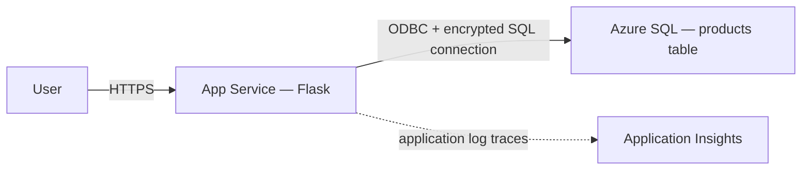

# Flask and Azure SQL for App Service

**Level:** Intermediate · **Time:** 30–60 minutes wey include ogbonweyn wey you need first

Dis sample dey deploy Python Flask read API go **Linux App Service** and one Basic
Azure SQL database. Dem put source, Bicep, and azd configuration. E be
learning application, no be production-ready database arrangement.

## Wetin you go learn

- How to provision App Service, SQL, and monitoring resources with Bicep.
- How to configure encrypted SQL connectivity without to commit credentials.
- How to start schema before Gunicorn workers dem start.
- How to check seeded data, not-found responses, and database health.



Resources: dedicated resource group, B1 Linux App Service plan, Python 3.11 Web
App, SQL server and Basic 2-GB database, Application Insights, and Log Analytics.
The Web App dey use **source/ZIP deployment and Oryx dependency installation**;
`azd deploy` no go build or deploy the optional Dockerfile.

## Wetin you need first

- Current stable [azd](https://learn.microsoft.com/azure/developer/azure-developer-cli/install-azd)
  (published release at review time: 1.37.2).
- [Azure CLI](https://learn.microsoft.com/cli/azure/install-azure-cli) for checking.
- Azure subscription, permissions to fit create the resources wey dem list, plus regional quota.
- Python **3.11** for local development; the committed `pyodbc==5.0.1` fit need
  native build tools on newer Python versions.
- Microsoft ODBC Driver 18 (or 17) for SQL Server for local machines. `pip install
  pyodbc` no dey install the system driver. See
  [ODBC installation](https://learn.microsoft.com/sql/connect/odbc/download-odbc-driver-for-sql-server).
- Docker na only if you wan test the optional container for your machine.

```bash
azd version
az version
azd auth login
az login
```

Use the same subscription for both tools. Commands wen dem show here na Bash.

## How to deploy am

From the repository root:

```bash
cd examples/database-app
azd env new sql-demo
azd provision
azd deploy
WEB_URL=$(azd env get-value WEB_APP_URI)
WEB_NAME=$(azd env get-value WEB_APP_NAME)
RG_NAME=$(azd env get-value AZURE_RESOURCE_GROUP)
```

Pick one supported region. `sqlAdminLogin` dey set to `sqladmin` by default; the required
`sqlAdminPassword` na secure parameter. Give better password wen dem ask you.
Make sure say you no put deployment credentials for Git and report issues. The current connection
string interpolation dey expect password wey no get connection-string delimiters like
`;`; make you fit adapt escaping before you use such values.

Bicep dey set startup command wey dey run `init_database()` **before** Gunicorn
workers dem start. E important because importing `app:app` no dey run
Python `if __name__ == '__main__'` block. For new database, initialization
go create `products` and put five rows inside. Na simple teaching seed, no be
concurrent migration framework; make you use proper migrations if you wan scale your instances.

The app go first select Microsoft ODBC Driver 18, after 17, if the connection
string no talk driver. If neither dey, startup go fail with
installation error wey you fit act on. Make you check if driver dey for your selected
App Service runtime before you just believe say e go dey.

## How to verify am

```bash
curl --fail-with-body "${WEB_URL}/"
curl --fail-with-body "${WEB_URL}/health"
curl --fail-with-body "${WEB_URL}/products"
curl --fail-with-body "${WEB_URL}/products/1"
curl -i "${WEB_URL}/products/999"
```

Expect:

- `/` dey return endpoint info.
- `/health` dey return 200 wit `{"status":"healthy","database":"connected"}`.
- `/products` dey return five seeded products for fresh database.
- `/products/1` dey return Laptop wit price 1299.99.
- Product we no dey return 404 wit `{"error":"Product not found"}`.

Di API na read-only. No get POST/PUT/DELETE route or browser UI.
Database connection wahala dey return 503 from `/health`; e no be success.

## Files and configuration

```text
azure.yaml                         # Python App Service source deployment
infra/main.bicep
infra/main.parameters.json
infra/abbreviations.json
infra/resources/sql-server.bicep
infra/resources/sql-database.bicep
infra/resources/app-service-plan.bicep
infra/resources/web-app.bicep       # Settings + initialization/startup command
infra/resources/app-insights.bicep
src/web/app.py
src/web/requirements.txt
src/web/Dockerfile                 # Optional local container, not the azd target
.env.sample
```

`SQL_CONNECTION_STRING` dem dey pass am as secure Bicep parameter go Web App module
and dem save am for App Service settings, no be deployment outputs.
`APPLICATIONINSIGHTS_CONNECTION_STRING` dey configure log export.
`SCM_DO_BUILD_DURING_DEPLOYMENT=true` dey enable server-side dependency installation.
Setting random `azd env` values no go automatically change app settings.

Di SQL firewall `0.0.0.0` rule dey allow connections from **Azure services,
including other customers' subscriptions**, but SQL authentication still dey valid. E no
restricted to dis app or subscription. SQL public network access dey enabled.
Use scoped networking and one non-admin app identity before production.

## Local development

Use Python 3.11 and make sure say Microsoft SQL ODBC driver don install:

```bash
python -m venv .venv
source .venv/bin/activate  # PowerShell: .\.venv\Scripts\Activate.ps1
python -m pip install -r src/web/requirements.txt
export SQL_CONNECTION_STRING='Server=tcp:YOUR_SERVER.database.windows.net,1433;Database=YOUR_DATABASE;UID=YOUR_USER;PWD=YOUR_PASSWORD;Encrypt=yes;TrustServerCertificate=no;Connection Timeout=30;'
python src/web/app.py
```

Replace placeholders well-well. If you copy `.env` file, e no go **automatically load**
for this application. Export variables inside your current shell instead.
For Azure SQL from laptop, make you temporarily allow only your own public IP:

```bash
SQL_SERVER=$(azd env get-value SQL_SERVER_NAME)
MY_IP=YOUR_PUBLIC_IP
az sql server firewall-rule create -g "$RG_NAME" -s "$SQL_SERVER" \
  -n AllowMyLearningIP --start-ip-address "$MY_IP" --end-ip-address "$MY_IP"
```

Remove di rule after you don test am:

```bash
az sql server firewall-rule delete -g "$RG_NAME" -s "$SQL_SERVER" -n AllowMyLearningIP
```

Optional container test from dis example directory:

```bash
docker build -t sql-flask:local src/web
docker run --rm -p 8000:8000 -e SQL_CONNECTION_STRING sql-flask:local
```

Dis image dey install Driver 18 wit Debian 12 package repository wey match im
Bookworm base, e dey initialize database once, then e go start Gunicorn.

## Monitoring and troubleshooting

Enable/tail App Service filesystem application logs when you dey diagnose startup:

```bash
az webapp log config --name "$WEB_NAME" --resource-group "$RG_NAME" \
  --application-logging filesystem --level information
az webapp log tail --name "$WEB_NAME" --resource-group "$RG_NAME"
```

Dis code dey export application **log traces** through old OpenCensus handler.
E no dey configure automatic Flask request/dependency tracing, Live Metrics,
SQL auditing, diagnostic settings, or alerts. All those ones need separate setup.
For new instrumentation, better make you use Azure Monitor OpenTelemetry.

For Application Insights Logs, after you don make API requests:

```kusto
traces
| where timestamp > ago(1h)
| where message contains "products" or message contains "Health check"
| project timestamp, message, severityLevel
```

Make you allow ingestion delay. Request-table or Live Metrics activity no mean say
dis log-only instrumentation don finish.

- **Driver we dey miss:** check `pyodbc.drivers()` inside runtime and install
  one Microsoft ODBC driver wey dem support. Python package alone no go suffice.
- **Connection failure:** check SQL settings, credentials, firewall, and selected
  subscription. No disable encryption just to bypass error.
- **We no get products table:** confirm say Bicep startup command deploy well;
  just starting `gunicorn app:app` no go initialize am.
- **Package build failure:** use Python 3.11 or provide native build prerequisites.
- **Zero-price data:** zero na valid decimal price; e suppose serialize as 0.0,
  no be `null`.

## Practical Exercises

### Exercise 1: Check how missing product behave

**Where we start:** deployed API and `WEB_URL` wey dey up.
**Goal:** sabi difference between missing row and broken database.
Request `/health` and `/products/999` using commands wey dey up.
**Success criteria / answer:** health 200, product we no dey 404 (no be 500 or 503).
**Common problem:** assume sey not-found response mean SQL connection don broke.

### Exercise 2: Change one seeded value

**Where we start:** Azure SQL Query Editor, connected to sample database.
**Goal:** show say API data dey SQL and no dey inside process memory.

```sql
UPDATE products SET price = 0 WHERE id = 1;
SELECT id, name, price FROM products WHERE id = 1;
```

Request `${WEB_URL}/products/1`. **Success criteria:** price na `0.0`, no be `null`.
Restore di value:

```sql
UPDATE products SET price = 1299.99 WHERE id = 1;
```

**Common problem:** edit Python seed list no dey update rows wey dey for SQL.
No make schema/data exercise for production database.

### Exercise 3: Add read-only count endpoint

**Where we start:** `src/web/app.py`.
**Goal:** extend API with parameter-free aggregate query.
Add dis one before `if __name__ == '__main__':` block:

```python
@app.route('/product-count')
def product_count():
    from contextlib import closing
    with closing(get_db_connection()) as conn, closing(conn.cursor()) as cursor:
        cursor.execute("SELECT COUNT(*) FROM products")
        return jsonify({'count': cursor.fetchone()[0]})
```

Run `azd deploy web`, then request `${WEB_URL}/product-count`.
**Success criteria:** 200 with `{"count":5}` for untouched seeded database.
**Common problem:** change route but forget to redeploy.
For production, add error handling/tests; dis short exercise na just for query.

## Costs, production gaps, and cleanup

B1 App Service and Basic database dey charge as long as dem dey provision. If you stop Web App,
e no mean say App Service plan billing stop. Logs and storage fit add to di cost.
Use [Azure pricing calculator](https://azure.microsoft.com/pricing/calculator/)
for how much e go cost for your region. To switch to F1, you need disable `alwaysOn`;
e no be one-line drop-in replacement. SQL serverless no be automatically free.

For production, work include least-privilege app identity (no be SQL admin),
authentication/authorization, private networking, safe migrations, connection
pooling/lifecycle review, telemetry, auditing, alerts, tests, and recovery procedures.
Redis caching and more tables na development ideas, no be exercises we implement.

From this example directory:

```bash
azd down
```

Review deletion prompt and confirm say dedicated resource group don delete.
No delete groups wey get unrelated data.

[Container examples](../../../../examples/container-app) ·
[AI development](../../docs/chapter-02-ai-development/README.md) ·
[Course home](../../README.md) · [Report an issue](https://github.com/microsoft/AZD-for-beginners/issues)

---

<!-- CO-OP TRANSLATOR DISCLAIMER START -->
**Disclaimer**:
Dis document don translate wit AI translation service [Co-op Translator](https://github.com/Azure/co-op-translator). Even tho we dey try make am correct, abeg make you know say automated translation fit get errors or mistakes. Di original document for dia own language na im be di correct source. For important info, make person wey sabi human translation do am. We no go responsible for any misunderstanding or wrong understanding wey fit happen because of dis translation.
<!-- CO-OP TRANSLATOR DISCLAIMER END -->