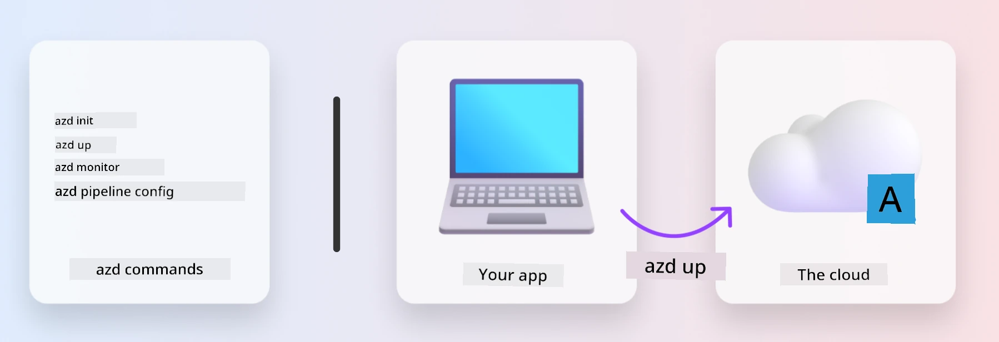
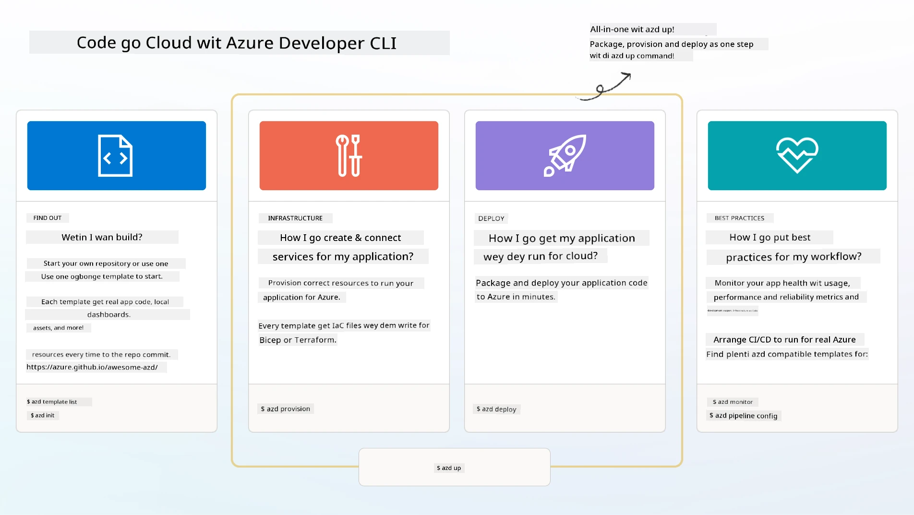

# 1. Chọs Templet

!!! tip "BY THE END OF THIS MODULE YOU GO FIT"

    - [ ] Describe what AZD templates are
    - [ ] Discover and use AZD templates for AI
    - [ ] Get started with the AI Agents template
    - [ ] **Lab 1:** AZD Quickstart in Codespaces or a dev container

---

## 1. Builder Analogy

To build beta modern enterprise-ready AI app _from scratch_ fit hard. E be like say you dey build your new house by yourself, brick upon brick. Yes, e fit done! But e no be the best way to get the result wey you wan!

Instead, we dey usually start with some _design blueprint_ wey don already dey, den we dey work with architect make e customize am to fit wetin we want. Na so you go take build intelligent applications. First find good design wey go fit your problem. Then you go work with solution architect to customize and develop solution wey go fit your particular case.

But where we go fit find these design blueprints? And how we go take find architect wey go wan teach us how to customize and deploy these blueprints by ourselves? For this workshop, we go answer these questions by introducing to you three technologies:

1. [Azure Developer CLI](https://aka.ms/azd) - na open-source tool wey dey speed developer path from local dev (build) go cloud deployment (ship).
1. [Microsoft Foundry Templates](https://ai.azure.com/templates) - standardized open-source repos wey get sample code, infrastructure and config files for deploying AI solution architecture.
1. [GitHub Copilot Agent Mode](https://code.visualstudio.com/docs/copilot/chat/chat-agent-mode) - na coding agent wey base for Azure knowledge, fit guide us for how to waka the codebase and make changes - all with natural language.

Wit these tools for hand, we fit _discover_ the correct template, _deploy_ am to check say e dey work, and _customize_ am to suit our special cases. Make we dive enter am and learn how dem dey work.


---

## 2. Azure Developer CLI

The [Azure Developer CLI](https://learn.microsoft.com/en-us/azure/developer/azure-developer-cli/) (or `azd`) na open-source commandline tool wey fit quicken your code-to-cloud journey with dev-friendly commands wey dey work the same across your IDE (dev) and CI/CD (devops) environments.

With `azd`, your deployment journey fit simple like dis:

- `azd init` - E dey initialize new AI project from existing AZD template.
- `azd up` - E dey provide infrastructure and deploy your app at once.
- `azd monitor` - E go give you real-time monitoring and diagnostics for deployed app.
- `azd pipeline config` - E go setup CI/CD pipelines to automate deployment to Azure.

**🎯 | EXERCISE**: <br/> Explore the `azd` commandline tool for your current workshop environment now. E fit be GitHub Codespaces, dev container, or local clone wey get all requirements installed. Start by typing this command to see wetin the tool fit do:

```bash title="" linenums="0"
azd help
```



---

## 3. The AZD Template

For `azd` to do dis, e need sabi infrastructure wey e go provide, configuration settings wey e go use, and the app wey e go deploy. Na here [AZD templates](https://learn.microsoft.com/en-us/azure/developer/azure-developer-cli/azd-templates?tabs=csharp) dey.

AZD templates na open-source repositories wey combine sample code with infrastructure and configuration files wey you need to deploy solution architecture.
By using _Infrastructure-as-Code_ (IaC) approach, dem allow template resource definitions and config settings to dey version-controlled (just like app source code) - dey create reusable and consistent workflows for users of the project.

When you wan create or reuse AZD template for _your_ case, make you think bout dis questions:

1. Wetin you dey build? → E get templet wey get starter code for that case?
1. How your solution be? → E get template wey get all resources wey you need?
1. How your solution dey deploy? → Think `azd deploy` wit pre/post-processing hooks!
1. How you fit make am beta? → Think built-in monitoring and automation pipelines!

**🎯 | EXERCISE**: <br/> 
Visit [Awesome AZD](https://azure.github.io/awesome-azd/) gallery and use filters check the 250+ templates wey dem get now. See if you fit find one wey con align with _your_ scenario requirements.



---

## 4. AI App Templates

For AI-powered apps, Microsoft dey provide special templates wey get **Microsoft Foundry** and **Foundry Agents**. These templates go quicken your road to build intelligent, production-ready apps.

### Microsoft Foundry & Foundry Agents Templates

Chọs templet below to deploy. Each template dey for [Awesome AZD](https://azure.github.io/awesome-azd/) and you fit initialize with one command.

| Template | Description | Deploy Command |
|----------|-------------|----------------|
| **[AI Chat with RAG](https://github.com/Azure-Samples/azure-search-openai-demo)** | Search-grounded chat app | `azd init -t Azure-Samples/azure-search-openai-demo .` |
| **[Get Started with AI Agents](https://github.com/Azure-Samples/get-started-with-ai-agents)** | Agent-backed chat app; dem dey use am through this workshop | `azd init -t Azure-Samples/get-started-with-ai-agents .` |
| **[Get Started with AI Chat](https://github.com/Azure-Samples/get-started-with-ai-chat)** | Starter AI chat app | `azd init -t Azure-Samples/get-started-with-ai-chat .` |

These ones be alternatives: initialize **one** template inside him own empty directory. The trailing `.` go select that directory; if you no put am for current AZD versions e go create template-named subdirectory. Initialization go download project; `azd up` go perform the paid deployment after you don check prerequisites, resources, region support, and quota.

### Quick Start

1. **Browse templates**: Visit [https://azure.github.io/awesome-azd/](https://azure.github.io/awesome-azd/) and use filters for `AI`, `Agents`, or `Microsoft Foundry`
2. **Select your template**: Choose one wey match your use case
3. **Initialize**: Run `azd init` command for your chosen template
4. **Deploy**: Run `azd up` to provide and deploy

**🎯 | EXERCISE**: <br/>
Chọs one of the templates wey dey above based on your scenario:

- **You dey continue this workshop?** → Choose **Get Started with AI Agents**
- **You dey build search-grounded chat?** → Explore **AI Chat with RAG** separate
- **You need another architecture?** → Search the gallery, check the real repo, implementation status, and prerequisites

```bash title="Initialize the workshop template in an empty directory" linenums="0"
azd init -t Azure-Samples/get-started-with-ai-agents .
azd auth login
azd up
```

!!! info "Explore More Templates"
    The [Awesome AZD Gallery](https://azure.github.io/awesome-azd/) get 250+ templates. Use filters to find templates wey match your language, framework, and Azure services requirements.

---

<!-- CO-OP TRANSLATOR DISCLAIMER START -->
**Disclaimer**:
Dis document don translate wit AI translation service [Co-op Translator](https://github.com/Azure/co-op-translator). Even tho we dey try make am correct, abeg make you know say automated translation fit get errors or mistakes. Di original document for dia own language na im be di correct source. For important info, make person wey sabi human translation do am. We no go responsible for any misunderstanding or wrong understanding wey fit happen because of dis translation.
<!-- CO-OP TRANSLATOR DISCLAIMER END -->