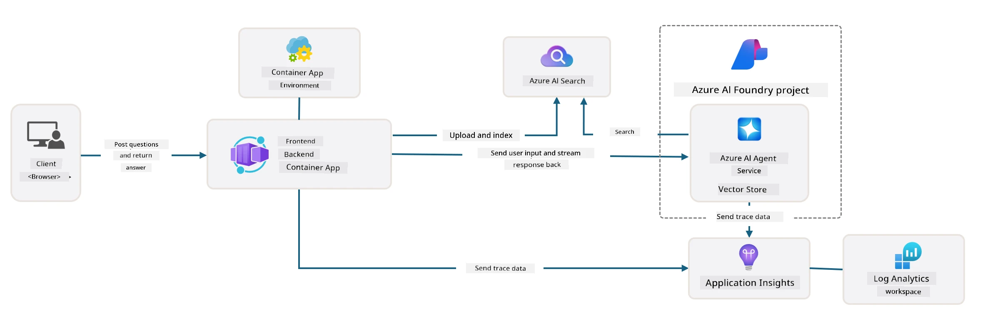
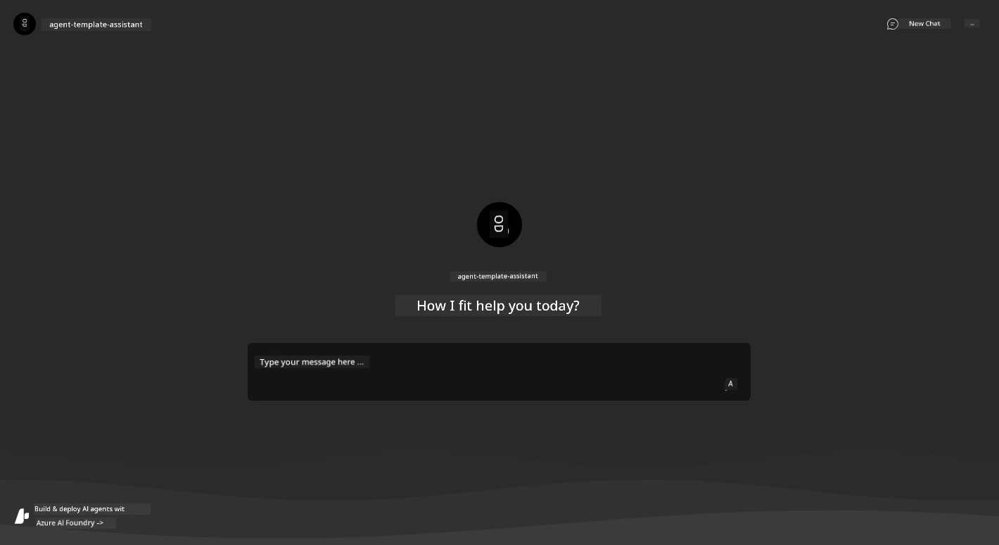

# 2. Validate Template

> Source guide wey dem check for AZD 1.37.2 plus the current sample on November 4, 2026. Screenshots na for show; portal navigation, template defaults, and service availability fit change. Dis review no do real live Azure deployment.

!!! tip "BY THE END OF THIS MODULE YOU GO FIT"

    - [ ] Identify the sample's prerequisites and intended resources
    - [ ] Deploy the selected template into an intentional environment
    - [ ] Verify the application and agent behavior separately from deployment success
    - [ ] **Lab 2:** Record evidence of a working baseline, or an actionable deployment blocker

---

## 1. Check wetin you need first

The [Azure Developer CLI](https://learn.microsoft.com/azure/developer/azure-developer-cli/) dey manage application deployment using di template configuration, infrastructure, plus code. Check your installed version:

```bash
azd version
```

Use di [current installation/update instructions](https://learn.microsoft.com/azure/developer/azure-developer-cli/install-azd) if e necessary. Di sample wey dem review talk say AZD `>=1.14.0`, but better na to use current supported release. Di optional AI extensions get separated version wahala dem; dis sample normal `azd up` workflow no need di agents extension.

Before you start make you read di sample [Azure account setup](https://github.com/Azure-Samples/get-started-with-ai-agents/blob/main/docs/azure_account_setup.md) plus di [deployment guide](https://github.com/Azure-Samples/get-started-with-ai-agents/blob/main/docs/deployment.md). Confirm your subscription, permissions, model availability, regional quota, plus di charges wey dem expect. Azure free account no mean sey you go get access or free use for all di services wey you need.

## 2. Open di sample wey you choose

Use di [Get Started with AI Agents](https://github.com/Azure-Samples/get-started-with-ai-agents) repository wey you start for Module 1. If you never start am, choose one from these options:

- Open [Codespace for the sample](https://github.com/codespaces/new/Azure-Samples/get-started-with-ai-agents).
- Clone di sample and follow di local/dev-container setup.
- For **empty directory**, run:

```bash
azd init --template Azure-Samples/get-started-with-ai-agents .
```

No open second template on top existing project. Run next command dem from di sample root wey get `azure.yaml`, no be from di course repository root.

Di sample dey host agent-backed chat application inside Container Apps and e go create supporting Foundry resources. Make you review di current architecture and optional services instead of to treat old screenshot like di exact resource list.



## 3. Deploy with correct mind

```bash
azd auth login
azd up
```

Make you check di prompts:

1. Choose unique AZD environment name.
2. Select di subscription wey you want, no just pick di one wey show first.
3. Select region wey di required model/version/SKU plus your quota support.
4. Read di provisioning, deployment, plus post-deployment hook output.

Di default we dem review include `gpt-5-mini`, version `2025-08-07`, plus `GlobalStandard`. Check your initialized template and di [supported model/region combinations](https://learn.microsoft.com/azure/ai-services/agents/concepts/model-region-support). No region fit promise say e for always work.

Di deployment time fit vary. If provisioning fail, keep di error and fix di cause before you try again. No go delete di deployment or permanently remove resources just as generic troubleshooting.

## 4. Validate di application

```bash
azd show
```

Open di endpoint for `api_and_frontend`, or find di Container App inside di deployment resource group for di [Azure portal](https://portal.azure.com/). Follow di sample access/authentication instructions if dem require sign-in; no disable authentication just to make smoke test pass.



Try some [sample questions](https://github.com/Azure-Samples/get-started-with-ai-agents/blob/main/docs/sample_questions.md):

- General factual question.
- Question wey answer suppose dey for sample uploaded documents.
- Question wey you no fit answer from those documents.

Make sure sey UI load, API respond, retrieval use di correct data, citations match di original content, and unsupported questions dem handle well. Just one successful `azd up` message no be guarantee say all these things happen.

## 5. Check di deployed agent

Open your project for [Foundry portal](https://ai.azure.com/). For di flow wey dem review, select **Build**, then **Agents**, find di agent wey di sample create. Navigation label dem fit change.

Write down:

- Di agent name plus version.
- Di model deployment wey e configure.
- Di real instructions and enabled tools.
- Which files or search index dey connected, plus if setup finish well.

Di sample wey dem review dey use agent identifier for `agent_name:agent_version` form for test. No copy old agent/thread identifier from old screenshot put for newer API workflow.

Compare uploaded documents with `src/files/` for your initialized revision. Old screenshots show 32 files; dis no be guaranteed current default. Check any answer about sample customers/products against real synthetic source data, no upload real customer data for dis exercise.

## 6. Compare with di playground

Open di selected agent playground inside Foundry and ask di same retrieval question. Compare di agent version, tools, citations, plus answer quality with di deployed application.

Responses dey probabilistic; no be say word-for-word match na di only way. If results different well-well, check say di app and playground dey target same project, agent/version, and knowledge source.

## 7. Check observability prerequisites

Di sample's [observability guide](https://github.com/Azure-Samples/get-started-with-ai-agents/blob/main/docs/observability.md) na di real source for tracing, evaluation, plus red-teaming setup.

For di infrastructure defaults wey dem review, Application Insights dey enabled but **client tracing no dey enabled** (`ENABLE_AZURE_MONITOR_TRACING=false`). Just because monitoring resource dey no mean say application dey export traces. Module 5 go show how to enable tracing and run test request.

Use Container App application logs to check startup/API errors. For Foundry, look for di agent tracing and monitoring views wey dey available. Evaluation entries need correct config, supported evaluators/region, and actual requests; no guarantee say e go show automatically every run.

Leave prompt/response content capture off unless dem don check privacy, retention, access, plus redaction requirements.

## 8. Understand environment values

AZD dey store di selected environment under `.azure/<environment-name>/`. Persistent inputs and deployment outputs you fit read with:

```bash
azd env list
azd env get-value AZURE_ENV_NAME
azd env get-value AZURE_LOCATION
```

`azd env get-values` list all values, some fit be sensitive configuration. No copy dat output put for public issues or logs.

AZD dey use di selected environment wen e dey run im commands/hooks, while process environment variables fit also dey influence commands and templates dem. Dis no **go export** values enter your parent shell or every independently started Python process. Follow di sample's [local development instructions](https://github.com/Azure-Samples/get-started-with-ai-agents/blob/main/docs/local_development.md).

Template defaults fit dey apply for `infra/main.parameters.json` without e show as explicit local values. To set any variable no go change infrastructure unless di template use am.

For example, to explicitly select di reviewed model defaults:

```bash
azd env set AZURE_AI_AGENT_MODEL_NAME gpt-5-mini
azd env set AZURE_AI_AGENT_MODEL_VERSION 2025-08-07
azd env set AZURE_AI_AGENT_DEPLOYMENT_SKU GlobalStandard
azd provision --preview
azd up
```

Review compatibility, capacity, availability, and di planned changes first. Infrastructure updates need provisioning; `azd deploy` alone no suf. Supported model changes normal no dey need to tear down di whole application.

`azd env refresh` dey retrieve deployment outputs for one environment wey fit access; e no go rebuild all custom inputs, synchronize secrets, or change configuration management.

## 9. Record your baseline

- [ ] Correct environment, subscription, region, and model verified.
- [ ] Provisioning, deployment, and required setup hooks complete without any unresolved errors.
- [ ] Application access, chat, retrieval, and citations check don complete.
- [ ] Agent/version and knowledge source don identify.
- [ ] Observability prerequisites and any remaining blockers don document.

Continue to [Deconstruct a Template](3-Deconstruct-AI-Template.md).

---

<!-- CO-OP TRANSLATOR DISCLAIMER START -->
**Disclaimer**:
Dis document don translate wit AI translation service [Co-op Translator](https://github.com/Azure/co-op-translator). Even tho we dey try make am correct, abeg make you know say automated translation fit get errors or mistakes. Di original document for dia own language na im be di correct source. For important info, make person wey sabi human translation do am. We no go responsible for any misunderstanding or wrong understanding wey fit happen because of dis translation.
<!-- CO-OP TRANSLATOR DISCLAIMER END -->