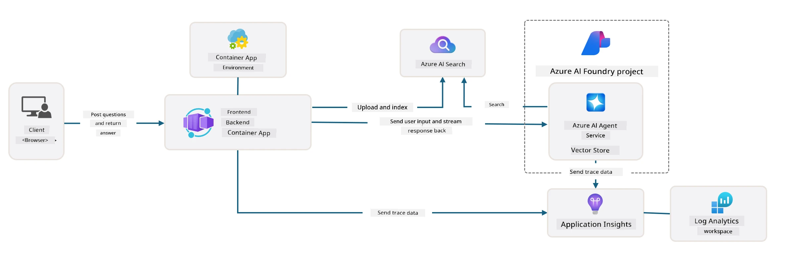

# 3. Deconstruct a Template

!!! tip "BY THE END OF THIS MODULE YOU GO FIT"

    - [ ] Use GitHub Copilot and optional MCP tools for Azure documentation and read-only exploration
    - [ ] Identify the template's application, infrastructure, configuration, and test entry points
    - [ ] Verify generated explanations against actual repository files
    - [ ] **Lab 3:** Trace one request and one configuration input through the project

---

## 1. Activate GitHub Copilot

Open di initialized AI sample for VS Code and enable [GitHub Copilot](https://code.visualstudio.com/docs/copilot/chat/chat-agent-mode). Sign in with one account wey get eligible plan; usage limits dey vary. Ask Copilot make e explain di repository before you authorize any changes.

### Optional MCP servers

Dis services fit provide extra tools:

- [Azure MCP Server](https://learn.microsoft.com/azure/developer/azure-mcp-server/overview)
- [Microsoft Learn MCP Server](https://learn.microsoft.com/training/support/mcp)

For VS Code, check di [MCP configuration guidance](https://code.visualstudio.com/docs/copilot/chat/mcp-servers) and create `.vscode/mcp.json` if e necessary:

```json
{
  "servers": {
    "Azure MCP Server": {
      "type": "stdio",
      "command": "npx",
      "args": ["-y", "@azure/mcp@latest", "server", "start"]
    },
    "microsoft.docs.mcp": {
      "type": "http",
      "url": "https://learn.microsoft.com/api/mcp"
    }
  }
}
```

Di `npx` command need make Node.js/npm installation wey dey supported and e go download executable code. Check di package well and pin one approved version so dat team setup go dey reproducible. Start di servers using VS Code MCP controls and check di available tools; di names fit change between versions.

**Authentication na separate matter.** Use `azd auth login` for AZD. Follow di documented Azure MCP authentication flow for im tools; AZD login alone no mean say MCP session don establish. Use `az login` separate when exercise or hook dey call Azure CLI.

Try read-only prompts:

1. “Use Microsoft Learn MCP find di Azure Developer CLI configuration documentation.”
2. “Explain dis repository's `azure.yaml`; mention di files wey implement each hook.”
3. “Using di tools wey dey available for Azure MCP, list my deployed resources without changing anything.”

Check di tenancy/subscription wey you select and every tool call wey dem propose. No approve resource creation, deletion, or access changes just to check how di architecture be.

## 2. Understand di architecture

Di sample host Python FastAPI backend and React/TypeScript frontend inside Azure Container Apps. Di backend dey communicate with agent for one Microsoft Foundry project. Retrieval and observability depend on di template features wey you enable and di setup wey you do well; no be say dem go always dey just because application deploy already.



Compare dis diagram with di [current upstream deployment guide](https://github.com/Azure-Samples/get-started-with-ai-agents/blob/main/docs/deployment.md) and your real resources. Check di configured model deployment, agent tools, managed identity, role assignments, and optional AI Search/Application Insights resources.

**Exercise:** Ask Copilot to trace one chat request from frontend through di API go Foundry, with file and function references. Open those references and check di explanation. No to infer implemented authentication, routing, or authorization based only for one diagram.

## 3. Repository structure

Di selected paths wey dem check against di sample on November 4, 2026 dey below. Your initialized revision na di source of truth:

```text
get-started-with-ai-agents/
  azure.yaml
  docker-compose.yaml
  requirements-dev.txt
  .devcontainer/
  infra/
    main.bicep
    main.parameters.json
    api.bicep
    core/
  src/
    Dockerfile
    pyproject.toml
    requirements.txt
    api/
      main.py
      routes.py
      search_index_manager.py
    frontend/
      package.json
      src/
    files/
  scripts/
    validate_env_vars.sh
    validate_env_vars.ps1
    postdeploy.sh
    postdeploy.ps1
  tests/
    test_evaluation.py
    test_red_teaming.py
  docs/
    deployment.md
    deploy_customization.md
    ai_search.md
    observability.md
    local_development.md
    troubleshooting.md
```

### Infrastructure and configuration

`infra/main.bicep` dey orchestrate resources; `main.parameters.json` dey connect template inputs go AZD environment values. `azure.yaml` dey select di application service and lifecycle hooks. Follow one input like `USE_AZURE_AI_SEARCH_SERVICE` through these files to know wetin really dey change.

### Application and identity

Read `src/api/` and `src/frontend/` together. Find where dem create or retrieve di agent, where instructions/tools dey configure, and which identity every Azure call dey use. Sample files for under `src/files/` na demonstration data, no be production catalog or authorization model.

### Tests and observability

Di current evaluation and red-teaming entry points dey under `tests/`; older `evals/` and `airedteaming/` directory references no dey relevant for dis sample again. Read `docs/observability.md` for prerequisites and costs before you run cloud tests. These Python tests separate from di optional `azure.ai.evaluations` AZD extension.

## 4. Verify your findings

- Identify di API route, agent interaction, and retrieval code for one sample question.
- Explain which identity dey access Foundry and which configuration dey select im endpoint.
- Find di real pre-up and post-deploy scripts and how dem dey handle error.
- List any dependencies or optional features wey no dey for your deployment.

Continue to [Configure a Template](4-Configure-AI-Template.md).

---

<!-- CO-OP TRANSLATOR DISCLAIMER START -->
**Disclaimer**:
Dis document don translate wit AI translation service [Co-op Translator](https://github.com/Azure/co-op-translator). Even tho we dey try make am correct, abeg make you know say automated translation fit get errors or mistakes. Di original document for dia own language na im be di correct source. For important info, make person wey sabi human translation do am. We no go responsible for any misunderstanding or wrong understanding wey fit happen because of dis translation.
<!-- CO-OP TRANSLATOR DISCLAIMER END -->