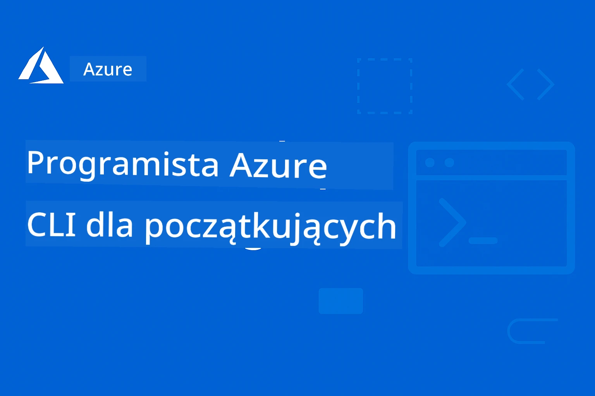

# AZD dla początkujących: Ustrukturyzowana ścieżka nauki

 

[](https://github.com/microsoft/AZD-for-beginners)
[](https://GitHub.com/microsoft/azd-for-beginners/network/)
[](https://github.com/microsoft/AZD-for-beginners)

[](https://discord.com/invite/nkVh3dp)
[](https://discord.gg/nTYy5BXMWG)

---

### Automatyczne tłumaczenia (zawsze aktualne)

<!-- CO-OP TRANSLATOR LANGUAGES TABLE START -->
[Arabski](../ar/README.md) | [Bengalski](../bn/README.md) | [Bułgarski](../bg/README.md) | [Birmański (Myanmar)](../my/README.md) | [Chiński (uproszczony)](../zh-CN/README.md) | [Chiński (tradycyjny, Hongkong)](../zh-HK/README.md) | [Chiński (tradycyjny, Makau)](../zh-MO/README.md) | [Chiński (tradycyjny, Tajwan)](../zh-TW/README.md) | [Chorwacki](../hr/README.md) | [Czeski](../cs/README.md) | [Duński](../da/README.md) | [Niderlandzki](../nl/README.md) | [Estoński](../et/README.md) | [Fiński](../fi/README.md) | [Francuski](../fr/README.md) | [Niemiecki](../de/README.md) | [Grecki](../el/README.md) | [Hebrajski](../he/README.md) | [Hindi](../hi/README.md) | [Węgierski](../hu/README.md) | [Indonezyjski](../id/README.md) | [Włoski](../it/README.md) | [Japoński](../ja/README.md) | [Kannada](../kn/README.md) | [Khmer](../km/README.md) | [Koreański](../ko/README.md) | [Litewski](../lt/README.md) | [Malajski](../ms/README.md) | [Malajalam](../ml/README.md) | [Marathi](../mr/README.md) | [Nepalski](../ne/README.md) | [Nigeryjski pidgin](../pcm/README.md) | [Norweski](../no/README.md) | [Perski (Farsi)](../fa/README.md) | [Polski](./README.md) | [Portugalski (Brazylia)](../pt-BR/README.md) | [Portugalski (Portugalia)](../pt-PT/README.md) | [Pendżabski (Gurmukhi)](../pa/README.md) | [Rumuński](../ro/README.md) | [Rosyjski](../ru/README.md) | [Serbski (cyrylica)](../sr/README.md) | [Słowacki](../sk/README.md) | [Słoweński](../sl/README.md) | [Hiszpański](../es/README.md) | [Suahili](../sw/README.md) | [Szwedzki](../sv/README.md) | [Tagalog (filipiński)](../tl/README.md) | [Tamilski](../ta/README.md) | [Telugu](../te/README.md) | [Tajski](../th/README.md) | [Turecki](../tr/README.md) | [Ukraiński](../uk/README.md) | [Urdu](../ur/README.md) | [Wietnamski](../vi/README.md)

> **Wolisz klonować lokalnie?**
>
> To repozytorium zawiera tłumaczenia na ponad 50 języków, co znacznie zwiększa rozmiar pobierania. Aby sklonować bez tłumaczeń, użyj sparse checkout:
>
> **Bash / macOS / Linux:**
> ```bash
> git clone --filter=blob:none --sparse https://github.com/microsoft/AZD-for-beginners.git
> cd AZD-for-beginners
> git sparse-checkout set --no-cone '/*' '!translations' '!translated_images'
> ```
>
> **CMD (Windows):**
> ```cmd
> git clone --filter=blob:none --sparse https://github.com/microsoft/AZD-for-beginners.git
> cd AZD-for-beginners
> git sparse-checkout set --no-cone "/*" "!translations" "!translated_images"
> ```
>
> To zapewnia wszystko, co potrzebne do ukończenia kursu, przy znacznie szybszym pobieraniu.
<!-- CO-OP TRANSLATOR LANGUAGES TABLE END -->

## 🆕 Co nowego dzisiaj w azd

> 📌 **Aktualizacja Foundry GA (2026-11-09):** Pakiet **`microsoft.foundry` 1.0 jest ogólnie dostępny**, ogłoszony [5 listopada 2026](https://devblogs.microsoft.com/azure-sdk/microsoft-foundry-azure-developer-cli-ga/). Użyj **`azd >= 1.37.0`** i zainstaluj go przez `azd ext install microsoft.foundry`. Skorzystaj z [przewodnika po hostowanym agencie](docs/chapter-02-ai-development/microsoft-foundry-integration.md#hosted-agent-walkthrough-ga) aby skonfigurować, testować lokalnie i wdrażać. Ta aktualizacja opiera się na opublikowanych wytycznych, a nie na działającym wdrożeniu Azure; pakiet GA nie udostępnia wszystkich opcjonalnych funkcji, rozszerzeń czy SDK.

Azure Developer CLI obsługuje wiele typów aplikacji, między innymi aplikacje webowe, API i agentów AI, dzięki obsługiwanym hostom, szablonom i rozszerzeniom.

Oto co to oznacza dla Ciebie:

- **Pakiet GA dla tworzenia Foundry.** `microsoft.foundry` instaluje siedem podstawowych rozszerzeń, w tym agentów, projekty i Agent Inspector. Kod agenta i ustawienia wdrożenia pozostają razem w `azure.yaml`.
- **Testuj lokalnie, a następnie wdrażaj kod.** Użyj `azd ai agent init --deploy-mode code`, `azd provision` i `azd ai agent run` do inspekcji lokalnych żądań i odpowiedzi. Następnie użyj `azd deploy` do zdalnego buildu w Foundry, bez lokalnego builda kontenera.
- **Mierz jakość osobno.** Zainstaluj **`azure.ai.evaluations`** do `azd ai eval generate`, `init`, i `run start`; nie jest wliczony w pakiet. Przechowuj przeglądane zestawy danych i rubryki z kodem. Starsze projekty powinny stosować się do [przewodnika migracji ewaluacji i optymalizacji](docs/chapter-08-production/production-ai-practices.md#evaluation-migration-and-quality-checks).
- **Wykorzystaj konfigurację w CI/CD.** Po pomyślnym `azd up`, skonfiguruj pipeline z `azd pipeline config`. Zainstaluj pakiet na runnerze i zachowaj wygenerowane ustawienia uwierzytelniania i środowiska.
- **Płynniejsza codzienna praca.** Ostatnie wersje uczyniły `azd init` idempotentnym (bezpiecznym do powtórnego uruchomienia), automatycznie czyściły przestarzałe tokeny w `azd auth login` i dodały przyjazny monit `azd tool` przy pierwszym uruchomieniu.
- **Podstawowy przepływ pracy nie uległ zmianie.** Niezależnie od tego czy wdrażasz aplikację todo, mikroserwis, czy rozwiązanie AI wieloagentowe, polecenia są takie same.

> **Uwaga dla użytkowników Aspire:** Microsoft nazywa teraz produkt po prostu **Aspire** (wcześniej ".NET Aspire"). Wsparcie azd dla Aspire pozostaje bez zmian – zmieniono tylko nazwę.

Jeśli wcześniej używałeś azd, wsparcie AI jest naturalnym rozszerzeniem – nie osobnym narzędziem ani zaawansowanym kursem. Jeśli zaczynasz od zera, nauczysz się jednego przepływu pracy działającego dla wszystkiego.

---

## 🚀 Czym jest Azure Developer CLI (azd)?

**Azure Developer CLI (azd)** to przyjazne dla deweloperów narzędzie wiersza poleceń, które upraszcza wdrażanie aplikacji do Azure. Zamiast ręcznego tworzenia i łączenia dziesiątek zasobów Azure, możesz wdrożyć całą aplikację jednym poleceniem.

### Magia `azd up`

```bash
# This single command does everything:
# ✅ Creates all Azure resources  
# ✅ Configures networking and security
# ✅ Builds your application code
# ✅ Deploys to Azure
# ✅ Gives you a working URL
azd up
```

Szablon dostarcza konfigurację aplikacji i infrastruktury. Pomyślne wdrożenie wymaga jednak obsługiwanych usług/modeli, wystarczającego limitu i uprawnień, prawidłowych danych wejściowych oraz weryfikacji wdrożonej aplikacji. `azd up` nie zapewnia automatycznie, że szablon jest bezpieczny, zgodny albo gotowy do produkcji.

---

## ❓ Azure Developer CLI a Azure CLI: jaka jest różnica?

To najczęściej zadawane pytanie przez początkujących. Oto prosta odpowiedź:

| Cecha | **Azure CLI (`az`)** | **Azure Developer CLI (`azd`)** |
|---------|---------------------|--------------------------------|
| **Cel** | Zarządzanie pojedynczymi zasobami Azure | Wdrażanie kompletnych aplikacji |
| **Nastawienie** | Skupienie na infrastrukturze | Skupienie na aplikacji |
| **Przykład** | `az webapp create --name myapp...` | `azd up` |
| **Krzywa nauki** | Trzeba znać usługi Azure | Trzeba znać swoją aplikację |
| **Najlepsze zastosowanie** | DevOps, infrastruktura | Deweloperzy, prototypowanie |

### Prosta analogia

- **Azure CLI** to jak posiadanie wszystkich narzędzi do budowy domu - młotki, piły, gwoździe. Możesz zbudować wszystko, ale musisz znać się na budownictwie.
- **Azure Developer CLI** to jak zatrudnienie wykonawcy - opisujesz, czego chcesz, a on zajmuje się budową.

### Kiedy używać którego z nich

| Scenariusz | Użyj tego |
|----------|----------|
| "Chcę szybko wdrożyć aplikację webową" | `azd up` |
| "Potrzebuję utworzyć tylko konto magazynu" | `az storage account create` |
| "Tworzę pełną aplikację AI" | `azd init --template azure-search-openai-demo` |
| "Muszę debugować konkretny zasób Azure" | `az resource show` |
| "Chcę wdrożyć do mojego skonfigurowanego środowiska produkcyjnego" | Przejrzyj konfigurację, dostęp, koszty i bramki operacyjne przed `azd up --environment production` |

### Działają razem!

AZD i Azure CLI mają oddzielne uwierzytelnianie i konfigurację. Używaj `azd auth login` dla AZD i `az login`, gdy polecenie potrzebuje wyraźnie Azure CLI. Można korzystać z obu:
```bash
# Deploy your app with AZD
azd up

# Then fine-tune specific resources with Azure CLI
az webapp config set --name myapp --always-on true
```

---

## 🌟 Znajdź szablony w Awesome AZD

Nie zaczynaj od zera! **Awesome AZD** to społecznościowa kolekcja gotowych do wdrożenia szablonów:

| Zasób | Opis |
|----------|-------------|
| 🔗 [**Awesome AZD Gallery**](https://azure.github.io/awesome-azd/) | Przeglądaj 200+ szablonów z wdrożeniem jednym kliknięciem |
| 🔗 [**Prześlij szablon**](https://github.com/Azure/awesome-azd/issues) | Wnieś swój własny szablon do społeczności |
| 🔗 [**Repozytorium GitHub**](https://github.com/Azure/awesome-azd) | Oceniaj i przeglądaj kod źródłowy |

### Popularne szablony AI z Awesome AZD

Wybierz jeden szablon w pustym katalogu; poniższe polecenia to alternatywy. Końcowy `.` inicjalizuje ten katalog.

```bash
# RAG Chat with Microsoft Foundry Models + AI Search
azd init --template azure-search-openai-demo .

# Quick AI Chat Application
azd init --template openai-chat-app-quickstart .

# AI Agents with Foundry Agents
azd init --template get-started-with-ai-agents .
```

---

## 🎯 Zacznij w 3 krokach

Zanim zaczniesz, upewnij się, że Twój komputer jest gotowy do szablonu, który chcesz wdrożyć:

**Windows:**
```powershell
.\validate-setup.ps1
```

**macOS / Linux:**
```bash
bash ./validate-setup.sh
```

Jeśli któryś wymóg nie zostanie spełniony, napraw to najpierw, a następnie kontynuuj szybki start.

### Krok 1: Zainstaluj AZD (2 minuty)

**Windows:**
```powershell
winget install microsoft.azd
```

**macOS:**
```bash
brew tap azure/azd && brew install azd
```

**Linux:**
```bash
curl -fsSL https://aka.ms/install-azd.sh | bash
```

### Krok 2: Uwierzytelnij się do AZD

```bash
# Optional if you plan to use Azure CLI commands directly in this course
az login

# Required for AZD workflows
azd auth login
```

Jeśli nie wiesz, który potrzebujesz, przejdź przez pełny proces konfiguracji w [Instalacja i konfiguracja](docs/chapter-01-foundation/installation.md#authentication-setup).

### Krok 3: Wdróż swoją pierwszą aplikację

```bash
# Initialize from a template
azd init --template todo-nodejs-mongo .

# Deploy to Azure (creates everything!)
azd up
```

**🎉 To wszystko!** Twoja aplikacja jest teraz dostępna na Azure.

### Sprzątaj (nie zapomnij!)

```bash
# Remove all resources when done experimenting
azd down --force --purge
```

---

## 📚 Jak korzystać z tego kursu

Ten kurs jest zaprojektowany do **stopniowej nauki** – zacznij tam, gdzie czujesz się komfortowo, i stopniowo poszerzaj wiedzę:

| Twoje doświadczenie | Zacznij tutaj |
|-----------------|------------|
| **Całkiem nowy w Azure** | [Rozdział 1: Podstawy](#-chapter-1-foundation--quick-start) |
| **Znasz Azure, nowy w AZD** | [Rozdział 1: Podstawy](#-chapter-1-foundation--quick-start) |
| **Chcesz wdrażać aplikacje AI** | [Rozdział 2: Rozwój z AI na pierwszym miejscu](#-chapter-2-ai-first-development-recommended-for-ai-developers) |
| **Chcesz praktyki „hands-on”** | [🎓 Interaktywny warsztat](workshop/README.md) – 3-4 godziny prowadzonych ćwiczeń |
| **Potrzebujesz wzorców produkcyjnych** | [Rozdział 8: Produkcja i przedsiębiorstwa](#-chapter-8-production--enterprise-patterns) |

### Szybka konfiguracja

1. **Wykonaj fork repozytorium**: [](https://GitHub.com/microsoft/azd-for-beginners/fork)
2. **Sklonuj**: `git clone https://github.com/YOUR-USERNAME/azd-for-beginners.git`
3. **Uzyskaj pomoc**: [Społeczność Azure Discord](https://discord.com/invite/ByRwuEEgH4)

> **Wolisz klonować lokalnie?**

> To repozytorium zawiera tłumaczenia na ponad 50 języków, co znacznie zwiększa rozmiar pobierania. Aby sklonować bez tłumaczeń, użyj sparse checkout:
> ```bash
> git clone --filter=blob:none --sparse https://github.com/microsoft/AZD-for-beginners.git
> cd AZD-for-beginners
> git sparse-checkout set --no-cone '/*' '!translations' '!translated_images'
> ```
> To daje wszystko, czego potrzebujesz do ukończenia kursu przy znacznie szybszym pobieraniu.


## Przegląd kursu

Opanuj Azure Developer CLI (azd) dzięki ustrukturyzowanym rozdziałom zaprojektowanym do stopniowej nauki. **Szczególny nacisk na wdrażanie aplikacji AI z integracją Microsoft Foundry.**

### Dlaczego ten kurs jest niezbędny dla nowoczesnych programistów

Programiści wdrażający obciążenia AI często potrzebują wskazówek dotyczących:
- Złożonych architektur AI z wieloma usługami
- Najlepszych praktyk produkcyjnego wdrażania AI  
- Integracji i konfiguracji usług Azure AI
- Optymalizacji kosztów obciążeń AI
- Rozwiązywania problemów specyficznych dla wdrożeń AI

### Cele nauki

Po ukończeniu tego ustrukturyzowanego kursu:
- **Opanujesz podstawy AZD**: Podstawowe koncepcje, instalację i konfigurację
- **Wdrożysz aplikacje AI**: Korzystając z AZD i usług Microsoft Foundry
- **Zaimplementujesz Infrastrukturę jako Kod**: Zarządzanie zasobami Azure za pomocą szablonów Bicep
- **Rozwiążesz problemy z wdrożeniami**: Usuwanie typowych błędów i debugowanie
- **Zoptymalizujesz pod kątem produkcji**: Bezpieczeństwo, skalowanie, monitorowanie i zarządzanie kosztami
- **Zbudujesz rozwiązania wieloagentowe**: Wdrażanie złożonych architektur AI

## Przed rozpoczęciem: konta, dostęp i założenia

Przed rozpoczęciem Rozdziału 1 upewnij się, że masz następujące elementy. Kroki instalacji w tym przewodniku zakładają, że te podstawy są już spełnione.

- **Subskrypcja Azure**: Możesz użyć istniejącej subskrypcji służbowej lub prywatnej albo utworzyć [bezpłatną wersję próbną](https://aka.ms/azurefreetrial), aby zacząć.
- **Uprawnienia do tworzenia zasobów Azure**: Do większości ćwiczeń potrzebujesz co najmniej dostępu **Współtwórcy** do docelowej subskrypcji lub grupy zasobów. W niektórych rozdziałach może być wymagane tworzenie grup zasobów, zarządzanych tożsamości i przypisań RBAC.
- [**Konto GitHub**](https://github.com): Przydatne do forka repozytorium, śledzenia swoich zmian oraz korzystania z GitHub Codespaces podczas warsztatów.
- **Wymagania wstępne do uruchamiania szablonów**: Niektóre szablony wymagają lokalnych narzędzi, takich jak Node.js, Python, Java lub Docker. Uruchom walidator środowiska przed rozpoczęciem, aby na wczesnym etapie wykryć brakujące narzędzia.
- **Podstawowa znajomość terminala**: Nie musisz być ekspertem, ale powinieneś swobodnie używać poleceń takich jak `git clone`, `azd auth login` i `azd up`.

> **Pracujesz w subskrypcji korporacyjnej?**
> Jeśli Twoje środowisko Azure jest zarządzane przez administratora, wcześniej potwierdź, czy możesz wdrażać zasoby w subskrypcji lub grupie zasobów, którą planujesz użyć. W przeciwnym razie poproś o subskrypcję typu sandbox lub dostęp Współtwórcy przed rozpoczęciem.

> **Nowy w Azure?**
> Zacznij od własnej subskrypcji testowej Azure lub płatności według zużycia na https://aka.ms/azurefreetrial, aby zakończyć ćwiczenia od początku do końca bez oczekiwania na zatwierdzenia na poziomie dzierżawy.

## 🗺️ Mapa kursu: szybka nawigacja według rozdziału

Każdy rozdział ma dedykowany plik README zawierający cele nauki, szybkie starty oraz ćwiczenia:

| Rozdział | Temat | Lekcje | Czas trwania | Trudność |
|---------|-------|---------|----------|------------|
| **[Rozdział 1: Podstawy](docs/chapter-01-foundation/README.md)** | Początki | [Podstawy AZD](docs/chapter-01-foundation/azd-basics.md) &#124; [Instalacja](docs/chapter-01-foundation/installation.md) &#124; [Pierwszy projekt](docs/chapter-01-foundation/first-project.md) | 30-45 min | ⭐ |
| **[Rozdział 2: Rozwój AI](docs/chapter-02-ai-development/README.md)** | Aplikacje AI-First | [Integracja Foundry](docs/chapter-02-ai-development/microsoft-foundry-integration.md) &#124; [Agenci AI](docs/chapter-02-ai-development/agents.md) &#124; [Wdrożenie modelu](docs/chapter-02-ai-development/ai-model-deployment.md) &#124; [Warsztat](docs/chapter-02-ai-development/ai-workshop-lab.md) | 1-2 godziny | ⭐⭐ |
| **[Rozdział 3: Konfiguracja](docs/chapter-03-configuration/README.md)** | Uwierzytelnianie i bezpieczeństwo | [Konfiguracja](docs/chapter-03-configuration/configuration.md) &#124; [Uwierzytelnianie i bezpieczeństwo](docs/chapter-03-configuration/authsecurity.md) | 45-60 minut | ⭐⭐ |
| **[Rozdział 4: Infrastruktura](docs/chapter-04-infrastructure/README.md)** | IaC i wdrożenie | [Przewodnik wdrożeniowy](docs/chapter-04-infrastructure/deployment-guide.md) &#124; [Provisioning](docs/chapter-04-infrastructure/provisioning.md) | 1-1,5 godziny | ⭐⭐⭐ |
| **[Rozdział 5: Multi-Agent](docs/chapter-05-multi-agent/README.md)** | Rozwiązania agentów AI | [Scenariusz detaliczny](examples/retail-scenario.md) &#124; [Wzorce koordynacji](docs/chapter-06-pre-deployment/coordination-patterns.md) | 2-3 godziny | ⭐⭐⭐⭐ |
| **[Rozdział 6: Przed wdrożeniem](docs/chapter-06-pre-deployment/README.md)** | Planowanie i walidacja | [Kontrole wstępne](docs/chapter-06-pre-deployment/preflight-checks.md) &#124; [Planowanie pojemności](docs/chapter-06-pre-deployment/capacity-planning.md) &#124; [Wybór SKU](docs/chapter-06-pre-deployment/sku-selection.md) &#124; [Application Insights](docs/chapter-06-pre-deployment/application-insights.md) | 1 godzina | ⭐⭐ |
| **[Rozdział 7: Rozwiązywanie problemów](docs/chapter-07-troubleshooting/README.md)** | Debugowanie i naprawa | [Typowe problemy](docs/chapter-07-troubleshooting/common-issues.md) &#124; [Debugowanie](docs/chapter-07-troubleshooting/debugging.md) &#124; [Problemy AI](docs/chapter-07-troubleshooting/ai-troubleshooting.md) | 1-1,5 godziny | ⭐⭐ |
| **[Rozdział 8: Produkcja](docs/chapter-08-production/README.md)** | Wzorce korporacyjne | [Praktyki produkcyjne](docs/chapter-08-production/production-ai-practices.md) | 2-3 godziny | ⭐⭐⭐⭐ |
| **[🎓 Warsztat](workshop/README.md)** | Praktyczne laboratorium | [Wprowadzenie](workshop/docs/instructions/0-Introduction.md) &#124; [Wybór](workshop/docs/instructions/1-Select-AI-Template.md) &#124; [Walidacja](workshop/docs/instructions/2-Validate-AI-Template.md) &#124; [Analiza](workshop/docs/instructions/3-Deconstruct-AI-Template.md) &#124; [Konfiguracja](workshop/docs/instructions/4-Configure-AI-Template.md) &#124; [Dostosowanie](workshop/docs/instructions/5-Customize-AI-Template.md) &#124; [Zamknięcie](workshop/docs/instructions/6-Teardown-Infrastructure.md) &#124; [Podsumowanie](workshop/docs/instructions/7-Wrap-up.md) | 3-4 godziny | ⭐⭐ |

**Całkowity czas kursu:** ~10-14 godzin | **Rozwój umiejętności:** Początkujący → Gotowy do produkcji

---

## 📚 Rozdziały edukacyjne

*Wybierz ścieżkę nauki w zależności od poziomu doświadczenia i celów*

### 🚀 Rozdział 1: Podstawy i szybki start
**Wymagania wstępne**: subskrypcja Azure, podstawowa znajomość linii poleceń  
**Czas trwania**: 30-45 minut  
**Trudność**: ⭐

#### Czego się nauczysz
- Zrozumienie podstaw Azure Developer CLI
- Instalacja AZD na Twojej platformie
- Pierwsze udane wdrożenie

#### Materiały edukacyjne
- **🎯 Zacznij tutaj**: [Czym jest Azure Developer CLI?](#-what-is-azure-developer-cli-azd)
- **📖 Teoria**: [Podstawy AZD](docs/chapter-01-foundation/azd-basics.md) - Kluczowe koncepcje i terminologia
- **⚙️ Instalacja**: [Instalacja i konfiguracja](docs/chapter-01-foundation/installation.md) - Przewodniki platformowe
- **🛠️ Praktyka**: [Twój pierwszy projekt](docs/chapter-01-foundation/first-project.md) - Poradnik krok po kroku
- **📋 Szybkie odniesienie**: [Skróty poleceń](resources/cheat-sheet.md)

#### Ćwiczenia praktyczne
```bash
# Quick installation check
azd version

# Deploy your first application
azd init --template todo-nodejs-mongo .
azd up
```

**💡 Wynik rozdziału**: Skutecznie wdrożona prosta aplikacja webowa w Azure z użyciem AZD

**✅ Weryfikacja sukcesu:**
```bash
# After completing Chapter 1, you should be able to:
azd version              # Shows installed version
azd init --template todo-nodejs-mongo  # Initializes project
azd up                  # Deploys to Azure
azd show                # Displays running app URL
# Application opens in browser and works
azd down --force --purge  # Cleans up resources
```

**📊 Nakład czasu:** 30-45 minut  
**📈 Poziom umiejętności:** Potrafi samodzielnie wdrażać podstawowe aplikacje

---

### 🤖 Rozdział 2: Rozwój AI-First (polecany dla programistów AI)
**Wymagania wstępne**: ukończony Rozdział 1  
**Czas trwania**: 1-2 godziny  
**Trudność**: ⭐⭐

#### Czego się nauczysz
- Integracja Microsoft Foundry z AZD
- Wdrażanie aplikacji wspomaganych AI
- Zrozumienie konfiguracji usług AI

#### Materiały edukacyjne
- **🎯 Zacznij tutaj**: [Integracja Microsoft Foundry](docs/chapter-02-ai-development/microsoft-foundry-integration.md)
- **🤖 Agenci AI**: [Przewodnik po agentach AI](docs/chapter-02-ai-development/agents.md) - Wdrażanie inteligentnych agentów z AZD
- **📖 Wzorce**: [Wdrożenie modeli AI](docs/chapter-02-ai-development/ai-model-deployment.md) - Wdrażanie i zarządzanie modelami AI
- **🛠️ Warsztat**: [Laboratorium AI](docs/chapter-02-ai-development/ai-workshop-lab.md) - Przygotuj rozwiązania AI do AZD
- **🎥 Przewodnik interaktywny**: [Materiały warsztatowe](workshop/README.md) - Nauka przeglądarkowa z MkDocs * środowisko DevContainer
- **📋 Szablony**: [Szablony Microsoft Foundry](#featured-microsoft-foundry-templates)
- **📝 Przykłady**: [Przykłady wdrożeń AZD](examples/README.md)

#### Ćwiczenia praktyczne
```bash
# Deploy your first AI application
azd init --template azure-search-openai-demo .
azd up

# Try additional AI templates
azd init --template openai-chat-app-quickstart .
azd init --template agent-openai-python-prompty .
```

**💡 Wynik rozdziału**: Wdrożona i skonfigurowana aplikacja czatu napędzana AI z funkcjami RAG

**✅ Weryfikacja sukcesu:**
```bash
# After Chapter 2, you should be able to:
azd init --template azure-search-openai-demo .
azd up
# Test the AI chat interface
# Ask questions and get AI-powered responses with sources
# Verify search integration works
azd monitor  # Check Application Insights shows telemetry
azd down --force --purge
```

**📊 Nakład czasu:** 1-2 godziny  
**📈 Poziom umiejętności:** Potrafi wdrażać aplikacje uczące się AI i identyfikować dodatkowe wymagania produkcyjne
**💰 Świadomość kosztów:** Znajomość kosztów deweloperskich $80-150/miesiąc, produkcyjnych $300-3500/miesiąc

#### 💰 Rozważania kosztowe dla wdrożeń AI

**Środowisko deweloperskie (szacowane $80-150/miesiąc):**
- Modele Microsoft Foundry (płatność za użycie): $0-50/miesiąc (w zależności od użycia tokenów)
- AI Search (poziom podstawowy): $75/miesiąc
- Container Apps (zużycie): $0-20/miesiąc
- Storage (standard): $1-5/miesiąc

**Środowisko produkcyjne (szacowane $300-3500+/miesiąc):**
- Modele Microsoft Foundry (PTU dla stałej wydajności): $3,000+/miesiąc LUB płatność za użycie przy dużym wolumenie
- AI Search (poziom standard): $250/miesiąc
- Container Apps (dedykowane): $50-100/miesiąc
- Application Insights: $5-50/miesiąc
- Storage (premium): $10-50/miesiąc

**💡 Wskazówki optymalizacji kosztów:**
- Sprawdź cennik inferencji modelu i dostępne kredyty specyficzne dla konta; Azure OpenAI nie obejmuje uniwersalnego darmowego limitu 50,000 tokenów miesięcznie
- Uruchom `azd down`, aby usuwać zasoby po zakończeniu korzystania, po przejrzeniu wybranego środowiska
- Zacznij od rozliczenia według zużycia, uaktualnij do PTU tylko w produkcji
- Użyj `azd provision --preview`, aby sprawdzić planowaną infrastrukturę, a następnie wyceń zasoby kalkulatorem cen Azure
- Włącz automatyczne skalowanie: płać tylko za faktyczne użycie

**Monitorowanie kosztów:**
```bash
# Inspect planned resources (this does not calculate prices)
azd provision --preview

# Monitor actual costs in Azure Portal
az consumption budget list --resource-group <your-rg>
```

---

### ⚙️ Rozdział 3: Konfiguracja i uwierzytelnianie
**Wymagania wstępne**: ukończony Rozdział 1  
**Czas trwania**: 45-60 minut  
**Trudność**: ⭐⭐

#### Czego się nauczysz
- Konfiguracja i zarządzanie środowiskiem
- Najlepsze praktyki uwierzytelniania i bezpieczeństwa
- Nazewnictwo i organizacja zasobów

#### Materiały edukacyjne
- **📖 Konfiguracja**: [Przewodnik konfiguracji](docs/chapter-03-configuration/configuration.md) - Ustawienia środowiska
- **🔐 Bezpieczeństwo**: [Wzorce uwierzytelniania i zarządzane tożsamości](docs/chapter-03-configuration/authsecurity.md) - Wzorce uwierzytelniania
- **📝 Przykłady**: [Przykład aplikacji bazodanowej](examples/database-app/README.md) - Przykłady baz danych AZD

#### Ćwiczenia praktyczne
- Konfiguracja wielu środowisk (dev, staging, prod)
- Konfiguracja uwierzytelniania przy użyciu zarządzanej tożsamości
- Implementacja konfiguracji specyficznych dla środowisk

**💡 Wynik rozdziału**: Zarządzanie wieloma środowiskami z właściwym uwierzytelnianiem i bezpieczeństwem

---

### 🏗️ Rozdział 4: Infrastruktura jako kod i wdrożenie
**Wymagania wstępne**: ukończone Rozdziały 1-3  
**Czas trwania**: 1-1,5 godziny  
**Trudność**: ⭐⭐⭐

#### Czego się nauczysz
- Zaawansowane wzorce wdrożeniowe
- Infrastruktura jako Kod z Bicep
- Strategie provisioningu zasobów

#### Materiały edukacyjne
- **📖 Wdrożenie**: [Przewodnik wdrożeniowy](docs/chapter-04-infrastructure/deployment-guide.md) - Kompletne workflow
- **🏗️ Provisioning**: [Provisioning zasobów](docs/chapter-04-infrastructure/provisioning.md) - Zarządzanie zasobami Azure
- **📝 Przykłady**: [Przykład Container App](../../examples/container-app) - Wdrożenia konteneryzowane

#### Ćwiczenia praktyczne
- Tworzenie własnych szablonów Bicep
- Wdrażanie aplikacji wielousługowych
- Implementacja strategii blue-green deployment

**💡 Wynik rozdziału**: Wdrażanie złożonych aplikacji wielousługowych za pomocą niestandardowych szablonów infrastruktury

---

### 🎯 Rozdział 5: Rozwiązania AI wieloagentowe (zaawansowany)
**Wymagania wstępne**: ukończone Rozdziały 1-2  
**Czas trwania**: 2-3 godziny  
**Trudność**: ⭐⭐⭐⭐

#### Czego się nauczysz
- Wzorce architektury wieloagentowej
- Orkiestracja i koordynacja agentów
- Wdrożenia AI gotowe do produkcji

#### Materiały edukacyjne
- **🤖 Polecany Projekt**: [Rozwiązanie detaliczne wieloagentowe](examples/retail-scenario.md) - Plan architektury, nie kompletna aplikacja
- **🛠️ Szablony ARM**: [Pakiet szablonów ARM](../../examples/retail-multiagent-arm-template) - Szkielet infrastruktury; sprawdź wymagania wstępne i brakujące komponenty aplikacji
- **📖 Architektura**: [Wzorce koordynacji wieloagentowej](docs/chapter-06-pre-deployment/coordination-patterns.md) - Wzorce

#### Ćwiczenia praktyczne
```bash
# Inspect the retail infrastructure scaffold before choosing to deploy it
cd examples/retail-multiagent-arm-template
cat README.md

# After an intentional deployment, inspect infrastructure state
az deployment group show --resource-group <rg-name> --name <deployment-name>
```

**💡 Rezultat rozdziału**: Zrozumieć projektowanie wieloagentowe i zidentyfikować implementację, walidację oraz prace operacyjne potrzebne poza szkieletem infrastruktury

---

### 🔍 Rozdział 6: Walidacja i planowanie przed wdrożeniem
**Wymagania wstępne**: Ukończony rozdział 4  
**Czas trwania**: 1 godzina  
**Złożoność**: ⭐⭐

#### Czego się nauczysz
- Planowanie pojemności i walidacja zasobów
- Strategie wyboru SKU
- Kontrole przedwdrożeniowe i automatyzacja

#### Materiały do nauki
- **📊 Planowanie**: [Planowanie pojemności](docs/chapter-06-pre-deployment/capacity-planning.md) - Walidacja zasobów
- **💰 Wybór**: [Wybór SKU](docs/chapter-06-pre-deployment/sku-selection.md) - Wybory opłacalne kosztowo
- **✅ Walidacja**: [Kontrole przedwdrożeniowe](docs/chapter-06-pre-deployment/preflight-checks.md) - Skrypty automatyczne

#### Ćwiczenia praktyczne
- Uruchom skrypty walidacji pojemności
- Optymalizuj wybory SKU pod kątem kosztów
- Wdroż automatyczne kontrole przedwdrożeniowe

**💡 Rezultat rozdziału**: Zweryfikuj i zoptymalizuj wdrożenia przed ich wykonaniem

---

### 🚨 Rozdział 7: Rozwiązywanie problemów i debugowanie
**Wymagania wstępne**: Ukończony dowolny rozdział dotyczący wdrożenia  
**Czas trwania**: 1-1,5 godziny  
**Złożoność**: ⭐⭐

#### Czego się nauczysz
- Systematyczne podejścia do debugowania
- Typowe problemy i rozwiązania
- Specyficzne dla AI rozwiązywanie problemów

#### Materiały do nauki
- **🔧 Typowe problemy**: [Typowe problemy](docs/chapter-07-troubleshooting/common-issues.md) - FAQ i rozwiązania
- **🕵️ Debugowanie**: [Przewodnik debugowania](docs/chapter-07-troubleshooting/debugging.md) - Strategie krok po kroku
- **🤖 Problemy AI**: [Specyficzne rozwiązywanie problemów AI](docs/chapter-07-troubleshooting/ai-troubleshooting.md) - Problemy z usługami AI

#### Ćwiczenia praktyczne
- Diagnozuj błędy wdrożenia
- Rozwiązuj problemy z uwierzytelnianiem
- Debuguj łączność z usługą AI

**💡 Rezultat rozdziału**: Samodzielnie diagnozuj i rozwiązuj typowe problemy wdrożeniowe

---

### 🏢 Rozdział 8: Wzorce produkcyjne i korporacyjne
**Wymagania wstępne**: Ukończone rozdziały 1-4  
**Czas trwania**: 2-3 godziny  
**Złożoność**: ⭐⭐⭐⭐

#### Czego się nauczysz
- Strategie wdrożeń produkcyjnych
- Korporacyjne wzorce bezpieczeństwa
- Monitorowanie i optymalizacja kosztów

#### Materiały do nauki
- **🏭 Produkcja**: [Najlepsze praktyki AI produkcyjnego](docs/chapter-08-production/production-ai-practices.md) - Wzorce korporacyjne
- **📝 Przykłady**: [Przykład mikroserwisów](../../examples/microservices) - Złożone architektury
- **📊 Monitorowanie**: [Integracja z Application Insights](docs/chapter-06-pre-deployment/application-insights.md) - Monitorowanie

#### Ćwiczenia praktyczne
- Wdroż wzorce bezpieczeństwa korporacyjnego
- Skonfiguruj kompleksowe monitorowanie
- Wdroż produkcyjnie z odpowiednim zarządzaniem

**💡 Rezultat rozdziału**: Wdróż aplikacje gotowe do produkcji z pełnymi możliwościami produkcyjnymi

---

## 🎓 Przegląd warsztatów: Praktyczne doświadczenie edukacyjne

> **⚠️ STATUS WARSZTATU: Aktywny rozwój**  
> Materiały warsztatowe są obecnie opracowywane i dopracowywane. Kluczowe moduły działają, ale niektóre zaawansowane sekcje są nieukończone. Aktywnie pracujemy nad ukończeniem całej zawartości. [Śledź postęp →](workshop/README.md)

### Interaktywne materiały warsztatowe
**Kompleksowe praktyczne nauczanie z użyciem narzędzi przeglądarkowych i prowadzonych ćwiczeń**

Nasze materiały warsztatowe zapewniają usystematyzowane, interaktywne doświadczenie edukacyjne uzupełniające program nauki oparty na rozdziałach powyżej. Warsztat jest zaprojektowany zarówno do samodzielnej nauki, jak i sesji prowadzonych przez instruktora.

#### 🛠️ Cechy warsztatów
- **Interfejs przeglądarkowy**: Kompletny warsztat oparty na MkDocs z funkcjami wyszukiwania, kopiowania oraz motywów
- **Integracja GitHub Codespaces**: Konfiguracja środowiska deweloperskiego jednym kliknięciem
- **Ustrukturyzowana ścieżka nauki**: 8 modułów prowadzonych ćwiczeń (łącznie 3-4 godziny)
- **Metodologia progresywna**: Wprowadzenie → Wybór → Walidacja → Rozbiórka → Konfiguracja → Personalizacja → Zakończenie → Podsumowanie
- **Interaktywne środowisko DevContainer**: Wstępnie skonfigurowane narzędzia i zależności

#### 📚 Struktura modułów warsztatowych
Warsztat realizuje **8-modułową metodologię progresywną**, która prowadzi od odkrycia do mistrzostwa we wdrożeniach:

| Moduł | Temat | Co zrobisz | Czas trwania |
|--------|-------|----------------|----------|
| **0. Wprowadzenie** | Przegląd warsztatu | Poznasz cele nauki, wymagania i strukturę warsztatu | 15 min |
| **1. Wybór** | Odkrywanie szablonów | Przeglądniesz szablony AZD i wybierzesz odpowiedni AI szablon dla swojego scenariusza | 20 min |
| **2. Walidacja** | Wdrożenie i weryfikacja | Wdrożysz szablon za pomocą `azd up` i zweryfikujesz działanie infrastruktury | 30 min |
| **3. Rozbiórka** | Zrozumienie struktury | Użyjesz GitHub Copilot do poznania architektury szablonu, plików Bicep i organizacji kodu | 30 min |
| **4. Konfiguracja** | Głębokie zanurzenie w azure.yaml | Opanujesz konfigurację `azure.yaml`, haczyki cyklu życia i zmienne środowiskowe | 30 min |
| **5. Personalizacja** | Dostosuj do siebie | Włączysz AI Search, śledzenie, ewaluację i dostosujesz scenariusz do swoich potrzeb | 45 min |
| **6. Zakończenie** | Sprzątanie | Bezpiecznie zwolnisz zasoby za pomocą `azd down --purge` | 15 min |
| **7. Podsumowanie** | Kolejne kroki | Podsumujesz osiągnięcia, kluczowe koncepcje i dalej będziesz kontynuować naukę | 15 min |

**Przebieg warsztatu:**
```
Introduction → Selection → Validation → Deconstruction → Configuration → Customization → Teardown → Wrap-up
     ↓            ↓           ↓              ↓               ↓              ↓            ↓           ↓
  Overview    Find the     Deploy &      Explore        Master         Customize     Clean up    Review &
             right        verify        code &        azure.yaml      for your      resources   next steps
             template                   structure                     scenario
```

#### 🚀 Rozpoczęcie warsztatu
```bash
# Option 1: GitHub Codespaces (Recommended)
# Click "Code" → "Create codespace on main" in the repository

# Option 2: Local Development
git clone https://github.com/microsoft/azd-for-beginners.git
cd azd-for-beginners/workshop
# Follow the setup instructions in workshop/README.md
```

#### 🎯 Rezultaty nauki w warsztacie
Po ukończeniu warsztatu uczestnicy będą potrafili:
- **Wdrożyć produkcyjne aplikacje AI**: Używać AZD z usługami Microsoft Foundry
- **Opanować architektury wieloagentowe**: Wdrażać skoordynowane rozwiązania agentów AI
- **Wdrażać najlepsze praktyki bezpieczeństwa**: Konfigurować uwierzytelnianie i kontrolę dostępu
- **Optymalizować pod skalę**: Projektować opłacalne i wydajne wdrożenia
- **Rozwiązywać problemy wdrożeń**: Samodzielnie usuwać typowe problemy

#### 📖 Materiały warsztatowe
- **🎥 Interaktywny przewodnik**: [Materiały warsztatowe](workshop/README.md) - Środowisko do nauki oparte na przeglądarce
- **📋 Instrukcje moduł po module**:
  - [0. Wprowadzenie](workshop/docs/instructions/0-Introduction.md) - Przegląd warsztatu i cele
  - [1. Wybór](workshop/docs/instructions/1-Select-AI-Template.md) - Znajdź i wybierz szablony AI
  - [2. Walidacja](workshop/docs/instructions/2-Validate-AI-Template.md) - Wdroż i zweryfikuj szablony
  - [3. Rozbiórka](workshop/docs/instructions/3-Deconstruct-AI-Template.md) - Poznaj architekturę szablonu
  - [4. Konfiguracja](workshop/docs/instructions/4-Configure-AI-Template.md) - Opanuj azure.yaml
  - [5. Personalizacja](workshop/docs/instructions/5-Customize-AI-Template.md) - Dostosuj do scenariusza
  - [6. Zakończenie](workshop/docs/instructions/6-Teardown-Infrastructure.md) - Sprzątnij zasoby
  - [7. Podsumowanie](workshop/docs/instructions/7-Wrap-up.md) - Podsumowanie i kolejne kroki
- **🛠️ Laboratorium AI Workshop**: [AI Workshop Lab](docs/chapter-02-ai-development/ai-workshop-lab.md) - Ćwiczenia skupione na AI
- **💡 Szybki start**: [Przewodnik konfiguracji warsztatu](workshop/README.md#browser-based-guide) - Konfiguracja środowiska

**Idealny dla**: szkoleń korporacyjnych, zajęć uniwersyteckich, samodzielnej nauki oraz bootcampów dla deweloperów.

---

## 📖 Dogłębna analiza: możliwości AZD

Poza podstawami, AZD oferuje potężne funkcje dla wdrożeń produkcyjnych:

- **Wdrożenia oparte na szablonach** - Używaj gotowych szablonów dla powszechnych wzorców aplikacji
- **Infrastruktura jako kod** - Zarządzaj zasobami Azure za pomocą Bicep lub Terraform  
- **Zintegrowane przepływy pracy** - Bezproblemowo twórz, wdrażaj i monitoruj aplikacje
- **Przyjazny dla deweloperów** - Optymalizowany pod produktywność i doświadczenie dewelopera

### **AZD + Microsoft Foundry: idealne do wdrożeń AI**

**Dlaczego AZD dla rozwiązań AI?** AZD rozwiązuje główne wyzwania programistów AI:

- **Szablony gotowe na AI** - Wstępnie skonfigurowane szablony dla Microsoft Foundry Models, Azure AI Services i obciążeń ML
- **Bezpieczne wdrożenia AI** - Wbudowane wzorce bezpieczeństwa dla usług AI, kluczy API i punktów końcowych modeli  
- **Wzorce produkcyjne AI** - Najlepsze praktyki skalowalnych i opłacalnych wdrożeń AI
- **Kompleksowe przepływy AI** - Od rozwoju modelu do wdrożenia produkcyjnego z odpowiednim monitorowaniem
- **Optymalizacja kosztów** - Inteligentne zarządzanie zasobami i skalowaniem AI
- **Integracja z Microsoft Foundry** - Bezproblemowe połączenie z katalogiem modeli i punktami końcowymi Microsoft Foundry

---

## 🎯 Biblioteka szablonów i przykładów

### Polecane: szablony Microsoft Foundry
**Zacznij tutaj, jeśli wdrażasz aplikacje AI!**

> **Uwaga:** Te szablony demonstrują różne wzorce AI. Niektóre pochodzą z zewnętrznych przykładów Azure, inne to lokalne implementacje.

| Szablon | Rozdział | Złożoność | Usługi | Typ |
|----------|---------|------------|----------|------|
| [**Rozpocznij rozmowę AI**](https://github.com/Azure-Samples/get-started-with-ai-chat) | Rozdział 2 | ⭐⭐ | AzureOpenAI + Azure AI Model Inference API + Azure AI Search + Azure Container Apps + Application Insights | Zewnętrzny |
| [**Rozpocznij z agentami AI**](https://github.com/Azure-Samples/get-started-with-ai-agents) | Rozdział 2 | ⭐⭐ | Foundry Agents + AzureOpenAI + Azure AI Search + Azure Container Apps + Application Insights| Zewnętrzny |
| [**Demonstracja Azure Search + OpenAI**](https://github.com/Azure-Samples/azure-search-openai-demo) | Rozdział 2 | ⭐⭐ | Azure OpenAI + Azure AI Search + Container Apps (domyślnie) + Storage | Zewnętrzny |
| [**Szybki start aplikacji OpenAI Chat**](https://github.com/Azure-Samples/openai-chat-app-quickstart) | Rozdział 2 | ⭐ | AzureOpenAI + Container Apps + Application Insights | Zewnętrzny |
| [**Agent OpenAI Python Prompty**](https://github.com/Azure-Samples/agent-openai-python-prompty) | Rozdział 5 | ⭐⭐⭐ | AzureOpenAI + Azure Functions + Prompty | Zewnętrzny |
| [**Contoso Chat RAG**](https://github.com/Azure-Samples/contoso-chat) | Rozdział 8 | ⭐⭐⭐⭐ | AzureOpenAI + AI Search + Cosmos DB + Container Apps | Zewnętrzny |
| [**Rozwiązanie detalicznego wieloagenta**](examples/retail-scenario.md) | Rozdział 5 | ⭐⭐⭐⭐ | Proponowana architektura i szkielet infrastruktury; wymagana implementacja aplikacji | **Lokalny plan** |

### Polecane: kompletne scenariusze edukacyjne
**Szablony aplikacji produkcyjnych powiązane z rozdziałami nauki**

| Szablon | Rozdział nauki | Złożoność | Kluczowa nauka |
|----------|------------------|------------|--------------|
| [**openai-chat-app-quickstart**](https://github.com/Azure-Samples/openai-chat-app-quickstart) | Rozdział 2 | ⭐ | Podstawowe wzorce wdrożeń AI |
| [**azure-search-openai-demo**](https://github.com/Azure-Samples/azure-search-openai-demo) | Rozdział 2 | ⭐⭐ | Implementacja RAG z Azure AI Search |
| [**get-started-with-ai-agents**](https://github.com/Azure-Samples/get-started-with-ai-agents) | Rozdział 2 | ⭐⭐ | Chat wspierany agentem i testy ewaluacji specyficzne dla przykładu |
| [**agent-openai-python-prompty**](https://github.com/Azure-Samples/agent-openai-python-prompty) | Rozdział 5 | ⭐⭐⭐ | Framework agenta i wywoływanie funkcji |
| [**contoso-chat**](https://github.com/Azure-Samples/contoso-chat) | Rozdział 8 | ⭐⭐⭐ | Orkiestracja AI w przedsiębiorstwie |
| [**retail-multi-agent-solution**](examples/retail-scenario.md) | Rozdział 5 | ⭐⭐⭐⭐ | Architektura wieloagentowa z agentami Klienta i Zapasów |

### Nauka poprzez typ przykładu

> **📌 Lokalne vs. zewnętrzne przykłady:**  
> **Lokalne przykłady** (w tym repozytorium) = Sprawdź README przykładu dla statusu implementacji i wymagań
> **Zewnętrzne przykłady** (Azure Samples) = Klonuj z powiązanych repozytoriów

#### Lokalne przykłady (gotowe do użycia)
- [**Rozwiązanie detalicznego wieloagenta**](examples/retail-scenario.md) - Plan architektury z szkieletowym szablonem ARM
  - Proponowane role agentów Klienta i Zapasów
  - Wymagana implementacja monitorowania, ewaluacji oraz kodu aplikacji i ich weryfikacja
  - Samo udostępnienie zasobów nie skutkuje działającą aplikacją detaliczną

#### Lokalne przykłady - aplikacje kontenerowe (rozdziały 2-5)
**Kompleksowe przykłady wdrożeń kontenerowych w tym repozytorium:**
- [**Przykłady aplikacji kontenerowych**](examples/container-app/README.md) - Kompletny przewodnik po wdrożeniach kontenerów
  - [Proste API Flask](../../examples/container-app/simple-flask-api) - Podstawowe REST API ze skalowaniem do zera
  - [Architektura mikroserwisów](../../examples/container-app/microservices) - Przykład uczenia z dwoma usługami; usztywnienie produkcyjne jest dodatkową pracą
  - Wzorce szybkiego startu, produkcji i zaawansowane wdrożenia
  - Poradniki monitorowania, bezpieczeństwa i optymalizacji kosztów

#### Zewnętrzne przykłady - proste aplikacje (rozdziały 1-2)
**Sklonuj te repozytoria przykładów Azure, aby zacząć:**
- [Prosta aplikacja webowa - Node.js + MongoDB](https://github.com/Azure-Samples/todo-nodejs-mongo) - Podstawowe wzorce wdrożeń
- [Statyczna strona - React SPA](https://github.com/Azure-Samples/todo-csharp-sql-swa-func) - Wdrożenie statycznych treści
- [Container App - Python Flask](https://github.com/Azure-Samples/container-apps-store-api-microservice) - Wdrażanie REST API

#### Przykłady zewnętrzne - Integracja z bazą danych (rozdziały 3-4)  
- [Database App - C# + SQL](https://github.com/Azure-Samples/todo-csharp-sql) - Wzorce łączności z bazą danych
- [Functions + Cosmos DB](https://github.com/Azure-Samples/todo-python-mongo-swa-func) - Serverless workflow danych

#### Przykłady zewnętrzne - Zaawansowane wzorce (rozdziały 4-8)
- [Java Microservices](https://github.com/Azure-Samples/java-microservices-aca-lab) - Architektury wieloserwisowe
- [Container Apps Jobs](https://github.com/Azure-Samples/container-apps-jobs) - Przetwarzanie w tle  
- [Enterprise ML Pipeline](https://github.com/Azure/mlops-v2) - Wzorce referencyjne MLOps; nie jest to gotowy szablon AZD

### Kolekcje szablonów zewnętrznych
- [**Oficjalna galeria szablonów AZD**](https://azure.github.io/awesome-azd/) - Wyselekcjonowana kolekcja oficjalnych i społecznościowych szablonów
- [**Szablony Azure Developer CLI**](https://learn.microsoft.com/en-us/azure/developer/azure-developer-cli/azd-templates) - Dokumentacja szablonów Microsoft Learn
- [**Katalog przykładów**](examples/README.md) - Lokalne przykłady do nauki z obszernymi wyjaśnieniami

---

## 📚 Zasoby do nauki i odniesienia

### Szybkie odniesienia
- [**Skrót Poleceń**](resources/cheat-sheet.md) - Podstawowe polecenia azd zorganizowane według rozdziałów
- [**Słownik Terminów**](resources/glossary.md) - Terminologia związana z Azure i azd  
- [**FAQ**](resources/faq.md) - Często zadawane pytania zorganizowane według rozdziałów nauki
- [**Przewodnik do Nauki**](resources/study-guide.md) - Kompleksowe ćwiczenia praktyczne

### Warsztaty Praktyczne
- [**Laboratorium Warsztatowe AI**](docs/chapter-02-ai-development/ai-workshop-lab.md) - Spraw, aby Twoje rozwiązania AI były gotowe do wdrożenia przez AZD (2-3 godziny)
- [**Warsztat Interaktywny**](workshop/README.md) - 8 modułowych ćwiczeń prowadzonych z MkDocs i GitHub Codespaces
  - Następuje: Wprowadzenie → Wybór → Walidacja → Dekonstrukcja → Konfiguracja → Dostosowanie → Zakończenie → Podsumowanie

### Zewnętrzne Źródła Nauki
- [Dokumentacja Azure Developer CLI](https://learn.microsoft.com/en-us/azure/developer/azure-developer-cli/)
- [Centrum Architektury Azure](https://learn.microsoft.com/en-us/azure/architecture/)
- [Kalkulator Cen Azure](https://azure.microsoft.com/pricing/calculator/)
- [Status Azure](https://status.azure.com/)

### Umiejętności AI Agenta dla Twojego Edytora
- [**Umiejętności Microsoft Azure na skills.sh**](https://skills.sh/microsoft/github-copilot-for-azure) - 37 otwartych umiejętności agenta dla Azure AI, Foundry, wdrożeń, diagnostyki, optymalizacji kosztów i innych. Zainstaluj je w GitHub Copilot, Cursor, Claude Code lub dowolnym wspieranym agencie:
  ```bash
  npx skills add microsoft/github-copilot-for-azure
  ```

---

## 🔧 Szybki Przewodnik Rozwiązywania Problemów

**Typowe problemy, z którymi borykają się początkujący, i szybkie rozwiązania:**

<details>
<summary><strong>❌ "azd: polecenie nie znalezione"</strong></summary>

```bash
# Install AZD first
# Windows (PowerShell):
winget install microsoft.azd

# macOS:
brew tap azure/azd && brew install azd

# Linux:
curl -fsSL https://aka.ms/install-azd.sh | bash

# Verify installation
azd version
```
</details>

<details>
<summary><strong>❌ "Brak subskrypcji" lub "Subskrypcja nie ustawiona"</strong></summary>

```bash
# List available subscriptions
az account list --output table

# Set default subscription
az account set --subscription "<subscription-id-or-name>"

# Set for AZD environment
azd env set AZURE_SUBSCRIPTION_ID "<subscription-id>"

# Verify
az account show
```
</details>

<details>
<summary><strong>❌ "InsufficientQuota" lub "Limit przekroczony"</strong></summary>

```bash
# Try different Azure region
azd env set AZURE_LOCATION "westus2"
azd up

# Or use smaller SKUs in development
# Edit infra/main.parameters.json:
{
  "sku": "B1"  // Instead of "P1V2"
}
```
</details>

<details>
<summary><strong>❌ "azd up" nie powiódł się w połowie</strong></summary>

```bash
# Option 1: Inspect the error and retry after correcting its cause
azd show
azd up --debug

# Option 2: Just fix infrastructure
azd provision

# Option 3: Check detailed status
azd show

# Option 4: Check logs in Azure Monitor
azd monitor --logs
```
</details>

<details>
<summary><strong>❌ "Uwierzytelnianie nie powiodło się" lub "Token wygasł"</strong></summary>

```bash
# Re-authenticate for AZD
azd auth logout
azd auth login

# Optional: refresh Azure CLI too if you are running az commands
az logout
az login

# Verify authentication
az account show
```
</details>

<details>
<summary><strong>❌ "Zasób już istnieje" lub konflikty nazw</strong></summary>

```bash
# Inspect the conflicting resource before changing or deleting anything.
# For an isolated new deployment, create a separate environment:
azd env new dev-v2
azd up
```
</details>

<details>
<summary><strong>❌ Wdrażanie szablonu trwa zbyt długo</strong></summary>

**Normalne czasy oczekiwania:**
- Prosta aplikacja internetowa: 5-10 minut
- Aplikacja z bazą danych: 10-15 minut
- Aplikacje AI: 15-25 minut (prowizjonowanie OpenAI jest wolne)

```bash
# Check progress
azd show

# If stuck >30 minutes, check Azure Portal:
azd monitor --overview
# Look for failed deployments
```
</details>

<details>
<summary><strong>❌ "Odmowa dostępu" lub "Zakazane"</strong></summary>

```bash
# Check your Azure role
az role assignment list --assignee $(az account show --query user.name -o tsv)

# You need at least "Contributor" role
# Ask your Azure admin to grant:
# - Contributor (for resources)
# - User Access Administrator (for role assignments)
```
</details>

<details>
<summary><strong>❌ Nie można znaleźć URL wdrożonej aplikacji</strong></summary>

```bash
# Show all service endpoints
azd show

# Or open Azure Portal
azd monitor

# Check specific service
azd env get-values
# Look for *_URL variables
```
</details>

### 📚 Pełne Zasoby Rozwiązywania Problemów

- **Przewodnik po typowych problemach:** [Szczegółowe rozwiązania](docs/chapter-07-troubleshooting/common-issues.md)
- **Problemy specyficzne dla AI:** [Rozwiązywanie problemów AI](docs/chapter-07-troubleshooting/ai-troubleshooting.md)
- **Przewodnik debugowania:** [Krok po kroku debugowanie](docs/chapter-07-troubleshooting/debugging.md)
- **Uzyskaj pomoc:** [Discord Azure](https://discord.gg/microsoft-azure) #azure-developer-cli

---

## 🎓 Ukończenie kursu i certyfikacja

### Śledzenie postępów
Śledź swoje postępy w nauce przez każdy rozdział:

- [ ] **Rozdział 1**: Podstawy i szybki start ✅
- [ ] **Rozdział 2**: Rozwój AI w pierwszej kolejności ✅  
- [ ] **Rozdział 3**: Konfiguracja i uwierzytelnianie ✅
- [ ] **Rozdział 4**: Infrastruktura jako kod i wdrożenia ✅
- [ ] **Rozdział 5**: Wieloagentowe rozwiązania AI ✅
- [ ] **Rozdział 6**: Walidacja i planowanie przed wdrożeniem ✅
- [ ] **Rozdział 7**: Rozwiązywanie problemów i debugowanie ✅
- [ ] **Rozdział 8**: Wzorce produkcyjne i korporacyjne ✅

### Weryfikacja nauki
Po ukończeniu każdego rozdziału, zweryfikuj swoją wiedzę poprzez:
1. **Ćwiczenie praktyczne**: Wykonaj praktyczne wdrożenie z rozdziału
2. **Sprawdzenie wiedzy**: Przejrzyj sekcję FAQ dla danego rozdziału
3. **Dyskusję w społeczności**: Podziel się swoimi doświadczeniami na Discord Azure
4. **Następny rozdział**: Przejdź do kolejnego poziomu zaawansowania

### Korzyści z ukończenia kursu
Po ukończeniu wszystkich rozdziałów zdobędziesz:
- **Doświadczenie produkcyjne**: Wdrożone rzeczywiste aplikacje AI w Azure
- **Umiejętności zawodowe**: Zdolność do wdrożeń gotowych na potrzeby przedsiębiorstw  
- **Uznanie w społeczności**: Aktywny członek społeczności programistów Azure
- **Rozwój kariery**: Poszukiwane kompetencje AZD i wdrażania AI

---

## 🤝 Społeczność i wsparcie

### Uzyskaj pomoc i wsparcie
- **Problemy techniczne**: [Zgłaszaj błędy i prośby o funkcje](https://github.com/microsoft/azd-for-beginners/issues)
- **Pytania dotyczące nauki**: [Społeczność Microsoft Azure Discord](https://discord.gg/microsoft-azure) oraz [](https://discord.gg/nTYy5BXMWG)
- **Pomoc specyficzna dla AI**: Dołącz do [](https://discord.gg/nTYy5BXMWG)
- **Dokumentacja**: [Oficjalna dokumentacja Azure Developer CLI](https://learn.microsoft.com/en-us/azure/developer/azure-developer-cli/)

### Wgląd społeczności z Microsoft Foundry Discord

**Tematy dyskutowane przez społeczność:**
- Wdrożenia wielousługowe, zarządzanie poświadczeniami i gotowość produkcyjna
- Specyficzne dla AI szablony, przewodniki rozwiązywania problemów i najlepsze praktyki

**Dołącz do naszej społeczności, aby:**
- Dzielenie się doświadczeniami z AZD + AI i uzyskiwanie pomocy
- Uzyskać wczesny dostęp do nowych szablonów AI
- Wspierać najlepsze praktyki wdrożeń AI
- Mieć wpływ na przyszły rozwój funkcji AI + AZD

### Współtworzenie kursu
Zapraszamy do współpracy! Prosimy o zapoznanie się z naszym [Przewodnikiem dla współtwórców](CONTRIBUTING.md) zawierającym:
- **Ulepszanie treści**: Rozwijanie istniejących rozdziałów i przykładów
- **Nowe przykłady**: Dodawanie scenariuszy ze świata rzeczywistego i szablonów  
- **Tłumaczenie**: Pomoc w utrzymaniu wsparcia wielojęzycznego
- **Zgłaszanie błędów**: Poprawa dokładności i przejrzystości
- **Standardy społeczności**: Przestrzeganie naszych wytycznych inkluzywności

---

## 📄 Informacje o kursie

### Licencja
Ten projekt jest licencjonowany na podstawie licencji MIT - zapoznaj się z plikiem [LICENSE](../../LICENSE) po szczegóły.

### Powiązane zasoby szkoleniowe Microsoft

Nasz zespół tworzy inne kompleksowe kursy szkoleniowe:

<!-- CO-OP TRANSLATOR OTHER COURSES START -->
### LangChain
[](https://aka.ms/langchain4j-for-beginners)
[](https://aka.ms/langchainjs-for-beginners?WT.mc_id=m365-94501-dwahlin)
[](https://github.com/microsoft/langchain-for-beginners?WT.mc_id=m365-94501-dwahlin)
---

### Azure / Edge / MCP / Agenci
[](https://github.com/microsoft/AZD-for-beginners?WT.mc_id=academic-105485-koreyst)
[](https://github.com/microsoft/edgeai-for-beginners?WT.mc_id=academic-105485-koreyst)
[](https://github.com/microsoft/mcp-for-beginners?WT.mc_id=academic-105485-koreyst)
[](https://github.com/microsoft/ai-agents-for-beginners?WT.mc_id=academic-105485-koreyst)

---
 
### Seria Generatywnego AI
[](https://github.com/microsoft/generative-ai-for-beginners?WT.mc_id=academic-105485-koreyst)
[-9333EA?style=for-the-badge&labelColor=E5E7EB&color=9333EA)](https://github.com/microsoft/Generative-AI-for-beginners-dotnet?WT.mc_id=academic-105485-koreyst)
[-C084FC?style=for-the-badge&labelColor=E5E7EB&color=C084FC)](https://github.com/microsoft/generative-ai-for-beginners-java?WT.mc_id=academic-105485-koreyst)
[-E879F9?style=for-the-badge&labelColor=E5E7EB&color=E879F9)](https://github.com/microsoft/generative-ai-with-javascript?WT.mc_id=academic-105485-koreyst)

---
 
### Podstawy Nauki
[](https://aka.ms/ml-beginners?WT.mc_id=academic-105485-koreyst)
[](https://aka.ms/datascience-beginners?WT.mc_id=academic-105485-koreyst)
[](https://aka.ms/ai-beginners?WT.mc_id=academic-105485-koreyst)
[](https://github.com/microsoft/Security-101?WT.mc_id=academic-96948-sayoung)
[](https://aka.ms/webdev-beginners?WT.mc_id=academic-105485-koreyst)
[](https://aka.ms/iot-beginners?WT.mc_id=academic-105485-koreyst)
[](https://github.com/microsoft/xr-development-for-beginners?WT.mc_id=academic-105485-koreyst)

---
 
### Seria Copilot
[](https://aka.ms/GitHubCopilotAI?WT.mc_id=academic-105485-koreyst)
[](https://github.com/microsoft/mastering-github-copilot-for-dotnet-csharp-developers?WT.mc_id=academic-105485-koreyst)
[](https://github.com/microsoft/CopilotAdventures?WT.mc_id=academic-105485-koreyst)
<!-- CO-OP TRANSLATOR OTHER COURSES END -->

---

## 🗺️ Nawigacja po kursie

**🚀 Gotowy, by zacząć naukę?**

**Początkujący**: Zacznij od [Rozdział 1: Podstawy i szybki start](#-chapter-1-foundation--quick-start)  
**Programiści AI**: Przejdź do [Rozdział 2: Rozwój AI w pierwszej kolejności](#-chapter-2-ai-first-development-recommended-for-ai-developers)  
**Doświadczeni programiści**: Zacznij od [Rozdział 3: Konfiguracja i uwierzytelnianie](#️-chapter-3-configuration--authentication)

**Kolejne kroki**: [Rozpocznij rozdział 1 - Podstawy AZD](docs/chapter-01-foundation/azd-basics.md) →

---

<!-- CO-OP TRANSLATOR DISCLAIMER START -->
**Zastrzeżenie**:
Niniejszy dokument został przetłumaczony za pomocą usługi tłumaczenia AI [Co-op Translator](https://github.com/Azure/co-op-translator). Choć dążymy do dokładności, prosimy pamiętać, że automatyczne tłumaczenia mogą zawierać błędy lub niedokładności. Oryginalny dokument w jego języku źródłowym należy uznawać za autorytatywne źródło. W przypadku informacji krytycznych zalecane jest skorzystanie z profesjonalnego tłumaczenia wykonanego przez człowieka. Nie ponosimy odpowiedzialności za jakiekolwiek nieporozumienia lub błędne interpretacje wynikające z użycia tego tłumaczenia.
<!-- CO-OP TRANSLATOR DISCLAIMER END -->