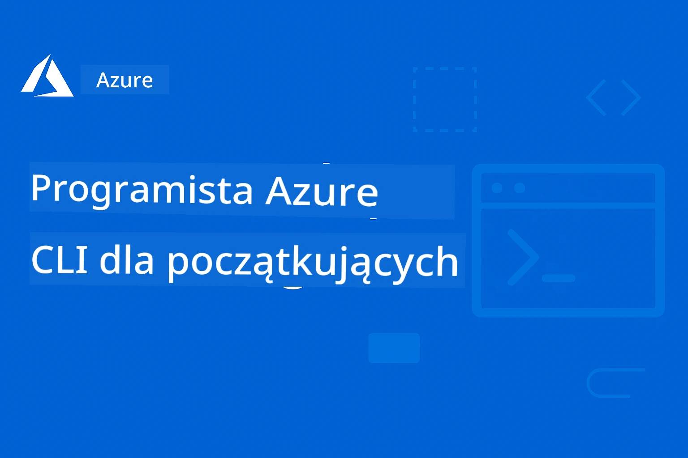

# AZD dla początkujących: Ustrukturyzowana podróż edukacyjna

 

[](https://github.com/microsoft/AZD-for-beginners)
[](https://GitHub.com/microsoft/azd-for-beginners/network/)
[](https://github.com/microsoft/AZD-for-beginners)

[](https://discord.com/invite/nkVh3dp)
[](https://discord.gg/nTYy5BXMWG)

---

### Automatyczne tłumaczenia (zawsze aktualne)

<!-- CO-OP TRANSLATOR LANGUAGES TABLE START -->
[arabski](../ar/README.md) | [bengalski](../bn/README.md) | [bułgarski](../bg/README.md) | [birmański (Myanmar)](../my/README.md) | [chiński (uproszczony)](../zh-CN/README.md) | [chiński (tradycyjny, Hongkong)](../zh-HK/README.md) | [chiński (tradycyjny, Makau)](../zh-MO/README.md) | [chiński (tradycyjny, Tajwan)](../zh-TW/README.md) | [chorwacki](../hr/README.md) | [czeski](../cs/README.md) | [duński](../da/README.md) | [holenderski](../nl/README.md) | [estoński](../et/README.md) | [fiński](../fi/README.md) | [francuski](../fr/README.md) | [niemiecki](../de/README.md) | [grecki](../el/README.md) | [hebrajski](../he/README.md) | [hindi](../hi/README.md) | [węgierski](../hu/README.md) | [indonezyjski](../id/README.md) | [włoski](../it/README.md) | [japoński](../ja/README.md) | [kannada](../kn/README.md) | [khmerski](../km/README.md) | [koreański](../ko/README.md) | [litewski](../lt/README.md) | [malajski](../ms/README.md) | [malajalam](../ml/README.md) | [manipuri (Meitei Mayek)](../mni/README.md) | [marathi](../mr/README.md) | [nepalski](../ne/README.md) | [pidgin nigeryjski](../pcm/README.md) | [norweski](../no/README.md) | [perski (farsi)](../fa/README.md) | [polski](./README.md) | [portugalski (Brazylia)](../pt-BR/README.md) | [portugalski (Portugalia)](../pt-PT/README.md) | [pendżabski (Gurmukhi)](../pa/README.md) | [rumuński](../ro/README.md) | [rosyjski](../ru/README.md) | [serbski (cyrylica)](../sr/README.md) | [słowacki](../sk/README.md) | [słoweński](../sl/README.md) | [hiszpański](../es/README.md) | [suahili](../sw/README.md) | [szwedzki](../sv/README.md) | [tagalog (filipino)](../tl/README.md) | [tamil](../ta/README.md) | [telugu](../te/README.md) | [tajski](../th/README.md) | [turecki](../tr/README.md) | [ukraiński](../uk/README.md) | [urdu](../ur/README.md) | [wietnamski](../vi/README.md)

> **Wolisz klonować lokalnie?**
>
> To repozytorium zawiera ponad 50 tłumaczeń językowych, co znacznie zwiększa rozmiar pobierania. Aby sklonować bez tłumaczeń, użyj sparse checkout:
>
> **Bash / macOS / Linux:**
> ```bash
> git clone --filter=blob:none --sparse https://github.com/microsoft/AZD-for-beginners.git
> cd AZD-for-beginners
> git sparse-checkout set --no-cone '/*' '!translations' '!translated_images'
> ```
>
> **CMD (Windows):**
> ```cmd
> git clone --filter=blob:none --sparse https://github.com/microsoft/AZD-for-beginners.git
> cd AZD-for-beginners
> git sparse-checkout set --no-cone "/*" "!translations" "!translated_images"
> ```
>
> To daje Ci wszystko, czego potrzebujesz, aby ukończyć kurs, przy znacznie szybszym pobieraniu.
<!-- CO-OP TRANSLATOR LANGUAGES TABLE END -->

## 🆕 Co nowego w azd dzisiaj

> 📌 **Przegląd wydania AI CLI (2026-11-04):** Wskazówki zostały sprawdzone względem opublikowanej dokumentacji/źródła **`azd 1.37.2`**, **agentów `1.0.0-beta.23`** i **ewaluacji `1.0.0-beta.2`**. Używaj `azd >= 1.37.0` dla połączonego workflow. Uruchom `azd version` i [zaktualizuj rdzeń CLI](https://learn.microsoft.com/azure/developer/azure-developer-cli/install-azd) przed rozszerzeniami. Zobacz [zmiany i poprawki w wydaniu](docs/chapter-08-production/production-ai-practices.md#recent-release-changes-and-fixes). To nie jest walidacja na żywo całego kursu.

Azure Developer CLI wspiera wiele typów aplikacji, w tym aplikacje webowe, API i agentów AI, poprzez obsługiwane hosty, szablony i rozszerzenia.

Oto co to dla Ciebie oznacza:

- **Agenci AI są teraz pełnoprawnymi obciążeniami azd.** Możesz inicjalizować, wdrażać i zarządzać projektami agentów AI, korzystając z tego samego workflow `azd init` → `azd up`, które już znasz.
- **Cykl życia agenta obejmuje dwa rozszerzenia.** Użyj `azure.ai.agents` do inicjalizacji, wywoływania, optymalizacji i wycofania agentów. Zainstaluj **`azure.ai.evaluations`** osobno dla `azd ai eval init`, `generate` i `run start`. Agenci beta.22 zastąpili starszy workflow ewaluacyjny i zmienili konfigurację optymalizacji; postępuj zgodnie z [przewodnikiem migracji](docs/chapter-08-production/production-ai-practices.md#evaluation-migration-and-quality-checks).
- **Więcej bloków budujących AI.** Nowe rozszerzenia w podglądzie — `azure.ai.skills` i `azure.ai.connections` — pozwalają zarządzać umiejętnościami agentów i połączeniami Foundry bezpośrednio w azd.
- **Integracja Microsoft Foundry** wprowadza wdrażanie modeli, hosting agentów i konfigurację usług AI bezpośrednio do ekosystemu szablonów azd.
- **Płynniejsze codzienne podstawy.** Ostatnie wydania sprawiły, że `azd init` stał się idempotentny (bezpieczny do ponownego uruchomienia), `azd auth login` automatycznie czyści nieważne tokeny, a także dodano przyjazny monit ustawienia przy pierwszym uruchomieniu `azd tool`.
- **Rdzeniowy workflow się nie zmienił.** Niezależnie czy wdrażasz aplikację todo, mikroserwis czy wieloagentowe rozwiązanie AI, komendy są takie same.

> **Uwaga dla użytkowników Aspire:** Microsoft obecnie nazywa produkt po prostu **Aspire** (dawniej ".NET Aspire"). Wsparcie azd dla Aspire pozostaje bez zmian — zmieniła się tylko nazwa.

Jeśli korzystałeś wcześniej z azd, wsparcie AI to naturalne rozszerzenie — nie osobne narzędzie ani zaawansowany tor. Jeśli zaczynasz od zera, nauczysz się jednego workflow działającego dla wszystkiego.

---

## 🚀 Czym jest Azure Developer CLI (azd)?

**Azure Developer CLI (azd)** to przyjazne deweloperom narzędzie wiersza poleceń, które ułatwia wdrażanie aplikacji w Azure. Zamiast ręcznie tworzyć i łączyć dziesiątki zasobów Azure, możesz wdrożyć całe aplikacje jednym poleceniem.

### Magia `azd up`

```bash
# This single command does everything:
# ✅ Creates all Azure resources  
# ✅ Configures networking and security
# ✅ Builds your application code
# ✅ Deploys to Azure
# ✅ Gives you a working URL
azd up
```

Szablon dostarcza konfigurację aplikacji i infrastruktury. Pomyślne wdrożenie wymaga jednak obsługiwanych usług/modeli, wystarczającego limitu i uprawnień, poprawnych danych wejściowych oraz weryfikacji wdrożonej aplikacji. `azd up` nie sprawia automatycznie, że szablon jest bezpieczny, zgodny lub gotowy do produkcji.

---

## ❓ Azure Developer CLI vs Azure CLI: Jaka jest różnica?

To najczęściej zadawane pytanie przez początkujących. Oto prosta odpowiedź:

| Funkcja | **Azure CLI (`az`)** | **Azure Developer CLI (`azd`)** |
|---------|---------------------|--------------------------------|
| **Cel** | Zarządzanie pojedynczymi zasobami Azure | Wdrażanie kompletnych aplikacji |
| **Myślenie** | Skoncentrowane na infrastrukturze | Skoncentrowane na aplikacji |
| **Przykład** | `az webapp create --name myapp...` | `azd up` |
| **Krzywa uczenia się** | Musisz znać usługi Azure | Wystarczy znać swoją aplikację |
| **Najlepsze dla** | DevOps, infrastruktura | Deweloperzy, prototypowanie |

### Prosta analogia

- **Azure CLI** to jak posiadanie wszystkich narzędzi do budowy domu – młotki, piły, gwoździe. Możesz zbudować wszystko, ale musisz znać się na budownictwie.
- **Azure Developer CLI** to jak zatrudnienie wykonawcy – opisujesz, co chcesz, a on zajmuje się budową.

### Kiedy używać którego

| Scenariusz | Użyj tego |
|----------|----------|
| „Chcę szybko wdrożyć moją aplikację webową” | `azd up` |
| „Muszę utworzyć tylko konto storage” | `az storage account create` |
| „Buduję pełną aplikację AI” | `azd init --template azure-search-openai-demo` |
| „Muszę debugować konkretny zasób Azure” | `az resource show` |
| „Chcę wdrożyć do mojego skonfigurowanego środowiska produkcyjnego” | Sprawdź konfigurację, dostęp, koszty i bramki operacyjne przed `azd up --environment production` |

### Działają razem!

AZD i Azure CLI mają osobną autoryzację i konfigurację. Używaj `azd auth login` dla AZD, a `az login` gdy polecenie lub diagnostyka wymaga wyraźnie Azure CLI. Możesz używać obu:
```bash
# Deploy your app with AZD
azd up

# Then fine-tune specific resources with Azure CLI
az webapp config set --name myapp --always-on true
```

---

## 🌟 Znajdź szablony w Awesome AZD

Nie zaczynaj od zera! **Awesome AZD** to kolekcja społecznościowa gotowych do wdrożenia szablonów:

| Zasób | Opis |
|----------|-------------|
| 🔗 [**Galeria Awesome AZD**](https://azure.github.io/awesome-azd/) | Przeglądaj 200+ szablonów z możliwością wdrożenia jednym kliknięciem |
| 🔗 [**Prześlij szablon**](https://github.com/Azure/awesome-azd/issues) | Wnieś swój własny szablon do społeczności |
| 🔗 [**Repozytorium GitHub**](https://github.com/Azure/awesome-azd) | Dodaj gwiazdkę i zbadaj źródło |

### Popularne szablony AI z Awesome AZD

Wybierz jeden szablon w własnym pustym katalogu; poniższe polecenia to alternatywy. Dodanie końcowego `.` inicjuje ten katalog.

```bash
# RAG Chat with Microsoft Foundry Models + AI Search
azd init --template azure-search-openai-demo .

# Quick AI Chat Application
azd init --template openai-chat-app-quickstart .

# AI Agents with Foundry Agents
azd init --template get-started-with-ai-agents .
```

---

## 🎯 Zacznij w 3 krokach

Zanim zaczniesz, upewnij się, że Twój komputer jest gotowy do szablonu, który chcesz wdrożyć:

**Windows:**
```powershell
.\validate-setup.ps1
```

**macOS / Linux:**
```bash
bash ./validate-setup.sh
```

Jeśli którykolwiek wymóg nie jest spełniony, napraw to najpierw, a potem kontynuuj szybki start.

### Krok 1: Zainstaluj AZD (2 minuty)

**Windows:**
```powershell
winget install microsoft.azd
```

**macOS:**
```bash
brew tap azure/azd && brew install azd
```

**Linux:**
```bash
curl -fsSL https://aka.ms/install-azd.sh | bash
```

### Krok 2: Zaloguj się dla AZD

```bash
# Optional if you plan to use Azure CLI commands directly in this course
az login

# Required for AZD workflows
azd auth login
```

Jeśli nie jesteś pewien, który wybrać, przejdź pełny proces ustawiania w [Instalacja i konfiguracja](docs/chapter-01-foundation/installation.md#authentication-setup).

### Krok 3: Wdróż swoją pierwszą aplikację

```bash
# Initialize from a template
azd init --template todo-nodejs-mongo .

# Deploy to Azure (creates everything!)
azd up
```

**🎉 Gotowe!** Twoja aplikacja jest już aktywna na Azure.

### Posprzątaj (nie zapomnij!)

```bash
# Remove all resources when done experimenting
azd down --force --purge
```

---

## 📚 Jak korzystać z tego kursu

Kurs jest zaprojektowany do **stopniowego uczenia się** - zacznij tam, gdzie czujesz się pewnie i rozwijaj się dalej:

| Twoje Doświadczenie | Zacznij tutaj |
|-------------------|--------------|
| **Nowicjusz w Azure** | [Rozdział 1: Podstawy](#-chapter-1-foundation--quick-start) |
| **Znajomość Azure, nowy w AZD** | [Rozdział 1: Podstawy](#-chapter-1-foundation--quick-start) |
| **Chcę wdrażać aplikacje AI** | [Rozdział 2: Rozwój z naciskiem na AI](#-chapter-2-ai-first-development-recommended-for-ai-developers) |
| **Chcę praktycznego warsztatu** | [🎓 Warsztat interaktywny](workshop/README.md) - 3-4 godziny prowadzonych laboratoriów |
| **Potrzebuję wzorców produkcyjnych** | [Rozdział 8: Produkcja i przedsiębiorstwo](#-chapter-8-production--enterprise-patterns) |

### Szybka konfiguracja

1. **Zrób fork repozytorium**: [](https://GitHub.com/microsoft/azd-for-beginners/fork)
2. **Sklonuj je**: `git clone https://github.com/YOUR-USERNAME/azd-for-beginners.git`
3. **Uzyskaj pomoc**: [Społeczność Azure Discord](https://discord.com/invite/ByRwuEEgH4)

> **Wolisz klonować lokalnie?**

> To repozytorium zawiera ponad 50 tłumaczeń językowych, co znacznie zwiększa rozmiar pobierania. Aby sklonować bez tłumaczeń, użyj sparse checkout:
> ```bash
> git clone --filter=blob:none --sparse https://github.com/microsoft/AZD-for-beginners.git
> cd AZD-for-beginners
> git sparse-checkout set --no-cone '/*' '!translations' '!translated_images'
> ```
> To daje ci wszystko, czego potrzebujesz, aby ukończyć kurs z dużo szybszym pobieraniem.


## Przegląd Kursu

Opanuj Azure Developer CLI (azd) poprzez uporządkowane rozdziały zaprojektowane do stopniowej nauki. **Szczególny nacisk na wdrażanie aplikacji AI z integracją Microsoft Foundry.**

### Dlaczego ten kurs jest niezbędny dla nowoczesnych programistów

Programiści wdrażający obciążenia AI często potrzebują wskazówek dotyczących:
- Złożonych architektur AI z wieloma usługami
- Najlepszych praktyk wdrażania AI w środowisku produkcyjnym  
- Integracji i konfiguracji usług Azure AI
- Optymalizacji kosztów obciążeń AI
- Rozwiązywania problemów specyficznych dla wdrażania AI

### Cele nauki

Po ukończeniu tego strukturalnego kursu, będziesz:
- **Opanowanie podstaw AZD**: Kluczowe koncepcje, instalacja i konfiguracja
- **Wdrażanie aplikacji AI**: Korzystanie z AZD z usługami Microsoft Foundry
- **Implementacja infrastruktury jako kodu**: Zarządzanie zasobami Azure za pomocą szablonów Bicep
- **Rozwiązywanie problemów z wdrożeniami**: Usuwanie typowych błędów i debugowanie problemów
- **Optymalizacja na potrzeby produkcji**: Bezpieczeństwo, skalowanie, monitorowanie i zarządzanie kosztami
- **Budowanie rozwiązań wieloagentowych**: Wdrażanie złożonych architektur AI

## Przed rozpoczęciem: konta, dostęp i założenia

Przed rozpoczęciem Rozdziału 1 upewnij się, że masz następujące elementy. Kroki instalacji przedstawione później zakładają, że te podstawy są już spełnione.

- **Subskrypcja Azure**: Możesz użyć istniejącej subskrypcji z pracy lub własnego konta albo utworzyć [bezpłatną wersję próbną](https://aka.ms/azurefreetrial) do rozpoczęcia.
- **Uprawnienia do tworzenia zasobów Azure**: Do większości ćwiczeń powinieneś mieć co najmniej dostęp **Współtwórcy** do docelowej subskrypcji lub grupy zasobów. Niektóre rozdziały mogą również zakładać możliwość tworzenia grup zasobów, zarządzanych tożsamości i przypisań RBAC.
- [**Konto GitHub**](https://github.com): Przydatne do rozwidlania repozytorium, śledzenia własnych zmian i korzystania z GitHub Codespaces podczas warsztatów.
- **Wymagania wstępne dla środowiska uruchomieniowego szablonów**: Niektóre szablony wymagają lokalnych narzędzi, takich jak Node.js, Python, Java lub Docker. Uruchom walidator instalacji przed rozpoczęciem, aby wcześnie wykryć brakujące narzędzia.
- **Podstawowa znajomość terminala**: Nie musisz być ekspertem, ale powinieneś swobodnie uruchamiać komendy takie jak `git clone`, `azd auth login` i `azd up`.

> **Pracujesz w subskrypcji korporacyjnej?**
> Jeśli twoje środowisko Azure jest zarządzane przez administratora, upewnij się z wyprzedzeniem, że możesz wdrażać zasoby w subskrypcji lub grupie zasobów, której zamierzasz używać. Jeśli nie, poproś o subskrypcję sandbox lub dostęp Współtwórcy przed rozpoczęciem.

> **Nowy w Azure?**
> Zacznij od własnej wersji próbnej Azure lub subskrypcji płatnej za użycie pod adresem https://aka.ms/azurefreetrial, aby móc wykonać ćwiczenia w całości bez oczekiwania na zatwierdzenia na poziomie dzierżawy.

## 🗺️ Mapa kursu: szybka nawigacja według rozdziałów

Każdy rozdział ma osobny plik README z celami nauki, szybkim startem i ćwiczeniami:

| Rozdział | Temat | Lekcje | Czas trwania | Złożoność |
|---------|-------|---------|----------|------------|
| **[Rozdział 1: Podstawy](docs/chapter-01-foundation/README.md)** | Początki | [Podstawy AZD](docs/chapter-01-foundation/azd-basics.md) &#124; [Instalacja](docs/chapter-01-foundation/installation.md) &#124; [Pierwszy projekt](docs/chapter-01-foundation/first-project.md) | 30-45 min | ⭐ |
| **[Rozdział 2: AI Development](docs/chapter-02-ai-development/README.md)** | Aplikacje AI | [Integracja Foundry](docs/chapter-02-ai-development/microsoft-foundry-integration.md) &#124; [Agenci AI](docs/chapter-02-ai-development/agents.md) &#124; [Wdrażanie modeli](docs/chapter-02-ai-development/ai-model-deployment.md) &#124; [Warsztaty](docs/chapter-02-ai-development/ai-workshop-lab.md) | 1-2 godz. | ⭐⭐ |
| **[Rozdział 3: Konfiguracja](docs/chapter-03-configuration/README.md)** | Uwierzytelnianie i bezpieczeństwo | [Konfiguracja](docs/chapter-03-configuration/configuration.md) &#124; [Uwierzytelnianie i bezpieczeństwo](docs/chapter-03-configuration/authsecurity.md) | 45-60 min | ⭐⭐ |
| **[Rozdział 4: Infrastruktura](docs/chapter-04-infrastructure/README.md)** | IaC i wdrożenia | [Przewodnik wdrożeń](docs/chapter-04-infrastructure/deployment-guide.md) &#124; [Provisioning](docs/chapter-04-infrastructure/provisioning.md) | 1-1,5 godz. | ⭐⭐⭐ |
| **[Rozdział 5: Multi-Agent](docs/chapter-05-multi-agent/README.md)** | Rozwiązania AI wieloagentowe | [Scenariusz sprzedaży detalicznej](examples/retail-scenario.md) &#124; [Wzorce koordynacji](docs/chapter-06-pre-deployment/coordination-patterns.md) | 2-3 godz. | ⭐⭐⭐⭐ |
| **[Rozdział 6: Przed wdrożeniem](docs/chapter-06-pre-deployment/README.md)** | Planowanie i walidacja | [Sprawdzanie przed wdrożeniem](docs/chapter-06-pre-deployment/preflight-checks.md) &#124; [Planowanie pojemności](docs/chapter-06-pre-deployment/capacity-planning.md) &#124; [Wybór SKU](docs/chapter-06-pre-deployment/sku-selection.md) &#124; [App Insights](docs/chapter-06-pre-deployment/application-insights.md) | 1 godz. | ⭐⭐ |
| **[Rozdział 7: Rozwiązywanie problemów](docs/chapter-07-troubleshooting/README.md)** | Debugowanie i naprawa | [Typowe problemy](docs/chapter-07-troubleshooting/common-issues.md) &#124; [Debugowanie](docs/chapter-07-troubleshooting/debugging.md) &#124; [Problemy AI](docs/chapter-07-troubleshooting/ai-troubleshooting.md) | 1-1,5 godz. | ⭐⭐ |
| **[Rozdział 8: Produkcja](docs/chapter-08-production/README.md)** | Wzorce korporacyjne | [Praktyki produkcyjne](docs/chapter-08-production/production-ai-practices.md) | 2-3 godz. | ⭐⭐⭐⭐ |
| **[🎓 Warsztaty](workshop/README.md)** | Laboratorium praktyczne | [Wstęp](workshop/docs/instructions/0-Introduction.md) &#124; [Wybór](workshop/docs/instructions/1-Select-AI-Template.md) &#124; [Walidacja](workshop/docs/instructions/2-Validate-AI-Template.md) &#124; [Demontaż](workshop/docs/instructions/3-Deconstruct-AI-Template.md) &#124; [Konfiguracja](workshop/docs/instructions/4-Configure-AI-Template.md) &#124; [Dostosowanie](workshop/docs/instructions/5-Customize-AI-Template.md) &#124; [Demontaż](workshop/docs/instructions/6-Teardown-Infrastructure.md) &#124; [Podsumowanie](workshop/docs/instructions/7-Wrap-up.md) | 3-4 godz. | ⭐⭐ |

**Całkowity czas kursu:** ~10-14 godzin | **Postęp umiejętności:** Początkujący → Gotowy do produkcji

---

## 📚 Rozdziały edukacyjne

*Wybierz ścieżkę nauki w zależności od poziomu doświadczenia i celów*

### 🚀 Rozdział 1: Podstawy i szybki start
**Wymagania wstępne**: subskrypcja Azure, podstawowa znajomość terminala  
**Czas trwania**: 30-45 minut  
**Złożoność**: ⭐

#### Czego się nauczysz
- Zrozumienie podstaw Azure Developer CLI
- Instalacja AZD na twojej platformie
- Pierwsze udane wdrożenie

#### Materiały edukacyjne
- **🎯 Zacznij tutaj**: [Czym jest Azure Developer CLI?](#-what-is-azure-developer-cli-azd)
- **📖 Teoria**: [Podstawy AZD](docs/chapter-01-foundation/azd-basics.md) - Kluczowe koncepcje i terminologia
- **⚙️ Instalacja**: [Instalacja i konfiguracja](docs/chapter-01-foundation/installation.md) - Przewodniki specyficzne dla platform
- **🛠️ Praktyka**: [Twój pierwszy projekt](docs/chapter-01-foundation/first-project.md) - Instrukcje krok po kroku
- **📋 Szybkie odniesienie**: [Ściągawka z komendami](resources/cheat-sheet.md)

#### Ćwiczenia praktyczne
```bash
# Quick installation check
azd version

# Deploy your first application
azd init --template todo-nodejs-mongo .
azd up
```

**💡 Efekt rozdziału**: Pomyślnie wdrożenie prostej aplikacji webowej do Azure za pomocą AZD

**✅ Walidacja sukcesu:**
```bash
# After completing Chapter 1, you should be able to:
azd version              # Shows installed version
azd init --template todo-nodejs-mongo  # Initializes project
azd up                  # Deploys to Azure
azd show                # Displays running app URL
# Application opens in browser and works
azd down --force --purge  # Cleans up resources
```

**📊 Nakład czasowy:** 30-45 minut  
**📈 Poziom umiejętności po ukończeniu:** Potrafi samodzielnie wdrażać podstawowe aplikacje

---

### 🤖 Rozdział 2: Rozwój AI-First (Polecany dla programistów AI)
**Wymagania wstępne**: ukończenie Rozdziału 1  
**Czas trwania**: 1-2 godziny  
**Złożoność**: ⭐⭐

#### Czego się nauczysz
- Integracja Microsoft Foundry z AZD
- Wdrażanie aplikacji zasilanych AI
- Zrozumienie konfiguracji usług AI

#### Materiały edukacyjne
- **🎯 Zacznij tutaj**: [Integracja Microsoft Foundry](docs/chapter-02-ai-development/microsoft-foundry-integration.md)
- **🤖 Agenci AI**: [Przewodnik agentów AI](docs/chapter-02-ai-development/agents.md) - Wdrażanie inteligentnych agentów za pomocą AZD
- **📖 Wzorce**: [Wdrażanie modeli AI](docs/chapter-02-ai-development/ai-model-deployment.md) - Wdrażanie i zarządzanie modelami AI
- **🛠️ Warsztaty**: [Laboratorium AI](docs/chapter-02-ai-development/ai-workshop-lab.md) - Przygotuj rozwiązania AI do AZD
- **🎥 Przewodnik interaktywny**: [Materiały warsztatowe](workshop/README.md) - Nauka w przeglądarce z MkDocs * środowisko DevContainer
- **📋 Szablony**: [Szablony Microsoft Foundry](#featured-microsoft-foundry-templates)
- **📝 Przykłady**: [Przykłady wdrożeń AZD](examples/README.md)

#### Ćwiczenia praktyczne
```bash
# Deploy your first AI application
azd init --template azure-search-openai-demo .
azd up

# Try additional AI templates
azd init --template openai-chat-app-quickstart .
azd init --template agent-openai-python-prompty .
```

**💡 Efekt rozdziału**: Wdrożenie i konfiguracja aplikacji czatu zasilanej AI z możliwościami RAG

**✅ Walidacja sukcesu:**
```bash
# After Chapter 2, you should be able to:
azd init --template azure-search-openai-demo .
azd up
# Test the AI chat interface
# Ask questions and get AI-powered responses with sources
# Verify search integration works
azd monitor  # Check Application Insights shows telemetry
azd down --force --purge
```

**📊 Nakład czasowy:** 1-2 godziny  
**📈 Poziom umiejętności po ukończeniu:** Potrafi wdrażać aplikacje uczące się AI i identyfikować dodatkowe wymagania produkcyjne
**💰 Świadomość kosztów:** Zrozumienie kosztów rozwoju $80-150/mies., kosztów produkcji $300-3500/mies.

#### 💰 Uwagi dotyczące kosztów wdrożeń AI

**Środowisko deweloperskie (szacunkowo $80-150/mies.):**
- Modele Microsoft Foundry (płać za zużycie): $0-50/mies. (w zależności od tokenów)
- AI Search (poziom podstawowy): $75/mies.
- Container Apps (na żądanie): $0-20/mies.
- Storage (standardowy): $1-5/mies.

**Środowisko produkcyjne (szacunkowo $300-3500+/mies.):**
- Modele Microsoft Foundry (PTU dla spójnej wydajności): $3,000+/mies. LUB płać za użycie przy dużym wolumenie
- AI Search (poziom standardowy): $250/mies.
- Container Apps (dedykowane): $50-100/mies.
- Application Insights: $5-50/mies.
- Storage (premium): $10-50/mies.

**💡 Wskazówki dotyczące optymalizacji kosztów:**
- Sprawdź ceny za inferencję modeli i dostępne kredyty na konto; Azure OpenAI nie obejmuje uniwersalnego, darmowego limitu 50 000 tokenów miesięcznie
- Uruchom `azd down`, aby usunąć zasoby, gdy nie są już potrzebne, po sprawdzeniu wybranego środowiska
- Zacznij od rozliczania według zużycia, aktualizuj do PTU tylko w środowisku produkcyjnym
- Użyj `azd provision --preview`, aby przejrzeć planowaną infrastrukturę, a następnie wyceń zasoby za pomocą Azure Pricing Calculator
- Włącz automatyczne skalowanie: płać tylko za faktyczne użycie

**Monitorowanie kosztów:**
```bash
# Inspect planned resources (this does not calculate prices)
azd provision --preview

# Monitor actual costs in Azure Portal
az consumption budget list --resource-group <your-rg>
```

---

### ⚙️ Rozdział 3: Konfiguracja i uwierzytelnianie
**Wymagania wstępne**: ukończenie Rozdziału 1  
**Czas trwania**: 45-60 minut  
**Złożoność**: ⭐⭐

#### Czego się nauczysz
- Konfiguracji i zarządzania środowiskiem
- Najlepszych praktyk uwierzytelniania i bezpieczeństwa
- Nazewnictwa i organizacji zasobów

#### Materiały edukacyjne
- **📖 Konfiguracja**: [Przewodnik konfiguracji](docs/chapter-03-configuration/configuration.md) - Ustawienia środowiska
- **🔐 Bezpieczeństwo**: [Wzorce uwierzytelniania i zarządzane tożsamości](docs/chapter-03-configuration/authsecurity.md) - Wzorce uwierzytelniania
- **📝 Przykłady**: [Przykład aplikacji bazodanowej](examples/database-app/README.md) - Przykłady baz danych AZD

#### Ćwiczenia praktyczne
- Konfiguracja wielu środowisk (dev, staging, prod)
- Ustawienie uwierzytelniania zarządzanej tożsamości
- Implementacja konfiguracji specyficznych dla środowisk

**💡 Efekt rozdziału**: Zarządzanie wieloma środowiskami z prawidłowym uwierzytelnianiem i zabezpieczeniami

---

### 🏗️ Rozdział 4: Infrastruktura jako kod i wdrożenie
**Wymagania wstępne**: ukończenie Rozdziałów 1-3  
**Czas trwania**: 1-1,5 godziny  
**Złożoność**: ⭐⭐⭐

#### Czego się nauczysz
- Zaawansowane wzorce wdrożeń
- Infrastruktura jako kod przy użyciu Bicep
- Strategie provisioningu zasobów

#### Materiały edukacyjne
- **📖 Wdrożenia**: [Przewodnik wdrożeń](docs/chapter-04-infrastructure/deployment-guide.md) - Kompleksowe przepływy pracy
- **🏗️ Provisioning**: [Provisioning zasobów](docs/chapter-04-infrastructure/provisioning.md) - Zarządzanie zasobami Azure
- **📝 Przykłady**: [Przykład aplikacji kontenerowej](../../examples/container-app) - Wdrażanie konteneryzowane

#### Ćwiczenia praktyczne
- Tworzenie niestandardowych szablonów Bicep
- Wdrażanie aplikacji wieloserwisowych
- Implementacja strategii wdrożeń blue-green

**💡 Efekt rozdziału**: Wdrażanie złożonych aplikacji wieloserwisowych z użyciem niestandardowych szablonów infrastruktury

---

### 🎯 Rozdział 5: Wieloagentowe rozwiązania AI (zaawansowany)
**Wymagania wstępne**: ukończenie Rozdziałów 1-2  
**Czas trwania**: 2-3 godziny  
**Złożoność**: ⭐⭐⭐⭐

#### Czego się nauczysz
- Wzorce architektury wieloagentowej
- Orkiestracja i koordynacja agentów
- Wdrożenia AI gotowe do produkcji

#### Materiały edukacyjne
- **🤖 Wyróżniony projekt**: [Wieloagentowe rozwiązanie dla detalistów](examples/retail-scenario.md) - Plan architektury, niepełna aplikacja
- **🛠️ Szablony ARM**: [Pakiet szablonów ARM](../../examples/retail-multiagent-arm-template) - Szkielet infrastruktury; przegląd wymagań wstępnych i brakujących komponentów aplikacji
- **📖 Architektura**: [Wzorce koordynacji wielu agentów](docs/chapter-06-pre-deployment/coordination-patterns.md) - Wzorce

#### Ćwiczenia praktyczne
```bash
# Inspect the retail infrastructure scaffold before choosing to deploy it
cd examples/retail-multiagent-arm-template
cat README.md

# After an intentional deployment, inspect infrastructure state
az deployment group show --resource-group <rg-name> --name <deployment-name>
```

**💡 Efekt rozdziału**: Zrozumienie projektowania wielu agentów i identyfikacja prac implementacyjnych, walidacyjnych i operacyjnych wykraczających poza szkielet infrastruktury

---

### 🔍 Rozdział 6: Walidacja i planowanie przed wdrożeniem
**Wymagania wstępne**: Ukończony rozdział 4  
**Czas trwania**: 1 godzina  
**Złożoność**: ⭐⭐

#### Czego się nauczysz
- Planowanie pojemności i walidacja zasobów
- Strategie wyboru SKU
- Kontrole wstępne i automatyzacja

#### Materiały dydaktyczne
- **📊 Planowanie**: [Planowanie pojemności](docs/chapter-06-pre-deployment/capacity-planning.md) - Walidacja zasobów
- **💰 Wybór**: [Wybór SKU](docs/chapter-06-pre-deployment/sku-selection.md) - Wybory ekonomiczne
- **✅ Walidacja**: [Kontrole wstępne](docs/chapter-06-pre-deployment/preflight-checks.md) - Skrypty automatyczne

#### Ćwiczenia praktyczne
- Uruchom skrypty walidacji pojemności
- Optymalizuj wybory SKU pod kątem kosztów
- Wdróż automatyczne kontrole przed wdrożeniem

**💡 Efekt rozdziału**: Zweryfikuj i zoptymalizuj wdrożenia przed wykonaniem

---

### 🚨 Rozdział 7: Rozwiązywanie problemów i debugowanie
**Wymagania wstępne**: Dowolny ukończony rozdział o wdrożeniu  
**Czas trwania**: 1-1,5 godziny  
**Złożoność**: ⭐⭐

#### Czego się nauczysz
- Systematyczne podejścia do debugowania
- Typowe problemy i rozwiązania
- Rozwiązywanie problemów specyficznych dla AI

#### Materiały dydaktyczne
- **🔧 Typowe problemy**: [Typowe problemy](docs/chapter-07-troubleshooting/common-issues.md) - FAQ i rozwiązania
- **🕵️ Debugowanie**: [Przewodnik debugowania](docs/chapter-07-troubleshooting/debugging.md) - Strategie krok po kroku
- **🤖 Problemy AI**: [Rozwiązywanie problemów specyficznych dla AI](docs/chapter-07-troubleshooting/ai-troubleshooting.md) - Problemy z usługami AI

#### Ćwiczenia praktyczne
- Diagnozuj błędy wdrożenia
- Rozwiązuj problemy z uwierzytelnianiem
- Debuguj łączność usług AI

**💡 Efekt rozdziału**: Samodzielnie diagnozuj i rozwiązuj typowe problemy z wdrożeniem

---

### 🏢 Rozdział 8: Wzorce produkcyjne i korporacyjne
**Wymagania wstępne**: Ukończone rozdziały 1-4  
**Czas trwania**: 2-3 godziny  
**Złożoność**: ⭐⭐⭐⭐

#### Czego się nauczysz
- Strategie wdrożeń produkcyjnych
- Wzorce bezpieczeństwa korporacyjnego
- Monitorowanie i optymalizacja kosztów

#### Materiały dydaktyczne
- **🏭 Produkcja**: [Najlepsze praktyki AI w produkcji](docs/chapter-08-production/production-ai-practices.md) - Wzorce korporacyjne
- **📝 Przykłady**: [Przykład mikroserwisów](../../examples/microservices) - Złożone architektury
- **📊 Monitorowanie**: [Integracja Application Insights](docs/chapter-06-pre-deployment/application-insights.md) - Monitorowanie

#### Ćwiczenia praktyczne
- Wdróż wzorce bezpieczeństwa korporacyjnego
- Skonfiguruj kompleksowe monitorowanie
- Wdróż produkcyjnie z odpowiednim zarządzaniem

**💡 Efekt rozdziału**: Wdróż aplikacje gotowe do produkcji z pełnymi możliwościami produkcyjnymi

---

## 🎓 Przegląd warsztatów: Praktyczne doświadczenie

> **⚠️ STATUS WARSZTATU: Aktywny rozwój**  
> Materiały warsztatowe są obecnie rozwijane i udoskonalane. Główne moduły są funkcjonalne, ale niektóre zaawansowane sekcje są niekompletne. Aktywnie pracujemy nad ukończeniem całej zawartości. [Śledź postęp →](workshop/README.md)

### Materiały warsztatowe interaktywne
**Kompleksowe praktyczne nauczanie z narzędziami przeglądarkowymi i prowadzonymi ćwiczeniami**

Nasze materiały warsztatowe zapewniają ustrukturyzowane, interaktywne doświadczenie nauki, które uzupełnia powyższy program rozdziałów. Warsztat jest zaprojektowany zarówno do nauki samodzielnej, jak i sesji prowadzonych przez instruktora.

#### 🛠️ Cechy warsztatu
- **Interfejs przeglądarkowy**: Kompletny warsztat oparty na MkDocs z funkcjami wyszukiwania, kopiowania i motywów
- **Integracja GitHub Codespaces**: Konfiguracja środowiska programistycznego jednym kliknięciem
- **Ustrukturyzowana ścieżka nauki**: 8 modułów prowadzonych ćwiczeń (łącznie 3-4 godziny)
- **Metodologia progresywna**: Wprowadzenie → Wybór → Walidacja → Dekonstrukcja → Konfiguracja → Dostosowanie → Zakończenie → Podsumowanie
- **Interaktywne środowisko DevContainer**: Wstępnie skonfigurowane narzędzia i zależności

#### 📚 Struktura modułów warsztatu
Warsztat opiera się na **8-modułowej metodologii progresywnej**, która prowadzi Cię od odkrywania do mistrzostwa wdrożeniowego:

| Moduł | Temat | Co zrobisz | Czas trwania |
|--------|-------|----------------|----------|
| **0. Wprowadzenie** | Przegląd warsztatu | Poznaj cele nauki, wymagania wstępne i strukturę warsztatu | 15 min |
| **1. Wybór** | Odkrywanie szablonów | Poznaj szablony AZD i wybierz odpowiedni szablon AI dla swojego scenariusza | 20 min |
| **2. Walidacja** | Wdrożenie i weryfikacja | Wdróż szablon za pomocą `azd up` i zweryfikuj działanie infrastruktury | 30 min |
| **3. Dekonstrukcja** | Zrozumienie struktury | Użyj GitHub Copilot do eksploracji architektury szablonu, plików Bicep i organizacji kodu | 30 min |
| **4. Konfiguracja** | Głębokie zanurzenie w azure.yaml | Opanuj konfigurację `azure.yaml`, hooki cyklu życia i zmienne środowiskowe | 30 min |
| **5. Dostosowanie** | Uczyń to swoim | Włącz AI Search, śledzenie, ewaluację i dostosuj do swojego scenariusza | 45 min |
| **6. Zakończenie** | Sprzątanie | Bezpieczne usuwanie zasobów za pomocą `azd down --purge` | 15 min |
| **7. Podsumowanie** | Kolejne kroki | Przegląd osiągnięć, kluczowych koncepcji i kontynuacja nauki | 15 min |

**Przebieg warsztatu:**
```
Introduction → Selection → Validation → Deconstruction → Configuration → Customization → Teardown → Wrap-up
     ↓            ↓           ↓              ↓               ↓              ↓            ↓           ↓
  Overview    Find the     Deploy &      Explore        Master         Customize     Clean up    Review &
             right        verify        code &        azure.yaml      for your      resources   next steps
             template                   structure                     scenario
```

#### 🚀 Rozpoczęcie warsztatu
```bash
# Option 1: GitHub Codespaces (Recommended)
# Click "Code" → "Create codespace on main" in the repository

# Option 2: Local Development
git clone https://github.com/microsoft/azd-for-beginners.git
cd azd-for-beginners/workshop
# Follow the setup instructions in workshop/README.md
```

#### 🎯 Wyniki nauki warsztatu
Po ukończeniu warsztatu uczestnicy będą potrafili:
- **Wdrażać produkcyjne aplikacje AI**: Korzystać z AZD z usługami Microsoft Foundry
- **Opanować architektury wielu agentów**: Implementować skoordynowane rozwiązania agentów AI
- **Wdrożyć najlepsze praktyki bezpieczeństwa**: Konfigurować uwierzytelnianie i kontrolę dostępu
- **Optymalizować pod kątem skali**: Projektować ekonomiczne i wydajne wdrożenia
- **Rozwiązywać problemy wdrożeń**: Samodzielnie rozwiązywać typowe problemy

#### 📖 Materiały warsztatowe
- **🎥 Interaktywny przewodnik**: [Materiały warsztatowe](workshop/README.md) - Środowisko nauki w przeglądarce
- **📋 Instrukcje krok po kroku**:
  - [0. Wprowadzenie](workshop/docs/instructions/0-Introduction.md) - Przegląd i cele warsztatu
  - [1. Wybór](workshop/docs/instructions/1-Select-AI-Template.md) - Znajdź i wybierz szablony AI
  - [2. Walidacja](workshop/docs/instructions/2-Validate-AI-Template.md) - Wdróż i zweryfikuj szablony
  - [3. Dekonstrukcja](workshop/docs/instructions/3-Deconstruct-AI-Template.md) - Poznaj architekturę szablonów
  - [4. Konfiguracja](workshop/docs/instructions/4-Configure-AI-Template.md) - Opanuj azure.yaml
  - [5. Dostosowanie](workshop/docs/instructions/5-Customize-AI-Template.md) - Dostosuj do swojego scenariusza
  - [6. Zakończenie](workshop/docs/instructions/6-Teardown-Infrastructure.md) - Sprzątanie zasobów
  - [7. Podsumowanie](workshop/docs/instructions/7-Wrap-up.md) - Przegląd i dalsze kroki
- **🛠️ Laboratorium warsztatowe AI**: [Laboratorium AI](docs/chapter-02-ai-development/ai-workshop-lab.md) - Ćwiczenia skoncentrowane na AI
- **💡 Szybki start**: [Przewodnik konfiguracji warsztatu](workshop/README.md#browser-based-guide) - Konfiguracja środowiska

**Idealne dla**: szkoleń korporacyjnych, kursów uniwersyteckich, nauki indywidualnej i bootcampów dla programistów.

---

## 📖 Głębokie zanurzenie: Możliwości AZD

Poza podstawami, AZD oferuje potężne funkcje dla wdrożeń produkcyjnych:

- **Wdrożenia oparte na szablonach** - Używaj gotowych szablonów dla popularnych wzorców aplikacji
- **Infrastruktura jako kod** - Zarządzaj zasobami Azure przy użyciu Bicep lub Terraform  
- **Zintegrowane przepływy pracy** - Bezproblemowe provisionowanie, wdrażanie i monitorowanie aplikacji
- **Przyjazny dla programisty** - Optymalizacja produktywności i doświadczenia dewelopera

### **AZD + Microsoft Foundry: Idealne dla wdrożeń AI**

**Dlaczego AZD dla rozwiązań AI?** AZD odpowiada na najważniejsze wyzwania programistów AI:

- **Szablony gotowe na AI** - Wstępnie skonfigurowane szablony dla modeli Microsoft Foundry, usług Azure AI i obciążeń ML
- **Bezpieczne wdrożenia AI** - Wbudowane wzorce bezpieczeństwa dla usług AI, kluczy API i punktów końcowych modeli  
- **Produkcjne wzorce AI** - Najlepsze praktyki skalowalnego i ekonomicznego wdrażania aplikacji AI
- **End-to-End przepływy pracy AI** - Od rozwoju modeli do wdrożenia produkcyjnego z odpowiednim monitoringiem
- **Optymalizacja kosztów** - Inteligentne przydzielanie zasobów i skalowanie obciążeń AI
- **Integracja z Microsoft Foundry** - Bezproblemowe połączenie z katalogiem modeli i punktami końcowymi Microsoft Foundry

---

## 🎯 Biblioteka szablonów i przykładów

### Polecane: Szablony Microsoft Foundry
**Zacznij tutaj, jeśli wdrażasz aplikacje AI!**

> **Uwaga:** Te szablony demonstrują różne wzorce AI. Niektóre pochodzą z zewnętrznych przykładów Azure, inne są implementacjami lokalnymi.

| Szablon | Rozdział | Złożoność | Usługi | Typ |
|----------|---------|------------|----------|------|
| [**Pierwsze kroki z czatem AI**](https://github.com/Azure-Samples/get-started-with-ai-chat) | Rozdział 2 | ⭐⭐ | AzureOpenAI + Azure AI Model Inference API + Azure AI Search + Azure Container Apps + Application Insights | Zewnętrzny |
| [**Pierwsze kroki z agentami AI**](https://github.com/Azure-Samples/get-started-with-ai-agents) | Rozdział 2 | ⭐⭐ | Agenci Foundry + AzureOpenAI + Azure AI Search + Azure Container Apps + Application Insights| Zewnętrzny |
| [**Demo Azure Search + OpenAI**](https://github.com/Azure-Samples/azure-search-openai-demo) | Rozdział 2 | ⭐⭐ | Azure OpenAI + Azure AI Search + Container Apps (domyślny) + Storage | Zewnętrzny |
| [**Szybki start aplikacji czatu OpenAI**](https://github.com/Azure-Samples/openai-chat-app-quickstart) | Rozdział 2 | ⭐ | AzureOpenAI + Container Apps + Application Insights | Zewnętrzny |
| [**Agent OpenAI Python Prompty**](https://github.com/Azure-Samples/agent-openai-python-prompty) | Rozdział 5 | ⭐⭐⭐ | AzureOpenAI + Azure Functions + Prompty | Zewnętrzny |
| [**Contoso Chat RAG**](https://github.com/Azure-Samples/contoso-chat) | Rozdział 8 | ⭐⭐⭐⭐ | AzureOpenAI + AI Search + Cosmos DB + Container Apps | Zewnętrzny |
| [**Rozwiązanie wieloagentowe Retail**](examples/retail-scenario.md) | Rozdział 5 | ⭐⭐⭐⭐ | Proponowana architektura i szkielet infrastruktury; wymagana implementacja aplikacji | **Lokalny blueprint** |

### Polecane: Kompleksowe scenariusze nauki
**Szablony aplikacji gotowe do produkcji powiązane z rozdziałami nauki**

| Szablon | Rozdział nauki | Złożoność | Kluczowa nauka |
|----------|------------------|------------|--------------|
| [**openai-chat-app-quickstart**](https://github.com/Azure-Samples/openai-chat-app-quickstart) | Rozdział 2 | ⭐ | Podstawowe wzorce wdrożeń AI |
| [**azure-search-openai-demo**](https://github.com/Azure-Samples/azure-search-openai-demo) | Rozdział 2 | ⭐⭐ | Implementacja RAG z Azure AI Search |
| [**get-started-with-ai-agents**](https://github.com/Azure-Samples/get-started-with-ai-agents) | Rozdział 2 | ⭐⭐ | Czat z agentami i testy ewaluacyjne specyficzne dla próbki |
| [**agent-openai-python-prompty**](https://github.com/Azure-Samples/agent-openai-python-prompty) | Rozdział 5 | ⭐⭐⭐ | Framework agentów i wywoływanie funkcji |
| [**contoso-chat**](https://github.com/Azure-Samples/contoso-chat) | Rozdział 8 | ⭐⭐⭐ | Orkiestracja AI dla przedsiębiorstw |
| [**retail-multi-agent-solution**](examples/retail-scenario.md) | Rozdział 5 | ⭐⭐⭐⭐ | Architektura wielu agentów z agentami Klienta i Magazynu |

### Nauka na przykładach

> **📌 Przykłady lokalne vs. zewnętrzne:**  
> **Przykłady lokalne** (w tym repozytorium) = Sprawdź README przykładu dla statusu implementacji i wymagań wstępnych
> **Przykłady zewnętrzne** (przykłady Azure) = Klonuj z powiązanych repozytoriów

#### Przykłady lokalne (gotowe do użycia)
- [**Rozwiązanie wieloagentowe Retail**](examples/retail-scenario.md) - Blueprint architektury z szablonem infrastruktury ARM
  - Proponowane role agentów Klienta i Magazynu
  - Wymagana implementacja i weryfikacja monitorowania, ewaluacji i kodu aplikacji
  - Samo provisionowanie zasobów nie tworzy działającej aplikacji retail

#### Przykłady lokalne – Aplikacje kontenerowe (rozdziały 2-5)
**Kompleksowe przykłady wdrożeń kontenerów w tym repozytorium:**
- [**Przykłady aplikacji kontenerowych**](examples/container-app/README.md) - Kompletny przewodnik po wdrożeniach kontenerowych
  - [Proste API Flask](../../examples/container-app/simple-flask-api) - Podstawowe REST API ze skalowaniem do zera
  - [Architektura mikroserwisów](../../examples/container-app/microservices) - Przykład nauki z dwoma usługami; utwardzanie produkcyjne jest zadaniem dodatkowym
  - Wzorce szybkiego startu, produkcji i zaawansowane
  - Wskazówki dotyczące monitorowania, bezpieczeństwa i optymalizacji kosztów

#### Przykłady zewnętrzne – Proste aplikacje (rozdziały 1-2)
**Sklonuj te repozytoria przykładów Azure, aby zacząć:**
- [Prosta aplikacja webowa - Node.js + MongoDB](https://github.com/Azure-Samples/todo-nodejs-mongo) - Podstawowe wzorce wdrożeń
- [Statyczna strona - React SPA](https://github.com/Azure-Samples/todo-csharp-sql-swa-func) - Wdrożenie zawartości statycznej
- [Aplikacja kontenerowa - Python Flask](https://github.com/Azure-Samples/container-apps-store-api-microservice) - Wdrożenie REST API

#### Przykłady zewnętrzne – Integracja baz danych (rozdziały 3-4)  
- [Aplikacja bazodanowa - C# + SQL](https://github.com/Azure-Samples/todo-csharp-sql) - Wzorce łączności z bazą danych
- [Funkcje + Cosmos DB](https://github.com/Azure-Samples/todo-python-mongo-swa-func) - Bezserwerowy przepływ danych

#### Przykłady zewnętrzne - zaawansowane wzorce (rozdziały 4-8)
- [Mikroserwisy Java](https://github.com/Azure-Samples/java-microservices-aca-lab) - Architektury wielousługowe
- [Zadania aplikacji kontenerowych](https://github.com/Azure-Samples/container-apps-jobs) - Przetwarzanie w tle  
- [Przedsiębiorcza linia ML](https://github.com/Azure/mlops-v2) - Wzorce referencyjne MLOps; nie jest to gotowy szablon AZD

### Kolekcje zewnętrznych szablonów
- [**Oficjalna galeria szablonów AZD**](https://azure.github.io/awesome-azd/) - Wyselekcjonowany zbiór oficjalnych i społecznościowych szablonów
- [**Szablony Azure Developer CLI**](https://learn.microsoft.com/en-us/azure/developer/azure-developer-cli/azd-templates) - Dokumentacja szablonów Microsoft Learn
- [**Katalog przykładów**](examples/README.md) - Przykłady do nauki lokalnej z szczegółowymi objaśnieniami

---

## 📚 Materiały edukacyjne i odniesienia

### Szybkie odniesienia
- [**Lista poleceń**](resources/cheat-sheet.md) - Podstawowe polecenia azd uporządkowane według rozdziałów
- [**Słownik**](resources/glossary.md) - Terminologia Azure i azd  
- [**FAQ**](resources/faq.md) - Najczęstsze pytania uporządkowane według rozdziałów nauki
- [**Przewodnik do nauki**](resources/study-guide.md) - Kompleksowe ćwiczenia praktyczne

### Warsztaty praktyczne
- [**Laboratorium warsztatów AI**](docs/chapter-02-ai-development/ai-workshop-lab.md) - Uczyń swoje rozwiązania AI gotowymi do wdrożenia AZD (2-3 godziny)
- [**Warsztat interaktywny**](workshop/README.md) - 8-modułowe prowadzone ćwiczenia z MkDocs i GitHub Codespaces
  - Kolejność: Wprowadzenie → Wybór → Walidacja → Rozbiórka → Konfiguracja → Dostosowanie → Zakończenie → Podsumowanie

### Zewnętrzne zasoby edukacyjne
- [Dokumentacja Azure Developer CLI](https://learn.microsoft.com/en-us/azure/developer/azure-developer-cli/)
- [Centrum Architektury Azure](https://learn.microsoft.com/en-us/azure/architecture/)
- [Kalkulator cen Azure](https://azure.microsoft.com/pricing/calculator/)
- [Status Azure](https://status.azure.com/)

### Umiejętności agenta AI dla Twojego edytora
- [**Microsoft Azure Skills na skills.sh**](https://skills.sh/microsoft/github-copilot-for-azure) - 37 otwartych umiejętności agenta dla Azure AI, Foundry, wdrożeń, diagnostyki, optymalizacji kosztów i innych. Zainstaluj je w GitHub Copilot, Cursor, Claude Code lub dowolnym obsługiwanym agencie:
  ```bash
  npx skills add microsoft/github-copilot-for-azure
  ```

---

## 🔧 Szybki przewodnik rozwiązywania problemów

**Typowe problemy początkujących i natychmiastowe rozwiązania:**

<details>
<summary><strong>❌ "azd: command not found"</strong></summary>

```bash
# Install AZD first
# Windows (PowerShell):
winget install microsoft.azd

# macOS:
brew tap azure/azd && brew install azd

# Linux:
curl -fsSL https://aka.ms/install-azd.sh | bash

# Verify installation
azd version
```
</details>

<details>
<summary><strong>❌ "No subscription found" lub "Subscription not set"</strong></summary>

```bash
# List available subscriptions
az account list --output table

# Set default subscription
az account set --subscription "<subscription-id-or-name>"

# Set for AZD environment
azd env set AZURE_SUBSCRIPTION_ID "<subscription-id>"

# Verify
az account show
```
</details>

<details>
<summary><strong>❌ "InsufficientQuota" lub "Quota exceeded"</strong></summary>

```bash
# Try different Azure region
azd env set AZURE_LOCATION "westus2"
azd up

# Or use smaller SKUs in development
# Edit infra/main.parameters.json:
{
  "sku": "B1"  // Instead of "P1V2"
}
```
</details>

<details>
<summary><strong>❌ "azd up" nie udaje się w połowie</strong></summary>

```bash
# Option 1: Inspect the error and retry after correcting its cause
azd show
azd up --debug

# Option 2: Just fix infrastructure
azd provision

# Option 3: Check detailed status
azd show

# Option 4: Check logs in Azure Monitor
azd monitor --logs
```
</details>

<details>
<summary><strong>❌ "Authentication failed" lub "Token expired"</strong></summary>

```bash
# Re-authenticate for AZD
azd auth logout
azd auth login

# Optional: refresh Azure CLI too if you are running az commands
az logout
az login

# Verify authentication
az account show
```
</details>

<details>
<summary><strong>❌ "Resource already exists" lub konflikt nazw</strong></summary>

```bash
# Inspect the conflicting resource before changing or deleting anything.
# For an isolated new deployment, create a separate environment:
azd env new dev-v2
azd up
```
</details>

<details>
<summary><strong>❌ Wdrażanie szablonu trwa zbyt długo</strong></summary>

**Typowe czasy oczekiwania:**
- Prosta aplikacja internetowa: 5-10 minut
- Aplikacja z bazą danych: 10-15 minut
- Aplikacje AI: 15-25 minut (wolne uruchamianie OpenAI)

```bash
# Check progress
azd show

# If stuck >30 minutes, check Azure Portal:
azd monitor --overview
# Look for failed deployments
```
</details>

<details>
<summary><strong>❌ "Permission denied" lub "Forbidden"</strong></summary>

```bash
# Check your Azure role
az role assignment list --assignee $(az account show --query user.name -o tsv)

# You need at least "Contributor" role
# Ask your Azure admin to grant:
# - Contributor (for resources)
# - User Access Administrator (for role assignments)
```
</details>

<details>
<summary><strong>❌ Nie można znaleźć adresu URL wdrożonej aplikacji</strong></summary>

```bash
# Show all service endpoints
azd show

# Or open Azure Portal
azd monitor

# Check specific service
azd env get-values
# Look for *_URL variables
```
</details>

### 📚 Pełne zasoby do rozwiązywania problemów

- **Przewodnik rozwiązywania typowych problemów:** [Szczegółowe rozwiązania](docs/chapter-07-troubleshooting/common-issues.md)
- **Problemy specyficzne dla AI:** [Rozwiązywanie problemów AI](docs/chapter-07-troubleshooting/ai-troubleshooting.md)
- **Przewodnik debugowania:** [Krok po kroku debugowanie](docs/chapter-07-troubleshooting/debugging.md)
- **Uzyskaj pomoc:** [Azure Discord](https://discord.gg/microsoft-azure) #azure-developer-cli

---

## 🎓 Ukończenie kursu i certyfikacja

### Śledzenie postępów
Śledź swoje postępy w nauce w każdym rozdziale:

- [ ] **Rozdział 1**: Podstawy i szybki start ✅
- [ ] **Rozdział 2**: Rozwój AI na pierwszym miejscu ✅  
- [ ] **Rozdział 3**: Konfiguracja i uwierzytelnianie ✅
- [ ] **Rozdział 4**: Infrastruktura jako kod i wdrożenie ✅
- [ ] **Rozdział 5**: Wieloagentowe rozwiązania AI ✅
- [ ] **Rozdział 6**: Weryfikacja i planowanie przed wdrożeniem ✅
- [ ] **Rozdział 7**: Rozwiązywanie problemów i debugowanie ✅
- [ ] **Rozdział 8**: Produkcja i wzorce dla przedsiębiorstw ✅

### Weryfikacja nauki
Po ukończeniu każdego rozdziału sprawdź swoją wiedzę:
1. **Ćwiczenie praktyczne**: Wykonaj praktyczne wdrożenie z rozdziału
2. **Sprawdzenie wiedzy**: Przejrzyj sekcję FAQ dla swojego rozdziału
3. **Dyskusja społecznościowa**: Podziel się doświadczeniami na Azure Discord
4. **Następny rozdział**: Przejdź do kolejnego poziomu zaawansowania

### Korzyści z ukończenia kursu
Po ukończeniu wszystkich rozdziałów będziesz mieć:
- **Doświadczenie produkcyjne**: Wdrożone rzeczywiste aplikacje AI w Azure
- **Umiejętności zawodowe**: Gotowość do wdrożeń na poziomie przedsiębiorstw  
- **Uznanie w społeczności**: Aktywny członek społeczności deweloperów Azure
- **Rozwój kariery**: Pożądane kompetencje w zakresie AZD i wdrożeń AI

---

## 🤝 Społeczność i wsparcie

### Uzyskaj pomoc i wsparcie
- **Problemy techniczne**: [Zgłaszaj błędy i prośby o funkcje](https://github.com/microsoft/azd-for-beginners/issues)
- **Pytania dotyczące nauki**: [Społeczność Microsoft Azure Discord](https://discord.gg/microsoft-azure) i [](https://discord.gg/nTYy5BXMWG)
- **Pomoc specyficzna dla AI**: Dołącz do [](https://discord.gg/nTYy5BXMWG)
- **Dokumentacja**: [Oficjalna dokumentacja Azure Developer CLI](https://learn.microsoft.com/en-us/azure/developer/azure-developer-cli/)

### Spostrzeżenia społeczności z Microsoft Foundry Discord

**Tematy omawiane przez społeczność:**
- Wdrażanie wielousługowe, zarządzanie poświadczeniami i gotowość produkcyjna
- Szablony specyficzne dla AI, przewodniki po rozwiązywaniu problemów i najlepsze praktyki

**Dołącz do naszej społeczności, aby:**
- Dzielenie się doświadczeniami z AZD + AI i uzyskanie pomocy
- Dostęp do wczesnych wersji nowych szablonów AI
- Współtworzyć najlepsze praktyki wdrożeń AI
- Wpływać na przyszły rozwój funkcji AI + AZD

### Współtworzenie kursu
Zapraszamy do współpracy! Prosimy o zapoznanie się z naszym [Przewodnikiem współtworzenia](CONTRIBUTING.md) w sprawie:
- **Ulepszanie treści**: Rozwijanie istniejących rozdziałów i przykładów
- **Nowe przykłady**: Dodawanie rzeczywistych scenariuszy i szablonów  
- **Tłumaczenia**: Pomoc w utrzymaniu wsparcia wielojęzycznego
- **Raporty o błędach**: Poprawa dokładności i klarowności
- **Standardy społeczności**: Przestrzeganie naszych inkluzywnych wytycznych

---

## 📄 Informacje o kursie

### Licencja
Ten projekt jest licencjonowany na licencji MIT - zobacz plik [LICENSE](../../LICENSE) po szczegóły.

### Powiązane materiały edukacyjne Microsoft

Nasz zespół tworzy inne obszerne kursy edukacyjne:

<!-- CO-OP TRANSLATOR OTHER COURSES START -->
### LangChain
[](https://aka.ms/langchain4j-for-beginners)
[](https://aka.ms/langchainjs-for-beginners?WT.mc_id=m365-94501-dwahlin)
[](https://github.com/microsoft/langchain-for-beginners?WT.mc_id=m365-94501-dwahlin)
---

### Azure / Edge / MCP / Agenci
[](https://github.com/microsoft/AZD-for-beginners?WT.mc_id=academic-105485-koreyst)
[](https://github.com/microsoft/edgeai-for-beginners?WT.mc_id=academic-105485-koreyst)
[](https://github.com/microsoft/mcp-for-beginners?WT.mc_id=academic-105485-koreyst)
[](https://github.com/microsoft/ai-agents-for-beginners?WT.mc_id=academic-105485-koreyst)

---
 
### Seria AI generatywnej
[](https://github.com/microsoft/generative-ai-for-beginners?WT.mc_id=academic-105485-koreyst)
[-9333EA?style=for-the-badge&labelColor=E5E7EB&color=9333EA)](https://github.com/microsoft/Generative-AI-for-beginners-dotnet?WT.mc_id=academic-105485-koreyst)
[-C084FC?style=for-the-badge&labelColor=E5E7EB&color=C084FC)](https://github.com/microsoft/generative-ai-for-beginners-java?WT.mc_id=academic-105485-koreyst)
[-E879F9?style=for-the-badge&labelColor=E5E7EB&color=E879F9)](https://github.com/microsoft/generative-ai-with-javascript?WT.mc_id=academic-105485-koreyst)

---
 
### Podstawy nauki
[](https://aka.ms/ml-beginners?WT.mc_id=academic-105485-koreyst)
[](https://aka.ms/datascience-beginners?WT.mc_id=academic-105485-koreyst)
[](https://aka.ms/ai-beginners?WT.mc_id=academic-105485-koreyst)
[](https://github.com/microsoft/Security-101?WT.mc_id=academic-96948-sayoung)
[](https://aka.ms/webdev-beginners?WT.mc_id=academic-105485-koreyst)
[](https://aka.ms/iot-beginners?WT.mc_id=academic-105485-koreyst)
[](https://github.com/microsoft/xr-development-for-beginners?WT.mc_id=academic-105485-koreyst)

---
 
### Seria Copilot
[](https://aka.ms/GitHubCopilotAI?WT.mc_id=academic-105485-koreyst)
[](https://github.com/microsoft/mastering-github-copilot-for-dotnet-csharp-developers?WT.mc_id=academic-105485-koreyst)
[](https://github.com/microsoft/CopilotAdventures?WT.mc_id=academic-105485-koreyst)
<!-- CO-OP TRANSLATOR OTHER COURSES END -->

---

## 🗺️ Nawigacja po kursie

**🚀 Gotowy, by zacząć naukę?**

**Początkujący**: Zacznij od [Rozdział 1: Podstawy i szybki start](#-chapter-1-foundation--quick-start)  
**Deweloperzy AI**: Przejdź do [Rozdział 2: Rozwój AI na pierwszym miejscu](#-chapter-2-ai-first-development-recommended-for-ai-developers)  
**Doświadczeni deweloperzy**: Zacznij od [Rozdział 3: Konfiguracja i uwierzytelnianie](#️-chapter-3-configuration--authentication)

**Następne kroki**: [Rozpocznij rozdział 1 – Podstawy AZD](docs/chapter-01-foundation/azd-basics.md) →

---

<!-- CO-OP TRANSLATOR DISCLAIMER START -->
**Zastrzeżenie**:
Niniejszy dokument został przetłumaczony za pomocą usługi tłumaczenia AI [Co-op Translator](https://github.com/Azure/co-op-translator). Choć dążymy do dokładności, prosimy pamiętać, że automatyczne tłumaczenia mogą zawierać błędy lub niedokładności. Oryginalny dokument w jego języku źródłowym należy uznawać za autorytatywne źródło. W przypadku informacji krytycznych zalecane jest skorzystanie z profesjonalnego tłumaczenia wykonanego przez człowieka. Nie ponosimy odpowiedzialności za jakiekolwiek nieporozumienia lub błędne interpretacje wynikające z użycia tego tłumaczenia.
<!-- CO-OP TRANSLATOR DISCLAIMER END -->