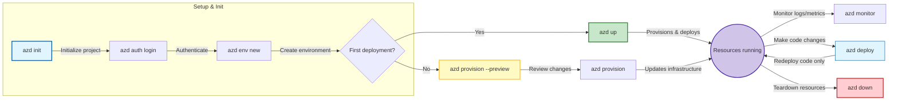
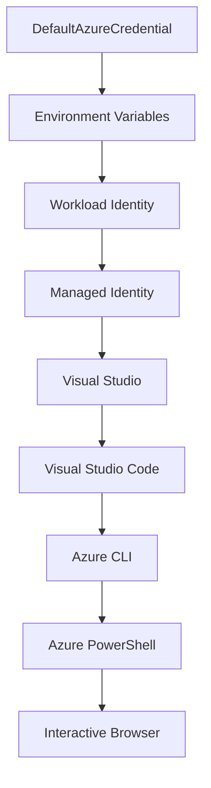

# Podstawy AZD - Podstawowe Pojęcia i Fundamenty

**Nawigacja po rozdziałach:**
- **📚 Strona główna kursu**: [AZD dla początkujących](../../README.md)
- **📖 Bieżący rozdział**: Rozdział 1 - Fundamenty i szybki start
- **⬅️ Poprzedni**: [Przegląd kursu](../../README.md#-chapter-1-foundation--quick-start)
- **➡️ Następny**: [Instalacja i konfiguracja](installation.md)
- **🚀 Następny rozdział**: [Rozdział 2: Rozwój AI-first](../chapter-02-ai-development/microsoft-foundry-integration.md)

## Wprowadzenie

> Przejrzano w oparciu o `azd 1.37.2` (listopad 2026). Polecenia Bash używają cytowanych symboli zastępczych, które trzeba zamienić. Szablony przepływów pracy używają `.` do inicjalizacji bieżącego katalogu; bez argumentu katalogu, inicjalizacja szablonu tworzy podkatalog i nie zmienia katalogu roboczego powłoki. Zaawansowane fragmenty są ilustracyjne, nie kompletnymi projektami.

Ta lekcja wprowadza Cię do Azure Developer CLI (azd), potężnego narzędzia wiersza poleceń, które przyspiesza Twoją drogę od lokalnego rozwoju do wdrożenia w Azure. Poznasz podstawowe koncepcje, kluczowe funkcje i zrozumiesz, jak azd upraszcza wdrażanie aplikacji natywnych dla chmury.

## Cele nauki

Pod koniec tej lekcji będziesz:
- Rozumieć, czym jest Azure Developer CLI i jaki jest jego główny cel
- Poznawać podstawowe pojęcia dotyczące szablonów, środowisk i usług
- Poznawać kluczowe funkcje, w tym rozwój oparty na szablonach oraz Infrastrukturę jako Kod
- Rozumieć strukturę projektu azd i przepływ pracy
- Być gotowym do instalacji i konfiguracji azd dla Twojego środowiska deweloperskiego

## Efekty nauki

Po ukończeniu tej lekcji będziesz potrafił:
- Wyjaśnić rolę azd we współczesnych przepływach pracy rozwoju chmurowego
- Zidentyfikować składniki struktury projektu azd
- Opisać, jak szablony, środowiska i usługi współdziałają
- Zrozumieć korzyści z Infrastruktury jako Kodu przy użyciu azd
- Rozpoznawać różne polecenia azd i ich cele

## Czym jest Azure Developer CLI (azd)?

Azure Developer CLI (azd) to narzędzie wiersza poleceń zaprojektowane, aby przyspieszyć Twoją drogę od lokalnego rozwoju do wdrożenia w Azure. Upraszcza proces budowania, wdrażania i zarządzania aplikacjami natywnymi dla chmury na platformie Azure.

### Co możesz wdrożyć za pomocą azd?

azd obsługuje szeroki zakres obciążeń — i lista ciągle rośnie. Obecnie możesz używać azd do wdrożenia:

| Typ obciążenia | Przykłady | Ten sam przepływ pracy? |
|---------------|----------|----------------|
| **Tradycyjne aplikacje** | Aplikacje internetowe, REST API, statyczne strony | ✅ `azd up` |
| **Usługi i mikroserwisy** | Aplikacje kontenerowe, Function Apps, wieloserwisowe backendy | ✅ `azd up` |
| **Aplikacje zasilane AI** | Aplikacje czatowe z modelami Microsoft Foundry, rozwiązania RAG z AI Search | ✅ `azd up` |
| **Inteligentni agenci** | Agenci hostowani w Foundry, orkiestracje wielu agentów | ✅ `azd up` |

Kluczową obserwacją jest to, że **cykl życia azd pozostaje taki sam, niezależnie od wdrażanego rozwiązania**. Inicjujesz projekt, zapewniasz infrastrukturę, wdrażasz kod, monitorujesz aplikację i sprzątasz — czy to prostą stronę internetową, czy zaawansowanego agenta AI.

Ta ciągłość jest zaprojektowana celowo. azd traktuje możliwości AI jako kolejny typ usługi, której może używać Twoja aplikacja, a nie jako coś zasadniczo odmiennego. Punkt końcowy chatu oparty na modelach Microsoft Foundry to z perspektywy azd po prostu kolejna usługa do skonfigurowania i wdrożenia.

### 🎯 Dlaczego używać AZD? Porównanie praktyczne

Porównajmy wdrożenie prostej aplikacji internetowej z bazą danych:

#### ❌ BEZ AZD: Ręczne wdrożenie Azure (30+ minut)

**Ilustracyjne porównanie Bash, nie starter aplikacji do uruchomienia.** Zakłada istniejący kod aplikacji, unikalne nazwy zasobów, uwierzytelnienie Azure CLI oraz wszelkie wymagane rozszerzenia CLI. Użyj ćwiczenia szablonowego poniżej dla obsługiwanego przepływu end-to-end.

```bash
# Step 1: Create resource group
az group create --name myapp-rg --location eastus

# Step 2: Create App Service Plan
az appservice plan create --name myapp-plan \
  --resource-group myapp-rg \
  --sku B1 --is-linux

# Step 3: Create Web App
az webapp create --name myapp-web-unique123 \
  --resource-group myapp-rg \
  --plan myapp-plan \
  --runtime "NODE:22-lts"

# Step 4: Create Cosmos DB account (10-15 minutes)
az cosmosdb create --name myapp-cosmos-unique123 \
  --resource-group myapp-rg \
  --kind MongoDB

# Step 5: Create database
az cosmosdb mongodb database create \
  --account-name myapp-cosmos-unique123 \
  --resource-group myapp-rg \
  --name tododb

# Step 6: Create collection
az cosmosdb mongodb collection create \
  --account-name myapp-cosmos-unique123 \
  --resource-group myapp-rg \
  --database-name tododb \
  --name todos

# Step 7: Get connection string
CONN_STR=$(az cosmosdb keys list \
  --name myapp-cosmos-unique123 \
  --resource-group myapp-rg \
  --type connection-strings \
  --query "connectionStrings[0].connectionString" -o tsv)

# Step 8: Configure app settings
az webapp config appsettings set \
  --name myapp-web-unique123 \
  --resource-group myapp-rg \
  --settings MONGODB_URI="$CONN_STR"

# Step 9: Enable logging
az webapp log config --name myapp-web-unique123 \
  --resource-group myapp-rg \
  --application-logging filesystem \
  --detailed-error-messages true

# Step 10: Set up Application Insights
az monitor app-insights component create \
  --app myapp-insights \
  --location eastus \
  --resource-group myapp-rg

# Step 11: Link App Insights to Web App
INSTRUMENTATION_KEY=$(az monitor app-insights component show \
  --app myapp-insights \
  --resource-group myapp-rg \
  --query "instrumentationKey" -o tsv)

az webapp config appsettings set \
  --name myapp-web-unique123 \
  --resource-group myapp-rg \
  --settings APPINSIGHTS_INSTRUMENTATIONKEY="$INSTRUMENTATION_KEY"

# Step 12: Build application locally
npm install
npm run build

# Step 13: Create deployment package
zip -r app.zip . -x "*.git*" "node_modules/*"

# Step 14: Deploy application
az webapp deployment source config-zip \
  --resource-group myapp-rg \
  --name myapp-web-unique123 \
  --src app.zip

# Step 15: Wait and pray it works 🙏
# (No automated validation, manual testing required)
```

**Problemy:**
- ❌ Ponad 15 poleceń do zapamiętania i wykonania w kolejności
- ❌ 30-45 minut pracy ręcznej
- ❌ Łatwo popełnić błędy (literówki, złe parametry)
- ❌ Dane uwierzytelniające wymagają jawnej obsługi; dzienniki debugowania i śledzenie powłoki mogą je ujawniać
- ❌ Brak automatycznego wycofania, jeśli coś się nie powiedzie
- ❌ Trudno powtórzyć dla członków zespołu
- ❌ Za każdym razem inne (niepowtarzalne)

#### ✅ Z AZD: Zautomatyzowane wdrożenie (5 poleceń, 10-15 minut)

```bash
# Step 1: Initialize from template
azd init --template todo-nodejs-mongo .

# Step 2: Authenticate
azd auth login

# Step 3: Select the environment created during init
azd env select dev

# Step 4: Preview changes (optional but recommended)
azd provision --preview

# Step 5: Deploy everything
azd up

# ✨ Done! Everything is deployed, configured, and monitored
```

**Korzyści:**
- ✅ **5 poleceń** wobec ponad 15 ręcznych kroków
- ✅ **10-15 minut** łącznego czasu (głównie oczekiwanie na Azure)
- ✅ **Mniej błędów ręcznych** — spójny, szablonowy przepływ pracy
- ✅ **Bezpieczne zarządzanie sekretami** — wiele szablonów używa zarządzanego przez Azure magazynu sekretów
- ✅ **Powtarzalne wdrożenia** — ten sam przepływ za każdym razem
- ✅ **Powtarzalne definicje infrastruktury** — z uwzględnieniem limitów, dostępności regionów i wersji szablonów
- ✅ **Gotowe na zespół** — każdy może wdrożyć, używając tych samych poleceń
- ✅ **Infrastruktura jako Kod** — wersjonowane szablony Bicep
- ✅ **Monitorowanie zdefiniowane przez szablon** — Application Insights, gdy zawarte w szablonie

### Czas i niezawodność

Podane czasy są orientacyjne, a nie benchmarkami. azd ogranicza liczbę poleceń, które trzeba koordynować, ale nie gwarantuje czasu wdrożenia, nie eliminuje błędów ani nie zapewnia automatycznego wycofania aplikacji/bazy danych. Trzymaj działające wersje w kontroli wersji i testuj procedury odzyskiwania.

## Podstawowe pojęcia

### Szablony
Szablony są fundamentem azd. Zawierają:
- **Kod aplikacji** — Twój kod źródłowy i zależności
- **Definicje infrastruktury** — zasoby Azure zdefiniowane w Bicep lub Terraform
- **Pliki konfiguracyjne** — ustawienia i zmienne środowiskowe
- **Skrypty wdrożeniowe** — zautomatyzowane przepływy pracy wdrożenia

### Środowiska
Środowiska reprezentują różne cele wdrożenia:
- **Rozwój** — do testowania i rozwoju
- **Staging** — środowisko przedprodukcyjne
- **Produkcja** — środowisko produkcyjne na żywo

Każde środowisko utrzymuje własne:
- Nazwę środowiska i wartości; izolacja zasobów zależy od szablonu infrastruktury
- Ustawienia konfiguracyjne
- Stan wdrożenia

### Usługi
Usługi w `azure.yaml` opisują składniki aplikacji podlegające wdrożeniu:
- **Frontend** — aplikacje webowe, SPA
- **Backend** — API, mikroserwisy

Bazy danych i magazyn są zwykle zapewniane jako zasoby infrastruktury, a nie jako tworzone usługi hostujące, takie jak `host: postgres`.

## Kluczowe funkcje

### 1. Rozwój oparty na szablonach
```bash
# Browse available templates
azd template list

# Initialize from a template
azd init --template "<template-name>" .
```

### 2. Infrastruktura jako Kod
- **Bicep** — specyficzny język Azure
- **Terraform** — narzędzie wielochmurowe do zarządzania infrastrukturą
- Bicep kompiluje do szablonów ARM; surowy ARM JSON nie jest osobnym wbudowanym `infra.provider`.

### 3. Zintegrowane przepływy pracy
```bash
# Complete deployment workflow
azd up            # Provision + Deploy this is hands off for first time setup

# 🧪 NEW: Preview infrastructure changes before deployment (SAFE)
azd provision --preview    # Simulate infrastructure deployment without making changes

azd provision     # Create Azure resources if you update the infrastructure use this
azd deploy        # Deploy application code or redeploy application code once update
azd down          # Clean up resources
```

#### 🛡️ Bezpieczne planowanie infrastruktury z podglądem
Polecenie `azd provision --preview` zmienia zasady gry pod kątem bezpiecznych wdrożeń:
- **Analiza na sucho** — pokazuje, co zostanie utworzone, zmodyfikowane lub usunięte
- **Brak zastosowania zmian infrastruktury** — przegląda zmiany dostawcy; najpierw sprawdź haki projektu, ponieważ mogą uruchamiać polecenia z efektami ubocznymi
- **Współpraca zespołowa** — dziel się wynikami podglądu przed wdrożeniem
- **Planowanie kosztów** — sprawdzaj proponowane SKU, a następnie wyceniaj je za pomocą Azure Pricing Calculator; podgląd nie liczy cen

```bash
# Example preview workflow
azd provision --preview           # See what will change
# Review the output, discuss with team
azd provision                     # Apply changes with confidence
```

### 📊 Wizualizacja: Przepływ pracy rozwoju AZD



**Wyjaśnienie przepływu pracy:**
1. **Init** - zacznij od szablonu lub nowego projektu
2. **Auth** - uwierzytelnij się w Azure
3. **Environment** - utwórz izolowane środowisko wdrożeniowe
4. **Preview** - 🆕 Zawsze najpierw podglądaj zmiany infrastruktury (bezpieczna praktyka)
5. **Provision** - utwórz/aktualizuj zasoby Azure
6. **Deploy** - wypchnij kod aplikacji
7. **Monitor** - obserwuj wydajność aplikacji
8. **Iterate** - wprowadzaj zmiany i ponownie wdrażaj kod
9. **Cleanup** - usuń zasoby po zakończeniu

### 4. Zarządzanie środowiskiem
```bash
# Create and manage environments
azd env new "<environment-name>"
azd env select "<environment-name>"
azd env list
```

### 5. Rozszerzenia i polecenia AI

azd używa systemu rozszerzeń do dodawania funkcji wykraczających poza podstawowy CLI. Jest to szczególnie przydatne dla obciążeń AI:

```bash
# List available extensions
azd extension list

# Install the Foundry agents extension
azd extension install azure.ai.agents

# Initialize an AI agent project interactively
azd ai agent init

# Test a deployed agent (shows latency and time-to-first-byte)
azd ai agent invoke

# Start the MCP server for AI-assisted development (Alpha)
azd mcp start
```

**Cykl życia agenta, krok po kroku.** Używaj `azure.ai.agents` do operacji cyklu życia agenta i instaluj oddzielnie `azure.ai.evaluations` do oceny. Używaj `azd >= 1.37.0` dla połączonego przepływu pracy. Nie potrzebujesz ich wszystkich pierwszego dnia:

| Etap | Polecenie | Co robi |
|-------|---------|--------------|
| **Szkielet** | `azd ai agent init --template <path-to-azure.yaml>` | Przyjmij aktualny szablon projektu agenta |
| **Test** | `azd ai agent invoke` | Wywołaj agenta i zobacz czas odpowiedzi |
| **Pomiar** | `azd ai eval init`, `generate`, `run start` | Konfiguruj, wdrażaj i uruchamiaj oceny z użyciem oddzielnego rozszerzenia |
| **Ulepszanie** | `azd ai agent optimize --eval <evaluation-name> --optimize-model <optimizer-deployment>` | Ponownie użyj zgodnej oceny, aby zoptymalizować agenta |
| **Inspekcja** | `azd ai agent endpoint show` | Zobacz konfigurację punktu końcowego na żywo |
| **Sprzątanie** | `azd ai agent delete` | Usuń hostowanego agenta i wszystkie jego wersje |

> Rozszerzenia są szczegółowo omówione w [Rozdziale 2: Rozwój AI-First](../chapter-02-ai-development/agents.md) oraz w referencji [AZD AI CLI Commands](../chapter-08-production/production-ai-practices.md#azd-ai-cli-commands-and-extensions).

## 📁 Struktura projektu

Typowa struktura projektu azd:
```
my-app/
├── .azure/                  # Local environments and selected-environment config
│   ├── config.json
│   └── dev/.env
├── .devcontainer/          # Development container config
├── .github/workflows/      # GitHub Actions
├── .vscode/               # VS Code settings
├── infra/                 # Infrastructure code
│   ├── main.bicep        # Main infrastructure template
│   ├── main.parameters.json
│   └── modules/          # Reusable modules
├── src/                  # Application source code
│   ├── api/             # Backend services
│   └── web/             # Frontend application
├── azure.yaml           # azd project configuration
└── README.md
```

## 🔧 Pliki konfiguracyjne

### azure.yaml
Główny plik konfiguracyjny projektu:
```yaml
name: my-awesome-app
metadata:
  template: my-template@1.0.0

services:
  web:
    project: ./src/web
    language: js
    host: appservice
  api:
    project: ./src/api
    language: js
    host: appservice

hooks:
  preprovision:
    shell: pwsh
    run: echo "Preparing to provision..."
```

### .azure/config.json
Lokalny wybór domyślnego środowiska w projekcie (ilustracyjny; zarządzany przez azd):
```json
{
  "defaultEnvironment": "dev"
}
```

## 🎪 Typowe przepływy pracy z ćwiczeniami praktycznymi

> **💡 Wskazówka naukowa:** Wykonuj te ćwiczenia w porządku, aby stopniowo budować swoje umiejętności AZD.

### 🎯 Ćwiczenie 1: Zainicjuj swój pierwszy projekt

**Cel:** Utwórz projekt AZD i poznaj jego strukturę

**Kroki:**
```bash
# Use a proven template
mkdir azd-basics-practice
cd azd-basics-practice
# Choose "dev" for the environment name when prompted
azd init --template todo-nodejs-mongo .

# Explore the generated files
ls -la  # View all files including hidden ones

# Key files created:
# - azure.yaml (main config)
# - infra/ (infrastructure code)
# - src/ (application code)
```

**✅ Sukces:** Masz katalogi azure.yaml, infra/ i src/

---

### 🎯 Ćwiczenie 2: Wdrożenie do Azure

**Cel:** Ukończ wdrożenie end-to-end

**Kroki:**
```bash
# 1. Authenticate
azd auth login

# 2. Select the dev environment created in Exercise 1
azd env select dev
azd env set AZURE_LOCATION eastus

# 3. Preview changes (RECOMMENDED)
azd provision --preview

# 4. Deploy everything
azd up

# 5. Verify deployment
azd show    # View your app URL
```

**Oczekiwany czas:** 10-15 minut  
**✅ Sukces:** Adres URL aplikacji otwiera się w przeglądarce

---

### 🎯 Ćwiczenie 3: Wiele środowisk

**Cel:** Wdrożenie do środowisk dev i staging

**Kroki:**
```bash
# Already have dev, create staging
azd env new staging
azd env set AZURE_LOCATION westus2
azd up

# Switch between them
azd env list
azd env select dev
```

**✅ Sukces:** Dwie osobne grupy zasobów w Azure Portal

**Sprzątanie:** Ćwiczenie 3 tworzy drugie płatne wdrożenie. Usuń oba po zakończeniu:

```bash
azd down --environment dev
azd down --environment staging
```

---

### 🛡️ Destrukcyjne sprzątanie: `azd down --force --purge`

Gdy chcesz świadomie usunąć zasoby Azure wybranego środowiska:

```bash
azd down --force --purge
```

**Co robi:**
- `--force`: Brak monitów o potwierdzenie
- `--purge`: Usuwa także trwale obsługiwane miękko usunięte zasoby (na przykład Key Vaulty), tam gdzie ochrona przed usunięciem na stałe na to pozwala. Nie usuwa lokalnego katalogu `.azure/`.

**Używaj, gdy:** skończysz ze środowiskiem jednorazowym. Nie traktuj destrukcyjnego sprzątania jako pierwszej reakcji na błąd uwierzytelniania, limitu lub konfiguracji.

---

## 🎪 Oryginalna referencja przepływu pracy

### Rozpoczęcie nowego projektu
```bash
# Method 1: Use existing template
azd init --template todo-nodejs-mongo .

# Method 2: Start from scratch
azd init

# Method 3: Use current directory
azd init .
```

### Cykl rozwoju
```bash
# Set up development environment
azd auth login
azd env new dev
azd env select dev

# Deploy everything
azd up

# Make changes and redeploy
azd deploy

# Clean up when done
azd down --force --purge # Deletes this environment's discovered Azure resources; review before forcing deletion.
```

## Zrozumienie `azd down --force --purge`
Polecenie `azd down --force --purge` to potężny sposób na całkowite usunięcie środowiska azd i wszystkich powiązanych zasobów. Oto rozbicie, co robi każda flaga:
```
--force
```
- Pomija monity o potwierdzenie.
- Przydatne do automatyzacji lub skryptów, gdzie nie jest możliwy ręczny input.
- Nie omija uprawnień, ochrony przed usunięciem, ani niepowodzeń usunięcia.

```
--purge
```
Trwale usuwa obsługiwane zasoby Azure, które zostały miękko usunięte, bez dodatkowego potwierdzenia. Ochrona przed usunięciem i uprawnienia nadal obowiązują. **Nie** usuwa środowisk lokalnych ani folderu `.azure/`.


### Dlaczego używać obu?
Używaj obu tylko wtedy, gdy zamierzasz usunąć zasoby Azure wybranego środowiska oraz przeprowadzić oczyszczenie zasobów możliwych do odzyskania. To jest destrukcyjna operacja porządkowa, a nie ogólna naprawa czy reset stanu lokalnego.

Jest to szczególnie przydatne po ręcznych usunięciach zasobów w portalu Azure lub podczas zmiany szablonów, środowisk lub konwencji nazewnictwa grup zasobów.


### Zarządzanie wieloma środowiskami
```bash
# Create staging environment
azd env new staging
azd env select staging
azd up

# Switch back to dev
azd env select dev

# Compare environments
azd env list
```

## 🔐 Uwierzytelnianie i dane uwierzytelniające

Rozróżnij uwierzytelnianie wdrożenia (`azd auth login`) od uwierzytelniania SDK aplikacji (`DefaultAzureCredential`). Są one oddzielne. azd domyślnie nie używa poświadczeń Azure CLI.

### Uwierzytelnianie Azure CLI (`az login`)

Uruchom `azd auth login` dla azd. Następujące polecenia Azure CLI są opcjonalne i uwierzytelniają polecenia `az` osobno:

```bash
# Interactive login (opens browser)
az login

# Login with specific tenant
az login --tenant "<tenant-id>"

# Login with service principal
az login --service-principal -u "<app-id>" -p "<password>" --tenant "<tenant-id>"

# Check current login status
az account show

# List available subscriptions
az account list --output table

# Set default subscription
az account set --subscription "<subscription-id>"
```

### Proces uwierzytelniania
1. **Interaktywne logowanie**: Otwiera domyślną przeglądarkę w celu uwierzytelnienia
2. **Device Code Flow**: Dla środowisk bez dostępu do przeglądarki
3. **Service Principal**: Dla automatyzacji i scenariuszy CI/CD
4. **Managed Identity**: Dla aplikacji hostowanych w Azure

### Łańcuch DefaultAzureCredential

`DefaultAzureCredential` to typ poświadczeń, który zapewnia uproszczone doświadczenie uwierzytelniania, automatycznie próbując wiele źródeł poświadczeń w określonej kolejności:

#### Łańcuch poświadczeń SDK aplikacji

Dokładny łańcuch zależy od języka SDK Azure Identity, wersji, zainstalowanych wtyczek i opcji. Ten diagram jest koncepcyjny, a nie stałą sekwencją uwierzytelniania azd; najnowsze SDK mogą również zawierać poświadczenia Azure Developer CLI.


#### 1. Zmienne środowiskowe
```bash
# Set environment variables for service principal
export AZURE_CLIENT_ID="<app-id>"
export AZURE_CLIENT_SECRET="<password>"
export AZURE_TENANT_ID="<tenant-id>"
```

#### 2. Tożsamość obciążenia (Kubernetes/GitHub Actions)
Używane automatycznie w:
- Azure Kubernetes Service (AKS) z tożsamością obciążenia
- GitHub Actions z federacją OIDC
- Inne scenariusze federowanych tożsamości

#### 3. Zarządzana tożsamość
Dla zasobów Azure takich jak:
- Maszyny wirtualne
- App Service
- Azure Functions
- Instancje kontenerów

```bash
# Inspect a deployed Container App's configured identity (requires az login)
az containerapp show --name "<app-name>" --resource-group "<rg-name>" --query identity
```

#### 4. Integracja narzędzi deweloperskich
- **Visual Studio**: Automatycznie używa zalogowanego konta
- **VS Code**: Wsparcie zależy od SDK oraz obsługiwanej konfiguracji brokera/wtyczki
- **Azure CLI**: Używa poświadczeń `az login` (najczęstsze dla lokalnego rozwoju)

### Konfiguracja uwierzytelniania AZD

```bash
# Method 1: Direct azd authentication (recommended)
azd auth login

# Method 2: Direct azd authentication
azd auth login --use-device-code  # For headless environments

# Method 3: Check authentication status
azd auth login --check-status

# Method 4: Logout and re-authenticate
azd auth logout
azd auth login
```

### Najlepsze praktyki uwierzytelniania

#### Dla lokalnego rozwoju
```bash
# 1. Log in to azd
azd auth login

# 2. Select the subscription for this initialized environment
azd env set AZURE_SUBSCRIPTION_ID "<subscription-id>"

# 3. Check azd sign-in details (read the status message)
azd auth login --check-status
```

#### Dla CI/CD
```yaml
# Partial GitHub Actions steps: assumes checkout, azd installation,
# required AZURE_* environment values, and pipeline secret configuration.
- name: Deploy with azd
  run: |
    azd auth login --client-id ${{ secrets.AZURE_CLIENT_ID }} \
                    --client-secret ${{ secrets.AZURE_CLIENT_SECRET }} \
                    --tenant-id ${{ secrets.AZURE_TENANT_ID }}
    azd up --no-prompt
```

#### Dla środowisk produkcyjnych
- Używaj **zarządzanej tożsamości** podczas uruchamiania na zasobach Azure
- Używaj **Service Principal** w scenariuszach automatyzacji
- Unikaj przechowywania poświadczeń w kodzie lub plikach konfiguracyjnych
- Używaj **Azure Key Vault** dla wrażliwej konfiguracji

### Typowe problemy z uwierzytelnianiem i rozwiązania

#### Problem: "Nie znaleziono subskrypcji"
```bash
# Solution: Set default subscription
az account list --output table
az account set --subscription "<subscription-id>"
azd env set AZURE_SUBSCRIPTION_ID "<subscription-id>"
```

#### Problem: "Niewystarczające uprawnienia"
```bash
# Solution: Check and assign required roles
az role assignment list --assignee $(az account show --query user.name --output tsv)

# Common required roles:
# - Contributor (for resource management)
# - User Access Administrator (for role assignments)
```

#### Problem: "Token wygasł"
```bash
# Solution: Re-authenticate
az logout
az login
azd auth logout
azd auth login
```

### Uwierzytelnianie w różnych scenariuszach

#### Lokalny rozwój
```bash
# Personal development account
az login
azd auth login
```

#### Praca zespołowa
```bash
# Use specific tenant for organization
az login --tenant contoso.onmicrosoft.com
azd auth login --tenant-id "<tenant-id>"
```

#### Scenariusze wielonajemcy
```bash
# Switch between tenants
az login --tenant tenant1.onmicrosoft.com
azd auth login --tenant-id "<tenant-1-id>"
# Select an environment configured with tenant 1's subscription
azd env select tenant1-dev
# Deploy to tenant 1
azd up

az login --tenant tenant2.onmicrosoft.com  
azd auth login --tenant-id "<tenant-2-id>"
azd env select tenant2-dev
# Deploy to tenant 2
azd up
```

### Aspekty bezpieczeństwa

1. **Przechowywanie poświadczeń**: Nigdy nie przechowuj poświadczeń w kodzie źródłowym
2. **Ograniczenie zakresu**: Stosuj zasadę najmniejszych uprawnień dla service principals
3. **Rotacja tokenów**: Regularnie rotuj tajne klucze service principal
4. **Ścieżka audytu**: Monitoruj aktywności uwierzytelniania i wdrożenia
5. **Bezpieczeństwo sieci**: Używaj punktów końcowych prywatnych, gdy to możliwe

### Rozwiązywanie problemów z uwierzytelnianiem

```bash
# Debug authentication issues
azd auth login --check-status
az account show
az account get-access-token

# Common diagnostic commands
whoami                          # Current user context
az ad signed-in-user show      # Microsoft Entra ID user details
az group list                  # Test resource access
```

## Odkrywanie poleceń

### Odkrywanie
```bash
azd template list              # Browse templates
azd template list --help       # Template discovery options
azd init --help               # Initialization options
```

### Zarządzanie projektem
```bash
azd show                     # Project overview
azd env list                # Available environments and selected default
azd config show            # Configuration settings
```

### Monitorowanie
```bash
azd monitor                  # Open Azure portal monitoring
azd monitor --logs           # View application logs
azd monitor --live           # View live metrics
azd pipeline config          # Set up CI/CD
```

## Najlepsze praktyki

### 1. Używaj znaczących nazw
```bash
# Good
azd env new production-east
azd init --template todo-nodejs-mongo .

# Avoid
azd env new env1
azd init --template template1 .
```

### 2. Wykorzystuj szablony
- Zacznij od istniejących szablonów
- Dostosuj do swoich potrzeb
- Twórz szablony wielokrotnego użytku dla swojej organizacji

### 3. Izolacja środowisk
- Używaj oddzielnych środowisk dla dev/staging/prod
- Nigdy nie wdrażaj bezpośrednio do produkcji z lokalnej maszyny
- Używaj pipeline’ów CI/CD dla wdrożeń produkcyjnych

### 4. Zarządzanie konfiguracją
- Używaj zarządzanej tożsamości i Key Vault do sekretów; zwykłe wartości `azd env set` to lokalny tekst jawny
- Przechowuj konfigurację w kontroli wersji
- Dokumentuj ustawienia specyficzne dla środowiska

## Postęp nauki

### Początkujący (tydzień 1-2)
1. Zainstaluj azd i się uwierzytelnij
2. Wdróż prosty szablon
3. Zrozum strukturę projektu
4. Naucz się podstawowych poleceń (up, down, deploy)

### Średnio zaawansowany (tydzień 3-4)
1. Dostosuj szablony
2. Zarządzaj wieloma środowiskami
3. Zrozum kod infrastruktury
4. Skonfiguruj pipeline’y CI/CD

### Zaawansowany (tydzień 5+)
1. Twórz własne szablony
2. Zaawansowane wzorce infrastruktury
3. Wdrożenia wieloregionalne
4. Konfiguracje na poziomie korporacyjnym

## Kolejne kroki

**📖 Kontynuuj naukę z Rozdziału 1:**
- [Instalacja i konfiguracja](installation.md) - Uzyskaj azd zainstalowany i skonfigurowany
- [Twój pierwszy projekt](first-project.md) - Ukończ praktyczny samouczek
- [Przewodnik po konfiguracji](../chapter-03-configuration/configuration.md) - Zaawansowane opcje konfiguracji

**🎯 Gotowy na następny rozdział?**
- [Rozdział 2: AI-First Development](../chapter-02-ai-development/microsoft-foundry-integration.md) - Zacznij tworzyć aplikacje AI

## Dodatkowe zasoby

- [Przegląd Azure Developer CLI](https://learn.microsoft.com/en-us/azure/developer/azure-developer-cli/)
- [Galeria szablonów](https://azure.github.io/awesome-azd/)
- [Przykłady społeczności](https://github.com/Azure-Samples)

---

## 🙋 Najczęściej zadawane pytania

### Pytania ogólne

**P: Jaka jest różnica między AZD a Azure CLI?**

O: Azure CLI (`az`) służy do zarządzania pojedynczymi zasobami Azure. AZD (`azd`) służy do zarządzania całymi aplikacjami:

```bash
# Azure CLI - Low-level resource management
az webapp create --name myapp --resource-group rg
az sql server create --name myserver --resource-group rg
# ...many more commands needed

# AZD - Application-level management
azd up  # Deploys entire app with all resources
```

**Pomyśl o tym tak:**
- `az` = Operowanie pojedynczymi klockami Lego
- `azd` = Praca z całymi zestawami Lego

---

**P: Czy muszę znać Bicep lub Terraform, aby używać AZD?**

O: Nie! Zacznij od szablonów:
```bash
# Use existing template - no IaC knowledge needed
azd init --template todo-nodejs-mongo .
azd up
```

Możesz nauczyć się Bicep później, by dostosować infrastrukturę. Szablony dostarczają działające przykłady do nauki.

---

**P: Ile kosztuje uruchomienie szablonów AZD?**

O: Koszty różnią się w zależności od regionu, SKU, czasu działania, trybu bazy danych i użycia modelu. Środowisko developerskie może generować znaczne miesięczne opłaty nawet w czasie bezczynności; nie zakładaj uniwersalnego zakresu 50-150 USD:

```bash
# Preview resource changes (not prices)
azd provision --preview

# Always cleanup when not using
azd down --force --purge  # Removes all resources
```

**Profesjonalna rada:** Korzystaj z darmowych poziomów tam, gdzie dostępne:
- App Service: poziom F1 (Darmowy)
- Azure OpenAI: brak ogólnie gwarantowanego miesięcznego darmowego limitu tokenów; sprawdź aktualne ceny modelu i ofertę
- Cosmos DB: kwalifikujące się konta z przydzieloną przepustowością mogą wybrać darmowy poziom; szablony serverless nie kwalifikują się automatycznie

---

**P: Czy mogę używać AZD z istniejącymi zasobami Azure?**

O: Tak, ale łatwiej zacząć od nowa. AZD działa najlepiej, gdy zarządza pełnym cyklem życia. Dla istniejących zasobów:

```bash
# Option 1: Import existing resources (advanced)
azd init
# Then modify infra/ to reference existing resources

# Option 2: Start fresh (recommended)
azd init --template "<verified-template-name>" .
azd up  # Creates new environment
```

---

**P: Jak udostępnić projekt współpracownikom?**

O: Zatwierdź projekt AZD do Git (ale NIE folderu .azure):

```bash
# Already in .gitignore by default
.azure/        # Contains secrets and environment data
*.env          # Environment variables

# Team members then:
git clone "<your-repo>"
# Change into the cloned repository before running the remaining commands.
azd auth login
azd env new "<their-name>-dev"
azd up
```

Wszyscy otrzymują identyczną infrastrukturę z tych samych szablonów.

---

### Pytania dotyczące rozwiązywania problemów

**P: "azd up" nie powiodło się w połowie. Co robić?**

O: Sprawdź błąd, napraw go, a następnie spróbuj ponownie:

```bash
# Capture detailed diagnostics (redact sensitive values before sharing)
azd up --debug

# Common fixes:

# 1. If quota exceeded:
azd env set AZURE_LOCATION "westus2"  # Try different region

# 2. If resource name conflict:
azd down --force --purge  # Clean slate
azd up  # Retry

# 3. If auth expired:
az login
azd auth login
azd up
```

**Najczęstszy problem:** Wybrano niewłaściwą subskrypcję Azure
```bash
az account list --output table
az account set --subscription "<correct-subscription>"
azd env set AZURE_SUBSCRIPTION_ID "<correct-subscription-id>"
```

---

**P: Jak wdrożyć tylko zmiany w kodzie bez reprowizjonowania?**

O: Użyj `azd deploy` zamiast `azd up`:

```bash
azd up          # First time: provision + deploy (slow)

# Make code changes...

azd deploy      # Subsequent times: deploy only (fast)
```

Porównanie szybkości:
- `azd up`: 10-15 minut (prowizjonuje infrastrukturę)
- `azd deploy`: 2-5 minut (tylko kod)

---

**P: Czy mogę dostosować szablony infrastruktury?**

O: Tak! Edytuj pliki Bicep w `infra/`:

```bash
# After azd init
cd infra/
code main.bicep  # Edit in VS Code

# Preview changes
azd provision --preview

# Apply changes
azd provision
```

**Wskazówka:** Zacznij od małych zmian - najpierw zmień SKU:
```bicep
// infra/main.bicep
sku: {
  name: 'B1'  // Change to 'P1V2' for production
}
```

---

**P: Jak usunąć wszystko, co utworzył AZD?**

O: Jedno polecenie usuwa wszystkie zasoby:

```bash
azd down --force --purge

# This deletes:
# - Azure resources/resource groups discovered for the selected environment
# - Supported soft-deleted resources, if purge protection allows
# Local .azure files remain; shared/external resources may remain too.
```

**Zawsze uruchamiaj to, gdy:**
- Skończysz testowanie szablonu
- Przechodzisz do innego projektu
- Chcesz zacząć od nowa

**Sprawdzenie kosztów:** Potwierdź usunięcie w Azure i sprawdź zachowane/współdzielone zasoby. Wcześniej poniesione opłaty nadal obowiązują.

---

**P: Co zrobić, jeśli przez pomyłkę usunąłem zasoby w Azure Portal?**

O: Stan AZD może się rozjechać. Podejście "czysta karta":

```bash
# 1. Delete remaining resources only if that is your intent
azd down --force --purge

# 2. Start fresh
azd up

# Alternative: Let AZD detect and fix
azd provision  # Will create missing resources
```

---

### Zaawansowane pytania

**P: Czy mogę używać AZD w pipeline’ach CI/CD?**

O: Tak! Przykład GitHub Actions:

```yaml
# .github/workflows/deploy.yml
name: Deploy with AZD

on:
  push:
    branches: [main]

jobs:
  deploy:
    runs-on: ubuntu-latest
    steps:
      - uses: actions/checkout@v4
      
      - name: Install azd
        run: curl -fsSL https://aka.ms/install-azd.sh | bash
      
      - name: Azure Login
        run: |
          azd auth login \
            --client-id ${{ secrets.AZURE_CLIENT_ID }} \
            --client-secret ${{ secrets.AZURE_CLIENT_SECRET }} \
            --tenant-id ${{ secrets.AZURE_TENANT_ID }}
      
      - name: Deploy
        env:
          AZURE_ENV_NAME: dev
          AZURE_LOCATION: ${{ vars.AZURE_LOCATION }}
          AZURE_SUBSCRIPTION_ID: ${{ vars.AZURE_SUBSCRIPTION_ID }}
        run: azd up --no-prompt
```

---

**P: Jak obsługiwać tajne i wrażliwe dane?**

O: Używaj Key Vault explicite. `azd env set` zapisuje zwykłe wartości do lokalnego pliku środowiska; nie tworzy automatycznie vault, nie przypisuje ról ani nie wstrzykuje sekretów do aplikacji.

```bash
# Interactive: create/select a Key Vault secret and save its reference
azd env set-secret DATABASE_PASSWORD
```

Musisz mieć odpowiednie uprawnienia do vault. Twoja infrastruktura/aplikacja musi nadal przekazać sekret konsumentowi i przyznać dostęp tożsamości runtime. Nie wyświetlaj rozwiniętych wartości sekretów w logach.

**Nigdy nie zatwierdzaj:**
- folderu `.azure/` (zawiera dane środowiska)
- plików `.env` (lokalne sekrety)
- ciągów połączeń

---

**P: Czy mogę wdrożyć do wielu regionów?**

O: Tak, utwórz środowisko na region:

```bash
# East US environment
azd env new prod-eastus
azd env set AZURE_LOCATION eastus
azd up

# West Europe environment
azd env new prod-westeurope
azd env set AZURE_LOCATION westeurope
azd up

# Each environment is independent
azd env list
```

Dla prawdziwych aplikacji wieloregionalnych dostosuj szablony Bicep, aby wdrażać jednocześnie do wielu regionów.

---

**P: Gdzie mogę uzyskać pomoc, gdy utknę?**

1. **Dokumentacja AZD:** https://learn.microsoft.com/azure/developer/azure-developer-cli/
2. **GitHub Issues:** https://github.com/Azure/azure-dev/issues
3. **Discord:** [Azure Discord](https://discord.gg/microsoft-azure) - kanał #azure-developer-cli
4. **Stack Overflow:** Tag `azure-developer-cli`
5. **Ten kurs:** [Przewodnik rozwiązywania problemów](../chapter-07-troubleshooting/common-issues.md)

**Profesjonalna rada:** Przed pytaniem uruchom:
```bash
azd show       # Shows current state
azd version    # Shows your version
```
Uwzględnij te informacje w pytaniu, aby szybciej uzyskać pomoc.

---

## 🎓 Co dalej?

Teraz rozumiesz podstawy AZD. Wybierz swoją ścieżkę:

### 🎯 Dla początkujących:
1. **Następny krok:** [Instalacja i konfiguracja](installation.md) - Zainstaluj AZD na swojej maszynie
2. **Potem:** [Twój pierwszy projekt](first-project.md) - Wdróż swoją pierwszą aplikację
3. **Ćwiczenia:** Wykonaj wszystkie 3 ćwiczenia w tej lekcji

### 🚀 Dla deweloperów AI:
1. **Przejdź do:** [Rozdział 2: AI-First Development](../chapter-02-ai-development/microsoft-foundry-integration.md)
2. **Wdróż:** W pustym katalogu projektu zacznij od `azd init --template get-started-with-ai-chat .`
3. **Ucz się:** Buduj podczas wdrażania

### 🏗️ Dla doświadczonych deweloperów:
1. **Przegląd:** [Przewodnik po konfiguracji](../chapter-03-configuration/configuration.md) - Zaawansowane ustawienia
2. **Poznaj:** [Infrastructure as Code](../chapter-04-infrastructure/provisioning.md) - Głębokie zanurzenie w Bicep
3. **Buduj:** Twórz własne szablony dla swojego stosu

---

**Nawigacja po rozdziale:**
- **📚 Strona główna kursu**: [AZD dla początkujących](../../README.md)
- **📖 Bieżący rozdział**: Rozdział 1 - Podstawy i szybki start  
- **⬅️ Poprzedni**: [Przegląd kursu](../../README.md#-chapter-1-foundation--quick-start)
- **➡️ Następny**: [Instalacja i konfiguracja](installation.md)
- **🚀 Następny rozdział**: [Rozdział 2: AI-First Development](../chapter-02-ai-development/microsoft-foundry-integration.md)

---

<!-- CO-OP TRANSLATOR DISCLAIMER START -->
**Zastrzeżenie**:
Niniejszy dokument został przetłumaczony za pomocą usługi tłumaczenia AI [Co-op Translator](https://github.com/Azure/co-op-translator). Choć dążymy do dokładności, prosimy pamiętać, że automatyczne tłumaczenia mogą zawierać błędy lub niedokładności. Oryginalny dokument w jego języku źródłowym należy uznawać za autorytatywne źródło. W przypadku informacji krytycznych zalecane jest skorzystanie z profesjonalnego tłumaczenia wykonanego przez człowieka. Nie ponosimy odpowiedzialności za jakiekolwiek nieporozumienia lub błędne interpretacje wynikające z użycia tego tłumaczenia.
<!-- CO-OP TRANSLATOR DISCLAIMER END -->