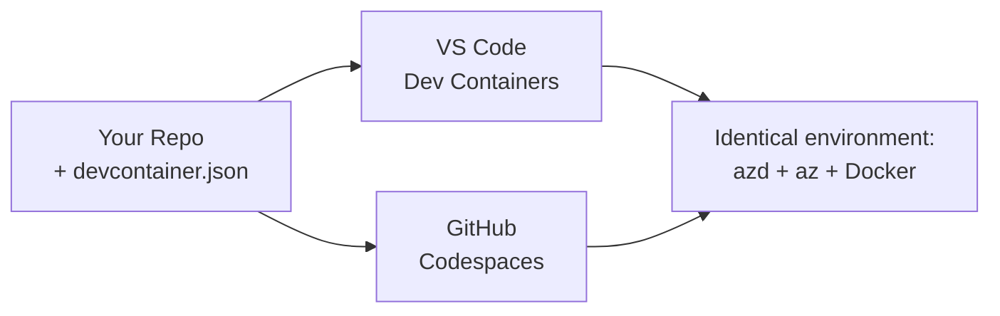

# Kontenery deweloperskie i GitHub Codespaces dla azd

**Nawigacja po rozdziale:**
- **📚 Strona kursu**: [AZD dla początkujących](../../README.md)
- **📖 Obecny rozdział**: Rozdział 1 - Podstawy i szybki start
- **⬅️ Poprzedni**: [Własna aplikacja](bring-your-own-app.md)
- **🚀 Następny rozdział**: [Rozdział 2: Rozwój z AI w centrum](../chapter-02-ai-development/README.md)

> Cel przeglądu poleceń i konfiguracji: `azd 1.37.2` (listopad 2026). Budowanie kontenerów i wdrożenia Azure nie były wykonywane w ramach tego przeglądu.

## Wprowadzenie

Instalacja azd, odpowiedniego środowiska uruchomieniowego języka, Dockera oraz Azure CLI na każdej maszynie to uciążliwość — i jest to główny powód, dla którego tutorial, który „działa na mojej maszynie”, zawodzi u kogoś innego. **Kontener deweloperski** rozwiązuje to, opisując cały twój zestaw narzędzi w pliku. Każdy, kto otworzy projekt w VS Code lub GitHub Codespaces, otrzymuje dokładnie takie samo środowisko, z już zainstalowanym azd. Ta lekcja pokazuje, jak go dodać.

## Cele nauki

Pod koniec tej lekcji będziesz:
- Rozumieć, czym jest kontener deweloperski i dlaczego pomaga w pracy z azd
- Dodać minimalny `.devcontainer/devcontainer.json` do projektu
- Uwzględnić azd, Azure CLI i Docker przez *funkcje* kontenera deweloperskiego
- Otworzyć projekt w GitHub Codespaces lub VS Code

## Efekty nauki

Po ukończeniu tej lekcji będziesz potrafił:
- Napisać `devcontainer.json` dla projektu azd
- Dodać azd i narzędzia Azure bez ręcznej instalacji
- Uruchomić `azd up` z wnętrza kontenera lub Codespace

---

## Czym jest kontener deweloperski?

Kontener deweloperski to środowisko deweloperskie oparte na Dockerze, zdefiniowane przez plik `.devcontainer/devcontainer.json` w twoim repozytorium. Gdy otwierasz projekt:

- **VS Code** (z rozszerzeniem Dev Containers) buduje kontener i do niego się łączy.
- **GitHub Codespaces** buduje ten sam kontener w chmurze i umożliwia użycie edytora w przeglądarce.

W obu przypadkach każdy współtwórca ma identyczne narzędzia — nie ma „czy zainstalowałeś azd?” do rozwiązywania problemów.



---

## Krok 1: Utwórz plik devcontainer

Utwórz `.devcontainer/devcontainer.json` w katalogu głównym projektu:

```json
{
  "name": "azd-project",
  "image": "mcr.microsoft.com/devcontainers/base:bookworm",
  "features": {
    "ghcr.io/devcontainers/features/azure-cli:1": {},
    "ghcr.io/azure/azure-dev/azd:0": { "version": "1.37.2" },
    "ghcr.io/devcontainers/features/docker-in-docker:2": {},
    "ghcr.io/devcontainers/features/node:1": {}
  },
  "customizations": {
    "vscode": {
      "extensions": [
        "ms-azuretools.azure-dev",
        "ms-azuretools.vscode-bicep"
      ]
    }
  },
  "forwardPorts": [3000],
  "postCreateCommand": "azd version"
}
```

Co robi każda część:

| Klucz | Przeznaczenie |
|-----|---------|
| `image` | Bazowy system operacyjny kontenera |
| `features` | Uprzednio przygotowane instalatory — tutaj: Azure CLI, **azd**, Docker i Node.js |
| `customizations.vscode.extensions` | Automatyczna instalacja rozszerzeń VS Code: azd i Bicep |
| `forwardPorts` | Udostępnia port aplikacji do przeglądarki |
| `postCreateCommand` | Uruchamia się raz po zbudowaniu kontenera (tu, test sanity) |

> Wersja funkcji (`azd:0`) i zainstalowana wersja CLI różnią się. Ustaw opcję `version` funkcji na `"1.37.2"` aby przypiąć wersję CLI; nie używaj wersji CLI jako tagu funkcji.

---

## Krok 2: Dopasuj funkcję do języka aplikacji

Zamień funkcję `node` na tę, którą używa twoja aplikacja:

```jsonc
// Python project
"ghcr.io/devcontainers/features/python:1": {},

// .NET project
"ghcr.io/devcontainers/features/dotnet:2": {},

// Java project
"ghcr.io/devcontainers/features/java:1": {},

// Go project
"ghcr.io/devcontainers/features/go:1": {}
```

Zachowaj `docker-in-docker` przy budowaniu obrazów lokalnie. Skonfigurowany zdalny build w ACR (`docker.remoteBuild: true`) jest alternatywą; sam typ hosta nie zawsze wymaga lokalnego Dockera.

---

## Krok 3: Otwórz projekt

**W VS Code:**
1. Zainstaluj rozszerzenie **Dev Containers**.
2. Otwórz folder projektu.
3. Kliknij **Reopen in Container** gdy pojawi się monit (lub uruchom *Dev Containers: Reopen in Container*).

**W GitHub Codespaces:**
1. Zepchnij repozytorium do GitHub.
2. Kliknij **Code → Codespaces → Create codespace on main**.
3. Poczekaj na zbudowanie kontenera — azd jest gotowy w terminalu.

---

## Krok 4: Wdrażanie z wnętrza kontenera

Kontener ma preinstalowany azd, więc normalny przepływ pracy działa bez zmian:

```bash
azd auth login --use-device-code   # device code is handy inside Codespaces
azd up
```

> **Dlaczego `--use-device-code`?** W zdalnym kontenerze lub Codespace nie ma lokalnej przeglądarki do przekierowania, więc logowanie przez device-code jest niezawodną metodą. Wklejasz kod do zakładki przeglądarki, by dokończyć logowanie.

---

## Częste pułapki

| Pułapka | Naprawa |
|---------|-----|
| `azd up` nie może zbudować obrazu | Dodaj funkcję `docker-in-docker` |
| Logowanie przeglądarką zawiesza się w Codespaces | Użyj `azd auth login --use-device-code` |
| Narzędzia różnią się między współpracownikami | Przypnij wersję CLI przez opcję `version` funkcji azd i przypnij środowiska uruchomieniowe języka |
| Aplikacja niedostępna w przeglądarce | Dodaj port do `forwardPorts` |

---

## Podsumowanie

- Kontener deweloperski sprawia, że twój zestaw narzędzi azd jest powtarzalny dla wszystkich.
- Dodaj azd, Azure CLI i Docker przez *funkcje* kontenera deweloperskiego.
- Dopasuj funkcję języka do aplikacji i zachowaj `docker-in-docker` dla hostów kontenerów.
- Używaj logowania device-code podczas pracy w Codespaces.

---

## 🔗 Nawigacja

| Kierunek | Zasób |
|-----------|----------|
| **Poprzedni** | [Własna aplikacja](bring-your-own-app.md) |
| **Strona rozdziału** | [Rozdział 1: Podstawy i szybki start](README.md) |
| **Następny rozdział** | [Rozdział 2: Rozwój z AI w centrum](../chapter-02-ai-development/README.md) |

## 📖 Powiązane zasoby

- [Instalacja i konfiguracja](installation.md)
- [Skrót poleceń](../../resources/cheat-sheet.md)
- [Oficjalna specyfikacja Dev Containers](https://containers.dev/)
- [Funkcja azd dla Dev Container](https://github.com/Azure/azure-dev/tree/main/ext/devcontainer)

---

<!-- CO-OP TRANSLATOR DISCLAIMER START -->
**Zastrzeżenie**:
Niniejszy dokument został przetłumaczony za pomocą usługi tłumaczenia AI [Co-op Translator](https://github.com/Azure/co-op-translator). Choć dążymy do dokładności, prosimy pamiętać, że automatyczne tłumaczenia mogą zawierać błędy lub niedokładności. Oryginalny dokument w jego języku źródłowym należy uznawać za autorytatywne źródło. W przypadku informacji krytycznych zalecane jest skorzystanie z profesjonalnego tłumaczenia wykonanego przez człowieka. Nie ponosimy odpowiedzialności za jakiekolwiek nieporozumienia lub błędne interpretacje wynikające z użycia tego tłumaczenia.
<!-- CO-OP TRANSLATOR DISCLAIMER END -->