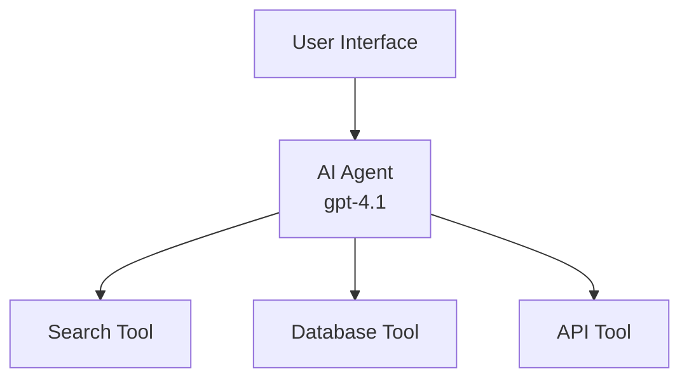
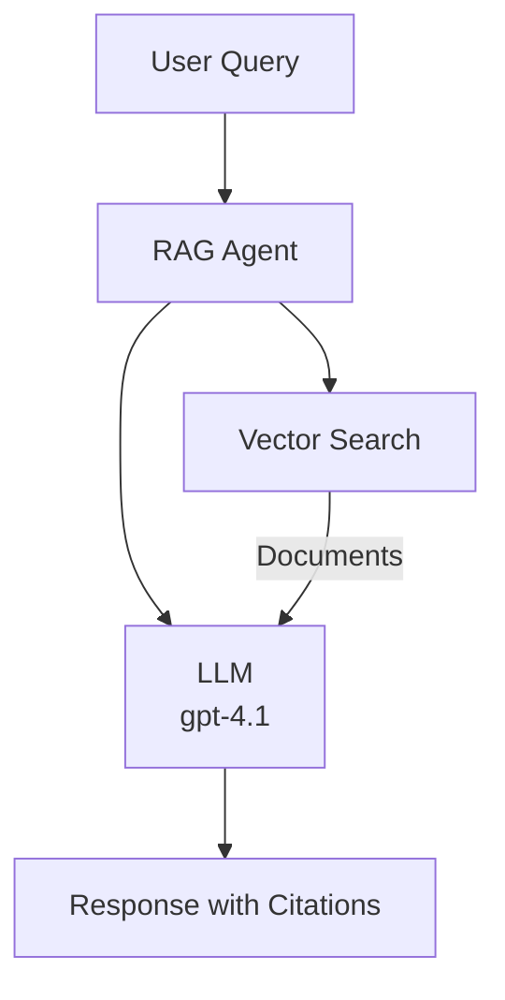
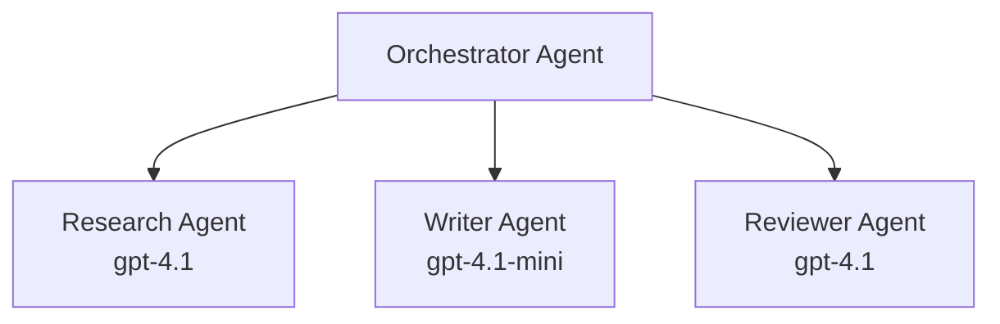

# Agenci AI z Azure Developer CLI

**Nawigacja po rozdziale:**
- **📚 Strona kursu głównego**: [AZD dla początkujących](../../README.md)
- **📖 Obecny rozdział**: Rozdział 2 - Rozwój zorientowany na AI
- **⬅️ Poprzedni**: [Integracja Microsoft Foundry](microsoft-foundry-integration.md)
- **➡️ Następny**: [Wdrożenie modeli AI](ai-model-deployment.md)
- **🚀 Zaawansowane**: [Rozwiązania wieloagentowe](../../examples/retail-scenario.md)

---

## Wprowadzenie

Agenci AI to autonomiczne programy, które mogą postrzegać swoje otoczenie, podejmować decyzje i podejmować działania w celu osiągnięcia określonych celów. W przeciwieństwie do prostych chatbotów reagujących na polecenia, agenci mogą:

- **Używać narzędzi** - Wywoływać API, przeszukiwać bazy danych, wykonywać kod
- **Planować i rozumować** - Dzielić złożone zadania na kroki
- **Uczyć się z kontekstu** - Utrzymywać pamięć i dostosowywać zachowanie
- **Współpracować** - Pracować z innymi agentami (systemy wieloagentowe)

Ten przewodnik pokazuje, jak wdrożyć agentów AI do Azure przy użyciu Azure Developer CLI (azd).

Korzystanie z kontekstu rozmowy to nie jest trening modelu: trwała pamięć, kontrola dostępu i przechowywanie muszą być zaimplementowane/konfigurowane przez aplikację.

> **Aktualizacja Foundry GA (2026-11-09):** Zainstaluj ogólnie dostępną paczkę `microsoft.foundry` 1.0 za pomocą `azd >= 1.37.0`. Ewaluacje instalowane są osobno; opcjonalne funkcje podglądu i klasyczny fragment SDK poniżej nie są promowane do GA przez tę zapowiedź. To zalecenie opiera się na [ogłoszeniu GA](https://devblogs.microsoft.com/azure-sdk/microsoft-foundry-azure-developer-cli-ga/) i dokumentacji, a nie na działającej implementacji Azure.

## Cele nauki

Po ukończeniu tego przewodnika:
- Zrozumiesz, czym są agenci AI i czym różnią się od chatbotów
- Wdrożysz predefiniowane szablony agentów AI za pomocą AZD
- Skonfigurujesz agenty Foundry do agentów niestandardowych
- Wdrożysz podstawowe wzorce agentów (użycie narzędzi, RAG, wieloagentowe)
- Będziesz monitorować i debugować wdrożonych agentów

## Rezultaty nauki

Po ukończeniu będziesz potrafił:
- Wdrożyć aplikacje agentów AI na Azure za pomocą jednego polecenia
- Skonfigurować narzędzia i możliwości agentów
- Wdrożyć generowanie wspomagane odzyskiwaniem (RAG) z agentami
- Projektować architektury wieloagentowe dla złożonych procesów
- Rozwiązywać typowe problemy z wdrożeniem agentów

---

## 🤖 Czym agent różni się od chatbota?

| Cecha | Chatbot | Agent AI |
|---------|---------|----------|
| **Zachowanie** | Odpowiada na polecenia | Podejmuje autonomiczne działania |
| **Narzędzia** | Może używać wyszukiwania lub narzędzi | Zwykle używa narzędzi w pętli ukierunkowanej na cel |
| **Pamięć** | Zależna od aplikacji | Trwała pamięć tylko jeśli wyraźnie zaimplementowana |
| **Planowanie** | Pojedyncza odpowiedź | Wieloetapowe rozumowanie |
| **Współpraca** | Jednostka pojedyncza | Może współpracować z innymi agentami |

### Prosta analogia

- **Chatbot** = Pomocna osoba odpowiadająca na pytania przy punkcie informacyjnym
- **Agent AI** = Osobisty asystent, który może dzwonić, rezerwować spotkania i wykonywać zadania za Ciebie

---

## 🚀 Szybki start: Wdroż swój pierwszy agenta

Wybierz jedną opcję w **nowym pustym katalogu roboczym**. Końcowy `.` inicjalizuje tam; bez wyraźnego celu, aktualny AZD może utworzyć podkatalog o nazwie szablonu i nie zmieni katalogu powłoki. Trzymaj różne szablony/środowiska w osobnych katalogach.

Podane zakresy czasów/kosztów są orientacyjne, a nie zweryfikowanymi wycenami. Sprawdź wymagania, ceny, limity modelu i opcjonalne usługi każdego przykładu przed wdrożeniem.

### Opcja 1: Szablon Foundry Agents (zalecany)

```bash
# Initialize the AI agents template
azd init --template get-started-with-ai-agents .

# Deploy to Azure
azd up
```

**Co zostaje wdrożone:** Bieżąca infrastruktura i wybrane opcje próbki determinują model, narzędzia, hosting i zasoby monitoringu. Zapoznaj się z plikiem README i `infra/` przed provisioningiem; nie zakładaj, że każdy szablon agentów zawiera Search lub interfejs WWW.

**Czas:** ~15-20 minut
**Koszt:** ~$100-150/miesiąc (rozwój)

### Opcja 2: Agenci pisarscy z Prompty

```bash
# Initialize the Prompty-based agent template
azd init --template https://github.com/Azure-Samples/contoso-creative-writer .

# Deploy to Azure
azd up
```

**Co zostaje wdrożone:** Przykład FastAPI/Prompty wieloagentowego pisania wykorzystujący Azure OpenAI, Bing Grounding i Azure AI Search. Poprzednie repozytorium `agent-openai-python-prompty` przekierowuje tutaj; nie jest to minimalny szablon agenta pogodowego Azure Functions. Postępuj zgodnie z aktualnym README dla hostingu, limitów modelu i wymagań Bing Grounding.

**Czas:** ~10-15 minut
**Koszt:** ~$50-100/miesiąc (rozwój)

### Opcja 3: Agent RAG Chat

```bash
# Initialize RAG chat template
azd init --template azure-search-openai-demo .

# Deploy to Azure
azd up
```

**Co zostaje wdrożone:**
- ✅ Modele Microsoft Foundry
- ✅ Azure AI Search z przykładowymi danymi
- ✅ Pipeline przetwarzania dokumentów
- ✅ Interfejs czatu z cytowaniami

**Czas:** ~15-25 minut
**Koszt:** ~$80-150/miesiąc (rozwój)

### Opcja 4: Hostowany agent z pakietem GA Foundry

Skorzystaj z [pełnego przewodnika po hostowanym agencie](microsoft-foundry-integration.md#hosted-agent-walkthrough-ga) dla podstawowego przykładu Python Agent Framework Responses API. Ta ścieżka wdrożenia kodu wymaga Pythona 3.13+, aktualnego uv, uprawnień Foundry i regionalnego limitu modeli. Autoryzuj lokalne wywołania SDK osobno podczas używania poświadczeń Azure CLI.

```bash
azd auth login
azd ext install microsoft.foundry
```

W pustym katalogu zainicjalizuj próbkę:

```text
azd ai agent init --template https://github.com/microsoft-foundry/foundry-samples/blob/main/samples/python/hosted-agents/agent-framework/responses/01-basic/azure.yaml --deploy-mode code --src .
```

Wybierz nowy lub istniejący projekt, zapoznaj się z `azure.yaml` i wykonaj `azd provision`. Użyj `azd ai agent run`, aby otworzyć Agent Inspector, i w innym terminalu w tym samym katalogu wykonaj `azd ai agent invoke --local "Explain how this agent is hosted."`. Po weryfikacji lokalnej użyj `azd deploy` i `azd ai agent invoke "Explain how this agent is hosted."` do porównania odpowiedzi z wdrożeniem. Foundry zdalnie buduje przesłane źródła; lokalna budowa kontenera nie jest wymagana.

**Kiedy używać `azd ai agent init` vs `azd init --template`:**

| Podejście | Najlepsze dla | Jak to działa |
|----------|--------------|---------------|
| `azd init --template` | Start z działającą aplikacją próbną | Klonuje pełne repozytorium szablonu z kodem + infra |
| `azd ai agent init --template` | Adopcja bieżącego projektu agenta Foundry | Używa dokumentu projektu `azure.yaml` i jego definicji |

> **Wskazówka:** Opcje 1-3 zaczynają od pełnych szablonów aplikacji; Opcja 4 uczy przepływu pracy hostowanego agenta GA. Żadne polecenie inicjalizacji nie migruje automatycznie starych manifestów agenta. Aby dodać bezpośrednią definicję agenta do istniejącego projektu, zobacz [instrukcje inicjalizacji i migracji](../chapter-08-production/production-ai-practices.md#initializing-agent-projects-with-azd-ai-agent-init).

Zainstaluj `azure.ai.evaluations` osobno, aby generować i przeglądać dane testowe/składniki oceny, konfigurować ewaluację i uruchamiać ją za pomocą `azd ai eval`. Optymalizacja może ponownie użyć kompatybilnej ewaluacji; przeglądaj kandydatów przed explicytnym wdrożeniem. Przestrzegaj [przepływu oceny](../chapter-08-production/production-ai-practices.md#evaluation-migration-and-quality-checks) i [migracji optymalizacji](../chapter-08-production/production-ai-practices.md#optimization-configuration-migration) przed ponownym wykorzystaniem starszych przykładów. Po zakończeniu zasoby używanego projektu Foundry pozostają po `azd down`; zasób grupy projektu nowo utworzonego jest usuwany. Zapoznaj się z [instrukcjami czyszczenia](microsoft-foundry-integration.md#7-clean-up-deliberately).

---

## 🏗️ Wzorce architektury agentów

### Wzorzec 1: Pojedynczy agent z narzędziami

Najprostszy wzorzec agenta - jeden agent, który może używać wielu narzędzi.



**Najlepsze dla:**
- Boty wsparcia klienta
- Asystenci badawczy
- Agenty analizy danych

**Powiązany przykład aplikacji:** `azure-search-openai-demo` demonstruje RAG, nie ogólny agent używający dowolnych narzędzi.

### Wzorzec 2: Agent RAG (Retrieval-Augmented Generation)

Agent, który wyszukuje odpowiednie dokumenty przed generowaniem odpowiedzi.



**Najlepsze dla:**
- Bazy wiedzy przedsiębiorstwa
- Systemy Q&A na dokumentach
- Badania zgodności i prawne

**Szablon AZD:** `azure-search-openai-demo`

### Wzorzec 3: System wieloagentowy

Wiele wyspecjalizowanych agentów współpracujących przy złożonych zadaniach.



**Najlepsze dla:**
- Złożone generowanie treści
- Wieloetapowe procesy
- Zadania wymagające różnych specjalizacji

**Dowiedz się więcej:** [Wzorce koordynacji wieloagentowej](../chapter-06-pre-deployment/coordination-patterns.md)

---

## ⚙️ Konfiguracja narzędzi agenta

Agenci stają się potężni, gdy mogą używać narzędzi. Oto jak skonfigurować powszechne narzędzia:

### Konfiguracja narzędzi w Foundry Agents

Ten **klasyczny fragment SDK Agent Service** jest skierowany do `azure-ai-projects==1.0.0` i `azure-ai-agents==1.1.0` z `azure-identity`. Nie jest to nowsza wersja API wersjonowanego-agenta/Responses używanego przez niektóre aktualne szablony Foundry, ani rozszerzenie AZD `azure.ai.agents` (inna paczka). Nie mieszaj tych pokoleń API. Ustaw `PROJECT_ENDPOINT` na klasyczny punkt końcowy projektu Foundry i `MODEL_DEPLOYMENT_NAME` na istniejące obsługiwane wdrożenie modelu; uwierzytelniaj lokalnie za pomocą `az login` i przyznaj wymagane uprawnienia projektu.

```python
# agent_config.py
import os
from azure.ai.projects import AIProjectClient
from azure.ai.agents.models import FunctionTool
from azure.identity import DefaultAzureCredential

def search_knowledge_base(query: str) -> str:
    """Search the demonstration knowledge base.

    :param query: Search text.
    :return: Matching demonstration information.
    """
    # Local fixture only, not a production search implementation.
    return "Demo policy: returns are accepted within 30 days."

project_client = AIProjectClient(
    endpoint=os.environ["PROJECT_ENDPOINT"],
    credential=DefaultAzureCredential(),
)
search_tool = FunctionTool(functions={search_knowledge_base})
project_client.agents.enable_auto_function_calls(search_tool)
agent = project_client.agents.create_agent(
    model=os.environ["MODEL_DEPLOYMENT_NAME"],
    name="Support Agent",
    instructions="Use search_knowledge_base for policy questions. Label results as demo data.",
    tools=search_tool.definitions,
)
```

Rejestracja schematu funkcji nie wykonuje Pythona na usłudze. W tym SDK `enable_auto_function_calls` plus `agents.runs.create_and_process(...)` uruchamiają zarejestrowane wywołania zwrotne w Twoim procesie klienta. Zobacz [udostępniony przykład SDK](https://github.com/Azure/azure-sdk-for-python/blob/azure-ai-agents_1.1.0/sdk/ai/azure-ai-agents/samples/agents_tools/sample_agents_auto_function_call.py). Zamknij klienta i usuń demonstracyjne agentów/wątki po zakończeniu.

### Konfiguracja środowiska

Następujące nazwy to **ilustracyjne własne dane wejściowe szablonu**, nie wbudowane przełączniki AZD. Najpierw przeprowadź każdą wartość przez `infra/main.parameters.json`, infrastrukturę i kod aplikacji. Samo `azd env set` nie zmienia narzędzi lub instrukcji agenta.

```bash
# Set up agent-specific environment variables
azd env set AZURE_OPENAI_MODEL "gpt-4.1"
azd env set AGENT_INSTRUCTIONS "You are a helpful assistant..."
azd env set ENABLE_CODE_INTERPRETER "true"
azd env set ENABLE_FILE_SEARCH "true"

# Apply wired infrastructure and application changes
azd up
```

---

## 📊 Monitorowanie agentów

### Integracja z Application Insights

Jeśli wybrany szablon udostępnia Application Insights i ustawia instrumentację:

```bash
# Open monitoring dashboard
azd monitor --overview

# Open the Application Insights logs view (not a streaming log tail)
azd monitor --logs

# View live metrics
azd monitor --live
```

### Kluczowe wskaźniki do śledzenia

| Wskaźnik | Opis | Cel |
|--------|-------------|--------|
| Opóźnienie odpowiedzi | Czas generowania odpowiedzi | < 5 sekund |
| Zużycie tokenów | Tokeny na żądanie | Monitorowanie kosztów |
| Skuteczność wywołań narzędzi | % udanych wywołań narzędzi | > 95% |
| Wskaźnik błędów | Nieudane żądania agenta | < 1% |
| Satysfakcja użytkowników | Wyniki opinii | > 4.0/5.0 |

### Niestandardowe logowanie agentów

```python
import os
from azure.monitor.opentelemetry import configure_azure_monitor
from opentelemetry import trace

# Configure Azure Monitor with OpenTelemetry
configure_azure_monitor(
    connection_string=os.environ["APPLICATIONINSIGHTS_CONNECTION_STRING"]
)

tracer = trace.get_tracer(__name__)

def log_agent_interaction(user_query, agent_response, tools_used, latency_ms):
    with tracer.start_as_current_span("agent_interaction") as span:
        span.set_attributes({
            "query_length": len(user_query),  # Do not log raw prompts or personal data
            "response_length": len(agent_response),
            "tools_used": tools_used,
            "latency_ms": latency_ms
        })
```

> **Uwaga:** Zainstaluj wymaganą paczkę: `pip install azure-monitor-opentelemetry`. Zawiera zależności OpenTelemetry; przestrzeń nazw importu nie jest wymagana do instalacji paczki o nazwie `opentelemetry`.

---

## 💰 Rozważania dotyczące kosztów

### Szacunkowe miesięczne koszty według wzorca

Są to orientacyjne zakresy planowania, nie wyceny ani limity wydatków. Region, tokeny modelu, SKU Search/compute, sesje narzędzi, pamięć i ruch mogą przekraczać te wartości. Sprawdź rekomendacje kosztowe szablonu i cennik Azure przed `azd up`.

| Wzorzec | Środowisko deweloperskie | Produkcja |
|---------|-----------------|------------|
| Pojedynczy agent | $50-100 | $200-500 |
| Agent RAG | $80-150 | $300-800 |
| System wieloagentowy (2-3 agentów) | $150-300 | $500-1,500 |
| Wieloagentowy przedsiębiorstwa | $300-500 | $1,500-5,000+ |

### Wskazówki dotyczące optymalizacji kosztów

1. **Używaj gpt-4.1-mini do prostych zadań** (tylko jeśli Twój szablon to wykorzystuje)
   ```bash
   azd env set AZURE_OPENAI_MODEL "gpt-4.1-mini"
   ```

2. **Zaimplementuj zakresową pamięć podręczną dla bezpiecznych, powtarzających się zapytań.** Uwzględnij uprawnienia najemcy/użytkownika, wdrożenie modelu, instrukcje i wersję wyszukiwania w kluczu pamięci podręcznej; ustaw czas wygaśnięcia. Nie udostępniaj prywatnych odpowiedzi z rozmów przez globalną pamięć podręczną do zapytań. Obiekt agenta SDK nie ma ogólnej metody `agent.run()`.

3. **Ustaw limity tokenów dla każdego uruchomienia**
   ```python
   # Set max_completion_tokens when running the agent, not during creation
   run = project_client.agents.runs.create_and_process(
       thread_id=thread.id,
       agent_id=agent.id,
       max_completion_tokens=1000  # Budget across the run; may finish as incomplete
   )
   ```

4. **Skaluj kwalifikujące się aplikacje kontenerowe do zera, gdy nie są używane**
   ```bash
   # Custom-template input: must map to template.scale.minReplicas
   azd env set MIN_REPLICAS "0"
   ```
   Zastosuj zmianę infrastruktury za pomocą `azd provision` lub `azd up`. Skalowanie do zera wymaga odpowiedniego wyzwalacza i nie zatrzymuje kosztów Search, pamięci ani modeli/narzędzi.

---

## 🔧 Rozwiązywanie problemów z agentami

### Typowe problemy i rozwiązania

<details>
<summary><strong>❌ Agent nie odpowiada na wywołania narzędzi</strong></summary>

```bash
# Inspect the application deployment (not the agent's registered tools)
azd show

# Verify OpenAI deployment
az cognitiveservices account deployment list \
  --name $AZURE_OPENAI_NAME \
  --resource-group $RG_NAME

# Check agent logs
azd monitor --logs
```

**Typowe przyczyny:**
- Niedopasowanie sygnatury funkcji narzędzia
- Brak wymaganych uprawnień
- Niedostępny endpoint API
</details>

<details>
<summary><strong>❌ Wysokie opóźnienia w odpowiedziach agenta</strong></summary>

```bash
# Check Application Insights for bottlenecks
azd monitor --live

# Consider using a faster model
azd env set AZURE_OPENAI_MODEL "gpt-4.1-mini"
azd up
```

**Wskazówki optymalizacyjne:**
- Używaj odpowiedzi strumieniowych
- Wprowadź pamięć podręczną odpowiedzi
- Zmniejsz rozmiar okna kontekstu
</details>

<details>
<summary><strong>❌ Agent zwraca nieprawidłowe lub halucynacyjne informacje</strong></summary>

```python
# Improve with better system prompts
instructions = """
You are a helpful assistant. IMPORTANT:
- Only answer based on provided context
- If you don't know, say "I don't know"
- Always cite your sources
- Never make up information
"""

# Use these instructions in the agent definition.
# For classic file search, first upload/index documents in a vector store,
# then use FileSearchTool(vector_store_ids=[...]) and pass both its
# .definitions and .resources when creating the agent.
```
Instrukcje i wyszukiwanie zmniejszają ryzyko; żadne nie gwarantują faktograficznych odpowiedzi. Oceń pytania ugruntowane i spoza zakresu względem znanych odpowiedzi.
</details>

<details>
<summary><strong>❌ Błędy przekroczenia limitu tokenów</strong></summary>

```python
# Implement context window management
def truncate_context(messages, max_tokens=8000, model="gpt-4.1"):
    """Approximate content-only budget for objects with .content strings."""
    import tiktoken
    encoding = tiktoken.encoding_for_model(model)
    total_tokens = 0
    truncated = []
    
    for msg in reversed(messages):
        msg_tokens = len(encoding.encode(msg.content))
        if total_tokens + msg_tokens > max_tokens:
            break
        truncated.insert(0, msg)
        total_tokens += msg_tokens
    
    return truncated
```
Ten pomocnik wyklucza schematy ról/narzędzi, instrukcje systemowe, tokeny obrazów i narzut protokołu. Zarezerwuj miejsce na te oraz odpowiedź; nie dziel par wywołań narzędzi/rezultatów i nie odrzucaj wymaganych instrukcji systemowych. Zainstaluj `tiktoken` osobno. Nie jest to ogólny walidator okna kontekstowego.
</details>

---

## 🎓 Ćwiczenia praktyczne

### Ćwiczenie 1: Wdrożenie podstawowego agenta (20 minut)

**Cel:** Wdroż swój pierwszy agenta AI używając AZD

```bash
# Step 1: Initialize template
azd init --template get-started-with-ai-agents .

# Step 2: Login to Azure
azd auth login
# If you work across tenants, add --tenant-id <tenant-id>

# Step 3: Deploy
azd up

# Step 4: Test the agent
# Expected output after deployment:
#   Deployment Complete!
#   Endpoint: https://<app-name>.<region>.azurecontainerapps.io
# Open the URL shown in the output and try asking a question

# Step 5: View monitoring
azd monitor --overview

# Step 6: Review the listed resources and confirm cleanup
azd down
```

**Kryteria sukcesu:**
- [ ] Agent odpowiada na pytania
- [ ] Może uzyskać dostęp do pulpitu monitoringu przez `azd monitor`
- [ ] Zasoby zostały pomyślnie posprzątane

### Ćwiczenie 2: Dodaj narzędzie niestandardowe (30 minut)

**Cel:** Rozszerz agenta o niestandardowe narzędzie

**Punkt wyjścia:** Użyj klasycznego klienta SDK z [Konfiguracja narzędzi](#tool-configuration-in-foundry-agents), a nie dowolnego szablonu z inną generacją SDK.

1. Dodaj ten deterministyczny fixture do `agent_config.py`:
   ```python
   def get_weather(location: str) -> str:
       """Return demonstration weather, not live conditions.

       :param location: City name.
       :return: A clearly labelled fixture.
       """
       print(f"TOOL_CALLED: {location}")
       return f"Demo weather in {location}: Sunny, 72°F (fixture, not live)"
   ```
2. Zastąp blok rejestracji i tworzenia search-tool tym:
   ```python
   weather_tool = FunctionTool(functions={get_weather})
   project_client.agents.enable_auto_function_calls(weather_tool)
   agent = project_client.agents.create_agent(
       model=os.environ["MODEL_DEPLOYMENT_NAME"],
       name="Weather Agent",
       instructions="Call get_weather for weather questions; explain that it returns demo data.",
       tools=weather_tool.definitions,
   )
   thread = project_client.agents.threads.create()
   try:
       project_client.agents.messages.create(
           thread_id=thread.id, role="user", content="Use get_weather for Seattle."
       )
       run = project_client.agents.runs.create_and_process(
           thread_id=thread.id, agent_id=agent.id
       )
       if run.status != "completed":
           raise RuntimeError(f"Run status: {run.status}; error: {run.last_error}")
       for message in project_client.agents.messages.list(thread_id=thread.id):
           for text in message.text_messages:
               print(text.text.value)
   finally:
       project_client.agents.threads.delete(thread.id)
       project_client.agents.delete_agent(agent.id)
       project_client.close()
   ```
3. Uruchom lokalnie (to wywołuje istniejący projekt Azure i generuje opłaty za model):
   ```bash
   python agent_config.py
   # Expected: TOOL_CALLED: Seattle, then a completed answer labelled demo data.
   ```

**Kryteria sukcesu:**
- [ ] Agent rozpoznaje zapytania dotyczące pogody
- [ ] Narzędzie jest poprawnie wywoływane
- [ ] Odpowiedź zawiera informacje o pogodzie

### Ćwiczenie 3: Zbuduj agenta RAG (45 minut)

**Cel:** Stwórz agenta, który odpowie na pytania na podstawie twoich dokumentów

```bash
# Step 1: Deploy RAG template
azd init --template azure-search-openai-demo .
azd up

# Step 2: Upload your documents
# For the sample's local ingestion path, place supported files in data/.
# Run from the sample root after following its Python environment setup:
./scripts/prepdocs.sh
# Windows PowerShell equivalent: .\\scripts\\prepdocs.ps1

# Step 3: Test with domain-specific questions
# Open the web app URL from the azd up output
# Ask questions about your uploaded documents
# Responses should include citation references like [doc.pdf]
```

**Kryteria sukcesu:**
- [ ] Agent odpowiada na podstawie przesłanych dokumentów
- [ ] Odpowiedzi zawierają cytaty
- [ ] Pytania poza zakresem są obsługiwane bez składania nieobsługiwanych twierdzeń (nie gwarantuje to poprawności dla każdego przyszłego pytania)

Jeśli `USE_CLOUD_INGESTION=true`, użyj zamiast tego próbnego przepływu wczytywania/przesyłania danych w chmurze; lokalny wrapper celowo pomija ingestion. Po testach uruchom `azd down` w środowisku RAG i sprawdź zasoby do usunięcia.

---

## 📚 Kolejne kroki

Teraz gdy rozumiesz agentów SI, poznaj te zaawansowane tematy:

| Temat | Opis | Link |
|-------|-------------|------|
| **Systemy wieloagentowe** | Buduj systemy z wieloma współpracującymi agentami | [Przykład wieloagentowy dla handlu detalicznego](../../examples/retail-scenario.md) |
| **Wzorce koordynacji** | Naucz się wzorców orkiestracji i komunikacji | [Wzorce koordynacji](../chapter-06-pre-deployment/coordination-patterns.md) |
| **Wdrożenie produkcyjne** | Gotowe do produkcji wdrożenie agenta | [Praktyki AI w produkcji](../chapter-08-production/production-ai-practices.md) |
| **Ewaluacja agentów** | Testuj i oceniaj wydajność agenta | [Rozwiązywanie problemów AI](../chapter-07-troubleshooting/ai-troubleshooting.md) |
| **Laboratorium warsztatowe AI** | Praktyczne: Przygotuj swoje rozwiązanie AI do AZD | [Laboratorium warsztatowe AI](ai-workshop-lab.md) |

---

## 📖 Dodatkowe zasoby

### Oficjalna dokumentacja
- [Microsoft Foundry Agent Service](https://learn.microsoft.com/azure/ai-services/agents/)
- [Microsoft Foundry Agent Service Quickstart](https://learn.microsoft.com/azure/ai-services/agents/quickstart)
- [Semantic Kernel Agent Framework](https://learn.microsoft.com/semantic-kernel/)

### Szablony AZD dla agentów
- [Rozpocznij pracę z agentami AI](https://github.com/Azure-Samples/get-started-with-ai-agents)
- [Agenci kreatywnego pisania z Prompty](https://github.com/Azure-Samples/contoso-creative-writer)
- [Azure Search OpenAI Demo](https://github.com/Azure-Samples/azure-search-openai-demo)

### Zasoby społeczności
- [Awesome AZD - szablony agentów](https://azure.github.io/awesome-azd/?tags=ai-agents)
- [Azure AI Discord](https://discord.gg/microsoft-azure)
- [Microsoft Foundry Discord](https://discord.gg/nTYy5BXMWG)

### Umiejętności agentów dla twojego edytora
- [**Umiejętności agentów Microsoft Azure**](https://skills.sh/microsoft/github-copilot-for-azure) - Instaluj wielokrotnego użytku umiejętności agentów AI dla programowania na Azure w GitHub Copilot, Cursor lub dowolnym obsługiwanym agencie. Obejmuje umiejętności dla [Azure AI](https://skills.sh/microsoft/github-copilot-for-azure/azure-ai), [Microsoft Foundry](https://skills.sh/microsoft/github-copilot-for-azure/microsoft-foundry), [wdrożenia](https://skills.sh/microsoft/github-copilot-for-azure/azure-deploy) i [diagnostyki](https://skills.sh/microsoft/github-copilot-for-azure/azure-diagnostics):
  ```bash
  npx skills add microsoft/github-copilot-for-azure
  ```

---

**Nawigacja**
- **Poprzednia lekcja**: [Integracja Microsoft Foundry](microsoft-foundry-integration.md)
- **Następna lekcja**: [Wdrożenie modelu AI](ai-model-deployment.md)

---

<!-- CO-OP TRANSLATOR DISCLAIMER START -->
**Zastrzeżenie**:
Niniejszy dokument został przetłumaczony za pomocą usługi tłumaczenia AI [Co-op Translator](https://github.com/Azure/co-op-translator). Choć dążymy do dokładności, prosimy pamiętać, że automatyczne tłumaczenia mogą zawierać błędy lub niedokładności. Oryginalny dokument w jego języku źródłowym należy uznawać za autorytatywne źródło. W przypadku informacji krytycznych zalecane jest skorzystanie z profesjonalnego tłumaczenia wykonanego przez człowieka. Nie ponosimy odpowiedzialności za jakiekolwiek nieporozumienia lub błędne interpretacje wynikające z użycia tego tłumaczenia.
<!-- CO-OP TRANSLATOR DISCLAIMER END -->