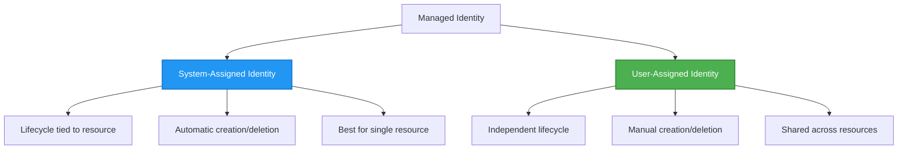

# Wzorce uwierzytelniania i zarządzana tożsamość

⏱️ **Szacowany czas**: 45-60 minut czytania; zarezerwuj dodatkowy czas na zadania praktyczne | 💰 **Wpływ na koszty**: Tożsamość/RBAC są darmowe; naliczane opłaty za wdrożone elementy obliczeniowe, pamięć i Key Vault | ⭐ **Poziom trudności**: Średniozaawansowany

> Sprawdzono na podstawie `azd 1.37.2` (listopad 2026). Ta lekcja zawiera **fragmenty integracyjne jako przykład, a nie kompletny szablon `secure-app` do pobrania**. Utwórz wymienione pliki, zapewnij odpowiednią infrastrukturę i zastąp symbole zastępcze przed wdrożeniem. Podczas przeglądu nie utworzono zasobów Azure.

**📚 Ścieżka nauki:**
- ← Poprzednia: [Zarządzanie konfiguracją](configuration.md) - Zarządzanie zmiennymi środowiskowymi i sekretami
- 🎯 **Jesteś tutaj**: Uwierzytelnianie i bezpieczeństwo (Zarządzana tożsamość, Key Vault, bezpieczne wzorce)
- → Następna: [Infrastruktura jako kod](../chapter-04-infrastructure/README.md) - Provisioning i wdrażanie zasobów
- 🏠 [Strona główna kursu](../../README.md)

---

## Czego się nauczysz

Po ukończeniu tej lekcji:
- Zrozumiesz wzorce uwierzytelniania w Azure (klucze, connection stringi, zarządzana tożsamość)
- Wdrożysz **zarządzaną tożsamość** do uwierzytelniania bez haseł
- Zabezpieczysz sekrety dzięki integracji z **Azure Key Vault**
- Skonfigurujesz **kontrolę dostępu opartą na rolach (RBAC)** dla wdrożeń AZD
- Zastosujesz najlepsze praktyki bezpieczeństwa w Container Apps i usługach Azure
- Przeprowadzisz migrację z uwierzytelniania opartego na kluczach do opartego na tożsamości

## Dlaczego zarządzana tożsamość jest ważna

### Problem: Tradycyjne uwierzytelnianie

**Przed zarządzaną tożsamością:**
```javascript
// ❌ SECURITY RISK: Hardcoded secrets in code
const connectionString = "Server=mydb.database.windows.net;User=admin;Password=P@ssw0rd123";
const storageKey = "xK7mN9pQ2wR5tY8uI0oP3aS6dF1gH4jK...";
const cosmosKey = "C2x7B9n4M1p8Q5w3E6r0T2y5U8i1O4p7...";
```

**Problemy:**
- 🔴 **Ujawione sekrety** w kodzie, plikach konfiguracyjnych, zmiennych środowiskowych
- 🔴 **Rotacja poświadczeń** wymaga zmian w kodzie i ponownego wdrożenia
- 🔴 **Koszmary audytu** - kto i kiedy uzyskał dostęp?
- 🔴 **Rozproszenie** - sekrety rozrzucone w wielu systemach
- 🔴 **Ryzyka zgodności** - niezdane audyty bezpieczeństwa

### Rozwiązanie: Zarządzana tożsamość

**Po wdrożeniu zarządzanej tożsamości:**
```javascript
// ✅ SECURE: No secrets in code
const credential = new DefaultAzureCredential();
const client = new BlobServiceClient(
  "https://mystorageaccount.blob.core.windows.net",
  credential  // Azure automatically handles authentication
);
```

**Korzyści:**
- ✅ **Brak sekretów** w kodzie lub konfiguracji
- ✅ **Automatyczna rotacja** - obsługiwana przez Azure
- ✅ **Pełny ślad audytu** w logach Microsoft Entra ID
- ✅ **Centralne zarządzanie bezpieczeństwem** - w Azure Portal
- ✅ **Gotowość do zgodności** - spełnia standardy bezpieczeństwa

**Porównanie**: Tradycyjne uwierzytelnianie to jak noszenie wielu fizycznych kluczy do różnych drzwi. Zarządzana tożsamość to jak karta dostępu, która automatycznie nadaje uprawnienia w oparciu o twoją tożsamość—bez kluczy do zgubienia, kopiowania czy obracania.

---

## Przegląd architektury

### Przebieg uwierzytelniania z zarządzaną tożsamością

```mermaid
sequenceDiagram
    participant App as Your Application<br/>(Container App)
    participant MI as Managed Identity<br/>(Microsoft Entra ID)
    participant KV as Key Vault
    participant Storage as Azure Storage
    participant DB as Azure SQL
    
    App->>MI: Request access token<br/>(automatic)
    MI->>MI: Verify identity<br/>(no password needed)
    MI-->>App: Return token for requested audience<br/>(lifetime varies)
    
    App->>KV: Get secret<br/>(using token)
    KV->>KV: Check RBAC permissions
    KV-->>App: Return secret value
    
    App->>Storage: Upload blob<br/>(using token)
    Storage->>Storage: Check RBAC permissions
    Storage-->>App: Success
    
    App->>DB: Query data<br/>(using token)
    DB->>DB: Check SQL permissions
    DB-->>App: Return results
    
    Note over App,DB: Request a separate token for each service audience;<br/>SDK credentials handle caching and renewal
```

### Rodzaje zarządzanych tożsamości



| Cecha | System przypisana | Użytkownik przypisana |
|---------|----------------|---------------|
| **Cykl życia** | Powiązana z zasobem | Niezależna |
| **Tworzenie** | Automatyczne z zasobem | Ręczne tworzenie |
| **Usuwanie** | Usuwana z zasobem | Pozostaje po usunięciu zasobu |
| **Udostępnianie** | Jeden zasób tylko | Wiele zasobów |
| **Przypadek użycia** | Proste scenariusze | Złożone scenariusze wielozasobowe |
| **Wybór szablonu** | Definiowany w infrastrukturze | Definiowany w infrastrukturze |

---

## Wymagania wstępne

### Wymagane narzędzia

Powinieneś mieć je już zainstalowane z poprzednich lekcji:

```bash
# Verify Azure Developer CLI
azd version
# ✅ Expected: azd version 1.0.0 or higher

# Verify Azure CLI
az --version
# ✅ Expected: azure-cli 2.50.0 or higher
```

### Wymagania Azure

- Aktywna subskrypcja Azure
- Uprawnienia do:
  - Tworzenia zarządzanych tożsamości
  - Przypisywania ról RBAC
  - Tworzenia zasobów Key Vault
  - Wdrażania Container Apps

### Wiedza wstępna

Powinieneś ukończyć:
- [Przewodnik instalacji](../chapter-01-foundation/installation.md) - konfiguracja AZD
- [Podstawy AZD](../chapter-01-foundation/azd-basics.md) - kluczowe pojęcia
- [Zarządzanie konfiguracją](configuration.md) - zmienne środowiskowe

---

## Lekcja 1: Zrozumienie wzorców uwierzytelniania

### Wzorzec 1: Connection Strings (Legacy - unikać)

**Jak działa:**
```bash
# Connection string contains credentials
STORAGE_CONNECTION_STRING="DefaultEndpointsProtocol=https;AccountName=myaccount;AccountKey=xK7mN9pQ2wR5..."
COSMOS_CONNECTION_STRING="AccountEndpoint=https://myaccount.documents.azure.com:443/;AccountKey=C2x7..."
SQL_CONNECTION_STRING="Server=myserver.database.windows.net;User=admin;Password=P@ssw0rd..."
```

**Problemy:**
- ❌ Sekrety widoczne w zmiennych środowiskowych
- ❌ Logowane w systemach wdrożeniowych
- ❌ Trudność w rotacji
- ❌ Brak śladu audytu dostępu

**Kiedy stosować:** Gdy usługa wymaga uwierzytelniania na bazie klucza. Preferuj tożsamość jeśli obsługiwana; w przeciwnym razie przechowuj klucze bezpiecznie i rotuj je, także w środowisku produkcyjnym.

---

### Wzorzec 2: Odwołania do Key Vault (lepsze)

**Jak działa:**
**Częściowe fragmenty Bicep:** wymagane pola vault, tożsamość Container App oraz jego wpis `configuration.secrets` są pominięte. `secretRef` odnosi się do sekretu Container App; **nie jest to** URI Key Vault. Aby używać Key Vault, zdefiniuj ten nazwany sekret z `keyVaultUrl` i autoryzowanym `identity`.

```bicep
// Store secret in Key Vault
resource keyVault 'Microsoft.KeyVault/vaults@2023-02-01' = {
  name: 'mykv'
  properties: {
    enableRbacAuthorization: true
  }
}

// Reference in Container App
env: [
  {
    name: 'STORAGE_KEY'
    secretRef: 'storage-key'  // References Key Vault
  }
]
```

**Korzyści:**
- ✅ Sekrety przechowywane bezpiecznie w Key Vault
- ✅ Centralne zarządzanie sekretami
- ✅ Rotacja bez zmian w kodzie

**Ograniczenia:**
- ⚠️ Nadal używa kluczy/hasła
- ⚠️ Konieczność zarządzania dostępem do Key Vault

**Kiedy stosować:** Krok przejściowy od connection stringów do zarządzanej tożsamości.

---

### Wzorzec 3: Zarządzana tożsamość (dobra praktyka)

**Jak działa:**
**Fragment Bicep:** scal blok tożsamości z pełnym Container App i podaj `storageAccount` oraz definicję roli. Przypisanie roli wymaga też deterministycznego `name`.

```bicep
// Enable managed identity
resource containerApp 'Microsoft.App/containerApps@2023-05-01' = {
  name: 'myapp'
  identity: {
    type: 'SystemAssigned'  // Automatically creates identity
  }
}

// Grant permissions
resource roleAssignment 'Microsoft.Authorization/roleAssignments@2022-04-01' = {
  name: guid(storageAccount.id, containerApp.id, storageBlobDataContributorRole)
  scope: storageAccount
  properties: {
    roleDefinitionId: storageBlobDataContributorRole
    principalId: containerApp.identity.principalId
    principalType: 'ServicePrincipal'
  }
}
```

**Kod aplikacji:**
```javascript
// No secrets needed!
const { DefaultAzureCredential } = require('@azure/identity');
const { BlobServiceClient } = require('@azure/storage-blob');

const credential = new DefaultAzureCredential();
const blobServiceClient = new BlobServiceClient(
  'https://mystorageaccount.blob.core.windows.net',
  credential
);
```

**Korzyści:**
- ✅ Brak sekretów w kodzie/konfiguracji
- ✅ Automatyczna rotacja poświadczeń
- ✅ Pełny ślad audytu
- ✅ Uprawnienia oparte na RBAC
- ✅ Gotowość do zgodności

**Kiedy stosować:** Preferowane dla aplikacji hostowanych w Azure, które uzyskują dostęp do usług obsługujących uwierzytelnianie Microsoft Entra.

---

### Wzorzec 4: Service Principals (CI/CD i automatyzacja)

Zarządzana tożsamość to złoty standard *dla zasobów działających wewnątrz Azure*. A co z elementami działającymi **poza** Azure—jak pipeline CI/CD na agencie budującym lub skrypt na laptopie, który nie może użyć interaktywnego logowania? W tych przypadkach stosuje się **service principal**: tożsamość nieludzka z własnymi poświadczeniami, pod którą automatyczny proces może się zalogować.

**Jak działa:**

Utwórz service principal Scoped do grupy zasobów (zasada najmniejszych uprawnień):

```bash
az ad sp create-for-rbac \
  --name "myapp-cicd" \
  --role contributor \
  --scopes "/subscriptions/<sub-id>/resourceGroups/<rg-name>"
```

To wyświetla client ID, client secret i tenant ID. azd może zalogować się nimi bez interakcji:

```bash
azd auth login \
  --client-id "<appId>" \
  --client-secret "<password>" \
  --tenant-id "<tenant>"
```

**Preferuj poświadczenia federacyjne (OIDC) zamiast sekretów.** Zamiast długotrwałego client secreta, skonfiguruj poświadczenie federacyjne, aby pipeline wymieniał token krótkotrwały—bez sekretu do wycieku lub rotacji:

```bash
azd auth login \
  --client-id "<appId>" \
  --federated-credential-provider "github" \
  --tenant-id "<tenant>"
```

> `azd pipeline config` ustawia to automatycznie dla Ciebie. Zobacz przewodniki CI/CD w [Rozdziale 8](../chapter-08-production/production-ai-practices.md).

**Korzyści:**
- ✅ Działa poza Azure (agenci budowania, lokalnie, inne chmury)
- ✅ Można ograniczyć do jednej grupy zasobów z jedną rolą
- ✅ Federowany (OIDC) wariant nie używa sekretu przechowywanego

**Wady:**
- ⚠️ Wariant z sekretem wymaga bezpiecznego przechowywania i rotacji
- ⚠️ Wycieklony sekret daje pełne uprawnienia SP—utrzymuj restrykcyjne zakresy

**Kiedy stosować:** Pipeline'y CI/CD i automatyzacja, które nie mogą użyć zarządzanej tożsamości. Zawsze preferuj wariant **federowany/OIDC** zamiast client secreta i preferuj zarządzaną tożsamość, jeśli obciążenie działa wewnątrz Azure.

**Bezpieczne przechowywanie poświadczeń:**
- Nigdy nie commituj sekretów—używaj bezpiecznego magazynu sekretów pipeline (GitHub Actions secrets, Azure DevOps variable groups / Key Vault).
- Ogranicz SP do najmniejszej potrzebnej roli i grupy zasobów.
- Ustaw datę wygaśnięcia i rotuj, lub wyeliminuj sekret całkowicie używając OIDC.

---

## Lekcja 2: Wdrażanie zarządzanej tożsamości za pomocą AZD

### Implementacja krok po kroku

Poniższe fragmenty pokazują, jak zintegrować zarządzaną tożsamość z projektem Container App. To **nie jest starter do kopiowania i uruchomienia**: moduł Storage, pełna infrastruktura środowiska zarządzanego/rejestru, Dockerfile i plik parametrów nie są tu kompletne. Zacznij od działającego szablonu Container Apps i scal te wzorce, zachowując konfigurację rejestru i tagi serwisowe.

### Struktura projektu

```
secure-app/
├── azure.yaml                 # AZD configuration
├── infra/
│   ├── main.bicep            # Main infrastructure
│   ├── core/
│   │   ├── identity.bicep    # Managed identity setup
│   │   ├── keyvault.bicep    # Key Vault configuration
│   │   └── storage.bicep     # Storage with RBAC
│   └── app/
│       └── container-app.bicep
└── src/
    ├── app.js                # Application code
    ├── package.json
    └── Dockerfile
```

### 1. Konfiguracja AZD (azure.yaml)

```yaml
name: secure-app
metadata:
  template: secure-app@1.0.0

services:
  api:
    project: ./src
    language: js
    host: containerapp

# Managed identity must be enabled in the infrastructure, not by this YAML.
```

### 2. Infrastruktura: Włącz zarządzaną tożsamość

**Plik: `infra/main.bicep`**

```bicep
targetScope = 'subscription'

param environmentName string
param location string = 'eastus'
param containerAppsEnvironmentId string
param containerImage string

var tags = { 'azd-env-name': environmentName }

// Resource group
resource rg 'Microsoft.Resources/resourceGroups@2021-04-01' = {
  name: 'rg-${environmentName}'
  location: location
  tags: tags
}

// Storage Account
module storage './core/storage.bicep' = {
  name: 'storage'
  scope: rg
  params: {
    name: 'st${uniqueString(rg.id)}'
    location: location
    tags: tags
  }
}

// Key Vault
module keyVault './core/keyvault.bicep' = {
  name: 'keyvault'
  scope: rg
  params: {
    name: 'kv-${uniqueString(rg.id)}'
    location: location
    tags: tags
  }
}

// Container App with Managed Identity
module containerApp './app/container-app.bicep' = {
  name: 'container-app'
  scope: rg
  params: {
    name: 'ca-${environmentName}'
    location: location
    tags: tags
    storageAccountName: storage.outputs.name
    keyVaultName: keyVault.outputs.name
    containerAppsEnvironmentId: containerAppsEnvironmentId
    containerImage: containerImage
  }
}

// Grant Container App access to Storage
module storageRoleAssignment './core/role-assignment.bicep' = {
  name: 'storage-role'
  scope: rg
  params: {
    principalId: containerApp.outputs.identityPrincipalId
    roleDefinitionId: 'ba92f5b4-2d11-453d-a403-e96b0029c9fe'  // Storage Blob Data Contributor
    targetResourceType: 'storage'
    targetResourceName: storage.outputs.name
  }
}

// Grant Container App access to Key Vault
module kvRoleAssignment './core/role-assignment.bicep' = {
  name: 'kv-role'
  scope: rg
  params: {
    principalId: containerApp.outputs.identityPrincipalId
    roleDefinitionId: '4633458b-17de-408a-b874-0445c86b69e6'  // Key Vault Secrets User
    targetResourceType: 'keyvault'
    targetResourceName: keyVault.outputs.name
  }
}

// Outputs
output AZURE_STORAGE_ACCOUNT_NAME string = storage.outputs.name
output AZURE_KEY_VAULT_NAME string = keyVault.outputs.name
output APP_URL string = containerApp.outputs.url
```

### 3. Container App z tożsamością systemową

**Plik: `infra/app/container-app.bicep`**

```bicep
param name string
param location string
param tags object = {}
param storageAccountName string
param keyVaultName string
param containerAppsEnvironmentId string
param containerImage string

resource containerApp 'Microsoft.App/containerApps@2023-05-01' = {
  name: name
  location: location
  tags: union(tags, { 'azd-service-name': 'api' })
  identity: {
    type: 'SystemAssigned'  // 🔑 Enable managed identity
  }
  properties: {
    managedEnvironmentId: containerAppsEnvironmentId
    configuration: {
      ingress: {
        external: true
        targetPort: 3000
      }
    }
    template: {
      containers: [
        {
          name: 'api'
          image: containerImage // Must exist; configure registry credentials for private images
          resources: {
            cpu: json('0.5')
            memory: '1Gi'
          }
          env: [
            {
              name: 'AZURE_STORAGE_ACCOUNT_NAME'
              value: storageAccountName
            }
            {
              name: 'AZURE_KEY_VAULT_NAME'
              value: keyVaultName
            }
            // 🔑 No secrets - managed identity handles authentication!
          ]
        }
      ]
    }
  }
}

// Output the identity for RBAC assignments
output identityPrincipalId string = containerApp.identity.principalId
output id string = containerApp.id
output url string = 'https://${containerApp.properties.configuration.ingress.fqdn}'
```

### 4. Moduł przypisania roli RBAC

**Plik: `infra/core/role-assignment.bicep`**

```bicep
param principalId string
param roleDefinitionId string  // Azure built-in role ID
@allowed(['storage', 'keyvault'])
param targetResourceType string
param targetResourceName string

// Typed existing resources give Bicep a valid resource scope, not a string ID.
resource storageTarget 'Microsoft.Storage/storageAccounts@2023-01-01' existing = {
  name: targetResourceName
}
resource vaultTarget 'Microsoft.KeyVault/vaults@2023-02-01' existing = {
  name: targetResourceName
}

resource storageAssignment 'Microsoft.Authorization/roleAssignments@2022-04-01' = if (targetResourceType == 'storage') {
  name: guid(storageTarget.id, principalId, roleDefinitionId)
  scope: storageTarget
  properties: {
    roleDefinitionId: subscriptionResourceId('Microsoft.Authorization/roleDefinitions', roleDefinitionId)
    principalId: principalId
    principalType: 'ServicePrincipal'
  }
}

resource vaultAssignment 'Microsoft.Authorization/roleAssignments@2022-04-01' = if (targetResourceType == 'keyvault') {
  name: guid(vaultTarget.id, principalId, roleDefinitionId)
  scope: vaultTarget
  properties: {
    roleDefinitionId: subscriptionResourceId('Microsoft.Authorization/roleDefinitions', roleDefinitionId)
    principalId: principalId
    principalType: 'ServicePrincipal'
  }
}

// This module assigns at the target resource scope, not the whole resource group.
```

### 5. Kod aplikacji z zarządzaną tożsamością

**Plik: `src/app.js`**

```javascript
const express = require('express');
const { DefaultAzureCredential } = require('@azure/identity');
const { BlobServiceClient } = require('@azure/storage-blob');
const { SecretClient } = require('@azure/keyvault-secrets');

const app = express();
const PORT = process.env.PORT || 3000;

// 🔑 Initialize credential (works automatically with managed identity)
const credential = new DefaultAzureCredential();

// Azure Storage setup
const storageAccountName = process.env.AZURE_STORAGE_ACCOUNT_NAME;
const blobServiceClient = new BlobServiceClient(
  `https://${storageAccountName}.blob.core.windows.net`,
  credential  // No keys needed!
);

// Key Vault setup
const keyVaultName = process.env.AZURE_KEY_VAULT_NAME;
const secretClient = new SecretClient(
  `https://${keyVaultName}.vault.azure.net`,
  credential  // No keys needed!
);

// Health check
app.get('/health', (req, res) => {
  res.json({ status: 'healthy', authentication: 'managed-identity' });
});

// Upload file to blob storage
app.post('/upload', async (req, res) => {
  try {
    const containerClient = blobServiceClient.getContainerClient('uploads');
    await containerClient.createIfNotExists();
    
    const blobName = `file-${Date.now()}.txt`;
    const blockBlobClient = containerClient.getBlockBlobClient(blobName);
    
    const content = 'Hello from managed identity!';
    await blockBlobClient.upload(content, Buffer.byteLength(content));
    
    res.json({
      success: true,
      blobName: blobName,
      message: 'File uploaded using managed identity!'
    });
  } catch (error) {
    console.error('Upload error:', error);
    res.status(500).json({ error: error.message });
  }
});

// Get secret from Key Vault
app.get('/secret/:name', async (req, res) => {
  try {
    const secretName = req.params.name;
    const secret = await secretClient.getSecret(secretName);
    
    res.json({
      name: secretName,
      retrieved: secret.value !== undefined, // Never return the secret value to callers
      message: 'Secret retrieved using managed identity!'
    });
  } catch (error) {
    console.error('Secret error:', error);
    res.status(500).json({ error: error.message });
  }
});

// List blob containers (demonstrates read access)
app.get('/containers', async (req, res) => {
  try {
    const containers = [];
    for await (const container of blobServiceClient.listContainers()) {
      containers.push(container.name);
    }
    
    res.json({
      containers: containers,
      count: containers.length,
      message: 'Containers listed using managed identity!'
    });
  } catch (error) {
    console.error('List error:', error);
    res.status(500).json({ error: error.message });
  }
});

app.listen(PORT, () => {
  console.log(`Secure API listening on port ${PORT}`);
  console.log('Authentication: Managed Identity (passwordless)');
});
```

**Plik: `src/package.json`**

```json
{
  "name": "secure-app",
  "version": "1.0.0",
  "dependencies": {
    "express": "^4.18.2",
    "@azure/identity": "^4.0.0",
    "@azure/storage-blob": "^12.17.0",
    "@azure/keyvault-secrets": "^4.7.0"
  },
  "scripts": {
    "start": "node app.js"
  }
}
```

### 6. Wdrażanie i testowanie

Uruchom te polecenia **dopiero po** uzupełnieniu brakującej infrastruktury, Dockerfile i pasującego `main.parameters.json` w swoim projekcie. Uwierzytelnij azd przy pomocy `azd auth login`; zaloguj się oddzielnie przez `az login` do późniejszych sprawdzeń CLI Azure. Pokazane punkty końcowe są demonstracjami i wymagają odpowiednich kontroli dostępu przed użytkiem publicznym.

```bash
# Initialize AZD environment
azd init

# Deploy infrastructure and application
azd up

# Get the app URL
APP_URL=$(azd env get-value APP_URL)

# Test health check
curl $APP_URL/health
```

**✅ Oczekiwany wynik:**
```json
{
  "status": "healthy",
  "authentication": "managed-identity"
}
```

**Test przesyłania blobu:**
```bash
curl -X POST $APP_URL/upload
```

**✅ Oczekiwany wynik:**
```json
{
  "success": true,
  "blobName": "file-1700404800000.txt",
  "message": "File uploaded using managed identity!"
}
```

**Test listowania kontenerów:**
```bash
curl $APP_URL/containers
```

**✅ Oczekiwany wynik:**
```json
{
  "containers": ["uploads"],
  "count": 1,
  "message": "Containers listed using managed identity!"
}
```

---

## Typowe role Azure RBAC

### Wbudowane ID ról dla zarządzanej tożsamości

| Usługa | Nazwa roli | ID roli | Uprawnienia |
|---------|-----------|---------|-------------|
| **Storage** | Storage Blob Data Reader | `2a2b9908-6ea1-4ae2-8e65-a410df84e7d1` | Odczyt blobów i kontenerów |
| **Storage** | Storage Blob Data Contributor | `ba92f5b4-2d11-453d-a403-e96b0029c9fe` | Odczyt, zapis, usuwanie blobów |
| **Storage** | Storage Queue Data Contributor | `974c5e8b-45b9-4653-ba55-5f855dd0fb88` | Odczyt, zapis, usuwanie kolejek/wiadomości |
| **Key Vault** | Key Vault Secrets User | `4633458b-17de-408a-b874-0445c86b69e6` | Odczyt sekretów |
| **Key Vault** | Key Vault Secrets Officer | `b86a8fe4-44ce-4948-aee5-eccb2c155cd7` | Odczyt, zapis, usuwanie sekretów |
| **Cosmos DB** | Cosmos DB Built-in Data Reader | `00000000-0000-0000-0000-000000000001` | Odczyt danych Cosmos DB |
| **Cosmos DB** | Cosmos DB Built-in Data Contributor | `00000000-0000-0000-0000-000000000002` | Odczyt, zapis danych Cosmos DB |
| **SQL Database** | SQL DB Contributor | `9b7fa17d-e63e-47b0-bb0a-15c516ac86ec` | Zarządzanie zasobami bazy; nie przyznaje dostępu do danych SQL |
| **Service Bus** | Azure Service Bus Data Owner | `090c5cfd-751d-490a-894a-3ce6f1109419` | Wysyłanie, odbiór, zarządzanie wiadomościami |

### Jak znaleźć ID ról

Dwa powyższe ID Cosmos DB for NoSQL to **wbudowane definicje ról natywne dla płaszczyzny danych Cosmos**, nie subskrypcyjne role Azure RBAC. Przypisuj je przez `az cosmosdb sql role assignment create` (lub `Microsoft.DocumentDB/databaseAccounts/sqlRoleAssignments`), nie przez `az role assignment create`. Dostęp do danych SQL wymaga użytkownika bazy Entra i uprawnień SQL.

```bash
# List all built-in roles
az role definition list --query "[].{Name:roleName, ID:name}" --output table

# Search for specific role
az role definition list --query "[?contains(roleName, 'Storage Blob')].{Name:roleName, ID:name}" --output table

# Get role details
az role definition list --name "Storage Blob Data Contributor"
```

---

## Ćwiczenia praktyczne

**Wymagania integracyjne dla wszystkich trzech ćwiczeń:** działający szablon Container App w twoim projekcie, dopasowane zasoby Bicep, logowanie Azure CLI/azd oraz uprawnienia do przypisywania wymaganych ról. To adaptacje pod przewodnictwem, nie samodzielne startowe lokalne projekty; zamień przykładowe nazwy zasobów na swoje wdrożone.

### Ćwiczenie 1: Włącz zarządzaną tożsamość dla istniejącej aplikacji ⭐⭐ (średni poziom)

**Cel**: Dodaj zarządzaną tożsamość do istniejącego wdrożenia Container App

**Scenariusz**: Masz Container App korzystającą z connection stringów. Przekształć ją na zarządzaną tożsamość.

**Punkt startowy**: Container App z taką konfiguracją:

```bicep
// ❌ Current: Using connection string
env: [
  {
    name: 'STORAGE_CONNECTION_STRING'
    secretRef: 'storage-connection'
  }
]
```

**Kroki**:

1. **Włącz zarządzaną tożsamość w Bicep:**

```bicep
resource containerApp 'Microsoft.App/containerApps@2023-05-01' = {
  name: 'myapp'
  identity: {
    type: 'SystemAssigned'  // Add this
  }
  // ... rest of configuration
}
```

2. **Nadaj dostęp do Storage:**

```bicep
// Get storage account reference
resource storageAccount 'Microsoft.Storage/storageAccounts@2023-01-01' existing = {
  name: storageAccountName
}

// Assign role
resource roleAssignment 'Microsoft.Authorization/roleAssignments@2022-04-01' = {
  name: guid(containerApp.id, 'ba92f5b4-2d11-453d-a403-e96b0029c9fe', storageAccount.id)
  scope: storageAccount
  properties: {
    roleDefinitionId: subscriptionResourceId('Microsoft.Authorization/roleDefinitions', 'ba92f5b4-2d11-453d-a403-e96b0029c9fe')
    principalId: containerApp.identity.principalId
    principalType: 'ServicePrincipal'
  }
}
```

3. **Zaktualizuj kod aplikacji:**

**Przed (connection string):**
```javascript
const { BlobServiceClient } = require('@azure/storage-blob');

const blobServiceClient = BlobServiceClient.fromConnectionString(
  process.env.STORAGE_CONNECTION_STRING
);
```

**Po (zarządzana tożsamość):**
```javascript
const { DefaultAzureCredential } = require('@azure/identity');
const { BlobServiceClient } = require('@azure/storage-blob');

const credential = new DefaultAzureCredential();
const blobServiceClient = new BlobServiceClient(
  `https://${process.env.STORAGE_ACCOUNT_NAME}.blob.core.windows.net`,
  credential
);
```

4. **Zaktualizuj zmienne środowiskowe:**

```bicep
env: [
  {
    name: 'STORAGE_ACCOUNT_NAME'
    value: storageAccountName  // Just the name, no secrets!
  }
  // Remove STORAGE_CONNECTION_STRING
]
```

5. **Wdróż i przetestuj:**

```bash
# Redeploy
azd up

# Test that it still works
APP_URL=$(azd show --output json | jq -er '.services.api.ingressUrl')
curl --fail -X POST "$APP_URL/upload"
```

**✅ Kryteria sukcesu:**
- ✅ Aplikacja wdraża się bez błędów
- ✅ Operacje Storage działają (przesyłanie, listowanie, pobieranie)
- ✅ Brak connection stringów w zmiennych środowiskowych
- ✅ Tożsamość widoczna w Azure Portal w oknie "Tożsamość"

**Weryfikacja:**

```bash
# Check managed identity is enabled
az containerapp show \
  --name myapp \
  --resource-group rg-myapp \
  --query "identity.type"
# ✅ Expected: "SystemAssigned"

# Check role assignment
az role assignment list \
  --assignee $(az containerapp show --name myapp --resource-group rg-myapp --query "identity.principalId" -o tsv) \
  --scope /subscriptions/{sub-id}/resourceGroups/rg-myapp/providers/Microsoft.Storage/storageAccounts/mystorageaccount
# ✅ Expected: Shows "Storage Blob Data Contributor" role
```

**Czas**: 20-30 minut

---

### Ćwiczenie 2: Dostęp wielu usług z tożsamością przypisaną przez użytkownika ⭐⭐⭐ (zaawansowany)

**Cel**: Utwórz tożsamość przypisaną przez użytkownika, współdzieloną przez kilka Container Apps

**Scenariusz**: Masz 3 mikroserwisy, które wszystkie potrzebują dostępu do tego samego konta Storage i Key Vault.

**Kroki**:

1. **Utwórz tożsamość przypisaną przez użytkownika:**

**Plik: `infra/core/identity.bicep`**

```bicep
param name string
param location string
param tags object = {}

resource userAssignedIdentity 'Microsoft.ManagedIdentity/userAssignedIdentities@2023-01-31' = {
  name: name
  location: location
  tags: tags
}

output id string = userAssignedIdentity.id
output principalId string = userAssignedIdentity.properties.principalId
output clientId string = userAssignedIdentity.properties.clientId
```

2. **Przypisz role do tożsamości przypisanej przez użytkownika:**

```bicep
// In main.bicep
module userIdentity './core/identity.bicep' = {
  name: 'user-identity'
  scope: rg
  params: {
    name: 'id-${environmentName}'
    location: location
    tags: tags
  }
}

// Grant Storage access
resource storageRoleAssignment 'Microsoft.Authorization/roleAssignments@2022-04-01' = {
  name: guid(storageAccount.id, environmentName, 'storage-contributor')
  scope: storageAccount
  properties: {
    roleDefinitionId: subscriptionResourceId('Microsoft.Authorization/roleDefinitions', 'ba92f5b4-2d11-453d-a403-e96b0029c9fe')
    principalId: userIdentity.outputs.principalId
    principalType: 'ServicePrincipal'
  }
}

// Grant Key Vault access
resource kvRoleAssignment 'Microsoft.Authorization/roleAssignments@2022-04-01' = {
  name: guid(keyVault.id, environmentName, 'kv-secrets-user')
  scope: keyVault
  properties: {
    roleDefinitionId: subscriptionResourceId('Microsoft.Authorization/roleDefinitions', '4633458b-17de-408a-b874-0445c86b69e6')
    principalId: userIdentity.outputs.principalId
    principalType: 'ServicePrincipal'
  }
}
```

3. **Przypisz tożsamość wielu aplikacjom kontenerowym:**

```bicep
resource apiGateway 'Microsoft.App/containerApps@2023-05-01' = {
  name: 'api-gateway'
  identity: {
    type: 'UserAssigned'
    userAssignedIdentities: {
      '${userIdentity.outputs.id}': {}
    }
  }
  // ... rest of config
}

resource productService 'Microsoft.App/containerApps@2023-05-01' = {
  name: 'product-service'
  identity: {
    type: 'UserAssigned'
    userAssignedIdentities: {
      '${userIdentity.outputs.id}': {}
    }
  }
  // ... rest of config
}

resource orderService 'Microsoft.App/containerApps@2023-05-01' = {
  name: 'order-service'
  identity: {
    type: 'UserAssigned'
    userAssignedIdentities: {
      '${userIdentity.outputs.id}': {}
    }
  }
  // ... rest of config
}
```

4. **Kod aplikacji (wszystkie usługi stosują ten sam wzorzec):**

```javascript
const { ManagedIdentityCredential } = require('@azure/identity');
const { BlobServiceClient } = require('@azure/storage-blob');

// For user-assigned identity, specify the client ID
const credential = new ManagedIdentityCredential(
  process.env.AZURE_CLIENT_ID  // User-assigned identity client ID
);

// Alternative (choose ONE credential declaration):
// const { DefaultAzureCredential } = require('@azure/identity');
// const credential = new DefaultAzureCredential({
//   managedIdentityClientId: process.env.AZURE_CLIENT_ID
// });

const blobServiceClient = new BlobServiceClient(
  `https://${process.env.STORAGE_ACCOUNT_NAME}.blob.core.windows.net`,
  credential
);
```

Ustaw czas wykonywania `AZURE_CLIENT_ID` dla każdej aplikacji kontenerowej na `userIdentity.outputs.clientId` oraz `STORAGE_ACCOUNT_NAME` na nazwę twojego storage w Bicep. Sama przypisana tożsamość lub uruchomienie `azd env set` nie konfiguruje tych wartości czasu wykonywania.

5. **Wdrażaj i weryfikuj:**

```bash
azd up

# Test all services can access storage
# Replace with the actual ingress URLs reported for your three services
curl --fail -X POST "$API_GATEWAY_URL/upload"
curl --fail -X POST "$PRODUCT_SERVICE_URL/upload"
curl --fail -X POST "$ORDER_SERVICE_URL/upload"
```

**✅ Kryteria sukcesu:**
- ✅ Jedna tożsamość współdzielona przez 3 usługi
- ✅ Wszystkie usługi mają dostęp do Storage i Key Vault
- ✅ Tożsamość utrzymuje się po usunięciu jednej usługi
- ✅ Centralne zarządzanie uprawnieniami

**Zalety tożsamości przypisanej przez użytkownika:**
- Pojedyncza tożsamość do zarządzania
- Spójne uprawnienia w usługach
- Przetrwa usunięcie usługi
- Lepsze dla złożonych architektur

**Czas**: 30-40 minut

---

### Ćwiczenie 3: Wprowadzenie rotacji sekretów Key Vault ⭐⭐⭐ (Zaawansowane)

**Cel**: Przechowywanie kluczy API firm trzecich w Key Vault i dostęp do nich za pomocą zarządzanej tożsamości

**Scenariusz**: Twoja aplikacja musi wywoływać zewnętrzne API (OpenAI, Stripe, SendGrid), które wymaga kluczy API.

**Kroki**:

1. **Utwórz Key Vault z RBAC:**

**Plik: `infra/core/keyvault.bicep`**

```bicep
param name string
param location string
param tags object = {}

resource keyVault 'Microsoft.KeyVault/vaults@2023-02-01' = {
  name: name
  location: location
  tags: tags
  properties: {
    enableRbacAuthorization: true  // Use RBAC instead of access policies
    sku: {
      family: 'A'
      name: 'standard'
    }
    tenantId: subscription().tenantId
    enableSoftDelete: true
    softDeleteRetentionInDays: 90
  }
}

// Allow Container App to read secrets
output id string = keyVault.id
output name string = keyVault.name
output uri string = keyVault.properties.vaultUri
```

2. **Przechowuj sekrety w Key Vault:**

```bash
# Get Key Vault name
KV_NAME=$(azd env get-value AZURE_KEY_VAULT_NAME)

# Store third-party API keys
az keyvault secret set \
  --vault-name $KV_NAME \
  --name "OpenAI-ApiKey" \
  --value "sk-proj-xxxxxxxxxxxxx"

az keyvault secret set \
  --vault-name $KV_NAME \
  --name "Stripe-ApiKey" \
  --value "sk_live_xxxxxxxxxxxxx"

az keyvault secret set \
  --vault-name $KV_NAME \
  --name "SendGrid-ApiKey" \
  --value "SG.xxxxxxxxxxxxx"
```

3. **Kod aplikacji do pobierania sekretów:**

**Plik: `src/config.js`**

```javascript
const { DefaultAzureCredential } = require('@azure/identity');
const { SecretClient } = require('@azure/keyvault-secrets');

class Config {
  constructor() {
    this.credential = new DefaultAzureCredential();
    this.secretClient = new SecretClient(
      `https://${process.env.AZURE_KEY_VAULT_NAME}.vault.azure.net`,
      this.credential
    );
    this.cache = {};
  }

  async getSecret(secretName) {
    // Check cache first
    if (this.cache[secretName]) {
      return this.cache[secretName];
    }

    try {
      const secret = await this.secretClient.getSecret(secretName);
      this.cache[secretName] = secret.value;
      console.log(`✅ Retrieved secret: ${secretName}`);
      return secret.value;
    } catch (error) {
      console.error(`❌ Failed to get secret ${secretName}:`, error.message);
      throw error;
    }
  }

  async getOpenAIKey() {
    return this.getSecret('OpenAI-ApiKey');
  }

  async getStripeKey() {
    return this.getSecret('Stripe-ApiKey');
  }

  async getSendGridKey() {
    return this.getSecret('SendGrid-ApiKey');
  }
}

module.exports = new Config();
```

4. **Użyj sekretów w aplikacji:**

**Plik: `src/app.js`**

Ten **fragment aplikacji zastępczej** wymaga `npm install openai`, prawdziwego klucza firm trzecich, dostępnego modelu oraz infrastruktury z twojego działającego projektu. Wywołuje OpenAI bezpośrednio, a nie wdrożenie Azure OpenAI. Poniższe klucze zastępcze nie autoryzują żadnego żądania.

```javascript
const express = require('express');
const config = require('./config');
const { OpenAI } = require('openai');

const app = express();

// Initialize OpenAI with key from Key Vault
let openaiClient;

async function initializeServices() {
  const openaiKey = await config.getOpenAIKey();
  openaiClient = new OpenAI({ apiKey: openaiKey });
  console.log('✅ Services initialized with secrets from Key Vault');
}

app.post('/chat', async (req, res) => {
  try {
    const completion = await openaiClient.chat.completions.create({
      model: 'gpt-4.1',
      messages: [{ role: 'user', content: 'Hello!' }]
    });
    
    res.json({
      response: completion.choices[0].message.content,
      authentication: 'Key from Key Vault via Managed Identity'
    });
  } catch (error) {
    res.status(500).json({ error: error.message });
  }
});

// Start listening only after initialization succeeds.
initializeServices().then(() => {
  app.listen(3000, () => console.log('Key Vault demo running'));
}).catch(error => {
  console.error('Initialization failed:', error.message);
  process.exitCode = 1;
});
```

5. **Wdrażaj i testuj:**

```bash
azd up

# Test that API keys work
curl -X POST https://myapp.azurecontainerapps.io/chat \
  -H "Content-Type: application/json" \
  -d '{"message":"Hello AI"}'
```

**✅ Kryteria sukcesu:**
- ✅ Brak kluczy API w kodzie lub zmiennych środowiskowych
- ✅ Aplikacja pobiera klucze z Key Vault
- ✅ Firmowe API działa poprawnie
- ✅ Można rotować klucze bez zmiany kodu

**Rotacja sekretu:**

```bash
# Update secret in Key Vault
az keyvault secret set \
  --vault-name $KV_NAME \
  --name "OpenAI-ApiKey" \
  --value "sk-proj-NEW_KEY_HERE"

# Find the active revision name, then restart it to clear the in-process cache
az containerapp revision list --name myapp --resource-group rg-myapp --output table
az containerapp revision restart \
  --name myapp \
  --resource-group rg-myapp \
  --revision "<active-revision-name>"
```

**Czas**: 25-35 minut

---

## Punkt kontrolny wiedzy

### 1. Wzorce uwierzytelniania ✓

Sprawdź swoją wiedzę:

- [ ] **P1**: Jakie są trzy główne wzorce uwierzytelniania? 
  - **O**: Łańcuchy połączeń (dawne), odwołania do Key Vault (przejściowe), zarządzana tożsamość (najlepsze)

- [ ] **P2**: Dlaczego zarządzana tożsamość jest lepsza niż łańcuchy połączeń?
  - **O**: Brak sekretów w kodzie, automatyczna rotacja, pełny ślad audytu, uprawnienia RBAC

- [ ] **P3**: Kiedy użyłbyś tożsamości przypisanej przez użytkownika zamiast systemowej?
  - **O**: Gdy tożsamość jest współdzielona przez wiele zasobów lub gdy cykl życia tożsamości jest niezależny od cyklu życia zasobu

**Weryfikacja praktyczna:**
```bash
# Check what type of identity your app uses
az containerapp show \
  --name myapp \
  --resource-group rg-myapp \
  --query "identity.type"

# List all role assignments for the identity
az role assignment list \
  --assignee $(az containerapp show --name myapp --resource-group rg-myapp --query "identity.principalId" -o tsv)
```

---

### 2. RBAC i uprawnienia ✓

Sprawdź swoją wiedzę:

- [ ] **P1**: Jaki jest identyfikator roli "Storage Blob Data Contributor"?
  - **O**: `ba92f5b4-2d11-453d-a403-e96b0029c9fe`

- [ ] **P2**: Jakie uprawnienia daje rola "Key Vault Secrets User"?
  - **O**: Dostęp tylko do odczytu sekretów (nie może tworzyć, aktualizować ani usuwać)

- [ ] **P3**: Jak udzielić aplikacji kontenerowej dostępu do Azure SQL?
  - **O**: Skonfiguruj uwierzytelnianie Microsoft Entra, utwórz tożsamość jako użytkownika bazy danych i przydziel wymagane uprawnienia SQL. Rola "SQL DB Contributor" zarządza tylko zasobami Azure, nie autoryzuje zapytań.

**Weryfikacja praktyczna:**
```bash
# Find specific role
az role definition list --name "Storage Blob Data Contributor"

# Check what roles are assigned to your identity
PRINCIPAL_ID=$(az containerapp show --name myapp --resource-group rg-myapp --query "identity.principalId" -o tsv)
az role assignment list --assignee $PRINCIPAL_ID --output table
```

---

### 3. Integracja z Key Vault ✓

Sprawdź swoją wiedzę:

- [ ] **P1**: Jak włączyć RBAC dla Key Vault zamiast polityk dostępu?
  - **O**: Ustaw `enableRbacAuthorization: true` w Bicep

- [ ] **P2**: Która biblioteka Azure SDK obsługuje uwierzytelnianie zarządzaną tożsamością?
  - **O**: `@azure/identity` z klasą `DefaultAzureCredential`

- [ ] **P3**: Jak długo sekrety Key Vault pozostają w pamięci podręcznej?
  - **O**: Zależy od aplikacji; zaimplementuj własną strategię cache

**Weryfikacja praktyczna:**
```bash
# Test Key Vault access
az keyvault secret show \
  --vault-name $KV_NAME \
  --name "OpenAI-ApiKey" \
  --query "{name:name,enabled:attributes.enabled}"

# Check RBAC is enabled
az keyvault show \
  --name $KV_NAME \
  --query "properties.enableRbacAuthorization"
# ✅ Expected: true
```

---

## Najlepsze praktyki bezpieczeństwa

### ✅ ZRÓB TO:

1. **Zawsze używaj zarządzanej tożsamości w produkcji**
   ```bicep
   identity: {
     type: 'SystemAssigned'
   }
   ```

2. **Stosuj role RBAC o minimalnych uprawnieniach**
   - Używaj ról "Reader", gdy to możliwe
   - Unikaj "Owner" lub "Contributor" jeśli nie są konieczne

3. **Przechowuj klucze firm trzecich w Key Vault**
   ```javascript
   const apiKey = await secretClient.getSecret('ThirdPartyApiKey');
   ```

4. **Włącz audyt logów** (fragment zasobu częściowy; scal z deklaracjami swojej skrytki i przestrzeni roboczej)
   ```bicep
   resource vaultDiagnostics 'Microsoft.Insights/diagnosticSettings@2021-05-01-preview' = {
     name: 'vault-audit'
     scope: keyVault
     properties: {
       workspaceId: logAnalytics.id
       logs: [{ category: 'AuditEvent', enabled: true }]
     }
   }
   ```

5. **Używaj różnych tożsamości dla dev/staging/produkcji**
   ```bash
   azd env new dev
   azd env new staging
   azd env new prod
   ```

6. **Regularnie rotuj sekrety**
   - Ustawiaj daty wygaśnięcia sekretów Key Vault
   - Automatyzuj rotację z Azure Functions

### ❌ NIE RÓB TEGO:

1. **Nigdy nie zapisuj sekretów na stałe w kodzie**
   ```javascript
   // ❌ BAD
   const apiKey = "sk-proj-xxxxxxxxxxxxx";
   ```

2. **Nie używaj łańcuchów połączeń w produkcji**
   ```javascript
   // ❌ BAD
   BlobServiceClient.fromConnectionString(process.env.STORAGE_CONNECTION_STRING)
   ```

3. **Nie przydzielaj nadmiernych uprawnień**
   ```bicep
   // ❌ BAD - too much access
   roleDefinitionId: subscriptionResourceId('Microsoft.Authorization/roleDefinitions', '8e3af657-a8ff-443c-a75c-2fe8c4bcb635')
   
   // ✅ GOOD - least privilege
   roleDefinitionId: subscriptionResourceId('Microsoft.Authorization/roleDefinitions', '2a2b9908-6ea1-4ae2-8e65-a410df84e7d1')
   ```

4. **Nie loguj sekretów**
   ```javascript
   // ❌ BAD
   console.log('API Key:', apiKey);
   
   // ✅ GOOD
   console.log('API Key retrieved successfully');
   ```

5. **Nie udostępniaj tożsamości produkcyjnych między środowiskami**
   ```bicep
   // ❌ BAD - same identity for dev and prod
   // ✅ GOOD - separate identities per environment
   ```

---

## Przewodnik rozwiązywania problemów

### Problem: "Nieautoryzowany" przy dostępie do Azure Storage

**Objawy:**
```
Error: Unauthorized (403)
AuthorizationPermissionMismatch: This request is not authorized to perform this operation
```

**Diagnoza:**

```bash
# Check if managed identity is enabled
az containerapp show \
  --name myapp \
  --resource-group rg-myapp \
  --query "identity.type"
# ✅ Expected: "SystemAssigned" or "UserAssigned"

# Check role assignments
PRINCIPAL_ID=$(az containerapp show --name myapp --resource-group rg-myapp --query "identity.principalId" -o tsv)
az role assignment list --assignee $PRINCIPAL_ID

# Expected: Should see "Storage Blob Data Contributor" or similar role
```

**Rozwiązania:**

1. **Nadaj właściwą rolę RBAC:**
```bash
STORAGE_ID=$(az storage account show --name mystorageaccount --resource-group rg-myapp --query "id" -o tsv)
az role assignment create \
  --assignee $PRINCIPAL_ID \
  --role "Storage Blob Data Contributor" \
  --scope $STORAGE_ID
```

2. **Poczekaj na propagację (może trwać 5-10 minut):**
```bash
# Check role assignment status
az role assignment list --assignee $PRINCIPAL_ID --scope $STORAGE_ID
```

3. **Sprawdź, czy kod aplikacji używa właściwej tożsamości:**
```javascript
// Make sure you're using DefaultAzureCredential
const credential = new DefaultAzureCredential();
```

---

### Problem: Brak dostępu do Key Vault

**Objawy:**
```
Error: Forbidden (403)
The user, group or application does not have secrets get permission
```

**Diagnoza:**

```bash
# Check Key Vault RBAC is enabled
az keyvault show \
  --name $KV_NAME \
  --query "properties.enableRbacAuthorization"
# ✅ Expected: true

# Check role assignments
az role assignment list \
  --assignee $PRINCIPAL_ID \
  --scope /subscriptions/{sub-id}/resourceGroups/rg-myapp/providers/Microsoft.KeyVault/vaults/$KV_NAME
```

**Rozwiązania:**

1. **Włącz RBAC na Key Vault:**
```bash
az keyvault update \
  --name $KV_NAME \
  --enable-rbac-authorization true
```

2. **Nadaj rolę Key Vault Secrets User:**
```bash
KV_ID=$(az keyvault show --name $KV_NAME --query "id" -o tsv)
az role assignment create \
  --assignee $PRINCIPAL_ID \
  --role "Key Vault Secrets User" \
  --scope $KV_ID
```

---

### Problem: DefaultAzureCredential nie działa lokalnie

**Objawy:**
```
Error: DefaultAzureCredential failed to retrieve a token
CredentialUnavailableError: No credential available
```

**Diagnoza:**

```bash
# Check if you're logged in
az account show

# Check Azure CLI authentication
az ad signed-in-user show
```

**Rozwiązania:**

1. **Zaloguj się do Azure CLI:**
```bash
az login
```

2. **Ustaw subskrypcję Azure:**
```bash
az account set --subscription "Your Subscription Name"
```

3. **Do lokalnego developmentu używaj zmiennych środowiskowych:**
```bash
export AZURE_TENANT_ID="your-tenant-id"
export AZURE_CLIENT_ID="your-client-id"
export AZURE_CLIENT_SECRET="your-client-secret"
```

4. **Lub użyj innej tożsamości lokalnie:**
```javascript
const { DefaultAzureCredential, AzureCliCredential } = require('@azure/identity');

// Use AzureCliCredential for local dev
const credential = process.env.NODE_ENV === 'production' 
  ? new DefaultAzureCredential()
  : new AzureCliCredential();
```

---

### Problem: Nadanie roli zajmuje za dużo czasu na propagację

**Objawy:**
- Rola przypisana pomyślnie
- Nadal występują błędy 403
- Dostęp okresowy (czasami działa, czasami nie)

**Wyjaśnienie:**
Zmiany w Azure RBAC mogą potrzebować 5-10 minut na globalną propagację.

**Rozwiązanie:**

```bash
# Wait and retry
echo "Waiting for RBAC propagation..."
sleep 300  # Wait 5 minutes

# Test access
curl --fail -X POST "$APP_URL/upload"

# If still failing, restart the app
az containerapp revision restart \
  --name myapp \
  --resource-group rg-myapp \
  --revision "<active-revision-name>"
```

---

## Koszty

### Koszty zarządzanej tożsamości

| Zasób | Koszt |
|----------|------|
| **Zarządzana tożsamość** | 🆓 **BEZPŁATNA** - brak opłat |
| **Przydziały ról RBAC** | 🆓 **BEZPŁATNE** - brak opłat |
| **Żądania tokenów Microsoft Entra ID** | 🆓 **BEZPŁATNE** - wliczone |
| **Operacje Key Vault** | $0.03 za 10 000 operacji |
| **Przechowywanie sekretów Key Vault** | Sprawdź aktualne ceny; nie zakładaj miesięcznej opłaty za sekret |

**Zarządzana tożsamość oszczędza pieniądze dzięki:**
- ✅ Eliminacji operacji Key Vault dla uwierzytelniania między usługami
- ✅ Zmniejszeniu incydentów bezpieczeństwa (brak wycieków poświadczeń)
- ✅ Obniżeniu kosztów operacyjnych (brak ręcznej rotacji)

Liczba wywołań aplikacji nie równa się liczbie operacji Key Vault: wzorce cache i rotacji determinują koszty odczytu sekretów. Tożsamość nie likwiduje kosztów obliczeń/przechowywania. Sprawdź [cennik Key Vault](https://azure.microsoft.com/pricing/details/key-vault/) oraz Azure Pricing Calculator dla swojego regionu zamiast wyciągać wnioski na podstawie samej liczby żądań.

---

## Dowiedz się więcej

### Oficjalna dokumentacja
- [Azure Managed Identity](https://learn.microsoft.com/entra/identity/managed-identities-azure-resources/overview)
- [Azure RBAC](https://learn.microsoft.com/azure/role-based-access-control/overview)
- [Azure Key Vault](https://learn.microsoft.com/azure/key-vault/general/overview)
- [DefaultAzureCredential](https://learn.microsoft.com/dotnet/api/azure.identity.defaultazurecredential)

### Dokumentacja SDK
- [@azure/identity (Node.js)](https://www.npmjs.com/package/@azure/identity)
- [Azure.Identity (C#)](https://www.nuget.org/packages/Azure.Identity/)
- [azure-identity (Python)](https://pypi.org/project/azure-identity/)

### Kolejne kroki w tym kursie
- ← Poprzedni: [Zarządzanie konfiguracją](configuration.md)
- → Następny: [Infrastruktura jako kod](../chapter-04-infrastructure/README.md)
- 🏠 [Strona główna kursu](../../README.md)

### Powiązane przykłady
- [Przykład czatu Microsoft Foundry Models](../../../../examples/azure-openai-chat) - Używa zarządzanej tożsamości dla Microsoft Foundry Models
- [Przykład mikrousług](../../../../examples/microservices) - Wzorce uwierzytelniania dla wielu usług

---

## Podsumowanie

**Nauczyłeś się:**
- ✅ Trzech wzorców uwierzytelniania (łańcuchy połączeń, Key Vault, zarządzana tożsamość)
- ✅ Jak włączyć i skonfigurować zarządzaną tożsamość w AZD
- ✅ Przydziały ról RBAC dla usług Azure
- ✅ Integracji Key Vault dla sekretów firm trzecich
- ✅ Tożsamości przypisanej przez użytkownika vs systemowej
- ✅ Najlepszych praktyk bezpieczeństwa oraz rozwiązywania problemów

**Kluczowe wnioski:**
1. **Zawsze używaj zarządzanej tożsamości w produkcji** - Brak sekretów, automatyczna rotacja
2. **Stosuj role RBAC o minimalnych uprawnieniach** - Nadaj tylko niezbędne uprawnienia
3. **Przechowuj klucze firm trzecich w Key Vault** - Centralne zarządzanie sekretami
4. **Oddzielne tożsamości na środowisko** - Izolacja dev, staging, produkcja
5. **Włącz logging audytu** - Śledź kto i co odczytał

**Następne kroki:**
1. Ukończ powyższe ćwiczenia praktyczne
2. Migruj istniejącą aplikację z łańcuchów połączeń na zarządzaną tożsamość
3. Powróć do początku wdrożenia dla początkujących: [Pierwszy projekt](../chapter-01-foundation/first-project.md)

---

<!-- CO-OP TRANSLATOR DISCLAIMER START -->
**Zastrzeżenie**:
Niniejszy dokument został przetłumaczony za pomocą usługi tłumaczenia AI [Co-op Translator](https://github.com/Azure/co-op-translator). Choć dążymy do dokładności, prosimy pamiętać, że automatyczne tłumaczenia mogą zawierać błędy lub niedokładności. Oryginalny dokument w jego języku źródłowym należy uznawać za autorytatywne źródło. W przypadku informacji krytycznych zalecane jest skorzystanie z profesjonalnego tłumaczenia wykonanego przez człowieka. Nie ponosimy odpowiedzialności za jakiekolwiek nieporozumienia lub błędne interpretacje wynikające z użycia tego tłumaczenia.
<!-- CO-OP TRANSLATOR DISCLAIMER END -->