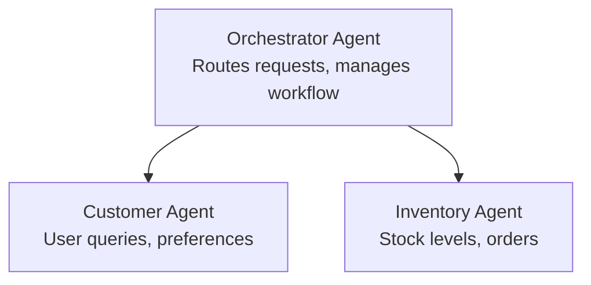

# Rozdział 5: Rozwiązania AI z wieloma agentami

**📚 Kurs**: [AZD dla początkujących](../../README.md) | **⏱️ Czas trwania**: 2-3 godziny | **⭐ Złożoność**: Zaawansowany

---

## Przegląd

Ten rozdział omawia zaawansowane wzorce architektury z wieloma agentami, orkiestrację agentów oraz wdrożenia AI gotowe do produkcji dla złożonych scenariuszy.

> Wskazówki dotyczące poleceń zostały zweryfikowane względem opublikowanego odniesienia `azd 1.37.2`. Wdrożenia w chmurze nie zostały wykonane.

## Cele nauki

Po ukończeniu tego rozdziału będziesz:
- Rozumieć wzorce architektury wieloagentowej
- Wdrażać skoordynowane systemy agentów AI
- Implementować komunikację między agentami
- Budować rozwiązania wieloagentowe gotowe do produkcji

---

## 📚 Lekcje

| # | Lekcja | Opis | Czas |
|---|--------|-------------|------|
| 1 | [Podstawy wieloagentowe](multi-agent-basics.md) | Praktycznie: wdrożenie działającej aplikacji wieloagentowej z `azd up` | 45 min |
| 2 | [Wzorce koordynacji](../chapter-06-pre-deployment/coordination-patterns.md) | Strategie orkiestracji agentów (kontynuacja w rozdziale 6) | 30 min |
| 3 | [Wdrożenie szablonu ARM](../../examples/retail-multiagent-arm-template/README.md) | Przykład wdrożenia jednym kliknięciem | 30 min |

> **Zacznij od lekcji 1.** To jedyna w pełni praktyczna, wdrażalna lekcja w tym rozdziale. Lekcja 2 znajduje się w rozdziale 6 (wspólna z planowaniem przed wdrożeniem), a [Retail Multi-Agent Solution](../../examples/retail-scenario.md) to plan architektury — wzór projektowy, a nie szablon do wdrożenia jednym poleceniem.

---

## 🚀 Szybki start

```bash
# Option 1: Deploy the multi-agent template used in Lesson 1
azd init --template Azure-Samples/contoso-creative-writer .
azd up

# Option 2: Initialize a Foundry agent interactively (requires azure.ai.agents)
azd extension install azure.ai.agents
azd ai agent init
azd up
```

> **Które podejście?** Użyj `azd init --template`, aby zacząć od działającego przykładu. Użyj `azd ai agent init` interaktywnie lub `azd ai agent init --template <path-to-azure.yaml>`, aby zaadaptować istniejący projekt agenta. Zobacz [odniesienie AZD AI CLI](../chapter-08-production/production-ai-practices.md#azd-ai-cli-commands-and-extensions) dla wymagań wersji i migracji oceny.

Uruchom te alternatywy w osobnych, pustych folderach. Rozszerzenie agentów `1.0.0-beta.23` wymaga `azd >= 1.37.0`; jego tryb interaktywny nie generuje niestandardowego potoku Service Bus w lekcji koordynacji.

---

## 🤖 Architektura wieloagentowa



---

## 🎯 Prezentowane rozwiązanie: Retail Multi-Agent

Rozwiązanie [Retail Multi-Agent](../../examples/retail-scenario.md) demonstruje:

- **Agent Klienta**: Obsługuje interakcje i preferencje użytkownika
- **Agent Inwentaryzacji**: Zarządza stanem magazynowym i przetwarzaniem zamówień
- **Orkiestrator**: Koordynuje pracę agentów
- **Wspólna Pamięć**: Zarządzanie kontekstem między agentami

### Używane usługi

| Usługa | Cel |
|---------|---------|
| Microsoft Foundry Models | Rozumienie języka |
| Azure AI Search | Katalog produktów |
| Cosmos DB | Stan i pamięć agenta |
| Container Apps | Hostowanie agentów |
| Application Insights | Monitorowanie |

---

## 🔗 Nawigacja

| Kierunek | Rozdział |
|-----------|---------|
| **Poprzedni** | [Rozdział 4: Infrastruktura](../chapter-04-infrastructure/README.md) |
| **Następny** | [Rozdział 6: Przygotowanie do wdrożenia](../chapter-06-pre-deployment/README.md) |

---

## 📖 Powiązane zasoby

- [Przewodnik po agentach AI](../chapter-02-ai-development/agents.md)
- [Praktyki produkcyjne AI](../chapter-08-production/production-ai-practices.md)
- [Rozwiązywanie problemów AI](../chapter-07-troubleshooting/ai-troubleshooting.md)

---

<!-- CO-OP TRANSLATOR DISCLAIMER START -->
**Zastrzeżenie**:
Niniejszy dokument został przetłumaczony za pomocą usługi tłumaczenia AI [Co-op Translator](https://github.com/Azure/co-op-translator). Choć dążymy do dokładności, prosimy pamiętać, że automatyczne tłumaczenia mogą zawierać błędy lub niedokładności. Oryginalny dokument w jego języku źródłowym należy uznawać za autorytatywne źródło. W przypadku informacji krytycznych zalecane jest skorzystanie z profesjonalnego tłumaczenia wykonanego przez człowieka. Nie ponosimy odpowiedzialności za jakiekolwiek nieporozumienia lub błędne interpretacje wynikające z użycia tego tłumaczenia.
<!-- CO-OP TRANSLATOR DISCLAIMER END -->