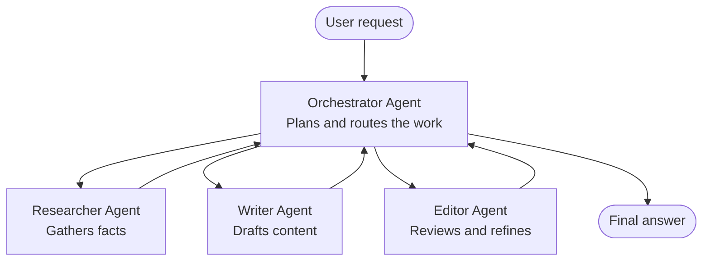

# Podstawy systemów wieloagentowych - Wdróż swój pierwszy skoordynowany system AI

**Nawigacja po rozdziale:**
- **📚 Strona kursu**: [AZD dla początkujących](../../README.md)
- **📖 Bieżący rozdział**: Rozdział 5 - Rozwiązania AI wieloagentowe
- **⬅️ Poprzedni**: [Rozdział 4: Infrastruktura](../chapter-04-infrastructure/README.md)
- **➡️ Następny**: [Wzorce koordynacji](../chapter-06-pre-deployment/coordination-patterns.md)

> Komendy zweryfikowane w odniesieniu do opublikowanego `azd 1.37.2`. Nie wykonano wdrożeń w chmurze.

## Wprowadzenie

W poprzednich rozdziałach wdrożyłeś pojedynczą aplikację — a w Rozdziale 2 wdrożyłeś pojedynczego agenta AI. Ta lekcja robi kolejny krok: wdrażanie **systemu wieloagentowego**, gdzie kilku wyspecjalizowanych agentów współpracuje, aby rozwiązać problem, którego pojedynczy agent nie byłby w stanie dobrze samodzielnie rozwiązać.

Dobra wiadomość dla początkujących: **nie potrzebujesz nowych komend.** Rozwiązanie wieloagentowe to wciąż projekt azd. Będziesz `azd init`, `azd up`, testować i `azd down` — dokładnie taki sam proces, jaki już znasz. Zmienia się jedynie *kształt* aplikacji wewnątrz.

## Cele nauki

Po zakończeniu tej lekcji będziesz:
- Rozumieć, co oznacza "wieloagentowy" i kiedy warto podjąć się tej dodatkowej złożoności
- Rozpoznawać najczęstsze role w systemie wieloagentowym (koordynator + specjaliści)
- Wdrażać działający szablon systemu wieloagentowego z `azd up`
- Znać zasoby Azure wspierające aplikację wieloagentową
- Wiedzieć, jak bezpiecznie zweryfikować, dostosować i usunąć rozwiązanie

## Rezultaty nauki

Po ukończeniu tej lekcji będziesz w stanie:
- Wyjaśnić różnicę między pojedynczym agentem a systemem wieloagentowym
- Wybrać między pojedynczym agentem z narzędziami a prawdziwym projektem wieloagentowym
- Wdrożyć i przetestować szablon wieloagentowy od początku do końca przy użyciu azd
- Zidentyfikować, gdzie działa każdy agent i jak się komunikują
- Posprzątać wszystkie zasoby, aby uniknąć dalszych opłat

---

## Czym jest system wieloagentowy?

Pojedynczy agent AI to jeden model z zestawem instrukcji i (opcjonalnie) narzędzi. To działa dobrze w przypadku skoncentrowanych zadań. Ale gdy zadanie rośnie — badania, potem pisanie, potem redakcja, potem weryfikacja faktów — upychanie wszystkiego w jednym promptcie sprawia, że agent staje się wolniejszy, mniej niezawodny i trudniejszy do debugowania.

**System wieloagentowy** dzieli pracę na specjalistów, z których każdy wykonuje jedno zadanie dobrze, koordynowanych przez koordynatora:



### Dwie role, które zawsze zobaczysz

| Rola | Zadanie | Przykład |
|------|---------|----------|
| **Koordynator** | Decyduje *co będzie dalej* i kieruje pracą między agentami | „Najpierw badania, potem pisanie, potem edycja” |
| **Specjalista** | Wykonuje jedno wyspecjalizowane zadanie i zwraca wynik | „badacz” zbierający tylko fakty |

### Czy naprawdę potrzebujesz wielu agentów?

Zacznij prosto. Sięgnij po rozwiązanie wieloagentowe **tylko** wtedy, gdy spełniony jest któryś z poniższych warunków:

- ✅ Zadanie ma **wyraźne etapy**, które korzystają z różnych instrukcji (badania vs. pisanie vs. przegląd)
- ✅ Chcesz, aby specjaliści działali **równolegle**, aby zaoszczędzić czas
- ✅ Różne kroki wymagają **różnych narzędzi lub źródeł danych**
- ✅ Każdy krok musi być **niezależnie testowalny i debugowalny**

Jeśli Twoje zadanie to pojedyncze pytanie i odpowiedź lub prosty wywołanie narzędzia, **pojedynczy agent z narzędziami** (Rozdział 2) jest prostszy, tańszy i łatwiejszy w obsłudze.

> **Wskazówka dla początkujących:** „Więcej agentów” nie oznacza „lepiej”. Każdy agent dodaje opóźnienie, koszt i coś nowego do monitorowania. Dodawaj agentów tylko, gdy problem wyraźnie dzieli się na części.

---

## Dwa sposoby budowy systemu wieloagentowego na Azure

| Podejście | Co to jest | Najlepsze dla |
|----------|-----------|--------------|
| **Jeden agent + narzędzia** | Jeden agent Foundry wywołujący funkcje/narzędzia | Proste przepływy pracy, rozpoczęcie pracy |
| **Wielu skoordynowanych agentów** | Kilku agentów z koordynatorem | Wyraźne etapy, praca równoległa, specjalizacja |

Ta lekcja koncentruje się na drugim podejściu, używając **gotowego szablonu**, abyś mógł zobaczyć działający system wieloagentowy przed zbudowaniem własnego.

---

## Praktyczne zajęcia: Wdróż działającą aplikację wieloagentową

Wdrożymy **Contoso Creative Writer**, oficjalny przykład Azure, który koordynuje agentów badań, produktu, pisania i edycji do napisania artykułu. Przed rozpoczęciem sprawdź [wymagania wstępne i koszty przykładu](https://github.com/Azure-Samples/contoso-creative-writer#azure-account-requirements): potrzebne są limity modeli, Azure AI Search, dostęp do Bing Grounding, Python, Docker i narzędzia kompatybilne z Bashem. Dostępność modeli i regionów zależy od Twojej subskrypcji; wdrożenie nie jest gwarantowane przez wybór regionu.

### Krok 1: Zainicjuj szablon

```bash
# Create a working folder
mkdir creative-writer && cd creative-writer

# Initialize from the official multi-agent template
azd init --template Azure-Samples/contoso-creative-writer .
```

> Przeglądaj więcej szablonów wieloagentowych w dowolnym czasie w [świetnej galerii AZD AI](https://azure.github.io/awesome-azd/?tags=ai). Inne przyjazne dla początkujących opcje to `get-started-with-ai-agents` i `azure-ai-travel-agents`.

### Krok 2: Uwierzytelnienie

```bash
# Required for azd workflows
azd auth login

# Also required by this sample's Azure CLI hooks
az login
```

### Krok 3: Sprawdź środowisko

```bash
# init normally creates/selects an environment; confirm it before proceeding
azd env list
# Only if you need an additional environment:
# azd env new dev
```

### Krok 4: Podgląd, a następnie wdrożenie

```bash
# See what will be created before spending anything (recommended)
azd provision --preview

# Provision infrastructure and deploy all agents in one step
azd up
```

`azd up` poprosi o brakujące ustawienia subskrypcji i regionu, następnie zaaranżuje zasoby i wdroży aplikację. Podgląd nie rezerwuje kwot ani nie gwarantuje sukcesu; haki szablonu mogą się uruchamiać nawet podczas podglądu wdrożenia, więc sprawdź je najpierw. Aby wydłużyć czas oczekiwania azd na każde **wdrożenie usługi** (nie provisionowanie modelu):

```bash
azd deploy --timeout 1800
```

Limit czasu zatrzymuje oczekiwanie azd; nie anuluje wdrożenia w Azure. Sprawdź stan zasobu przed ponowną próbą.

> **Uwaga dotycząca kosztów i pojemności:** Aplikacje wieloagentowe wdrażają modele AI, które zużywają limit i generują koszty. Jeśli `azd up` zwróci błąd limitu modelu, zobacz [Rozwiązywanie problemów AI](../chapter-07-troubleshooting/ai-troubleshooting.md) oraz Rozdział 6 [Planowanie pojemności](../chapter-06-pre-deployment/capacity-planning.md).

---

## Zrozumienie tego, co wdrożyłeś

Typowa aplikacja wieloagentowa jak ta tworzy zestaw zasobów Azure odpowiadających bezpośrednio obowiązkom na powyższym diagramie:

| Zasób | Dlaczego jest potrzebny |
|--------|-----------------------|
| **Microsoft Foundry / modele** | Hostuje modele językowe używane przez każdego agenta |
| **Azure AI Search** | Dostarcza agentowi badacza ugruntowane dane do wyszukiwania |
| **Container Apps** (lub App Service) | Hostuje kod koordynatora i agentów |
| **Cosmos DB** (w niektórych przykładach) | Przechowuje współdzielony stan/pamięć przekazywaną między agentami |
| **Application Insights** | Śledzi żądania *pomiędzy* agentami, aby można było debugować przepływ |

### Jak agenci się komunikują

W większości przykładów azd wieloagentowych **koordynator działa w Twoim kodzie aplikacji** (na przykład przy użyciu frameworka Semantic Kernel lub Microsoft Agent Framework). Koordynator wywołuje kolejno każdego specjalistycznego agenta, przekazuje wyniki i składa ostateczną odpowiedź. Agenci dzielą kontekst przez:

- **Wywołania funkcji/narzędzi** — koordynator wywołuje specjalistę i otrzymuje wynik
- **Wspólną pamięć** — baza danych (często Cosmos DB) przechowuje stan, który obaj agenci mogą odczytać
- **Wiadomości/zdarzenia** — dla luźniejszego powiązania agenci komunikują się przez kolejkę lub Service Bus

> **Dlaczego to ma znaczenie przy debugowaniu:** ponieważ każdy krok jest oddzielny, Application Insights pokazuje *który* agent był wolny lub zawiódł. To główny powód podziału pracy między agentów.

---

## Zweryfikuj wdrożenie

Potwierdź, że system faktycznie działa przed przejściem dalej:

```bash
# Show the deployed endpoints
azd show

# Open the app's monitoring dashboard
azd monitor

# Open Application Insights Logs (not a terminal log stream)
azd monitor --logs
```

Następnie otwórz URL aplikacji z `azd show` i poproś o krótki artykuł. Użyj widoku debugowania przykładu, aby zbadać workflow agenta. Wyszukiwanie transakcji w Application Insights może pokazać poszczególne kroki tylko, jeśli przykład je instrumentuje i koreluje; azd nie dodaje automatycznie zakresów agenta.

**Kryteria sukcesu:**
- ✅ `azd show` zwraca osiągalny endpoint
- ✅ Żądanie generuje wynik, który ewidentnie przeszedł przez wiele etapów
- ✅ Widok debugowania pokazuje wiele kroków agentów; jeśli śledzenie jest włączone, zweryfikuj odpowiadające telemetry po przetworzeniu

---

## Dostosuj: Dodaj lub zmodyfikuj agenta

Ponieważ każdy agent to tylko instrukcje plus narzędzia, dostosowywanie jest przystępne:

1. **Znajdź definicje agentów** w szablonie (często zestaw plików `prompts/`, `agents/` lub `*.prompty`).
2. **Dopasuj instrukcje agenta** — na przykład poleć agentowi redakcji stosowanie konkretnego tonu lub ilości słów.
3. **Ponownie wdroż tylko kod** (infrastruktura pozostaje bez zmian):

   ```bash
   azd deploy
   ```

Aby pójść dalej z własnym projektem agenta Foundry, użyj interaktywnej inicjalizacji rozszerzenia agenta:

```bash
azd extension install azure.ai.agents
azd ai agent init
azd up
azd ai agent invoke      # test, with response timing
```

Zobacz [Rozdział 2: Agenci](../chapter-02-ai-development/agents.md) i [referencję AZD AI CLI](../chapter-08-production/production-ai-practices.md#azd-ai-cli-commands-and-extensions) dla pełnego cyklu życia: agenta `invoke`, oddzielny workflow oceny rozszerzenia `azd ai eval`, agenta `optimize` i agenta `delete`.

---

## Porządki

Aplikacje wieloagentowe uruchamiają wiele rozliczanych usług. Usuń wszystko, gdy skończysz:

```bash
# Review the resources and confirm deletion interactively
azd down
```

Usuwanie jest destrukcyjne. W laboratorium do jednorazowego użytku `azd down --force --purge` pomija usuwanie i wspierane potwierdzenia miękkiego usunięcia; usuwanie jest nieodwracalne tam, gdzie jest dostępne, i może być blokowane przez ochronę usuwania. Miękkie usunięcie dotyczy kwestii odzyskiwania/ponownego użycia nazw, nie jest samo w sobie dowodem na dalsze opłaty. Sprawdź zachowane zasoby i rozliczenia po sprzątaniu.

---

## Notatka o produkcyjnych systemach wieloagentowych

Rozwiązanie [Retail Multi-Agent Solution](../../examples/retail-scenario.md) w tym repozytorium to **schemat architektury**, a nie szablon do uruchomienia jednym poleceniem — dokumentuje, jak *mógłby* być zbudowany produkcyjny system detaliczny (i wyraźnie zaznacza, że pełna budowa to znaczny wysiłek). Używaj go jako odniesienia projektowego *po* wdrożeniu działającego przykładu tutaj. W kwestiach produkcyjnych (odporność, koszty, monitorowanie, zarządzanie) przejdź do [Rozdziału 8: Praktyki AI w produkcji](../chapter-08-production/production-ai-practices.md).

---

## Podsumowanie

- System wieloagentowy dzieli pracę pomiędzy specjalistów koordynowanych przez orkiestratora.
- Używaj go tylko wtedy, gdy zadanie ma wyraźne etapy, równoległość lub różne narzędzia na każdym kroku — w przeciwnym razie preferuj pojedynczego agenta.
- Przepływ pracy azd pozostaje niezmieniony: `azd init` → `azd up` → test → `azd down`.
- Prawdziwy szablon, taki jak `contoso-creative-writer`, pozwala dziś zobaczyć i dostosować działającą aplikację wieloagentową.
- Śledzenie Application Insights pomiędzy agentami jest jedną z największych praktycznych korzyści projektu wieloagentowego.

---

## 🔗 Nawigacja

| Kierunek | Lekcja |
|-----------|--------|
| **Poprzednia** | [Rozdział 4: Infrastruktura](../chapter-04-infrastructure/README.md) |
| **Następna** | [Wzorce Koordynacji](../chapter-06-pre-deployment/coordination-patterns.md) |

## 📖 Powiązane Zasoby

- [Przewodnik po Agentach AI](../chapter-02-ai-development/agents.md)
- [Wzorce Koordynacji](../chapter-06-pre-deployment/coordination-patterns.md)
- [Praktyki Produkcyjne AI](../chapter-08-production/production-ai-practices.md)
- [Rozwiązywanie Problemów AI](../chapter-07-troubleshooting/ai-troubleshooting.md)

---

<!-- CO-OP TRANSLATOR DISCLAIMER START -->
**Zastrzeżenie**:
Niniejszy dokument został przetłumaczony za pomocą usługi tłumaczenia AI [Co-op Translator](https://github.com/Azure/co-op-translator). Choć dążymy do dokładności, prosimy pamiętać, że automatyczne tłumaczenia mogą zawierać błędy lub niedokładności. Oryginalny dokument w jego języku źródłowym należy uznawać za autorytatywne źródło. W przypadku informacji krytycznych zalecane jest skorzystanie z profesjonalnego tłumaczenia wykonanego przez człowieka. Nie ponosimy odpowiedzialności za jakiekolwiek nieporozumienia lub błędne interpretacje wynikające z użycia tego tłumaczenia.
<!-- CO-OP TRANSLATOR DISCLAIMER END -->