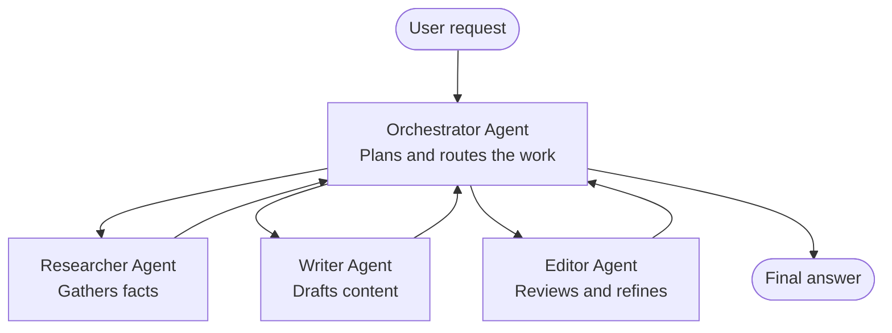

# Podstawy Multi-Agentów - Wdróż swój pierwszy skoordynowany system AI

**Nawigacja po rozdziale:**
- **📚 Strona kursu**: [AZD dla początkujących](../../README.md)
- **📖 Aktualny rozdział**: Rozdział 5 - Rozwiązania Multi-Agent AI
- **⬅️ Poprzedni**: [Rozdział 4: Infrastruktura](../chapter-04-infrastructure/README.md)
- **➡️ Następny**: [Wzorce koordynacji](../chapter-06-pre-deployment/coordination-patterns.md)

> Polecenia zweryfikowane względem opublikowanego odniesienia `azd 1.37.2`. Nie przeprowadzano wdrożeń w chmurze.

## Wprowadzenie

W poprzednich rozdziałach wdrożyłeś pojedynczą aplikację — a w Rozdziale 2 wdrożyłeś pojedynczego agenta AI. Ta lekcja to kolejny krok: wdrożenie **systemu multi-agentowego**, gdzie kilku wyspecjalizowanych agentów współpracuje, aby rozwiązać problem, którego pojedynczy agent nie poradziłby sobie samodzielnie dobrze.

Dobra wiadomość dla początkujących: **nie potrzebujesz nowych poleceń.** Rozwiązanie multi-agentowe to wciąż projekt azd. Będziesz `azd init`, `azd up`, testować i `azd down` — dokładnie taki sam przepływ pracy, jaki już znasz. Zmienia się *kształt* aplikacji wewnątrz.

## Cele nauki

Na koniec tej lekcji będziesz:
- Rozumieć, co oznacza "multi-agent" i kiedy warto podjąć się dodatkowej złożoności
- Rozpoznawać typowe role w systemie multi-agentowym (koordynator + specjaliści)
- Wdrożyć rzeczywisty, działający szablon multi-agentowy z `azd up`
- Rozumieć zasoby Azure, które wspierają aplikację multi-agentową
- Wiedzieć, jak bezpiecznie zweryfikować, dostosować i usunąć rozwiązanie

## Efekty nauki

Po ukończeniu tej lekcji będziesz potrafił:
- Wyjaśnić różnicę między pojedynczym agentem a systemem multi-agentowym
- Wybrać między pojedynczym agentem z narzędziami a prawdziwym projektem multi-agentowym
- Wdrożyć i przetestować szablon multi-agentowy od początku do końca za pomocą azd
- Zidentyfikować, gdzie działa każdy agent i jak się komunikują
- Posprzątać wszystkie zasoby, aby uniknąć bieżących opłat

---

## Czym jest system multi-agentowy?

Pojedynczy agent AI to jeden model z zestawem instrukcji i (opcjonalnie) jakimiś narzędziami. To dobrze działa dla skoncentrowanych zadań. Ale gdy zadanie rośnie — badania, potem pisanie, potem edycja, potem weryfikacja faktów — upychanie wszystkiego w jednym promptcie sprawia, że agent staje się wolniejszy, mniej niezawodny i trudniejszy do debugowania.

**System multi-agentowy** dzieli pracę między specjalistów, którzy wykonują dobrze jedno zadanie, koordynowanych przez koordynatora:



### Dwie role, które zawsze zobaczysz

| Rola | Zadanie | Przykład |
|------|---------|----------|
| **Koordynator** | Decyduje *co będzie dalej* i kieruje pracę między agentami | „Najpierw badania, potem pisanie, potem edycja” |
| **Specjalista** | Wykonuje jedno skoncentrowane zadanie i zwraca wynik | „badacz”, który zbiera tylko fakty |

### Czy naprawdę potrzebujesz wielu agentów?

Zacznij prosto. Sięgaj po multi-agent **tylko**, gdy spełniony jest jeden z tych warunków:

- ✅ Zadanie ma **wyraźne etapy**, które korzystają z różnych instrukcji (badania vs. pisanie vs. weryfikacja)
- ✅ Chcesz, aby specjaliści działali **równolegle**, by zaoszczędzić czas
- ✅ Różne kroki potrzebują **różnych narzędzi lub źródeł danych**
- ✅ Potrzebujesz, aby każdy etap był **niezależnie testowalny i debugowalny**

Jeśli Twoje zadanie to pojedyncze pytanie i odpowiedź lub proste wywołanie narzędzia, **pojedynczy agent z narzędziami** (Rozdział 2) jest prostszy, tańszy i łatwiejszy w obsłudze.

> **Wskazówka dla początkujących:** „Więcej agentów” nie oznacza „lepiej.” Każdy agent dodaje opóźnienie, koszt i nowe elementy do monitorowania. Dodawaj agentów tylko wtedy, gdy problem wyraźnie dzieli się na części.

---

## Dwa sposoby budowania multi-agentów na Azure

| Podejście | Co to jest | Najlepsze dla |
|----------|------------|--------------|
| **Pojedynczy agent + narzędzia** | Jeden agent Foundry wywołujący funkcje/narzędzia | Proste procesy, startowanie |
| **Wielu koordynowanych agentów** | Kilku agentów z koordynatorem | Wyraźne etapy, praca równoległa, specjalizacja |

Ta lekcja skupia się na drugim podejściu z użyciem **gotowego szablonu**, abyś mógł zobaczyć działający system multi-agent przed zbudowaniem własnego.

---

## Praktycznie: Wdróż działającą aplikację multi-agentową

Wdrożymy **Contoso Creative Writer**, oficjalny przykład Azure, który koordynuje agentów badań, produktu, pisania i edycji, aby wyprodukować artykuł. Przed kontynuowaniem sprawdź [wymagania wstępne i koszty przykładu](https://github.com/Azure-Samples/contoso-creative-writer#azure-account-requirements): wymaga quota modeli, Azure AI Search, dostępu do Bing Grounding, Pythona, Dockera i hooków kompatybilnych z Bashem. Dostępność modeli i regionów zależy od Twojej subskrypcji; wdrożenie nie jest gwarantowane przez wybranie konkretnego regionu.

### Krok 1: Zainicjuj szablon

```bash
# Create a working folder
mkdir creative-writer && cd creative-writer

# Initialize from the official multi-agent template
azd init --template Azure-Samples/contoso-creative-writer .
```

> Przeglądaj więcej szablonów multi-agent w dowolnym czasie w [galerii Awesome AZD AI](https://azure.github.io/awesome-azd/?tags=ai). Inne przyjazne dla początkujących opcje to `get-started-with-ai-agents` i `azure-ai-travel-agents`.

### Krok 2: Uwierzytelnij się

```bash
# Required for azd workflows
azd auth login

# Also required by this sample's Azure CLI hooks
az login
```

### Krok 3: Sprawdź środowisko

```bash
# init normally creates/selects an environment; confirm it before proceeding
azd env list
# Only if you need an additional environment:
# azd env new dev
```

### Krok 4: Podgląd, a potem wdrożenie

```bash
# See what will be created before spending anything (recommended)
azd provision --preview

# Provision infrastructure and deploy all agents in one step
azd up
```

`azd up` poprosi o brakujące ustawienia subskrypcji i regionu, następnie zapewni zasoby i wdroży aplikację. Podgląd nie rezerwuje quota ani nie gwarantuje sukcesu; hooki szablonu mogą się uruchomić także podczas podglądu, zatem sprawdź je najpierw. Aby wydłużyć czas oczekiwania azd na każde **wdrożenie usługi** (nie na provisioning modelu):

```bash
azd deploy --timeout 1800
```

Timeout zatrzymuje oczekiwanie azd; nie anuluje wdrożenia w Azure. Sprawdź stan zasobu przed ponowną próbą.

> **Uwaga na koszty i pojemność:** Aplikacje multi-agent wdrażają modele AI, które zużywają quota i generują koszty. Jeśli `azd up` nie powiedzie się z quota modeli, zobacz [Rozwiązywanie problemów AI](../chapter-07-troubleshooting/ai-troubleshooting.md) dla napraw regionu i quota oraz Rozdział 6 [Planowanie pojemności](../chapter-06-pre-deployment/capacity-planning.md).

---

## Zrozumienie tego, co wdrożyłeś

Typowa aplikacja multi-agentowa, taka jak ta, zapewnia zestaw zasobów Azure, które bezpośrednio odpowiadają odpowiedzialnościom na powyższym diagramie:

| Zasób | Dlaczego jest tam obecny |
|----------|------------------------|
| **Microsoft Foundry / Modele** | Hostuje modele językowe używane przez każdego agenta |
| **Azure AI Search** | Dostarcza agentowi badawczemu osadzone dane do przeszukiwania |
| **Container Apps** (lub App Service) | Hostuje kod koordynatora i agentów |
| **Cosmos DB** (w niektórych przykładach) | Przechowuje współdzielony stan/pamięć przekazywaną między agentami |
| **Application Insights** | Śledzi żądania *pomiędzy* agentami, co ułatwia debugowanie przepływu |

### Jak agenci komunikują się ze sobą

W większości azd przykładów multi-agent, **koordynator działa w Twoim kodzie aplikacji** (na przykład, używając frameworka takiego jak Semantic Kernel lub Microsoft Agent Framework). Koordynator wywołuje kolejno poszczególnych specjalistycznych agentów, przekazuje wyniki i składa ostateczną odpowiedź. Agenci dzielą kontekst poprzez:

- **Wywołania funkcji/narzędzi** — koordynator wywołuje specjalistę i oczekuje wyniku
- **Wspólną pamięć** — baza danych (często Cosmos DB) przechowuje stan, który mogą odczytać oba agenty
- **Wiadomości/zdarzenia** — dla luźniejszego powiązania agenci komunikują się za pomocą kolejki lub Service Bus

> **Dlaczego to ważne dla debugowania:** ponieważ każdy etap jest oddzielny, Application Insights pokazuje *który* agent był wolny lub zawiódł. To główny powód podziału pracy między agentów w pierwszej kolejności.

---

## Sprawdź wdrożenie

Potwierdź, że system faktycznie działa, zanim przejdziesz dalej:

```bash
# Show the deployed endpoints
azd show

# Open the app's monitoring dashboard
azd monitor

# Open Application Insights Logs (not a terminal log stream)
azd monitor --logs
```

Następnie otwórz URL aplikacji z `azd show` i poproś o krótki artykuł. Użyj widoku debugowania przykładu, aby przejrzeć przepływ pracy agentów. Wyszukiwanie transakcji Application Insights może pokazać poszczególne kroki tylko jeśli przykład instrumentuje i koreluje je; azd nie dodaje automatycznie zakresów agentów.

**Kryteria sukcesu:**
- ✅ `azd show` wyświetla dostępny endpoint
- ✅ Żądanie generuje wynik, który wyraźnie przeszedł przez wiele etapów
- ✅ Widok debugowania pokazuje wiele kroków agentów; jeśli śledzenie jest włączone, zweryfikuj odpowiadającą telemetrię po przetworzeniu

---

## Dostosuj: Dodaj lub zmodyfikuj agenta

Ponieważ każdy agent to po prostu instrukcje plus narzędzia, dostosowywanie jest przystępne:

1. **Znajdź definicje agentów** w szablonie (często zestaw plików `prompts/`, `agents/` lub `*.prompty`).
2. **Dopasuj instrukcje agenta** — na przykład powiedz agentowi edytora, aby wymuszał określony ton lub liczbę słów.
3. **Wdróż ponownie tylko kod** (infrastruktura pozostaje bez zmian):

   ```bash
   azd deploy
   ```

Aby iść dalej z własnym projektem agenta Foundry, użyj wersji GA z AZD 1.37.0+ w osobnym pustym katalogu:

```bash
azd ext install microsoft.foundry
azd ai agent init
azd up
azd ai agent invoke      # test, with response timing
```

Zobacz [przejście po hostowanym agencie GA](../chapter-02-ai-development/microsoft-foundry-integration.md#hosted-agent-walkthrough-ga) dla lokalnego testowania Agent Inspector, zdalnego wdrażania kodu i zarządzania sprzątaniem. [Referencja CLI AZD AI](../chapter-08-production/production-ai-practices.md#azd-ai-cli-commands-and-extensions) obejmuje także rozszerzenie oddzielnych ewaluacji, optymalizację i usuwanie agentów.

---

## Sprzątanie

Aplikacje multi-agent uruchamiają wiele płatnych usług. Usuń wszystko, gdy skończysz:

```bash
# Review the resources and confirm deletion interactively
azd down
```

Usuwanie jest nieodwracalne. Dla jednorazowego laboratorium `azd down --force --purge` pomija usuwanie oraz wspiera potwierdzenia miękkiego usuwania purge; czyszczenie jest nieodwracalne tam, gdzie jest wspierane i może być blokowane przez ochronę purge. Miękkie usuwanie dotyczy odzyskiwania/ponownego użycia nazw, nie jest samym dowodem na trwające opłaty. Sprawdź zatrzymane zasoby i rozliczenia po sprzątaniu.

Jeśli także zainicjowałeś hostowanego agenta w istniejącym projekcie Foundry, `azd down` pozostawia agenta tego projektu i inne zasoby na miejscu. Usuń tylko niechciane zasoby, które posiadasz osobno. W przypadku nowego projektu Foundry utworzonego przez jego środowisko AZD, `azd down` usuwa grupę zasobów i wszystko, co się w niej znajduje.

---

## Notatka o produkcyjnych systemach multi-agentowych

Rozwiązanie [Retail Multi-Agent Solution](../../examples/retail-scenario.md) w tym repozytorium jest **szkieletem architektury**, a nie szablonem do uruchomienia jednym poleceniem — dokumentuje, jak *faktycznie* zbudować produkcyjny system detaliczny (i jasno wskazuje, że kompletne zbudowanie to znaczne przedsięwzięcie). Używaj go jako odniesienia projektowego *po* wdrożeniu działającej próbki tutaj. W sprawach produkcyjnych (odporność, koszty, monitorowanie, zarządzanie) kontynuuj czytanie [Rozdziału 8: Praktyki AI w produkcji](../chapter-08-production/production-ai-practices.md).

---

## Podsumowanie

- System wieloagentowy dzieli pracę pomiędzy specjalistów koordynowanych przez orkiestratora.
- Używaj go tylko wtedy, gdy zadanie ma wyraźne etapy, równoległość lub różne narzędzia na każdym kroku – w przeciwnym razie lepiej użyć pojedynczego agenta.
- Przepływ pracy azd pozostaje bez zmian: `azd init` → `azd up` → test → `azd down`.
- Prawdziwy szablon taki jak `contoso-creative-writer` pozwala dziś zobaczyć i dostosować działającą aplikację wieloagentową.
- Śledzenie Application Insights między agentami jest jedną z największych praktycznych zalet projektu wieloagentowego.

---

## 🔗 Nawigacja

| Kierunek | Lekcja |
|-----------|--------|
| **Poprzednia** | [Rozdział 4: Infrastruktura](../chapter-04-infrastructure/README.md) |
| **Następna** | [Wzorce Koordynacji](../chapter-06-pre-deployment/coordination-patterns.md) |

## 📖 Powiązane Zasoby

- [Przewodnik po Agentach AI](../chapter-02-ai-development/agents.md)
- [Wzorce Koordynacji](../chapter-06-pre-deployment/coordination-patterns.md)
- [Praktyki Produkcyjne AI](../chapter-08-production/production-ai-practices.md)
- [Rozwiązywanie Problemów AI](../chapter-07-troubleshooting/ai-troubleshooting.md)

---

<!-- CO-OP TRANSLATOR DISCLAIMER START -->
**Zastrzeżenie**:
Niniejszy dokument został przetłumaczony za pomocą usługi tłumaczenia AI [Co-op Translator](https://github.com/Azure/co-op-translator). Choć dążymy do dokładności, prosimy pamiętać, że automatyczne tłumaczenia mogą zawierać błędy lub niedokładności. Oryginalny dokument w jego języku źródłowym należy uznawać za autorytatywne źródło. W przypadku informacji krytycznych zalecane jest skorzystanie z profesjonalnego tłumaczenia wykonanego przez człowieka. Nie ponosimy odpowiedzialności za jakiekolwiek nieporozumienia lub błędne interpretacje wynikające z użycia tego tłumaczenia.
<!-- CO-OP TRANSLATOR DISCLAIMER END -->