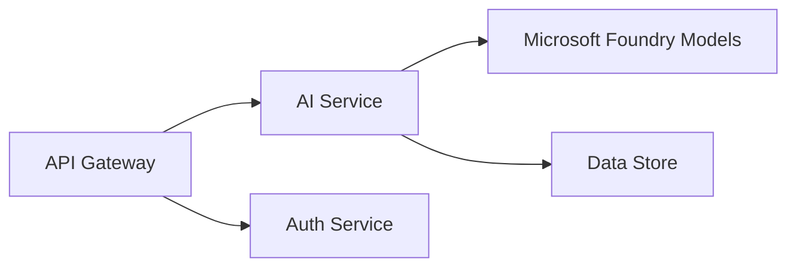

# Rozdział 8: Wzorce produkcyjne i korporacyjne  

**📚 Kurs**: [AZD dla początkujących](../../README.md) | **⏱️ Czas trwania**: 2-3 godziny | **⭐ Poziom trudności**: Zaawansowany  

---  

## Przegląd  

Ten rozdział obejmuje wzorce wdrażania gotowe na potrzeby przedsiębiorstw, wzmacnianie bezpieczeństwa, monitoring i optymalizację kosztów dla produkcyjnych obciążeń AI.  

Jest to odniesienie architektoniczne, a nie kompletny szablon do wdrożenia produkcyjnego. Przykłady pomijają szczegóły integracji, które muszą zostać dostarczone i przetestowane w twojej własnej aplikacji; przeczytanie listy kontrolnej nie gwarantuje gotowości do produkcji.  

> **Przegląd wydania (2026-11-04):** Wskazówki dotyczące AI CLI zostały sprawdzone względem dokumentacji/źródeł `azd 1.37.2`, agentów `1.0.0-beta.23` i ewaluacji `1.0.0-beta.2`. Zobacz [zmiany i poprawki w wydaniu](production-ai-practices.md#recent-release-changes-and-fixes) dotyczące wymagań kompatybilności i szczegółów migracji; nie jest to weryfikacja wdrożenia na żywo.  

## Cele nauki  

Po ukończeniu tego rozdziału będziesz potrafił:  
- Wdrażać aplikacje odporne na wiele regionów  
- Zastosować korporacyjne wzorce bezpieczeństwa  
- Skonfigurować kompleksowy monitoring  
- Optymalizować koszty na dużą skalę  
- Ustawiać potoki CI/CD z AZD  

---  

## 📚 Lekcje  

| # | Lekcja | Opis | Czas |  
|---|--------|-------------|------|  
| 1 | [Praktyki AI w produkcji](production-ai-practices.md) | Wzorce wdrożeń korporacyjnych | 90 min |  

---  

## 🚀 Lista kontrolna do produkcji  

- [ ] Wdrożenie wieloregionalne dla odporności  
- [ ] Zarządzana tożsamość do uwierzytelniania (bez kluczy)  
- [ ] Application Insights do monitorowania  
- [ ] Konfiguracja budżetów kosztów i alertów  
- [ ] Włączone skanowanie bezpieczeństwa  
- [ ] Integracja potoku CI/CD  
- [ ] Plan odzyskiwania po awarii  

---  

## 🏗️ Wzorce architektoniczne  

### Wzorzec 1: AI oparte na mikrousługach  


  
### Wzorzec 2: AI sterowane zdarzeniami  


  
---  

## 🔐 Najlepsze praktyki bezpieczeństwa  

```bicep
// Illustrative properties from different resources, NOT a standalone Bicep file.
// Attach identity to the application host:
identity: {
  type: 'SystemAssigned'
}

// AI account properties (also require private endpoints, DNS and app connectivity):
properties: {
  publicNetworkAccess: 'Disabled'
  networkAcls: {
    defaultAction: 'Deny'
  }
}
```
  
---  

## 💰 Optymalizacja kosztów  

| Strategia | Główne ograniczenie |  
|----------|---------|  
| Skalowanie do zera (Container Apps) | Wymaga odpowiedniego wyzwalacza; inne usługi nadal generują koszty |  
| Korzystanie z poziomów konsumpcyjnych dla dev | Porównaj ceny wybranej usługi i obciążenie |  
| Skalowanie zaplanowane | Skalowanie przez wspieraną infrastrukturę/automatyzację |  
| Rezerwacje/zapewniona pojemność | Tylko gdy dostępne; zobowiązania mogą zwiększyć koszty bezczynności |  

Skorzystaj z [kompletnego wzorca budżetu zasobów](production-ai-practices.md#2-cost-monitoring-and-budgets) z ważną datą rozpoczęcia, zakresem rozliczeniowym, odbiorcami i uprawnieniami. Budżet wysyła alerty; nie ogranicza wydatków. Oszczędności zależą od zmierzonego wykorzystania i nie są gwarantowanymi procentami.  

---  

## 📊 Konfiguracja monitoringu  

```bash
# Open the Application Insights logs view (requires configured monitoring)
azd monitor --logs

# Check Application Insights
azd monitor --overview

# View metrics
az monitor metrics list --resource <resource-id>
```
  
---  

## 🔗 Nawigacja  

| Kierunek | Rozdział |  
|-----------|---------|  
| **Poprzedni** | [Rozdział 7: Rozwiązywanie problemów](../chapter-07-troubleshooting/README.md) |  
| **Kurs ukończony** | [Strona główna kursu](../../README.md) |  

---  

## 📖 Powiązane zasoby  

- [Przewodnik po agentach AI](../chapter-02-ai-development/agents.md)  
- [Application Insights](../chapter-06-pre-deployment/application-insights.md)  
- [Rozwiązania wieloagentowe](../chapter-05-multi-agent/README.md)  
- [Przykład mikrousług](../../examples/microservices/README.md)  

---

<!-- CO-OP TRANSLATOR DISCLAIMER START -->
**Zastrzeżenie**:
Niniejszy dokument został przetłumaczony za pomocą usługi tłumaczenia AI [Co-op Translator](https://github.com/Azure/co-op-translator). Choć dążymy do dokładności, prosimy pamiętać, że automatyczne tłumaczenia mogą zawierać błędy lub niedokładności. Oryginalny dokument w jego języku źródłowym należy uznawać za autorytatywne źródło. W przypadku informacji krytycznych zalecane jest skorzystanie z profesjonalnego tłumaczenia wykonanego przez człowieka. Nie ponosimy odpowiedzialności za jakiekolwiek nieporozumienia lub błędne interpretacje wynikające z użycia tego tłumaczenia.
<!-- CO-OP TRANSLATOR DISCLAIMER END -->