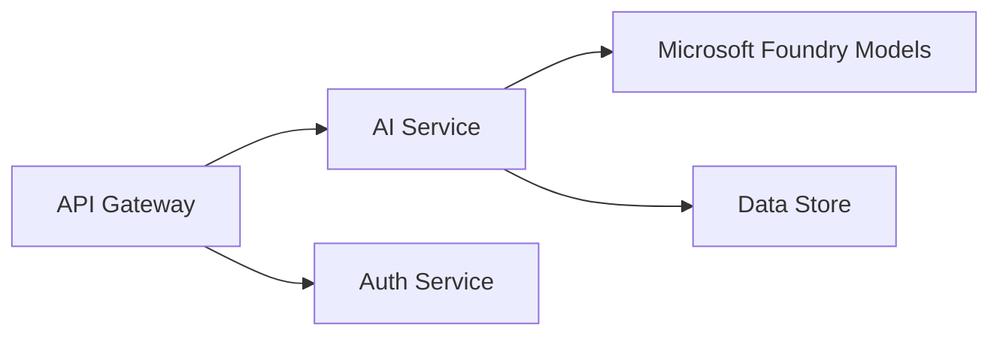
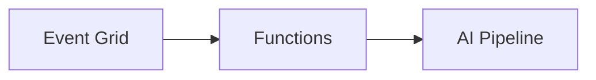

# Rozdział 8: Wzorce produkcyjne i korporacyjne

**📚 Kurs**: [AZD For Beginners](../../README.md) | **⏱️ Czas trwania**: 2-3 godziny | **⭐ Złożoność**: Zaawansowany

---

## Przegląd

Ten rozdział obejmuje wzorce wdrożeń gotowych na potrzeby przedsiębiorstw, utwardzanie zabezpieczeń, monitorowanie oraz optymalizację kosztów dla produkcyjnych obciążeń AI.

Jest to odniesienie architektoniczne, a nie kompletny wzór wdrożeniowy gotowy do produkcji. Przykłady pomijają szczegóły integracji, które muszą być dostarczone i przetestowane w Twojej aplikacji; przeczytanie listy kontrolnej nie potwierdza gotowości do produkcji.

> **Aktualizacja Foundry GA (2026-11-09):** Używaj `azd >= 1.37.0` i ogólnie dostępnego pakietu `microsoft.foundry` 1.0 dla przepływu pracy Foundry; oceny są instalowane osobno. Zobacz [zakres wydania i migracja](production-ai-practices.md#recent-release-changes-and-fixes) oraz [przykład uwierzytelnionego pipeline](production-ai-practices.md#cicd-pipeline-configuration). To jest przegląd dokumentacji, a nie walidacja wdrożenia na żywo lub ogólny status GA dla opcjonalnych funkcji podglądu.

## Cele nauki

Ukończenie tego rozdziału pozwoli Ci:
- Wdrożyć odporne aplikacje wieloregionalne
- Wdrożyć korporacyjne wzorce zabezpieczeń
- Skonfigurować kompleksowy monitoring
- Optymalizować koszty na dużą skalę
- Ustawić pipeline CI/CD z AZD

---

## 📚 Lekcje

| # | Lekcja | Opis | Czas |
|---|--------|-------------|------|
| 1 | [Praktyki AI produkcyjnego](production-ai-practices.md) | Korporacyjne wzorce wdrożeniowe | 90 min |

---

## 🚀 Lista kontrolna produkcji

- [ ] Wieloregionalne wdrożenie dla odporności
- [ ] Zarządzana tożsamość do uwierzytelniania (bez kluczy)
- [ ] Application Insights do monitorowania
- [ ] Konfiguracja budżetów kosztów i alertów
- [ ] Włączone skanowanie zabezpieczeń
- [ ] Integracja pipeline CI/CD
- [ ] Plan odzyskiwania po awarii

---

## 🏗️ Wzorce architektoniczne

### Wzorzec 1: Mikrousługi AI



### Wzorzec 2: AI sterowane zdarzeniami



---

## 🔐 Najlepsze praktyki bezpieczeństwa

```bicep
// Illustrative properties from different resources, NOT a standalone Bicep file.
// Attach identity to the application host:
identity: {
  type: 'SystemAssigned'
}

// AI account properties (also require private endpoints, DNS and app connectivity):
properties: {
  publicNetworkAccess: 'Disabled'
  networkAcls: {
    defaultAction: 'Deny'
  }
}
```

---

## 💰 Optymalizacja kosztów

| Strategia | Główne ograniczenie |
|----------|---------|
| Skalowanie do zera (Container Apps) | Wymaga odpowiedniego wyzwalacza; inne usługi nadal generują koszty |
| Użycie poziomów konsumpcyjnych na dev | Porównaj ceny wybranej usługi i obciążenie |
| Planowane skalowanie | Skaluj za pomocą wspieranej infrastruktury/automatyzacji |
| Rezerwacje/zarezerwowana pojemność | Tylko gdy wspierane; zobowiązania mogą zwiększać koszty bezczynności |

Użyj [pełnego wzorca zasobu budżetu](production-ai-practices.md#2-cost-monitoring-and-budgets) ze poprawną datą rozpoczęcia, zakresem rozliczeniowym, odbiorcami i uprawnieniami. Budżet wysyła alerty; nie ogranicza wydatków. Oszczędności zależą od zmierzonego wykorzystania i nie są gwarantowane procentowo.

---

## 📊 Konfiguracja monitoringu

```bash
# Open the Application Insights logs view (requires configured monitoring)
azd monitor --logs

# Check Application Insights
azd monitor --overview

# View metrics
az monitor metrics list --resource <resource-id>
```

---

## 🔗 Nawigacja

| Kierunek | Rozdział |
|-----------|---------|
| **Poprzedni** | [Rozdział 7: Rozwiązywanie problemów](../chapter-07-troubleshooting/README.md) |
| **Kurs zakończony** | [Strona główna kursu](../../README.md) |

---

## 📖 Powiązane zasoby

- [Przewodnik po agentach AI](../chapter-02-ai-development/agents.md)
- [Application Insights](../chapter-06-pre-deployment/application-insights.md)
- [Rozwiązania wieloagentowe](../chapter-05-multi-agent/README.md)
- [Przykład mikrousług](../../examples/microservices/README.md)

---

<!-- CO-OP TRANSLATOR DISCLAIMER START -->
**Zastrzeżenie**:
Niniejszy dokument został przetłumaczony za pomocą usługi tłumaczenia AI [Co-op Translator](https://github.com/Azure/co-op-translator). Choć dążymy do dokładności, prosimy pamiętać, że automatyczne tłumaczenia mogą zawierać błędy lub niedokładności. Oryginalny dokument w jego języku źródłowym należy uznawać za autorytatywne źródło. W przypadku informacji krytycznych zalecane jest skorzystanie z profesjonalnego tłumaczenia wykonanego przez człowieka. Nie ponosimy odpowiedzialności za jakiekolwiek nieporozumienia lub błędne interpretacje wynikające z użycia tego tłumaczenia.
<!-- CO-OP TRANSLATOR DISCLAIMER END -->