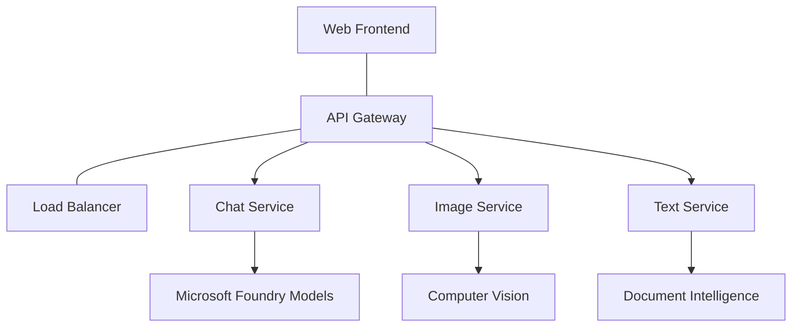

# Najlepsze praktyki obciążeń AI w produkcji z AZD

**Nawigacja po rozdziale:**
- **📚 Strona kursu**: [AZD dla początkujących](../../README.md)
- **📖 Bieżący rozdział**: Rozdział 8 - Wzorce produkcyjne i korporacyjne
- **⬅️ Poprzedni rozdział**: [Rozdział 7: Rozwiązywanie problemów](../chapter-07-troubleshooting/debugging.md)
- **⬅️ Powiązane również**: [Warsztaty AI](../chapter-02-ai-development/ai-workshop-lab.md)
- **🎯 Kurs ukończony**: [AZD dla początkujących](../../README.md)

## Przegląd

Ten przewodnik wyjaśnia wzorce projektowe AI w produkcji z wykorzystaniem Azure Developer CLI (AZD). Jest to odniesienie projektowe, a nie aplikacja do wdrożenia ani certyfikacja produkcyjna.

**Przykładowe granice:** O ile nie opisano wyraźnie jako kompletne, fragmenty Bicep zakładają parametry i zasoby odwoływane z szablonu zawierającego. Pomijają obrazy/ plany hosta, tożsamości, role przypisania, DNS, outputy i inne wymagane integracje. Ścieżki usług YAML oraz skrypty hook/testowe to pliki ilustracyjne do utworzenia w **własnej aplikacji**; nie są dostarczane przez ten kurs. Użyj działającego przykładu AZD jako bazy, skompiluj kompletną infrastrukturę i przetestuj ją w środowisku izolowanym przed produkcją.

## Kluczowe wyzwania

Typowe problemy produkcyjne obejmują wdrożenia wieloserwisowe, zarządzanie tożsamością i sekretami, skalowanie, kontrolę kosztów i monitoring. Tutaj nie twierdzimy, że są one mierzalnie powszechne.

## Wzorce architektury dla produkcyjnej AI

### Wzorzec 1: Architektura AI mikroserwisów

**Kiedy używać**: Złożone aplikacje AI z wieloma funkcjonalnościami



**Implementacja AZD**:

```yaml
# azure.yaml
name: enterprise-ai-platform
services:
  web:
    project: ./web
    host: staticwebapp
  api-gateway:
    project: ./api-gateway
    host: containerapp
  chat-service:
    project: ./services/chat
    host: containerapp
  vision-service:
    project: ./services/vision
    host: containerapp
  text-service:
    project: ./services/text
    host: containerapp
```

### Wzorzec 2: Przetwarzanie AI sterowane zdarzeniami

**Kiedy używać**: Przetwarzanie wsadowe, analiza dokumentów, asynchroniczne przepływy pracy

```bicep
// Event Hub for AI processing pipeline
resource eventHub 'Microsoft.EventHub/namespaces@2024-01-01' = {
  name: eventHubNamespaceName
  location: location
  sku: {
    name: 'Standard'
    tier: 'Standard'
    capacity: 1
  }
}

// Service Bus for reliable message processing
resource serviceBus 'Microsoft.ServiceBus/namespaces@2024-01-01' = {
  name: serviceBusNamespaceName
  location: location
  sku: {
    name: 'Premium'
    tier: 'Premium'
    capacity: 1
  }
}

// Function App for processing
resource functionApp 'Microsoft.Web/sites@2023-01-01' = {
  name: functionAppName
  location: location
  kind: 'functionapp,linux'
  properties: {
    siteConfig: {
      appSettings: [
        {
          name: 'FUNCTIONS_EXTENSION_VERSION'
          value: '~4'
        }
        {
          name: 'AZURE_OPENAI_ENDPOINT'
          value: '@Microsoft.KeyVault(VaultName=${keyVault.name};SecretName=openai-endpoint)'
        }
      ]
    }
  }
}
```

Tworzy to fragmenty przestrzeni nazw, a nie huby, kolejki, subskrypcje czy wyzwalacze Functions. Do uruchomienia Function potrzebny jest także plan hostingu, konfiguracja runtime/storage, dołączona tożsamość, RBAC i dostęp sieciowy. Odwołanie do Key Vault wymaga uprawnień do odczytu sekretów; sama URL końcowego punktu nie jest poświadczeniem.

## Myślenie o zdrowiu agentów AI

Gdy tradycyjna aplikacja webowa przestaje działać, objawy są znane: strona nie ładuje się, API zwraca błąd lub wdrożenie się nie powiodło. Aplikacje oparte na AI mogą się zepsuć na wszystkie te sposoby — ale mogą też zachowywać się w subtelniejszy sposób, który nie generuje oczywistych komunikatów błędów.

Ta sekcja pomaga zbudować model mentalny monitorowania obciążeń AI, by wiedzieć, gdzie patrzeć, gdy coś wydaje się nie tak.

### Jak zdrowie agenta różni się od zdrowia tradycyjnej aplikacji

Tradycyjne aplikacje mogą też mieć subtelne błędy poprawności. Agent AI wprowadza niedeterministyczną jakość odpowiedzi do zwykłych kwestii dostępności i poprawności. Myśl o zdrowiu agenta w dwóch warstwach:

| Warstwa | Co monitorować | Gdzie patrzeć |
|-------|----------------|--------------|
| **Zdrowie infrastruktury** | Czy usługa działa? Czy zasoby są przydzielone? Czy punkty końcowe są osiągalne? | `azd monitor`, zdrowie zasobów w Azure Portal, logi kontenera/aplikacji |
| **Zdrowie zachowania** | Czy agent odpowiada prawidłowo? Czy odpowiedzi pojawiają się na czas? Czy model jest wywoływany poprawnie? | śledzenia Application Insights, metryki latencji wywołań modelu, logi jakości odpowiedzi |

Zdrowie infrastruktury jest znane — jest takie samo dla każdej aplikacji azd. Zdrowie zachowania to nowa warstwa wprowadzona przez obciążenia AI.

### Gdzie szukać, gdy aplikacje AI zachowują się nieoczekiwanie

Jeśli Twoja aplikacja AI nie generuje oczekiwanych wyników, oto koncepcyjna lista kontrolna:

1. **Zacznij od podstaw.** Czy aplikacja działa? Czy może uzyskać dostęp do swoich zależności? Sprawdź `azd monitor` i zdrowie zasobów tak jak dla każdej aplikacji.
2. **Sprawdź połączenie z modelem.** Czy aplikacja poprawnie wywołuje model AI? Nieudane lub przekroczone wywołania modelu są najczęstszą przyczyną problemów z aplikacjami AI i pojawią się w logach aplikacji.
3. **Bezpiecznie sprawdź wejście i podstawę:** Błędne odpowiedzi mogą pochodzić z pobierania danych, instrukcji, ograniczeń modelu lub wykonania narzędzi. Używaj kontrolowanych dostępem, poodcinanych danych diagnostycznych; nie włączaj nieograniczonego logowania zapytań/odpowiedzi w produkcji.
4. **Przeanalizuj opóźnienia odpowiedzi.** Wywołania modeli AI są wolniejsze niż typowe wywołania API. Jeśli aplikacja wydaje się powolna, sprawdź, czy czas odpowiedzi modelu się wydłużył — może to wskazywać na ograniczenia, limit pojemności lub przeciążenie na poziomie regionu.
5. **Obserwuj sygnały kosztowe.** Niespodziewane skoki zużycia tokenów lub wywołań API mogą wskazywać na pętlę, błędną konfigurację promptu lub nadmierne powtórki.

Nie musisz od razu opanowywać narzędzi obserwowalności. Kluczowa lekcja to, że aplikacje AI mają dodatkową warstwę zachowania do monitorowania, a wbudowany monitoring azd (`azd monitor`) daje punkt startowy do badania obu warstw.

---

## Najlepsze praktyki bezpieczeństwa

### 1. Model bezpieczeństwa Zero-Trust

**Strategia wdrożenia**:
- Brak komunikacji usług bez uwierzytelniania
- Wszystkie wywołania API używają zarządzanych tożsamości
- Izolacja sieciowa z prywatnymi punktami końcowymi
- Kontrola dostępu zgodna z zasadą najmniejszych uprawnień

```bicep
// Managed Identity for each service
resource chatServiceIdentity 'Microsoft.ManagedIdentity/userAssignedIdentities@2023-01-31' = {
  name: 'chat-service-identity'
  location: location
}

// Role assignments with minimal permissions
resource openAIUserRole 'Microsoft.Authorization/roleAssignments@2022-04-01' = {
  scope: openAIAccount
  name: guid(openAIAccount.id, chatServiceIdentity.id, '5e0bd9bd-7b93-4f28-af87-19fc36ad61bd')
  properties: {
    roleDefinitionId: subscriptionResourceId('Microsoft.Authorization/roleDefinitions', '5e0bd9bd-7b93-4f28-af87-19fc36ad61bd')
    principalId: chatServiceIdentity.properties.principalId
    principalType: 'ServicePrincipal'
  }
}
```

### 2. Bezpieczne zarządzanie sekretami

**Wzorzec integracji z Key Vault**:

```bicep
// Key Vault with proper access policies
resource keyVault 'Microsoft.KeyVault/vaults@2023-02-01' = {
  name: keyVaultName
  location: location
  properties: {
    tenantId: tenant().tenantId
    sku: {
      family: 'A'
      name: 'standard' // Premium is needed for HSM-backed keys, not ordinary secrets
    }
    enableRbacAuthorization: true  // Use RBAC instead of access policies
    enablePurgeProtection: true    // Prevent accidental deletion
    enableSoftDelete: true
    softDeleteRetentionInDays: 90
  }
}

// Optional legacy key-auth alternative; omit when using Entra ID.
resource openAIKeySecret 'Microsoft.KeyVault/vaults/secrets@2023-02-01' = {
  parent: keyVault
  name: 'openai-api-key'
  properties: {
    value: openAIAccount.listKeys().key1
    attributes: {
      enabled: true
    }
  }
}
```

Przypisz tożsamość runtime `Key Vault Secrets User` na odpowiednim zakresie i dołącz ją do hosta; `enableRbacAuthorization` samodzielnie nie daje dostępu. Preferuj uwierzytelnianie zarządzaną tożsamością OpenAI z `disableLocalAuth: true`. Opcjonalny sekret klucza ma sens tylko dla konta z celowo włączonym kluczem, a podmiot dostarczający też musi mieć pozwolenie na zapis sekretów.

### 3. Bezpieczeństwo sieci

**Konfiguracja prywatnego punktu końcowego**:

```bicep
// Virtual Network for AI services
resource virtualNetwork 'Microsoft.Network/virtualNetworks@2023-04-01' = {
  name: vnetName
  location: location
  properties: {
    addressSpace: {
      addressPrefixes: ['10.0.0.0/16']
    }
    subnets: [
      {
        name: 'ai-services-subnet'
        properties: {
          addressPrefix: '10.0.1.0/24'
          privateEndpointNetworkPolicies: 'Disabled'
        }
      }
      {
        name: 'app-services-subnet'
        properties: {
          addressPrefix: '10.0.2.0/24'
          delegations: [
            {
              name: 'Microsoft.Web/serverFarms'
              properties: {
                serviceName: 'Microsoft.Web/serverFarms'
              }
            }
          ]
        }
      }
    ]
  }
}

// Private endpoints for all AI services
resource openAIPrivateEndpoint 'Microsoft.Network/privateEndpoints@2023-04-01' = {
  name: '${openAIAccountName}-pe'
  location: location
  properties: {
    subnet: {
      id: virtualNetwork.properties.subnets[0].id
    }
    privateLinkServiceConnections: [
      {
        name: 'openai-connection'
        properties: {
          privateLinkServiceId: openAIAccount.id
          groupIds: ['account']
        }
      }
    ]
  }
}
```

Prywatne punkty końcowe wymagają także grup stref DNS prywatnych/powiązań VNet oraz integracji aplikacji z VNet. Nie blokują automatycznie dostępu publicznego: wyłącz go wyraźnie po zweryfikowaniu prywatnej łączności i dostępu do wdrożenia AI.

## Wydajność i skalowanie

### 1. Strategie autoskalowania

**Autoskalowanie Container Apps**:

```bicep
resource containerApp 'Microsoft.App/containerApps@2023-05-01' = {
  name: containerAppName
  location: location
  properties: {
    configuration: {
      ingress: {
        external: true
        targetPort: 8000
        transport: 'http'
      }
    }
    template: {
      scale: {
        minReplicas: 2  // Always have 2 instances minimum
        maxReplicas: 50 // Scale up to 50 for high load
        rules: [
          {
            name: 'http-scaling'
            http: {
              metadata: {
                concurrentRequests: '20'  // Scale when >20 concurrent requests
              }
            }
          }
          {
            name: 'cpu-scaling'
            custom: {
              type: 'cpu'
              metadata: {
                type: 'Utilization'
                value: '70'  // Scale when CPU >70%
              }
            }
          }
        ]
      }
    }
  }
}
```

### 2. Strategie buforowania (cache)

**Redis Cache dla odpowiedzi AI**:

```bicep
// Legacy Azure Cache for Redis example (not recommended for new deployments)
resource redisCache 'Microsoft.Cache/redis@2023-04-01' = {
  name: redisCacheName
  location: location
  properties: {
    sku: {
      name: 'Premium'
      family: 'P'
      capacity: 1
    }
    enableNonSslPort: false
    minimumTlsVersion: '1.2'
    redisConfiguration: {
      'maxmemory-policy': 'allkeys-lru'
    }
    // Sharding distributes data; replication/failover provides availability.
    shardCount: 2
  }
}

// Cache configuration in application
var cacheConnectionString = '${redisCache.properties.hostName}:6380,password=${redisCache.listKeys().primaryKey},ssl=True,abortConnect=False'
```

Azure Cache for Redis Basic/Standard/Premium jest na [ścieżce wycofania](https://learn.microsoft.com/azure/azure-cache-for-redis/retirement-faq). Używaj Azure Managed Redis dla nowych projektów i jego dokumentowanej konfiguracji SKU, tożsamości i TLS, zamiast kopiować ten zasób dziedziczony do nowego systemu produkcyjnego. Linia connection-string jest nieaktywnym zastępnikiem, nie poświadczeniem. Podziel klucze cache zgodnie z autoryzacją, modelem/instrukcjami i wersją pobierania z wygaśnięciem; współdzielony cache tylko do zapytań może ujawnić dane innego użytkownika.

### 3. Równoważenie obciążenia i zarządzanie ruchem

**Application Gateway z WAF**:

```bicep
// Application Gateway with Web Application Firewall
resource applicationGateway 'Microsoft.Network/applicationGateways@2023-04-01' = {
  name: appGatewayName
  location: location
  properties: {
    sku: {
      name: 'WAF_v2'
      tier: 'WAF_v2'
      capacity: 2
    }
    webApplicationFirewallConfiguration: {
      enabled: true
      firewallMode: 'Prevention'
      ruleSetType: 'OWASP'
      ruleSetVersion: '3.2'
    }
    // Backend pools for AI services
    backendAddressPools: [
      {
        name: 'ai-services-pool'
        properties: {
          backendAddresses: [
            {
              fqdn: '${containerApp.properties.configuration.ingress.fqdn}'
            }
          ]
        }
      }
    ]
  }
}
```

To jest fragment zasobu gateway: rzeczywiste wdrożenie wymaga także konfiguracji podsieci/IP gateway, front-end IP i portów, TLS słuchaczy/certyfikatów, ustawień backend HTTP/sond, reguł trasowania i priorytetów oraz zweryfikowanej polityki WAF. Nazwa hosta TLS/SNI i uwierzytelnianie muszą odpowiadać backendowi Container App.

## 💰 Optymalizacja kosztów

### 1. Dopasowanie rozmiaru zasobów

**Konfiguracje specyficzne dla środowiska**:

Te nazwy to **ilustracyjne dane wejściowe szablonu niestandardowego**, a nie automatyczne ustawienia AZD. Zmapuj każdą do `infra/main.parameters.json`/Bicep i konfiguracji hosta najpierw. Na przykład przykład RAG używa `AZURE_SEARCH_SERVICE_SKU` i `AZURE_OPENAI_CHATGPT_DEPLOYMENT_CAPACITY`, a nie poniższych nazw ogólnych. Nadaj pamięci Container Apps wspieraną jednostkę taką jak `1Gi` w zasobie. Wprowadzaj zmiany infrastruktury za pomocą `azd up` lub `azd provision`; sam `azd deploy` nie wprowadza zmian Bicep.

```bash
# Development environment
azd env new development
azd env set AZURE_OPENAI_SKU "S0"
azd env set AZURE_OPENAI_CAPACITY 10
azd env set AZURE_SEARCH_SKU "basic"
azd env set CONTAINER_CPU 0.5
azd env set CONTAINER_MEMORY 1.0

# Production environment  
azd env new production
azd env set AZURE_OPENAI_SKU "S0"
azd env set AZURE_OPENAI_CAPACITY 100
azd env set AZURE_SEARCH_SKU "standard"
azd env set CONTAINER_CPU 2.0
azd env set CONTAINER_MEMORY 4.0
```

### 2. Monitorowanie kosztów i budżety

```bicep
// Supply the first day of the current UTC month, e.g. 2026-11-01T00:00:00Z.
param budgetStartDate string

// Cost management and budgets
resource budget 'Microsoft.Consumption/budgets@2024-08-01' = {
  name: 'ai-workload-budget'
  properties: {
    timePeriod: {
      startDate: budgetStartDate
    }
    timeGrain: 'Monthly'
    amount: 2000  // In the billing currency, not necessarily USD
    category: 'Cost'
    notifications: {
      warning: {
        enabled: true
        operator: 'GreaterThan'
        threshold: 80
        contactEmails: [
          'finance@company.com'
          'engineering@company.com'
        ]
        contactRoles: [
          'Owner'
          'Contributor'
        ]
      }
      critical: {
        enabled: true
        operator: 'GreaterThan'
        threshold: 95
        contactEmails: [
          'cto@company.com'
        ]
      }
    }
  }
}
```

Zamień przykładowych odbiorców i sprawdź zakres/uprawnienia. Alerty budżetowe używają opóźnionych danych rozliczeniowych i nie wymuszają limitu wydatków.

### 3. Optymalizacja użycia tokenów

**Zarządzanie kosztami OpenAI**:

To jest tylko heurystyka oparta na znakach dla podglądu UI, **nie** walidator limitu tokenów modelu. Kod produkcyjny musi używać tokenizera odpowiedniego do wdrożonego modelu i uwzględniać instrukcje systemowe, schematy narzędzi, historię i budżet outputu. Odrzuć zbyt duże wiadomości użytkownika, zamiast cicho je obcinać.

```typescript
// Application-level token optimization
class TokenOptimizer {
  private readonly maxTokens = 4000;
  private readonly reserveTokens = 500;
  
  optimizePrompt(userInput: string, context: string): string {
    const availableTokens = this.maxTokens - this.reserveTokens;
    if (this.estimateTokens(userInput) + 8 >= availableTokens) {
      throw new Error("User input exceeds the illustrative prompt budget");
    }
    const estimatedTokens = this.estimateTokens(userInput + context) + 8;
    
    if (estimatedTokens > availableTokens) {
      // Truncate context, not user input
      context = this.truncateContext(context, Math.max(0, availableTokens - this.estimateTokens(userInput) - 8));
    }
    
    return `${context}\n\nUser: ${userInput}`;
  }
  
  private estimateTokens(text: string): number {
    // Rough estimation: 1 token ≈ 4 characters
    return Math.ceil(text.length / 4);
  }

  private truncateContext(text: string, estimatedBudget: number): string {
    return text.slice(0, Math.max(0, estimatedBudget) * 4);
  }
}
```

## Monitorowanie i obserwowalność

### 1. Kompleksowy Application Insights

```bicep
// Application Insights with advanced features
resource applicationInsights 'Microsoft.Insights/components@2020-02-02' = {
  name: applicationInsightsName
  location: location
  kind: 'web'
  properties: {
    Application_Type: 'web'
    WorkspaceResourceId: logAnalyticsWorkspace.id
    SamplingPercentage: 100  // Ingestion setting; review cost and SDK sampling separately
    DisableIpMasking: false  // Retain IP masking
  }
}

// Custom metrics for AI operations
resource aiMetricAlerts 'Microsoft.Insights/metricAlerts@2018-03-01' = {
  name: 'ai-high-error-rate'
  location: 'global'
  properties: {
    description: 'Alert when failed request count exceeds 10 in five minutes'
    severity: 2
    enabled: true
    scopes: [
      applicationInsights.id
    ]
    evaluationFrequency: 'PT1M'
    windowSize: 'PT5M'
    criteria: {
      'odata.type': 'Microsoft.Azure.Monitor.SingleResourceMultipleMetricCriteria'
      allOf: [
        {
          name: 'high-error-rate'
          metricName: 'requests/failed'
          operator: 'GreaterThan'
          threshold: 10
          timeAggregation: 'Count'
        }
      ]
    }
  }
}
```

### 2. Monitorowanie specyficzne dla AI

**Własne pulpity do metryk AI**:

```json
{
  "dashboard": {
    "name": "AI Application Monitoring",
    "tiles": [
      {
        "name": "OpenAI Request Volume",
        "query": "dependencies | where target contains 'openai' | summarize count() by bin(timestamp, 5m)"
      },
      {
        "name": "AI Response Latency",
        "query": "dependencies | where target contains 'openai' | summarize avg(duration) by bin(timestamp, 5m)"
      },
      {
        "name": "Token Usage",
        "query": "customMetrics | where name == 'openai_tokens_used' | summarize sum(value) by bin(timestamp, 1h)"
      },
      {
        "name": "Cost per Hour",
        "query": "customMetrics | where name == 'openai_cost' | summarize sum(value) by bin(timestamp, 1h)"
      }
    ]
  }
}
```

Ten JSON to szkic zdefiniowany przez aplikację, a nie importowalny schemat pulpitu w Azure portal. Zapytania tokenów/kosztów wymagają, by aplikacja emitowała dokładnie te metryki niestandardowe; nie są one tworzone przez AZD. Dostosuj filtry zależności do twoich rzeczywistych nazw punktów końcowych/rozpiętości modelu.

### 3. Kontrole zdrowia i monitorowanie dostępności

```bicep
// Application Insights availability tests
resource availabilityTest 'Microsoft.Insights/webtests@2022-06-15' = {
  name: 'ai-app-availability-test'
  location: location
  tags: {
    'hidden-link:${applicationInsights.id}': 'Resource'
  }
  properties: {
    SyntheticMonitorId: 'ai-app-availability-test'
    Name: 'AI Application Availability Test'
    Description: 'Tests AI application endpoints'
    Enabled: true
    Frequency: 300  // 5 minutes
    Timeout: 120    // 2 minutes
    Kind: 'standard'
    Locations: [
      {
        Id: 'us-east-2-azr'
      }
      {
        Id: 'us-west-2-azr'
      }
    ]
    Request: {
      RequestUrl: 'https://${webApp.properties.defaultHostName}/health'
      HttpVerb: 'GET'
      FollowRedirects: true
      ParseDependentRequests: false
    }
    ValidationRules: {
      ExpectedHttpStatusCode: 200
      SSLCheck: true
      SSLCertRemainingLifetimeCheck: 7
    }
  }
}
```

## Odzyskiwanie po awarii i wysoka dostępność

Powyższy test zakłada istniejący App Service `webApp` oraz zasób Application Insights. Standardowe testy dostępności są płatne i wymagają osiągalnego punktu końcowego; aplikacje prywatne wymagają odpowiedniego projektu monitoringu prywatnego. Testy ping URL są przestarzałe; używaj [standardowych testów dostępności](https://learn.microsoft.com/azure/azure-monitor/app/availability).

### 1. Wdrożenie wieloregionalne

```yaml
# azure.yaml - Multi-region configuration
name: ai-app-multiregion
services:
  api-primary:
    project: ./api
    host: containerapp
    env:
      AZURE_REGION: eastus
  api-secondary:
    project: ./api
    host: containerapp
    env:
      AZURE_REGION: westus2
```

```bicep
// Separate App Service topology, not the Container Apps declarations above
resource trafficManager 'Microsoft.Network/trafficManagerProfiles@2022-04-01' = {
  name: trafficManagerProfileName
  location: 'global'
  properties: {
    profileStatus: 'Enabled'
    trafficRoutingMethod: 'Priority'
    dnsConfig: {
      relativeName: trafficManagerProfileName
      ttl: 30
    }
    monitorConfig: {
      protocol: 'HTTPS'
      port: 443
      path: '/health'
      intervalInSeconds: 30
      toleratedNumberOfFailures: 3
      timeoutInSeconds: 10
    }
    endpoints: [
      {
        name: 'primary-endpoint'
        type: 'Microsoft.Network/trafficManagerProfiles/azureEndpoints'
        properties: {
          targetResourceId: primaryAppService.id
          endpointStatus: 'Enabled'
          priority: 1
        }
      }
      {
        name: 'secondary-endpoint'
        type: 'Microsoft.Network/trafficManagerProfiles/azureEndpoints'
        properties: {
          targetResourceId: secondaryAppService.id
          endpointStatus: 'Enabled'
          priority: 2
        }
      }
    ]
  }
}
```

Zmienne środowiskowe nie wybierają lokalizacji zasobów. IaC musi wdrożyć odrębne regionalne hosty i powiązać każdą usługę za pomocą tagów `resourceName` lub `azd-service-name`. Przykład Traffic Manager to **oddzielna topologia App Service** (`primaryAppService`/`secondaryAppService`), a nie trasowanie dla deklaracji Container Apps. Container Apps wymaga odpowiednio skonfigurowanego punktu końcowego zewnętrznego/front door, trasowania TLS/własnej domeny oraz sond zdrowotnych.

### 2. Kopie zapasowe i odzyskiwanie danych

```bicep
// Backup configuration for critical data
resource backupVault 'Microsoft.DataProtection/backupVaults@2023-05-01' = {
  name: backupVaultName
  location: location
  identity: {
    type: 'SystemAssigned'
  }
  properties: {
    storageSettings: [
      {
        datastoreType: 'VaultStore'
        type: 'LocallyRedundant'
      }
    ]
  }
}

```

Sam vault nic nie kopiuje. Skonfiguruj **obsługiwalną politykę i instancję backupu specyficzną dla obciążenia**, uprawnienia źródła, retencję i testy przywracania, korzystając z [matryc wsparcia Azure Backup](https://learn.microsoft.com/azure/backup/backup-support-matrix). Nie ma uniwersalnej polityki Azure Backup dla wdrożeń modelu Azure OpenAI hostowanych. Przechowuj definicje infrastruktury/modelu pod kontrolą źródła; chroń przesłane dokumenty, dane aplikacji i artefakty fine-tuningowe używając funkcji backupu/eksportu obsługiwanych przez każde zaplecze. Wyraźnie zdefiniuj i przetestuj RPO/RTO.

## Integracja DevOps i CI/CD

### 1. Workflow GitHub Actions

```yaml
# .github/workflows/deploy-ai-app.yml
name: Deploy AI Application

on:
  push:
    branches: [main]
  pull_request:
    branches: [main]

jobs:
  test:
    runs-on: ubuntu-latest
    steps:
      - uses: actions/checkout@v4
      
      - name: Setup Python
        uses: actions/setup-python@v4
        with:
          python-version: '3.11'
          
      - name: Install dependencies
        run: |
          pip install -r requirements.txt
          pip install pytest
          
      - name: Run tests
        run: pytest tests/
        
      - name: AI Safety Tests
        run: |
          python scripts/test_ai_safety.py
          python scripts/validate_prompts.py

```

To jest **część testowa** workflow i zakłada, że utworzyłeś `requirements.txt`, `tests/` oraz dwa skrypty bezpieczeństwa. Dodaj uwierzytelnione zadania OIDC do provisioning/wdrożenia z [Konfiguracji pipeline CI/CD](#cicd-pipeline-configuration), z `needs: test`, zaufanym push/ręcznym wyzwalaczem i chronionymi środowiskami GitHub. Nie wdrażaj niezweryfikowanego kodu pull-request z poświadczeniami cloud. Świeży runner nie ma wybranego lokalnego środowiska AZD; dostarcz dane środowiska/subskrypcji/lokalizacji i użyj `azd auth login`, nie tylko `azure/login`.

### 2. Weryfikacja infrastruktury

```bash
# scripts/validate_infrastructure.sh
#!/bin/bash
set -euo pipefail

echo "Validating AI infrastructure deployment..."

# Requires Azure CLI login and the resource group selected explicitly.
: "${AZURE_RESOURCE_GROUP:?Set AZURE_RESOURCE_GROUP}"
: "${AZURE_OPENAI_NAME:?Set AZURE_OPENAI_NAME}"
: "${AZURE_OPENAI_CHAT_DEPLOYMENT:?Set the actual deployment name}"

# A successful empty list is not proof that resources exist.
types=("Microsoft.CognitiveServices/accounts" "Microsoft.Search/searchServices"
       "Microsoft.Storage/storageAccounts" "Microsoft.KeyVault/vaults")
for resource_type in "${types[@]}"; do
    count=$(az resource list --resource-group "$AZURE_RESOURCE_GROUP" \
        --resource-type "$resource_type" --query "length(@)" -o tsv)
    if [[ "$count" -lt 1 ]]; then
        echo "ERROR: No $resource_type found in $AZURE_RESOURCE_GROUP"
        exit 1
    fi
done

# Validate OpenAI model deployments
echo "Validating OpenAI model deployments..."
state=$(az cognitiveservices account deployment show \
  --name "$AZURE_OPENAI_NAME" --resource-group "$AZURE_RESOURCE_GROUP" \
  --deployment-name "$AZURE_OPENAI_CHAT_DEPLOYMENT" \
  --query "properties.provisioningState" -o tsv)
if [[ "$state" != "Succeeded" ]]; then
    echo "ERROR: Required model deployment is not provisioned successfully"
    exit 1
fi

echo "Infrastructure validation completed successfully!"
```

Oczekiwane: zero exit i tylko komunikat ukończenia, gdy istnieją wszystkie oczekiwane typy i wdrożenie modelu o podanej nazwie jest zprowizjonowane. Sprawdza stan inwentaryzacji/prowizjonowania, **nie** zdrowie zasobów, dokładną topologię, RBAC, osiągalność sieciową ani zachowanie modelu. Dostosuj spodziewane typy do architektury, a następnie wykonaj osobny uwierzytelniony test gotowości aplikacji.

## Lista kontrolna gotowości produkcyjnej

### Bezpieczeństwo ✅
- [ ] Wszystkie usługi używają zarządzanych tożsamości
- [ ] Sekrety przechowywane w Key Vault
- [ ] Skonfigurowane prywatne punkty końcowe
- [ ] Wdrożone grupy zabezpieczeń sieci
- [ ] RBAC z zasadą najmniejszych uprawnień
- [ ] WAF włączony na publicznych punktach końcowych

### Wydajność ✅
- [ ] Skonfigurowane autoskalowanie
- [ ] Wdrożone buforowanie
- [ ] Skonfigurowane równoważenie obciążenia
- [ ] CDN dla zawartości statycznej
- [ ] Pooling połączeń do bazy danych
- [ ] Optymalizacja użycia tokenów

### Monitoring ✅
- [ ] Skonfigurowany Application Insights
- [ ] Zdefiniowane metryki niestandardowe
- [ ] Skonfigurowane reguły alertów
- [ ] Utworzony pulpit
- [ ] Wdrożone kontrole zdrowia
- [ ] Zasady retencji logów

### Niezawodność ✅
- [ ] Wdrożenie wieloregionalne
- [ ] Plan kopii zapasowych i odzyskiwania
- [ ] Wdrożone "circuit breakers"
- [ ] Skonfigurowane polityki powtórek
- [ ] Graceful degradation (łagodne pogarszanie)
- [ ] Punkty końcowe kontroli zdrowia

### Zarządzanie kosztami ✅
- [ ] Skonfigurowane alerty budżetowe
- [ ] Dopasowanie rozmiaru zasobów
- [ ] Zastosowane zniżki dla dev/test
- [ ] Zakupione instancje zarezerwowane
- [ ] Pulpit monitorowania kosztów
- [ ] Regularne przeglądy kosztów

### Zgodność ✅
- [ ] Spełnione wymagania dotyczące lokalizacji danych
- [ ] Włączone logowanie audytu
- [ ] Zastosowane polityki zgodności
- [ ] Wdrożone podstawy bezpieczeństwa
- [ ] Regularne oceny bezpieczeństwa
- [ ] Plan reagowania na incydenty

## Benchmarki wydajności

### Ilustracyjne cele produkcyjne

Są to przykładowe SLO do negocjacji i testów obciążeniowych, a nie mierzone benchmarki czy gwarancje. Czas odpowiedzi zależy od modelu/długości wyjścia; miesięczny koszt tokenów zależy od ruchu i cen, nie samej liczby tokenów.

| Metryka | Cel | Monitorowanie |
|--------|-----|-------------|
| **Czas odpowiedzi** | < 2 sekundy | Application Insights |
| **Dostępność** | 99,9% | Monitorowanie czasu działania |
| **Wskaźnik błędów** | < 0,1% | Logi aplikacji |
| **Wydatki na model** | < 500 USD/miesiąc (przykładowy budżet) | Zarządzanie kosztami |
| **Użytkownicy równoczesni** | 1000+ | Testy obciążeniowe |
| **Czas odzyskiwania** | < 1 godzina | Testy odzyskiwania po awarii |

### Testy obciążeniowe

Poniżej znajduje się szkic interfejsu dla skryptu testu obciążeniowego, **który musisz wdrożyć**; to repozytorium nie dostarcza `scripts/load_test.py`. Zdefiniuj ładunki żądań, uwierzytelnianie, reprezentatywne obciążenia, asercje opóźnień/błędów na percentylach oraz limit wydatków w wybranym przez siebie narzędziu do testów obciążeniowych przed jego uruchomieniem:

```bash
# Load testing script for AI applications
python scripts/load_test.py \
  --endpoint https://your-ai-app.azurewebsites.net \
  --concurrent-users 100 \
  --duration 300 \
  --ramp-up 60
```

## 🤝 Najlepsze praktyki społeczności

Na podstawie opinii społeczności Microsoft Foundry Discord:

### Najważniejsze zalecenia społeczności:

1. **Zacznij od małego, skaluj stopniowo**: Zacznij od podstawowych SKU i skaluj w oparciu o rzeczywiste użycie
2. **Monitoruj wszystko**: Skonfiguruj kompleksowy monitoring od pierwszego dnia
3. **Automatyzuj bezpieczeństwo**: Używaj infrastruktury jako kodu dla spójnego zabezpieczenia
4. **Testuj dokładnie**: Uwzględnij testy specyficzne dla AI w swoim pipeline
5. **Planuj koszty**: Monitoruj zużycie tokenów i ustaw alerty budżetowe wcześnie

### Typowe pułapki do uniknięcia:

- ❌ Twarde kodowanie kluczy API w kodzie
- ❌ Brak odpowiedniej konfiguracji monitoringu
- ❌ Ignorowanie optymalizacji kosztów
- ❌ Brak testów scenariuszy awarii
- ❌ Wdrażanie bez kontroli stanu zdrowia

## Polecenia i rozszerzenia AI CLI AZD

AZD zawiera rosnący zestaw poleceń i rozszerzeń specyficznych dla AI, które usprawniają produkcyjne przepływy pracy AI. Te narzędzia łączą lukę między lokalnym rozwojem a produkcyjnym wdrożeniem obciążeń AI.

> **Aktualizacja Foundry GA (2026-11-09):** Pakiet `microsoft.foundry` osiągnął **1.0 / stabilną dostępność ogólną** w dniu [5 listopada 2026](https://devblogs.microsoft.com/azure-sdk/microsoft-foundry-azure-developer-cli-ga/). Używaj **`azd >= 1.37.0`** dla tego przepływu pracy. Wcześniejsza recenzja `azd 1.37.2`, agents beta.23 i evaluations beta.2 jest zachowana poniżej jako historia migracji, a nie aktualna wersja pakietu. To jest recenzja dokumentacji/źródeł, a nie walidacja wdrożenia na żywo ani stwierdzenie, że każda opcjonalna funkcja rozszerzenia, API lub wersji próbnej jest już GA.

### Rozszerzenia AZD dla AI

AZD korzysta z systemu rozszerzeń do dodawania funkcji specyficznych dla AI. Instaluj i zarządzaj rozszerzeniami za pomocą:

```bash
# List all available extensions (including AI)
azd extension list

# Inspect installed versions
azd version
azd ext list --installed

# Install the GA Foundry bundle
azd ext install microsoft.foundry

# Install the separate Foundry evaluations extension
azd extension install azure.ai.evaluations

# Install the fine-tuning extension
azd extension install azure.ai.finetune

# Install the custom models extension
azd extension install azure.ai.models

# Upgrade the Foundry bundle
azd ext upgrade microsoft.foundry
```

**Dostępne rozszerzenia AI:**

| Rozszerzenie | Przeznaczenie | Status |
|------------|-------------|--------|
| `microsoft.foundry` | Meta-pakiet instalujący siedem podstawowych rozszerzeń poniżej; brak własnej grupy poleceń | Pakiet GA 1.0 |
| `azure.ai.agents` | `azd ai agent`: konfiguracja agentów, wykonanie lokalne i operacje | Włączone; wersjonowane niezależnie |
| `azure.ai.connections` | `azd ai connection`: połączenia projektów | Włączone; wersjonowane niezależnie |
| `azure.ai.inspector` | `azd ai inspector`: lokalny interfejs Agent Inspector | Włączone; wersjonowane niezależnie |
| `azure.ai.projects` | `azd ai project`: zasoby projektowe i wdrożenia modeli | Włączone; wersjonowane niezależnie |
| `azure.ai.routines` | `azd ai routine`: harmonogramy i wyzwalacze | Włączone; wersjonowane niezależnie |
| `azure.ai.skills` | `azd ai skill`: wielokrotnego użytku wytyczne zachowań | Włączone; wersjonowane niezależnie |
| `azure.ai.toolboxes` | `azd ai toolbox`: wersjonowane kolekcje narzędzi | Włączone; wersjonowane niezależnie |
| `azure.ai.evaluations` | Zestawy danych ewaluacyjnych, ewaluatory, grupy ewaluacji i wykonania | Oddzielna instalacja/wersja |
| `azure.ai.dataset` | Rejestracja i wersjonowanie zestawów danych | Oddzielna instalacja/wersja |
| `azure.ai.finetune` | Fine-tuning modeli Foundry | Oddzielna instalacja/wersja |
| `azure.ai.models` | Niestandardowe modele Foundry | Oddzielna instalacja/wersja |

Instalacja `azure.ai.agents` indywidualnie jest nadal wspierana i instaluje zależności; pakiet jest domyślny w kursie dla przepływu pracy GA. Pakiet GA nie jest gwarancją statusu wydania dla opcjonalnych funkcji jego składników. Zobacz [pakowanie i weryfikację rozszerzeń](https://learn.microsoft.com/azure/foundry/agents/how-to/install-cli-foundry-extensions) oraz sprawdź pomoc poleceń zainstalowanych przed ich użyciem.

> Najpierw zaktualizuj podstawowe CLI za pomocą `azd update` lub odpowiedniej [metody instalacji/aktualizacji](https://learn.microsoft.com/azure/developer/azure-developer-cli/install-azd), następnie uruchom `azd ext upgrade microsoft.foundry`. W razie potrzeby zaktualizuj osobno instalowane ewaluacje za pomocą `azd ext upgrade azure.ai.evaluations`. Nie ma podstawowego polecenia `azd upgrade`. Rejestruj i przeglądaj wersjonowane niezależnie rozszerzenia w automatyce produkcyjnej; aktualizacja nie migruje automatycznie starej konfiguracji.

### Ostatnie zmiany i poprawki w wydaniu

| Wydanie | Co zmienia się dla tego kursu |
|---------|------------------------------|
| `microsoft.foundry` 1.0 GA (2026-11-05) | Domyślny pakiet siedmiu rozszerzeń, zachowuj ustawienia agenta/wdrożenia w `azure.yaml`, testuj lokalnie za pomocą Agent Inspector, i wysyłaj kod do zdalnej budowy Foundry. Instaluj ewaluacje osobno i ponownie instaluj wymagane rozszerzenia na runnerach CI. |
| `azd 1.37.0` | Dodaje stabilne API podglądu wdrożeń i poprawia edycje rozszerzeń nadpisujące niepowiązane ustawienia `azure.yaml`. |
| `azd 1.37.1` | Naprawia propagację Ctrl+C między rozszerzeniami i rozróżnia anulowanie/przekroczenia czasu od ogólnych błędów. |
| `azd 1.37.2` | Poprawia walidację provisioning: krytyczne ostrzeżenia domyślnie na **Nie**, powodują błąd bez potwierdzenia w uruchomieniach bezobsługowych, a anulowanie pomija haki post-provision. Poprawia też nierozwiązane wartości środowiskowe w deny listach Deployment Stacks, gdy włączona jest funkcja alfa. |
| Agenci `beta.22` | Migracja ewaluacji do `azd ai eval`, zmiana optymalizacji na API GA v1, wymaga liczby mnogiej `toolboxes` oraz separacja opt-in managed-harness, voice i long-running preview. Poprawki wyboru modelu zależnego od środowiska i uwierzytelniania toolboxa. |
| Agenci `beta.23` | Udostępnia `init --harness`; poprawki wyjścia odpowiedzi A2A 0.3, nieprawidłowych ścieżek/modułów prompt-agent między warstwami infrastruktury, diagnostyki timeoutu aktywacyjnego i utrzymane ostrzeżenia RBAC deweloperskie. |
| Ewaluacje `beta.2` | Wymaga konfiguracji ewaluacji w camelCase, dodaje statyczne/symulowane tworzenie rozmów i explicit lokalne źródła plików oraz poprawia obsługę danych identyfikacyjnych/wersji zestawów danych, liczenie quality-gate i diagnostykę błędnych wykonania. |

Limit czasu aktywacji agenta **nie** świadczy o niepowodzeniu wdrożenia: sprawdź wersję i jej stan przed ponowną próbą. Ostrzeżenia RBAC dewelopera mogą pozostać nawet po pomyślnym provisioningu; rozwiąż brakujący dostęp przed wywołaniem jako ten deweloper.

Rzędy beta powyżej opisują wcześniejsze poprawki i granice migracji, a nie wymóg przypinania nowych projektów do tych wersji.

Źródła: [Ogłoszenie Foundry GA](https://devblogs.microsoft.com/azure-sdk/microsoft-foundry-azure-developer-cli-ga/), [wydania AZD](https://github.com/Azure/azure-dev/releases), [wydanie agents beta.23](https://github.com/Azure/azure-dev/releases/tag/azd-ext-azure-ai-agents_1.0.0-beta.23), [migracja agents beta.22](https://github.com/Azure/azure-dev/releases/tag/azd-ext-azure-ai-agents_1.0.0-beta.22), oraz [wydanie evaluations beta.2](https://github.com/Azure/azure-dev/releases/tag/azd-ext-azure-ai-evaluations_1.0.0-beta.2).

**Czym są dołączone rozszerzenia `skills` i `connections`?**

Są instalowane z podstawowym pakietem, ale służą różnym celom:

- **`azure.ai.skills`** — **Skill** pakujący wielokrotnego użytku wytyczne zachowań dla agentów. Udostępniaj recenzowane instrukcje agentom zamiast je kopiować. Skill sam z siebie nie implementuje narzędzia ani nie daje dostępu do danych; do wykonania narzędzi używaj toolboxów i kodu aplikacji.
- **`azure.ai.connections`** — **Połączenie** to zarządzany link z Twojego projektu Foundry do zewnętrznego zasobu potrzebnego agentom — źródło danych (np. Azure AI Search), punkt końcowy narzędzia lub inna usługa. Połączenia centralizują *gdzie* i *jak* agenci mają dostęp do danych, więc dane uwierzytelniające i punkty końcowe są w jednym zarządzanym miejscu, a nie rozproszone w kodzie.

Nie musisz konfigurować każdej funkcjonalności z pakietu, by wdrożyć swojego pierwszego agenta. Sięgaj po skills, gdy agenci dzielą wytyczne zachowań, a połączenia, gdy dzielą zewnętrzne zasoby.

### Inicjalizacja projektów agentów za pomocą `azd ai agent init`

Polecenie `azd ai agent init` generuje szkielet projektu agenta Microsoft Foundry. Aby zobaczyć przykład działającego wdrożenia kodu z Python 3.13+ i aktualnym uv, przejdź do [przewodnika GA hosted-agent](../chapter-02-ai-development/microsoft-foundry-integration.md#hosted-agent-walkthrough-ga). Polecenia poniżej pokazują zamiast tego, jak zaadaptować **własny** aktualny szablon projektu `azure.yaml`; podany lokalny szablon nie jest dostarczany przez ten kurs:

```bash
# Initialize a new agent project from a local project template
azd ai agent init --template ./templates/support-agent/azure.yaml

# Initialize and target a specific Foundry project
azd ai agent init --template ./templates/support-agent/azure.yaml --project-id <foundry-project-id>

# Adopt the template into a different directory
azd ai agent init --template ./templates/support-agent/azure.yaml --src ./agents/my-agent
```

**Kluczowe flagi:**

| Flaga | Opis |
|-------|------|
| `-t, --template` | Ścieżka lub obsługiwany URI GitHub do dokumentu projektu `azure.yaml` |
| `-p, --project-id` | Istniejący identyfikator projektu Microsoft Foundry dla Twojego środowiska azd |
| `-s, --src` | Katalog źródłowy dla wygenerowanych agentów lub katalog docelowy podczas adopcji projektu |
| `--deploy-mode code` | Prześlij źródło do zdalnej budowy Foundry zamiast budowy lokalnego kontenera |
| `--model-deployment` | Ponowne użycie istniejącego, nazwanego wdrożenia modelu podczas inicjalizacji |
| `--kind` | Inicjalizuj agenta `hosted`, `prompt` lub wersji zapoznawczej `prompt-voice` |
| `--harness` | Opcjonalny harness wykonawczy dla `--kind prompt`; wymaga opt-in wersji zapoznawczej |
| `-e, --environment` | Używane środowisko azd |

`--manifest`/`-m` to przestarzały alias dla `--template`/`-t`; zmiana nazwy flagi nie konwertuje starego manifestu na aktualny dokument projektu. `--host containerapp` nie jest obecnie flagą agent-init. Dla zwykłej aplikacji Container Apps użyj `azd init --template` z szablonem deklarującym `host: containerapp`.

W przypadku istniejącego projektu z dokładnie jedną usługą `azure.ai.project`, polecenie `azd ai agent add support-agent --file ./agents/support-agent.yaml` dodaje lub aktualizuje bezpośrednią definicję agenta bez provisioning i wdrożenia. Polecenia runtime odrzucają przestarzałe implikacje `agent.yaml`/AgentManifest oraz zagnieżdżone definicje usługi `config:`; migruj je do aktualnej usługi `azure.ai.agent`. Jeśli init wyświetla kolejny krok `cd`, wykonaj go przed `azd up`: init nie zmienia katalogu powłoki.

**Wskazówka produkcyjna**: Użyj `--project-id`, aby łączyć się bezpośrednio z istniejącym projektem Foundry, utrzymując od początku powiązanie kodu agenta i zasobów cloud.

#### Opcjonalne funkcje wersji zapoznawczej

Managed harness, voice i long-running invocation są domyślnie niezależnie wyłączone. Ustaw tylko przełącznik dla funkcji, której potrzebujesz, w **środowisku procesu shell/CI**, a nie flagą `azd env set`:

| Funkcja | Zmienna środowiskowa procesu |
|---------|-----------------------------|
| Managed harness (`init --kind prompt --harness ...`) | `AZD_ALPHA_ENABLE_AGENTS_MANAGED_HARNESS=true` |
| Voice (`init --kind prompt-voice`) | `AZD_ALPHA_ENABLE_AGENTS_VOICE=true` |
| Long-running invocation | `AZD_ALPHA_ENABLE_AGENTS_LONG_RUNNING=true` |

Na przykład, użyj `export AZD_ALPHA_ENABLE_AGENTS_MANAGED_HARNESS=true` w Bash lub `$env:AZD_ALPHA_ENABLE_AGENTS_MANAGED_HARNESS = "true"` w PowerShell przed uruchomieniem odpowiedniego polecenia. Jeden przełącznik nie aktywuje pozostałych. Zobacz [README wydanych agentów](https://github.com/Azure/azure-dev/blob/azd-ext-azure-ai-agents_1.0.0-beta.23/cli/azd/extensions/azure.ai.agents/README.md) dla wszystkich przełączników wersji zapoznawczej i ograniczeń.

### Zarządzanie cyklem życia agenta

Rozszerzenie pakietu `azure.ai.agents` obsługuje testy lokalne i operacje wdrożonych agentów. Zainstaluj `azure.ai.evaluations` oddzielnie, aby mierzyć jakość:

```bash
# Start the local agent and Agent Inspector (leave running)
azd ai agent run

# From a second terminal in the project directory
azd ai agent invoke --local "Explain how this agent is deployed."

# Invoke a deployed agent and view server response timing
# (total latency and time to first byte)
azd ai agent invoke

# Show the live endpoint configuration before changing it
azd ai agent endpoint show

# Download the deployed source of a code-based hosted agent
# (with SHA-256 verification)
azd ai agent code download

# Delete a hosted agent and all of its versions
# (--force terminates active sessions)
azd ai agent delete --force
```

**Cykl życia w skrócie:**

| Etap | Polecenie | Użycie produkcyjne |
|------|----------|------------------|
| Test lokalny | `azd ai agent run`, następnie `azd ai agent invoke --local "Test prompt"` | Sprawdź żądania i odpowiedzi przed wdrożeniem; wywołania modelu Azure nadal generują opłaty |
| Wdrożenie | `azd deploy` | W trybie kodu zbuduj przesłane źródło zdalnie w Foundry |
| Test | `azd ai agent invoke` | Zweryfikuj odpowiedzi i zmierz opóźnienia przed wydaniem |
| Diagnostyka | `azd ai agent doctor`, `azd ai agent monitor --follow` | Sprawdź konfigurację/uprawnienia i oglądaj logi agenta |
| Inspekcja | `azd ai agent endpoint show` | Przejrzyj uwierzytelnianie/konfigurację punktu końcowego; wykrywaj wcześnie zmiany łamiące |
| Pomiar | `azd ai eval init`, `generate`, `run start` | Definiuj, wdrażaj i wykonuj powtarzalne ewaluacje |
| Optymalizacja | `azd ai agent optimize --eval <evaluation-name> --optimize-model <optimizer-deployment>` | Ponownie używaj kompatybilnej ewaluacji, by zoptymalizować agenta |
| Odzyskiwanie | `azd ai agent code download` | Pobierz dokładne wdrożone źródło do audytu/przywracania |
| Wycofywanie | `azd ai agent delete --force` | Usuń agenta i jego wersje w sposób czysty |

> Uruchom `azd ai agent --help`, aby przejrzeć polecenia w zainstalowanej wersji. Pakiet jest GA; niezależnie zatwierdzone funkcje wersji zapoznawczej są nadal opt-in. Przed oczyszczeniem rozróżniaj usuwanie agenta od usuwania projektu: `azd down` usuwa grupę zasobów świeżo utworzonego projektu, ale pozostawia zasoby projektów używanych ponownie. Postępuj zgodnie z [zaleceniami oczyszczania](../chapter-02-ai-development/microsoft-foundry-integration.md#7-clean-up-deliberately).

`endpoint show` obsługuje agentów hosted, prompt i voice, ale aktualizacje punktu końcowego są tylko hosted; agenci workflow nie są wspierani. Pobieranie kodu i powyższy przykład wycofania agenta hosted nie są operacjami ogólnymi dla każdego rodzaju agenta.

#### Migracja ewaluacji i kontrole jakości

Począwszy od agentów **1.0.0-beta.22 (2026-10-23)**, przestarzałe polecenia `azd ai agent eval` dostarczają wskazówki migracji zamiast dotychczasowego przepływu ewaluacji. Nie kopiuj starych przykładów `eval generate --dataset ...`: ewaluacja jest teraz pod **`azd ai eval`**.

W zainicjowanym projekcie agenta uwierzytelnij się za pomocą `azd auth login`, potwierdź wybrane środowisko/projekt Foundry i zainstaluj `azure.ai.evaluations`. Do oceny opartej na modelu potrzebne jest wdrożenie modelu sędziego; generowanie i symulacja rozmowy mogą wymagać własnych wyborów modeli i mogą wiązać się z dodatkowymi opłatami.

```bash
# Generate a draft rubric and dataset from the deployed agent
azd ai eval generate

# After reviewing the assets, configure a named evaluation
azd ai eval init --name quality

# Review generated files, then register datasets, evaluators, and eval groups
azd up

# Start an evaluation and wait for its results
azd ai eval run start --eval quality --wait

# Inspect runs and available test-case output
azd ai eval run list
azd ai eval run show <run-id>
azd ai eval run output list <run-id>
```

Dla przykładu z zapowiedzi GA wybierz **Dataset and evaluator** oraz **Turn** podczas generowania, a następnie wybierz te recenzowane zasoby i model sędziego podczas inicjalizacji. Postępuj zgodnie z wydrukowanymi kolejnymi krokami, zamiast zakładać, że wygenerowane zasoby są już zarejestrowane. Możesz również zainicjować się na podstawie istniejącego recenzowanego zbioru danych/schemat oceny bez generowania nowych danych. Konfiguracja oceny zwykle znajduje się w `evals/azure.eval.yaml`, do której odnosi się usługa `azure.ai.eval` w `azure.yaml`. Klucze są w **camelCase** (`evaluationLevel`, `maxSamples`, `initializationParameters`, `dataMapping`); stare klucze konfiguracyjne w snake_case są odrzucane. Ścieżki wewnątrz odwoływanej konfiguracji rozwiązują się względem tego pliku, a nie względem katalogu głównego repozytorium.

Dla ocen konwersacji wybierz **static**, aby ocenić zakończone transkrypcje bez wywoływania agenta, lub **simulation**, aby generować rozmowy na podstawie scenariuszy. Symulacja wymaga celu agenta, modelu symulatora oraz oddzielnego wyboru modelu sędziego. Dla poleceń nieobsługiwanych interaktywne, podaj wejścia wymienione przez `azd ai eval init --help` i `azd ai eval generate --help`; nie zakładaj, że model generujący jest także sędzią lub symulatorem.

Dla CI skonfiguruj wyraźną politykę jakości za pomocą `azd ai eval run start --help` (`--fail-on`) i traktuj niezerowe zakończenie hosta jako błąd. Zakończone uruchomienie nie jest automatycznie zaliczeniem jakości. Przejrzyj niezdane/błędne wiersze i diagnostykę; brakujące lub niespójne liczby wyników nie są dowodem sukcesu. Zarejestrowane zbiory danych zachowują swoją tożsamość/usługę i wersję; `--max-samples` nie może tworzyć podzbioru zarejestrowanego zbioru danych. Opublikuj mniejszy zestaw celowo lub użyj obsługiwanego lokalnego źródła plików.

```bash
# Example CI policy: at least 90% of all test cases must pass
azd ai eval run start --eval quality --wait --no-prompt --fail-on "pass-rate=0.9"
```

Brama wskaźnika zaliczenia używa liczby zaliczonych przypadków podzielonej przez całkowitą liczbę przypadków; niezaliczone, błędne, pominięte i inne niezdane wiersze liczą się przeciwko niej. Nie łącz bramy z `--no-wait`, która zwraca przed dostępnością werdyktu.

#### Migracja konfiguracji optymalizacji

Optymalizacja teraz korzysta z GA v1 API. Aby ponownie użyć kompatybilnej oceny **poziomu tury, opartej na zbiorze danych** z nowego przepływu:

```bash
# Replace placeholders with the evaluation name and optimizer model deployment
azd ai agent optimize --eval-config ./evals/azure.eval.yaml --eval <evaluation-name> --optimize-model <optimizer-deployment>
```

`--eval` wybiera ocenę; `--eval-config` wybiera jej plik konfiguracyjny (w tym definicje oparte na plikach). `--config` przyjmuje natomiast **samodzielne żądanie optymalizacji API** w formacie YAML lub JSON. Nie przekazuj starego agenta `eval.yaml` ani nowego `azure.eval.yaml` do `--config`, i nie łącz `--config` z `--eval`/`--eval-config`. Oceny konwersacji, oparte na śladach lub symulacyjne nie są wymienne z optymalizacją opartą na zbiorze danych; użyj obsługiwanego formatu żądania optymalizacyjnego dla tych scenariuszy. Przejrzyj kandydatów przed zastosowaniem lub wdrożeniem.

Zobacz [referencję ocen dla recenzowanego wydania](https://github.com/Azure/azure-dev/blob/azd-ext-azure-ai-evaluations_1.0.0-beta.2/cli/azd/extensions/azure.ai.evaluations/README.md) oraz [źródło polecenia optymalizacji dla recenzowanego wydania](https://github.com/Azure/azure-dev/blob/azd-ext-azure-ai-agents_1.0.0-beta.23/cli/azd/extensions/azure.ai.agents/internal/cmd/optimize.go) dla dokładnych opcji.

#### Podgląd wdrożenia hostowanego agenta tylko do odczytu

Dla istniejącego środowiska powiązanego z Foundry z zunifikowaną usługą `azure.ai.agent` w `kind: hosted` porównaj wspieraną konfigurację przed wdrożeniem:

```bash
azd deploy <service-name> --preview --no-prompt
```

Ten podgląd nie wdraża agenta. Nie jest to kompletny diff infrastruktury/bezpieczeństwa: agenty prompt/voice/workflow, stare układy konfiguracji i niektóre ustawienia hostowane są poza jego zakresem. Wynik `unknown` nie jest zatwierdzeniem do wdrożenia. Nie ma samodzielnego polecenia `azd ai agent deploy` ani polecenia agenta `--dry-run`; użyj podstawowego przepływu wdrożenia.

### Protokół Kontekstu Modelu (MCP) z `azd mcp`

AZD zawiera wbudowaną obsługę serwera MCP (Alpha), umożliwiającą agentom AI i narzędziom interakcję z zasobami Azure za pomocą ustandaryzowanego protokołu:

```bash
# Start the MCP server for your project
azd mcp start

# Review current Copilot consent rules for tool execution
azd copilot consent list
```

Serwer MCP udostępnia kontekst twojego projektu azd — środowiska, usługi i zasoby Azure — narzędziom wspieranym przez AI. Umożliwia to:

- **AI wspomagane wdrażanie**: Pozwól agentom kodującym zapytywać o stan projektu i uruchamiać wdrożenia
- **Odkrywanie zasobów**: Narzędzia AI mogą odnajdywać, jakich zasobów Azure używa twój projekt
- **Zarządzanie środowiskiem**: Agenci mogą przełączać się między środowiskami dev/staging/production

### Generowanie infrastruktury z `azd infra generate`

Dla produkcyjnych obciążeń AI możesz generować i dostosowywać Infrastrukturę jako kod (IaC), zamiast polegać na automatycznym provisioningu:

```bash
# Generate supported infrastructure for this project type
azd infra generate
```

Wsparcie zależy od projektu/hosta i zainstalowanych providerów; nie jest to ogólne polecenie do odzyskiwania informacji dla dowolnych zasobów Azure ani obietnica generowania zarówno Bicep, jak i Terraform. Uruchom `azd infra generate --help` i sprawdź wygenerowany format. Tam, gdzie jest obsługiwane, zapisanie IaC na dysku pozwala:
- Przejrzeć i zweryfikować infrastrukturę przed wdrożeniem
- Dodać niestandardowe zasady bezpieczeństwa (reguły sieciowe, prywatne punkty końcowe)
- Zintegrować z istniejącymi procesami przeglądu IaC
- Kontrolować wersje zmian infrastruktury oddzielnie od kodu aplikacji

### Haki cyklu życia produkcji

Haki AZD pozwalają wstrzykiwać własną logikę na każdym etapie cyklu życia wdrożenia — kluczowe dla produkcyjnych przepływów AI:

```yaml
# azure.yaml - Production hooks example
name: ai-production-app
hooks:
  preprovision:
    shell: sh
    run: scripts/validate-quotas.sh    # Check AI model quota before provisioning
  postprovision:
    shell: sh
    run: scripts/verify-networking.sh  # Verify IaC-provisioned private connectivity
  predeploy:
    shell: sh
    run: scripts/run-ai-safety-tests.sh  # Run prompt safety checks
  postdeploy:
    shell: sh
    run: scripts/smoke-test.sh           # Verify agent responses post-deploy
services:
  agent-api:
    project: ./src/agent
    host: containerapp
    hooks:
      predeploy:
        shell: sh
        run: scripts/validate-model-access.sh  # Per-service hook
```

```bash
# Run a specific hook manually during development
azd hooks run predeploy
```

**Zalecane haki produkcyjne dla obciążeń AI:**

| Hak | Przypadek użycia |
|------|----------|
| `preprovision` | Weryfikacja limitów subskrypcji dla pojemności modelu AI |
| `postprovision` | Sprawdzenie prywatnej łączności i wymaganych wyjść zasobów |
| `predeploy` | Przeprowadzanie testów bezpieczeństwa AI, weryfikacja szablonów promptów |
| `postdeploy` | Testy dymne odpowiedzi agenta, weryfikacja połączenia z modelem |

### Konfiguracja pipeline CI/CD

Najpierw lokalnie zweryfikuj projekt i ukończ pomyślne `azd up`. Następnie użyj `azd pipeline config` do podłączenia go do GitHub Actions lub Azure Pipelines z bezpiecznym uwierzytelnianiem Azure:

```bash
# Configure CI/CD pipeline (interactive)
azd pipeline config

# Configure with a specific provider
azd pipeline config --provider github
```

To polecenie:
- Tworzy lub konfiguruje tożsamość pipeline; przejrzyj jego wygenerowany zakres ról/uprawnień zamiast zakładać zasadę najmniejszych uprawnień
- Konfiguruje poświadczenia federacyjne (bez przechowywanych sekretów)
- Generuje lub aktualizuje plik definicji pipeline
- Ustawia wymagane zmienne środowiskowe w systemie CI/CD

#### Krok po kroku: twój pierwszy pipeline GitHub Actions

Oto pełny przewodnik od działającego projektu azd do automatycznych wdrożeń przy każdym pushu.

**1. Upewnij się, że twój projekt jest na GitHubie**

```bash
git init
git add .
git commit -m "Initial azd project"
gh repo create my-ai-app --private --source=. --push
```

**2. Uruchom konfigurację pipeline**

```bash
azd pipeline config --provider github
```

azd, w trybie interaktywnym:
- Zapyta, na której subskrypcji Azure i środowisku chcesz celować
- Utworzy rejestrację aplikacji Entra oraz principal usługi dla pipeline
- Skonfiguruje **poświadczenia federacyjne (OIDC)** — aby GitHub uwierzytelnił się w Azure za pomocą krótkotrwałych tokenów i **nie przechowywał sekretów**
- Wypchnie wymagane **zmienne** do twojego repozytorium GitHub (`AZURE_CLIENT_ID`, `AZURE_TENANT_ID`, `AZURE_SUBSCRIPTION_ID`, `AZURE_ENV_NAME`, `AZURE_LOCATION`)

**3. Zrozum wygenerowany workflow**

Dla obsługiwanego szablonu skonfiguruj/przejrzyj `.github/workflows/azure-dev.yml`. Następujący przykład Foundry zachowuje kroki checkout, logowania OIDC i ustawień środowiska docelowego, oraz instaluje pakiet GA i oceny na runnerze. Dodaj wymagania narzędzi łańcucha aplikacji i providerów infrastruktury; dla Terraform zachowaj wygenerowaną konfigurację, stan zdalny oraz kroki uwierzytelniania. Wybierz i przypnij recenzowaną wersję AZD w wersji co najmniej 1.37.0; ten fragment używa wymaganego minimum z zapowiedzi.

```yaml
# .github/workflows/azure-dev.yml
on:
  push:
    branches: [ main ]
  workflow_dispatch:        # lets you run it manually too

permissions:
  id-token: write           # required for OIDC federated login
  contents: read

concurrency:
  group: foundry-production-deployment
  cancel-in-progress: false

jobs:
  build:
    runs-on: ubuntu-latest
    env:
      AZURE_CLIENT_ID: ${{ vars.AZURE_CLIENT_ID }}
      AZURE_TENANT_ID: ${{ vars.AZURE_TENANT_ID }}
      AZURE_SUBSCRIPTION_ID: ${{ vars.AZURE_SUBSCRIPTION_ID }}
      AZURE_ENV_NAME: ${{ vars.AZURE_ENV_NAME }}
      AZURE_LOCATION: ${{ vars.AZURE_LOCATION }}
    steps:
      - uses: actions/checkout@v4
      - name: Install azd
        uses: Azure/setup-azd@v2
        with:
          version: 1.37.0
      - name: Install Foundry extensions
        run: azd ext install microsoft.foundry azure.ai.evaluations
      - name: Log in with OIDC
        run: azd auth login --client-id "$AZURE_CLIENT_ID" --federated-credential-provider "github" --tenant-id "$AZURE_TENANT_ID"
      - name: Provision infrastructure
        run: azd provision --no-prompt
      - name: Deploy application
        run: azd deploy --no-prompt
      - name: Evaluate deployed agent
        run: azd ai eval run start --eval quality --wait --no-prompt --fail-on "pass-rate=0.9"
```

Krok oceny wymaga zatwierdzonego `evals/azure.eval.yaml`, odniesienia usługi w `azure.yaml`, recenzowanych niepoufnych zasobów testowych oraz dostępu pipeline do referencjonowanych zbiorów danych, ewaluatorów i wdrożeń modeli. Skonfiguruj ocenę `quality` przed włączeniem tego kroku; pomiń zarówno krok, jak i instalację ocen, jeśli projekt go nie używa. Samo ukończenie uruchomienia nie jest bramą jakości: ten przykład wymaga minimum 90% przypadków zaliczonych.

Używaj oddzielnego środowiska AZD i odpowiednich zatwierdzeń dla każdego etapu. Grupa współbieżności serializuje tylko ten workflow, nie inne narzędzia lub repozytoria aktualizujące tego samego agenta. Przyznaj wymagane uprawnienia zasobów i Foundry tożsamości pipeline oraz przechowuj niezbędne poświadczenia czasu wykonywania w sekretach, a nie w zatwierdzonej konfiguracji. Zobacz [kompletny przewodnik CI/CD Foundry](https://learn.microsoft.com/azure/foundry/agents/how-to/set-up-ci-cd-cli) dla wymagań specyficznych dla providerów.

**4. Zweryfikuj działanie**

```bash
# Push a change to trigger the pipeline
git commit -am "Trigger pipeline" --allow-empty
git push
```

Otwórz zakładkę **Actions** w repozytorium GitHub i obserwuj, jak workflow uruchamia się automatycznie `azd provision` i `azd deploy`.

> **Dlaczego poświadczenia federacyjne są ważne:** starsze pipeline'y przechowywały sekret klienta w GitHub. Poświadczenia federacyjne OIDC całkowicie eliminują ten sekret — GitHub prosi o krótkotrwały token podczas wykonywania, co jest bezpieczniejsze i eliminuje potrzebę rotacji lub wycieku. To jest domyślnie konfigurowane przez `azd pipeline config`.

> **Sekrety a zmienne:** nieczułe identyfikatory (`AZURE_CLIENT_ID` itp.) umieszczaj w repozytorium jako **zmienne**. Jeśli Twoja aplikacja faktycznie potrzebuje sekretu podczas kompilacji, dodaj go jako GitHub **secret** i odwołuj się do niego przez `${{ secrets.NAME }}`—ale preferuj Key Vault + zarządzaną tożsamość w czasie wykonywania (zobacz [Rozdział 3](../chapter-03-configuration/authsecurity.md)).

**Przepływ produkcyjny z konfiguracją potoku:**

```bash
# 1. Set up production environment
azd env new production
azd env set AZURE_OPENAI_CAPACITY 100

# 2. Configure the pipeline
azd pipeline config --provider github

# 3. Review the generated trigger, provisioning/deployment steps, and approvals
```

#### Krok po kroku: Azure DevOps Pipelines

Wolisz Azure DevOps zamiast GitHub Actions? azd wspiera je natywnie przez dostawcę `azdo`. Przepływ jest niemal identyczny—azd generuje plik potoku, tworzy połączenie serwisowe i konfiguruje uwierzytelnianie.

**1. Upewnij się, że masz projekt Azure DevOps**

Potrzebujesz organizacji i projektu na `https://dev.azure.com/<your-org>`. Wygeneruj Personal Access Token (PAT) z zakresami **Build (Read & execute)**, **Code (Read & write)** oraz **Service Connections (Read, query & manage)**—azd o to poprosi.

**2. Skonfiguruj potok**

```bash
azd pipeline config --provider azdo
```

azd wykona:
- Poprosi o Twoją organizację i projekt Azure DevOps
- Utworzy (lub użyje ponownie) **połączenie serwisowe** do Azure używając service principala
- Skonfiguruje **federację tożsamości obciążenia (OIDC)** tak, aby nie przechowywać sekretu klienta
- Skonfiguruje definicję potoku (zwykle `.azdo/pipelines/azure-dev.yml`) na podstawie szablonu projektu

**3. Przejrzyj wygenerowany potok**

Użyj wygenerowanego potoku projektu, włączając w to jego **połączenie serwisowe Azure oraz kroki uwierzytelniania AZD**. Oficjalny [przewodnik konfiguracji Azure Pipelines](https://learn.microsoft.com/azure/developer/azure-developer-cli/pipeline-azure-pipelines) pokazuje poniższy fragment instalatora; jest to **tylko instalacja**, nie działający przepływ wdrożeniowy z uwierzytelnianiem:

```yaml
# .azdo/pipelines/azure-dev.yml (installer fragment only)
trigger:
  - main

pool:
  vmImage: ubuntu-latest

steps:
  - task: setup-azd@0
    displayName: Install azd
```

Zainstaluj rozszerzenie AZD Azure DevOps, jeśli to zadanie nie jest dostępne w Twojej organizacji. Dla zadań Foundry, zweryfikuj AZD w wersji 1.37.0+ i zainstaluj `microsoft.foundry` na runnerze, oraz `azure.ai.evaluations` jeśli wymagane są ewaluacje. Nie kopiuj samych kroków powłoki `azd provision`/`azd deploy` bez uwierzytelnienia: posiadanie połączenia serwisowego nie zaloguje automatycznie każdego procesu do AZD. Postępuj zgodnie z logowaniem OIDC i autoryzowanym kontekstem zadania w wygenerowanym szablonie oraz podaj wybrane środowisko/subskrypcję/lokalizację.

**4. Skąd pochodzą zmienne**

azd przechowuje wartości środowiska (`AZURE_ENV_NAME`, `AZURE_LOCATION`, `AZURE_SUBSCRIPTION_ID`) jako **grupę zmiennych** w Azure DevOps, aby potok mógł je odczytać. Możesz je przeglądać i modyfikować w **Pipelines → Library**.

> **Ten sam benefit OIDC co w GitHub:** dostawca `azdo` również domyślnie konfiguruje federację tożsamości obciążenia, więc w połączeniu serwisowym nie jest przechowywany sekret klienta—Azure DevOps wymienia krótkożyjący token w czasie wykonania. Przekaż `--auth-type client-credentials` tylko jeśli Twoja organizacja jeszcze nie może korzystać z OIDC.

**5. Uruchom go**

```bash
git commit -am "Add Azure DevOps pipeline" --allow-empty
git push
```

Otwórz **Pipelines** w Azure DevOps, aby oglądać uruchamianie się `azd provision` i `azd deploy`.

### Dodawanie komponentów z `azd add`

Stopniowo dodawaj usługi Azure do istniejącego projektu:

```bash
# Add a new service component interactively
azd add
```

Jest to szczególnie przydatne do rozbudowy produkcyjnych aplikacji AI — na przykład dodanie usługi wyszukiwania wektorowego, nowego punktu końcowego agenta lub komponentu monitorującego do istniejącego wdrożenia.

## Dodatkowe zasoby

- **Azure Well-Architected Framework**: [Wskazówki dotyczące obciążeń AI](https://learn.microsoft.com/azure/well-architected/ai/)
- **Dokumentacja Microsoft Foundry**: [Oficjalne dokumenty](https://learn.microsoft.com/azure/ai-studio/)
- **Szablony społeczności**: [Próbki Azure](https://github.com/Azure-Samples)
- **Społeczność Discord**: [Kanał #Azure](https://discord.gg/microsoft-azure)
- **Agent Skills for Azure**: [microsoft/github-copilot-for-azure na skills.sh](https://skills.sh/microsoft/github-copilot-for-azure) - Reużywalne umiejętności agenta dla Azure AI, Foundry, wdrożeń, optymalizacji kosztów i diagnostyki. Zainstaluj w swoim edytorze:
  ```bash
  npx skills add microsoft/github-copilot-for-azure
  ```

---

**Nawigacja po rozdziale:**
- **📚 Strona główna kursu**: [AZD dla początkujących](../../README.md)
- **📖 Obecny rozdział**: Rozdział 8 - Wzorce produkcyjne i korporacyjne
- **⬅️ Poprzedni rozdział**: [Rozdział 7: Rozwiązywanie problemów](../chapter-07-troubleshooting/debugging.md)
- **⬅️ Powiązane również**: [Warsztaty AI](../chapter-02-ai-development/ai-workshop-lab.md)
- **🎯 Kurs zakończony**: [AZD dla początkujących](../../README.md)

**Pamiętaj**: Produkcyjne obciążenia związane ze sztuczną inteligencją wymagają starannego planowania, monitorowania i ciągłej optymalizacji. Zacznij od tych wzorców i dostosuj je do swoich indywidualnych wymagań.

---

<!-- CO-OP TRANSLATOR DISCLAIMER START -->
**Zastrzeżenie**:
Niniejszy dokument został przetłumaczony za pomocą usługi tłumaczenia AI [Co-op Translator](https://github.com/Azure/co-op-translator). Choć dążymy do dokładności, prosimy pamiętać, że automatyczne tłumaczenia mogą zawierać błędy lub niedokładności. Oryginalny dokument w jego języku źródłowym należy uznawać za autorytatywne źródło. W przypadku informacji krytycznych zalecane jest skorzystanie z profesjonalnego tłumaczenia wykonanego przez człowieka. Nie ponosimy odpowiedzialności za jakiekolwiek nieporozumienia lub błędne interpretacje wynikające z użycia tego tłumaczenia.
<!-- CO-OP TRANSLATOR DISCLAIMER END -->