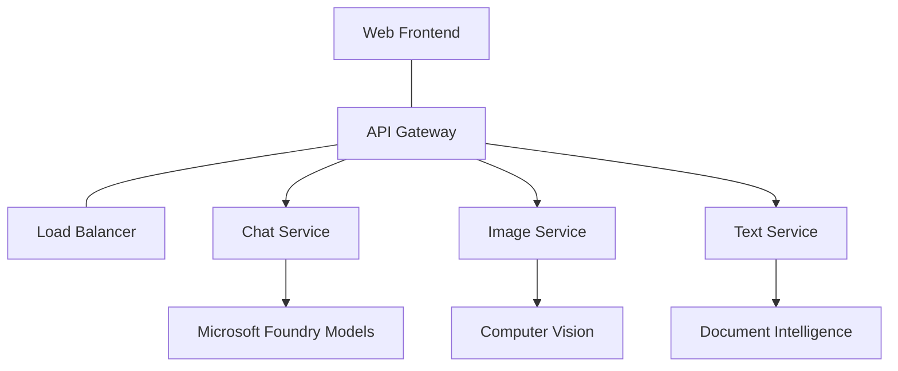

# Najlepsze praktyki dla produkcyjnych obciążeń AI z AZD

**Nawigacja po rozdziale:**
- **📚 Strona główna kursu**: [AZD dla początkujących](../../README.md)
- **📖 Obecny rozdział**: Rozdział 8 - Wzorce produkcyjne i korporacyjne
- **⬅️ Poprzedni rozdział**: [Rozdział 7: Rozwiązywanie problemów](../chapter-07-troubleshooting/debugging.md)
- **⬅️ Powiązane**: [Warsztat AI](../chapter-02-ai-development/ai-workshop-lab.md)
- **🎯 Kurs ukończony**: [AZD dla początkujących](../../README.md)

## Przegląd

Ten przewodnik wyjaśnia wzorce projektowe produkcyjnego AI z wykorzystaniem Azure Developer CLI (AZD). Jest to odniesienie do projektowania, a nie aplikacja do wdrożenia ani certyfikacja produkcyjna.

**Zakres przykładów:** O ile nie opisano ich wyraźnie jako kompletnych, fragmenty Bicep zakładają parametry i zasoby odwołane z zawierającego szablonu. Pomijają obrazy/gospodarzy planów, tożsamości, przypisania ról, DNS, wyjścia i inne wymagane integracje. Ścieżki usług YAML oraz skrypty hook/test to pliki ilustracyjne do utworzenia w **własnej aplikacji**; nie są dostarczane przez ten kurs. Użyj działającego przykładu AZD jako bazy, skompiluj pełną infrastrukturę i przetestuj ją w środowisku izolowanym przed produkcją.

## Kluczowe wyzwania rozwiązane

Typowe problemy produkcyjne obejmują wdrożenia wielousługowe, zarządzanie tożsamościami i sekretami, skalowanie, kontrolę kosztów oraz monitorowanie. Nie twierdzimy tu o mierzonej powszechności.

## Wzorce architektoniczne dla produkcyjnego AI

### Wzorzec 1: Architektura AI mikroserwisów

**Kiedy stosować**: złożone aplikacje AI z wieloma funkcjami



**Implementacja AZD**:

```yaml
# azure.yaml
name: enterprise-ai-platform
services:
  web:
    project: ./web
    host: staticwebapp
  api-gateway:
    project: ./api-gateway
    host: containerapp
  chat-service:
    project: ./services/chat
    host: containerapp
  vision-service:
    project: ./services/vision
    host: containerapp
  text-service:
    project: ./services/text
    host: containerapp
```

### Wzorzec 2: Przetwarzanie AI zdarzeniami

**Kiedy stosować**: przetwarzanie wsadowe, analiza dokumentów, asynchroniczne przepływy pracy

```bicep
// Event Hub for AI processing pipeline
resource eventHub 'Microsoft.EventHub/namespaces@2024-01-01' = {
  name: eventHubNamespaceName
  location: location
  sku: {
    name: 'Standard'
    tier: 'Standard'
    capacity: 1
  }
}

// Service Bus for reliable message processing
resource serviceBus 'Microsoft.ServiceBus/namespaces@2024-01-01' = {
  name: serviceBusNamespaceName
  location: location
  sku: {
    name: 'Premium'
    tier: 'Premium'
    capacity: 1
  }
}

// Function App for processing
resource functionApp 'Microsoft.Web/sites@2023-01-01' = {
  name: functionAppName
  location: location
  kind: 'functionapp,linux'
  properties: {
    siteConfig: {
      appSettings: [
        {
          name: 'FUNCTIONS_EXTENSION_VERSION'
          value: '~4'
        }
        {
          name: 'AZURE_OPENAI_ENDPOINT'
          value: '@Microsoft.KeyVault(VaultName=${keyVault.name};SecretName=openai-endpoint)'
        }
      ]
    }
  }
}
```

Tworzy to fragmenty przestrzeni nazw, nie huby, kolejki, subskrypcje ani wyzwalacze funkcji. Uruchamialna funkcja wymaga też planu hostingu, konfiguracji środowiska uruchomieniowego/magazynu, dołączonej tożsamości, RBAC i dostępu sieciowego. Odwołanie do Key Vault wymaga zezwolenia na odczyt sekretu; sam URL punktu końcowego nie jest poświadczeniem.

## Myślenie o zdrowiu agenta AI

Gdy tradycyjna aplikacja webowa przestaje działać, objawy są znane: strona się nie ładuje, API zwraca błąd lub wdrożenie nie powiodło się. Aplikacje zasilane AI mogą się zepsuć na te same sposoby — ale też mogą działać nieprawidłowo w subtelniejszy sposób, bez oczywistych komunikatów o błędach.

Ta sekcja pomaga zbudować model mentalny monitorowania obciążeń AI, by wiedzieć, gdzie szukać, gdy coś jest nie tak.

### Jak zdrowie agenta różni się od zdrowia tradycyjnej aplikacji

Tradycyjne aplikacje też mogą mieć subtelne błędy poprawności. Agent AI dodaje niedeterministyczną jakość odpowiedzi do zwykłych kwestii dostępności i poprawności. Pomyśl o zdrowiu agenta w dwóch warstwach:

| Warstwa | Co obserwować | Gdzie szukać |
|-------|--------------|---------------|
| **Zdrowie infrastruktury** | Czy usługa działa? Czy zasoby są zdefiniowane? Czy punkty końcowe są osiągalne? | `azd monitor`, Azure Portal stan zasobów, logi kontenera/aplikacji |
| **Zdrowie zachowania** | Czy agent odpowiada dokładnie? Czy odpowiedzi są terminowe? Czy model jest wywoływany poprawnie? | Ślady Application Insights, metryki latencji wywołań modelu, logi jakości odpowiedzi |

Zdrowie infrastruktury jest znane — jest takie samo dla każdej aplikacji azd. Zdrowie zachowania to nowa warstwa, którą wprowadzają obciążenia AI.

### Gdzie szukać, gdy aplikacje AI nie zachowują się zgodnie z oczekiwaniami

Jeśli Twoja aplikacja AI nie generuje oczekiwanych wyników, oto konceptualna lista kontrolna:

1. **Zacznij od podstaw.** Czy aplikacja działa? Czy może osiągnąć swoje zależności? Sprawdź `azd monitor` i zdrowie zasobów tak, jak dla każdej aplikacji.
2. **Sprawdź połączenie z modelem.** Czy Twoja aplikacja poprawnie wywołuje model AI? Nieudane lub przekroczone czasowo wywołania modelu są najczęstszą przyczyną problemów z aplikacjami AI i pojawią się w logach aplikacji.
3. **Bezpiecznie zbadaj dane wejściowe i podstawy.** Błędne odpowiedzi mogą wynikać z pobierania danych, instrukcji, ograniczeń modelu lub działania narzędzi. Używaj kontrolowanych dostępem i redagowanych danych diagnostycznych; nie włączaj niekontrolowanego logowania promptów/odpowiedzi w produkcji.
4. **Przejrzyj opóźnienia odpowiedzi.** Wywołania modeli AI są wolniejsze niż typowe wywołania API. Jeśli Twoja aplikacja jest powolna, sprawdź, czy czas odpowiedzi modelu się nie wydłużył — może to wskazywać na ograniczenia przepustowości, limity pojemności lub przeciążenie regionu.
5. **Obserwuj sygnały kosztowe.** Niespodziewane skoki zużycia tokenów lub wywołań API mogą wskazywać na pętlę, błędnie skonfigurowany prompt lub nadmierne próby ponownego wywołania.

Nie musisz od razu mistrzowsko opanowywać narzędzi obserwowalności. Kluczową lekcją jest to, że aplikacje AI mają dodatkową warstwę zachowania do monitorowania, a wbudowane monitorowanie azd (`azd monitor`) daje punkt startowy do badania obu warstw.

---

## Najlepsze praktyki bezpieczeństwa

### 1. Model bezpieczeństwa Zero-Trust

**Strategia wdrożenia**:
- Brak komunikacji serwisów bez uwierzytelnienia
- Wszystkie wywołania API korzystają z zarządzanych tożsamości
- Izolacja sieci z prywatnymi punktami końcowymi
- Kontrola dostępu z zasadą najmniejszych uprawnień

```bicep
// Managed Identity for each service
resource chatServiceIdentity 'Microsoft.ManagedIdentity/userAssignedIdentities@2023-01-31' = {
  name: 'chat-service-identity'
  location: location
}

// Role assignments with minimal permissions
resource openAIUserRole 'Microsoft.Authorization/roleAssignments@2022-04-01' = {
  scope: openAIAccount
  name: guid(openAIAccount.id, chatServiceIdentity.id, '5e0bd9bd-7b93-4f28-af87-19fc36ad61bd')
  properties: {
    roleDefinitionId: subscriptionResourceId('Microsoft.Authorization/roleDefinitions', '5e0bd9bd-7b93-4f28-af87-19fc36ad61bd')
    principalId: chatServiceIdentity.properties.principalId
    principalType: 'ServicePrincipal'
  }
}
```

### 2. Bezpieczne zarządzanie sekretami

**Wzorzec integracji z Key Vault**:

```bicep
// Key Vault with proper access policies
resource keyVault 'Microsoft.KeyVault/vaults@2023-02-01' = {
  name: keyVaultName
  location: location
  properties: {
    tenantId: tenant().tenantId
    sku: {
      family: 'A'
      name: 'standard' // Premium is needed for HSM-backed keys, not ordinary secrets
    }
    enableRbacAuthorization: true  // Use RBAC instead of access policies
    enablePurgeProtection: true    // Prevent accidental deletion
    enableSoftDelete: true
    softDeleteRetentionInDays: 90
  }
}

// Optional legacy key-auth alternative; omit when using Entra ID.
resource openAIKeySecret 'Microsoft.KeyVault/vaults/secrets@2023-02-01' = {
  parent: keyVault
  name: 'openai-api-key'
  properties: {
    value: openAIAccount.listKeys().key1
    attributes: {
      enabled: true
    }
  }
}
```

Przypisz tożsamość środowiska uruchomieniowego `Key Vault Secrets User` we właściwym zakresie i dołącz ją do hosta; samo `enableRbacAuthorization` nie gwarantuje dostępu. Preferuj uwierzytelnianie zarządzaną tożsamością OpenAI z `disableLocalAuth: true`. Opcjonalny sekret klucza ma sens tylko dla konta celowo włączonego klucz; podmiot zarządzający provisioningiem musi mieć też uprawnienia do zapisywania sekretów.

### 3. Bezpieczeństwo sieci

**Konfiguracja prywatnego punktu końcowego**:

```bicep
// Virtual Network for AI services
resource virtualNetwork 'Microsoft.Network/virtualNetworks@2023-04-01' = {
  name: vnetName
  location: location
  properties: {
    addressSpace: {
      addressPrefixes: ['10.0.0.0/16']
    }
    subnets: [
      {
        name: 'ai-services-subnet'
        properties: {
          addressPrefix: '10.0.1.0/24'
          privateEndpointNetworkPolicies: 'Disabled'
        }
      }
      {
        name: 'app-services-subnet'
        properties: {
          addressPrefix: '10.0.2.0/24'
          delegations: [
            {
              name: 'Microsoft.Web/serverFarms'
              properties: {
                serviceName: 'Microsoft.Web/serverFarms'
              }
            }
          ]
        }
      }
    ]
  }
}

// Private endpoints for all AI services
resource openAIPrivateEndpoint 'Microsoft.Network/privateEndpoints@2023-04-01' = {
  name: '${openAIAccountName}-pe'
  location: location
  properties: {
    subnet: {
      id: virtualNetwork.properties.subnets[0].id
    }
    privateLinkServiceConnections: [
      {
        name: 'openai-connection'
        properties: {
          privateLinkServiceId: openAIAccount.id
          groupIds: ['account']
        }
      }
    ]
  }
}
```

Prywatne punkty końcowe wymagają też prywatnych grup stref DNS/powiązań VNet i integracji aplikacji VNet. Nie blokują automatycznie dostępu publicznego: po zweryfikowaniu prywatnej łączności i dostępu do wdrożenia, jawnie wyłącz publiczny dostęp konta AI.

## Wydajność i skalowanie

### 1. Strategie automatycznego skalowania

**Automatyczne skalowanie Container Apps**:

```bicep
resource containerApp 'Microsoft.App/containerApps@2023-05-01' = {
  name: containerAppName
  location: location
  properties: {
    configuration: {
      ingress: {
        external: true
        targetPort: 8000
        transport: 'http'
      }
    }
    template: {
      scale: {
        minReplicas: 2  // Always have 2 instances minimum
        maxReplicas: 50 // Scale up to 50 for high load
        rules: [
          {
            name: 'http-scaling'
            http: {
              metadata: {
                concurrentRequests: '20'  // Scale when >20 concurrent requests
              }
            }
          }
          {
            name: 'cpu-scaling'
            custom: {
              type: 'cpu'
              metadata: {
                type: 'Utilization'
                value: '70'  // Scale when CPU >70%
              }
            }
          }
        ]
      }
    }
  }
}
```

### 2. Strategie buforowania

**Redis Cache dla odpowiedzi AI**:

```bicep
// Legacy Azure Cache for Redis example (not recommended for new deployments)
resource redisCache 'Microsoft.Cache/redis@2023-04-01' = {
  name: redisCacheName
  location: location
  properties: {
    sku: {
      name: 'Premium'
      family: 'P'
      capacity: 1
    }
    enableNonSslPort: false
    minimumTlsVersion: '1.2'
    redisConfiguration: {
      'maxmemory-policy': 'allkeys-lru'
    }
    // Sharding distributes data; replication/failover provides availability.
    shardCount: 2
  }
}

// Cache configuration in application
var cacheConnectionString = '${redisCache.properties.hostName}:6380,password=${redisCache.listKeys().primaryKey},ssl=True,abortConnect=False'
```

Azure Cache for Redis Basic/Standard/Premium jest na [ścieżce wygaszania](https://learn.microsoft.com/azure/azure-cache-for-redis/retirement-faq). Używaj Azure Managed Redis dla nowych konstrukcji oraz jego udokumentowanej konfiguracji SKU, tożsamości i TLS, zamiast kopiować ten zasób legacy do nowego systemu produkcyjnego. Linia connection-string jest nieaktywnym symbolem zastępczym, nie poświadczeniem. Partycjonuj klucze cache według autoryzacji, modelu/instrukcji i wersji pobierania z wygasaniem; wspólny cache tylko do odczytu może ujawnić dane innego użytkownika.

### 3. Równoważenie obciążenia i zarządzanie ruchem

**Application Gateway z WAF**:

```bicep
// Application Gateway with Web Application Firewall
resource applicationGateway 'Microsoft.Network/applicationGateways@2023-04-01' = {
  name: appGatewayName
  location: location
  properties: {
    sku: {
      name: 'WAF_v2'
      tier: 'WAF_v2'
      capacity: 2
    }
    webApplicationFirewallConfiguration: {
      enabled: true
      firewallMode: 'Prevention'
      ruleSetType: 'OWASP'
      ruleSetVersion: '3.2'
    }
    // Backend pools for AI services
    backendAddressPools: [
      {
        name: 'ai-services-pool'
        properties: {
          backendAddresses: [
            {
              fqdn: '${containerApp.properties.configuration.ingress.fqdn}'
            }
          ]
        }
      }
    ]
  }
}
```

To jest częściowy zasób gateway: rzeczywiste wdrożenie wymaga też podsieci/IP gateway, adresów IP i portów frontend, słuchaczy/certyfikatów TLS, ustawień/probek HTTP backendu, reguł routingu i priorytetów oraz zweryfikowanej polityki WAF. Nazwa hosta/SNI TLS i autoryzacja muszą pasować do backendu Container App.

## 💰 Optymalizacja kosztów

### 1. Dobór rozmiaru zasobów

**Konfiguracje specyficzne dla środowiska**:

Te nazwy są **ilustracyjnymi wejściami szablonu niestandardowego**, nie automatycznymi ustawieniami AZD. Najpierw odwzoruj je w `infra/main.parameters.json`/Bicep i konfiguracji hosta. Na przykład próbka RAG używa `AZURE_SEARCH_SERVICE_SKU` i `AZURE_OPENAI_CHATGPT_DEPLOYMENT_CAPACITY`, a nie poniższych nazw ogólnych. Podaj dla Container Apps pamięć w wspieranej jednostce, np. `1Gi` w rzeczywistym zasobie. Zastosuj zmiany infrastruktury przy pomocy `azd up` lub `azd provision`; samo `azd deploy` nie stosuje zmian Bicep.

```bash
# Development environment
azd env new development
azd env set AZURE_OPENAI_SKU "S0"
azd env set AZURE_OPENAI_CAPACITY 10
azd env set AZURE_SEARCH_SKU "basic"
azd env set CONTAINER_CPU 0.5
azd env set CONTAINER_MEMORY 1.0

# Production environment  
azd env new production
azd env set AZURE_OPENAI_SKU "S0"
azd env set AZURE_OPENAI_CAPACITY 100
azd env set AZURE_SEARCH_SKU "standard"
azd env set CONTAINER_CPU 2.0
azd env set CONTAINER_MEMORY 4.0
```

### 2. Monitorowanie kosztów i budżety

```bicep
// Supply the first day of the current UTC month, e.g. 2026-11-01T00:00:00Z.
param budgetStartDate string

// Cost management and budgets
resource budget 'Microsoft.Consumption/budgets@2024-08-01' = {
  name: 'ai-workload-budget'
  properties: {
    timePeriod: {
      startDate: budgetStartDate
    }
    timeGrain: 'Monthly'
    amount: 2000  // In the billing currency, not necessarily USD
    category: 'Cost'
    notifications: {
      warning: {
        enabled: true
        operator: 'GreaterThan'
        threshold: 80
        contactEmails: [
          'finance@company.com'
          'engineering@company.com'
        ]
        contactRoles: [
          'Owner'
          'Contributor'
        ]
      }
      critical: {
        enabled: true
        operator: 'GreaterThan'
        threshold: 95
        contactEmails: [
          'cto@company.com'
        ]
      }
    }
  }
}
```

Zamień przykładowych odbiorców i zweryfikuj zakres/uprawnienia. Alerty budżetowe korzystają z opóźnionych danych rozliczeniowych i nie wymuszają limitu wydatków.

### 3. Optymalizacja wykorzystania tokenów

**Zarządzanie kosztami OpenAI**:

To tylko heurystyka liczby znaków dla podglądu UI, **nie** walidator limitów tokenów modelu. Kod produkcyjny musi używać tokenizera odpowiedniego dla wdrożonego modelu, uwzględniać instrukcje systemowe, schematy narzędzi, historię i budżet wyjścia. Odrzuć przesadnie obszerne wiadomości użytkownika zamiast je cicho obcinać.

```typescript
// Application-level token optimization
class TokenOptimizer {
  private readonly maxTokens = 4000;
  private readonly reserveTokens = 500;
  
  optimizePrompt(userInput: string, context: string): string {
    const availableTokens = this.maxTokens - this.reserveTokens;
    if (this.estimateTokens(userInput) + 8 >= availableTokens) {
      throw new Error("User input exceeds the illustrative prompt budget");
    }
    const estimatedTokens = this.estimateTokens(userInput + context) + 8;
    
    if (estimatedTokens > availableTokens) {
      // Truncate context, not user input
      context = this.truncateContext(context, Math.max(0, availableTokens - this.estimateTokens(userInput) - 8));
    }
    
    return `${context}\n\nUser: ${userInput}`;
  }
  
  private estimateTokens(text: string): number {
    // Rough estimation: 1 token ≈ 4 characters
    return Math.ceil(text.length / 4);
  }

  private truncateContext(text: string, estimatedBudget: number): string {
    return text.slice(0, Math.max(0, estimatedBudget) * 4);
  }
}
```

## Monitorowanie i obserwowalność

### 1. Kompleksowe Application Insights

```bicep
// Application Insights with advanced features
resource applicationInsights 'Microsoft.Insights/components@2020-02-02' = {
  name: applicationInsightsName
  location: location
  kind: 'web'
  properties: {
    Application_Type: 'web'
    WorkspaceResourceId: logAnalyticsWorkspace.id
    SamplingPercentage: 100  // Ingestion setting; review cost and SDK sampling separately
    DisableIpMasking: false  // Retain IP masking
  }
}

// Custom metrics for AI operations
resource aiMetricAlerts 'Microsoft.Insights/metricAlerts@2018-03-01' = {
  name: 'ai-high-error-rate'
  location: 'global'
  properties: {
    description: 'Alert when failed request count exceeds 10 in five minutes'
    severity: 2
    enabled: true
    scopes: [
      applicationInsights.id
    ]
    evaluationFrequency: 'PT1M'
    windowSize: 'PT5M'
    criteria: {
      'odata.type': 'Microsoft.Azure.Monitor.SingleResourceMultipleMetricCriteria'
      allOf: [
        {
          name: 'high-error-rate'
          metricName: 'requests/failed'
          operator: 'GreaterThan'
          threshold: 10
          timeAggregation: 'Count'
        }
      ]
    }
  }
}
```

### 2. Specyficzne monitorowanie AI

**Własne pulpity z metrykami AI**:

```json
{
  "dashboard": {
    "name": "AI Application Monitoring",
    "tiles": [
      {
        "name": "OpenAI Request Volume",
        "query": "dependencies | where target contains 'openai' | summarize count() by bin(timestamp, 5m)"
      },
      {
        "name": "AI Response Latency",
        "query": "dependencies | where target contains 'openai' | summarize avg(duration) by bin(timestamp, 5m)"
      },
      {
        "name": "Token Usage",
        "query": "customMetrics | where name == 'openai_tokens_used' | summarize sum(value) by bin(timestamp, 1h)"
      },
      {
        "name": "Cost per Hour",
        "query": "customMetrics | where name == 'openai_cost' | summarize sum(value) by bin(timestamp, 1h)"
      }
    ]
  }
}
```

Ten JSON jest szkicem definiowanym przez aplikację, a nie schematem pulpitów importowanych w portalu Azure. Zapytania tokenów/kosztów wymagają, żeby Twoja aplikacja emitowała dokładnie te metryki niestandardowe; nie są tworzone przez AZD. Dostosuj filtry zależności do rzeczywistych nazw endpointów/zakresów modelu.

### 3. Kontrole zdrowia i monitorowanie dostępności

```bicep
// Application Insights availability tests
resource availabilityTest 'Microsoft.Insights/webtests@2022-06-15' = {
  name: 'ai-app-availability-test'
  location: location
  tags: {
    'hidden-link:${applicationInsights.id}': 'Resource'
  }
  properties: {
    SyntheticMonitorId: 'ai-app-availability-test'
    Name: 'AI Application Availability Test'
    Description: 'Tests AI application endpoints'
    Enabled: true
    Frequency: 300  // 5 minutes
    Timeout: 120    // 2 minutes
    Kind: 'standard'
    Locations: [
      {
        Id: 'us-east-2-azr'
      }
      {
        Id: 'us-west-2-azr'
      }
    ]
    Request: {
      RequestUrl: 'https://${webApp.properties.defaultHostName}/health'
      HttpVerb: 'GET'
      FollowRedirects: true
      ParseDependentRequests: false
    }
    ValidationRules: {
      ExpectedHttpStatusCode: 200
      SSLCheck: true
      SSLCertRemainingLifetimeCheck: 7
    }
  }
}
```

## Odzyskiwanie po awarii i wysoka dostępność

Test przedstawiony wymaga istniejącego App Service `webApp` oraz zasobu Application Insights. Standardowe testy dostępności są płatne i wymagają osiągalnego punktu końcowego; aplikacje tylko prywatne potrzebują odpowiedniego prywatnego projektu monitorowania. Testy ping URL są przestarzałe; używaj [standardowych testów dostępności](https://learn.microsoft.com/azure/azure-monitor/app/availability).

### 1. Wdrożenie wieloregionalne

```yaml
# azure.yaml - Multi-region configuration
name: ai-app-multiregion
services:
  api-primary:
    project: ./api
    host: containerapp
    env:
      AZURE_REGION: eastus
  api-secondary:
    project: ./api
    host: containerapp
    env:
      AZURE_REGION: westus2
```

```bicep
// Separate App Service topology, not the Container Apps declarations above
resource trafficManager 'Microsoft.Network/trafficManagerProfiles@2022-04-01' = {
  name: trafficManagerProfileName
  location: 'global'
  properties: {
    profileStatus: 'Enabled'
    trafficRoutingMethod: 'Priority'
    dnsConfig: {
      relativeName: trafficManagerProfileName
      ttl: 30
    }
    monitorConfig: {
      protocol: 'HTTPS'
      port: 443
      path: '/health'
      intervalInSeconds: 30
      toleratedNumberOfFailures: 3
      timeoutInSeconds: 10
    }
    endpoints: [
      {
        name: 'primary-endpoint'
        type: 'Microsoft.Network/trafficManagerProfiles/azureEndpoints'
        properties: {
          targetResourceId: primaryAppService.id
          endpointStatus: 'Enabled'
          priority: 1
        }
      }
      {
        name: 'secondary-endpoint'
        type: 'Microsoft.Network/trafficManagerProfiles/azureEndpoints'
        properties: {
          targetResourceId: secondaryAppService.id
          endpointStatus: 'Enabled'
          priority: 2
        }
      }
    ]
  }
}
```

Zmienne środowiskowe nie wybierają lokalizacji zasobów. IaC musi wdrożyć oddzielne regionalne hosty i powiązać każdą usługę z tagami `resourceName` lub `azd-service-name`. Przykład Traffic Manager to **osobna topologia App Service** (`primaryAppService`/`secondaryAppService`), a nie routing dla deklaracji Container Apps. Container Apps wymagają odpowiednio skonfigurowanego punktu końcowego/Front Door, routingu TLS/własnej domeny i sond zdrowia.

### 2. Kopie zapasowe i odzyskiwanie danych

```bicep
// Backup configuration for critical data
resource backupVault 'Microsoft.DataProtection/backupVaults@2023-05-01' = {
  name: backupVaultName
  location: location
  identity: {
    type: 'SystemAssigned'
  }
  properties: {
    storageSettings: [
      {
        datastoreType: 'VaultStore'
        type: 'LocallyRedundant'
      }
    ]
  }
}

```

Sam vault nic nie kopiuje. Skonfiguruj **obsługiwalną politykę i instancję kopii zapasowej specyficzną dla obciążenia**, zezwolenia źródłowe, retencję i testy przywracania według [matryc wsparcia Azure Backup](https://learn.microsoft.com/azure/backup/backup-support-matrix). Nie ma generycznej polityki Azure Backup dla hostowanych wdrożeń modelu Azure OpenAI. Przechowuj definicje wdrożeń infrastruktury/modelu w kontroli wersji; chroń przesłane dokumenty, dane aplikacji i artefakty dostrajania za pomocą funkcji backupu/eksportu każdej usługi zaplecza. Jawnie zdefiniuj i przetestuj RPO/RTO.

## Integracja DevOps i CI/CD

### 1. Workflow GitHub Actions

```yaml
# .github/workflows/deploy-ai-app.yml
name: Deploy AI Application

on:
  push:
    branches: [main]
  pull_request:
    branches: [main]

jobs:
  test:
    runs-on: ubuntu-latest
    steps:
      - uses: actions/checkout@v4
      
      - name: Setup Python
        uses: actions/setup-python@v4
        with:
          python-version: '3.11'
          
      - name: Install dependencies
        run: |
          pip install -r requirements.txt
          pip install pytest
          
      - name: Run tests
        run: pytest tests/
        
      - name: AI Safety Tests
        run: |
          python scripts/test_ai_safety.py
          python scripts/validate_prompts.py

```

To jest **wyłącznie część testowa** workflow i zakłada utworzenia `requirements.txt`, `tests/` oraz dwóch skryptów bezpieczeństwa. Dodaj uwierzytelnione zadania OIDC provisioningu/wdrożenia z [Konfiguracji pipeline CI/CD](#cicd-pipeline-configuration), z `needs: test`, zaufanym wyzwalaniem push/manualnym oraz chronionymi środowiskami GitHub. Nie wdrażaj niedozwolonego kodu pull-request z poświadczeniami cloud. Świeży runner nie ma wybranego lokalnego środowiska AZD; podaj dane środowiska/subskrypcji/lokalizacji i użyj `azd auth login`, nie tylko `azure/login`.

### 2. Walidacja infrastruktury

```bash
# scripts/validate_infrastructure.sh
#!/bin/bash
set -euo pipefail

echo "Validating AI infrastructure deployment..."

# Requires Azure CLI login and the resource group selected explicitly.
: "${AZURE_RESOURCE_GROUP:?Set AZURE_RESOURCE_GROUP}"
: "${AZURE_OPENAI_NAME:?Set AZURE_OPENAI_NAME}"
: "${AZURE_OPENAI_CHAT_DEPLOYMENT:?Set the actual deployment name}"

# A successful empty list is not proof that resources exist.
types=("Microsoft.CognitiveServices/accounts" "Microsoft.Search/searchServices"
       "Microsoft.Storage/storageAccounts" "Microsoft.KeyVault/vaults")
for resource_type in "${types[@]}"; do
    count=$(az resource list --resource-group "$AZURE_RESOURCE_GROUP" \
        --resource-type "$resource_type" --query "length(@)" -o tsv)
    if [[ "$count" -lt 1 ]]; then
        echo "ERROR: No $resource_type found in $AZURE_RESOURCE_GROUP"
        exit 1
    fi
done

# Validate OpenAI model deployments
echo "Validating OpenAI model deployments..."
state=$(az cognitiveservices account deployment show \
  --name "$AZURE_OPENAI_NAME" --resource-group "$AZURE_RESOURCE_GROUP" \
  --deployment-name "$AZURE_OPENAI_CHAT_DEPLOYMENT" \
  --query "properties.provisioningState" -o tsv)
if [[ "$state" != "Succeeded" ]]; then
    echo "ERROR: Required model deployment is not provisioned successfully"
    exit 1
fi

echo "Infrastructure validation completed successfully!"
```

Oczekiwane: zerowy kod wyjścia i komunikat ukończenia tylko gdy wszystkie oczekiwane typy istnieją a wdrożenie nazwanego modelu jest gotowe. Sprawdza stan inwentaryzacji/prowizjonowania, **nie** zdrowie zasobów, dokładną topologię, RBAC, osiągalność sieci ani zachowanie modelu. Dostosuj oczekiwane typy do swojej architektury, potem wykonaj osobny uwierzytelniony test gotowości aplikacji.

## Lista kontrolna gotowości produkcyjnej

### Bezpieczeństwo ✅
- [ ] Wszystkie usługi używają zarządzanych tożsamości
- [ ] Sekrety przechowywane w Key Vault
- [ ] Skonfigurowane prywatne punkty końcowe
- [ ] Wdrożone grupy zabezpieczeń sieci
- [ ] RBAC z zasadą najmniejszych uprawnień
- [ ] Włączony WAF na publicznych punktach końcowych

### Wydajność ✅
- [ ] Skonfigurowane automatyczne skalowanie
- [ ] Wdrożone buforowanie
- [ ] Skonfigurowane równoważenie obciążenia
- [ ] CDN dla statycznych treści
- [ ] Poolowanie połączeń z bazą danych
- [ ] Optymalizacja użycia tokenów

### Monitorowanie ✅
- [ ] Skonfigurowany Application Insights
- [ ] Zdefiniowane metryki niestandardowe
- [ ] Skonfigurowane reguły alertów
- [ ] Utworzony pulpit
- [ ] Wdrożone kontrole zdrowia
- [ ] Polityki retencji logów

### Niezawodność ✅
- [ ] Wdrożenie wieloregionalne
- [ ] Plan backupu i odzyskiwania
- [ ] Wdrożone bezpieczniki (circuit breakers)
- [ ] Skonfigurowane polityki ponawiania
- [ ] Łagodna degradacja
- [ ] Punkty końcowe kontroli zdrowia

### Zarządzanie kosztami ✅
- [ ] Skonfigurowane alerty budżetowe
- [ ] Dobór rozmiaru zasobów
- [ ] Rabaty dla środowisk deweloperskich/testowych
- [ ] Wykupione rezerwacje instancji
- [ ] Pulpit monitorowania kosztów
- [ ] Regularne przeglądy kosztów

### Zgodność ✅
- [ ] Spełnione wymagania dotyczące lokalizacji danych
- [ ] Włączone logowanie audytu
- [ ] Zastosowane polityki zgodności
- [ ] Wdrożone podstawy bezpieczeństwa
- [ ] Regularne oceny bezpieczeństwa
- [ ] Plan reagowania na incydenty

## Benchmarki wydajności

### Ilustracyjne cele produkcyjne

To są przykładowe SLO do negocjacji i testów obciążeniowych, a nie mierzone benchmarki ani gwarancje. Opóźnienie odpowiedzi zależy od modelu/długości wyjścia; miesięczne wydatki tokenowe zależą od ruchu i cen, nie tylko od liczby tokenów.

| Metrika | Cel | Monitorowanie |
|--------|--------|------------|
| **Czas odpowiedzi** | < 2 sekundy | Application Insights |
| **Dostępność** | 99.9% | Monitorowanie dostępności |
| **Wskaźnik błędów** | < 0.1% | Logi aplikacji |
| **Wydatki na model** | < 500 USD/miesiąc (przykładowy budżet) | Zarządzanie kosztami |
| **Użytkownicy jednoczesni** | 1000+ | Testy obciążeniowe |
| **Czas odzyskiwania** | < 1 godzina | Testy odzyskiwania po awarii |

### Testy obciążeniowe

Poniżej szkic interfejsu do skryptu testu obciążeniowego, **który musisz wdrożyć**; to repozytorium nie dostarcza `scripts/load_test.py`. Zdefiniuj ładunki żądań, uwierzytelnianie, reprezentatywne obciążenia, asercje dla opóźnień/błędów na percentylach oraz limit wydatków w wybranym narzędziu do testów obciążeniowych przed jego uruchomieniem:

```bash
# Load testing script for AI applications
python scripts/load_test.py \
  --endpoint https://your-ai-app.azurewebsites.net \
  --concurrent-users 100 \
  --duration 300 \
  --ramp-up 60
```

## 🤝 Najlepsze praktyki społeczności

Na podstawie opinii społeczności Microsoft Foundry Discord:

### Najważniejsze zalecenia od społeczności:

1. **Zacznij od małego, skaluj stopniowo**: Zacznij od podstawowych SKU i skaluj w oparciu o faktyczne użycie
2. **Monitoruj wszystko**: Skonfiguruj kompleksowy monitoring od pierwszego dnia
3. **Automatyzuj bezpieczeństwo**: Korzystaj z infrastruktury jako kodu dla spójnego bezpieczeństwa
4. **Testuj dokładnie**: Uwzględnij w swoim pipeline testy specyficzne dla AI
5. **Planuj koszty**: Monitoruj wykorzystanie tokenów i ustawiaj alerty budżetowe wcześnie

### Typowe pułapki do uniknięcia:

- ❌ Twarde kodowanie kluczy API w kodzie
- ❌ Brak właściwego monitoringu
- ❌ Ignorowanie optymalizacji kosztów
- ❌ Brak testów scenariuszy awarii
- ❌ Wdrażanie bez kontroli stanu zdrowia

## Komendy i rozszerzenia AZD AI CLI

AZD zawiera rosnący zestaw poleceń i rozszerzeń specyficznych dla AI, które upraszczają produkcyjne przepływy pracy AI. Te narzędzia łączą rozwój lokalny z wdrożeniem produkcyjnym dla obciążeń AI.

> **Przegląd wydania (2026-11-04):** Poniższe instrukcje CLI zostały zweryfikowane na podstawie opublikowanych wydań `azd` **1.37.2**, `azure.ai.agents` **1.0.0-beta.23** oraz `azure.ai.evaluations` **1.0.0-beta.2**. Agenci beta.23 wymagają `azd >= 1.37.0`; oceny beta.2 wymagają `azd >= 1.33.0`. Używaj co najmniej wersji 1.37.0 dla łączonego przepływu pracy. Jest to przegląd dokumentacji/źródeł, a nie walidacja wdrożenia w Azure na żywo.

### Rozszerzenia AZD dla AI

AZD używa systemu rozszerzeń, aby dodać możliwości specyficzne dla AI. Instaluj i zarządzaj rozszerzeniami za pomocą:

```bash
# List all available extensions (including AI)
azd extension list

# Inspect installed extension details
azd version
azd extension show azure.ai.agents

# Install the Foundry agents extension
azd extension install azure.ai.agents

# Install the separate Foundry evaluations extension
azd extension install azure.ai.evaluations

# Install the fine-tuning extension
azd extension install azure.ai.finetune

# Install the custom models extension
azd extension install azure.ai.models

# Upgrade all installed extensions
azd extension upgrade --all
```

**Dostępne rozszerzenia AI:**

| Rozszerzenie | Przeznaczenie | Status |
|-----------|---------|--------|
| `azure.ai.agents` | Zarządzanie usługą Foundry Agent | Preview |
| `azure.ai.evaluations` | Zbiory danych oceny, ewaluatorzy, grupy ewaluacji i przebiegi | Preview |
| `azure.ai.skills` | Ponowne używalne umiejętności agentów | Preview |
| `azure.ai.connections` | Połączenia Foundry (źródła danych, narzędzia) | Preview |
| `azure.ai.finetune` | Dostrajenie modeli Foundry | Preview |
| `azure.ai.models` | Niestandardowe modele Foundry | Preview |
| `azure.coding-agent` | Konfiguracja agenta kodującego | Dostępne |

> Uruchom `azd extension list --installed` i `azd extension show azure.ai.evaluations`, aby sprawdzić zainstalowane wersje. Najpierw zaktualizuj główne CLI korzystając z [instrukcji instalacji/aktualizacji](https://learn.microsoft.com/azure/developer/azure-developer-cli/install-azd) (dla instalacji winget na Windows: `winget upgrade Microsoft.Azd`), następnie uruchom `azd extension upgrade --all`. Nie ma głównego polecenia `azd upgrade`. Przed aktualizacją automatyzacji produkcyjnej sprawdź zmiany łamiące kompatybilność; nie zakładaj, że aktualizacja rozszerzenia zachowuje stare formaty poleceń lub konfiguracji.

### Ostatnie zmiany i poprawki w wydaniach

| Wydanie | Co się zmienia dla tego kursu |
|---------|------------------------------|
| `azd 1.37.0` | Dodaje stabilne API podglądu wdrożenia i naprawia nadpisywanie niepowiązanych ustawień `azure.yaml` podczas edycji rozszerzenia. |
| `azd 1.37.1` | Naprawia propagację Ctrl+C w rozszerzeniach i rozróżnia anulowanie/przekroczenie czasu od ogólnych błędów. |
| `azd 1.37.2` | Ulepsza walidację provisioning: krytyczne ostrzeżenia domyślnie na **Nie**, awarie bez potwierdzenia w trybach bez nadzoru, anulowanie pomija haki post-provisioningu. Naprawia też nierozwiązane wartości środowiskowe na listach deny Deployment Stacks w trybie alfa. |
| Agenci `beta.22` | Migracja ewaluacji do `azd ai eval`, zmiana optymalizacji na GA v1 API, wymaga liczby mnogiej `toolboxes`, rozdziela zarządzanie harness, głos i długotrwałe podglądy opt-in. Naprawia wybór modelu specyficzny dla środowiska i uwierzytelnianie toolbox. |
| Agenci `beta.23` | Udostępnia `init --harness`; poprawia wyjścia odpowiedzi A2A 0.3, nieprawidłowe ścieżki/moduły prompt-agent przez warstwy infrastruktury, diagnostykę timeout aktywacji oraz zachowane ostrzeżenia RBAC dewelopera. |
| Ewaluacje `beta.2` | Wymaga konfiguracji ocen w camelCase, dodaje statyczne/symulowane tworzenie konwersacji i explicite źródła lokalnych plików, poprawia obsługę tożsamości/wersji zbiorów danych, liczniki quality-gate i diagnostykę błędnych przebiegów. |

Limit czasu aktywacji agenta **nie** oznacza awarii wdrożenia: sprawdź wersję i jej stan przed ponowieniem próby. Ostrzeżenia RBAC dewelopera mogą się utrzymywać nawet po powodzeniu provisioningu; rozwiąż brak dostępu przed wywołaniem jako ten deweloper.

Źródła: [wydania AZD](https://github.com/Azure/azure-dev/releases), [wydanie agents beta.23](https://github.com/Azure/azure-dev/releases/tag/azd-ext-azure-ai-agents_1.0.0-beta.23), [migracja agents beta.22](https://github.com/Azure/azure-dev/releases/tag/azd-ext-azure-ai-agents_1.0.0-beta.22), i [wydanie evaluations beta.2](https://github.com/Azure/azure-dev/releases/tag/azd-ext-azure-ai-evaluations_1.0.0-beta.2).

**Czym są nowsze rozszerzenia `skills` i `connections`?**

Dwa rozszerzenia w wersji podglądowej pojawiły się wraz z narzędziami agentowymi i warto je poznać, nawet jako początkujący:

- **`azure.ai.skills`** — **umiejętność** to wielokrotnego użytku funkcjonalność (zapakowane narzędzie lub zachowanie), którą możesz przypiąć do jednego lub kilku agentów zamiast implementować za każdym razem na nowo. Pomyśl o niej jako o wspólnym bloku budulcowym: zdefiniuj raz umiejętność "przeszukaj dokumentację" lub "sprawdź zamówienie", a następnie używaj jej w wielu agentach. To utrzymuje spójność systemów wieloagentowych (rozdział 5) i unika kopiuj-wklej.
- **`azure.ai.connections`** — **połączenie** to zarządzany link projektu Foundry do zewnętrznego zasobu potrzebnego agentom — źródło danych (np. Azure AI Search), punkt końcowy narzędzia lub inna usługa. Połączenia centralizują *gdzie* i *jak* agenci mają dostęp do danych, dzięki czemu poświadczenia i punkty końcowe są zarządzane w jednym miejscu, a nie rozproszone w kodzie.

Nie potrzebujesz ich na początek wdrażania pierwszych agentów — zacznij od `azure.ai.agents` podczas nauki. Sięgaj po `skills`, gdy znajdziesz się w sytuacji duplikowania tego samego narzędzia w agentach, i po `connections`, gdy kilku agentów dzieli to samo źródło danych.

### Inicjalizacja projektów agentów za pomocą `azd ai agent init`

Polecenie `azd ai agent init` generuje szkielet projektu agenta Microsoft Foundry. Używaj aktualnego szablonu projektu `azure.yaml`, a nie implicit legacy manifestu agenta:

```bash
# Initialize a new agent project from a local project template
azd ai agent init --template ./templates/support-agent/azure.yaml

# Initialize and target a specific Foundry project
azd ai agent init --template ./templates/support-agent/azure.yaml --project-id <foundry-project-id>

# Adopt the template into a different directory
azd ai agent init --template ./templates/support-agent/azure.yaml --src ./agents/my-agent
```

**Kluczowe flagi:**

| Flaga | Opis |
|------|-------------|
| `-t, --template` | Ścieżka lub obsługiwany URI GitHub do dokumentu projektu `azure.yaml` |
| `-p, --project-id` | Istniejące ID projektu Microsoft Foundry dla twojego środowiska azd |
| `-s, --src` | Katalog źródłowy dla generowanych agentów lub katalog docelowy przy adoptowaniu projektu |
| `--kind` | Inicjalizuj agenta `hosted`, `prompt` lub awangardowego `prompt-voice` |
| `--harness` | Opcjonalny harness wykonawczy dla `--kind prompt`; wymaga jego opt-in w podglądzie |
| `-e, --environment` | Środowisko azd do użycia |

`--manifest`/`-m` to przestarzały alias dla `--template`/`-t`; zmiana nazwy flagi nie konwertuje starego manifestu do aktualnego dokumentu projektu. `--host containerapp` nie jest aktualną flagą agent-init. Dla zwykłej aplikacji Container Apps użyj `azd init --template` ze szablonem deklarującym `host: containerapp`.

Dla istniejącego projektu z dokładnie jedną usługą `azure.ai.project`, `azd ai agent add support-agent --file ./agents/support-agent.yaml` dodaje lub aktualizuje bezpośrednią definicję agenta bez provisioning i wdrożenia. Polecenia runtime odrzucają przestarzałe implicit `agent.yaml`/AgentManifest i zagnieżdżone definicje usług `config:`; migruj je do aktualnej usługi `azure.ai.agent`. Gdy init wypisuje kolejny krok `cd`, wykonaj go przed `azd up`: init nie zmienia katalogu powłoki.

**Wskazówka produkcyjna**: Używaj `--project-id`, aby połączyć się bezpośrednio z istniejącym projektem Foundry, utrzymując od samego początku powiązanie kodu agenta z zasobami chmury.

#### Opcjonalne funkcje podglądu

Zarządzany harness, głos i długotrwałe wywołania są domyślnie wyłączone niezależnie. Ustaw tylko przełącznik dla funkcji, której potrzebujesz w **środowisku procesu powłoki/CI**, nie używając `azd env set`:

| Funkcja | Zmienna środowiskowa procesu |
|---------|------------------------------|
| Zarządzany harness (`init --kind prompt --harness ...`) | `AZD_ALPHA_ENABLE_AGENTS_MANAGED_HARNESS=true` |
| Głos (`init --kind prompt-voice`) | `AZD_ALPHA_ENABLE_AGENTS_VOICE=true` |
| Długotrwałe wywołanie | `AZD_ALPHA_ENABLE_AGENTS_LONG_RUNNING=true` |

Przykładowo, użyj `export AZD_ALPHA_ENABLE_AGENTS_MANAGED_HARNESS=true` w Bash lub `$env:AZD_ALPHA_ENABLE_AGENTS_MANAGED_HARNESS = "true"` w PowerShell przed uruchomieniem odpowiedniego polecenia. Jeden przełącznik nie włącza pozostałych. Zobacz [released agents README](https://github.com/Azure/azure-dev/blob/azd-ext-azure-ai-agents_1.0.0-beta.23/cli/azd/extensions/azure.ai.agents/README.md) dla wszystkich przełączników podglądu i ograniczeń.

### Zarządzanie cyklem życia agenta

Użyj `azure.ai.agents` do testowania, inspekcji, optymalizacji i wycofania agentów oraz osobnego rozszerzenia `azure.ai.evaluations` do pomiaru jakości:

```bash
# Invoke a deployed agent and view server response timing
# (total latency and time to first byte)
azd ai agent invoke

# Show the live endpoint configuration before changing it
azd ai agent endpoint show

# Download the deployed source of a code-based hosted agent
# (with SHA-256 verification)
azd ai agent code download

# Delete a hosted agent and all of its versions
# (--force terminates active sessions)
azd ai agent delete --force
```

**Cykl życia w skrócie:**

| Etap | Polecenie | Użycie produkcyjne |
|-------|---------|----------------|
| Testuj | `azd ai agent invoke` | Waliduj odpowiedzi i mierz opóźnienia przed wydaniem |
| Inspekcja | `azd ai agent endpoint show` | Przegląd uwierzytelniania/konfiguracji endpointów; wczesne wykrywanie zmian łamiących |
| Mierz | `azd ai eval init`, `generate`, `run start` | Definiuj, wdrażaj i wykonuj powtarzalne ewaluacje |
| Ulepszaj | `azd ai agent optimize --eval <evaluation-name> --optimize-model <optimizer-deployment>` | Wykorzystuj kompatybilną ewaluację do optymalizacji agenta |
| Odzyskaj | `azd ai agent code download` | Pobierz dokładne wdrożone źródło do audytu/przywracania |
| Wycofaj | `azd ai agent delete --force` | Czysto usuń agenta i jego wersje |

> To są polecenia w podglądzie i mogą ulec zmianie między wydaniami rozszerzeń. Uruchom `azd ai agent --help`, aby zobaczyć dokładne podpolecenia dostępne w twojej zainstalowanej wersji.

`endpoint show` obsługuje agentów hosted, prompt i voice, ale aktualizacje endpointów dotyczą tylko hosted; agenci workflow nie są wspierani. Pobieranie kodu i powyższy przykład wycofywania hosted-agenta nie są operacjami uniwersalnymi dla każdego rodzaju agenta.

#### Migracja ewaluacji i kontrole jakości

Począwszy od agentów **1.0.0-beta.22 (2026-10-23)**, przestarzałe polecenia `azd ai agent eval` dostarczają wskazówek migracyjnych zamiast wcześniejszego workflow ewaluacji. Nie kopiuj starych przykładów `eval generate --dataset ...`: ewaluacja teraz znajduje się pod **`azd ai eval`**.

W zainicjowanym projekcie agenta uwierzytelnij się przez `azd auth login`, potwierdź wybrane środowisko/projekt Foundry i zainstaluj `azure.ai.evaluations`. Wdrożenie modelu sędziego jest potrzebne dla oceny modelowej; generowanie i symulacja konwersacji mogą wymagać własnych wyborów modeli i wiązać się z dodatkowymi kosztami.

```bash
# Scaffold evals/ and wire an azure.ai.eval service into azure.yaml
azd ai eval init

# Optionally synthesize a rubric and dataset from the agent
azd ai eval generate

# Review generated files, then register datasets, evaluators, and eval groups
azd up

# Start an evaluation and wait for its results
azd ai eval run start --wait

# Inspect runs and available test-case output
azd ai eval run list
azd ai eval run show <run-id>
azd ai eval run output list <run-id>
```

Postępuj zgodnie z interaktywnymi wyborami i wydrukowanymi kolejnymi krokami, zamiast zakładać, że wygenerowane zasoby są już zarejestrowane. Konfiguracja ewaluacji zwykle znajduje się w `evals/azure.eval.yaml`, do której odwołuje się usługa `azure.ai.eval` w `azure.yaml`. Klucze są w **camelCase** (`evaluationLevel`, `maxSamples`, `initializationParameters`, `dataMapping`); stare klucze konfiguracyjne snake_case są odrzucane. Ścieżki w referowanym pliku konfiguracyjnym rozwiązują się względem tego pliku, nie względem katalogu głównego repozytorium.

Dla ewaluacji konwersacji wybierz **statyczne**, aby ocenić zakończone transkrypty bez wywoływania agenta, lub **symulacja**, aby generować konwersacje z ziaren scenariuszy. Symulacja wymaga celu agenta, modelu symulatora oraz osobnego wyboru modelu sędziego. Dla poleceń bez nadzoru podaj wejścia wypisane przez `azd ai eval init --help` i `azd ai eval generate --help`; nie zakładaj, że model generujący to też sędzia lub symulator.

Dla CI skonfiguruj explicite politykę jakości używając `azd ai eval run start --help` (`--fail-on`) i traktuj niezerowy kod wyjścia hosta jako błąd. Zakończony przebieg nie jest automatycznie zaliczeniem jakości. Przejrzyj nieudane/błędne wiersze i diagnostykę; brakujące lub niespójne liczby wyników nie dowodzą sukcesu. Zarejestrowane zbiory danych zachowują swoją tożsamość/wersję usługi; `--max-samples` nie może tworzyć podzbioru zarejestrowanego zbioru danych. Opublikuj mniejszy zbiór świadomie lub użyj obsługiwanego lokalnego źródła plików.

```bash
# Example CI policy: at least 90% of all test cases must pass
azd ai eval run start --wait --fail-on "pass-rate=0.9"
```

Bramka pass-rate używa liczby zaliczonych przypadków testowych podzielonej przez całkowitą liczbę przypadków; wiersze niezaliczone, błędne, pominięte i inne liczą się przeciwko niej. Nie łącz bramki z `--no-wait`, który zwraca wyniki zanim dostępny jest werdykt.

#### Migracja konfiguracji optymalizacji

Optymalizacja teraz korzysta z GA v1 API. Aby ponownie użyć kompatybilną **ewaluację na poziomie interakcji, opartą na zbiorze danych** z nowego workflow:

```bash
# Replace placeholders with the evaluation name and optimizer model deployment
azd ai agent optimize --eval-config ./evals/azure.eval.yaml --eval <evaluation-name> --optimize-model <optimizer-deployment>
```

`--eval` wybiera ocenę; `--eval-config` wybiera jej plik konfiguracyjny (w tym definicje oparte na plikach). `--config` natomiast przyjmuje **samodzielne żądanie optymalizacji API** w formacie YAML lub JSON. Nie przekazuj starego agenta `eval.yaml` ani nowego `azure.eval.yaml` do `--config` i nie łącz `--config` z `--eval`/`--eval-config`. Oceny oparte na rozmowach, śledzeniu lub symulacjach nie są zamienne z optymalizacją opartą na zestawie danych; użyj obsługiwanego formatu żądania optymalizacji dla tych scenariuszy. Przejrzyj kandydatów przed zastosowaniem lub wdrożeniem.

Zobacz [referencję ocen dla przeglądanej wersji](https://github.com/Azure/azure-dev/blob/azd-ext-azure-ai-evaluations_1.0.0-beta.2/cli/azd/extensions/azure.ai.evaluations/README.md) oraz [źródło polecenia optymalizacji dla przeglądanej wersji](https://github.com/Azure/azure-dev/blob/azd-ext-azure-ai-agents_1.0.0-beta.23/cli/azd/extensions/azure.ai.agents/internal/cmd/optimize.go) dla dokładnych opcji.

#### Podgląd wdrożenia agenta-host'a tylko do odczytu

Dla istniejącego środowiska powiązanego z Foundry ze zunifikowaną usługą `azure.ai.agent` `kind: hosted`, porównaj obsługiwaną konfigurację przed wdrożeniem:

```bash
azd deploy <service-name> --preview --no-prompt
```

Ten podgląd nie wdraża agenta. Nie jest to pełne porównanie infrastruktury/bezpieczeństwa: agenty prompt, głosowe, workflow, warianty konfiguracji legacy oraz niektóre ustawienia hostowane są poza jego zakresem. Wynik `unknown` nie jest zatwierdzeniem wdrożenia. Nie istnieje samodzielne polecenie `azd ai agent deploy` lub agenta `--dry-run`; użyj podstawowego przepływu wdrożeniowego.

### Protokół kontekstu modelu (MCP) z `azd mcp`

AZD zawiera wbudowane wsparcie serwera MCP (Alfa), umożliwiające agentom AI i narzędziom interakcję z zasobami Azure za pomocą standardowego protokołu:

```bash
# Start the MCP server for your project
azd mcp start

# Review current Copilot consent rules for tool execution
azd copilot consent list
```

Serwer MCP udostępnia kontekst projektu azd — środowiska, usługi i zasoby Azure — narzędziom AI do wspomagania rozwoju. Umożliwia to:

- **Wdrożenie wspomagane AI**: pozwól agentom kodującym pytać o stan projektu i wyzwalać wdrożenia
- **Odkrywanie zasobów**: narzędzia AI mogą odkrywać, jakich zasobów Azure używa Twój projekt
- **Zarządzanie środowiskami**: agenci mogą przełączać się pomiędzy środowiskami dev/staging/production

### Generowanie infrastruktury z `azd infra generate`

Dla produkcyjnych obciążeń AI możesz generować i dostosowywać Infrastrukturę jako Kod zamiast polegać na automatycznym provisioning’u:

```bash
# Generate supported infrastructure for this project type
azd infra generate
```

Wsparcie zależy od projektu/gospodarza i zainstalowanych dostawców; nie jest to ogólne polecenie do odwrotnego inżynierii dowolnych zasobów Azure ani obietnica wygenerowania zarówno Bicep, jak i Terraform. Uruchom `azd infra generate --help` i sprawdź wygenerowany format. Tam, gdzie to obsługiwane, zapisanie IaC na dysk pozwala:
- Przejrzeć i audytować infrastrukturę przed wdrożeniem
- Dodawać niestandardowe polityki bezpieczeństwa (reguły sieciowe, prywatne punkty końcowe)
- Integracja z istniejącymi procesami przeglądu IaC
- Kontrola wersji zmian infrastruktury osobno od kodu aplikacji

### Haki w cyklu życia produkcji

Haki AZD pozwalają wstrzykiwać niestandardową logikę na każdym etapie cyklu życia wdrożenia — kluczowe dla produkcyjnych obciążeń AI:

```yaml
# azure.yaml - Production hooks example
name: ai-production-app
hooks:
  preprovision:
    shell: sh
    run: scripts/validate-quotas.sh    # Check AI model quota before provisioning
  postprovision:
    shell: sh
    run: scripts/verify-networking.sh  # Verify IaC-provisioned private connectivity
  predeploy:
    shell: sh
    run: scripts/run-ai-safety-tests.sh  # Run prompt safety checks
  postdeploy:
    shell: sh
    run: scripts/smoke-test.sh           # Verify agent responses post-deploy
services:
  agent-api:
    project: ./src/agent
    host: containerapp
    hooks:
      predeploy:
        shell: sh
        run: scripts/validate-model-access.sh  # Per-service hook
```

```bash
# Run a specific hook manually during development
azd hooks run predeploy
```

**Zalecane haki produkcyjne dla obciążeń AI:**

| Hak | Zastosowanie |
|------|----------|
| `preprovision` | Weryfikacja limitów subskrypcji na pojemność modeli AI |
| `postprovision` | Sprawdzenie prywatnej łączności i wymaganych outputów zasobów |
| `predeploy` | Przeprowadzenie testów bezpieczeństwa AI, walidacja szablonów promptów |
| `postdeploy` | Testowanie reakcji agenta, weryfikacja łączności z modelem |

### Konfiguracja potoku CI/CD

Użyj `azd pipeline config`, aby połączyć projekt z GitHub Actions lub Azure Pipelines z bezpiecznym uwierzytelnianiem Azure:

```bash
# Configure CI/CD pipeline (interactive)
azd pipeline config

# Configure with a specific provider
azd pipeline config --provider github
```

To polecenie:
- Tworzy lub konfiguruje tożsamość potoku; przejrzyj zakres/pozwolenia wygenerowanej roli zamiast zakładać zasadę najmniejszych uprawnień
- Konfiguruje poświadczenia federacyjne (bez przechowywanych sekretów)
- Generuje lub aktualizuje plik definicji potoku
- Ustawia wymagane zmienne środowiskowe w Twoim systemie CI/CD

#### Krok po kroku: Twój pierwszy potok GitHub Actions

Oto pełna instrukcja od działającego projektu azd do automatycznych wdrożeń przy każdym pushu.

**1. Upewnij się, że projekt znajduje się na GitHub**

```bash
git init
git add .
git commit -m "Initial azd project"
gh repo create my-ai-app --private --source=. --push
```

**2. Uruchom konfigurację potoku**

```bash
azd pipeline config --provider github
```

azd interaktywnie:
- Zapyta, która subskrypcja Azure i środowisko mają być celem
- Utworzy rejestrację aplikacji Entra + service principal dla potoku
- Skonfiguruje federowane poświadczenia (OIDC) — tak aby GitHub uwierzytelniał się w Azure tokenami krótkotrwałymi i **bez przechowywania sekretów**
- Wypchnie wymagane **zmienne** do repozytorium GitHub (`AZURE_CLIENT_ID`, `AZURE_TENANT_ID`, `AZURE_SUBSCRIPTION_ID`, `AZURE_ENV_NAME`, `AZURE_LOCATION`)

**3. Zapoznaj się z generowanym workflow**

Dla obsługiwanego szablonu skonfiguruj/przejrzyj `.github/workflows/azure-dev.yml`. Kluczowe części wyglądają tak (szablon musi dostarczyć toolchain i parametry środowiskowe aplikacji):

```yaml
# .github/workflows/azure-dev.yml
on:
  push:
    branches: [ main ]
  workflow_dispatch:        # lets you run it manually too

permissions:
  id-token: write           # required for OIDC federated login
  contents: read

jobs:
  build:
    runs-on: ubuntu-latest
    env:
      AZURE_CLIENT_ID: ${{ vars.AZURE_CLIENT_ID }}
      AZURE_TENANT_ID: ${{ vars.AZURE_TENANT_ID }}
      AZURE_SUBSCRIPTION_ID: ${{ vars.AZURE_SUBSCRIPTION_ID }}
      AZURE_ENV_NAME: ${{ vars.AZURE_ENV_NAME }}
      AZURE_LOCATION: ${{ vars.AZURE_LOCATION }}
    steps:
      - uses: actions/checkout@v4
      - name: Install azd
        uses: Azure/setup-azd@v2
      - name: Log in with OIDC
        run: azd auth login --client-id "$AZURE_CLIENT_ID" --federated-credential-provider "github" --tenant-id "$AZURE_TENANT_ID"
      - name: Provision infrastructure
        run: azd provision --no-prompt
      - name: Deploy application
        run: azd deploy --no-prompt
```

**4. Zweryfikuj działanie**

```bash
# Push a change to trigger the pipeline
git commit -am "Trigger pipeline" --allow-empty
git push
```

Otwórz zakładkę **Actions** w repozytorium GitHub i obserwuj automatyczne działanie workflow `azd provision` i `azd deploy`.

> **Dlaczego poświadczenia federowane są ważne:** starsze potoki przechowywały sekret klienta w GitHub. Poświadczenia federowane OIDC całkowicie eliminują ten sekret — GitHub żąda krótkotrwałego tokenu podczas działania, co jest bardziej bezpieczne i nie wymaga rotacji ani ryzyka wycieku. Taką konfigurację domyślnie ustawia `azd pipeline config`.

> **Sekrety vs zmienne:** nieczułe identyfikatory (`AZURE_CLIENT_ID` itd.) umieść jako **zmienne** repozytorium. Jeśli aplikacja rzeczywiście potrzebuje sekretu podczas budowania, dodaj go jako **sekret** GitHub i odwołuj się za pomocą `${{ secrets.NAME }}` — ale preferuj Key Vault + managed identity w czasie działania (zobacz [Rozdział 3](../chapter-03-configuration/authsecurity.md)).

**Produkcja z konfiguracją potoku:**

```bash
# 1. Set up production environment
azd env new production
azd env set AZURE_OPENAI_CAPACITY 100

# 2. Configure the pipeline
azd pipeline config --provider github

# 3. Review the generated trigger, provisioning/deployment steps, and approvals
```

#### Krok po kroku: Azure DevOps Pipelines

Wolisz Azure DevOps zamiast GitHub Actions? azd ma natywną obsługę providera `azdo`. Przepływ jest niemal identyczny — azd generuje plik potoku, tworzy service connection i podłącza uwierzytelnianie.

**1. Upewnij się, że masz projekt Azure DevOps**

Potrzebujesz organizacji i projektu w `https://dev.azure.com/<your-org>`. Wygeneruj Personal Access Token (PAT) z zakresami **Build (Read & execute)**, **Code (Read & write)** oraz **Service Connections (Read, query & manage)** — azd o to poprosi.

**2. Skonfiguruj potok**

```bash
azd pipeline config --provider azdo
```

azd:
- Zapyta o organizację Azure DevOps i projekt
- Utworzy (lub użyje istniejącego) **service connection** do Azure z service principalem
- Skonfiguruje federację tożsamości obciążenia (OIDC), więc sekret klienta nie jest przechowywany
- Skonfiguruje definicję potoku (zwykle `.azdo/pipelines/azure-dev.yml`) z szablonu potoku projektu

**3. Przejrzyj wygenerowany potok**

Użyj wygenerowanego potoku projektu, w tym **Azure service connection i kroków uwierzytelniania AZD**. Oficjalny [przewodnik konfiguracji Azure Pipelines](https://learn.microsoft.com/azure/developer/azure-developer-cli/pipeline-azure-pipelines) pokazuje poniższy fragment instalatora; to jest **tylko instalacja**, a nie gotowy do uruchomienia uwierzytelniony workflow wdrożeniowy:

```yaml
# .azdo/pipelines/azure-dev.yml (installer fragment only)
trigger:
  - main

pool:
  vmImage: ubuntu-latest

steps:
  - task: setup-azd@0
    displayName: Install azd
```

Zainstaluj rozszerzenie AZD Azure DevOps, jeśli zadanie nie jest dostępne w twojej organizacji. Nie kopiuj samych poleceń `azd provision`/`azd deploy` w powłoce bez uwierzytelniania: posiadanie skonfigurowanego service connection nie loguje automatycznie każdego procesu do AZD. Postępuj zgodnie z logowaniem OIDC i autoryzowanym kontekstem zadania w wygenerowanym szablonie oraz podaj wybrane środowisko/subskrypcję/lokalizację.

**4. Skąd się biorą zmienne**

azd przechowuje wartości środowiska (`AZURE_ENV_NAME`, `AZURE_LOCATION`, `AZURE_SUBSCRIPTION_ID`) jako **grupę zmiennych** w Azure DevOps, aby potok mógł je odczytać. Możesz je wyświetlić i edytować pod **Pipelines → Library**.

> **Ten sam benefit OIDC co GitHub:** provider `azdo` domyślnie konfiguruje federację tożsamości obciążenia, więc sekret klienta nie jest przechowywany w service connection — Azure DevOps wymienia krótkotrwały token podczas działania. Przekaż `--auth-type client-credentials` tylko jeśli twoja organizacja jeszcze nie może używać OIDC.

**5. Uruchom potok**

```bash
git commit -am "Add Azure DevOps pipeline" --allow-empty
git push
```

Otwórz **Pipelines** w Azure DevOps, aby obserwować działanie `azd provision` i `azd deploy`.

### Dodawanie komponentów z `azd add`

Stopniowo dodawaj usługi Azure do istniejącego projektu:

```bash
# Add a new service component interactively
azd add
```

Jest to szczególnie przydatne do rozszerzania produkcyjnych aplikacji AI — na przykład dodanie usługi wyszukiwania wektorowego, nowego punktu końcowego agenta lub komponentu monitorującego do istniejącego wdrożenia.

## Dodatkowe zasoby

- **Azure Well-Architected Framework**: [Wytyczne dla obciążeń AI](https://learn.microsoft.com/azure/well-architected/ai/)
- **Microsoft Foundry Documentation**: [Oficjalna dokumentacja](https://learn.microsoft.com/azure/ai-studio/)
- **Szablony społeczności**: [Próbki Azure](https://github.com/Azure-Samples)
- **Społeczność Discord**: [kanał #Azure](https://discord.gg/microsoft-azure)
- **Umiejętności agenta dla Azure**: [microsoft/github-copilot-for-azure na skills.sh](https://skills.sh/microsoft/github-copilot-for-azure) - wielokrotnego użytku umiejętności agenta dla Azure AI, Foundry, wdrożeń, optymalizacji kosztów i diagnostyki. Zainstaluj w swoim edytorze:
  ```bash
  npx skills add microsoft/github-copilot-for-azure
  ```

---

**Nawigacja rozdziału:**
- **📚 Strona kursu**: [AZD dla początkujących](../../README.md)
- **📖 Aktualny rozdział**: Rozdział 8 - Wzorce produkcyjne i korporacyjne
- **⬅️ Poprzedni rozdział**: [Rozdział 7: Rozwiązywanie problemów](../chapter-07-troubleshooting/debugging.md)
- **⬅️ Powiązane również**: [Warsztaty AI](../chapter-02-ai-development/ai-workshop-lab.md)
- **🎯 Kurs ukończony**: [AZD dla początkujących](../../README.md)

**Pamiętaj**: Produkcyjne obciążenia AI wymagają starannego planowania, monitorowania i ciągłej optymalizacji. Zacznij od tych wzorców i dostosuj je do swoich konkretnych potrzeb.

---

<!-- CO-OP TRANSLATOR DISCLAIMER START -->
**Zastrzeżenie**:
Niniejszy dokument został przetłumaczony za pomocą usługi tłumaczenia AI [Co-op Translator](https://github.com/Azure/co-op-translator). Choć dążymy do dokładności, prosimy pamiętać, że automatyczne tłumaczenia mogą zawierać błędy lub niedokładności. Oryginalny dokument w jego języku źródłowym należy uznawać za autorytatywne źródło. W przypadku informacji krytycznych zalecane jest skorzystanie z profesjonalnego tłumaczenia wykonanego przez człowieka. Nie ponosimy odpowiedzialności za jakiekolwiek nieporozumienia lub błędne interpretacje wynikające z użycia tego tłumaczenia.
<!-- CO-OP TRANSLATOR DISCLAIMER END -->