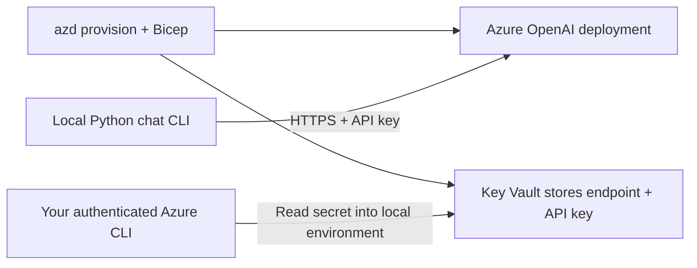

# Azure OpenAI Chat — lokalny CLI i infrastruktura AZD

**Poziom:** Średniozaawansowany · **Czas:** 35–60 minut łącznie z konfiguracją

Ten przykład tworzy **zasób Azure OpenAI oraz Key Vault**, a następnie uruchamia
interaktywny Python chat CLI **na twoim komputerze**. Nie jest hostowana żadna aplikacja webowa
ani Container App. Domyślny model to `gpt-4.1`, wersja `2025-04-14`, z
pojemnością wdrożenia `GlobalStandard` 20. Sprawdź aktualną dostępność i limit w
wybranym regionie przed utworzeniem zasobu; daty cyklu życia modelu mogą się zmieniać.

## Cele nauki

- Tworzenie infrastruktury modelu za pomocą Bicep i azd.
- Pobieranie klucza API z Key Vault bez umieszczania go w wynikach wdrożenia.
- Wysyłanie zapytań Chat Completions i utrzymywanie historii rozmowy.
- Interpretacja liczby tokenów i ograniczeń szacunków kosztów.



W tym przykładzie nie ma integracji środowiska wykonawczego z zarządzaną tożsamością, failover między regionami,
własnego ogranicznika przepływności, trybu strumieniowego ani hostowanego obliczania. SDK OpenAI
wykonuje do dwóch prób ponowienia dla błędów możliwych do ponowienia; CLI zgłasza pozostałe błędy.

## Wymagania wstępne

- Aktualna stabilna wersja [azd](https://learn.microsoft.com/azure/developer/azure-developer-cli/install-azd)
  (opublikowana wersja na czas przeglądu: 1.37.2).
- [Azure CLI](https://learn.microsoft.com/cli/azure/install-azure-cli).
- Python **3.10+** (zalecany 3.11) oraz środowisko wirtualne.
- Subskrypcja Azure z uprawnieniami do tworzenia zasobów Cognitive Services i Key Vault,
  wdrażania modeli oraz odczytu sekretów skarbca.
- Regionalna dostępność i limit `GlobalStandard` dla `gpt-4.1`. Wymagania dostępu
  zależą od subskrypcji i funkcji; brak gwarantowanego czasu zatwierdzenia.

```bash
azd version
az version
python --version
azd auth login
az login
```

To są oddzielne sesje uwierzytelniania. Wybierz tę samą subskrypcję w obu
narzędziach przed uruchomieniem poniższych poleceń.

## Szybki start (Bash)

Uruchom z katalogu głównego repozytorium:

```bash
cd examples/azure-openai-chat
azd env new myopenai
azd provision
```

Wybierz wspierany region. Tworzenie zasobów utworzy grupę zasobów, konto OpenAI,
wdrożenie modelu, Key Vault oraz sekrety `openai-endpoint`/`openai-api-key`.
Nie ma **żadnych usług do wdrożenia** w `azure.yaml`.

Załaduj wyniki nienależące do sekretów i pobierz sekret do aktualnej powłoki:

```bash
export AZURE_OPENAI_ENDPOINT="$(azd env get-value AZURE_OPENAI_ENDPOINT)"
export AZURE_OPENAI_MODEL="$(azd env get-value AZURE_OPENAI_MODEL)"
KV_NAME="$(azd env get-value AZURE_KEY_VAULT_NAME)"
export AZURE_OPENAI_API_KEY="$(az keyvault secret show \
  --vault-name "$KV_NAME" --name openai-api-key --query value --output tsv)"

python -m venv .venv
source .venv/bin/activate
python -m pip install -r src/requirements.txt
python src/chat.py
```

W PowerShell aktywuj za pomocą `.\.venv\Scripts\Activate.ps1` i przypisz zmienne środowiskowe
za pomocą `$env:AZURE_OPENAI_ENDPOINT = azd env get-value AZURE_OPENAI_ENDPOINT`
(i podobnie dla modelu). Pobierz klucz API za pomocą
`$env:AZURE_OPENAI_API_KEY = az keyvault secret show --vault-name $KV_NAME --name openai-api-key --query value -o tsv`.
Najpierw ustaw `$KV_NAME = azd env get-value AZURE_KEY_VAULT_NAME`.

Nie drukuj, nie zatwierdzaj ani nie wklejaj klucza API w zgłoszeniach. CLI odczytuje proces
zmienne środowiskowe; nie pobiera **nie** sekretów Key Vault ani nie ładuje plików `.env`.
`config.py` weryfikuje punkt końcowy, limit tokenów i temperaturę podczas uruchamiania.

Oczekiwany wynik (zawartość i użycie różnią się):

```text
Azure OpenAI Chat Application
Model: gpt-4.1
...
You: Say hello in one sentence.
Assistant: Hello! How can I help you today?
[Tokens: ... | Cost: $...]
```

Polecenia: `stats` pokazuje sumy, `clear` czyści historię rozmowy, a
`quit`/`exit` kończy sesję. Nie ma poleceń `--stream`, `--show-tokens`, `tokens`,
ani `cost`.

## Zweryfikuj wdrożenie

Po załadowaniu powyższych zmiennych powłoki:

```bash
curl --fail-with-body \
  "${AZURE_OPENAI_ENDPOINT%/}/openai/deployments/${AZURE_OPENAI_MODEL}/chat/completions?api-version=2024-10-21" \
  -H "Content-Type: application/json" \
  -H "api-key: $AZURE_OPENAI_API_KEY" \
  -d '{"messages":[{"role":"user","content":"Say hello!"}],"max_tokens":50}'

az keyvault secret list --vault-name "$KV_NAME" --query "[].name" -o table
```

Sukces: API zwraca HTTP 200 z `choices[0].message.content` i `usage`;
skarbiec wymienia `openai-api-key` i `openai-endpoint`. Samo udane wdrożenie ARM
nie weryfikuje inferencji.

## Pliki i konfiguracja

```text
azure.yaml                         # Infrastructure-only AZD project
infra/main.bicep                   # Subscription deployment
infra/main.parameters.json         # Environment, location, principal ID
infra/resources/openai.bicep       # Account + model
infra/resources/keyvault.bicep     # Vault + deploying user's secret access policy
infra/resources/secrets.bicep      # Writes secrets, no key output
src/chat.py                        # Interactive CLI
src/config.py                      # Environment validation
src/requirements.txt               # Python packages
```

Aby zmienić dostarczony model/wersję/pojemność, edytuj domyślne wartości w
`infra/main.bicep` i uruchom `azd provision`. Ustawienie `AZURE_OPENAI_MODEL` w twojej
powłoce wybiera tylko **istniejącą nazwę wdrożenia**; nie wdraża innego modelu.

| Zmienna czasu wykonywania | Domyślnie / źródło |
|---|---|
| `AZURE_OPENAI_ENDPOINT` | Wymagane; wyjście azd bez sekretów |
| `AZURE_OPENAI_API_KEY` | Wymagane; pobierz z Key Vault |
| `AZURE_OPENAI_MODEL` | `gpt-4.1`; nazwa wdrożenia Azure |
| `AZURE_OPENAI_MAX_TOKENS` | 800 (zakres walidacji 1–4096) |
| `AZURE_OPENAI_TEMPERATURE` | 0.7 (zakres 0–2) |
| `AZURE_OPENAI_INPUT_PRICE_PER_1K` | 0.002 USD; przykładowa stawka za niebuforowane wejście |
| `AZURE_OPENAI_OUTPUT_PRICE_PER_1K` | 0.008 USD; przykładowa stawka za wyjście |

## Koszty i ograniczenia bezpieczeństwa

Wyświetlanie kosztów to **szacunek**, nie rozliczenie Azure. Mnoży użycie tokenów API
przez skonfigurowane stawki i nie uwzględnia zniżek za buforowane wejścia,
różnic regionalnych/SKU, podatków, zmian cen ani nieudanych/powtarzanych wywołań.
Nadpisz **obie stawki**, gdy używasz innego modelu lub SKU i sprawdź aktualne
[cenniki Azure OpenAI](https://azure.microsoft.com/pricing/details/cognitive-services/openai-service/).

Dla zobrazowania, 100 żądań używających po 500 niebuforowanych tokenów wejściowych i 200 wyjściowych
po domyślnych stawkach kosztuje `100 × (500/1000 × .002 + 200/1000 × .008) = $0.26`.
Operacje/magazynowanie Key Vault generują oddzielne opłaty. Nie ma stałej opłaty 50 USD/miesiąc
za to lokalne CLI i nie ma hostowanego obliczania w szablonie.

Skarbiec używa polityki dostępu dla podmiotu wdrażającego; nie jest to przykład aplikacji RBAC ani
z zarządzaną tożsamością. Publiczne punkty końcowe i uwierzytelnianie kluczem API
służą do nauki. Ogranicz uprawnienia i dodaj odpowiednie kontrolki tożsamości/sieci
przed dostosowaniem do produkcji.

## Ćwiczenia praktyczne

### 1. Zweryfikuj kontekst i zresetuj go

**Start:** uruchomione CLI. **Cel:** obserwuj historię.
Powiedz „Zapamiętaj słowo cedr”, potem zapytaj „Jakie słowo kazałem ci zapamiętać?”
Uruchom `stats`; dwa udane zwroty powinny liczyć się jako dwie wymienione wiadomości.
Uruchom `clear` i `stats`; wymienione wiadomości powinny wynosić zero (sumy tokenów pozostają).
Dokładne sformułowania modelu nie są deterministyczne.

### 2. Zmień limit odpowiedzi

**Start:** wyjdź z CLI, zachowując tę samą powłokę.
Uruchom `export AZURE_OPENAI_MAX_TOKENS=100`, zrestartuj `python src/chat.py` i poproś o
krótkie wyjaśnienie azd. Sprawdź, czy baner pokazuje 100.
Przywróć za pomocą `unset AZURE_OPENAI_MAX_TOKENS`. Mniejszy limit odpowiedzi nie
zmniejsza już wysłanych tokenów historii.

### Typowe problemy

- **Brakujące zmienne środowiskowe:** provisioning nie eksportuje wartości powłoki;
  powtórz kroki eksportu. Nowy terminal potrzebuje ich ponownie.
- **403 czytanie Key Vault:** sprawdź subskrypcję/logowanie Azure CLI oraz podmiot
  w polityce dostępu skarbca. Zmiany polityki mogą się propagować z opóźnieniem.
- **404 inferencja:** sprawdź nazwę wdrożenia, punkt końcowy i status wdrożenia.
- **429 inferencja:** poczekaj na zresetowanie limitów; sprawdź kwotę modelu regionalnego.
  CLI usuwa nieudane zwroty z historii, więc ponawianie nie duplikuje ich.
- **Długość kontekstu:** przykładowy kod nie przycina długich rozmów; użyj `clear`.
- **Model niedostępny/wycofany:** sprawdź aktualną dostępność modelu i zaktualizuj
  model/wersję/SKU razem; wersja API i wersja modelu to różne ustawienia.

## Sprzątanie i kolejne kroki

```bash
azd down
unset AZURE_OPENAI_API_KEY
```

Okres przechowywania miękkiego usunięcia Key Vault to siedem dni; usunięcie wymaga oddzielnych uprawnień.
Nie ma zestawu testów; nie uruchamiaj nieistniejącego polecenia `pytest tests/`.
Dodaj udawane testy API przed rozszerzeniem kodu.

[Przykłady kontenerów](../../../../examples/container-app) · [Plan architektury handlu detalicznego](../retail-scenario.md) ·
[Strona kursu](../../README.md) · [Zgłoś problem](https://github.com/microsoft/AZD-for-beginners/issues)

---

<!-- CO-OP TRANSLATOR DISCLAIMER START -->
**Zastrzeżenie**:
Niniejszy dokument został przetłumaczony za pomocą usługi tłumaczenia AI [Co-op Translator](https://github.com/Azure/co-op-translator). Choć dążymy do dokładności, prosimy pamiętać, że automatyczne tłumaczenia mogą zawierać błędy lub niedokładności. Oryginalny dokument w jego języku źródłowym należy uznawać za autorytatywne źródło. W przypadku informacji krytycznych zalecane jest skorzystanie z profesjonalnego tłumaczenia wykonanego przez człowieka. Nie ponosimy odpowiedzialności za jakiekolwiek nieporozumienia lub błędne interpretacje wynikające z użycia tego tłumaczenia.
<!-- CO-OP TRANSLATOR DISCLAIMER END -->