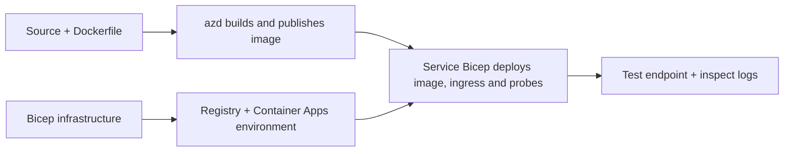

# Przykłady wdrażania aplikacji kontenerowych z użyciem AZD

Ten katalog zawiera dwa przykłady edukacyjne z kodem źródłowym, plikami Dockerfile,
infrastrukturą Bicep oraz `azure.yaml`. Żaden z nich nie jest w pełni przygotowany do produkcji.

## Wybierz przykład

| Przykład | Co jest zaimplementowane | Wymagania wstępne |
|---|---|---|
| [Proste API Flask](../../../../examples/container-app/simple-flask-api) | Pojedyncze API CRUD w Pythonie, elementy w pamięci, sondy zdrowia, skalowanie HTTP | Podstawowa znajomość CLI i HTTP |
| [Mikrousługi dwusystemowe](../../../../examples/container-app/microservices) | Brama Node.js, wewnętrzna usługa produktowa Python tylko do odczytu, telemetria i skalowanie | Najpierw ukończ przykład z pojedynczą usługą |

Zaplanuj 30–60 minut, łącznie z konfiguracją i weryfikacją. Czas provisioningu w Azure może się różnić.

## Wymagania wstępne

- [Azure Developer CLI](https://learn.microsoft.com/azure/developer/azure-developer-cli/install-azd)
- [Azure CLI](https://learn.microsoft.com/cli/azure/install-azure-cli) do poleceń weryfikacyjnych
- Docker z działającym demonem do budowania tych obrazów kontenerowych
- Subskrypcja Azure z uprawnieniami do tworzenia zasobów i wystarczającym limitem regionalnym
- Bash dla przykładów w powłoce lub odpowiednie polecenia PowerShell

```bash
azd version
az version
docker info
azd auth login
az login
```

Te dwa narzędzia mają oddzielne sesje logowania. Użyj aktualnej stabilnej wersji azd; aktualna
opublikowana wersja w chwili przeglądu to 1.37.2. Starsze minimalne wersje nie gwarantują
kompatybilności.

## Szybki start

Z katalogu głównego repozytorium:

```bash
cd examples/container-app/simple-flask-api
azd env new flask-demo
azd up
API_URL=$(azd env get-value API_ENDPOINT)
curl --fail-with-body "${API_URL}/health"
```

Oczekiwane: HTTP 200 z `"status": "healthy"`. Postępuj zgodnie z przykładowym README, aby utworzyć,
odczytać, zaktualizować i usunąć element oraz sprawdzić logi.



Początkowe przygotowanie używa publicznego obrazu hello-world na porcie 80. Specyficzne dla usługi
pliki parametrów Bicep pozwalają `azd deploy` zastąpić go zbudowanym obrazem aplikacji
oraz prawidłowym portem aplikacji/probami (8000 dla Flask/produktu, 8080 dla bramy).
Zachowaj te pliki ze swoimi `azure.yaml` `module` ustawieniami.

## Konfiguracja: co zmienia co

`azure.yaml` wybiera katalogi źródłowe, języki, hosty i moduły wdrożeniowe.
CPU/pamięć kontenera, ingress, próby, liczba replik i zasady skalowania są definiowane
w **Bicep**, a nie w dowolnych właściwościach usługi `resources`, `scale` lub `regions`.

`azd env set SOME_VALUE ...` przechowuje wartość lokalnie. Zmienia wdrożony
zasób tylko wtedy, gdy parametr, mapowanie środowiska lub hook wyraźnie wykorzystują tę
wartość. Te przykłady nie wykorzystują `MAX_REPLICAS`, `SCALE_TO_ZERO_TIMEOUT`,
`CONTAINER_APP_REPLICA_TYPE` ani niestandardowych ustawień kanarek z wartości środowisk azd.
Edytuj odpowiedni Bicep i uruchom `azd up`, aby ponownie przygotować i wdrożyć.

Nie umieszczaj źródła aplikacji pod `infra/`. `project` musi wskazywać na katalog źródłowy
zawierający Dockerfile i manifest zależności.

## Monitorowanie i koszty

- `azd monitor --logs` otwiera widok portalu; nie jest to strumień logów terminala.
  Użyj `az containerapp logs show --follow` z rzeczywistą nazwą zasobu.
- Prosty API zapisuje stdout logi zbierane przez Container Apps/Log Analytics.
  Przydzielony zasób Application Insights nie jest automatycznie instrumentowany.
- Brama mikrousług używa zestawu SDK Node.js Application Insights; serwis Python eksportuje ślady logów aplikacji.
  Pełne śledzenie żądań/zależności w Pythonie nie jest skonfigurowane.

- Skalowanie do zera może zmniejszyć koszty obliczeniowe, ale rejestr i pobieranie/przechowywanie logów
  nadal mogą generować koszty. Domyślne ustawienia mikrousług utrzymują działanie replik.
  Oszacuj swój region i użycie w
  [Azure pricing calculator](https://azure.microsoft.com/pricing/calculator/).

## Zaawansowane wzorce — implementacje nieujęte

To są wskazówki projektowe, a nie dodatkowe lokalne projekty ani fragmenty do skopiowania i uruchomienia:

- **Trwałe dane i uwierzytelnianie:** zastąp magazyny w pamięci i dodaj
  uwierzytelnianie/autoryzację Microsoft Entra ID przed produkcją.
- **Blue-green/canary:** użyj trybu wielowersyjnego Container Apps, etykiet rewizji,
  wag ruchu, weryfikacji stanu i procedur wycofania.
  W tych przykładach nie ma konfiguracji `deploymentStrategy: canary` azd.
  Zobacz [zarządzanie rewizjami](https://learn.microsoft.com/azure/container-apps/revisions).
- **Wieloregionalność:** utwórz oddzielne środowiska i aplikacje w Bicep oraz zaprojektuj
  globalne trasowanie i spójność danych. Lista usług `regions` nie jest mechanizmem wdrażania azd.

- **Pracownicy kolejek:** dodaj źródło pracownika, zależności, zasoby kolejki, zarządzaną
  tożsamość z rolami warstwy danych oraz uwierzytelnioną regułą skalowania. Nie kopiuj
  pustej ścieżki `src/worker` i nie oczekuj działającego projektu.
- **Dapr:** przygotuj komponenty, skonfiguruj sidecar, zainstaluj odpowiednie SDK,
  oraz zaimplementuj obsługę błędów w stanie/pub-sub.
- **Sekrety:** korzystaj z zarządzanej tożsamości i przydziałów ról, gdy to możliwe. Samo
  utworzenie Key Vault nie przyznaje aplikacjom dostępu ani nie ładuje sekretów.

## Czyszczenie

Z katalogu przykładowego:

```bash
azd down
```

Sprawdź monity usunięcia i potwierdź, że dedykowana grupa zasobów została usunięta.
Nie używaj tych przykładów jako podstawy produkcyjnej bez dodatkowego projektu i testów.

[Indeks przykładów](../README.md) · [Strona kursu](../../README.md) ·
[Dokumentacja Container Apps](https://learn.microsoft.com/azure/container-apps/) ·
[Zgłoś problem](https://github.com/microsoft/AZD-for-beginners/issues)

---

<!-- CO-OP TRANSLATOR DISCLAIMER START -->
**Zastrzeżenie**:
Niniejszy dokument został przetłumaczony za pomocą usługi tłumaczenia AI [Co-op Translator](https://github.com/Azure/co-op-translator). Choć dążymy do dokładności, prosimy pamiętać, że automatyczne tłumaczenia mogą zawierać błędy lub niedokładności. Oryginalny dokument w jego języku źródłowym należy uznawać za autorytatywne źródło. W przypadku informacji krytycznych zalecane jest skorzystanie z profesjonalnego tłumaczenia wykonanego przez człowieka. Nie ponosimy odpowiedzialności za jakiekolwiek nieporozumienia lub błędne interpretacje wynikające z użycia tego tłumaczenia.
<!-- CO-OP TRANSLATOR DISCLAIMER END -->