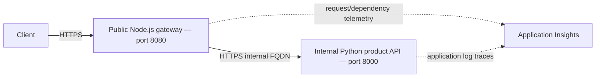

# Mikrousługi z dwoma usługami — Azure Container Apps

**Poziom:** Średniozaawansowany · **Czas:** 45–60 minut włącznie z konfiguracją

Ten przykład nauki implementuje **Node.js API Gateway** oraz **tylko do odczytu usługę Python Product Service**.
Źródła, Dockerfiles, Bicep i konfiguracja azd są dołączone.
Nie jest to system przygotowany do produkcji.

## Czego się nauczysz

- Niezależnie wdrażać dwie usługi.
- Używać wewnętrznego backendowego FQDN przez HTTPS.
- Weryfikować odpowiedzi: sukces, nie znaleziono i niedostępna usługa.
- Rozumieć telemetrykę i niezależne granice skalowania.



Katalog produktów zawiera w pamięci pięć stałych produktów. Nie ma **obsługi POST,
PUT ani DELETE**, bazy danych, Service Bus, serwisu zamówień/użytkowników/powiadomień,
kodu C# ani Go. To są pomysły na przyszłe rozwinięcia, a nie uwzględnione funkcje.
Brama nie uwierzytelnia użytkowników; wewnętrzny dostęp nie zastępuje
autoryzacji aplikacji.

## Wymagania wstępne

Najpierw ukończ [pojedyncze API Flask](../../../../../examples/container-app/simple-flask-api).
Zainstaluj aktualną stabilną wersję azd (w chwili przeglądu wydanie 1.37.2), Azure CLI
oraz Dockera z uruchomionym daemonem. Potrzebujesz subskrypcji Azure, uprawnień do tworzenia zasobów
oraz limitu na regionalne aplikacje kontenerowe.

```bash
azd version
az version
docker info
azd auth login
az login
```

Używaj tej samej subskrypcji w obu narzędziach CLI. Poniższe polecenia używają Basza.

## Wdrażanie i weryfikacja

Z katalogu głównego repozytorium:

```bash
cd examples/container-app/microservices
azd env new microservices-demo
azd up
GATEWAY_URL=$(azd env get-value API_GATEWAY_URL)
RG_NAME=$(azd env get-value AZURE_RESOURCE_GROUP)
GATEWAY_NAME=$(azd env get-value API_GATEWAY_NAME)
PRODUCT_NAME=$(azd env get-value PRODUCT_SERVICE_NAME)

curl --fail-with-body "${GATEWAY_URL}/health"
curl --fail-with-body "${GATEWAY_URL}/api/products"
curl --fail-with-body "${GATEWAY_URL}/api/products/1"
curl -i "${GATEWAY_URL}/api/products/999"
```

**Sukces:** health 200; lista 200 z **pięcioma** produktami; produkt 1 to Laptop
w cenie 999,99 i zapasie 50; nieznany produkt zwraca 404.
Opisy są dołączone w odpowiedziach; znaczniki czasu mogą się różnić.

Wstępna konfiguracja używa publicznych obrazów hello-world na porcie 80, więc nie próbuje
pobierać nieistniejących obrazów z pustego rejestru. Specyficzne dla usługi moduły Bicep
i pliki parametrów zastępują je zbudowanymi obrazami oraz portami/aplikacjami podczas
`azd deploy`. Główne parametry zachowują nazwy opublikowanych obrazów do późniejszej konfiguracji.

## Usługi i sieć

| Usługa | Udostępnione punkty końcowe | Domyślne zasoby |
|---|---|---|
| Gateway | GET `/`, `/health`, `/api/products`, `/api/products/:id` | 1 vCPU, 2 GiB, 2–20 replik |
| Product | GET `/`, `/health`, `/products`, `/products/<id>` | 0.5 vCPU, 1 GiB, 1–10 replik |

Ingress produktu ma `external: false` i `allowInsecure: false`. Bicep wstrzykuje
`PRODUCT_SERVICE_URL=https://<actual-internal-fqdn>` do bramy. HTTP by
przekierowanie; HTTPS pasuje do skonfigurowanego wejścia. Krótka nazwa DNS musi pasować do
**rzeczywistej nazwy Container App**, a nie logicznego klucza usługi `product-service`.
Nie próbuj wywoływać wewnętrznego URL bezpośrednio ze swojego laptopa.

Brama ma limit czasu 5 sekund na wywołania produktów. Brakujące identyfikatory produktów
skutkują 404; awarie transportu/inne awarie backendu zwracają 503. Brama
`/health` sprawdza tylko bramę, nie dostępność backendu.

## Pliki i konfiguracja

```text
azure.yaml
infra/main.bicep
infra/main.parameters.json
infra/abbreviations.json
infra/core/container-apps-environment.bicep
infra/core/monitor.bicep
infra/app/api-gateway.bicep
infra/app/api-gateway.parameters.json
infra/app/product-service.bicep
infra/app/product-service.parameters.json
src/api-gateway/{app.js,package.json,Dockerfile}
src/product-service/{main.py,requirements.txt,Dockerfile}
```

Skalowanie, CPU/pamięć, porty i sondy ustawiane są w `infra/app/*.bicep`. Zmodyfikuj te
pliki i uruchom `azd up`, aby zastosować infrastrukturę i ponownie wdrożyć. W tym przykładzie nie ma
parametru zmiennej środowiskowej `GATEWAY_MAX_REPLICAS`.

Dla zmian tylko w kodzie:

```bash
azd deploy product-service
azd deploy api-gateway
```

Obraz Node używa Node 22; obraz Python korzysta z Python 3.11. Oba bindują się do
`0.0.0.0`. Wejścia/sondy używają odpowiednio portów 8080 (brama) i 8000 (produkt).

## Lokalny rozwój z Dockerem

Uruchom z tego katalogu przykładu. Użyj sieci zdefiniowanej przez użytkownika, **nie `localhost`
aby jeden kontener mógł się połączyć z drugim**:

```bash
docker network create azd-microservices-demo
docker build -t local-product ./src/product-service
docker build -t local-gateway ./src/api-gateway
docker run -d --name azd-product --network azd-microservices-demo local-product
docker run -d --name azd-gateway --network azd-microservices-demo \
  -p 8080:8080 -e PRODUCT_SERVICE_URL=http://azd-product:8000 local-gateway
curl --fail-with-body http://localhost:8080/api/products
```

Oczekiwane: pięć produktów. HTTP jest używany tylko dla tej lokalnej sieci Docker.

```bash
docker stop azd-product azd-gateway
docker rm azd-product azd-gateway
docker network rm azd-microservices-demo
```

## Monitorowanie

```bash
az containerapp logs show --name "$GATEWAY_NAME" --resource-group "$RG_NAME" --follow
# In a separate terminal:
az containerapp logs show --name "$PRODUCT_NAME" --resource-group "$RG_NAME" --tail 100
```

`azd monitor --logs` otwiera widok portalu; nie strumieniuje logów terminala.
SDK Node zbiera żądania/zależności bramy. Python `AzureLogHandler`
eksportuje **ślady logów**, a nie automatyczne żądania Flask, zależności SQL czy pełne
rozproszone ślady. OpenCensus to przestarzałe SDK; zaleca się użycie Azure Monitor OpenTelemetry
do rozszerzania tego przykładu.

W Application Insights Logs generuj żądania i sprawdź:

```kusto
requests
| where timestamp > ago(1h)
| where name contains "products"
| summarize RequestCount=count(), AvgDuration=avg(duration) by bin(timestamp, 5m)
```

Dla komunikatów aplikacji Python:

```kusto
traces
| where timestamp > ago(1h)
| where message contains "products"
| project timestamp, message, severityLevel
```

Uwzględnij opóźnienie ingestii i próbkowanie; nie oczekuj dokładnej liczby żądań ani
gwarantowanej latencji. Nie skonfigurowano żadnych niestandardowych alertów ani pulpitów.

## Ćwiczenia praktyczne

### Ćwiczenie 1: Modyfikacja katalogu

**Punkt startowy:** `src/product-service/main.py`.
**Cel:** zweryfikować niezależne wdrożenie usługi.
Zmień zapas Laptopa z 50 na 49 w stałej liście `products`, uruchom
`azd deploy product-service`, a następnie wykonaj żądanie `${GATEWAY_URL}/api/products/1`.

**Kryteria sukcesu / rozwiązanie:** HTTP 200 z `"stock":49`. Przywróć 50 i ponownie wdroż.
**Typowy problem:** edycja bramy zamiast usługi posiadającej katalog.
To zmienia dane źródłowe, nie trwałą bazę zapasów.

### Ćwiczenie 2: Weryfikacja konfiguracji replik

**Punkt startowy:** `infra/app/product-service.bicep`.
**Cel:** zaobserwować zmianę infrastruktury bez zgadywania autoskalowania.
Zmień `minReplicas: 1` na `minReplicas: 2`, uruchom `azd up`, następnie:

```bash
az containerapp show --name "$PRODUCT_NAME" --resource-group "$RG_NAME" \
  --query properties.template.scale -o json
```

**Kryteria sukcesu:** minimalna wartość ustawiona na 2, a maksymalna pozostaje 10.
Przywróć minimalną 1 i uruchom ponownie `azd up`.
**Typowy problem:** `azd deploy` samodzielnie nie wprowadza zmian w niepowiązanej współdzielonej
infrastrukturze. Nie ustawiaj `maxReplicas` na zero jako symulacji awarii.
To weryfikuje konfigurację, a nie test obciążeniowy ani gwarantowaną natychmiastową liczbę replik.

### Ćwiczenie 3: Test obsługi niedostępnej usługi lokalnie

**Punkt startowy:** oba lokalne kontenery Docker powyżej działają.
**Cel:** rozróżnić awarię backendu od brakującego produktu.
Zatrzymaj tylko kontener produktu:

```bash
docker stop azd-product
curl -i http://localhost:8080/api/products
docker start azd-product
curl --fail-with-body http://localhost:8080/api/products
```

**Kryteria sukcesu:** podczas zatrzymania brama zwraca 503 z
`"error":"Product service unavailable"`; po restarcie lista zwraca 200.
W razie potrzeby ponów próbę po krótkim opóźnieniu startu.
**Typowy problem:** zatrzymanie bramy testuje inny rodzaj awarii (brak odpowiedzi HTTP).

## Koszty i luki produkcyjne

Domyślne minimalne repliki utrzymują działanie obliczeń. Rejestr i monitorowanie również generują
koszty. Nie ma zweryfikowanej stałej sumy 50 USD/miesiąc: oszacuj regionalne CPU/pamięć,
godziny replik, żądania, rejestr i retencję logów w
[kalkulatorze cen Azure](https://azure.microsoft.com/pricing/calculator/).
Usuwaj zasoby edukacyjne natychmiast.

Praca produkcyjna obejmuje uwierzytelnianie/autoryzację, zarządzane tożsamości z zakresem,
trwałe dane, walidację wejść/odpowiedzi, obsługiwane instrumentacje obserwowalności,
testy obciążeniowe/awaryjne, CI/CD, alerty i procedury odzyskiwania. Dodanie usługi zamówień,
kolejki lub bazy danych jest oddzielnym zadaniem implementacyjnym, a nie zakończonym
ćwiczeniem czy już dostępną funkcją.

## Rozwiązywanie problemów i sprzątanie

- **Obraz nie znaleziony podczas pierwszego provisioningu:** bootstrap powinien używać obrazu publicznego;
  zweryfikuj domyślne parametry obrazu głównego i mapowania modułów wdrożeniowych.
- **503 przy produktach:** sprawdź logi produktów, rewizję obrazu i wstrzyknięty wewnętrzny URL HTTPS.
- **404 na nieoczekiwanej ścieżce:** API produktu jest tylko do odczytu; zweryfikuj trasę, nie nieistniejący handler CRUD.
- **Brak telemetrii:** sprawdź ciągi połączeń w czasie runtime bez ich ujawniania i
  uwzględnij opóźnienie ingestii. Tabele żądań Pythona nie są wypełniane przez jego handler logów.

Z tego katalogu przykładu:

```bash
azd down
```

Sprawdź potwierdzenia usunięcia i zweryfikuj usunięcie dedykowanej grupy zasobów.

[Poprzedni: Flask API](../../../../../examples/container-app/simple-flask-api) · [Następny: Aplikacja bazy danych](../../../../../examples/database-app) ·
[Rozwój AI](../../../docs/chapter-02-ai-development/README.md) ·
[Strona kursu](../../../README.md) · [Zgłoś problem](https://github.com/microsoft/AZD-for-beginners/issues)

---

<!-- CO-OP TRANSLATOR DISCLAIMER START -->
**Zastrzeżenie**:
Niniejszy dokument został przetłumaczony za pomocą usługi tłumaczenia AI [Co-op Translator](https://github.com/Azure/co-op-translator). Choć dążymy do dokładności, prosimy pamiętać, że automatyczne tłumaczenia mogą zawierać błędy lub niedokładności. Oryginalny dokument w jego języku źródłowym należy uznawać za autorytatywne źródło. W przypadku informacji krytycznych zalecane jest skorzystanie z profesjonalnego tłumaczenia wykonanego przez człowieka. Nie ponosimy odpowiedzialności za jakiekolwiek nieporozumienia lub błędne interpretacje wynikające z użycia tego tłumaczenia.
<!-- CO-OP TRANSLATOR DISCLAIMER END -->